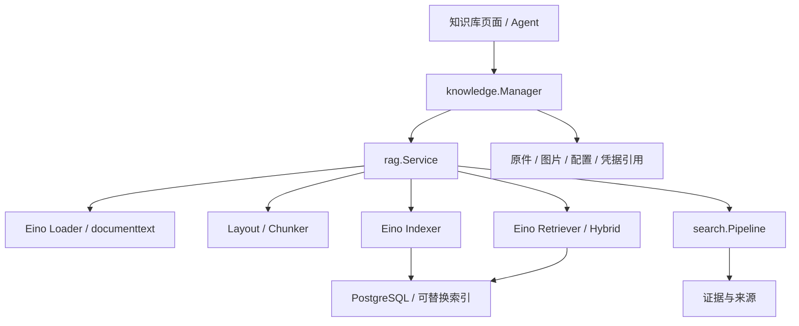

# Humbert Agent RAG 源码详解

> 源码核对日期：2026-10-22。范围为当前工作区的 `internal/rag`、共享 `internal/documenttext`、桌面 `internal/knowledge`、迁移命令和上传/查询示例。本文描述现有代码；逐文件索引按当前 Go 语法树提取，包含尚未提交的重构。
>
> 桌面与 Agent 已接入知识库。`rag.Service` 返回证据，`knowledge` 拥有桌面业务与授权，最终回答由既有 Eino Agent 生成。整体工程见 [项目源码详解](项目源码详解.md)，使用入口见 [README](../README.md#知识库-rag)。

## 阅读导航

1. [模块范围与业务边界](#scope)
2. [目录与组件契约](#architecture)
3. [数据模型、身份与来源坐标](#models)
4. [装配、冻结连接与关闭](#assembly)
5. [导入主流程与阶段](#ingest)
6. [真实文件解析、缓存与图片](#loader)
7. [结构布局与策略选择](#strategy)
8. [递归切分、结构保护与重叠](#recursive)
9. [标题层级与上下文路径](#heading)
10. [启发式章节边界](#heuristic)
11. [Token 目标与父子分块](#parent-child)
12. [Eino Transformer 与统一检索文本](#representation)
13. [Embedding、预算与模型档案](#embedding)
14. [PostgreSQL 结构与迁移](#database)
15. [索引与原子发布](#indexing)
16. [取消、重试、删除与恢复](#lifecycle)
17. [Search 入口与 Agent 工具](#search)
18. [向量与 BM25](#retrievers)
19. [Hybrid 与 RRF](#hybrid)
20. [精排与降级](#rerank)
21. [独立 MMR 的边界](#mmr)
22. [父块扩展、预算与引用](#context)
23. [分离索引与发布补偿](#backends)
24. [配置、桌面使用与独立示例](#configuration)
25. [评测指标与边界](#evaluation)
26. [验证、异常定位与扩展](#verification)
27. [当前源码索引](#source-index)

<a id="scope"></a>
## 1. 模块范围与业务边界

当前存在三层，不能用其中一层的职责概括全部 RAG 功能：

| 层 | 实际入口 | 拥有的事实与行为 |
| --- | --- | --- |
| 文档/检索底座 | `rag.Service` | 导入、原件引用、处理状态、版本、分块、检索、图片证据、取消和关闭 |
| 桌面知识库 | `knowledge.Manager` + `KnowledgeService` | 设置与凭据引用、知识库/Agent 绑定、上传队列、原件下载、人工检索预览、工具授权 |
| 回答与引用 | Eino Agent + `knowledge_search` + Vue 来源界面 | 按需读取证据，继续工具循环和回答；来源快照进入真实 ToolResult |

`Service.Search` 本身不生成自然语言答案。桌面可以只做检索预览，也可以由 Agent 在对话中 list/search/read。核心没有独立 RAG REST/SSE 服务；已实现的桌面 UI 和 Agent 工具不是未来计划。

| 能力 | 当前行为 |
| --- | --- |
| 文档解析 | 本地文本、PDF、Office、HTML 与图片；格式取决于 Loader/解析器入口 |
| 切分 | Goldmark AST/Layout，auto/heading/heuristic/recursive，普通或父子模式 |
| 图片增强 | 可选 caption/OCR、smart_ocr、动作缓存、每图状态和独立检索块 |
| Embedding | Eino OpenAI 兼容/Ollama 组件，完整输入预算与有限重试 |
| 检索 | PostgreSQL 向量/BM25，通用 Hybrid/RRF、可选精排、父块扩展 |
| 文档生命周期 | 托管原件、版本栅栏、状态推进、取消、删除、明确重试和过期任务恢复 |
| 外部索引 | 原生 Eino 组件组合与发布/清理契约；没有自动装配所有第三方数据库 |
| MMR | 独立 Engine.Rerank 支持；统一 Search 不调用 |
| Query Rewrite/GraphRAG | 统一流程未实现；Agent 可自主改写下一次 search 的 query |

<a id="architecture"></a>
## 2. 目录与组件契约

```text
internal/knowledge/          桌面知识库、队列、连接和 Agent 授权
internal/rag/
  rag.go                    Dependencies/New、文档管理与 Shutdown
  service.go                请求/批次类型、Search
  ingestion.go              导入编排、版本、阶段、失败回写
  ingestion_document.go     原件/重试、单文档、切分策略
  ingestion_batch.go        普通/父子批次
  ingest.go                 并发、请求占用、完整输入再切分
  indexing.go               版本 ID、Eino Store、发布与补偿
  persistence.go/source.go  文档能力、原件引用与文件存储
  loader*.go                Eino Loader、解析、图片资产保存
  image_*.go                图片动作处理、状态、缓存与独立块
  config/                   参数、默认值、校验和加载
  chunker/                  共用 AST/Layout 的切分与 Transformer
  embedding/                模型协议适配、预算、重试与档案
  indexer/                  PG 文档/索引、迁移、Multi
  retriever/                向量、BM25、通用 Hybrid、父块读取
  retrieval/                结果、Metadata、检索文本与 RRF
  rerank/                   HTTP Scorer、精排与独立 MMR
  search/                   召回后的统一处理
internal/documenttext/      附件与 RAG 共用的受限解析、布局和来源
examples/5-rag/             固定参数共享包 + upload/query 两个程序
cmd/rag-migrate/            YAML 驱动的显式数据库初始化
```



Eino 定义 Loader.Load、Indexer.Store、Retriever.Retrieve 和 Transformer.Transform。项目额外定义 SourceStore、DocumentLifecycle、DocumentTracker、DocumentPublisher、PublishedChunkReader 等，因为 Eino 不负责桌面原件、导入版本与发布状态。

Service 的核心流程按接口组合；PG 和 Embedder 在装配层创建。内置 Loader 与图片模型适配同在 rag 根包，不能据此宣称整个根包完全没有具体解析器/模型依赖。

<a id="models"></a>
## 3. 数据模型、身份与来源坐标

### 3.1 数据结构各司其职

| 类型 | 用途 |
| --- | --- |
| Eino `schema.Document` | 解析、索引和召回组件边界；Content 在不同阶段含义不同 |
| `chunker.Chunk` / `ChildChunk` | 切分正文、标题路径、全文 rune 范围、父关系 |
| `rag.SourceFile` | 原件 URI、存储内相对路径、文件名/类型/大小与 SHA-256 |
| `rag.DocumentRecord` | 最新处理状态与当前发布版本；不保存整篇 Markdown |
| `rag.IngestionBatch` | 一次待发布版本、处理快照、原件、父子块和临时 Markdown |
| `retrieval.SearchResult` | 命中子块、原始分数、父块上下文、定位与 Evidence |
| `knowledge.Source` | 给模型/UI 的受限来源快照和稳定引用标识 |

`CollectionID` 是逻辑检索范围；桌面 Manager 再检查 Agent 绑定。单独调用底层 Service 的业务方必须自行提供访问控制，不能把 WithIndex 当作用户授权。

### 3.2 四类身份

- DocumentID 是稳定业务键，对应 PG documents.source_key；桌面按原件 hash+格式去重，独立示例按来源路径身份处理。
- Attempt 是最新导入/取消栅栏；Revision 是当前已发布版本，失败时可继续保持旧 Revision。
- 版本化 ChunkID 含文档、知识库摘要和 attempt，父块/子块分别编号。它是跨索引库的 ID。
- 数据库 BIGINT id 与外键仅用于 PG 内部关联，不能替代 source_key/chunk_key 或前端来源 ID。

### 3.3 文本与坐标

解析 Markdown、索引输入、命中子块、扩展父块分别保存/使用。检索输入会拼标题和路径，但 StartRune/EndRune 仍是处理文本的 Unicode rune 左闭右开范围，不是 UTF-8 字节或原始 PDF 字节。

SourceBlocks 描述解析阶段的页/幻灯片/工作表/表格/图片等来源。按分块裁剪为 locators，不能根据 Markdown 行号推造 PDF 坐标。OCR/描述追加在导入逻辑文本末尾，标为 image_ocr/image_caption；这不是原 PDF 字形范围。完整 SourceBlocks 列表不写入主表/所有分块。

SourceFile.Hash 标识原格式文件；ContentHash 标识归一化处理正文，可能包含图片识别文字；模型档案 ID 标识向量空间。三者不能混用。

<a id="assembly"></a>
## 4. 装配、冻结连接与关闭

### 4.1 桌面装配

`app.initModules` 默认创建 knowledge 模块，`services.All` 注册 KnowledgeService；前端 features 注册知识库及设置页。启动只读本地 state，不要求 PostgreSQL 在线。

`knowledge.acquire` 锁内检查启用、配置 revision、活动占用和共享供应商版本，冻结 Values/Credentials/Connections；锁外建立连接，最后重新核对 revision 并安装引擎。并发请求等待同一个连接尝试，可单独取消等待。普通连接不代替显式初始化的迁移。

`buildEngine` 在显式 Initialize 时调用 EnsureDatabase、EnsureExtensions 和 Migrate；普通操作只连接并 CheckSchema。随后组装 SourceStore、共享 Embedder、模型档案、PG Indexer、Vector/BM25/Hybrid、可选 Reranker、Loader 和 Service。桌面目录固定在 knowledge 下，页面不能任意覆盖原件/图片/缓存路径。

### 4.2 rag.New 的校验

Loader/Indexer 必须同时存在；允许只导入或只提供默认 Retriever。仅提供单路 VectorRetriever、不提供默认 Retriever，不满足只读服务初始化条件。

Documents 要求 Lifecycle；Sources 要求 Documents。Publisher 模式还要求 Lifecycle、PublishedChunks、ChunkReader、DiscardAttempt 与 RemoveIndex。所有非空默认/向量/关键词 Retriever 都会通过 PublishedChunks 包装，保护每个查询 Mode。

New 失败时资源仍由装配方释放；成功后才由指定 Close 回调接管。创建 Embedder 不等于模型实际输出已通过验证。

### 4.3 两层关闭

Manager.Stop 停止新工作，取消并等待连接、同步文档/检索操作和异步导入；Close 在锁外释放引擎。Service.Shutdown 拒绝新请求、取消在途任务，等待状态回写与索引补偿完成后释放资源。Shutdown 超时只结束本次等待，后台清理继续；Close 等待完成且可重复调用。

<a id="ingest"></a>
## 5. 导入主流程与阶段

主入口已从 service.go 拆到 [ingestion.go](../internal/rag/ingestion.go)。`Ingest` 与 `RetryDocument` 进入同一条私有 ingest 流程，后者从记录中的托管原件恢复输入。

```text
校验范围/参数 → beginIngest（占用+总时限+并发槽）
  → 校验 StoredSource 或读取重试原件
  → ReserveDocument → StartDocument
  → 必要时保存原件 → parse → chunk
  → fitInputs → 可选 images → 版本化 ID / 摘要 / 处理快照
  → index（内部可细分 embedding / ready / publish）
  → 原子发布 → completed
失败/取消/超时 → 独立清理窗口回写当前 attempt 的阶段与错误
```

版本在解析前预留；已由上传队列保存的原件先 Resolve 核验。Loader 返回多份文档时，不能用一个显式稳定 DocumentID 标识全部；无稳定 ID 的非版本化底层组合也不承诺多篇文档整体事务。

`ingestDocument` 在本地副本上恢复原始文件展示信息，检查空正文和文本限额；构造一份 Layout，按普通/父子模式生成批次，先 ValidateIngestionBatch，再按完整索引输入做硬预算检查，随后处理图片、分配版本 ID 并再次校验。

阶段失败用 IngestionError 保留原始 errors.Is 链。清理使用 WithoutCancel + 5 秒窗口，DocumentTracker 再次检查 attempt，迟到失败不能覆盖新任务。发布成功后的清理警告属于已成功结果，不能据此自动重跑全部 Embedding。

<a id="loader"></a>
## 6. 真实文件解析、缓存与图片

### 6.1 Loader 与公共解析器

`rag.Loader.Load` 只接受本地普通文件。远程 URI 需由可信调用方先下载为本地来源；Loader 不是网页抓取器，也不承担 Agent 文件授权。

共享解析位于 `internal/documenttext`。读取输入快照、格式/ZIP/Excel 矩阵预检、一次性解析 Worker 和有界输出限制资源与取消。文本直接处理，PDF 默认使用 Tabula 与本地布局处理；扫描页渲染使用内嵌 PDFium WASM。Office 图片及独立图片走相同资产验证。可选 PaddleOCR-VL 结构化服务处理跨页表格等任务；仅显式配置后发送 PDF，失败明确报错。

附件 Extract 和 RAG ExtractFile 使用同一套实现，入口限额不同：聊天附件按需提取默认 12 MiB 输入、512 KiB 输出、20 秒；RAG ParserOptions 默认 32 MiB 输入/输出、256 MiB 展开、8192 个 ZIP 条目、1 分钟，另受 ingest 正文与总时限限制。

解析缓存根据内容及参数快照命名，损坏会重算，容量默认 256 MiB。完整 Markdown 可以存在解析缓存中，但不进入文档主表。缓存命中不取消调用方的原件/权限校验。

### 6.2 图片保存与动作处理

Loader 先将图片按内容摘要保存，改写 Markdown/HTML 引用并更新后续 SourceBlocks 偏移。图片在文件中，数据库只存引用、定位及状态；不把 Base64 塞进分块元数据。

正文切分后 Service 调用 ImageProcessor。默认动作是 caption+ocr；smart_ocr 先获取描述及是否有文字，再决定转录；tesseract 仅支持 OCR。provider=agent 表示冻结应用选中的图片模型，不运行一个有工具权限的 Agent。

每篇文档默认最多并行两张图片，动作分别记录成功、失败、无文字和 CacheHit。缓存身份含图片内容、动作、提示词、模型/地址/版本和相关解析配置；只复用成功动作。修改模型权重或本地 OCR 语言包后应更新 Revision。

成功文字生成独立 image_caption/image_ocr 块，与正文共享子块序号但保留图片来源。普通混合文档可带部分失败 warning 发布成功证据；纯图片没有可检索文字时失败，图片和处理状态仍保留供重试。不能把“关闭识别、仅保存图片”显示为 OCR 成功。

<a id="strategy"></a>
## 7. 结构布局与策略选择

`chunker.NewLayout` 为归一化 Markdown 创建一份 Goldmark AST 和全文 rune 数组。标题、块边界、代码围栏、表格行、链接和公式等结构在同一 Layout 中索引；普通切分、父子切分及 fitInputs 复用它，不对每个子段重新解析 Markdown。

| strategy | 执行链 |
| --- | --- |
| auto | 根据画像选择 heading / heuristic，最后 legacy |
| heading | heading → legacy |
| heuristic | heuristic → legacy |
| recursive / legacy / 低层空值 | legacy 结构递归切分 |

auto 在 Markdown 标题至少 3 个且密度大于 0.005 时尝试标题策略；章节标记至少 5 个、存在分页符或识别到语言章节时尝试 heuristic。每种结构策略经过 ValidateChunks；质量或数量不合适会记录 TierRejection 并回退。最终诊断包含 Profile、TierChain、SelectedTier 和 Rejected，不能只凭请求 strategy 判断最终算法。

基础预设 Default 使用 auto；直接构造零值 Splitter 的 Effective 默认 recursive。两者不是同一个初始化入口。

<a id="recursive"></a>
## 8. 递归切分、结构保护与重叠

`Layout.splitRange` 先考虑章节/AST 块边界，再按配置的字面分隔符选择结束位置。ChunkSize 是包括标题路径和补充结构开销的软目标，不保证每块正文恰好这么长。

代码块保护、表格表头、行级原子结构、链接和公式在 Layout 中处理。大表格可按完整行切分并补表头；代码片段补围栏。无法分割的原子结构可以超过软目标，最终由真实输入预算决定能否送模型；不能靠截断表头、链接或原文伪造合法坐标。

重叠是受结构边界调整的尾部范围，不能简单理解为永远复制最后 N 字。普通重叠最多为块大小的一半；开始位置若落在保留结构/原子结构内会移动到合法边界。分块生成中检查取消和全局 MaxChunks，避免先构造无限结果再检查。

<a id="heading"></a>
## 9. 标题层级与上下文路径

Layout 依据 Markdown 标题组织层级和 section；标题路径作为 ContextHeader。一个块跨越不同章节时取共同祖先，不能把后一章节错标为前一章节。标题策略优先 section 边界，过大 section 继续按结构窗口切分。

正文范围仍指向同一全文 rune 数组；补充的标题路径不会变成原文新字符。调试标题归属时联合查看 Content、ContextHeader、Start/End 和 Diagnostics，不能只看渲染后的 Markdown。

<a id="heuristic"></a>
## 10. 启发式章节边界

`profiler.go` 与 `patterns.go` 识别中/英/德章节、分页等信号，Layout 产生可选的 heuristic 边界，仍交给 splitRange 执行切分和结构保护。Languages 影响规则与近似 Token 估算；它不是翻译或语言模型识别功能。

heuristic 失败时回退 legacy，保留拒绝原因。解析器负责将 PDF/Office 转为正确文本结构，Chunker 不负责凭关键词恢复原文件丢失的表格/版面。

<a id="parent-child"></a>
## 11. Token 目标与父子分块

默认父子窗口为 4096/384 个 Unicode 字符。ForParentChild 由基础 Splitter 派生父/子配置；父块不套用 TokenLimit，正的基础重叠让子块按 child_size/5 推导，0 关闭，再由统一大小规则约束。

Layout 先切父范围，再以全文坐标在父范围切子块；所有父范围共用同一个子块数量预算。若唯一子块与父块完全相同，不额外保存重复父块。Parents 不进入向量/BM25，Children 才是可检索证据。

TokenLimit 使用语言比例近似，是切分软目标。`fitInputs` 进一步检查标题+路径+正文的完整输入；需要时调用 Layout.Fit 再切合法子范围。标题或不可分结构本身超过硬预算会报错，不静默缩短证据。

<a id="representation"></a>
## 12. Eino Transformer 与统一检索文本

`chunker.Transformer` 实现 Eino document.Transformer，给原生组件用户提供普通分块适配；完整 Service 额外负责版本、父子关系、图片和文档状态，两个入口不能互相等同。

`retrieval.BuildInput` / BuildSearchText 将标题、ContextHeader 和正文用空行组合，去除完全相同的部分。文档向量、BM25 search_content 和精排 passage 使用一致的文本构造规则。

IndexDocuments 只为 Children 生成 Eino 文档，将原始正文放入 rag_raw_content，并保留 collection、document、revision、parent、index、rune 范围和来源元数据。WithIngestionBatch 通过 Eino 实现专属 Option 传递整份业务批次，外部库不需要序列化该 Option，但必须保留实际索引 ID 和 Metadata。

<a id="embedding"></a>
## 13. Embedding、预算与模型档案

### 13.1 协议适配

`embedding.New` 选择 eino-ext OpenAI 兼容 `/embeddings` 或 Ollama `/api/embed`。项目传输层补齐原生 Ollama dimensions、限制响应体，并校验/恢复 OpenAI 按 index 的返回顺序；不在 Go 中任意截断向量冒充服务支持的维度。

临时网络错误、408/429/指定 5xx 做有限退避，默认总尝试 3 次；鉴权、参数、格式错误不当作可重试整篇任务。单次请求受模型 timeout 和外层 context 共同限制。

### 13.2 完整输入预算

Budget 默认单条 8192、单批 65536，批条数默认 64，同时检查。未注入 tokenizer 时 CountTokens 实际按 UTF-8 字节数保守估算，不是模型官方 token 统计。Search 的 ContextTokens 默认也使用这种保守计数。

PG 写入检查输出数量、实际维度、有限数值、半精度范围与非零向量。Dimensions 是建表、请求、入库、查询和模型档案的唯一来源；通用 Service 不限定某个固定维度。

### 13.3 collection profile

Profile 包含 provider、endpoint、model、手工 model_revision、dimensions、输入规则版本和 SearchBuilder，按稳定 JSON 计算 ID，不含密钥及请求限额。首次绑定后，同集合不能混用不同模型档案，即使维度相同也会拒绝。查询前的 BeforeSearch 检查与索引发布使用同一档案。

<a id="database"></a>
## 14. PostgreSQL 结构与迁移

### 14.1 当前后端要求

实际版本检查位于 `indexer/postgres_health.go`：PostgreSQL 14+、pgvector 0.6.2+、pg_search 0.20.10+。支持 halfvec 时使用 halfvec HNSW，最多 4000 维；没有 halfvec 的 vector HNSW 最多 2000 维。CheckSchema 只检查实际列和当前 schema，不通过 ALTER 自动转换已有向量。

EnsureDatabase 通过维护库创建缺失的目标库；已有角色、PostgreSQL 服务与扩展文件需事先准备。初始化时按实际权限创建扩展，不安装操作系统软件、不创建账号。普通查询不自动迁移。

### 14.2 权威记录与索引

| 表/记录 | 职责 |
| --- | --- |
| documents | 稳定 source_key、原件引用、摘要、档案关联、已发布 revision、最近处理状态/阶段/截止时间 |
| chunks | chunk_key、正文、父关系、rune 范围、来源及图片元数据 |
| retrieval_index | 可召回子块的向量与 search_content、启用状态；不索引纯父块 |
| rag_document_heads | collection+document 的 attempt 和 deleted 栅栏 |
| rag_collection_profiles | 集合绑定的模型档案 |
| rag_schema_migrations | 完整检索库迁移版本与 checksum |
| rag_document_schema_migrations | 仅权威文档库的独立迁移记录 |

最终结构使用 BIGINT identity 主键/外键，外部引用仍使用业务键。完整 Markdown 和原始文件二进制不放 documents；原件由 SourceStore 管理，分块保存可检索正文。全文不能从带重叠/补表头的块拼接还原。

### 14.3 迁移约束

当前完整库 SchemaVersion=6，文档库 DocumentSchemaVersion=5。迁移在咨询锁和事务下执行，记录版本及 SQL checksum；历史模板冻结，结构/分词配置变化应新增迁移。含非空旧 Markdown 的库会拒绝直接丢弃正文，先导出/备份再处理。

首次初始化将输出维度写入向量列与初始迁移身份；修改配置不会重建旧库。仅文档模式不创建 retrieval_index 或安装向量/BM25 扩展，可供外部索引组合使用。

<a id="indexing"></a>
## 15. 索引与原子发布

`indexer.Indexer` 复用 DocumentStore。完整批次通过 WithIngestionBatch 进入 Store；先校验 ID/Metadata/输入档案，生成统一检索文本并完成真实 Embedding，模型请求不在长数据库事务中执行。

发布事务取得对应 attempt 行锁并核对 deadline、集合档案和处理快照。原件引用、父子块、retrieval_index 与成功状态一起提交；任一步失败回滚，新版不取代旧发布内容。

同一 attempt 的幂等比较不只看 ContentHash，还比较处理配置/输入快照。不能以相同版本提交不同分块或不同索引输入。PG 内部父引用和外部 chunk_key 同时维护，不能把随机数据库行 ID 当成可重放的分块身份。

外部索引模式才使用单独 Publisher。`indexing.go` 统一协调 Store、可选可检索等待、发布与旧索引清理，详情见 [分离索引](#backends)。

<a id="lifecycle"></a>
## 16. 取消、重试、删除与恢复

| 操作 | 实际保证 |
| --- | --- |
| ReserveDocument | 解析前取得新 attempt，旧执行不能继续发布 |
| Start/Advance/TrackImages | 只更新对应 processing attempt，不覆盖已发布正文与后续任务 |
| CancelDocument | 停止本进程任务，并使数据库未发布版本失效；保留旧发布 revision |
| RetryDocument | 使用托管原件与新 attempt，要求可重试状态；不是块级断点续传 |
| Reindex（桌面） | 用户明确要求用当前参数重新处理已保存原件 |
| DeleteDocument | 停止任务并删除权威文档；分离索引按已发布 ID 幂等清理 |
| RecoverDocuments | 按 processing_deadline 收尾过期任务，不调用解析或模型、不抢占仍有效的跨进程任务 |

DocumentRecord.ParseStatus 描述最近处理，Revision 描述已发布内容：新版失败后旧版仍可检索，不能只因 failed 就认为数据库完全没有正文。部分图片失败但正文已发布时，CanRetryDocument 也可允许明确重试。

重试优先核验 pending_source；损坏/缺失的新原件不能悄悄回退旧原件。取消和删除在服务内部保留短暂文档占位，防止迟到取消误伤刚开始的新任务。

桌面队列在 knowledge/state.json 保存最近摘要，重启把 queued/processing 标记 interrupted，不自动重放模型。数据库才是正式文档状态与已发布内容来源；本地 Job 摘要不能替代它。

<a id="search"></a>
## 17. Search 入口与 Agent 工具

### 17.1 底层查询

`Service.Search` 校验 context、CollectionID、非空 Query 和 Limit，选择默认/hybrid、semantic 或 keyword 组件，执行 BeforeSearch 档案检查，创建同一套 EinoPipeline。RecallTopK 与最终 Limit 分开，不能把最终 5 条当作每路只召回 5 条。

原生文档由 retrieval.FromDocuments 转成 SearchResult，保留 schema score、原始通道分数和业务 Metadata。PublishedChunkReader 用当前集合/版本恢复权威正文，拒绝旧版、删除或未发布命中。

### 17.2 桌面与 Agent

`knowledge_search` 作为静态模块贡献进入同一份 Runtime 能力集合，使用 RiskRead 及宿主 Guard。每轮冻结配置 revision 与已绑定集合；每次调用及返回前复核，撤销或改绑后旧闭包失效。

- list 返回本 Agent 已授权的知识库。
- search 接受 collection_id、query、mode；只有一个授权库时可省略集合 ID。
- read 只接受已返回的完整 SourceID，不接受任意磁盘路径。

每轮工具总调用最多 6 次，query 为 1–2000 字符；Manager 最多并发两次查询，最终来源最多取配置与 5 的较小值。ToolResult 先缩短正文再减少条数，保持合法 JSON 与来源 ID；完整证据按版本回查。页面人工 Search 是用户管理入口，不伪造回答或未标注的 P/R 指标。

默认日志记录关联 ID、查询摘要 hash、参数和耗时；只有显式开启 log_queries 才记录原始 query。诊断去掉重复正文并脱敏限长。读取失败和取消交给宿主作为可恢复工具错误或运行取消处理。

<a id="retrievers"></a>
## 18. 向量与 BM25

VectorRetriever 在查询前生成一个真实查询向量，检查输出维度、有限值和量化后非零。SQL 保持 `embedding <=> query ORDER BY ... LIMIT ...` 的 HNSW 查询形状，按集合与 enabled 筛选，再关联权威 chunks/documents，分数为 1−余弦距离。

BM25Retriever 使用 pg_search 的匹配与评分，由数据库负责分词和 BM25 计算，不调用 Embedding。用户输入使用 SQL 参数绑定，结果按数据库分数和稳定 ID 排序。

两路都检查候选数/范围并保留原始分数：VectorScore 与 KeywordScore 尺度不同，不能直接相加。默认阈值分别为 0.15 与 0.30；PG 单次候选上限 200。通用原生组件能否支持同样的 Option/过滤语法须单独核对。

<a id="hybrid"></a>
## 19. Hybrid 与 RRF

Hybrid 与 PG 无绑定，接收两个 Eino Retriever。启用通道并发召回，单路候选数至少为本次融合 TopK；可给两路分别传实现专属选项。

RRF 使用各通道返回排名：贡献为 `weight / (k + rank)`，rank 从 1 开始，默认 k=60、向量/关键词权重 0.7/0.3。它不把两路原始分数相加。去重按集合、文档、版本、块身份，保留通道原始分数和诊断；结果以稳定规则排序。

strict 下任一启用通道失败则整次失败；allow_partial 允许单路普通错误/单路超时后使用成功结果，并标记 Degraded。整体取消或整体超时不能被吞掉，两路都失败仍失败。全零 RRF 组使用默认值；显式单路零权重会关闭该混合通道，不影响独立 semantic/keyword 模式。

<a id="rerank"></a>
## 20. 精排与降级

HTTPClient 只负责评分协议，Engine 负责候选、阈值、降级和最终组合分。精排默认关闭，关闭时不创建客户端/不请求模型。

统一 Search 调用 RerankCandidates：对最多 MaxCandidates 条构造 passage、请求一组模型分、验证数量与有限值。普通模型故障回退召回顺序并记录 model_error；整体 context 取消/超时仍返回错误。

先按模型相关性阈值筛选。若为空且允许降级，只复用已有评分降低一次阈值；仍无候选时，达到 fallback_min_score 的最佳项才可保留 Top1，否则明确 all_below_threshold。不会为了“有答案”虚构分数。

通过筛选后，排序组合模型分、召回分与来源权重，默认系数 0.6/0.3/0.1。原始 VectorScore、KeywordScore、RecallScore 与 RerankScore 分开保存。Diagnostics 记录 Applied、Outcome、候选/结果数、阈值变化和错误；disabled/no_model 不能显示为已经精排。

<a id="mmr"></a>
## 21. 独立 MMR 的边界

`Engine.Rerank` 在独立入口执行 MMR 去重，`RerankCandidates` 不做最终数量裁剪/多样性选择，便于 Pipeline 后续父块合并和预算选择。统一 Search 没有调用独立 MMR，配置 mmr_lambda 并不使整条业务链自动启用它。

MMR 在已有候选间平衡相关性和最大相似度惩罚，lambda 越大越重相关性。它不能代替召回，也不能把最终父块中未经召回的文字算作已命中的子块。接入统一流程时应先明确去重、父块合并与评测的共同单位。

<a id="context"></a>
## 22. 父块扩展、预算与引用

Pipeline 先把每条 Context* 初始化为子块，再批量读取所需父块。父块必须属于同集合、同文档、同 revision；缺失/版本变化时保留子块，不把旧父块错接到新证据。普通读取错误仅在 AllowParentFallback 开启时降级，整体取消/超时仍结束。

图片 OCR/描述的父关系用于溯源，不用正文父块覆盖识别文字。开启 CollapseSameParent 时，按有效上下文身份合并，Evidence 保留命中的子块及分数/范围。

最终在排名顺序上选择完整块并计入标题路径。父块超过剩余 MaxContextTokens 时退回实际子块并清空额外聚合证据；子块仍超限则跳过，不截断原文破坏来源坐标。合并或预算约束会使结果少于 FinalTopK。

桌面 SourceID 编码集合、文档、chunk 和 revision，URL 为 `humbert-source://...`。模型引用它，前端结合 knowledge.sources 实时事件与历史 ToolResult 展示卡片。点击时后端按 Agent 绑定和发布版本重新读取；失效时显示原因，并可保留对话中的历史检索快照，不能把快照冒充当前有效授权。

来源弹窗展示正文片段、知识库、版本和可用定位；原件通过知识库页面单独下载，不把来源链接当成任意文件路径打开。

<a id="backends"></a>
## 23. 分离索引与发布补偿

PG 一体化模式用一个事务完成文档、分块和两路索引，Publisher 留空。分离模式可使用 Multi 组合原生 Indexer，并注入独立 DocumentStore，顺序如下：

```text
读取旧发布 ID → Store 全部新 ID → validateStoredIDs
  → 可选 BeforePublish 等待索引可检索
  → Publisher 发布当前 attempt
  → RemoveIndex 清理旧 ID
```

New 强制要求 Publisher 模式具备 ChunkReader、PublishedChunks、Lifecycle、DiscardAttempt 与 RemoveIndex。网络错误可能发生在提交之后，补偿必须先原子确认未发布并作废 attempt；返回 false 说明已发布，禁止删掉有效索引。

发布前失败清理新 ID；发布成功但旧清理失败返回 warning，保留成功状态。全流程用独立短清理窗口，外部删除须幂等并限定集合。不同数据库没有共同事务，长期残留回收与强一致/刷新行为由实际后端负责。

PublishedChunks 在最终入口过滤所有查询 Mode；融合前各路也可包装，避免旧记录占名额。任何原生组件若改写 ID、丢弃版本或无法限定集合，都不能直接视为满足完整业务契约。装配示例与依赖表见 [BACKENDS.md](../internal/rag/BACKENDS.md)。

<a id="configuration"></a>
## 24. 配置、桌面使用与独立示例

### 24.1 三个配置入口

| 入口 | 配置来源 | 初始化行为 |
| --- | --- | --- |
| 桌面知识库 | state.json 的非敏感 Values + 共享供应商引用/凭据引用；FromValues 不读环境变量 | 用户显式 Initialize 建库/扩展/迁移，其它操作只连接检查 |
| upload/query 示例 | example.go 的 Config 和常量 | upload 显式初始化，query 只连接检查 |
| rag-migrate | 默认 rag.example.yaml，可指定 -config 或 HUMBERT_RAG_CONFIG；Load 读取 HUMBERT_RAG_* | 按命令显式迁移；documents-only 只建权威文档结构 |

不能通过修改 YAML 期待当前固定示例或桌面参数自动变化。EnsureSchema 是配置结构字段；当前 upload/query 的行为由显式 initialize 参数决定，迁移 CLI 也不依赖该开关。

桌面 secrets 不回显；未传保持原值、明确空值清除。数据库密码、Embedding/视觉/精排密钥及敏感精排头独立保存在凭据库。共享供应商更新影响后续操作；已有活动连接/导入使用冻结身份。

### 24.2 基础预设

| 参数 | 代码默认值/意义 |
| --- | --- |
| 解析 | 输入/输出 32 MiB，ZIP 展开 256 MiB，8192 条目，1 分钟；RAG 开启 PreserveImages/过滤页眉页脚 |
| 导入 | 同时 2 篇，最多 5000 检索子块，正文+识别文本 8 MiB，总时限 10 分钟含排队 |
| 切分 | auto；普通 512、重叠 80；父子默认开启，4096/384 |
| 图片 | 识别默认关闭；开启后默认 caption+ocr，单文档并行 2，动作超时 1 分钟 |
| Embedding | 默认协议 openai，模型/实际维度需填写；批条数 64，输入预算 8192/65536 |
| 检索 | 两路/融合候选默认 50，向量/BM25 阈值 0.15/0.30 |
| Hybrid | strict，整体 30 秒；RRF 60、0.7/0.3 |
| 精排 | disabled=true；阈值 0.3，degrade_factor 0.7，degrade_floor 0.3 |
| Search | FinalTopK 5，30 秒，上下文预算 16384，ExpandParents=true，CollapseSameParent=false |

rag.example.yaml 是可调整的实验值，不能把其中的 256 维、候选数等当作上述默认值。直接构造零值 Config 的 false 布尔值也不会自动套用 Default 中的 true。

### 24.3 当前可运行命令

先核对 [示例配置说明](../examples/5-rag/README.md)，再从仓库根执行：

```bash
go run ./examples/5-rag/upload
go run ./examples/5-rag/query
```

库中的路径、问题、数据库和模型参数集中在 example.go。当前示例使用 Ollama 和固定 128 维，文件路径必须改为自己的本地文件；没有自动读取位置参数、旧 RAG_DATABASE_URL 或 RAG_EMBEDDING_MODEL。

独立迁移读取 YAML，目标可能与示例不同：

```bash
go run ./cmd/rag-migrate -config rag.example.yaml
go run ./cmd/rag-migrate -config rag.example.yaml -documents-only
```

修改分块、解析、图片识别或索引文本规则后重新导入；修改模型/维度先处理数据库及 collection profile，不能原地混写。仅改变最终条数、可兼容的查询阈值/精排参数通常只影响后续查询。

<a id="evaluation"></a>
## 25. 评测指标与边界

query/main.go 的 references 默认为空。人工填写来源、已发布 ContentHash 和 rune 范围后，程序从完整发布分块建立相关集合；范围相交的子块视为相关，避免从本次结果反推召回率分母。

| 指标 | 当前计算 |
| --- | --- |
| P@K | 命中的相关独立子块数 / K；不足 K 条仍按 K 作分母 |
| R@K | 命中的相关子块数 / 全部已标注相关子块数 |
| RR@K | 首个相关结果名次倒数；多问题平均才是 MRR |
| nDCG@K | 二元相关性、log2 折扣与理想前 K 排序归一化 |

当前示例关闭同父块合并以保留独立子块排名；多 Evidence 合并时不强行计算这些排名指标。父块带来的未召回正文不自动算命中。没有有效标注时只展示检索结果；正文/解析规则变化后需重新核对 hash/范围。

指标衡量检索，不衡量回答模型正确性、来源忠实度或长期数据集表现；打印的单次耗时也可能包含模型冷启动。

<a id="verification"></a>
## 26. 验证、异常定位与扩展

### 26.1 不访问真实服务的检查

```bash
go build ./internal/rag/... ./internal/knowledge/... ./examples/5-rag/... ./cmd/rag-migrate
go vet ./internal/rag/... ./internal/knowledge/... ./examples/5-rag/... ./cmd/rag-migrate
./scripts/verify.sh --checks ../humbert-agent-checks
```

外部用例通过临时 overlay 加载，验证导入基准、失败收尾、文件/进程边界、知识库连接等待和相关前端竞态。它们需要单独保留；模拟无响应握手只监听本机回环端口，不代表真实 PostgreSQL/模型联调通过。实际验收按 [持续验证说明](持续验证说明.md) 区分记录。

### 26.2 按阶段排查

| 现象 | 先检查 |
| --- | --- |
| 配置无法保存 | Values 是否含明文 secret、共享连接用途、revision 和正在初始化/执行的占用 |
| 初始化失败 | 服务/角色权限、扩展版本、实际维度、schema/checksum、旧 Markdown 迁移要求 |
| 原件失败 | SourceStore 相对标识、大小/hash、格式与队列保存的 StoredSource |
| parse 失败 | 快照/ZIP/Excel 预算、Worker、扫描页识别开关、结构化 PDF endpoint |
| chunk 失败 | Diagnostics、结构保护、MaxChunks、标题开销及完整输入硬预算 |
| images 提示 | 实际 provider/动作状态、模型版本、NO_TEXT、失败与缓存，不只看文件是否存在 |
| embedding 失败 | 模型名、真实维度、响应数量/顺序、单条/单批预算和 deadline |
| 旧任务发布被拒绝 | attempt、deleted、processing_deadline 和 collection profile |
| 检索为空/降级 | query 范围、两路阈值、RRF/精排诊断、当前 revision 和上下文预算 |
| 来源链接失效 | Agent 绑定、配置 revision、已发布文档版本；UI 历史快照只用于回放 |

### 26.3 阅读和扩展顺序

先读 rag.go/persistence.go，明确接口与所有权；再追 ingestion → Layout → IndexDocuments → PG Store；查询沿 Service.Search → Hybrid → Pipeline → knowledge.Source。最后阅读 knowledge 的设置、连接、队列和 Runtime 贡献，理解底座如何进入真实对话。

增加解析格式通常改 documenttext/Loader；增加检索后端替换 Eino 组件并补发布/清理能力；增加桌面业务放在 knowledge/薄 Service/页面中。RAG 配置、原件和发布状态不复制到 Agent Profile 或前端 Store。应用数据归档不包含 PostgreSQL，完整恢复需协调外部数据库与本地原件。

<a id="source-index"></a>
## 27. 当前源码索引

下面按当前语法树列出类型、函数、方法和来源位置；包括平台文件，不代表它们在同一平台一起编译。源码链接相对本文，`#L` 后的行号来自本次扫描。字段详细定义以链接源码为准，方法名不代表另一套公共服务。

范围：RAG 63 个、共享解析 19 个、知识库业务 7 个 Go 文件，以及迁移和示例入口。

### 27.1 类型与逐文件函数

<details>
<summary>cmd/rag-migrate：1 个 Go 文件</summary>

**[cmd/rag-migrate/main.go](../cmd/rag-migrate/main.go)**

rag-migrate 按配置创建缺失的 RAG 数据库、安装扩展并迁移表和索引。

| 类型/函数 | 行 | 说明 |
| --- | ---: | --- |
| [`main`](../cmd/rag-migrate/main.go#L16) | 16 | 实现入口；调用边界见本文件 |
| [`run`](../cmd/rag-migrate/main.go#L22) | 22 | 实现入口；调用边界见本文件 |

</details>

<details>
<summary>examples/5-rag：1 个 Go 文件</summary>

**[examples/5-rag/example.go](../examples/5-rag/example.go)**

Package ragexample 集中两个示例的固定 RAG 参数与装配，不读取 RAG YAML 或命令行参数。 图片模型复用应用配置与凭据，不在这里重复填写。 从仓库根目录依次运行： go run ./examples/5-rag/upload go run ./examples/5-rag/query 需要 PostgreSQL 14+、pgvector 0.6.2+、pg_search…

| 类型/函数 | 行 | 说明 |
| --- | ---: | --- |
| [`Config`](../examples/5-rag/example.go#L40) | 40 | Config 集中写死实验参数；其余限额沿用正式 RAG 配置的默认值。 |
| [`NewLoader`](../examples/5-rag/example.go#L86) | 86 | NewLoader 只装配示例需要的模型注册表，不启动 Agent、MCP 或后台任务。 正式桌面入口可直接把现有 app.Models() 注入 Loader.ImageModels，无需重复初始化。 |
| [`NewReranker`](../examples/5-rag/example.go#L106) | 106 | NewReranker 关闭时不创建客户端、不请求模型；启用时校验服务配置，错误不能伪装成已精排。 |
| [`OpenPostgres`](../examples/5-rag/example.go#L121) | 121 | OpenPostgres 仅上传入口初始化数据库；查询入口只连接并检查已有表和向量维度。 |
| [`Run`](../examples/5-rag/example.go#L156) | 156 | Run 让 Ctrl+C 同时取消解析、模型和 SQL；业务函数返回前完成清理，再退出进程。 |
| [`PrintJSON`](../examples/5-rag/example.go#L168) | 168 | 实现入口；调用边界见本文件 |

</details>

<details>
<summary>examples/5-rag/query：1 个 Go 文件</summary>

**[examples/5-rag/query/main.go](../examples/5-rag/query/main.go)**

查询与评测保留在同一文件，支持 GoLand 按单文件直接运行 main.go。

| 类型/函数 | 行 | 说明 |
| --- | ---: | --- |
| [`main`](../examples/5-rag/query/main.go#L24) | 24 | 实现入口；调用边界见本文件 |
| [`query`](../examples/5-rag/query/main.go#L27) | 27 | query：固定问题 → 真实查询向量 + PG BM25 → RRF → 同版本父块 → 返回原文证据。 |
| [`printHits`](../examples/5-rag/query/main.go#L129) | 129 | printHits 分别展示命中证据和实际返回的上下文；同一父块在当前模式中只打印一次。 |
| [`reference`](../examples/5-rag/query/main.go#L145) | 145 | reference 是人工标注的答案范围，坐标按归一化 Markdown 的 Unicode 字符计算。 使用原文范围而非分块 ID，重新切分后仍可找到相关块；正文变更后必须重新核对标注。 |
| [`loadRelevant`](../examples/5-rag/query/main.go#L155) | 155 | loadRelevant 根据完整已发布分块建立相关块集合，不能只从本次命中结果反推召回率分母。 |
| [`metrics`](../examples/5-rag/query/main.go#L198) | 198 | metrics 使用二元相关性标注；它衡量检索结果，不代表回答模型的正确率或忠实度。 |
| [`evaluate`](../examples/5-rag/query/main.go#L205) | 205 | evaluate 评估最终返回的前 K 个独立子块；父块补充的其他正文不自动算作召回命中。 P@K 分母固定为 K，不足 K 条按未命中计算；单问题的 RR 在多问题取均值后才叫 MRR。 |

</details>

<details>
<summary>examples/5-rag/upload：1 个 Go 文件</summary>

**[examples/5-rag/upload/main.go](../examples/5-rag/upload/main.go)**

| 类型/函数 | 行 | 说明 |
| --- | ---: | --- |
| [`main`](../examples/5-rag/upload/main.go#L19) | 19 | 实现入口；调用边界见本文件 |
| [`upload`](../examples/5-rag/upload/main.go#L22) | 22 | upload：固定文件 → 保存原件 → 解析 → 父子分块 → 真实 Embedding → PG 原子发布。 |

</details>

<details>
<summary>internal/documenttext：19 个 Go 文件</summary>

**[internal/documenttext/cache.go](../internal/documenttext/cache.go)**

| 类型/函数 | 行 | 说明 |
| --- | ---: | --- |
| [`ExtractImageText`](../internal/documenttext/cache.go#L29) | 29 | ExtractImageText 与正文转换共用有界、可校验、可取消的缓存；profile 不得包含密钥。 key 包含图片内容与识别器版本，同一进程并发导入相同图片只识别一次。 |
| [`parseCacheKey`](../internal/documenttext/cache.go#L66) | 66 | 实现入口；调用边界见本文件 |
| [`acquireParse`](../internal/documenttext/cache.go#L87) | 87 | 实现入口；调用边界见本文件 |
| [`cachedParse`](../internal/documenttext/cache.go#L118) | 118 | 类型定义 |
| [`openCache`](../internal/documenttext/cache.go#L123) | 123 | 实现入口；调用边界见本文件 |
| [`readParseCache`](../internal/documenttext/cache.go#L139) | 139 | 实现入口；调用边界见本文件 |
| [`cacheLimit`](../internal/documenttext/cache.go#L173) | 173 | 实现入口；调用边界见本文件 |
| [`writeParseCache`](../internal/documenttext/cache.go#L181) | 181 | 缓存不可用时继续正常导入。临时文件与原子 rename 防止异常退出写出半截结果；只清理自己命名的文件。 |

**[internal/documenttext/extract.go](../internal/documenttext/extract.go)**

| 类型/函数 | 行 | 说明 |
| --- | ---: | --- |
| [`MIMEForName`](../internal/documenttext/extract.go#L29) | 29 | MIMEForName 只将明确的 PDF/Office 扩展名交给文档解析器。 |
| [`Validate`](../internal/documenttext/extract.go#L32) | 32 | Validate 校验文档类型、大小和容器结构；上传时调用它而不提前解析正文。 |
| [`Extract`](../internal/documenttext/extract.go#L58) | 58 | Extract 在一次性受限进程中将 PDF/Office 文档转换成 Markdown。 |
| [`parseInWorker`](../internal/documenttext/extract.go#L98) | 98 | 实现入口；调用边界见本文件 |
| [`preflightOffice`](../internal/documenttext/extract.go#L107) | 107 | 实现入口；调用边界见本文件 |

**[internal/documenttext/images.go](../internal/documenttext/images.go)**

| 类型/函数 | 行 | 说明 |
| --- | ---: | --- |
| [`ImageInfo`](../internal/documenttext/images.go#L30) | 30 | ImageInfo 只读取图片头；在任何位图解码、OCR 或视觉请求之前限制像素数。 返回的扩展名与实际编码一致，不相信上传文件名，也不把原图统一转成 JPEG。 |
| [`IsImageExtension`](../internal/documenttext/images.go#L53) | 53 | 实现入口；调用边界见本文件 |
| [`convertImage`](../internal/documenttext/images.go#L61) | 61 | 实现入口；调用边界见本文件 |
| [`RecognitionImage`](../internal/documenttext/images.go#L86) | 86 | RecognitionImage 只调整视觉请求的派生图，不改写磁盘原件；不兼容的编码转换为 JPEG。 |
| [`inlineImage`](../internal/documenttext/images.go#L103) | 103 | inlineImage 只接受内嵌的真实图片数据，不读取 Markdown/HTML 指向的任意本地路径或网址。 |
| [`extractMarkdownImages`](../internal/documenttext/images.go#L127) | 127 | extractMarkdownImages 用 Goldmark 的节点范围替换内嵌图，代码块里的图片示例不会被当成附件。 |
| [`convertHTMLImages`](../internal/documenttext/images.go#L221) | 221 | convertHTMLImages 让标准 HTML 解析器定位 img；正文仍交给 Tabula，表格保护规则保持不变。 |

**[internal/documenttext/markdown.go](../internal/documenttext/markdown.go)**

| 类型/函数 | 行 | 说明 |
| --- | ---: | --- |
| [`MarkdownRange`](../internal/documenttext/markdown.go#L17) | 17 | MarkdownRange 是原始 Markdown 的字节区间，不包含渲染时补充的内容。 |
| [`Markdown`](../internal/documenttext/markdown.go#L20) | 20 | Markdown 保存 Goldmark AST 与来源范围；转换清洗和 RAG 共用同一套语法。 |
| [`markdownCanceled`](../internal/documenttext/markdown.go#L26) | 26 | 类型定义 |
| [`ParseMarkdown`](../internal/documenttext/markdown.go#L30) | 30 | ParseMarkdown 只解析结构，不生成 HTML，也不访问链接、图片或本地文件。 使用 v1 是为了直接复用 Hugo 的公式扩展，避免自行实现公式定界符解析。 |
| [`Markdown.Range`](../internal/documenttext/markdown.go#L68) | 68 | Range 返回包含 Markdown 标记的来源范围；块节点的边界覆盖完整原始行。 |
| [`Markdown.indexRange`](../internal/documenttext/markdown.go#L70) | 70 | 实现入口；调用边界见本文件 |
| [`markdownTracking`](../internal/documenttext/markdown.go#L136) | 136 | markdownTracking 只记录第三方解析器消费的位置和检查取消，不判断任何 Markdown 语法。 |
| [`markdownTracking.check`](../internal/documenttext/markdown.go#L141) | 141 | 实现入口；调用边界见本文件 |
| [`markdownTracking.SetParserOption`](../internal/documenttext/markdown.go#L147) | 147 | 实现入口；调用边界见本文件 |
| [`trackedBlock`](../internal/documenttext/markdown.go#L156) | 156 | 类型定义 |
| [`trackedBlock.Open`](../internal/documenttext/markdown.go#L161) | 161 | 实现入口；调用边界见本文件 |
| [`trackedBlock.Continue`](../internal/documenttext/markdown.go#L171) | 171 | 实现入口；调用边界见本文件 |
| [`trackedBlock.Close`](../internal/documenttext/markdown.go#L184) | 184 | 实现入口；调用边界见本文件 |
| [`trackedBlock.SetOption`](../internal/documenttext/markdown.go#L189) | 189 | 实现入口；调用边界见本文件 |
| [`trackedInline`](../internal/documenttext/markdown.go#L195) | 195 | 类型定义 |
| [`trackedInline.Parse`](../internal/documenttext/markdown.go#L200) | 200 | 实现入口；调用边界见本文件 |
| [`trackedInline.CloseBlock`](../internal/documenttext/markdown.go#L215) | 215 | 实现入口；调用边界见本文件 |
| [`trackedInline.SetOption`](../internal/documenttext/markdown.go#L222) | 222 | 实现入口；调用边界见本文件 |
| [`HasIndexableText`](../internal/documenttext/markdown.go#L230) | 230 | HasIndexableText 复用 Goldmark AST 判断图片占位块，图片 alt/文件名不算正文。 代码、公式和 HTML 块仍按有效内容保留，避免只含结构内容的文档被错误丢弃。 |

**[internal/documenttext/normalize.go](../internal/documenttext/normalize.go)**

| 类型/函数 | 行 | 说明 |
| --- | ---: | --- |
| [`convertHTML`](../internal/documenttext/normalize.go#L24) | 24 | convertHTML 让 Tabula 转换正文，并在转换前保留表格片段，防止库先把合并关系和单元格引用压平。 |
| [`normalizeMarkdown`](../internal/documenttext/normalize.go#L59) | 59 | normalizeMarkdown 在建立原文范围之前统一换行和 HTML 表格；代码示例中的 HTML 保持原样。 |
| [`normalizeTables`](../internal/documenttext/normalize.go#L95) | 95 | 实现入口；调用边界见本文件 |
| [`HTMLTableRanges`](../internal/documenttext/normalize.go#L111) | 111 | HTMLTableRanges 返回完整外层表格的字节范围，供清洗与切分共用，支持嵌套表格。 |
| [`normalizeTable`](../internal/documenttext/normalize.go#L149) | 149 | 实现入口；调用边界见本文件 |
| [`clampRowSpans`](../internal/documenttext/normalize.go#L227) | 227 | clampRowSpans 在展平前固定行组范围；rowspan=0 表示当前行组剩余行，不能错误延伸到下一个 tbody。 |
| [`csvMarkdown`](../internal/documenttext/normalize.go#L248) | 248 | CSV 对齐 WeKnora 的宽表规则：宽度取最长记录，短行补空列；不丢弃多出的单元格。 |

**[internal/documenttext/office_images.go](../internal/documenttext/office_images.go)**

| 类型/函数 | 行 | 说明 |
| --- | ---: | --- |
| [`packageRelation`](../internal/documenttext/office_images.go#L17) | 17 | 类型定义 |
| [`imagePart`](../internal/documenttext/office_images.go#L18) | 18 | 类型定义 |
| [`extractOfficeImages`](../internal/documenttext/office_images.go#L25) | 25 | extractOfficeImages 只补齐 Tabula 未提供的包内图片关系，不重复解析或渲染正文。 ZIP 已在 worker 中预检；只读取正文实际引用的媒体，不访问外部关系或文件系统路径。 |
| [`xmlAttribute`](../internal/documenttext/office_images.go#L248) | 248 | 实现入口；调用边界见本文件 |
| [`relationshipID`](../internal/documenttext/office_images.go#L256) | 256 | 实现入口；调用边界见本文件 |
| [`packageTarget`](../internal/documenttext/office_images.go#L265) | 265 | 实现入口；调用边界见本文件 |
| [`insertImageReferences`](../internal/documenttext/office_images.go#L279) | 279 | insertImageReferences 尽量放回所属段落/幻灯片/工作表之后，并同步重建字符范围。 图片独有的文字由后续识别步骤补充；不把图片路径当作识别成功的正文。 |

**[internal/documenttext/options.go](../internal/documenttext/options.go)**

| 类型/函数 | 行 | 说明 |
| --- | ---: | --- |
| [`PDFOptions`](../internal/documenttext/options.go#L11) | 11 | PDFOptions 对齐 WeKnora 2c0d838 的 builtin PDF 参数；不混入分块窗口或检索规则。 PDFium 和 Tabula 提供的底层信息不同：这里仅暴露实际执行的参数，不声明未实现的隐藏字形过滤或矢量图识别。 |
| [`DefaultPDFOptions`](../internal/documenttext/options.go#L35) | 35 | 实现入口；调用边界见本文件 |
| [`PDFOptions.Validate`](../internal/documenttext/options.go#L43) | 43 | 实现入口；调用边界见本文件 |
| [`ParserOptions.pdfOptions`](../internal/documenttext/options.go#L61) | 61 | 实现入口；调用边界见本文件 |

**[internal/documenttext/parser.go](../internal/documenttext/parser.go)**

文档解析在一次性子进程中执行；附件和知识库分别配置输入及输出限额。

| 类型/函数 | 行 | 说明 |
| --- | ---: | --- |
| [`ParserOptions`](../internal/documenttext/parser.go#L30) | 30 | ParserOptions 同时供附件解析和 RAG 使用；配置键直接声明在字段上，避免重复映射。 |
| [`DefaultOptions`](../internal/documenttext/parser.go#L65) | 65 | 实现入口；调用边界见本文件 |
| [`ParserOptions.Validate`](../internal/documenttext/parser.go#L70) | 70 | 实现入口；调用边界见本文件 |
| [`ParserOptions.effective`](../internal/documenttext/parser.go#L80) | 80 | 实现入口；调用边界见本文件 |
| [`Result`](../internal/documenttext/parser.go#L115) | 115 | 类型定义 |
| [`workerRequest`](../internal/documenttext/parser.go#L125) | 125 | 类型定义 |
| [`workerResponse`](../internal/documenttext/parser.go#L130) | 130 | 类型定义 |
| [`init`](../internal/documenttext/parser.go#L136) | 136 | 实现入口；调用边界见本文件 |
| [`ExtractFile`](../internal/documenttext/parser.go#L165) | 165 | ExtractFile copies the already-authorized source before validating and parsing, so file replacement cannot invalidate the preflight checks. |
| [`callWorker`](../internal/documenttext/parser.go#L241) | 241 | callWorker 统一文件转换与 OCR 的进程边界，超时/取消均终止解析进程树。 |
| [`parserExecutable`](../internal/documenttext/parser.go#L296) | 296 | parserExecutable 优先使用显式路径；GUI/IDE 的 PATH 常缺少 Homebrew 等目录，按平台补查已安装的工具。 不启动 Shell 或修改全局 PATH；显式路径错误时直接报错，避免悄悄执行另一份程序。 |
| [`convert`](../internal/documenttext/parser.go#L325) | 325 | 实现入口；调用边界见本文件 |
| [`checkedResult`](../internal/documenttext/parser.go#L401) | 401 | checkedResult 是转换边界的最后校验，禁止损坏正文或超大图片结果进入缓存、向量化和数据库。 |
| [`parserResponseLimit`](../internal/documenttext/parser.go#L430) | 430 | 实现入口；调用边界见本文件 |
| [`preflight`](../internal/documenttext/parser.go#L435) | 435 | 实现入口；调用边界见本文件 |
| [`contextReader`](../internal/documenttext/parser.go#L484) | 484 | 类型定义 |
| [`contextReader.Read`](../internal/documenttext/parser.go#L489) | 489 | 实现入口；调用边界见本文件 |
| [`boundedWriter`](../internal/documenttext/parser.go#L496) | 496 | 类型定义 |
| [`boundedWriter.Write`](../internal/documenttext/parser.go#L502) | 502 | 实现入口；调用边界见本文件 |
| [`ParserOptions.OutputLimit`](../internal/documenttext/parser.go#L514) | 514 | OutputLimit 供图片引用改写/OCR 后的 Loader 继续使用同一输出上限。 |
| [`ParserOptions.Snapshot`](../internal/documenttext/parser.go#L517) | 517 | Snapshot 记录实际生效的解析参数；缓存路径属于本机运行状态，不扩散到数据库。 |

**[internal/documenttext/pdf.go](../internal/documenttext/pdf.go)**

| 类型/函数 | 行 | 说明 |
| --- | ---: | --- |
| [`ImageReference`](../internal/documenttext/pdf.go#L25) | 25 | ImageReference 对齐 WeKnora 的转换结果边界；Data 仅在进程/缓存间传递，不作为 Base64 正文入库。 |
| [`pdfFigure`](../internal/documenttext/pdf.go#L35) | 35 | 类型定义 |
| [`convertPDF`](../internal/documenttext/pdf.go#L43) | 43 | convertPDF 只转换与清洗，绝不调用 Tabula 的 RAG chunker；按页路由扫描页和文本页，最后统一进入 Go 分块器。 |
| [`pdfImageAsset`](../internal/documenttext/pdf.go#L240) | 240 | pdfImageAsset 优先保留 PDF 中完整的 JPEG 数据，避免重新压缩损失细节和重复编码。 像素流没有独立文件编码时，才由 Tabula 无损导出 PNG；原始 PDF 始终另行保存。 |
| [`selectPDFFigures`](../internal/documenttext/pdf.go#L253) | 253 | 实现入口；调用边界见本文件 |
| [`pdfJPEG`](../internal/documenttext/pdf.go#L278) | 278 | 实现入口；调用边界见本文件 |
| [`recognizePage`](../internal/documenttext/pdf.go#L296) | 296 | 实现入口；调用边界见本文件 |
| [`RecognizeImage`](../internal/documenttext/pdf.go#L343) | 343 | RecognizeImage 是 Loader 可替换的本地 OCR 适配器；没有编译 OCR 支持时返回明确错误。 |

**[internal/documenttext/pdf_layout.go](../internal/documenttext/pdf_layout.go)**

| 类型/函数 | 行 | 说明 |
| --- | ---: | --- |
| [`pdfLine`](../internal/documenttext/pdf_layout.go#L16) | 16 | 下列几何阅读顺序和质量回退规则移植自 WeKnora pdf_parser.py（2c0d838）。 Tabula 返回文本片段而非 PDFium 的逐字包围盒，不能据此伪造精确字形坐标；正文不经过 RAG 分块器。 |
| [`pdfMedian`](../internal/documenttext/pdf_layout.go#L21) | 21 | 实现入口；调用边界见本文件 |
| [`pdfLayoutText`](../internal/documenttext/pdf_layout.go#L33) | 33 | 实现入口；调用边界见本文件 |
| [`pdfColumnSpan`](../internal/documenttext/pdf_layout.go#L130) | 130 | 实现入口；调用边界见本文件 |
| [`pdfColumns`](../internal/documenttext/pdf_layout.go#L140) | 140 | pdfColumns 在没有任何文字跨越的完整栏间距递归分栏；最多 10 层，与参考实现一致。 |
| [`comparePDF`](../internal/documenttext/pdf_layout.go#L171) | 171 | 实现入口；调用边界见本文件 |
| [`pdfLines`](../internal/documenttext/pdf_layout.go#L181) | 181 | 实现入口；调用边界见本文件 |
| [`pdfPlainWellFormed`](../internal/documenttext/pdf_layout.go#L236) | 236 | 实现入口；调用边界见本文件 |
| [`pdfPreferPlain`](../internal/documenttext/pdf_layout.go#L248) | 248 | 实现入口；调用边界见本文件 |
| [`pdfPunctuationLine`](../internal/documenttext/pdf_layout.go#L314) | 314 | 实现入口；调用边界见本文件 |
| [`pdfGarbledFraction`](../internal/documenttext/pdf_layout.go#L318) | 318 | 实现入口；调用边界见本文件 |
| [`pdfOrphanPunctuationLine`](../internal/documenttext/pdf_layout.go#L340) | 340 | 孤立标点合并不包含横线；质量检查中的纯标点行仍包含横线，二者对应参考实现不同规则。 |

**[internal/documenttext/pdf_render.go](../internal/documenttext/pdf_render.go)**

| 类型/函数 | 行 | 说明 |
| --- | ---: | --- |
| [`pdfRenderer`](../internal/documenttext/pdf_render.go#L22) | 22 | pdfRenderer 在一次性解析进程内延迟创建，一篇 PDF 共用一个实例；纯文字 PDF 不启动渲染器。 PDFium WASM 随 Go 二进制内嵌，文件通过内存传入，禁止使用库默认的整盘挂载。 |
| [`newPDFRenderer`](../internal/documenttext/pdf_render.go#L29) | 29 | 实现入口；调用边界见本文件 |
| [`pdfRenderer.Close`](../internal/documenttext/pdf_render.go#L58) | 58 | 实现入口；调用边界见本文件 |
| [`pdfRenderer.Render`](../internal/documenttext/pdf_render.go#L67) | 67 | Render 先按 DPI/最长边计算像素预算，再调用库渲染整页；取消由外层 worker 和 WASM context 双重控制。 |

**[internal/documenttext/pdf_structured.go](../internal/documenttext/pdf_structured.go)**

| 类型/函数 | 行 | 说明 |
| --- | ---: | --- |
| [`paddlePage`](../internal/documenttext/pdf_structured.go#L24) | 24 | paddlePage 只解码 pipeline 实际提供的 Markdown 与内嵌图片；不访问返回的图片 URL 或本地路径。 |
| [`convertPaddlePDF`](../internal/documenttext/pdf_structured.go#L34) | 34 | convertPaddlePDF 对齐 WeKnora 737d237 的自托管 PaddleOCR-VL 请求协议与结构还原参数。 在现有解析子进程内执行；父 context 取消会终止子进程和 HTTP 连接，不启动后台任务。 默认仍用 Tabula；显式选择的结构化引擎失败时返回错误，不能静默降级成结构已丢失的文字。 |
| [`paddleImages`](../internal/documenttext/pdf_structured.go#L161) | 161 | paddleImages 仅改写 AST 确认的图片节点，代码示例不受影响；同名图片按页隔离，原编码校验后保存。 |

**[internal/documenttext/pdf_text.go](../internal/documenttext/pdf_text.go)**

PDF 文本清洗与版面规则参考 Tencent/WeKnora，固定版本 2c0d8384398ca756ee414eef01b71caf91e2caa6。 Copyright (C) 2026 Tencent. All rights reserved. Permission is hereby granted, free of charge, to any person obtaining a …

| 类型/函数 | 行 | 说明 |
| --- | ---: | --- |
| [`pdfPostprocess`](../internal/documenttext/pdf_text.go#L40) | 40 | pdfPostprocess 只用于 PDF 文本层；Markdown、代码文档和电子表格不套用这些删除规则。 |
| [`pdfChartDebris`](../internal/documenttext/pdf_text.go#L88) | 88 | 实现入口；调用边界见本文件 |
| [`pdfFigureInterior`](../internal/documenttext/pdf_text.go#L105) | 105 | 实现入口；调用边界见本文件 |
| [`pdfStripRepeatingLines`](../internal/documenttext/pdf_text.go#L128) | 128 | pdfStripRepeatingLines 使用全文统计清理短页眉页脚；至少 4 个正文页、重复率 60%，不使用单篇文档关键词。 |

**[internal/documenttext/source.go](../internal/documenttext/source.go)**

| 类型/函数 | 行 | 说明 |
| --- | ---: | --- |
| [`SourceLocator`](../internal/documenttext/source.go#L26) | 26 | SourceLocator 参照 WeKnora 的格式专用定位；没有可靠的版面坐标时不返回 BBox。 |
| [`SourceBlock`](../internal/documenttext/source.go#L44) | 44 | 类型定义 |
| [`sourceFragment`](../internal/documenttext/source.go#L50) | 50 | 类型定义 |
| [`convertStructured`](../internal/documenttext/source.go#L56) | 56 | convertStructured 只借用格式自身的结构信息；所有正文转换仍由 Tabula 完成。 |
| [`presentationOrder`](../internal/documenttext/source.go#L109) | 109 | presentationOrder 补齐 Tabula v1.6.14 的顺序差异：它按 slide 文件编号解析，实际放映顺序由 sldIdLst 决定。 通过公开的 Slide.Index 和 SlideNumbers 重新排序，不修改第三方库，也不自行转换幻灯片正文。 |
| [`docxFragments`](../internal/documenttext/source.go#L203) | 203 | docxFragments 只读取 Word body 的段落锚点，不参与格式转换；列表和表格内的段落沿用 body 所在块号。 |
| [`alignSourceBlocks`](../internal/documenttext/source.go#L259) | 259 | alignSourceBlocks 只接受顺序一致的精确匹配；清洗改写后无法可靠匹配的区域退回正文范围，不猜测原始位置。 |
| [`fallbackBlock`](../internal/documenttext/source.go#L299) | 299 | 实现入口；调用边界见本文件 |
| [`textSourceBlocks`](../internal/documenttext/source.go#L303) | 303 | 实现入口；调用边界见本文件 |
| [`SliceLocators`](../internal/documenttext/source.go#L333) | 333 | SliceLocators 在最终切片范围上重新求交；预算二次切分、父块展开后也能保留正确的引用范围。 |
| [`AttachLocators`](../internal/documenttext/source.go#L350) | 350 | AttachLocators 丢弃全文位置列表，仅留下当前切片的交集；预算二次切分时继续裁剪已有位置。 |

**[internal/documenttext/spreadsheet.go](../internal/documenttext/spreadsheet.go)**

| 类型/函数 | 行 | 说明 |
| --- | ---: | --- |
| [`convertSpreadsheet`](../internal/documenttext/spreadsheet.go#L19) | 19 | convertSpreadsheet 对齐 WeKnora ExcelParser：按工作表/行输出列标签和值，首行默认保留。 合并单元格的值展开到覆盖范围，空行跳过；这里不生成检索块，统一由下游 Go chunker 处理。 |
| [`spreadsheetCellLimit`](../internal/documenttext/spreadsheet.go#L141) | 141 | spreadsheetCellLimit 复用解压预算估算矩阵内存，128 字节按 Tabula Cell 的字段大小留余量。 |
| [`preflightSpreadsheet`](../internal/documenttext/spreadsheet.go#L147) | 147 | preflightSpreadsheet 在第三方库分配矩阵之前检查实际行、单元格和合并坐标；不信任 dimension 声明。 |

**[internal/documenttext/spreadsheet_format.go](../internal/documenttext/spreadsheet_format.go)**

| 类型/函数 | 行 | 说明 |
| --- | ---: | --- |
| [`spreadsheetFormats`](../internal/documenttext/spreadsheet_format.go#L16) | 16 | spreadsheetFormats 只补充 Tabula 未暴露的数字格式索引，不重复解析单元格正文。 |
| [`spreadsheetPercent`](../internal/documenttext/spreadsheet_format.go#L51) | 51 | spreadsheetPercent 对齐 WeKnora 的显式百分比格式；转义符、条件格式和非标准装饰不猜测为百分数。 |

**[internal/documenttext/table.go](../internal/documenttext/table.go)**

| 类型/函数 | 行 | 说明 |
| --- | ---: | --- |
| [`HTMLTable`](../internal/documenttext/table.go#L12) | 12 | HTMLTable 保存规范化表格的原文字节范围；跨行单元格连接的多行属于同一个不可分组。 Markdown 仍由 Goldmark 解析，这里只借助标准 HTML tokenizer 记录 tr 和 rowspan。 |
| [`ParseHTMLTable`](../internal/documenttext/table.go#L20) | 20 | ParseHTMLTable 只拆分无嵌套且行组已规范化的表；不确定的结构整体保留，不能猜测合并关系。 |

**[internal/documenttext/worker_unix.go](../internal/documenttext/worker_unix.go)**

| 类型/函数 | 行 | 说明 |
| --- | ---: | --- |
| [`configureWorker`](../internal/documenttext/worker_unix.go#L11) | 11 | 解析器可能启动页面渲染器；取消必须覆盖整个进程组，避免只杀 worker 留下渲染任务。 |

**[internal/documenttext/worker_windows.go](../internal/documenttext/worker_windows.go)**

| 类型/函数 | 行 | 说明 |
| --- | ---: | --- |
| [`configureWorker`](../internal/documenttext/worker_windows.go#L12) | 12 | 实现入口；调用边界见本文件 |

</details>

<details>
<summary>internal/knowledge：7 个 Go 文件</summary>

**[internal/knowledge/capability.go](../internal/knowledge/capability.go)**

| 类型/函数 | 行 | 说明 |
| --- | ---: | --- |
| [`SourcesEvent`](../internal/knowledge/capability.go#L31) | 31 | 类型定义 |
| [`Manager.publishSources`](../internal/knowledge/capability.go#L38) | 38 | 实现入口；调用边界见本文件 |
| [`toolInput`](../internal/knowledge/capability.go#L44) | 44 | 类型定义 |
| [`Source`](../internal/knowledge/capability.go#L53) | 53 | Source 既是模型看到的引用依据，也是聊天历史中可重放的来源快照；不包含系统绝对路径。 |
| [`SearchOutput`](../internal/knowledge/capability.go#L76) | 76 | 类型定义 |
| [`sourceKey`](../internal/knowledge/capability.go#L84) | 84 | 类型定义 |
| [`encodeSource`](../internal/knowledge/capability.go#L91) | 91 | 实现入口；调用边界见本文件 |
| [`decodeSource`](../internal/knowledge/capability.go#L95) | 95 | 实现入口；调用边界见本文件 |
| [`Manager.selected`](../internal/knowledge/capability.go#L113) | 113 | 实现入口；调用边界见本文件 |
| [`Manager.Selection`](../internal/knowledge/capability.go#L126) | 126 | 实现入口；调用边界见本文件 |
| [`Manager.Describe`](../internal/knowledge/capability.go#L133) | 133 | 实现入口；调用边界见本文件 |
| [`Manager.Resolve`](../internal/knowledge/capability.go#L136) | 136 | 实现入口；调用边界见本文件 |
| [`Manager.contribution`](../internal/knowledge/capability.go#L141) | 141 | 每轮冻结工具和授权范围，重查可改写 Query，但不会往模型的 tools/prompt 前缀动态塞内容。 |
| [`boundToolSources`](../internal/knowledge/capability.go#L209) | 209 | 工具结果保留合法 JSON 和来源标识，先缩小正文再减少条数；不要依赖截断半份 JSON。 完整原文仍由 read 和桌面来源预览按版本读取。 |
| [`clip`](../internal/knowledge/capability.go#L242) | 242 | 实现入口；调用边界见本文件 |
| [`Manager.PreviewSearch`](../internal/knowledge/capability.go#L245) | 245 | PreviewSearch 供知识库页面人工验证召回；不经过回答模型，也不伪造 P/R 等需要标注的指标。 |
| [`Manager.search`](../internal/knowledge/capability.go#L248) | 248 | 实现入口；调用边界见本文件 |
| [`Manager.checkRevision`](../internal/knowledge/capability.go#L369) | 369 | 实现入口；调用边界见本文件 |
| [`sourceMetrics`](../internal/knowledge/capability.go#L378) | 378 | 实现入口；调用边界见本文件 |
| [`engine.source`](../internal/knowledge/capability.go#L386) | 386 | 实现入口；调用边界见本文件 |
| [`Manager.ReadSource`](../internal/knowledge/capability.go#L425) | 425 | ReadSource 再次验证 Agent 绑定、文档版本和权威分块，来源 ID 只是定位符而非权限凭证。 |
| [`Manager.readSource`](../internal/knowledge/capability.go#L428) | 428 | 实现入口；调用边界见本文件 |
| [`Manager.PreviewSource`](../internal/knowledge/capability.go#L444) | 444 | PreviewSource 是用户在知识库管理页查看来源的入口，不暴露给模型。 |
| [`Manager.read`](../internal/knowledge/capability.go#L451) | 451 | 实现入口；调用边界见本文件 |

**[internal/knowledge/documents.go](../internal/knowledge/documents.go)**

| 类型/函数 | 行 | 说明 |
| --- | ---: | --- |
| [`Document`](../internal/knowledge/documents.go#L18) | 18 | 类型定义 |
| [`DocumentPage`](../internal/knowledge/documents.go#L32) | 32 | 类型定义 |
| [`Manager.collection`](../internal/knowledge/documents.go#L37) | 37 | 实现入口；调用边界见本文件 |
| [`Manager.Documents`](../internal/knowledge/documents.go#L47) | 47 | 实现入口；调用边界见本文件 |
| [`Manager.Delete`](../internal/knowledge/documents.go#L73) | 73 | 实现入口；调用边界见本文件 |
| [`Manager.PreviewDocument`](../internal/knowledge/documents.go#L100) | 100 | PreviewDocument 展示已发布的分块摘要，正文按页读取到 UI，不返回整篇转换文本。 |
| [`Manager.DocumentName`](../internal/knowledge/documents.go#L135) | 135 | 实现入口；调用边界见本文件 |
| [`Manager.DownloadOriginal`](../internal/knowledge/documents.go#L149) | 149 | DownloadOriginal 的目标路径只来自桌面保存对话框；工具不暴露文件写入能力。 |

**[internal/knowledge/engine.go](../internal/knowledge/engine.go)**

| 类型/函数 | 行 | 说明 |
| --- | ---: | --- |
| [`engine`](../internal/knowledge/engine.go#L20) | 20 | 类型定义 |
| [`Manager.buildEngine`](../internal/knowledge/engine.go#L32) | 32 | buildEngine 仅在用户初始化、上传或检索时连接外部服务；应用启动不依赖 PostgreSQL 在线。 只读取调用方冻结的 state；连接期间不持有 Manager 锁，也不能重新读取可变配置。 更换存储时替换这里的 Eino 组件，知识库页面、Agent 工具与核心导入流程无需改写。 |

**[internal/knowledge/jobs.go](../internal/knowledge/jobs.go)**

| 类型/函数 | 行 | 说明 |
| --- | ---: | --- |
| [`Job`](../internal/knowledge/jobs.go#L19) | 19 | 类型定义 |
| [`jobRecord`](../internal/knowledge/jobs.go#L30) | 30 | 类型定义 |
| [`Manager.Upload`](../internal/knowledge/jobs.go#L37) | 37 | Upload 只由原生文件选择器调用。先保存原格式快照，再启动有并发上限的后台任务。 |
| [`pending`](../internal/knowledge/jobs.go#L92) | 92 | 实现入口；调用边界见本文件 |
| [`Manager.queue`](../internal/knowledge/jobs.go#L94) | 94 | 实现入口；调用边界见本文件 |
| [`Manager.launch`](../internal/knowledge/jobs.go#L129) | 129 | 实现入口；调用边界见本文件 |
| [`Manager.runImport`](../internal/knowledge/jobs.go#L157) | 157 | 实现入口；调用边界见本文件 |
| [`Manager.updateJob`](../internal/knowledge/jobs.go#L215) | 215 | 实现入口；调用边界见本文件 |
| [`Manager.Cancel`](../internal/knowledge/jobs.go#L237) | 237 | 实现入口；调用边界见本文件 |
| [`Manager.Retry`](../internal/knowledge/jobs.go#L258) | 258 | 实现入口；调用边界见本文件 |
| [`Manager.Reindex`](../internal/knowledge/jobs.go#L263) | 263 | Reindex 是用户明确发起的重新索引，供切分参数调整后使用；普通重复上传仍直接跳过。 |
| [`Manager.reprocess`](../internal/knowledge/jobs.go#L267) | 267 | 实现入口；调用边界见本文件 |

**[internal/knowledge/lifecycle.go](../internal/knowledge/lifecycle.go)**

| 类型/函数 | 行 | 说明 |
| --- | ---: | --- |
| [`engineBuild`](../internal/knowledge/lifecycle.go#L13) | 13 | engineBuild 合并同一次连接初始化；done 关闭后 err 不再变化。 连接和关闭在锁外执行，配置快照与最终安装仍由 Manager 锁保护。 |
| [`Manager.acquire`](../internal/knowledge/lifecycle.go#L19) | 19 | 实现入口；调用边界见本文件 |
| [`Manager.checkAcquireLocked`](../internal/knowledge/lifecycle.go#L105) | 105 | 实现入口；调用边界见本文件 |
| [`Manager.retainEngineLocked`](../internal/knowledge/lifecycle.go#L119) | 119 | retainEngineLocked 将同步查询和异步导入都纳入关闭等待；每次操作只释放一次。 |
| [`Manager.Initialize`](../internal/knowledge/lifecycle.go#L135) | 135 | Initialize 是显式建库/迁移入口；不会调用 Embedding 或图片模型。 |
| [`Manager.Stop`](../internal/knowledge/lifecycle.go#L153) | 153 | 实现入口；调用边界见本文件 |
| [`Manager.Close`](../internal/knowledge/lifecycle.go#L168) | 168 | 实现入口；调用边界见本文件 |

**[internal/knowledge/manager.go](../internal/knowledge/manager.go)**

| 类型/函数 | 行 | 说明 |
| --- | ---: | --- |
| [`Manager`](../internal/knowledge/manager.go#L17) | 17 | 类型定义 |
| [`New`](../internal/knowledge/manager.go#L35) | 35 | 实现入口；调用边界见本文件 |
| [`Manager.Module`](../internal/knowledge/manager.go#L49) | 49 | 实现入口；调用边界见本文件 |
| [`Manager.ID`](../internal/knowledge/manager.go#L54) | 54 | 实现入口；调用边界见本文件 |
| [`logFailure`](../internal/knowledge/manager.go#L57) | 57 | logFailure 只记录脱敏错误，不把数据库 DSN、文档正文或模型密钥写入日志。 |

**[internal/knowledge/settings.go](../internal/knowledge/settings.go)**

Package knowledge 装配桌面知识库、后台导入和 Agent 能力；解析与检索继续复用 rag。

| 类型/函数 | 行 | 说明 |
| --- | ---: | --- |
| [`Settings`](../internal/knowledge/settings.go#L23) | 23 | 类型定义 |
| [`SaveSettingsRequest`](../internal/knowledge/settings.go#L33) | 33 | 类型定义 |
| [`Collection`](../internal/knowledge/settings.go#L43) | 43 | 类型定义 |
| [`diskState`](../internal/knowledge/settings.go#L51) | 51 | 类型定义 |
| [`State`](../internal/knowledge/settings.go#L62) | 62 | 类型定义 |
| [`Manager.State`](../internal/knowledge/settings.go#L68) | 68 | 实现入口；调用边界见本文件 |
| [`Manager.SaveSettings`](../internal/knowledge/settings.go#L75) | 75 | SaveSettings 与在途操作互斥：下一轮使用新配置，当前轮不能悄悄切到别的数据库或模型。 |
| [`Manager.stateLocked`](../internal/knowledge/settings.go#L181) | 181 | 锁内只读投影，避免 State 重复加锁。返回副本，前端或测试不能修改内部配置。 |
| [`Manager.DeleteProvider`](../internal/knowledge/settings.go#L196) | 196 | DeleteProvider 与保存绑定共用同一把锁，检查后到删除完成前不能插入新的引用。 锁顺序始终是知识库 -&gt; Registry，与保存和构建连接保持一致。 |
| [`Manager.connectionValues`](../internal/knowledge/settings.go#L212) | 212 | 连接引用属于桌面装配层，RAG 核心仍只接收标准配置和 Eino 组件。 密钥只进入这份临时副本，保存文件和前端投影仍只有 provider ID。 |
| [`Manager.SaveCollection`](../internal/knowledge/settings.go#L247) | 247 | SaveCollection 的 Agent 绑定属于知识库模块，不向 Agent Profile 增加一份重复配置。 |
| [`Manager.persist`](../internal/knowledge/settings.go#L281) | 281 | 实现入口；调用边界见本文件 |
| [`Manager.load`](../internal/knowledge/settings.go#L285) | 285 | 实现入口；调用边界见本文件 |
| [`clone`](../internal/knowledge/settings.go#L334) | 334 | 实现入口；调用边界见本文件 |
| [`getValue`](../internal/knowledge/settings.go#L340) | 340 | 实现入口；调用边界见本文件 |
| [`setValue`](../internal/knowledge/settings.go#L352) | 352 | 实现入口；调用边界见本文件 |
| [`deleteValue`](../internal/knowledge/settings.go#L364) | 364 | 实现入口；调用边界见本文件 |

</details>

<details>
<summary>internal/rag/chunker：11 个 Go 文件</summary>

**[internal/rag/chunker/chunk.go](../internal/rag/chunker/chunk.go)**

| 类型/函数 | 行 | 说明 |
| --- | ---: | --- |
| [`Chunk`](../internal/rag/chunker/chunk.go#L11) | 11 | Chunk 表示经过文档分块之后的一个文本块 是整个 RAG 核心的数据结构 递归、标题、启发式以及父子分块统一使用这个结构。 都会产生统一的Chunk |
| [`Chunk.EmbeddingContent`](../internal/rag/chunker/chunk.go#L35) | 35 | EmbeddingContent 返回用于检索的文本 不仅仅用于 Embedding 也可以用于 BM25、Rerank、调试检索文本 如果没有 ContextHeader 就直接返回 Content 如果有 ContextHeader 则返回 ContextHeader 和 Content |
| [`ChildChunk`](../internal/rag/chunker/chunk.go#L44) | 44 | ChildChunk 表示父子分块下的子块 |
| [`ParentChildResult`](../internal/rag/chunker/chunk.go#L53) | 53 | ParentChildResult 表示父子分块的最终结果 Parents用于提供完整的上下文，Children用于 Embedding 的检索 |

**[internal/rag/chunker/layout.go](../internal/rag/chunker/layout.go)**

| 类型/函数 | 行 | 说明 |
| --- | ---: | --- |
| [`span`](../internal/rag/chunker/layout.go#L20) | 20 | span 在 Layout 中统一使用 Unicode 字符坐标，构建期间先接收 AST 的字节坐标。 |
| [`heading`](../internal/rag/chunker/layout.go#L21) | 21 | 类型定义 |
| [`codeRange`](../internal/rag/chunker/layout.go#L27) | 27 | 类型定义 |
| [`tableRange`](../internal/rag/chunker/layout.go#L32) | 32 | 类型定义 |
| [`Layout`](../internal/rag/chunker/layout.go#L40) | 40 | Layout 是整篇文档的结构索引。父块、子块和预算切分共用它，不重新解析被截断的 Markdown。 |
| [`NewLayout`](../internal/rag/chunker/layout.go#L52) | 52 | 实现入口；调用边界见本文件 |
| [`convertRanges`](../internal/rag/chunker/layout.go#L234) | 234 | 实现入口；调用边界见本文件 |
| [`mergeSpans`](../internal/rag/chunker/layout.go#L255) | 255 | 实现入口；调用边界见本文件 |
| [`Layout.atomAt`](../internal/rag/chunker/layout.go#L271) | 271 | 实现入口；调用边界见本文件 |
| [`Layout.Quote`](../internal/rag/chunker/layout.go#L280) | 280 | Quote 使用原文短引文，合成表头和围栏不占用新的原文坐标。 |
| [`Layout.Normalize`](../internal/rag/chunker/layout.go#L284) | 284 | 实现入口；调用边界见本文件 |
| [`Layout.render`](../internal/rag/chunker/layout.go#L296) | 296 | 实现入口；调用边界见本文件 |
| [`Layout.Fit`](../internal/rag/chunker/layout.go#L329) | 329 | Fit 按完整模型输入检查预算。指数探测限制重复编码量；结构不可再分且仍超预算时明确失败。 |

**[internal/rag/chunker/normalize.go](../internal/rag/chunker/normalize.go)**

| 类型/函数 | 行 | 说明 |
| --- | ---: | --- |
| [`NormalizeLineEndings`](../internal/rag/chunker/normalize.go#L10) | 10 | NormalizeLineEndings 统一文档中的换行符 不同来源产生的文本可能使用不同换行规则，windows \r\n，早期的 mac \r，linux/unix \n |
| [`RuneLen`](../internal/rag/chunker/normalize.go#L26) | 26 | RuneLen 返回字符串中的 Unicode rune 数量。 因为后面的 Chunker 中会非常频繁地计算比如：ChunkSize、Start、End、Protected Span、Overlap, 所以我们需要提供一个这样的工具 |

**[internal/rag/chunker/parent_child.go](../internal/rag/chunker/parent_child.go)**

| 类型/函数 | 行 | 说明 |
| --- | ---: | --- |
| [`SplitParentChild`](../internal/rag/chunker/parent_child.go#L10) | 10 | SplitParentChild 先切父块，再切检索子块；完全相同的单一父块不重复保存。 |
| [`SplitParentChildWithDiagnostics`](../internal/rag/chunker/parent_child.go#L15) | 15 | 实现入口；调用边界见本文件 |
| [`SplitParentChildContext`](../internal/rag/chunker/parent_child.go#L21) | 21 | SplitParentChildContext 全程复用一份 AST 和全文坐标，子块自动继承正确的标题、表头及代码围栏。 |
| [`Layout.SplitParentChild`](../internal/rag/chunker/parent_child.go#L30) | 30 | SplitParentChild 共用布局与全局子块预算；每个父块不会重新获得完整的 MaxChunks 额度。 |

**[internal/rag/chunker/patterns.go](../internal/rag/chunker/patterns.go)**

| 类型/函数 | 行 | 说明 |
| --- | ---: | --- |
| [`ChapterPatternsForLangs`](../internal/rag/chunker/patterns.go#L39) | 39 | ChapterPatternsForLangs 根据语言提示选择章节正则；未指定或无法识别时启用全部规则。 |
| [`allChapterPatterns`](../internal/rag/chunker/patterns.go#L65) | 65 | allChapterPatterns 统一返回所有章节匹配规则。 |

**[internal/rag/chunker/profiler.go](../internal/rag/chunker/profiler.go)**

| 类型/函数 | 行 | 说明 |
| --- | ---: | --- |
| [`DocProfile`](../internal/rag/chunker/profiler.go#L11) | 11 | DocProfile 保留导入诊断字段；Markdown 特征全部来自 AST，正则仅用于非 Markdown 的章节提示。 |
| [`DocProfile.HeadingDensity`](../internal/rag/chunker/profiler.go#L33) | 33 | 实现入口；调用边界见本文件 |
| [`DocProfile.DominantHeadingLevel`](../internal/rag/chunker/profiler.go#L37) | 37 | 实现入口；调用边界见本文件 |
| [`DocProfile.HeuristicMarkerTotal`](../internal/rag/chunker/profiler.go#L51) | 51 | 实现入口；调用边界见本文件 |
| [`ProfileDocument`](../internal/rag/chunker/profiler.go#L55) | 55 | 实现入口；调用边界见本文件 |
| [`Layout.profile`](../internal/rag/chunker/profiler.go#L63) | 63 | 实现入口；调用边界见本文件 |
| [`Layout.plainLines`](../internal/rag/chunker/profiler.go#L135) | 135 | plainLines 跳过 AST 已确认的标题、代码、表格和公式，避免把其中的内容误当成普通章节。 |
| [`Layout.heuristicBoundaries`](../internal/rag/chunker/profiler.go#L149) | 149 | 实现入口；调用边界见本文件 |

**[internal/rag/chunker/splitter.go](../internal/rag/chunker/splitter.go)**

| 类型/函数 | 行 | 说明 |
| --- | ---: | --- |
| [`SplitText`](../internal/rag/chunker/splitter.go#L14) | 14 | SplitText 使用 Goldmark 的结构边界，再按字面分隔符和字符预算切分正文。 |
| [`Layout.header`](../internal/rag/chunker/splitter.go#L19) | 19 | 实现入口；调用边界见本文件 |
| [`commonHeadingPrefix`](../internal/rag/chunker/splitter.go#L35) | 35 | 实现入口；调用边界见本文件 |
| [`Layout.chunk`](../internal/rag/chunker/splitter.go#L44) | 44 | 实现入口；调用边界见本文件 |
| [`Layout.splitRange`](../internal/rag/chunker/splitter.go#L49) | 49 | splitRange 仅操作全文坐标；子块不会重新解析局部 Markdown，也不会丢失围栏或表头上下文。 |
| [`Layout.protectedStructure`](../internal/rag/chunker/splitter.go#L126) | 126 | protectedStructure 对齐 WeKnora 的代码块保护上限（7500 字符）；表格仅在软窗口能容纳时整体保留。 这不是模型 token 上限：标题、围栏和表头都要参与后续完整输入预算校验。 |
| [`Layout.chooseEnd`](../internal/rag/chunker/splitter.go#L145) | 145 | chooseEnd 优先选择自然结构，其次采用用户配置的字面分隔符；不识别 Markdown 标记。 |
| [`Layout.splitHeadings`](../internal/rag/chunker/splitter.go#L170) | 170 | 实现入口；调用边界见本文件 |

**[internal/rag/chunker/strategy.go](../internal/rag/chunker/strategy.go)**

| 类型/函数 | 行 | 说明 |
| --- | ---: | --- |
| [`StrategyTier`](../internal/rag/chunker/strategy.go#L10) | 10 | 类型定义 |
| [`TierRejection`](../internal/rag/chunker/strategy.go#L22) | 22 | TierRejection 保存策略未通过质量检查的原因。 |
| [`Diagnostics`](../internal/rag/chunker/strategy.go#L28) | 28 | Diagnostics 记录最终策略、回退及文档画像，供导入预览和参数调试使用。 |
| [`SelectStrategy`](../internal/rag/chunker/strategy.go#L35) | 35 | 实现入口；调用边界见本文件 |
| [`ensureDefaults`](../internal/rag/chunker/strategy.go#L49) | 49 | ensureDefaults 统一大小、重叠和近似 Token 目标；实际模型输入由导入阶段再次检查。 |
| [`Split`](../internal/rag/chunker/strategy.go#L64) | 64 | 实现入口；调用边界见本文件 |
| [`SplitWithDiagnostics`](../internal/rag/chunker/strategy.go#L69) | 69 | 实现入口；调用边界见本文件 |
| [`SplitContext`](../internal/rag/chunker/strategy.go#L75) | 75 | SplitContext 在当前调用内解析和切分；取消不会留下继续运行的后台 goroutine。 |
| [`Layout.Split`](../internal/rag/chunker/strategy.go#L84) | 84 | Split 允许导入链路复用同一份 AST；maxChunks=0 仅供原有不设限的低层调用。 |
| [`chunkLimit`](../internal/rag/chunker/strategy.go#L88) | 88 | 实现入口；调用边界见本文件 |
| [`Layout.split`](../internal/rag/chunker/strategy.go#L95) | 95 | 实现入口；调用边界见本文件 |
| [`tokenLanguage`](../internal/rag/chunker/strategy.go#L170) | 170 | 实现入口；调用边界见本文件 |

**[internal/rag/chunker/tokens.go](../internal/rag/chunker/tokens.go)**

| 类型/函数 | 行 | 说明 |
| --- | ---: | --- |
| [`ApproxTokenCount`](../internal/rag/chunker/tokens.go#L20) | 20 | ApproxTokenCount 根据字符数量与语言比例近似估算 token 数。 |
| [`ApproxTokenCountFromRuneLen`](../internal/rag/chunker/tokens.go#L29) | 29 | ApproxTokenCountFromRuneLen 使用已知字符数估算 token，避免重复扫描正文。 |
| [`DetectLanguage`](../internal/rag/chunker/tokens.go#L49) | 49 | DetectLanguage 根据字符分布粗略判断语言，用于切分和预算估算。 |
| [`isGermanUmlaut`](../internal/rag/chunker/tokens.go#L97) | 97 | isGermanUmlaut 判断是否是典型德语字符。 |
| [`hasGermanWords`](../internal/rag/chunker/tokens.go#L107) | 107 | hasGermanWords 只扫描前 512 字节的常见德语词，作为拉丁文本的辅助语言信号。 |
| [`containsLower`](../internal/rag/chunker/tokens.go#L126) | 126 | containsLower 执行 ASCII 大小写不敏感查找，不创建全文小写副本。 |
| [`CharsForTokenLimit`](../internal/rag/chunker/tokens.go#L156) | 156 | CharsForTokenLimit 将近似 token 预算换算成字符预算。 |

**[internal/rag/chunker/transformer.go](../internal/rag/chunker/transformer.go)**

| 类型/函数 | 行 | 说明 |
| --- | ---: | --- |
| [`IDGenerator`](../internal/rag/chunker/transformer.go#L19) | 19 | IDGenerator 根据来源文档、输入位置和分块信息生成 ID，供业务定制。 |
| [`Transformer`](../internal/rag/chunker/transformer.go#L26) | 26 | Transformer 适配 Eino 文档转换接口，实际分块算法由核心 chunker 实现。 |
| [`NewTransformer`](../internal/rag/chunker/transformer.go#L32) | 32 | NewTransformer 复制切片配置并设置默认 ID 生成器，避免调用方修改影响组件。 |
| [`transformerOptions`](../internal/rag/chunker/transformer.go#L40) | 40 | transformerOptions 保存当前调用的配置覆盖，不修改组件默认值。 |
| [`WithSplitterConfig`](../internal/rag/chunker/transformer.go#L46) | 46 | WithSplitterConfig 为当前 Transform 调用覆盖切分配置，并复制可变切片。 |
| [`WithIDGenerator`](../internal/rag/chunker/transformer.go#L55) | 55 | WithIDGenerator 临时覆盖某一次 Transform 的 ID 生成规则。 |
| [`Transformer.Transform`](../internal/rag/chunker/transformer.go#L64) | 64 | Transform 切分输入文档，保留来源元数据；每个输出块使用独立的顶层元数据副本。 |
| [`chunkToDocument`](../internal/rag/chunker/transformer.go#L117) | 117 | chunkToDocument 将核心分块转换为 Eino 文档，保留正文、来源身份和字符范围。 |
| [`DefaultIDGenerator`](../internal/rag/chunker/transformer.go#L145) | 145 | DefaultIDGenerator 使用来源 ID 与分块序号生成稳定 ID；来源无 ID 时使用输入位置。 |

**[internal/rag/chunker/validator.go](../internal/rag/chunker/validator.go)**

| 类型/函数 | 行 | 说明 |
| --- | ---: | --- |
| [`ValidationResult`](../internal/rag/chunker/validator.go#L24) | 24 | ValidationResult 保存分块质量是否合格及拒绝原因。 |
| [`ValidateChunks`](../internal/rag/chunker/validator.go#L39) | 39 | ValidateChunks 检查空结果、未充分切分、过多小块和严重超长块，供策略回退使用。 |

</details>

<details>
<summary>internal/rag/config：5 个 Go 文件</summary>

**[internal/rag/config/budget.go](../internal/rag/config/budget.go)**

| 类型/函数 | 行 | 说明 |
| --- | ---: | --- |
| [`Budget.Effective`](../internal/rag/config/budget.go#L6) | 6 | Effective 补齐预算和计数函数，不修改调用方配置。 |
| [`Batch`](../internal/rag/config/budget.go#L20) | 20 | Batch 一次模型请求的左闭右开输入区间。 |
| [`Budget.Plan`](../internal/rag/config/budget.go#L23) | 23 | Plan 在请求模型前校验所有输入，同时限制每批条数与总 token 数。 |

**[internal/rag/config/config.go](../internal/rag/config/config.go)**

Package config 统一管理 RAG 的参数、默认值、校验和加载，不创建模型或数据库连接。

| 类型/函数 | 行 | 说明 |
| --- | ---: | --- |
| [`Config`](../internal/rag/config/config.go#L53) | 53 | Config 是部署和调参的唯一入口。组件只接收自己的参数，不读取文件或环境变量。 模型、客户端和回调以 mapstructure:"-" 排除出文件配置，由装配代码注入。 字段注释中的默认值以 Default/Load 为准；rag.example.yaml 的实验值可以不同。 直接使用零值结构体时，布尔开关不会自动套用 Default 中的 true。 |
| [`Database`](../internal/rag/config/config.go#L93) | 93 | Database 只保存连接参数；由 DSN 交给 pgx，不持有连接或执行初始化。 |
| [`Database.DSN`](../internal/rag/config/config.go#L110) | 110 | DSN 用标准 URL 编码组合连接串，避免密码、库名含特殊字符时破坏连接参数。 Unix socket 使用 pgx 原生 host 查询参数，不依赖当前运行平台。 |
| [`Postgres`](../internal/rag/config/config.go#L124) | 124 | Postgres 统一连接、SQL、锁等待和管理操作超时；DSN 中显式设置的驱动参数优先。 |
| [`Loader`](../internal/rag/config/config.go#L140) | 140 | Loader 直接复用公共解析选项，页眉页脚、OCR 和资源限制只配置一次。 |
| [`ImageModelResolver`](../internal/rag/config/config.go#L161) | 161 | ImageModelResolver 只依赖 Eino；实现方负责选择全局图片模型并管理凭据。 返回基础模型、实际模型名、稳定配置指纹；client/maxOutput 保留导入任务自己的资源边界。 |
| [`ImageRecognition`](../internal/rag/config/config.go#L166) | 166 | ImageRecognition 只负责将图片转换为可检索文字；没有工具权限，不生成最终问答。 |
| [`Ingest`](../internal/rag/config/config.go#L194) | 194 | Ingest 限制单次导入规模、进程并发和包含排队在内的总时间。 |
| [`Chunking`](../internal/rag/config/config.go#L206) | 206 | Chunking 给所有导入提供统一默认参数；文档 ID、来源路径仍是单次请求的数据。 |
| [`Splitter`](../internal/rag/config/config.go#L218) | 218 | Splitter 的大小按 Unicode 字符计数，TokenLimit 是切分目标；完整模型输入另受 Budget 限制。 |
| [`Splitter.Clone`](../internal/rag/config/config.go#L236) | 236 | Clone 隔离分隔符和语言切片，允许同一组件安全应用单次调用的配置覆盖。 |
| [`Budget`](../internal/rag/config/config.go#L242) | 242 | Budget 按完整模型输入限制单条和单批 token；计数器不参与文件配置。 |
| [`Embedding`](../internal/rag/config/config.go#L252) | 252 | Embedding 统一 OpenAI 兼容协议和原生 Ollama 参数；不会把密钥写入配置快照。 |
| [`Indexer`](../internal/rag/config/config.go#L284) | 284 | Indexer 的模型和档案由装配层生成；完整输入预算统一配置在 Embedding.InputBudget。 |
| [`Vector`](../internal/rag/config/config.go#L304) | 304 | Vector 的 Embedder 必须和入库共享同一个向量空间。 |
| [`BM25`](../internal/rag/config/config.go#L318) | 318 | BM25 不调用 Embedding；原始分数没有固定上界，不能复用向量阈值。 |
| [`RRF`](../internal/rag/config/config.go#L329) | 329 | RRF 按排名融合两路候选，不直接相加 BM25 原始分数和向量相似度。 贡献为 weight/(K+rank)，rank 从 1 开始；只有整组为零才使用默认 60、0.7、0.3。 |
| [`Hybrid`](../internal/rag/config/config.go#L339) | 339 | Hybrid 只规定两路召回的组合策略，不创建或选择数据库实现。 |
| [`SearchText`](../internal/rag/config/config.go#L356) | 356 | SearchText 只定义输入取值规则；正文拼接在 retrieval 包中执行。 保留原来的 JSON 字段名，避免既有知识库的模型档案哈希改变。 |
| [`Rerank`](../internal/rag/config/config.go#L364) | 364 | Rerank 保存数值策略；PassageBuilder 是业务回调，仍由精排组件注入。 |
| [`RerankHTTP`](../internal/rag/config/config.go#L392) | 392 | RerankHTTP 配置接受 query/documents 并返回带 index、relevance_score 结果的精排服务。 |
| [`Search`](../internal/rag/config/config.go#L408) | 408 | Search 的 token 预算只统计返回块正文及上下文路径，调用方需另留提示词、引用和输出空间。 |

**[internal/rag/config/defaults.go](../internal/rag/config/defaults.go)**

| 类型/函数 | 行 | 说明 |
| --- | ---: | --- |
| [`Default`](../internal/rag/config/defaults.go#L15) | 15 | Default 是唯一预设。实验参数写入 YAML；不在代码中维护另一套示例地址或模型名。 |
| [`ImageRecognition.Effective`](../internal/rag/config/defaults.go#L43) | 43 | Effective 只补齐图片识别默认值；agent 路由的模型与凭据由执行阶段注入的 Registry 负责。 |
| [`Ingest.Effective`](../internal/rag/config/defaults.go#L80) | 80 | Effective 为未指定的导入限额补上默认值。 |
| [`Embedding.Effective`](../internal/rag/config/defaults.go#L97) | 97 | Effective 按实际协议补齐服务地址和超时，不猜测模型名或凭据。 |
| [`Postgres.Effective`](../internal/rag/config/defaults.go#L125) | 125 | Effective 补齐数据库操作超时；DSN 的显式参数由连接池装配时优先保留。 |
| [`RRF.Effective`](../internal/rag/config/defaults.go#L145) | 145 | Effective 仅在整组参数为零时使用默认融合权重，保留单通道显式的零权重。 |
| [`Hybrid.Effective`](../internal/rag/config/defaults.go#L153) | 153 | Effective 补齐召回规模、总超时和融合策略，不改变单通道超时与失败策略。 |
| [`Search.Effective`](../internal/rag/config/defaults.go#L168) | 168 | Effective 补齐搜索限额；ExpandParents 等布尔开关保持调用方的显式取值。 |
| [`Rerank.Effective`](../internal/rag/config/defaults.go#L185) | 185 | Effective 只补齐候选规模和整组缺省权重，保留零阈值与禁用状态。 |
| [`SearchText.Effective`](../internal/rag/config/defaults.go#L199) | 199 | Effective 为缺省的标题键和上下文键提供统一规则。 |
| [`Splitter.Effective`](../internal/rag/config/defaults.go#L210) | 210 | Effective 补齐分块大小和分隔符；显式的零重叠仍表示关闭重叠。 |
| [`Splitter.ForParentChild`](../internal/rag/config/defaults.go#L224) | 224 | ForParentChild 从同一份配置推导父子窗口，复制切片以隔离后续修改。 |

**[internal/rag/config/load.go](../internal/rag/config/load.go)**

| 类型/函数 | 行 | 说明 |
| --- | ---: | --- |
| [`Load`](../internal/rag/config/load.go#L16) | 16 | Load 只读取当前格式：默认值 &lt; YAML &lt; HUMBERT_RAG_* 环境变量。 path 留空时使用 HUMBERT_RAG_CONFIG；加载不创建文件、不连接模型或数据库。 |
| [`Values`](../internal/rag/config/load.go#L41) | 41 | Values 提供桌面设置页与持久化共用的配置投影，跳过客户端、回调等运行时依赖。 时长保留单位字符串；调用方负责将密码等敏感字段移交凭据库。 |
| [`FromValues`](../internal/rag/config/load.go#L48) | 48 | FromValues 与 YAML 加载使用相同默认值和严格校验，不读取环境变量。 |
| [`decode`](../internal/rag/config/load.go#L60) | 60 | 实现入口；调用边界见本文件 |
| [`register`](../internal/rag/config/load.go#L81) | 81 | register 从结构体推导可加载的字段，避免手写另一份配置键清单及默认值。 显式 BindEnv 让只存在于环境变量中的字段也参与 Viper.Unmarshal。 |
| [`durationHook`](../internal/rag/config/load.go#L129) | 129 | durationHook 要求超时包含单位，避免把 YAML 中的 30 误当成 30 纳秒。 |

**[internal/rag/config/validation.go](../internal/rag/config/validation.go)**

| 类型/函数 | 行 | 说明 |
| --- | ---: | --- |
| [`trim`](../internal/rag/config/validation.go#L30) | 30 | 实现入口；调用边界见本文件 |
| [`trimBaseURL`](../internal/rag/config/validation.go#L31) | 31 | 实现入口；调用边界见本文件 |
| [`normalizeName`](../internal/rag/config/validation.go#L32) | 32 | 实现入口；调用边界见本文件 |
| [`finite`](../internal/rag/config/validation.go#L33) | 33 | 实现入口；调用边界见本文件 |
| [`Postgres.Validate`](../internal/rag/config/validation.go#L35) | 35 | 实现入口；调用边界见本文件 |
| [`Ingest.Validate`](../internal/rag/config/validation.go#L44) | 44 | 实现入口；调用边界见本文件 |
| [`Splitter.Validate`](../internal/rag/config/validation.go#L51) | 51 | 实现入口；调用边界见本文件 |
| [`Budget.Validate`](../internal/rag/config/validation.go#L68) | 68 | 实现入口；调用边界见本文件 |
| [`Embedding.ValidateOptions`](../internal/rag/config/validation.go#L76) | 76 | ValidateOptions 允许迁移工具只加载参数；缺失模型由真正创建 Embedder 时检查。 |
| [`Embedding.Validate`](../internal/rag/config/validation.go#L103) | 103 | 实现入口；调用边界见本文件 |
| [`optionalTopK`](../internal/rag/config/validation.go#L113) | 113 | 实现入口；调用边界见本文件 |
| [`Vector.Validate`](../internal/rag/config/validation.go#L119) | 119 | 实现入口；调用边界见本文件 |
| [`BM25.Validate`](../internal/rag/config/validation.go#L131) | 131 | 实现入口；调用边界见本文件 |
| [`RRF.Validate`](../internal/rag/config/validation.go#L140) | 140 | 实现入口；调用边界见本文件 |
| [`Hybrid.Validate`](../internal/rag/config/validation.go#L149) | 149 | 实现入口；调用边界见本文件 |
| [`Search.Validate`](../internal/rag/config/validation.go#L158) | 158 | 实现入口；调用边界见本文件 |
| [`Rerank.Validate`](../internal/rag/config/validation.go#L164) | 164 | 实现入口；调用边界见本文件 |
| [`RerankHTTP.Validate`](../internal/rag/config/validation.go#L178) | 178 | 实现入口；调用边界见本文件 |
| [`Loader.Validate`](../internal/rag/config/validation.go#L196) | 196 | Validate 只检查配置，不探测服务；未启用图片识别时无需安装 OCR 或配置视觉模型。 |
| [`Config.Validate`](../internal/rag/config/validation.go#L246) | 246 | Validate 集中检查组件参数及跨阶段约束，不进行 I/O，也不要求迁移命令配置模型。 |
| [`Config.ValidateDatabase`](../internal/rag/config/validation.go#L289) | 289 | ValidateDatabase 检查字段并使用 pgx 原生解析器验证组合结果，不连接数据库。 不输出原始连接串或驱动解析错误，避免把其中的密码回显到终端。 |
| [`Config.ValidatePostgres`](../internal/rag/config/validation.go#L318) | 318 | ValidatePostgres 仅供当前 PG 装配入口使用，固定维度与候选上限不影响未来 Eino 外部存储。 |

</details>

<details>
<summary>internal/rag/embedding：6 个 Go 文件</summary>

**[internal/rag/embedding/budget.go](../internal/rag/embedding/budget.go)**

Package embedding 管理向量服务、输入预算与模型档案，不截断原文。

| 类型/函数 | 行 | 说明 |
| --- | ---: | --- |
| [`limitedEmbedder`](../internal/rag/embedding/budget.go#L14) | 14 | 类型定义 |
| [`Limit`](../internal/rag/embedding/budget.go#L23) | 23 | Limit 包装 Eino Embedder，拒绝超长输入并按批请求，不截断原文。 |
| [`limitedEmbedder.EmbedStrings`](../internal/rag/embedding/budget.go#L28) | 28 | EmbedStrings 按预算分批生成向量，保持输入顺序并校验向量数量。 |
| [`limitedEmbedder.embedBatch`](../internal/rag/embedding/budget.go#L66) | 66 | embedBatch 按请求限制执行时间，并恢复被部分上游适配器转成文本的取消/超时原因。 |

**[internal/rag/embedding/ollama.go](../internal/rag/embedding/ollama.go)**

| 类型/函数 | 行 | 说明 |
| --- | ---: | --- |
| [`newOllama`](../internal/rag/embedding/ollama.go#L14) | 14 | newOllama 使用原生 /api/embed；只组装组件，配置在统一 New 入口校验。 |

**[internal/rag/embedding/openai.go](../internal/rag/embedding/openai.go)**

| 类型/函数 | 行 | 说明 |
| --- | ---: | --- |
| [`newOpenAI`](../internal/rag/embedding/openai.go#L14) | 14 | newOpenAI 只组装 Eino 原生组件；配置与取消检查由统一 New 入口完成。 |

**[internal/rag/embedding/profile.go](../internal/rag/embedding/profile.go)**

| 类型/函数 | 行 | 说明 |
| --- | ---: | --- |
| [`NewProfile`](../internal/rag/embedding/profile.go#L12) | 12 | NewProfile 构造向量空间身份；维度直接取统一模型配置，不把密钥和请求限额写入档案。 |
| [`Profile`](../internal/rag/embedding/profile.go#L27) | 27 | Profile 描述向量空间身份，不包含凭据和请求限额。模型别名背后的权重变化时，应同步修改 Revision。 |
| [`Profile.JSON`](../internal/rag/embedding/profile.go#L38) | 38 | JSON 返回稳定字段顺序的配置快照，供模型档案保存与比较。 |
| [`Profile.ID`](../internal/rag/embedding/profile.go#L41) | 41 | ID 根据配置快照计算向量空间标识，防止不同模型混用索引。 |

**[internal/rag/embedding/provider.go](../internal/rag/embedding/provider.go)**

| 类型/函数 | 行 | 说明 |
| --- | ---: | --- |
| [`New`](../internal/rag/embedding/provider.go#L21) | 21 | New 统一校验并选择 eino-ext 模型组件，不在创建时发起模型请求。 导入和查询应共享同一个 Embedder，避免使用不同的向量空间。 |
| [`newHTTPClient`](../internal/rag/embedding/provider.go#L36) | 36 | newHTTPClient 不修改调用方共享客户端；两种协议都限制响应大小。 |
| [`retryEmbeddingTransport`](../internal/rag/embedding/provider.go#L57) | 57 | retryEmbeddingTransport 只重试无副作用的向量请求；不叠加 SDK 之外的整篇任务重试。 响应读取也在重试范围内，连接半途断开不会返回残缺向量；鉴权、参数、格式错误直接返回。 |
| [`retryEmbeddingTransport.RoundTrip`](../internal/rag/embedding/provider.go#L63) | 63 | 实现入口；调用边界见本文件 |

**[internal/rag/embedding/response.go](../internal/rag/embedding/response.go)**

| 类型/函数 | 行 | 说明 |
| --- | ---: | --- |
| [`orderedEmbeddingTransport`](../internal/rag/embedding/response.go#L17) | 17 | orderedEmbeddingTransport 限制响应大小，并修正 OpenAI SDK 丢弃 index 前的响应顺序。 请求协议、鉴权、模型参数及 Eino 回调继续由 eino-ext 处理。 |
| [`orderedEmbeddingTransport.RoundTrip`](../internal/rag/embedding/response.go#L22) | 22 | 实现入口；调用边界见本文件 |

</details>

<details>
<summary>internal/rag：2 个 Go 文件</summary>

**[internal/rag/image_index.go](../internal/rag/image_index.go)**

| 类型/函数 | 行 | 说明 |
| --- | ---: | --- |
| [`Service.enrichImages`](../internal/rag/image_index.go#L18) | 18 | enrichImages 在正文切分后处理图片。识别文本形成独立块，不混进普通正文或覆盖原文件。 发布仍使用原子版本事务：图片任务全部收尾后才发布；取消/索引失败保留上一版内容。 |
| [`prepareImageOwners`](../internal/rag/image_index.go#L78) | 78 | prepareImageOwners 将纯图片占位块保留为不入索引的父块，避免文件名污染向量/BM25 召回。 含正文的图片关联正文子块；识别块随后引用这个身份，无需额外的图片表或自建队列。 |
| [`imageBelongsToChunk`](../internal/rag/image_index.go#L127) | 127 | 同一图片文件可能在多页出现；只按文件名关联会把后面页的图片误挂到第一页。 |
| [`Service.appendImageText`](../internal/rag/image_index.go#L149) | 149 | appendImageText 把识别结果附加到仅用于范围校验/内容摘要的临时文本末尾，独立构建 image_* 块。 Start/End 属于转换后的逻辑文本；定位明确标为 image_ocr/image_caption，绝不伪造 PDF 字形坐标。 |
| [`imageWarnings`](../internal/rag/image_index.go#L219) | 219 | 实现入口；调用边界见本文件 |
| [`CanRetryDocument`](../internal/rag/image_index.go#L238) | 238 | CanRetryDocument 统一判断文档是否允许重试，包括正文已发布但个别图片识别失败的情况。 |
| [`hasFailedImages`](../internal/rag/image_index.go#L242) | 242 | 实现入口；调用边界见本文件 |
| [`Service.ReadDocumentImage`](../internal/rag/image_index.go#L256) | 256 | ReadDocumentImage 先检查图片属于当前文档，再委托资产存储读取；调用者不能传入任意本地路径。 |
| [`qualifyImageMetadata`](../internal/rag/image_index.go#L294) | 294 | 图片所属块也必须使用版本化 ID，不能在元数据里留下上一轮或临时身份。 |

**[internal/rag/image_pipeline.go](../internal/rag/image_pipeline.go)**

| 类型/函数 | 行 | 说明 |
| --- | ---: | --- |
| [`ImageAsset`](../internal/rag/image_pipeline.go#L34) | 34 | ImageAsset 只保存文件引用、来源和处理状态，不在数据库元数据中保存图片或 Base64。 OCR/描述的正文另存为检索块；同一文件可在不同页/幻灯片出现，来源分别保留。 |
| [`ImageActionState`](../internal/rag/image_pipeline.go#L49) | 49 | ImageActionState 区分未执行、成功、无文字和失败，失败不能伪装成空白图片。 |
| [`ImageResult`](../internal/rag/image_pipeline.go#L57) | 57 | 类型定义 |
| [`ImageProcessor`](../internal/rag/image_pipeline.go#L63) | 63 | ImageProcessor 是导入层的图片增强能力；解析器只保存文件，导入任务负责调用、取消和发布。 |
| [`ImageTracker`](../internal/rag/image_pipeline.go#L69) | 69 | ImageTracker 将进度保存在现有文档记录，写入必须校验导入版本，不能污染上一版已发布图片。 |
| [`imageAssets`](../internal/rag/image_pipeline.go#L73) | 73 | 实现入口；调用边界见本文件 |
| [`Loader.ProcessImages`](../internal/rag/image_pipeline.go#L92) | 92 | ProcessImages 使用有界 worker，返回顺序与文档顺序一致；所有 worker 退出后才结束导入。 成功动作按图片+模型+提示词缓存，失败后重试不会重新请求已经成功且缓存仍有效的动作。 |
| [`Loader.processImage`](../internal/rag/image_pipeline.go#L209) | 209 | 实现入口；调用边界见本文件 |
| [`Loader.imageError`](../internal/rag/image_pipeline.go#L304) | 304 | 除通用脱敏外，显式剔除本次模型凭据，防止服务端错误回显密钥进入持久化状态。 |
| [`ocrPrompt`](../internal/rag/image_pipeline.go#L321) | 321 | 实现入口；调用边界见本文件 |
| [`imageObservation`](../internal/rag/image_pipeline.go#L328) | 328 | 类型定义 |
| [`parseImageObservation`](../internal/rag/image_pipeline.go#L333) | 333 | 实现入口；调用边界见本文件 |
| [`Loader.recognizeCached`](../internal/rag/image_pipeline.go#L348) | 348 | 实现入口；调用边界见本文件 |
| [`Loader.ReadImage`](../internal/rag/image_pipeline.go#L403) | 403 | ReadImage 只读取资产目录中的摘要文件，核验大小、摘要与实际 MIME；元数据不能变成任意文件路径。 |

</details>

<details>
<summary>internal/rag/indexer：12 个 Go 文件</summary>

**[internal/rag/indexer/multi.go](../internal/rag/indexer/multi.go)**

Package indexer 组合 Eino 原生索引器，不重新定义索引接口。

| 类型/函数 | 行 | 说明 |
| --- | ---: | --- |
| [`multi`](../internal/rag/indexer/multi.go#L14) | 14 | 类型定义 |
| [`NewMulti`](../internal/rag/indexer/multi.go#L20) | 20 | NewMulti 将同一批子块依次写入独立向量索引和关键词索引。 所有组件成功后才能由 rag.Service 发布文档；任一路失败立即返回错误。 组件必须只负责索引并保留输入 ID，不能提前发布权威文档。 多个数据库没有共同事务，失败后的残留由版本过滤隐藏，清理由具体后端负责。 |
| [`multi.Store`](../internal/rag/indexer/multi.go#L33) | 33 | Store 将同一批分块写入所有索引，保护输入元数据并校验后端保留全部分块 ID。 |

**[internal/rag/indexer/postgres_document.go](../internal/rag/indexer/postgres_document.go)**

| 类型/函数 | 行 | 说明 |
| --- | ---: | --- |
| [`DocumentConfig`](../internal/rag/indexer/postgres_document.go#L21) | 21 | DocumentConfig 固定知识库的模型档案，不包含模型凭据。 |
| [`DocumentStore`](../internal/rag/indexer/postgres_document.go#L27) | 27 | DocumentStore 保存原件引用、管理元数据、权威分块和版本，不负责调用模型或文件存储。 单独使用时可与 eino-ext 的 ES/Milvus 等组件组合；Indexer 则复用它完成 PG 同库发布。 事务写入在 postgres_ingestion.go，版本操作在 postgres_revisions.go，分块读取在 postgres_reader.go。 source_key… |
| [`NewDocumentStore`](../internal/rag/indexer/postgres_document.go#L33) | 33 | NewDocumentStore 绑定已迁移的文档库，连接池由装配方负责关闭。 |
| [`database`](../internal/rag/indexer/postgres_document.go#L42) | 42 | database 直接使用 pgx 的方法签名；连接池原生满足接口，不再套一层连接或事务适配器。 它只约束本模块用到的操作，不承担 ES、Milvus 等检索后端的扩展职责。 |
| [`lockAttempt`](../internal/rag/indexer/postgres_document.go#L50) | 50 | lockAttempt 用同一条版本记录串行化开始、推进和发布；取消、删除或新版本会使旧任务失败。 UPDATE 即使不改值也会取得行锁，不能改成先 EXISTS 检查、后独立写入正文。 |
| [`DocumentStore.TrackImages`](../internal/rag/indexer/postgres_document.go#L60) | 60 | TrackImages 只保存当前导入的进度快照；发布事务会用已完成的资产状态替换它。 与取消/删除/新版本共用行锁，旧 worker 即使迟到也不能改写新任务。 |
| [`processSnapshot`](../internal/rag/indexer/postgres_document.go#L85) | 85 | processSnapshot 固定实际输入，拒绝同一版本以不同分块或检索文本重试。 |
| [`DocumentStore.StartDocument`](../internal/rag/indexer/postgres_document.go#L112) | 112 | StartDocument 在解析前保留可查询的管理记录；更新已有文档时保留已发布版本的原件引用。 新上传原件暂存到 metadata.rag_pending_source，失败后仍可定位；发布成功时由新元数据替换。 与发布/删除共用版本行锁，避免旧任务在删除后重新创建文档。 |
| [`DocumentStore.AdvanceDocument`](../internal/rag/indexer/postgres_document.go#L162) | 162 | AdvanceDocument 在进入耗时阶段前检查版本、状态和截止时间；跨进程取消后不会继续下一阶段。 |
| [`DocumentStore.FailDocument`](../internal/rag/indexer/postgres_document.go#L189) | 189 | FailDocument 只结束本次未发布任务。已提交但客户端收不到确认时，不能把成功记录改成失败。 分离索引补偿可能刚作废本次 attempt；仅允许匹配的墓碑，不能影响后续新任务。 |
| [`DocumentStore.RecoverDocuments`](../internal/rag/indexer/postgres_document.go#L216) | 216 | RecoverDocuments 收尾进程退出、断电或超时后残留的任务，不自动重新调用模型。 每批锁定至多 256 个版本行且跳过正被其他事务修改的文档；重复调用安全。 锁后用新语句重新检查状态，避免把等待行锁期间刚发布成功的文档误判为中断。 |
| [`marshalMetadata`](../internal/rag/indexer/postgres_document.go#L279) | 279 | marshalMetadata 保持空元数据为 JSON 对象，避免 SQL 中的 JSON 合并遇到 null。 |

**[internal/rag/indexer/postgres_health.go](../internal/rag/indexer/postgres_health.go)**

| 类型/函数 | 行 | 说明 |
| --- | ---: | --- |
| [`rowQueryer`](../internal/rag/indexer/postgres_health.go#L15) | 15 | 类型定义 |
| [`BackendStatus`](../internal/rag/indexer/postgres_health.go#L20) | 20 | BackendStatus 数据库与扩展版本，用于启动检查。 |
| [`CheckExtensions`](../internal/rag/indexer/postgres_health.go#L27) | 27 | CheckExtensions 检查 PostgreSQL、pgvector 和 ParadeDB 是否满足当前 SQL 的要求。 |
| [`BackendStatus.Validate`](../internal/rag/indexer/postgres_health.go#L39) | 39 | Validate 校验数据库与扩展的最低支持版本。 |
| [`versionAtLeast`](../internal/rag/indexer/postgres_health.go#L53) | 53 | versionAtLeast 比较三段数字版本；无法识别的版本视为不满足要求。 |
| [`CheckSchema`](../internal/rag/indexer/postgres_health.go#L76) | 76 | CheckSchema 检查数据库是否完成当前版本的 RAG 迁移。 |
| [`checkVectorDimensions`](../internal/rag/indexer/postgres_health.go#L89) | 89 | checkVectorDimensions 只检查已有列，不执行 ALTER 或重建索引，避免配置变化破坏已有数据。 仅初始化前允许列不存在；普通导入和查询必须确认数据库与当前模型维度一致。 |

**[internal/rag/indexer/postgres_identity.go](../internal/rag/indexer/postgres_identity.go)**

| 类型/函数 | 行 | 说明 |
| --- | ---: | --- |
| [`idFirstSchemaSQL`](../internal/rag/indexer/postgres_identity.go#L143) | 143 | idFirstSchemaSQL 只调整新表的列顺序，不重建已有表，也不改写历史迁移校验和。 建表时先在首列预留自增标识，BIGINT 迁移再将它命名为 id；临时列不会出现在已提交的表中。 |
| [`identityMigrationSQL`](../internal/rag/indexer/postgres_identity.go#L162) | 162 | identityMigrationSQL 允许已经升级的文档库补装 PG 检索层。 共享表不重复运行旧迁移；历史校验和仍按冻结模板计算，不能改写已应用的迁移。 |

**[internal/rag/indexer/postgres_indexer.go](../internal/rag/indexer/postgres_indexer.go)**

| 类型/函数 | 行 | 说明 |
| --- | ---: | --- |
| [`storeOptions`](../internal/rag/indexer/postgres_indexer.go#L35) | 35 | 类型定义 |
| [`WithEmbeddingOptions`](../internal/rag/indexer/postgres_indexer.go#L38) | 38 | WithEmbeddingOptions 使用 Eino 实现专属 Option 向模型转发调用参数。 |
| [`Indexer`](../internal/rag/indexer/postgres_indexer.go#L45) | 45 | Indexer 实现 Eino Store：校验输入、批量向量化，再交给文档存储原子发布。 文档版本、原文保存和删除由 DocumentStore 负责，不在这里另建一套持久化逻辑。 |
| [`NewIndexer`](../internal/rag/indexer/postgres_indexer.go#L51) | 51 | NewIndexer 校验配置并绑定连接池，连接池的关闭由组装层负责。 |
| [`newIndexerWithDatabase`](../internal/rag/indexer/postgres_indexer.go#L66) | 66 | 实现入口；调用边界见本文件 |
| [`Indexer.Store`](../internal/rag/indexer/postgres_indexer.go#L76) | 76 | Store 是唯一索引入口。普通 Eino 文档以“一份原文、一个分块”保存；应用层切分的 WithIngestionBatch 附带处理期正文、原件引用和父块；事务只持久化元数据、分块和检索行。 模型调用放在事务前，避免等待网络时占用数据库事务。 |
| [`embedTexts`](../internal/rag/indexer/postgres_indexer.go#L158) | 158 | embedTexts 按输入预算分批生成向量，校验数量、维度和半精度有效范围。 |
| [`makeHalfVector`](../internal/rag/indexer/postgres_indexer.go#L210) | 210 | makeHalfVector 校验配置维度与数值后交给 pgvector 编码，不在这里改变模型向量。 |

**[internal/rag/indexer/postgres_ingestion.go](../internal/rag/indexer/postgres_ingestion.go)**

| 类型/函数 | 行 | 说明 |
| --- | ---: | --- |
| [`preparedIngestionChunk`](../internal/rag/indexer/postgres_ingestion.go#L18) | 18 | preparedIngestionChunk 是数据库写入前的内部模型。 |
| [`Indexer.storeDocument`](../internal/rag/indexer/postgres_ingestion.go#L24) | 24 | storeDocument 共用唯一的文档替换事务，向量化仅由原生 Store 触发。 |
| [`Indexer.embedChangedTexts`](../internal/rag/indexer/postgres_ingestion.go#L68) | 68 | embedChangedTexts 复用当前文档已发布且模型档案一致的向量；比较的是完整模型输入，不是文件名或块序号。 不新增缓存表，也不改变版本发布事务；修改标题/正文/输入模板后只计算发生变化的输入。 |
| [`DocumentStore.PublishDocument`](../internal/rag/indexer/postgres_ingestion.go#L135) | 135 | PublishDocument 只保存文档元数据和权威分块，可与外部向量库、BM25 库组合。 数据发布前仍在事务内校验预留版本；此入口不调用模型、不写 retrieval_index。 |
| [`DocumentStore.replaceStoredDocument`](../internal/rag/indexer/postgres_ingestion.go#L164) | 164 | 同库原子入库和分离索引发布共用同一套事务、版本检查和分块保存规则。 |
| [`prepareStoredChunks`](../internal/rag/indexer/postgres_ingestion.go#L283) | 283 | prepareStoredChunks 预先序列化分块元数据，避免进入事务后才发现编码错误。 |
| [`insertStoredChunk`](../internal/rag/indexer/postgres_ingestion.go#L299) | 299 | insertStoredChunk 在当前事务内保存分块；检索索引仅由子块生成。 |

**[internal/rag/indexer/postgres_migrations.go](../internal/rag/indexer/postgres_migrations.go)**

| 类型/函数 | 行 | 说明 |
| --- | ---: | --- |
| [`migration`](../internal/rag/indexer/postgres_migrations.go#L19) | 19 | 类型定义 |
| [`initialSchema`](../internal/rag/indexer/postgres_migrations.go#L26) | 26 | initialSchema 拼接初始表结构与索引语句，用于第一版迁移。 |
| [`vectorSchema`](../internal/rag/indexer/postgres_migrations.go#L51) | 51 | vectorSchema 仅为首次初始化替换向量列维度，原始迁移模板保持冻结。 该维度会进入数据库保存的迁移校验和；已有数据库禁止通过改配置自动改变向量空间。 |
| [`Migrate`](../internal/rag/indexer/postgres_migrations.go#L127) | 127 | Migrate 在数据库咨询锁保护下，以一个事务执行带版本和校验和的迁移，保留已识别旧表中的数据。 |
| [`documentSchema`](../internal/rag/indexer/postgres_migrations.go#L153) | 153 | documentSchema 复用现有文档定义，独立初始化不创建搜索表、索引或数据库扩展。 |
| [`MigrateDocuments`](../internal/rag/indexer/postgres_migrations.go#L168) | 168 | MigrateDocuments 只准备权威文档库，供 ES、Milvus 等原生 Eino 组件组合使用。 |
| [`migrate`](../internal/rag/indexer/postgres_migrations.go#L189) | 189 | 两种装配共用迁移事务；迁移模板保持冻结，完整 PG 模式的初始校验和同时固定配置维度。 |

**[internal/rag/indexer/postgres_pool.go](../internal/rag/indexer/postgres_pool.go)**

| 类型/函数 | 行 | 说明 |
| --- | ---: | --- |
| [`EnsureDatabase`](../internal/rag/indexer/postgres_pool.go#L20) | 20 | EnsureDatabase 仅供显式初始化使用：先尝试目标库，只有库不存在才通过维护库 postgres 建库。 不创建角色或修改已有库；首次建库需当前角色具备 CREATEDB 权限，不在事务中执行。 |
| [`EnsureExtensions`](../internal/rag/indexer/postgres_pool.go#L61) | 61 | EnsureExtensions 使用普通连接安装 pgvector 与 ParadeDB，再创建注册向量类型的连接池。 |
| [`NewPool`](../internal/rag/indexer/postgres_pool.go#L91) | 91 | NewPool 创建连接池，并为每条连接注册 pgvector 编解码器；数据库扩展须先安装。 |
| [`NewDocumentPool`](../internal/rag/indexer/postgres_pool.go#L96) | 96 | NewDocumentPool 仅连接权威文档库，无需安装 pgvector 或 pg_search。 |
| [`parsePoolConfig`](../internal/rag/indexer/postgres_pool.go#L101) | 101 | parsePoolConfig 只准备驱动参数，不建立连接；DSN 显式设置优先于统一默认值。 |
| [`newPool`](../internal/rag/indexer/postgres_pool.go#L160) | 160 | 实现入口；调用边界见本文件 |

**[internal/rag/indexer/postgres_profile.go](../internal/rag/indexer/postgres_profile.go)**

| 类型/函数 | 行 | 说明 |
| --- | ---: | --- |
| [`EnsureCollectionProfile`](../internal/rag/indexer/postgres_profile.go#L17) | 17 | EnsureCollectionProfile 绑定知识库的向量空间，不推断历史向量模型，也不删除现有索引数据。 |
| [`ensureCollectionProfile`](../internal/rag/indexer/postgres_profile.go#L25) | 25 | ensureCollectionProfile 共用首次绑定与后续校验；同一知识库的模型档案受数据库锁保护。 |
| [`DocumentStore.ensureProfile`](../internal/rag/indexer/postgres_profile.go#L62) | 62 | ensureProfile 校验知识库绑定的向量空间档案，防止更换模型后继续使用旧索引。 |
| [`CheckCollectionProfile`](../internal/rag/indexer/postgres_profile.go#L70) | 70 | CheckCollectionProfile 是查询期的只读校验，已绑定的知识库不再每次搜索取得排他咨询锁。 |

**[internal/rag/indexer/postgres_reader.go](../internal/rag/indexer/postgres_reader.go)**

| 类型/函数 | 行 | 说明 |
| --- | ---: | --- |
| [`DocumentStore.ListDocuments`](../internal/rag/indexer/postgres_reader.go#L20) | 20 | ListDocuments 分页读取管理摘要，不把全文、处理配置或大块元数据发送给桌面页面。 |
| [`DocumentStore.GetDocument`](../internal/rag/indexer/postgres_reader.go#L46) | 46 | GetDocument 只返回管理字段，最近导入失败时仍返回旧版本的原件信息和发布版本。 |
| [`DocumentStore.ListChunks`](../internal/rag/indexer/postgres_reader.go#L72) | 72 | ListChunks 按原文顺序返回已发布文档的可检索分块，父分块不参与评估。 |
| [`DocumentStore.PageChunks`](../internal/rag/indexer/postgres_reader.go#L77) | 77 | PageChunks 供管理页按需读取，避免预览长文档时加载所有分块和图片识别正文。 |
| [`DocumentStore.listChunks`](../internal/rag/indexer/postgres_reader.go#L83) | 83 | 实现入口；调用边界见本文件 |
| [`DocumentStore.ResolveChunks`](../internal/rag/indexer/postgres_reader.go#L119) | 119 | ResolveChunks 一次读取外部命中的权威分块，只保留当前已发布版本。 即使外部库尚未删除旧向量、或索引写入后正文发布失败，也不会返回这些内容。 |
| [`resolvePublishedChunks`](../internal/rag/indexer/postgres_reader.go#L174) | 174 | 版本匹配与正文替换共用此函数，便于独立验证删除、旧版本和跨集合命中。 |

**[internal/rag/indexer/postgres_revisions.go](../internal/rag/indexer/postgres_revisions.go)**

| 类型/函数 | 行 | 说明 |
| --- | ---: | --- |
| [`DocumentStore.DiscardAttempt`](../internal/rag/indexer/postgres_revisions.go#L17) | 17 | DiscardAttempt 与发布争用同一文档行锁；提交结果不明时，已发布版本绝不会被补偿删除。 只作废指定任务，不能递增后来的新任务版本。 |
| [`rollbackTransaction`](../internal/rag/indexer/postgres_revisions.go#L46) | 46 | rollbackTransaction 使用独立短超时回滚事务，避免请求取消后无法清理。 |
| [`DocumentStore.ReserveDocument`](../internal/rag/indexer/postgres_revisions.go#L53) | 53 | ReserveDocument 在解析前预留新版本，使旧任务无法发布；上一版已发布文档仍可检索。 |
| [`DocumentStore.InvalidateDocument`](../internal/rag/indexer/postgres_revisions.go#L68) | 68 | InvalidateDocument 作废正在处理的版本，保留上一版已发布内容。 |
| [`DocumentStore.DeleteDocument`](../internal/rag/indexer/postgres_revisions.go#L89) | 89 | DeleteDocument 删除正文并留下墓碑，阻止迟到的入库任务复活文档。 |
| [`DocumentStore.TombstoneDocument`](../internal/rag/indexer/postgres_revisions.go#L95) | 95 | TombstoneDocument 原子隐藏正文并返回删除截止版本，供分离索引清理使用。 |

**[internal/rag/indexer/postgres_schema.go](../internal/rag/indexer/postgres_schema.go)**

</details>

<details>
<summary>internal/rag：10 个 Go 文件</summary>

**[internal/rag/indexing.go](../internal/rag/indexing.go)**

| 类型/函数 | 行 | 说明 |
| --- | ---: | --- |
| [`Service.storeBatch`](../internal/rag/indexing.go#L19) | 19 | storeBatch 复用原生 Store；分离索引先确认可见性，再发布正文，失败时安全补偿。 |
| [`chunkIDs`](../internal/rag/indexing.go#L94) | 94 | 实现入口；调用边界见本文件 |
| [`qualifyChunkIDs`](../internal/rag/indexing.go#L104) | 104 | qualifyChunkIDs 让不同版本的分块拥有独立 ID。 新版本在外部索引中写入失败时，不会覆盖仍可检索的旧版本。 |
| [`validateStoredIDs`](../internal/rag/indexing.go#L136) | 136 | validateStoredIDs 检查索引器返回的 ID 与全部子块一一对应，拒绝改名或重复。 |
| [`IngestionOptions`](../internal/rag/indexing.go#L155) | 155 | IngestionOptions 补充 Eino Store 未定义的原件引用、处理快照和父块信息。 它通过官方实现专属 Option 传递，不会成为外部索引需要序列化的元数据。 |
| [`WithIngestionBatch`](../internal/rag/indexing.go#L158) | 158 | WithIngestionBatch 通过 Eino 实现专属选项传递完整文档批次。 |
| [`IndexDocuments`](../internal/rag/indexing.go#L164) | 164 | IndexDocuments 只把子块交给索引组件，所有后端接收相同的检索文本。 Content 是标题、面包屑和正文组成的检索表示；权威分块单独保存供引用和评测使用。 |
| [`indexDocument`](../internal/rag/indexing.go#L173) | 173 | indexDocument 共用完整输入构造规则，预算检查和真正写入不能使用不同的标题/元数据。 |

**[internal/rag/ingest.go](../internal/rag/ingest.go)**

| 类型/函数 | 行 | 说明 |
| --- | ---: | --- |
| [`ingestRun`](../internal/rag/ingest.go#L18) | 18 | 类型定义 |
| [`Service.beginIngest`](../internal/rag/ingest.go#L25) | 25 | beginIngest 只允许同一文档同时运行一个任务，取消不会误伤随后开始的新导入。 |
| [`Service.stopIngest`](../internal/rag/ingest.go#L77) | 77 | 停止与数据库作废之间保留文档占位，防止旧任务退出后新导入被迟到的取消操作误伤。 |
| [`Service.beginRequest`](../internal/rag/ingest.go#L100) | 100 | beginRequest 将接收请求与关闭服务放在同一把锁下，防止 Wait 开始后再添加任务。 所有访问存储的业务入口均登记，结束时注销监听并释放等待计数。 |
| [`Service.fitInputs`](../internal/rag/ingest.go#L123) | 123 | fitInputs 在版本 ID 分配前按完整检索文本进一步切分，保留父块关系和原文字符坐标。 标题本身超出预算时明确报错，不静默截断原文或来源。 |

**[internal/rag/ingestion.go](../internal/rag/ingestion.go)**

| 类型/函数 | 行 | 说明 |
| --- | ---: | --- |
| [`Service.Ingest`](../internal/rag/ingestion.go#L15) | 15 | Ingest 完成解析、切分与索引。业务调用不能覆盖索引范围或 Embedding 模型。 |
| [`Service.RetryDocument`](../internal/rag/ingestion.go#L21) | 21 | RetryDocument 用托管原件重新执行失败/取消的导入，沿用稳定 ID 并预留新版本。 req 只提供范围与切分参数，忽略 Source；不会自动续传中间块或反复调用模型。 |
| [`Service.ingest`](../internal/rag/ingestion.go#L25) | 25 | 实现入口；调用边界见本文件 |

**[internal/rag/ingestion_batch.go](../internal/rag/ingestion_batch.go)**

| 类型/函数 | 行 | 说明 |
| --- | ---: | --- |
| [`newIngestionBatch`](../internal/rag/ingestion_batch.go#L16) | 16 | newIngestionBatch 统一两种切分策略的文档身份与元数据，避免来源处理逻辑分叉。 全文位置表只留在本次导入内存中；落库时每个分块仅保存与自身范围相关的出处。 |
| [`buildFlatBatch`](../internal/rag/ingestion_batch.go#L32) | 32 | buildFlatBatch 将普通切分结果转换成持久化模型。 |
| [`buildParentChildBatch`](../internal/rag/ingestion_batch.go#L44) | 44 | buildParentChildBatch 转换父子切分结果，保存父块身份与子块的关联关系。 |
| [`buildChunkRecord`](../internal/rag/ingestion_batch.go#L73) | 73 | buildChunkRecord 保存正文、原文坐标和来源元数据，不生成模型向量。 |
| [`documentTitle`](../internal/rag/ingestion_batch.go#L114) | 114 | documentTitle 按统一标题优先级取值，缺失时使用文档 ID。 |

**[internal/rag/ingestion_document.go](../internal/rag/ingestion_document.go)**

| 类型/函数 | 行 | 说明 |
| --- | ---: | --- |
| [`Service.resolveIngestSource`](../internal/rag/ingestion_document.go#L21) | 21 | resolveIngestSource 统一托管上传和重试的原件解析，不改变版本预留顺序。 |
| [`Service.ingestDocument`](../internal/rag/ingestion_document.go#L71) | 71 | ingestDocument 处理单份解析结果；空文档返回 nil，由批次入口统一判断。 |
| [`ingestProcessConfig`](../internal/rag/ingestion_document.go#L176) | 176 | 类型定义 |
| [`preparedIngestion`](../internal/rag/ingestion_document.go#L187) | 187 | 类型定义 |
| [`Service.splitIngestDocument`](../internal/rag/ingestion_document.go#L195) | 195 | splitIngestDocument 保留普通/父子两种策略，统一块数错误和处理配置。 |

**[internal/rag/loader.go](../internal/rag/loader.go)**

| 类型/函数 | 行 | 说明 |
| --- | ---: | --- |
| [`Loader`](../internal/rag/loader.go#L111) | 111 | Loader 实现 Eino 文档加载接口，只解析文件、保存图片和来源；图片理解由导入层单独调度。 |
| [`NewLoader`](../internal/rag/loader.go#L118) | 118 | NewLoader 创建一个 Tabula Loader。 |
| [`Loader.Load`](../internal/rag/loader.go#L127) | 127 | Load 校验本地文件，在受限子进程中解析，返回正文和来源元数据；当前不使用调用级选项。 |
| [`validateSource`](../internal/rag/loader.go#L202) | 202 | validateSource 验证 Eino Source 是否是当前 Loader 可以处理的本地文件。 |
| [`SupportedExtension`](../internal/rag/loader.go#L239) | 239 | SupportedExtension 判断格式是否受支持，兼容大小写以及带点或不带点的扩展名。 |
| [`isRemoteURI`](../internal/rag/loader.go#L258) | 258 | isRemoteURI 判断是否为 HTTP 地址；远程下载应在本地 Loader 之前完成。 |
| [`buildMetadata`](../internal/rag/loader.go#L265) | 265 | buildMetadata 保存文件来源、标题、格式、大小与解析诊断。 |
| [`warningMetadata`](../internal/rag/loader.go#L297) | 297 | warningMetadata 将解析警告转成可序列化文本，同时记录是否使用 OCR。 |
| [`DefaultIDGenerator`](../internal/rag/loader.go#L319) | 319 | DefaultIDGenerator 根据来源 URI 的 SHA-256 前 128 位生成稳定 ID；内容变化仍对应同一文档。 |

**[internal/rag/loader_images.go](../internal/rag/loader_images.go)**

| 类型/函数 | 行 | 说明 |
| --- | ---: | --- |
| [`Loader.storeImages`](../internal/rag/loader_images.go#L29) | 29 | storeImages 只保存真实图片文件并改写引用；OCR/VLM 在 Service 的图片阶段执行。 摘要文件名、原子写入和来源范围检查同时供独立图片、Office 插图和扫描页使用。 |
| [`Loader.assetDirectory`](../internal/rag/loader_images.go#L82) | 82 | 实现入口；调用边界见本文件 |
| [`imageTextFunc`](../internal/rag/loader_images.go#L94) | 94 | 类型定义 |
| [`Loader.imageHTTPClient`](../internal/rag/loader_images.go#L96) | 96 | 实现入口；调用边界见本文件 |
| [`Loader.freezeImageModel`](../internal/rag/loader_images.go#L103) | 103 | freezeImageModel 每次导入读取一次全局选择，后续动作固定模型与缓存身份；设置修改从下次导入生效。 |
| [`Loader.imageRecognizer`](../internal/rag/loader_images.go#L128) | 128 | imageRecognizer 复用 Eino 的视觉模型适配，不自行维护 OpenAI/Ollama 协议。 |
| [`imageResponseTransport`](../internal/rag/loader_images.go#L179) | 179 | 类型定义 |
| [`imageHTTPError`](../internal/rag/loader_images.go#L181) | 181 | 类型定义 |
| [`imageHTTPError.Error`](../internal/rag/loader_images.go#L186) | 186 | 实现入口；调用边界见本文件 |
| [`imageHTTPError.Timeout`](../internal/rag/loader_images.go#L187) | 187 | 实现入口；调用边界见本文件 |
| [`imageHTTPError.Temporary`](../internal/rag/loader_images.go#L188) | 188 | 实现入口；调用边界见本文件 |
| [`imageResponseTransport.RoundTrip`](../internal/rag/loader_images.go#L196) | 196 | 实现入口；调用边界见本文件 |
| [`Loader.rewriteImageReferences`](../internal/rag/loader_images.go#L218) | 218 | rewriteImageReferences 按原来源块替换引用并重算范围，图片路径变长后后续文字不会错位。 |
| [`saveImage`](../internal/rag/loader_images.go#L261) | 261 | 实现入口；调用边界见本文件 |
| [`verifyImage`](../internal/rag/loader_images.go#L298) | 298 | verifyImage 有界核验已有文件，损坏/超大文件不能通过复用路径占用无限内存。 |

**[internal/rag/persistence.go](../internal/rag/persistence.go)**

| 类型/函数 | 行 | 说明 |
| --- | ---: | --- |
| [`DocumentPublisher`](../internal/rag/persistence.go#L16) | 16 | DocumentPublisher 原子发布文档元数据与父子分块，完整 Markdown 仅在处理期间用于校验。 只有预留版本仍有效时才能成功，失败时上一版文档应保持可见。 外部 Indexer 写入时必须保留分块 ID 和集合、文档、版本元数据。 |
| [`ChunkReader`](../internal/rag/persistence.go#L21) | 21 | ChunkReader 返回当前已发布文档的普通可检索分块，按 ChunkIndex 升序排列。 |
| [`PublishedChunkReader`](../internal/rag/persistence.go#L27) | 27 | PublishedChunkReader 按文档版本校验外部索引命中，并补全权威正文。 已删除、未发布及过期版本的命中必须丢弃；保留输入顺序和召回分数。 |
| [`DocumentLifecycle`](../internal/rag/persistence.go#L32) | 32 | DocumentLifecycle 与存储实现无关，保留版本预留、取消和删除能力。 |
| [`SourceFile`](../internal/rag/persistence.go#L40) | 40 | SourceFile 描述托管原件；Path 是存储内的相对标识，URI 保留用户导入时的来源。 原件摘要与 IngestionBatch.ContentHash 分别标识源文件和转换后的正文，不能混用。 |
| [`SourceStore`](../internal/rag/persistence.go#L50) | 50 | SourceStore 保存原格式文件，并返回供 Eino Loader 读取的托管来源；不负责解析或向量化。 |
| [`IngestionError`](../internal/rag/persistence.go#L75) | 75 | IngestionError 保留阶段和原始错误，调用方仍可用 errors.Is 判断取消、超时等原因。 通用 Eino Store 内部不可见时使用 index；原子 PG 索引器可进一步报告 embedding/publish。 |
| [`IngestionError.Error`](../internal/rag/persistence.go#L80) | 80 | 实现入口；调用边界见本文件 |
| [`IngestionError.Unwrap`](../internal/rag/persistence.go#L81) | 81 | 实现入口；调用边界见本文件 |
| [`DocumentFailure`](../internal/rag/persistence.go#L84) | 84 | DocumentFailure 是本次导入的终态，不会覆盖上次已发布内容或后续任务。 |
| [`DocumentRecord`](../internal/rag/persistence.go#L90) | 90 | DocumentRecord 是文档管理记录；正文在 chunks 中，全文不通过拼接分块反向恢复。 ParseStatus 描述最近一次导入，Revision 描述已发布版本，失败重试期间两者可以不同。 |
| [`DocumentTracker`](../internal/rag/persistence.go#L119) | 119 | DocumentTracker 记录导入开始和失败；成功状态由发布事务写入，不能先于分块和索引提交。 所有状态更新必须校验 Attempt，旧任务不能覆盖新任务或已发布版本。 |

**[internal/rag/published.go](../internal/rag/published.go)**

| 类型/函数 | 行 | 说明 |
| --- | ---: | --- |
| [`published`](../internal/rag/published.go#L12) | 12 | 类型定义 |
| [`WithPublishedChunks`](../internal/rag/published.go#L20) | 20 | WithPublishedChunks 包装原生 Eino Retriever，按权威文档库过滤未发布和过期版本。 外部索引必须保留集合、文档、版本、分块 ID；只有基础检索时可以不使用该包装。 |
| [`published.Retrieve`](../internal/rag/published.go#L35) | 35 | Retrieve 执行原生检索，再过滤未发布、已删除和过期版本的分块。 |
| [`published.RetrieveWithDiagnostics`](../internal/rag/published.go#L41) | 41 | 版本过滤保留混合检索的降级诊断，不能让包装隐藏某一路失败的信息。 |

**[internal/rag/rag.go](../internal/rag/rag.go)**

Package rag 提供解析、切分、索引与检索组成的业务 API。 具体数据库和模型在调用方组装，核心只接收 Eino 原生组件。

| 类型/函数 | 行 | 说明 |
| --- | ---: | --- |
| [`Dependencies`](../internal/rag/rag.go#L18) | 18 | Dependencies 声明运行所需组件，不根据 Indexer 的实际类型猜测业务能力。 Eino 组件仍可直接使用其原生接口；原件引用、分块版本和发布由独立业务能力负责。 |
| [`Service`](../internal/rag/rag.go#L56) | 56 | Service 是唯一的业务入口。提供导入、检索及文档管理，不再包装另一层 Service。 |
| [`New`](../internal/rag/rag.go#L84) | 84 | New 创建业务服务，允许只配置完整导入流程或只配置检索流程。 创建失败时资源仍由调用方释放；成功后 Close 接管指定清理函数。 |
| [`Service.GetDocument`](../internal/rag/rag.go#L143) | 143 | GetDocument 读取文件信息与最近导入状态，不加载整篇正文或分块。 |
| [`Service.RecoverDocuments`](../internal/rag/rag.go#L161) | 161 | RecoverDocuments 由启动入口或人工恢复操作调用，只收尾过期任务，不重新解析或请求模型。 仍在总时限内的任务可能属于另一进程，必须保留；旧版本的可检索内容也会保留。 |
| [`Service.ListChunks`](../internal/rag/rag.go#L174) | 174 | ListChunks 返回已发布的正文及图片 OCR/描述块，供展示和人工标注使用。 |
| [`Service.CancelDocument`](../internal/rag/rag.go#L192) | 192 | CancelDocument 作废正在处理的版本；上一次已发布版本仍可检索。 同时取消本进程中该文档的解析或模型请求；跨进程任务仍由版本检查阻止发布。 |
| [`Service.DeleteDocument`](../internal/rag/rag.go#L212) | 212 | DeleteDocument 删除权威文档；外部索引残留通过版本检查过滤。 |
| [`Service.Shutdown`](../internal/rag/rag.go#L246) | 246 | Shutdown 停止接收请求并取消在途操作，等失败回写、索引补偿结束后才释放资源。 等待超时只结束本次等待；清理仍会继续，不能提前关闭在途任务依赖的连接池。 |
| [`Service.Close`](../internal/rag/rag.go#L273) | 273 | Close 可重复调用，等待清理完成；有退出截止时间的调用方使用 Shutdown。 注入的 Eino 组件与存储必须响应 context，不能在组件内部调用本服务的 Close。 |
| [`documentScope`](../internal/rag/rag.go#L278) | 278 | documentScope 检查请求上下文并规范化知识库与文档 ID。 |

</details>

<details>
<summary>internal/rag/rerank：2 个 Go 文件</summary>

**[internal/rag/rerank/http_client.go](../internal/rag/rerank/http_client.go)**

| 类型/函数 | 行 | 说明 |
| --- | ---: | --- |
| [`HTTPClient`](../internal/rag/rerank/http_client.go#L31) | 31 | HTTPClient 精排 HTTP 客户端，按输入顺序还原服务返回的相关性分数。 |
| [`NewHTTPClient`](../internal/rag/rerank/http_client.go#L40) | 40 | NewHTTPClient 校验配置并创建精排客户端，优先使用调用方提供的 HTTPClient。 |
| [`rerankRequest`](../internal/rag/rerank/http_client.go#L72) | 72 | 类型定义 |
| [`rerankResponse`](../internal/rag/rerank/http_client.go#L79) | 79 | 类型定义 |
| [`rerankResult`](../internal/rag/rerank/http_client.go#L83) | 83 | 类型定义 |
| [`HTTPClient.Score`](../internal/rag/rerank/http_client.go#L89) | 89 | Score 请求精排分数，并按响应中的 index 对齐输入顺序；不能直接使用服务返回的排序。 |

**[internal/rag/rerank/reranker.go](../internal/rag/rerank/reranker.go)**

| 类型/函数 | 行 | 说明 |
| --- | ---: | --- |
| [`Scorer`](../internal/rag/rerank/reranker.go#L21) | 21 | Scorer 按输入片段顺序返回精排分数；返回数量须与片段数一致。 |
| [`PassageBuilder`](../internal/rag/rerank/reranker.go#L27) | 27 | PassageBuilder 决定某一个 SearchResult 真正送给 Rerank Model 的文本。 |
| [`Outcome`](../internal/rag/rerank/reranker.go#L30) | 30 | Outcome 精排成功、阈值降级或模型不可用等执行状态。 |
| [`Diagnostics`](../internal/rag/rerank/reranker.go#L46) | 46 | Diagnostics 用于解释一次 Rerank 到底发生了什么。 未来 API / Debug UI 可以直接返回这个结构。 |
| [`Result`](../internal/rag/rerank/reranker.go#L66) | 66 | Result 保存一次完整 Rerank 的输出。 |
| [`Engine`](../internal/rag/rerank/reranker.go#L80) | 80 | Engine 模型精排引擎，负责评分、阈值处理和排序。 |
| [`NewEngine`](../internal/rag/rerank/reranker.go#L88) | 88 | NewEngine 保存配置与校验结果；配置错误在执行时返回。 |
| [`Engine.RerankCandidates`](../internal/rag/rerank/reranker.go#L99) | 99 | RerankCandidates 保留通过阈值的候选池，供父块分组后统一截断；此路径不执行 MMR 多样性选择。 |
| [`Engine.Rerank`](../internal/rag/rerank/reranker.go#L106) | 106 | Rerank 执行评分、过滤、排序与独立调用的 MMR 选择。普通模型错误退回召回顺序，取消和超时直接返回。 |
| [`DefaultPassageBuilder`](../internal/rag/rerank/reranker.go#L267) | 267 | DefaultPassageBuilder 复用统一文本构造规则，将标题、标题路径与子块正文交给精排模型。 |
| [`applyMMR`](../internal/rag/rerank/reranker.go#L273) | 273 | applyMMR 使用相关性与文本集合的 Jaccard 相似度选择尽量不重复的结果，不修改相关性分数。 |
| [`tokenSet`](../internal/rag/rerank/reranker.go#L341) | 341 | tokenSet 将拉丁字母和数字按词归一化，将中日韩字符按单字收集，用于轻量相似度计算。 |
| [`isCJK`](../internal/rag/rerank/reranker.go#L375) | 375 | isCJK 判断字符是否属于当前支持的中日韩文字范围。 |
| [`jaccard`](../internal/rag/rerank/reranker.go#L380) | 380 | jaccard 计算两个 token 集合的交并比，空集合返回零。 |
| [`sourceWeight`](../internal/rag/rerank/reranker.go#L403) | 403 | sourceWeight 优先读取结果中的来源权重，再读取元数据中的可选权重。 |
| [`indicesAboveThreshold`](../internal/rag/rerank/reranker.go#L433) | 433 | indicesAboveThreshold 返回达到相关性阈值的输入位置，保持原顺序。 |
| [`indexOfMax`](../internal/rag/rerank/reranker.go#L446) | 446 | indexOfMax 返回最高分位置，同分时保留第一个。 |
| [`fallbackResults`](../internal/rag/rerank/reranker.go#L463) | 463 | fallbackResults 保留召回排序并标记未精排，按独立调用的 TopK 截断。 |
| [`clamp01`](../internal/rag/rerank/reranker.go#L479) | 479 | clamp01 将有效分数限制在零到一之间。 |

</details>

<details>
<summary>internal/rag/retrieval：5 个 Go 文件</summary>

**[internal/rag/retrieval/diagnostics.go](../internal/rag/retrieval/diagnostics.go)**

| 类型/函数 | 行 | 说明 |
| --- | ---: | --- |
| [`ChannelDiagnostic`](../internal/rag/retrieval/diagnostics.go#L4) | 4 | ChannelDiagnostic 单路召回失败信息，供混合检索降级诊断使用。 |
| [`Diagnostics`](../internal/rag/retrieval/diagnostics.go#L10) | 10 | Diagnostics 实际检索方式与通道降级信息。 |

**[internal/rag/retrieval/documents.go](../internal/rag/retrieval/documents.go)**

| 类型/函数 | 行 | 说明 |
| --- | ---: | --- |
| [`Documents`](../internal/rag/retrieval/documents.go#L36) | 36 | Documents 把内部的引用信息写入 Eino 文档；相关性分数使用官方 WithScore。 |
| [`Results`](../internal/rag/retrieval/documents.go#L58) | 58 | Results 接收任意 Eino Retriever 的输出。没有 RAG 元数据时仍可进行基本检索； 原文、父子关系和版本信息只有后端保留了这些元数据才可以恢复。 |
| [`Locators`](../internal/rag/retrieval/documents.go#L98) | 98 | Locators 同时接收内存中的类型与数据库 JSON 反序列化后的值；旧文档缺失定位时仍可正常检索。 |
| [`Revision`](../internal/rag/retrieval/documents.go#L118) | 118 | Revision 不接受 float64，防止大版本号在 JSON 反序列化后悄悄损失精度。 |
| [`text`](../internal/rag/retrieval/documents.go#L142) | 142 | text 读取字符串元数据，缺失或类型不符时返回空字符串。 |
| [`number`](../internal/rag/retrieval/documents.go#L145) | 145 | number 读取数值元数据；缺失视为零，类型错误返回非数供上层拒绝。 |
| [`CloneMetadata`](../internal/rag/retrieval/documents.go#L167) | 167 | CloneMetadata 返回可写的顶层副本，避免不同分块或检索组件相互修改元数据。 嵌套值仍按只读数据共享，不进行递归复制。 |

**[internal/rag/retrieval/result.go](../internal/rag/retrieval/result.go)**

| 类型/函数 | 行 | 说明 |
| --- | ---: | --- |
| [`MatchType`](../internal/rag/retrieval/result.go#L10) | 10 | MatchType 表示一个 Chunk 是通过哪一路 Retriever 命中的。 |
| [`SearchResult`](../internal/rag/retrieval/result.go#L19) | 19 | SearchResult 保存召回子块、分数和最终上下文；原始证据与父块内容分别保留，便于引用和评测。 |
| [`HitEvidence`](../internal/rag/retrieval/result.go#L79) | 79 | HitEvidence 原始命中子块正文、分数与范围，父块分组后仍保留引用和评测依据。 |
| [`SearchResult.EffectiveContent`](../internal/rag/retrieval/result.go#L89) | 89 | EffectiveContent 优先返回扩展后的上下文，没有上下文时返回子块正文。 |
| [`SearchResult.EffectiveChunkID`](../internal/rag/retrieval/result.go#L98) | 98 | EffectiveChunkID 返回 EffectiveContent 对应的 Chunk ID。 |
| [`SearchResult.IdentityKey`](../internal/rag/retrieval/result.go#L107) | 107 | IdentityKey 结合知识库、文档、版本和分块 ID 去重；仅有分块 ID 的独立结果仍可使用。 |

**[internal/rag/retrieval/rrf.go](../internal/rag/retrieval/rrf.go)**

| 类型/函数 | 行 | 说明 |
| --- | ---: | --- |
| [`FuseRRF`](../internal/rag/retrieval/rrf.go#L13) | 13 | FuseRRF 按 Eino 返回的相关性顺序计算加权排名融合。 两路分数不需要统一量纲；缺省分数也不影响双路排名。 单路召回保留向量分数或归一化 BM25 分数，同时保留原始分数。 |
| [`vectorOnlyResults`](../internal/rag/retrieval/rrf.go#L100) | 100 | vectorOnlyResults 保留 cosine similarity 本身。 Dense similarity 本来就是一个具有实际意义的分数， 没必要因为只开启了一路 Retriever 就人为改变它。 |
| [`keywordOnlyResults`](../internal/rag/retrieval/rrf.go#L114) | 114 | keywordOnlyResults 保留关键词召回顺序，并按当前结果最大分数归一化，不改写原始关键词分数。 |
| [`Limit`](../internal/rag/retrieval/rrf.go#L146) | 146 | Limit 截取最终 TopK。 返回新的 slice header，底层 SearchResult 不会被修改。 |
| [`sortResults`](../internal/rag/retrieval/rrf.go#L155) | 155 | 按分数降序排列，同分按分块 ID 升序，保证结果稳定。 |
| [`prepareRankedChannel`](../internal/rag/retrieval/rrf.go#L166) | 166 | 同一路重复命中保留第一个，即排名最高的结果。 |

**[internal/rag/retrieval/search_text.go](../internal/rag/retrieval/search_text.go)**

| 类型/函数 | 行 | 说明 |
| --- | ---: | --- |
| [`BuildInput`](../internal/rag/retrieval/search_text.go#L13) | 13 | BuildInput 根据统一配置构造模型输入；原文及其字符范围仍单独保留。 |
| [`Title`](../internal/rag/retrieval/search_text.go#L22) | 22 | Title 按配置顺序查找标题，避免不同索引通道各自维护标题规则。 |
| [`BuildSearchText`](../internal/rag/retrieval/search_text.go#L35) | 35 | BuildSearchText 只去除完全相同的标题、路径和正文；拼接结果不用于计算原文坐标。 |
| [`metadataString`](../internal/rag/retrieval/search_text.go#L47) | 47 | metadataString 只读取字符串，防止把任意对象格式化后混入模型输入。 |

</details>

<details>
<summary>internal/rag/retriever：5 个 Go 文件</summary>

**[internal/rag/retriever/hybrid.go](../internal/rag/retriever/hybrid.go)**

| 类型/函数 | 行 | 说明 |
| --- | ---: | --- |
| [`Hybrid`](../internal/rag/retriever/hybrid.go#L19) | 19 | Hybrid 只负责并发召回、失败策略和 RRF；两路通道可以来自不同的库。 |
| [`NewHybrid`](../internal/rag/retriever/hybrid.go#L26) | 26 | NewHybrid 组合 Eino 原生向量与关键词检索器，不绑定具体索引库。 |
| [`Options`](../internal/rag/retriever/hybrid.go#L44) | 44 | Options 给两路组件分别传递原生调用选项，阈值和专属过滤语法由各后端解释。 |
| [`WithVectorOptions`](../internal/rag/retriever/hybrid.go#L47) | 47 | WithVectorOptions 为向量通道单独设置 Eino 选项，知识库范围仍由公共选项约束。 |
| [`WithKeywordOptions`](../internal/rag/retriever/hybrid.go#L53) | 53 | WithKeywordOptions 为关键词通道单独设置 Eino 选项，避免混用两路原始分数阈值。 |
| [`Hybrid.Retrieve`](../internal/rag/retriever/hybrid.go#L59) | 59 | Retrieve 并发召回两路结果，执行 RRF 融合并返回原生 Eino 文档。 |
| [`Hybrid.RetrieveWithDiagnostics`](../internal/rag/retriever/hybrid.go#L65) | 65 | RetrieveWithDiagnostics 附加失败诊断，普通调用仍使用 Eino 的 Retrieve 方法。 |

**[internal/rag/retriever/postgres_bm25.go](../internal/rag/retriever/postgres_bm25.go)**

| 类型/函数 | 行 | 说明 |
| --- | ---: | --- |
| [`BM25Retriever`](../internal/rag/retriever/postgres_bm25.go#L20) | 20 | BM25Retriever 仅适配 Eino 的 Retrieve 调用；BM25 算法、分词和索引维护由 pg_search 执行。 对应索引在 indexer/postgres_schema.go 的 retrieval_index_search_idx 中创建。 |
| [`NewBM25Retriever`](../internal/rag/retriever/postgres_bm25.go#L26) | 26 | NewBM25Retriever 使用已安装 pg_search 并完成迁移的数据库，连接池由装配方关闭。 |
| [`BM25Retriever.Retrieve`](../internal/rag/retriever/postgres_bm25.go#L40) | 40 | Retrieve 直接执行关键词 SQL，不调用向量模型；参数绑定避免拼接用户输入。 |

**[internal/rag/retriever/postgres_context_loader.go](../internal/rag/retriever/postgres_context_loader.go)**

| 类型/函数 | 行 | 说明 |
| --- | ---: | --- |
| [`ParentLoader`](../internal/rag/retriever/postgres_context_loader.go#L14) | 14 | ParentLoader 绑定知识库范围，批量读取已发布父块用于上下文扩展。 |
| [`NewParentLoader`](../internal/rag/retriever/postgres_context_loader.go#L20) | 20 | NewParentLoader 校验连接池和知识库 ID，创建父块读取器。 |
| [`ParentLoader.LoadParents`](../internal/rag/retriever/postgres_context_loader.go#L38) | 38 | LoadParents 使用一次查询读取所有父块，避免逐条子块查询数据库。 |
| [`uniqueStrings`](../internal/rag/retriever/postgres_context_loader.go#L85) | 85 | uniqueStrings 去除空值与重复 ID，保留首次出现顺序。 |

**[internal/rag/retriever/postgres_retriever.go](../internal/rag/retriever/postgres_retriever.go)**

| 类型/函数 | 行 | 说明 |
| --- | ---: | --- |
| [`queryer`](../internal/rag/retriever/postgres_retriever.go#L29) | 29 | queryer 直接采用 pgx 的查询签名，连接池和事务均可使用，无需再包装行集。 |
| [`queryDocuments`](../internal/rag/retriever/postgres_retriever.go#L34) | 34 | queryDocuments 共用结果转换与阈值过滤；向量/BM25 的 SQL、参数和评分仍各自负责。 |
| [`scanSearchResults`](../internal/rag/retriever/postgres_retriever.go#L53) | 53 | scanSearchResults 统一解码分块、文档版本与原始分数。 pgx.CollectRows 负责迭代错误和关闭行集，扫描失败也会释放数据库连接。 |
| [`validateSearchOptions`](../internal/rag/retriever/postgres_retriever.go#L87) | 87 | validateSearchOptions 在调用模型或数据库前校验公共选项；不同通道的分数上界各自校验。 |
| [`finite`](../internal/rag/retriever/postgres_retriever.go#L112) | 112 | 实现入口；调用边界见本文件 |
| [`filterByScore`](../internal/rag/retriever/postgres_retriever.go#L115) | 115 | filterByScore 保持数据库排序；BM25 和余弦分数分别使用各自的原始阈值。 |

**[internal/rag/retriever/postgres_vector.go](../internal/rag/retriever/postgres_vector.go)**

| 类型/函数 | 行 | 说明 |
| --- | ---: | --- |
| [`VectorRetriever`](../internal/rag/retriever/postgres_vector.go#L21) | 21 | VectorRetriever 负责查询向量化与 pgvector SQL，HNSW 索引由数据库维护。 |
| [`NewVectorRetriever`](../internal/rag/retriever/postgres_vector.go#L27) | 27 | NewVectorRetriever 绑定已迁移的数据库，连接池由装配方关闭。 |
| [`VectorRetriever.Retrieve`](../internal/rag/retriever/postgres_vector.go#L44) | 44 | Retrieve 先完成选项校验和查询向量化，再执行 HNSW 候选查询，不在 Go 中重复计算相似度。 |
| [`toHalfVector`](../internal/rag/retriever/postgres_vector.go#L76) | 76 | toHalfVector 拒绝维度错误、非有限值、半精度溢出和量化后归零的向量。 |

</details>

<details>
<summary>internal/rag/search：2 个 Go 文件</summary>

**[internal/rag/search/eino.go](../internal/rag/search/eino.go)**

| 类型/函数 | 行 | 说明 |
| --- | ---: | --- |
| [`diagnosticRetriever`](../internal/rag/search/eino.go#L16) | 16 | 带诊断的检索器仍然实现原生 Retriever，普通 eino-ext 组件无需实现此能力。 |
| [`NewEinoPipeline`](../internal/rag/search/eino.go#L21) | 21 | NewEinoPipeline 在组件边界转换一次数据，后续引用、精排与父块扩展使用内部结果。 |

**[internal/rag/search/pipeline.go](../internal/rag/search/pipeline.go)**

| 类型/函数 | 行 | 说明 |
| --- | ---: | --- |
| [`RetrieveFunc`](../internal/rag/search/pipeline.go#L22) | 22 | RetrieveFunc 是精排和引用处理的内部输入；外部 Eino 组件通过 NewEinoPipeline 接入。 |
| [`ParentLoader`](../internal/rag/search/pipeline.go#L25) | 25 | ParentLoader 批量读取父块；更换检索库不影响权威上下文的读取。 |
| [`Response`](../internal/rag/search/pipeline.go#L34) | 34 | Response 不只返回最终结果， 也保留 Rerank Diagnostics。 这样模型失败、阈值降级、全部拒绝等行为 都不会被 Pipeline 静默吞掉。 |
| [`Diagnostic`](../internal/rag/search/pipeline.go#L44) | 44 | Diagnostic 流程阶段与可恢复问题的说明。 |
| [`Pipeline`](../internal/rag/search/pipeline.go#L50) | 50 | Pipeline 召回、可选精排与父块扩展组成的检索流程。 |
| [`NewPipeline`](../internal/rag/search/pipeline.go#L59) | 59 | NewPipeline 校验配置并组合检索函数、精排引擎与父块读取器。 |
| [`NewPipelineWithDiagnostics`](../internal/rag/search/pipeline.go#L78) | 78 | NewPipelineWithDiagnostics 接收带通道诊断的检索函数，保留失败降级信息。 |
| [`Pipeline.Search`](../internal/rag/search/pipeline.go#L93) | 93 | Search 执行召回、可选结构排序与模型精排、父块扩展和最终选择；不执行问题改写。 |
| [`Pipeline.finalize`](../internal/rag/search/pipeline.go#L217) | 217 | finalize 先合并相同上下文，再按排名与预算选择完整块，避免截断后引用坐标失真。 |
| [`uniqueParentIDs`](../internal/rag/search/pipeline.go#L267) | 267 | uniqueParentIDs 收集不重复的父块 ID，供批量读取。 |
| [`collapseSameContext`](../internal/rag/search/pipeline.go#L292) | 292 | collapseSameContext 按最终上下文身份分组，聚合全部命中子块的引用证据。 |

</details>

<details>
<summary>internal/rag：3 个 Go 文件</summary>

**[internal/rag/service.go](../internal/rag/service.go)**

| 类型/函数 | 行 | 说明 |
| --- | ---: | --- |
| [`ChunkRecord`](../internal/rag/service.go#L36) | 36 | ChunkRecord 保存权威正文和原文坐标；它不承担检索库接口的职责。 |
| [`IngestionBatch`](../internal/rag/service.go#L59) | 59 | IngestionBatch 是一个待发布版本；原子 Indexer 或 Publisher 保存元数据和分块。 Markdown 来自 Loader，末尾可附加独立的图片识别结果，仅用于内存中的范围校验和摘要计算，不写入主表。 |
| [`DocumentVersioner`](../internal/rag/service.go#L87) | 87 | DocumentVersioner 是 Eino 未提供的业务能力：解析前预留文档版本。 |
| [`Config`](../internal/rag/service.go#L94) | 94 | Config 是运行时组件装配，数值参数复用 rag/config 的定义，不在这里读取部署配置。 Retriever 是默认检索器，可以是下面的两路混合结果， 也可以直接注入 eino-ext 的任意 Retriever；单路组件只在需要对应搜索模式时提供。 |
| [`IngestRequest`](../internal/rag/service.go#L120) | 120 | IngestRequest 是单次文档导入请求。 |
| [`IngestDocumentResult`](../internal/rag/service.go#L145) | 145 | IngestDocumentResult 描述一个 Loader 输出 Document 的处理结果。 |
| [`IngestResponse`](../internal/rag/service.go#L164) | 164 | IngestResponse 各文档的导入结果及父子块总数。 |
| [`SearchRequest`](../internal/rag/service.go#L173) | 173 | SearchRequest 是最终查询入口。 |
| [`Service.Search`](../internal/rag/service.go#L185) | 185 | Search 选择 Eino 检索器，再复用精排与父块扩展流水线。 |

**[internal/rag/source.go](../internal/rag/source.go)**

| 类型/函数 | 行 | 说明 |
| --- | ---: | --- |
| [`LocalSourceStore`](../internal/rag/source.go#L22) | 22 | LocalSourceStore 将原件按 SHA-256 和扩展名保存，共享相同内容，保留 PDF/Office 等原格式。 只有显式导入才写文件；数据库保存相对标识，移动整个数据目录后仍可访问原件。 |
| [`NewLocalSourceStore`](../internal/rag/source.go#L29) | 29 | NewLocalSourceStore 的空目录使用系统用户配置目录，兼容 macOS、Windows 和 Linux。 OpenRoot 限制后续文件操作的范围；调用方负责 Close。 |
| [`LocalSourceStore.Save`](../internal/rag/source.go#L59) | 59 | Save 流式复制受限快照，完整写入并同步后才发布；解析失败时原件仍可用于重试。 原件由知识库存储独立持有，不随聊天会话清理；共享文件不在删除单个文档时直接移除。 |
| [`LocalSourceStore.Open`](../internal/rag/source.go#L117) | 117 | Open 按数据库中的相对标识读取原件，拒绝任意路径和越界符号链接。 |
| [`LocalSourceStore.Resolve`](../internal/rag/source.go#L125) | 125 | Resolve 供失败后人工重试使用，不依赖用户上传时的临时文件仍然存在。 |
| [`LocalSourceStore.Close`](../internal/rag/source.go#L135) | 135 | 实现入口；调用边界见本文件 |
| [`LocalSourceStore.Directory`](../internal/rag/source.go#L138) | 138 | Directory 返回实际原件目录，便于桌面下载和示例输出定位文件。 |
| [`LocalSourceStore.verify`](../internal/rag/source.go#L140) | 140 | 实现入口；调用边界见本文件 |
| [`validSourcePath`](../internal/rag/source.go#L163) | 163 | 实现入口；调用边界见本文件 |
| [`sourceReader`](../internal/rag/source.go#L172) | 172 | sourceReader 在复制循环中传递取消，避免停止任务后继续读取大文件。 |
| [`sourceReader.Read`](../internal/rag/source.go#L177) | 177 | 实现入口；调用边界见本文件 |

**[internal/rag/validation.go](../internal/rag/validation.go)**

| 类型/函数 | 行 | 说明 |
| --- | ---: | --- |
| [`ValidateIngestionBatch`](../internal/rag/validation.go#L19) | 19 | ValidateIngestionBatch 在调用模型或存储前检查文档身份、分块范围和父子关系。 |

</details>

### 27.2 配置与业务数据结构

<details>
<summary>internal/documenttext：9 个导出结构</summary>

**documenttext.MarkdownRange** — [源码 17](../internal/documenttext/markdown.go#L17)

MarkdownRange 是原始 Markdown 的字节区间，不包含渲染时补充的内容。

| 字段 | Go 类型 | 标签 | 说明 |
| --- | --- | --- | --- |
| `Start` | `int` |  |  |
| `End` | `int` |  |  |

**documenttext.Markdown** — [源码 20](../internal/documenttext/markdown.go#L20)

Markdown 保存 Goldmark AST 与来源范围；转换清洗和 RAG 共用同一套语法。

| 字段 | Go 类型 | 标签 | 说明 |
| --- | --- | --- | --- |
| `Source` | `[]byte` |  |  |
| `Root` | `ast.Node` |  |  |

**documenttext.PDFOptions** — [源码 11](../internal/documenttext/options.go#L11)

PDFOptions 对齐 WeKnora 2c0d838 的 builtin PDF 参数；不混入分块窗口或检索规则。 PDFium 和 Tabula 提供的底层信息不同：这里仅暴露实际执行的参数，不声明未实现的隐藏字形过滤或矢量图识别。

| 字段 | Go 类型 | 标签 | 说明 |
| --- | --- | --- | --- |
| `PaddleOCRVLEndpoint` | `string` | `mapstructure:"paddleocr_vl_endpoint"` | PaddleOCRVLEndpoint 留空使用 Tabula；配置后将 PDF 原件发送给该结构化解析服务的 /layout-parsing。 这是可选的 PaddleOCR-VL pipeline 地址，不是普通视觉模型的 OpenAI 接口；跨页合表由该引擎完成。 |
| `ScanImageRatio` | `float64` | `mapstructure:"scan_image_ratio"` | 图片覆盖页面积 &gt;= 0.5 视为扫描页，允许重叠图片总面积 &gt; 1。 |
| `ScanMinChars` | `int` | `mapstructure:"scan_min_chars"` | 正文不足 10 字符且图片覆盖 &gt;= 0.1 时同样进入扫描路径。 |
| `ForceScanned` | `bool` | `mapstructure:"force_scanned"` | 强制所有页面进入扫描路径，默认 false。 |
| `LayoutOrdering` | `bool` | `mapstructure:"layout_ordering"` | 默认 true；恢复分栏阅读顺序，质量不足时回退文本层。 |
| `WordGapWidthRatio` | `float64` | `mapstructure:"word_gap_width_ratio"` | 默认 0.4；按文字宽度推断单词间空格。 |
| `DetectHeadings` | `bool` | `mapstructure:"detect_headings"` | 默认 true；按相对字号提升标题，不推断章节编号层级。 |
| `MinHeadingLineChars` | `int` | `mapstructure:"min_heading_line_chars"` | 标题最少 8 字符；最多 80，句末标点行不提升。 |
| `MarginColWidthRatio` | `float64` | `mapstructure:"margin_col_width_ratio"` | 默认 0.12；辅助排除狭窄的竖排水印列。 |
| `SanitizeText` | `bool` | `mapstructure:"sanitize_text"` | 默认 true；清理 PDF 文本层的软连字符、零宽字符等占位符。 |
| `StripChartDebris` | `bool` | `mapstructure:"strip_chart_debris"` | 默认 true；清理连续图表轴刻度/图例残片。 |
| `ExtractEmbeddedImages` | `bool` | `mapstructure:"extract_embedded_images"` | 默认 true；提取正文页插图，原始文档始终另外保存。 |
| `EmbedMinPixels` | `int` | `mapstructure:"embed_min_pixels"` | 插图宽、高均至少 80 像素。 |
| `EmbedMinAreaRatio` | `float64` | `mapstructure:"embed_min_area_ratio"` | 插图至少占页面面积的 0.01。 |
| `EmbedRepeatPageFraction` | `float64` | `mapstructure:"embed_repeat_page_fraction"` | 至少 50% 正文页重复的图片视为页徽/水印。 |
| `EmbedMaxImages` | `int` | `mapstructure:"embed_max_images"` | 最多提取 50 张正文插图；不限制扫描页数。 |
| `RenderDPI` | `int` | `mapstructure:"render_dpi"` | 内嵌 PDFium 渲染扫描页，默认 200 DPI，无需安装外部程序。 |
| `JPEGQuality` | `int` | `mapstructure:"jpeg_quality"` | 扫描页和插图 JPEG 质量 85，范围 1..95。 |
| `RenderMaxEdge` | `int` | `mapstructure:"render_max_edge"` | 渲染最长边 2000 像素，0 关闭缩放上限。 |

**documenttext.ParserOptions** — [源码 30](../internal/documenttext/parser.go#L30)

ParserOptions 同时供附件解析和 RAG 使用；配置键直接声明在字段上，避免重复映射。

| 字段 | Go 类型 | 标签 | 说明 |
| --- | --- | --- | --- |
| `MaxInputBytes` | `int64` | `mapstructure:"max_input_bytes"` | MaxInputBytes 是源文件字节上限，0 用 32 MiB；读取快照时也会再次限制。 |
| `MaxOutputBytes` | `int` | `mapstructure:"max_output_bytes"` | MaxOutputBytes 是转换 Markdown 与提取图片的合计字节上限，0 用 32 MiB；图片识别后的正文也受此上限约束。 |
| `MaxExpandedBytes` | `uint64` | `mapstructure:"max_expanded_bytes"` | MaxExpandedBytes 是 ZIP 文档解压后总字节上限，0 用 256 MiB；Excel 还按同一预算预检稠密单元格矩阵。 |
| `MaxArchiveEntries` | `int` | `mapstructure:"max_archive_entries"` | MaxArchiveEntries 是 ZIP 文档内部文件条目上限，0 用 8192；不是工作表、幻灯片或页数。 |
| `Timeout` | `time.Duration` | `mapstructure:"timeout"` | Timeout 是一次文件解析的总时限，0 用 1m；超时会取消快照读取或终止解析子进程。 |
| `ExcludeHeadersAndFooters` | `bool` | `mapstructure:"exclude_headers_and_footers"` | ExcludeHeadersAndFooters 控制 Tabula 页眉页脚过滤；解析器零值为 false，RAG.Default 设置为 true。 |
| `OCRLanguage` | `string` | `mapstructure:"ocr_language"` | OCRLanguage 是本地 Tesseract 语言，如 chi_sim+eng；空值用默认语言，需安装程序/语言包或启用已有 OCR 构建。 |
| `IncludePageNumbers` | `bool` | `mapstructure:"include_page_numbers"` | IncludePageNumbers 控制 Markdown 中是否带页码标记，默认 false，不会改变源文件内容。 |
| `CacheDirectory` | `string` | `mapstructure:"cache_directory"` | CacheDirectory 是解析缓存目录；auto 用系统用户缓存目录，空值关闭。缓存含正文，应使用本机私有目录。 |
| `CacheMaxBytes` | `int64` | `mapstructure:"cache_max_bytes"` | CacheMaxBytes 是该目录缓存文件的总字节上限，0 用 256 MiB；损坏、过期版本和超大结果会重新解析。 |
| `PDF` | `*PDFOptions` | `mapstructure:"pdf"` | PDF 是通用 PDF 解析参数；nil 使用 WeKnora builtin 默认值，指针保证显式 false 不被默认值覆盖。 |
| `PreserveImages` | `bool` | `mapstructure:"preserve_images"` | PreserveImages 供 RAG 开启：转换器返回图片引用，由 Loader 保存后再切分；附件文本提取默认关闭。 |
| `MaxImages` | `int` | `mapstructure:"max_images"` | MaxImages 限制单篇文档的图片引用数（含扫描页），0 用 256；超限明确失败，不静默漏图。 |
| `MaxImagePixels` | `int64` | `mapstructure:"max_image_pixels"` | MaxImagePixels 在解码前检查图片宽高乘积，0 用 3200 万像素，避免小文件解压出超大位图。 |
| `XLSXFirstRowAsHeader` | `bool` | `mapstructure:"xlsx_first_row_as_header"` | XLSXFirstRowAsHeader 默认 false；保留首行为数据，列名 A/B/C，显式开启才使用首行标签。 |
| `XLSXPercentAsText` | `bool` | `mapstructure:"xlsx_percent_as_text"` | XLSXPercentAsText 默认 false；百分比按底层数值输出，开启后保留百分号显示形式。 |

**documenttext.Result** — [源码 115](../internal/documenttext/parser.go#L115)


| 字段 | Go 类型 | 标签 | 说明 |
| --- | --- | --- | --- |
| `Markdown` | `string` |  |  |
| `Warnings` | `[]tabula.Warning` |  |  |
| `ContentHash` | `string` |  |  |
| `SourceBlocks` | `[]SourceBlock` |  | SourceBlocks 的范围基于最终 Markdown 的 Unicode 字符，不是字节；不伪造 Office 页码或坐标。 |
| `CacheHit` | `bool` |  |  |
| `Images` | `[]ImageReference` |  | 仅转换边界内传递二进制，Loader 保存为图片文件；不写入分块元数据。 |
| `Metadata` | `map[string]any` |  | 页数、扫描页数、版面回退等解析诊断。 |

**documenttext.ImageReference** — [源码 25](../internal/documenttext/pdf.go#L25)

ImageReference 对齐 WeKnora 的转换结果边界；Data 仅在进程/缓存间传递，不作为 Base64 正文入库。

| 字段 | Go 类型 | 标签 | 说明 |
| --- | --- | --- | --- |
| `OriginalRef` | `string` |  |  |
| `Filename` | `string` |  |  |
| `MIME` | `string` |  |  |
| `Data` | `[]byte` |  |  |
| `Page` | `int` |  |  |
| `Scanned` | `bool` |  |  |
| `Locator` | `SourceLocator` |  | Office 的段落/幻灯片/工作表，以及独立图片的来源。 |

**documenttext.SourceLocator** — [源码 26](../internal/documenttext/source.go#L26)

SourceLocator 参照 WeKnora 的格式专用定位；没有可靠的版面坐标时不返回 BBox。

| 字段 | Go 类型 | 标签 | 说明 |
| --- | --- | --- | --- |
| `Type` | `string` | `json:"type"` |  |
| `Mapping` | `string` | `json:"mapping"` | exact 为解析正文精确匹配；normalized_markdown 仅定位转换后的正文。 |
| `Partial` | `bool` | `json:"partial,omitempty"` |  |
| `SourceHash` | `string` | `json:"source_hash,omitempty"` |  |
| `Page` | `int` | `json:"page,omitempty"` | PDF 起始页，1 起算；跨页片段同时返回 PageEnd。 |
| `PageEnd` | `int` | `json:"page_end,omitempty"` |  |
| `Block` | `int` | `json:"block,omitempty"` | DOCX body 内的段落/表格序号，1 起算。 |
| `Slide` | `int` | `json:"slide,omitempty"` | PPTX 幻灯片序号，1 起算。 |
| `Sheet` | `string` | `json:"sheet,omitempty"` |  |
| `Image` | `string` | `json:"image,omitempty"` | 图片资产的相对路径；识别文字仍保留页码/幻灯片等来源。 |
| `RowStart` | `int` | `json:"row_start,omitempty"` | XLSX/CSV 行号，1 起算；CSV 的一条多行记录算一行。 |
| `RowEnd` | `int` | `json:"row_end,omitempty"` |  |
| `Start` | `int` | `json:"start"` | 最终 Markdown 的 Unicode 字符范围 [Start, End)。 |
| `End` | `int` | `json:"end"` |  |
| `Quote` | `string` | `json:"quote,omitempty"` | 命中范围的短引文；不是重复保存整篇原文。 |

**documenttext.SourceBlock** — [源码 44](../internal/documenttext/source.go#L44)


| 字段 | Go 类型 | 标签 | 说明 |
| --- | --- | --- | --- |
| `Start` | `int` | `json:"start"` |  |
| `End` | `int` | `json:"end"` |  |
| `Locator` | `SourceLocator` | `json:"locator"` |  |

**documenttext.HTMLTable** — [源码 12](../internal/documenttext/table.go#L12)

HTMLTable 保存规范化表格的原文字节范围；跨行单元格连接的多行属于同一个不可分组。 Markdown 仍由 Goldmark 解析，这里只借助标准 HTML tokenizer 记录 tr 和 rowspan。

| 字段 | Go 类型 | 标签 | 说明 |
| --- | --- | --- | --- |
| `Rows` | `[]MarkdownRange` |  |  |
| `HeaderEnd` | `int` |  |  |
| `Header` | `string` |  |  |
| `Closing` | `string` |  |  |

</details>

<details>
<summary>internal/knowledge：10 个导出结构</summary>

**knowledge.SourcesEvent** — [源码 31](../internal/knowledge/capability.go#L31)


| 字段 | Go 类型 | 标签 | 说明 |
| --- | --- | --- | --- |
| `RequestID` | `string` | `json:"request_id"` |  |
| `SessionID` | `string` | `json:"session_id"` |  |
| `AgentID` | `string` | `json:"agent_id"` |  |
| `Sources` | `[]Source` | `json:"sources"` |  |

**knowledge.Source** — [源码 53](../internal/knowledge/capability.go#L53)

Source 既是模型看到的引用依据，也是聊天历史中可重放的来源快照；不包含系统绝对路径。

| 字段 | Go 类型 | 标签 | 说明 |
| --- | --- | --- | --- |
| `ID` | `string` | `json:"id"` |  |
| `URL` | `string` | `json:"url"` |  |
| `CollectionID` | `string` | `json:"collection_id"` |  |
| `Collection` | `string` | `json:"collection"` |  |
| `DocumentID` | `string` | `json:"document_id"` |  |
| `ChunkID` | `string` | `json:"chunk_id"` |  |
| `Revision` | `int64` | `json:"revision"` |  |
| `Title` | `string` | `json:"title"` |  |
| `Header` | `string` | `json:"header,omitempty"` |  |
| `Excerpt` | `string` | `json:"excerpt"` |  |
| `Content` | `string` | `json:"content"` |  |
| `Truncated` | `bool` | `json:"truncated,omitempty"` |  |
| `Locators` | `[]documenttext.SourceLocator` | `json:"locators,omitempty"` |  |
| `MatchedLocators` | `[]documenttext.SourceLocator` | `json:"matched_locators,omitempty"` |  |
| `Score` | `float64` | `json:"score"` |  |
| `VectorScore` | `float64` | `json:"vector_score,omitempty"` |  |
| `KeywordScore` | `float64` | `json:"keyword_score,omitempty"` |  |
| `RecallScore` | `float64` | `json:"recall_score,omitempty"` |  |
| `RerankScore` | `float64` | `json:"rerank_score,omitempty"` |  |
| `Reranked` | `bool` | `json:"reranked,omitempty"` |  |

**knowledge.SearchOutput** — [源码 76](../internal/knowledge/capability.go#L76)


| 字段 | Go 类型 | 标签 | 说明 |
| --- | --- | --- | --- |
| `Kind` | `string` | `json:"kind"` |  |
| `Collections` | `[]Collection` | `json:"collections,omitempty"` |  |
| `Sources` | `[]Source` | `json:"sources"` |  |
| `Diagnostics` | `*search.Response` | `json:"diagnostics,omitempty"` |  |
| `Instruction` | `string` | `json:"instruction"` |  |

**knowledge.Document** — [源码 18](../internal/knowledge/documents.go#L18)


| 字段 | Go 类型 | 标签 | 说明 |
| --- | --- | --- | --- |
| `ID` | `string` | `json:"id"` |  |
| `Title` | `string` | `json:"title"` |  |
| `Name` | `string` | `json:"name"` |  |
| `Type` | `string` | `json:"type"` |  |
| `Size` | `int64` | `json:"size"` |  |
| `Revision` | `int64` | `json:"revision"` |  |
| `Status` | `string` | `json:"status"` |  |
| `Stage` | `string` | `json:"stage"` |  |
| `Error` | `string` | `json:"error,omitempty"` |  |
| `UpdatedAt` | `time.Time` | `json:"updated_at"` |  |
| `Retryable` | `bool` | `json:"retryable"` |  |

**knowledge.DocumentPage** — [源码 32](../internal/knowledge/documents.go#L32)


| 字段 | Go 类型 | 标签 | 说明 |
| --- | --- | --- | --- |
| `Documents` | `[]Document` | `json:"documents"` |  |
| `HasMore` | `bool` | `json:"has_more"` |  |

**knowledge.Job** — [源码 19](../internal/knowledge/jobs.go#L19)


| 字段 | Go 类型 | 标签 | 说明 |
| --- | --- | --- | --- |
| `ID` | `string` | `json:"id"` |  |
| `CollectionID` | `string` | `json:"collection_id"` |  |
| `DocumentID` | `string` | `json:"document_id"` |  |
| `Name` | `string` | `json:"name"` |  |
| `Status` | `string` | `json:"status"` |  |
| `Error` | `string` | `json:"error,omitempty"` |  |
| `Warnings` | `[]string` | `json:"warnings,omitempty"` |  |
| `UpdatedAt` | `time.Time` | `json:"updated_at"` |  |

**knowledge.Settings** — [源码 23](../internal/knowledge/settings.go#L23)


| 字段 | Go 类型 | 标签 | 说明 |
| --- | --- | --- | --- |
| `Enabled` | `bool` | `json:"enabled"` |  |
| `Revision` | `uint64` | `json:"revision"` |  |
| `Values` | `map[string]any` | `json:"values"` |  |
| `HasSecrets` | `map[string]bool` | `json:"has_secrets"` |  |
| `Connected` | `bool` | `json:"connected"` |  |
| `LogQueries` | `bool` | `json:"log_queries"` |  |
| `Connections` | `map[string]string` | `json:"connections"` |  |

**knowledge.SaveSettingsRequest** — [源码 33](../internal/knowledge/settings.go#L33)


| 字段 | Go 类型 | 标签 | 说明 |
| --- | --- | --- | --- |
| `Enabled` | `bool` | `json:"enabled"` |  |
| `Revision` | `uint64` | `json:"revision"` |  |
| `Values` | `map[string]any` | `json:"values"` |  |
| `Secrets` | `map[string]string` | `json:"secrets"` | 不传保持原值，传空字符串清除；密码从不回显。 |
| `LogQueries` | `bool` | `json:"log_queries"` |  |
| `Connections` | `map[string]string` | `json:"connections"` |  |

**knowledge.Collection** — [源码 43](../internal/knowledge/settings.go#L43)


| 字段 | Go 类型 | 标签 | 说明 |
| --- | --- | --- | --- |
| `ID` | `string` | `json:"id"` |  |
| `Name` | `string` | `json:"name"` |  |
| `Description` | `string` | `json:"description"` |  |
| `AgentIDs` | `[]string` | `json:"agent_ids"` |  |
| `UpdatedAt` | `time.Time` | `json:"updated_at"` |  |

**knowledge.State** — [源码 62](../internal/knowledge/settings.go#L62)


| 字段 | Go 类型 | 标签 | 说明 |
| --- | --- | --- | --- |
| `Settings` | `Settings` | `json:"settings"` |  |
| `Collections` | `[]Collection` | `json:"collections"` |  |
| `Jobs` | `[]Job` | `json:"jobs"` |  |

</details>

<details>
<summary>internal/rag/chunker：7 个导出结构</summary>

**chunker.Chunk** — [源码 11](../internal/rag/chunker/chunk.go#L11)

Chunk 表示经过文档分块之后的一个文本块 是整个 RAG 核心的数据结构 递归、标题、启发式以及父子分块统一使用这个结构。 都会产生统一的Chunk

| 字段 | Go 类型 | 标签 | 说明 |
| --- | --- | --- | --- |
| `Content` | `string` |  | 是当前 Chunk 的文本内容 |
| `ContextHeader` | `string` |  | 是当前 Chunk 的标题上下文。并不是Content的一部分，只是为了增强Embedding、BM25、Rerank时的语义 |
| `Seq` | `int` |  | 表示 Chunk 在整篇文档中的编号。可用于恢复原文顺序、邻居查找、连续 Chunk 合并、父子分块中的“子块”全局排序 |
| `Start` | `int` |  | 表示当前 Chunk 在“原始文档”中的开始位置。使用的是Unicode rune offset，而不是 Go string 的 byte offset。 因为在 go 中 rune 和 byte 对于中文的offset不一样，所以统一使用 rune offset |
| `End` | `int` |  | 表示当前 Chunk 在“原始文档”中的结束位置。也是使用Unicode rune offset。 使用 [Start, End) 左闭右开区间。 坐标对应解析后的原文；补充表头不占新的原文范围，正文长度可能与区间长度不同。 |

**chunker.ChildChunk** — [源码 44](../internal/rag/chunker/chunk.go#L44)

ChildChunk 表示父子分块下的子块

| 字段 | Go 类型 | 标签 | 说明 |
| --- | --- | --- | --- |
| `（嵌入）` | `Chunk` |  |  |
| `ParentIndex` | `int` |  | 子块对应的父块索引 |

**chunker.ParentChildResult** — [源码 53](../internal/rag/chunker/chunk.go#L53)

ParentChildResult 表示父子分块的最终结果 Parents用于提供完整的上下文，Children用于 Embedding 的检索

| 字段 | Go 类型 | 标签 | 说明 |
| --- | --- | --- | --- |
| `Parents` | `[]Chunk` |  |  |
| `Children` | `[]ChildChunk` |  |  |

**chunker.DocProfile** — [源码 11](../internal/rag/chunker/profiler.go#L11)

DocProfile 保留导入诊断字段；Markdown 特征全部来自 AST，正则仅用于非 Markdown 的章节提示。

| 字段 | Go 类型 | 标签 | 说明 |
| --- | --- | --- | --- |
| `TotalChars` | `int` | `json:"total_chars"` |  |
| `TotalLines` | `int` | `json:"total_lines"` |  |
| `AvgLineLen` | `float64` | `json:"avg_line_len"` |  |
| `StdLineLen` | `float64` | `json:"std_line_len"` |  |
| `MdHeadingCounts` | `map[int]int` | `json:"md_heading_counts"` |  |
| `MdHeadingTotal` | `int` | `json:"md_heading_total"` |  |
| `NumberedSectionCount` | `int` | `json:"numbered_section_count"` |  |
| `AllCapsShortLineCount` | `int` | `json:"all_caps_short_line_count"` |  |
| `BlankParagraphBreaks` | `int` | `json:"blank_paragraph_breaks"` |  |
| `FormFeedCount` | `int` | `json:"form_feed_count"` |  |
| `VisualSepCount` | `int` | `json:"visual_sep_count"` |  |
| `GermanChapterCount` | `int` | `json:"german_chapter_count"` |  |
| `EnglishChapterCount` | `int` | `json:"english_chapter_count"` |  |
| `ChineseChapterCount` | `int` | `json:"chinese_chapter_count"` |  |
| `RepeatedFooterCount` | `int` | `json:"repeated_footer_count"` |  |
| `HasTables` | `bool` | `json:"has_tables"` |  |
| `HasCode` | `bool` | `json:"has_code"` |  |
| `CodeRatio` | `float64` | `json:"code_ratio"` |  |
| `DetectedLangs` | `[]string` | `json:"detected_langs"` |  |

**chunker.TierRejection** — [源码 22](../internal/rag/chunker/strategy.go#L22)

TierRejection 保存策略未通过质量检查的原因。

| 字段 | Go 类型 | 标签 | 说明 |
| --- | --- | --- | --- |
| `Tier` | `StrategyTier` | `json:"tier"` |  |
| `Reason` | `string` | `json:"reason"` |  |

**chunker.Diagnostics** — [源码 28](../internal/rag/chunker/strategy.go#L28)

Diagnostics 记录最终策略、回退及文档画像，供导入预览和参数调试使用。

| 字段 | Go 类型 | 标签 | 说明 |
| --- | --- | --- | --- |
| `SelectedTier` | `StrategyTier` | `json:"selected_tier"` |  |
| `TierChain` | `[]StrategyTier` | `json:"tier_chain"` |  |
| `Rejected` | `[]TierRejection` | `json:"rejected"` |  |
| `Profile` | `*DocProfile` | `json:"profile,omitempty"` |  |

**chunker.ValidationResult** — [源码 24](../internal/rag/chunker/validator.go#L24)

ValidationResult 保存分块质量是否合格及拒绝原因。

| 字段 | Go 类型 | 标签 | 说明 |
| --- | --- | --- | --- |
| `OK` | `bool` |  |  |
| `Reason` | `string` |  |  |

</details>

<details>
<summary>internal/rag/config：20 个导出结构</summary>

**config.Batch** — [源码 20](../internal/rag/config/budget.go#L20)

Batch 一次模型请求的左闭右开输入区间。

| 字段 | Go 类型 | 标签 | 说明 |
| --- | --- | --- | --- |
| `Start` | `int` |  |  |
| `End` | `int` |  |  |

**config.Config** — [源码 53](../internal/rag/config/config.go#L53)

Config 是部署和调参的唯一入口。组件只接收自己的参数，不读取文件或环境变量。 模型、客户端和回调以 mapstructure:"-" 排除出文件配置，由装配代码注入。 字段注释中的默认值以 Default/Load 为准；rag.example.yaml 的实验值可以不同。 直接使用零值结构体时，布尔开关不会自动套用 Default 中的 true。

| 字段 | Go 类型 | 标签 | 说明 |
| --- | --- | --- | --- |
| `Database` | `Database` | `mapstructure:"database"` | Database 是数据库连接参数；文件与环境变量按字段覆盖，密码不进入配置快照。 |
| `Postgres` | `Postgres` | `mapstructure:"postgres"` | Postgres 控制连接、SQL、锁等待、扩展安装及迁移的超时。 |
| `EnsureSchema` | `bool` | `mapstructure:"ensure_schema"` | EnsureSchema 默认 false；PG ingest 示例开启后会创建缺失的库、安装扩展并迁移，query 不初始化。 独立迁移命令始终按命令参数执行，不受此开关限制。 |
| `CollectionID` | `string` | `mapstructure:"collection_id"` | CollectionID 是逻辑知识库 ID，默认空；PG 示例必填，同一库不能混用不同向量模型档案。 |
| `SourceDirectory` | `string` | `mapstructure:"source_directory"` | SourceDirectory 保存知识库原件；空值用系统用户配置目录下的 humbert-agent/rag/sources。 相对路径以进程工作目录解析；数据库只保存内容摘要命名的相对文件标识。 |
| `Loader` | `Loader` | `mapstructure:"loader"` | Loader 配置文档解析、图片保存及独立的图片识别；切分与调度仍由导入流程负责。 |
| `Ingest` | `Ingest` | `mapstructure:"ingest"` | Ingest 限制导入并发、正文规模、子块数量和总耗时。 |
| `Chunking` | `Chunking` | `mapstructure:"chunking"` | Chunking 控制切分算法及父子块窗口；由装配层传给每次导入请求。 |
| `Embedding` | `Embedding` | `mapstructure:"embedding"` | Embedding 同时配置文档和查询向量；二者必须使用同一个模型及输入预算。 |
| `Indexer` | `Indexer` | `mapstructure:"indexer"` | Indexer 控制索引写入的批量大小，模型实例与档案在运行时注入。 |
| `Vector` | `Vector` | `mapstructure:"vector"` | Vector 是内置 PG 向量检索器的参数，替换后端时使用对应 Eino 组件的配置。 |
| `Keyword` | `BM25` | `mapstructure:"keyword"` | Keyword 是内置 PG BM25 检索器的参数，不会调用向量模型。 |
| `Hybrid` | `Hybrid` | `mapstructure:"hybrid"` | Hybrid 控制双路召回、失败策略及 RRF 排名融合。 |
| `InputBuilder` | `SearchText` | `mapstructure:"input_builder"` | InputBuilder 规定标题、上下文路径与正文如何拼成索引输入，改变规则后应重新导入。 |
| `Rerank` | `Rerank` | `mapstructure:"rerank"` | Rerank 控制候选重评分、阈值和排序策略，默认关闭远程精排。 |
| `RerankProvider` | `*RerankHTTP` | `mapstructure:"rerank_provider"` | RerankProvider 是可选精排 HTTP 服务；Rerank.Disabled=false 时必须配置地址和模型。 |
| `Search` | `Search` | `mapstructure:"search"` | Search 控制最终返回条数、上下文预算和父块扩展，不是 Agent 对话压缩配置。 |

**config.Database** — [源码 93](../internal/rag/config/config.go#L93)

Database 只保存连接参数；由 DSN 交给 pgx，不持有连接或执行初始化。

| 字段 | Go 类型 | 标签 | 说明 |
| --- | --- | --- | --- |
| `Host` | `string` | `mapstructure:"host"` | Host 是数据库主机或 Unix socket 目录，默认 localhost。 |
| `Port` | `int` | `mapstructure:"port"` | Port 是数据库端口，默认 5432，合法范围为 1..65535。 |
| `Name` | `string` | `mapstructure:"name"` | Name 是目标数据库名，默认 humbert_rag；显式初始化时自动创建缺失的库。 |
| `User` | `string` | `mapstructure:"user"` | User 是已有的 PostgreSQL 角色；必须显式配置，程序不创建角色。 |
| `Password` | `string` | `mapstructure:"password" json:"-" yaml:"-"` | Password 是连接密码，允许无密码认证；空格和特殊字符原样保留，不写入配置快照。 |
| `SSLMode` | `string` | `mapstructure:"sslmode"` | SSLMode 默认 disable，适用于本机测试；远程按服务要求设置 require/verify-full 等。 |

**config.Postgres** — [源码 124](../internal/rag/config/config.go#L124)

Postgres 统一连接、SQL、锁等待和管理操作超时；DSN 中显式设置的驱动参数优先。

| 字段 | Go 类型 | 标签 | 说明 |
| --- | --- | --- | --- |
| `Dimensions` | `int` | `mapstructure:"-"` | Dimensions 由装配层取 Embedding.Dimensions；仅完整 PG 索引初始化使用，不再单独提供 YAML 配置。 |
| `ConnectTimeout` | `time.Duration` | `mapstructure:"connect_timeout"` | ConnectTimeout 是单次建连超时，0 用 10s；DSN 中的 connect_timeout 优先。 |
| `StatementTimeout` | `time.Duration` | `mapstructure:"statement_timeout"` | StatementTimeout 是普通 SQL 的执行超时，0 用 30s；DSN 中的 statement_timeout 优先。 |
| `LockTimeout` | `time.Duration` | `mapstructure:"lock_timeout"` | LockTimeout 是 SQL 等锁超时，0 用 5s；DSN 中的 lock_timeout 优先。 |
| `ExtensionTimeout` | `time.Duration` | `mapstructure:"extension_timeout"` | ExtensionTimeout 限制安装并检查数据库扩展的总时间，0 用 30s。 |
| `MigrationTimeout` | `time.Duration` | `mapstructure:"migration_timeout"` | MigrationTimeout 限制迁移流程，迁移事务也用它覆盖普通 SQL 超时；0 用 5m。 |

**config.Loader** — [源码 140](../internal/rag/config/config.go#L140)

Loader 直接复用公共解析选项，页眉页脚、OCR 和资源限制只配置一次。

| 字段 | Go 类型 | 标签 | 说明 |
| --- | --- | --- | --- |
| `ParseOptions` | `documenttext.ParserOptions` | `mapstructure:"parse_options"` | ParseOptions 是附件与 RAG 共用的解析参数，包括文件大小、解压、OCR 和解析超时。 |
| `AssetDirectory` | `string` | `mapstructure:"asset_directory"` | AssetDirectory 保存转换图片的独立目录；空/auto 使用本机配置目录，数据库仅保留内容摘要文件名。 |
| `RecognizeImages` | `bool` | `mapstructure:"recognize_images"` | RecognizeImages 默认 false；开启后在导入阶段按图处理，成功动作缓存、失败动作可重试。 |
| `ImageRecognition` | `ImageRecognition` | `mapstructure:"image_recognition"` | ImageRecognition 集中配置本地 OCR 或视觉模型；与 Embedding 模型、Agent 凭据相互独立。 |
| `ImageModels` | `ImageModelResolver` | `mapstructure:"-" json:"-" yaml:"-"` | ImageModels 由应用或示例注入统一模型注册表，不在 RAG 文件中复制用户的 API Key。 |
| `ImageText` | `func(context.Context, []byte, string, string) (string, error)` | `mapstructure:"-" json:"-" yaml:"-"` | ImageText 可由 Go 注入图片识别器，最后一个参数是本次动作的提示词；不使用未知实现的持久缓存。 |
| `NormalizeLineEndings` | `bool` | `mapstructure:"normalize_line_endings"` | NormalizeLineEndings 默认 true，将 CRLF/CR 统一为 LF 后再计算原文分块范围。 |
| `IDGenerator` | `func(document.Source) string` | `mapstructure:"-" json:"-" yaml:"-"` | IDGenerator 仅由 Go 注入；nil 使用来源 URI 的稳定哈希生成原始文档 ID。 |

**config.ImageRecognition** — [源码 166](../internal/rag/config/config.go#L166)

ImageRecognition 只负责将图片转换为可检索文字；没有工具权限，不生成最终问答。

| 字段 | Go 类型 | 标签 | 说明 |
| --- | --- | --- | --- |
| `Provider` | `string` | `mapstructure:"provider"` | Provider 默认 agent，复用应用的图片模型；也可独立选 ollama/openai，tesseract 仅显式启用。 |
| `Pipeline` | `string` | `mapstructure:"pipeline"` | Pipeline 默认 default：按 Actions 执行；smart_ocr 先生成描述/文字属性，再按需转录。 |
| `Actions` | `[]string` | `mapstructure:"actions"` | Actions 默认 [caption,ocr]；tesseract 默认仅 [ocr]，不能生成图片描述。 |
| `MaxConcurrent` | `int` | `mapstructure:"max_concurrent"` | MaxConcurrent 是同一导入中并行处理图片的上限，默认 2；整篇导入并发仍受 ingest 限制。 |
| `RetryAttempts` | `int` | `mapstructure:"retry_attempts"` | RetryAttempts 是临时网络错误/限流的总尝试次数，默认 3；1 关闭重试，配置/鉴权错误不重试。 |
| `RetryInterval` | `time.Duration` | `mapstructure:"retry_interval"` | RetryInterval 是首次退避时间，默认 250ms，随后翻倍，取消/超时立即结束等待。 |
| `BaseURL` | `string` | `mapstructure:"base_url"` | BaseURL 是视觉服务基础地址；Ollama 默认为本机 11434，OpenAI 兼容服务必须显式填写。 |
| `Model` | `string` | `mapstructure:"model"` | Model 在 agent 路由自动读取；独立服务需填写支持图像输入的模型，Embedding 不能替代图片转文字。 |
| `APIKey` | `string` | `mapstructure:"api_key" json:"-" yaml:"-"` | APIKey 仅发送到显式配置的 OpenAI 兼容地址，不写入处理快照或识别缓存。 |
| `Revision` | `string` | `mapstructure:"revision"` | Revision 是模型部署版本；同名模型更新后修改它，使图片识别缓存失效。 |
| `Timeout` | `time.Duration` | `mapstructure:"timeout"` | Timeout 限制单个 OCR/描述动作（含重试）的时间，0 用 1m；同时受整次导入的 context 控制。 |
| `MaxOutputTokens` | `int` | `mapstructure:"max_output_tokens"` | MaxOutputTokens 限制视觉模型输出，0 用 4096；本地 OCR 仍受解析输出字节上限约束。 |

**config.Ingest** — [源码 194](../internal/rag/config/config.go#L194)

Ingest 限制单次导入规模、进程并发和包含排队在内的总时间。

| 字段 | Go 类型 | 标签 | 说明 |
| --- | --- | --- | --- |
| `MaxConcurrent` | `int` | `mapstructure:"max_concurrent"` | MaxConcurrent 是同一 Service 同时执行的导入任务数，0 用 2；其余任务等待空位。 |
| `MaxChunks` | `int` | `mapstructure:"max_chunks"` | MaxChunks 是每篇文档最终子块/普通块的数量上限，不计父块；0 用 5000。 |
| `MaxTextBytes` | `int` | `mapstructure:"max_text_bytes"` | MaxTextBytes 是解析正文与图片识别文本的合计 UTF-8 字节上限，0 用 8 MiB；不同于源文件大小。 |
| `Timeout` | `time.Duration` | `mapstructure:"timeout"` | Timeout 包含排队、解析、分块、向量化及写入的总时间，0 用 10m。 |

**config.Chunking** — [源码 206](../internal/rag/config/config.go#L206)

Chunking 给所有导入提供统一默认参数；文档 ID、来源路径仍是单次请求的数据。

| 字段 | Go 类型 | 标签 | 说明 |
| --- | --- | --- | --- |
| `Splitter` | `Splitter` | `mapstructure:"splitter"` | Splitter 是普通切分及推导父子窗口的基础参数。 |
| `ParentChild` | `bool` | `mapstructure:"parent_child"` | ParentChild 默认 true；父块提供上下文，仅子块参与向量和 BM25 索引。 |
| `ParentChunkSize` | `int` | `mapstructure:"parent_chunk_size"` | ParentChunkSize 是父块目标字符数，仅父子模式生效；0 用 4096，父块不套用 TokenLimit。 |
| `ChildChunkSize` | `int` | `mapstructure:"child_chunk_size"` | ChildChunkSize 是子块目标字符数，仅父子模式生效；0 用 384，仍受完整模型输入预算限制。 |

**config.Splitter** — [源码 218](../internal/rag/config/config.go#L218)

Splitter 的大小按 Unicode 字符计数，TokenLimit 是切分目标；完整模型输入另受 Budget 限制。

| 字段 | Go 类型 | 标签 | 说明 |
| --- | --- | --- | --- |
| `ChunkSize` | `int` | `mapstructure:"chunk_size"` | ChunkSize 是普通块的目标 Unicode 字符数，0 用 512；结构保护可能保留更大的完整块。 |
| `ChunkOverlap` | `int` | `mapstructure:"chunk_overlap"` | ChunkOverlap 是最大重叠字符数，Default 为 80，显式 0 关闭；业务入口最多取块大小的一半。 父子模式中，正值会让子块重叠按 ChildChunkSize/5 推导，不直接采用此数值。 |
| `Separators` | `[]string` | `mapstructure:"separators"` | Separators 按顺序尝试字面分隔符，空列表用空行、换行、中文句号；分隔符不会从原文丢失。 |
| `Strategy` | `string` | `mapstructure:"strategy"` | Strategy 可选 auto/heading/heuristic/recursive（legacy 同 recursive）；空值使用 recursive，前两种结构策略可递归兜底。 |
| `TokenLimit` | `int` | `mapstructure:"token_limit"` | TokenLimit 是按语言比例估算的切分目标，0 关闭；不是模型真实 tokenizer 的硬上限。 |
| `Languages` | `[]string` | `mapstructure:"languages"` | Languages 可填 zh/en/de/mixed，影响章节规则及近似 token 估算；首项用于 token 目标。 空列表尝试全部支持的章节规则，并按正文判断估算语言。 |

**config.Budget** — [源码 242](../internal/rag/config/config.go#L242)

Budget 按完整模型输入限制单条和单批 token；计数器不参与文件配置。

| 字段 | Go 类型 | 标签 | 说明 |
| --- | --- | --- | --- |
| `MaxInputTokens` | `int` | `mapstructure:"max_input_tokens"` | MaxInputTokens 限制单条完整输入（标题、路径、正文），0 用 8192；不是只统计分块正文。 |
| `MaxBatchTokens` | `int` | `mapstructure:"max_batch_tokens"` | MaxBatchTokens 限制一次向量请求的输入总量，0 用 65536；条数上限同时生效。 |
| `CountTokens` | `func(string) int` | `mapstructure:"-" json:"-" yaml:"-"` | CountTokens 仅由 Go 注入，文档和查询应共用；nil 按 UTF-8 字节数保守估算，不是精确 token 数。 |

**config.Embedding** — [源码 252](../internal/rag/config/config.go#L252)

Embedding 统一 OpenAI 兼容协议和原生 Ollama 参数；不会把密钥写入配置快照。

| 字段 | Go 类型 | 标签 | 说明 |
| --- | --- | --- | --- |
| `Provider` | `string` | `mapstructure:"provider"` | Provider 可选 openai（兼容协议）或 ollama（原生协议），空值默认 openai。 |
| `InputBudget` | `Budget` | `mapstructure:"input_budget"` | InputBudget 对文档和查询的完整输入统一限额，超长输入不会交给服务端静默截断。 |
| `APIKey` | `string` | `mapstructure:"api_key" json:"-" yaml:"-"` | APIKey 用于 OpenAI 兼容服务，建议通过环境变量注入；Ollama 原生请求不使用此字段。 |
| `BaseURL` | `string` | `mapstructure:"base_url"` | BaseURL 是 HTTP(S) 基础地址，不是完整请求路径；OpenAI 默认 https://api.openai.com/v1。 Ollama 默认 http://localhost:11434，不附加 /v1 或 /api/embed。 |
| `Model` | `string` | `mapstructure:"model"` | Model 是服务实际接受的模型标识，创建 Embedder 时必填；程序不自动下载或猜测模型名。 |
| `ModelRevision` | `string` | `mapstructure:"model_revision"` | ModelRevision 是手动维护的模型权重版本，参与知识库档案；同名模型换权重时修改并重新导入新库。 |
| `Dimensions` | `int` | `mapstructure:"dimensions"` | Dimensions 是目标输出维度，文档和查询共用；两种协议均请求此值并校验实际返回长度。 0 使用模型原生输出，仅供独立 Embedder；PG 装配必须显式填写 1..4000。 支持 MRL 的模型由服务端截断并重新归一化；任意模型不一定支持降维。 |
| `Timeout` | `time.Duration` | `mapstructure:"timeout"` | Timeout 是单次向量请求超时，0 按协议取 OpenAI 30s / Ollama 2m，不是整篇导入超时。 |
| `HTTPClient` | `*http.Client` | `mapstructure:"-" json:"-" yaml:"-"` | HTTPClient 仅由 Go 注入，可定制传输；复制后使用，已有非零客户端超时优先。 |
| `RetryAttempts` | `int` | `mapstructure:"retry_attempts"` | RetryAttempts 是当前 Embedding 请求的总尝试次数，0 用 3，1 关闭重试，最多 5。 仅重试限流、指定临时服务错误和可恢复网络错误，不重跑解析、分块或整篇导入。 |
| `RetryInterval` | `time.Duration` | `mapstructure:"retry_interval"` | RetryInterval 是首次退避时长，0 用 250ms；之后翻倍但不超过 10s，可被 context 立即中断。 |
| `KeepAlive` | `*time.Duration` | `mapstructure:"keep_alive"` | KeepAlive 仅 Ollama 生效：nil 用服务默认值，0 请求后卸载，正值指定请求后继续驻留时长。 |

**config.Indexer** — [源码 284](../internal/rag/config/config.go#L284)

Indexer 的模型和档案由装配层生成；完整输入预算统一配置在 Embedding.InputBudget。

| 字段 | Go 类型 | 标签 | 说明 |
| --- | --- | --- | --- |
| `Dimensions` | `int` | `mapstructure:"-"` | Dimensions 由装配层取 Embedding.Dimensions；用于检查模型结果与 PG 向量列是否一致。 |
| `ProfileID` | `string` | `mapstructure:"-"` | ProfileID 是向量空间档案哈希，由装配层生成；非空时禁止请求临时替换模型。 |
| `ProfileJSON` | `string` | `mapstructure:"-"` | ProfileJSON 是与 ProfileID 对应的档案正文，只保存模型身份及输入规则，不包含密钥。 |
| `VersionedDocuments` | `bool` | `mapstructure:"-"` | VersionedDocuments 要求先预留文档版本再写入；PG 示例开启，避免旧任务覆盖新版本。 |
| `CollectionID` | `string` | `mapstructure:"-"` | CollectionID 是独立调用 Indexer.Store 时的默认库，可由 Eino WithIndex 按请求提供。 |
| `Embedder` | `embedding.Embedder` | `mapstructure:"-" json:"-" yaml:"-"` | Embedder 是运行时注入的 Eino 模型实例，须与查询侧使用同一向量空间。 |
| `EmbeddingBatchSize` | `int` | `mapstructure:"embedding_batch_size"` | EmbeddingBatchSize 是单次请求的子块条数上限，0 用 64，仍受 InputBudget.MaxBatchTokens 限制。 |
| `InputBudget` | `Budget` | `mapstructure:"-"` | InputBudget 仅供独立索引器注入；顶层配置统一填写 Embedding.InputBudget，再由装配层传入。 |

**config.Vector** — [源码 304](../internal/rag/config/config.go#L304)

Vector 的 Embedder 必须和入库共享同一个向量空间。

| 字段 | Go 类型 | 标签 | 说明 |
| --- | --- | --- | --- |
| `CollectionID` | `string` | `mapstructure:"-"` | CollectionID 是独立检索器的默认库；Service 查询通过 Eino WithIndex 传入当前库。 |
| `Embedder` | `embedding.Embedder` | `mapstructure:"-" json:"-" yaml:"-"` | Embedder 是查询向量模型，运行时注入；必须与入库模型及其版本一致。 |
| `TopK` | `int` | `mapstructure:"top_k"` | TopK 是直接使用 PG 向量检索器的默认候选数，0 用 50，范围 1..200；每次请求可覆盖。 |
| `ScoreThreshold` | `float64` | `mapstructure:"score_threshold"` | ScoreThreshold 是余弦相似度下限，范围 0..1，Default 为 0.15；显式 0 仍会过滤负相似度。 |
| `Dimensions` | `int` | `mapstructure:"-"` | Dimensions 由装配层取 Embedding.Dimensions，必须与当前 PG 向量列一致，不再重复配置。 |

**config.BM25** — [源码 318](../internal/rag/config/config.go#L318)

BM25 不调用 Embedding；原始分数没有固定上界，不能复用向量阈值。

| 字段 | Go 类型 | 标签 | 说明 |
| --- | --- | --- | --- |
| `CollectionID` | `string` | `mapstructure:"-"` | CollectionID 是独立关键词检索器的默认库；Service 查询按请求传入，不跨库召回。 |
| `TopK` | `int` | `mapstructure:"top_k"` | TopK 是直接使用 PG BM25 检索器的默认候选数，0 用 50，范围 1..200；每次请求可覆盖。 |
| `ScoreThreshold` | `float64` | `mapstructure:"score_threshold"` | ScoreThreshold 是非负 BM25 原始分数下限，Default 为 0.30；无固定上界，与向量或精排阈值不同。 |

**config.RRF** — [源码 329](../internal/rag/config/config.go#L329)

RRF 按排名融合两路候选，不直接相加 BM25 原始分数和向量相似度。 贡献为 weight/(K+rank)，rank 从 1 开始；只有整组为零才使用默认 60、0.7、0.3。

| 字段 | Go 类型 | 标签 | 说明 |
| --- | --- | --- | --- |
| `K` | `int` | `mapstructure:"k"` | K 是排名平滑常数，越大越弱化相邻名次差异；允许 0，上限 1000000。 |
| `VectorWeight` | `float64` | `mapstructure:"vector_weight"` | VectorWeight 是向量通道的非负相对权重，0 关闭该混合通道；不要求两路权重之和为 1。 |
| `KeywordWeight` | `float64` | `mapstructure:"keyword_weight"` | KeywordWeight 是关键词通道的非负相对权重，0 关闭该混合通道；配置后的两路不能同时为 0。 |

**config.Hybrid** — [源码 339](../internal/rag/config/config.go#L339)

Hybrid 只规定两路召回的组合策略，不创建或选择数据库实现。

| 字段 | Go 类型 | 标签 | 说明 |
| --- | --- | --- | --- |
| `TopK` | `int` | `mapstructure:"top_k"` | TopK 是融合后保留的候选条数，0 用 50；PG 示例也用它设置 semantic/keyword 模式的候选池。 |
| `ChannelTopK` | `int` | `mapstructure:"channel_top_k"` | ChannelTopK 是每路默认召回条数，0 用 50；实际至少取 max(ChannelTopK, 本次 TopK)。 |
| `Timeout` | `time.Duration` | `mapstructure:"timeout"` | Timeout 是双路召回与融合的总超时，0 用 30s，仍受外层 Search.Timeout 约束。 |
| `ChannelTimeout` | `time.Duration` | `mapstructure:"channel_timeout"` | ChannelTimeout 是每路独立超时；0 不另设上限，只遵循 Timeout 和外层上下文。 |
| `FailurePolicy` | `string` | `mapstructure:"failure_policy"` | FailurePolicy 可选 strict/allow_partial，空值等同 strict；整体取消或超时不可降级。 |
| `RRF` | `RRF` | `mapstructure:"rrf"` | RRF 规定两路排名融合及通道开关，仅影响 hybrid 模式。 |

**config.SearchText** — [源码 356](../internal/rag/config/config.go#L356)

SearchText 只定义输入取值规则；正文拼接在 retrieval 包中执行。 保留原来的 JSON 字段名，避免既有知识库的模型档案哈希改变。

| 字段 | Go 类型 | 标签 | 说明 |
| --- | --- | --- | --- |
| `TitleKeys` | `[]string` | `mapstructure:"title_keys"` | TitleKeys 按优先级取第一个非空字符串标题；空列表用 title、_title、file_name。 |
| `ContextHeaderKey` | `string` | `mapstructure:"context_header_key"` | ContextHeaderKey 指定子块标题路径的元数据键，空值用 rag_context_header；与标题、正文去重拼接。 |

**config.Rerank** — [源码 364](../internal/rag/config/config.go#L364)

Rerank 保存数值策略；PassageBuilder 是业务回调，仍由精排组件注入。

| 字段 | Go 类型 | 标签 | 说明 |
| --- | --- | --- | --- |
| `Disabled` | `bool` | `mapstructure:"disabled"` | Disabled 默认 true；关闭远程精排时保留召回顺序，改为 false 必须配置 RerankProvider。 |
| `TopK` | `int` | `mapstructure:"top_k"` | TopK 是独立 Engine.Rerank 输出上限，0 用 5；Service 保留候选，由 Search.FinalTopK 最终截断。 |
| `Threshold` | `float64` | `mapstructure:"threshold"` | Threshold 是模型相关性分数下限，范围 0..1，Default 为 0.3；不是组合排序分数阈值。 |
| `MaxCandidates` | `int` | `mapstructure:"max_candidates"` | MaxCandidates 是送模型评分前的候选数上限，0 用 200；精排开启时不得小于最终返回条数。 |
| `DegradeFactor` | `float64` | `mapstructure:"degrade_factor"` | DegradeFactor 是首次无候选时降低一次阈值的倍率，范围 0..1，Default 为 0.7；不会重试模型请求。 |
| `DegradeFloor` | `float64` | `mapstructure:"degrade_floor"` | DegradeFloor 是降级阈值下限，Default 为 0.3；Threshold 不高于此值时不执行降级。 |
| `FallbackMinScore` | `float64` | `mapstructure:"fallback_min_score"` | FallbackMinScore 是阈值筛选仍为空时保留最佳一条的最低模型分，Default 为 0.15。 |
| `ModelWeight` | `float64` | `mapstructure:"model_weight"` | ModelWeight 是模型分在组合排序分中的系数，Default 为 0.6。 三项权重各在 0..1 内且总和不超过 1；整组为 0 时补为默认的 0.6、0.3、0.1。 |
| `BaseWeight` | `float64` | `mapstructure:"base_weight"` | BaseWeight 是召回分在组合排序分中的系数，Default 为 0.3，不是 RRF 的向量权重。 |
| `SourceWeight` | `float64` | `mapstructure:"source_weight"` | SourceWeight 是来源权重的系数，Default 为 0.1；来源值取结果或 rag_source_weight 元数据，缺失为 0。 |
| `MMRLambda` | `float64` | `mapstructure:"mmr_lambda"` | MMRLambda 控制独立 Rerank 的相关性/去重权衡，范围 0..1，Default 为 0.7；越大越重相关性。 Service.Search 不执行 MMR，本字段在该路径不生效。 |

**config.RerankHTTP** — [源码 392](../internal/rag/config/config.go#L392)

RerankHTTP 配置接受 query/documents 并返回带 index、relevance_score 结果的精排服务。

| 字段 | Go 类型 | 标签 | 说明 |
| --- | --- | --- | --- |
| `Endpoint` | `string` | `mapstructure:"endpoint"` | Endpoint 是 HTTP(S) 完整请求地址（例如 /v1/rerank），不会像 Embedding.BaseURL 那样追加路径。 |
| `APIKey` | `string` | `mapstructure:"api_key" json:"-" yaml:"-"` | APIKey 非空时使用 Bearer 鉴权，建议由环境变量提供；不会写入配置快照。 |
| `Model` | `string` | `mapstructure:"model"` | Model 是服务接受的精排模型名；启用精排时与 Endpoint 一起必填。 |
| `Timeout` | `time.Duration` | `mapstructure:"timeout"` | Timeout 是单次精排 HTTP 请求超时，0 用 30s，仍受 Search.Timeout 约束。 |
| `HTTPClient` | `*http.Client` | `mapstructure:"-" json:"-" yaml:"-"` | HTTPClient 仅由 Go 注入；复制后使用，已有非零客户端超时优先于 Timeout。 |
| `Headers` | `map[string]string` | `mapstructure:"headers" json:"-" yaml:"-"` | Headers 是额外请求头，可通过 YAML 配置；复制后使用，不写入配置快照。 |

**config.Search** — [源码 408](../internal/rag/config/config.go#L408)

Search 的 token 预算只统计返回块正文及上下文路径，调用方需另留提示词、引用和输出空间。

| 字段 | Go 类型 | 标签 | 说明 |
| --- | --- | --- | --- |
| `Timeout` | `time.Duration` | `mapstructure:"timeout"` | Timeout 是召回、精排、父块扩展及预算筛选的总超时，0 用 30s，不含导入时间。 |
| `FinalTopK` | `int` | `mapstructure:"final_top_k"` | FinalTopK 是最终返回的上下文条数上限，0 用 5；受预算影响可更少，不是召回候选池大小。 |
| `MaxContextTokens` | `int` | `mapstructure:"max_context_tokens"` | MaxContextTokens 是返回正文及 ContextSourceHeader 的总预算，0 用 16384；父块过大时先退子块，再跳过。 不包含消息角色、引用包装、系统提示词及输出预算，调用方必须另留空间。 |
| `CountTokens` | `func(string) int` | `mapstructure:"-" json:"-" yaml:"-"` | CountTokens 仅由 Go 注入；nil 按 UTF-8 字节数保守估算，非模型真实 token 数。 |
| `ExpandParents` | `bool` | `mapstructure:"expand_parents"` | ExpandParents 默认 true；命中子块后尝试读取同文档、同版本父块，未注入父块读取器时不生效。 |
| `CollapseSameParent` | `bool` | `mapstructure:"collapse_same_parent"` | CollapseSameParent 默认 false；开启后合并共享上下文的命中，保留子块证据，减少重复返回同一父块。 |
| `AllowParentFallback` | `bool` | `mapstructure:"allow_parent_fallback"` | AllowParentFallback 默认 false；父块读取发生普通错误时可保留子块继续，取消/超时不会被忽略。 父块缺失或版本不匹配本来就保留子块，不依赖此开关；预算不足时退子块也不依赖此开关。 |

</details>

<details>
<summary>internal/rag/embedding：1 个导出结构</summary>

**embedding.Profile** — [源码 27](../internal/rag/embedding/profile.go#L27)

Profile 描述向量空间身份，不包含凭据和请求限额。模型别名背后的权重变化时，应同步修改 Revision。

| 字段 | Go 类型 | 标签 | 说明 |
| --- | --- | --- | --- |
| `Provider` | `string` | `json:"provider"` |  |
| `Endpoint` | `string` | `json:"endpoint"` |  |
| `Model` | `string` | `json:"model"` |  |
| `Revision` | `string` | `json:"revision"` |  |
| `Dimensions` | `int` | `json:"dimensions"` |  |
| `InputVersion` | `string` | `json:"input_version"` |  |
| `SearchBuilder` | `ragconfig.SearchText` | `json:"search_builder"` |  |

</details>

<details>
<summary>internal/rag：3 个导出结构</summary>

**rag.ImageAsset** — [源码 34](../internal/rag/image_pipeline.go#L34)

ImageAsset 只保存文件引用、来源和处理状态，不在数据库元数据中保存图片或 Base64。 OCR/描述的正文另存为检索块；同一文件可在不同页/幻灯片出现，来源分别保留。

| 字段 | Go 类型 | 标签 | 说明 |
| --- | --- | --- | --- |
| `Path` | `string` | `json:"path"` |  |
| `Hash` | `string` | `json:"hash"` |  |
| `MIME` | `string` | `json:"mime"` |  |
| `Size` | `int64` | `json:"size"` |  |
| `Page` | `int` | `json:"page,omitempty"` |  |
| `Scanned` | `bool` | `json:"scanned,omitempty"` |  |
| `Source` | `documenttext.SourceLocator` | `json:"source"` |  |
| `OwnerChunkID` | `string` | `json:"owner_chunk_id,omitempty"` |  |
| `Status` | `string` | `json:"status"` |  |
| `Error` | `string` | `json:"error,omitempty"` |  |
| `Actions` | `map[string]ImageActionState` | `json:"actions,omitempty"` |  |

**rag.ImageActionState** — [源码 49](../internal/rag/image_pipeline.go#L49)

ImageActionState 区分未执行、成功、无文字和失败，失败不能伪装成空白图片。

| 字段 | Go 类型 | 标签 | 说明 |
| --- | --- | --- | --- |
| `Status` | `string` | `json:"status"` |  |
| `Error` | `string` | `json:"error,omitempty"` |  |
| `CacheHit` | `bool` | `json:"cache_hit,omitempty"` |  |
| `Model` | `string` | `json:"model,omitempty"` | 本次实际使用的图片模型名，便于追踪全局路由。 |
| `Revision` | `string` | `json:"revision,omitempty"` | 不含凭据的稳定配置指纹。 |

**rag.ImageResult** — [源码 57](../internal/rag/image_pipeline.go#L57)


| 字段 | Go 类型 | 标签 | 说明 |
| --- | --- | --- | --- |
| `Asset` | `ImageAsset` |  |  |
| `OCR` | `string` |  |  |
| `Caption` | `string` |  |  |

</details>

<details>
<summary>internal/rag/indexer：3 个导出结构</summary>

**indexer.DocumentConfig** — [源码 21](../internal/rag/indexer/postgres_document.go#L21)

DocumentConfig 固定知识库的模型档案，不包含模型凭据。

| 字段 | Go 类型 | 标签 | 说明 |
| --- | --- | --- | --- |
| `ProfileID` | `string` |  |  |
| `ProfileJSON` | `string` |  |  |

**indexer.BackendStatus** — [源码 20](../internal/rag/indexer/postgres_health.go#L20)

BackendStatus 数据库与扩展版本，用于启动检查。

| 字段 | Go 类型 | 标签 | 说明 |
| --- | --- | --- | --- |
| `Postgres` | `int` |  |  |
| `Vector` | `string` |  |  |
| `PGSearch` | `string` |  |  |

**indexer.Indexer** — [源码 45](../internal/rag/indexer/postgres_indexer.go#L45)

Indexer 实现 Eino Store：校验输入、批量向量化，再交给文档存储原子发布。 文档版本、原文保存和删除由 DocumentStore 负责，不在这里另建一套持久化逻辑。

| 字段 | Go 类型 | 标签 | 说明 |
| --- | --- | --- | --- |
| `（嵌入）` | `*DocumentStore` |  |  |

</details>

<details>
<summary>internal/rag：6 个导出结构</summary>

**rag.IngestionOptions** — [源码 155](../internal/rag/indexing.go#L155)

IngestionOptions 补充 Eino Store 未定义的原件引用、处理快照和父块信息。 它通过官方实现专属 Option 传递，不会成为外部索引需要序列化的元数据。

| 字段 | Go 类型 | 标签 | 说明 |
| --- | --- | --- | --- |
| `Batch` | `*IngestionBatch` |  |  |

**rag.SourceFile** — [源码 40](../internal/rag/persistence.go#L40)

SourceFile 描述托管原件；Path 是存储内的相对标识，URI 保留用户导入时的来源。 原件摘要与 IngestionBatch.ContentHash 分别标识源文件和转换后的正文，不能混用。

| 字段 | Go 类型 | 标签 | 说明 |
| --- | --- | --- | --- |
| `URI` | `string` | `json:"source_uri"` |  |
| `Path` | `string` | `json:"file_path"` |  |
| `Name` | `string` | `json:"file_name"` |  |
| `Type` | `string` | `json:"file_type"` |  |
| `Size` | `int64` | `json:"file_size"` |  |
| `Hash` | `string` | `json:"file_hash"` |  |

**rag.IngestionError** — [源码 75](../internal/rag/persistence.go#L75)

IngestionError 保留阶段和原始错误，调用方仍可用 errors.Is 判断取消、超时等原因。 通用 Eino Store 内部不可见时使用 index；原子 PG 索引器可进一步报告 embedding/publish。

| 字段 | Go 类型 | 标签 | 说明 |
| --- | --- | --- | --- |
| `Stage` | `string` |  |  |
| `Err` | `error` |  |  |

**rag.DocumentFailure** — [源码 84](../internal/rag/persistence.go#L84)

DocumentFailure 是本次导入的终态，不会覆盖上次已发布内容或后续任务。

| 字段 | Go 类型 | 标签 | 说明 |
| --- | --- | --- | --- |
| `Status` | `string` |  |  |
| `Stage` | `string` |  |  |
| `Code` | `string` |  |  |
| `Message` | `string` |  |  |

**rag.DocumentRecord** — [源码 90](../internal/rag/persistence.go#L90)

DocumentRecord 是文档管理记录；正文在 chunks 中，全文不通过拼接分块反向恢复。 ParseStatus 描述最近一次导入，Revision 描述已发布版本，失败重试期间两者可以不同。

| 字段 | Go 类型 | 标签 | 说明 |
| --- | --- | --- | --- |
| `CollectionID` | `string` | `json:"collection_id"` |  |
| `ID` | `string` | `json:"id"` | ID 是稳定业务键，对应 documents.source_key；数据库内部自增主键不参与 Eino 标识。 |
| `Title` | `string` | `json:"title"` |  |
| `Type` | `string` | `json:"type"` |  |
| `（嵌入）` | `SourceFile` |  |  |
| `EmbeddingProfileID` | `string` | `json:"embedding_profile_id"` | EmbeddingProfileID 返回模型档案指纹；数据库关联列保存档案行的 BIGINT 主键。 |
| `Attempt` | `int64` | `json:"attempt"` | Attempt 是最新版本栅栏，取消也会递增；Revision 才是当前已发布的版本。 |
| `Revision` | `int64` | `json:"revision"` |  |
| `ContentHash` | `string` | `json:"content_hash"` |  |
| `ProcessConfig` | `json.RawMessage` | `json:"process_config"` |  |
| `Metadata` | `map[string]any` | `json:"metadata"` |  |
| `ParseStatus` | `string` | `json:"parse_status"` |  |
| `ErrorMessage` | `string` | `json:"error_message"` |  |
| `ProcessingAttempt` | `int64` | `json:"processing_attempt"` | ProcessingAttempt 对应状态所属任务，与取消后递增的 Attempt、已发布 Revision 分别记录。 |
| `ProcessingStage` | `string` | `json:"processing_stage"` |  |
| `ProcessingDeadline` | `*time.Time` | `json:"processing_deadline,omitempty"` |  |
| `ErrorCode` | `string` | `json:"error_code"` |  |
| `ProcessedAt` | `*time.Time` | `json:"processed_at,omitempty"` |  |
| `CreatedAt` | `time.Time` | `json:"created_at"` |  |
| `UpdatedAt` | `time.Time` | `json:"updated_at"` |  |

**rag.Dependencies** — [源码 18](../internal/rag/rag.go#L18)

Dependencies 声明运行所需组件，不根据 Indexer 的实际类型猜测业务能力。 Eino 组件仍可直接使用其原生接口；原件引用、分块版本和发布由独立业务能力负责。

| 字段 | Go 类型 | 标签 | 说明 |
| --- | --- | --- | --- |
| `Loader` | `document.Loader` |  | Loader 解析真实文档的 Eino 加载器。 |
| `Images` | `ImageProcessor` |  | Images 在正文切分后独立处理图片；ImageStates 可把每图/每动作进度写入文档管理记录。 |
| `ImageStates` | `ImageTracker` |  |  |
| `Indexer` | `indexer.Indexer` |  | Indexer 接收统一检索文本的 Eino 索引器。 原生组件应在装配时配置知识库范围；是否支持 WithIndex 以具体组件为准。 |
| `Config` | `Config` |  | Config 召回、精排与父块扩展配置。 |
| `ChunkReader` | `ChunkReader` |  | ChunkReader 读取已发布分块，供展示和人工标注。 |
| `Lifecycle` | `DocumentLifecycle` |  | Lifecycle 解析前预留版本，并提供取消与删除能力。 |
| `Sources` | `SourceStore` |  | Sources 保存原件，Documents 记录文件引用、导入状态和错误；二者由装配方显式提供。 |
| `Documents` | `DocumentTracker` |  |  |
| `PublishedChunks` | `PublishedChunkReader` |  | PublishedChunks 回查权威正文，过滤外部索引中的失效命中。 这是最后的版本/范围校验，不能替代后端的分区或元数据过滤。 |
| `Publisher` | `DocumentPublisher` |  | 外部索引成功后再发布权威文档。使用 PostgreSQL 原子 Indexer 时留空， 因为它通过 WithIngestionBatch 在同一事务内保存元数据、分块和索引。 |
| `BeforePublish` | `func(context.Context, IngestionBatch) error` |  | BeforePublish 等待外部索引可检索；使用强一致或同步刷新组件时可留空。 ES/Milvus 的刷新和一致性参数由原生组件/客户端处理，核心不复制数据库 SDK。 |
| `DiscardAttempt` | `func(context.Context, string, string, int64) (bool, error)` |  | DiscardAttempt 原子作废未发布版本，返回 false 表示已发布，不能清理其索引。 |
| `RemoveIndex` | `func(context.Context, string, []string) error` |  | RemoveIndex 使用原生客户端按分块 ID 清理所有外部索引，必须幂等且限制知识库范围。 |
| `Close` | `func()` |  | Close 在在途请求和状态收尾全部结束后释放资源，只执行一次；不要在请求内部关闭服务。 |

</details>

<details>
<summary>internal/rag/rerank：2 个导出结构</summary>

**rerank.Diagnostics** — [源码 46](../internal/rag/rerank/reranker.go#L46)

Diagnostics 用于解释一次 Rerank 到底发生了什么。 未来 API / Debug UI 可以直接返回这个结构。

| 字段 | Go 类型 | 标签 | 说明 |
| --- | --- | --- | --- |
| `Applied` | `bool` | `json:"applied"` |  |
| `Outcome` | `Outcome` | `json:"outcome"` | Outcome 表示精排成功、阈值降级或模型不可用等执行状态。 |
| `Threshold` | `float64` | `json:"threshold"` |  |
| `EffectiveThreshold` | `float64` | `json:"effective_threshold"` |  |
| `TopScore` | `float64` | `json:"top_score"` |  |
| `CandidateCount` | `int` | `json:"candidate_count"` |  |
| `ResultCount` | `int` | `json:"result_count"` |  |
| `Error` | `string` | `json:"error,omitempty"` |  |

**rerank.Result** — [源码 66](../internal/rag/rerank/reranker.go#L66)

Result 保存一次完整 Rerank 的输出。

| 字段 | Go 类型 | 标签 | 说明 |
| --- | --- | --- | --- |
| `Scored` | `[]retrieval.SearchResult` | `json:"scored"` | Scored 是通过模型阈值以后， 按 Composite Score 排序的结果。 还没有经过 MMR。 |
| `Results` | `[]retrieval.SearchResult` | `json:"results"` | Results 是最终经过 MMR TopK 的结果。 |
| `Diagnostics` | `Diagnostics` | `json:"diagnostics"` |  |

</details>

<details>
<summary>internal/rag/retrieval：4 个导出结构</summary>

**retrieval.ChannelDiagnostic** — [源码 4](../internal/rag/retrieval/diagnostics.go#L4)

ChannelDiagnostic 单路召回失败信息，供混合检索降级诊断使用。

| 字段 | Go 类型 | 标签 | 说明 |
| --- | --- | --- | --- |
| `Channel` | `MatchType` | `json:"channel"` |  |
| `Error` | `string` | `json:"error"` |  |

**retrieval.Diagnostics** — [源码 10](../internal/rag/retrieval/diagnostics.go#L10)

Diagnostics 实际检索方式与通道降级信息。

| 字段 | Go 类型 | 标签 | 说明 |
| --- | --- | --- | --- |
| `ModeUsed` | `MatchType` | `json:"mode_used"` |  |
| `Degraded` | `bool` | `json:"degraded"` |  |
| `Channels` | `[]ChannelDiagnostic` | `json:"channels,omitempty"` |  |

**retrieval.SearchResult** — [源码 19](../internal/rag/retrieval/result.go#L19)

SearchResult 保存召回子块、分数和最终上下文；原始证据与父块内容分别保留，便于引用和评测。

| 字段 | Go 类型 | 标签 | 说明 |
| --- | --- | --- | --- |
| `CollectionID` | `string` | `json:"collection_id,omitempty"` |  |
| `ChunkID` | `string` | `json:"chunk_id"` |  |
| `DocumentID` | `string` | `json:"document_id"` |  |
| `DocumentRevision` | `int64` | `json:"document_revision"` |  |
| `ParentChunkID` | `string` | `json:"parent_chunk_id,omitempty"` |  |
| `ChunkIndex` | `int` | `json:"chunk_index"` |  |
| `Content` | `string` | `json:"content"` |  |
| `ContextHeader` | `string` | `json:"context_header,omitempty"` |  |
| `StartRune` | `int` | `json:"start_rune"` |  |
| `EndRune` | `int` | `json:"end_rune"` |  |
| `SourceLocators` | `[]documenttext.SourceLocator` | `json:"source_locators,omitempty"` | SourceLocators 属于实际命中子块；上下文展开后仍可引用原始证据。 |
| `Score` | `float64` | `json:"score"` | Score 是当前阶段的排序分数，召回融合后或精排后含义不同。 |
| `BaseScore` | `float64` | `json:"base_score,omitempty"` | BaseScore 保留进入精排前的召回分数，供诊断和评分融合使用。 |
| `ModelScore` | `float64` | `json:"model_score,omitempty"` | ModelScore 是精排模型给出的相关性分数。 |
| `SourceWeight` | `float64` | `json:"source_weight,omitempty"` | SourceWeight 是可选的来源可信度权重，默认不提供额外加分。 |
| `Reranked` | `bool` | `json:"reranked,omitempty"` |  |
| `VectorScore` | `float64` | `json:"vector_score,omitempty"` |  |
| `KeywordScore` | `float64` | `json:"keyword_score,omitempty"` |  |
| `VectorRank` | `int` | `json:"vector_rank,omitempty"` |  |
| `KeywordRank` | `int` | `json:"keyword_rank,omitempty"` |  |
| `MatchType` | `MatchType` | `json:"match_type"` |  |
| `ContextChunkID` | `string` | `json:"context_chunk_id,omitempty"` | ContextChunkID 是最终上下文对应的分块 ID，父块扩展时与命中子块 ID 不同。 |
| `ContextContent` | `string` | `json:"context_content,omitempty"` | ContextContent 保存最终上下文文本，原始命中正文仍保存在 Content 中。 |
| `ContextStartRune` | `int` | `json:"context_start_rune"` |  |
| `ContextEndRune` | `int` | `json:"context_end_rune"` |  |
| `ContextSourceHeader` | `string` | `json:"context_source_header,omitempty"` |  |
| `ContextSourceLocators` | `[]documenttext.SourceLocator` | `json:"context_source_locators,omitempty"` | ContextSourceLocators 对应最终提供的上下文，退回子块时同步回退。 |
| `Evidence` | `[]HitEvidence` | `json:"evidence,omitempty"` | Evidence 保留父块分组前的全部子块范围，用于引用和评测。 |
| `Metadata` | `map[string]any` | `json:"metadata,omitempty"` |  |

**retrieval.HitEvidence** — [源码 79](../internal/rag/retrieval/result.go#L79)

HitEvidence 原始命中子块正文、分数与范围，父块分组后仍保留引用和评测依据。

| 字段 | Go 类型 | 标签 | 说明 |
| --- | --- | --- | --- |
| `ChunkID` | `string` | `json:"chunk_id"` |  |
| `StartRune` | `int` | `json:"start_rune"` |  |
| `EndRune` | `int` | `json:"end_rune"` |  |
| `Content` | `string` | `json:"content"` |  |
| `Score` | `float64` | `json:"score"` |  |
| `SourceLocators` | `[]documenttext.SourceLocator` | `json:"source_locators,omitempty"` |  |

</details>

<details>
<summary>internal/rag/retriever：1 个导出结构</summary>

**retriever.Options** — [源码 44](../internal/rag/retriever/hybrid.go#L44)

Options 给两路组件分别传递原生调用选项，阈值和专属过滤语法由各后端解释。

| 字段 | Go 类型 | 标签 | 说明 |
| --- | --- | --- | --- |
| `Vector` | `[]eino.Option` |  |  |
| `Keyword` | `[]eino.Option` |  |  |

</details>

<details>
<summary>internal/rag/search：2 个导出结构</summary>

**search.Response** — [源码 34](../internal/rag/search/pipeline.go#L34)

Response 不只返回最终结果， 也保留 Rerank Diagnostics。 这样模型失败、阈值降级、全部拒绝等行为 都不会被 Pipeline 静默吞掉。

| 字段 | Go 类型 | 标签 | 说明 |
| --- | --- | --- | --- |
| `Retrieval` | `retrieval.Diagnostics` | `json:"retrieval"` |  |
| `Results` | `[]retrieval.SearchResult` | `json:"results"` |  |
| `Rerank` | `rerank.Diagnostics` | `json:"rerank"` |  |
| `Diagnostics` | `[]Diagnostic` | `json:"diagnostics,omitempty"` |  |
| `ContextTokens` | `int` | `json:"context_tokens"` |  |

**search.Diagnostic** — [源码 44](../internal/rag/search/pipeline.go#L44)

Diagnostic 流程阶段与可恢复问题的说明。

| 字段 | Go 类型 | 标签 | 说明 |
| --- | --- | --- | --- |
| `Stage` | `string` | `json:"stage"` |  |
| `Message` | `string` | `json:"message"` |  |

</details>

<details>
<summary>internal/rag：7 个导出结构</summary>

**rag.ChunkRecord** — [源码 36](../internal/rag/service.go#L36)

ChunkRecord 保存权威正文和原文坐标；它不承担检索库接口的职责。

| 字段 | Go 类型 | 标签 | 说明 |
| --- | --- | --- | --- |
| `ID` | `string` |  | ID 是跨检索后端的分块业务键，对应 PG 的 chunk_key；版本化导入时包含文档版本。 |
| `DocumentID` | `string` |  | DocumentID 是所属文档的稳定业务键，对应 PG 的 source_key，数据库外键另用 BIGINT。 |
| `ChunkType` | `string` |  | ChunkType 区分正文、父块与图片的 OCR/描述块。 |
| `ChunkIndex` | `int` |  | ChunkIndex 父块、检索子块各自编号；正文和图片共用子块序列，避免业务 ID 重复。 |
| `Content` | `string` |  | Content 权威分块正文，可能包含补充表头。 |
| `ContextHeader` | `string` |  | ContextHeader 标题路径，用于增强检索语义。 |
| `StartRune` | `int` |  | StartRune 归一化解析正文中的字符区间，左闭右开；补充表头不占新原文范围。 |
| `EndRune` | `int` |  | StartRune 归一化解析正文中的字符区间，左闭右开；补充表头不占新原文范围。 |
| `ParentChunkID` | `string` |  | ParentChunkID 对应父块 ID；普通块或无需父块时为空。 |
| `Metadata` | `map[string]any` |  | Metadata 来源与业务元数据，顶层副本可独立修改。 |

**rag.IngestionBatch** — [源码 59](../internal/rag/service.go#L59)

IngestionBatch 是一个待发布版本；原子 Indexer 或 Publisher 保存元数据和分块。 Markdown 来自 Loader，末尾可附加独立的图片识别结果，仅用于内存中的范围校验和摘要计算，不写入主表。

| 字段 | Go 类型 | 标签 | 说明 |
| --- | --- | --- | --- |
| `Attempt` | `int64` |  | Attempt 解析前预留的文档版本；非版本化导入为零。 |
| `ContentHash` | `string` |  | ContentHash 完整归一化正文的 SHA-256 摘要。 |
| `ProcessConfig` | `json.RawMessage` |  | ProcessConfig 切分参数快照，供追溯与重新导入使用。 |
| `CollectionID` | `string` |  | CollectionID 是当前版本所属的知识库。 |
| `DocumentID` | `string` |  | DocumentID 是业务分配的稳定文档 ID。 |
| `Title` | `string` |  | Title 是用于检索和展示的文档标题。 |
| `Markdown` | `string` |  | Markdown 是归一化正文及图片识别文本；普通正文块在识别前已固定，不把 OCR 混入其内容。 |
| `SourceBlocks` | `[]documenttext.SourceBlock` | `json:"-"` | SourceBlocks 只参与导入中的范围裁剪；文档主表与分块中均不保存全文位置列表。 |
| `Source` | `SourceFile` |  | Source 是已托管原件的信息；纯文本 Eino Store 可留空。 |
| `Metadata` | `map[string]any` |  | Metadata 来源与业务元数据，顶层副本可独立修改。 |
| `Parents` | `[]ChunkRecord` |  | Parents 仅保存上下文，不进入向量或关键词索引。 |
| `Children` | `[]ChunkRecord` |  | Children 是真正参与检索的分块。 |

**rag.Config** — [源码 94](../internal/rag/service.go#L94)

Config 是运行时组件装配，数值参数复用 rag/config 的定义，不在这里读取部署配置。 Retriever 是默认检索器，可以是下面的两路混合结果， 也可以直接注入 eino-ext 的任意 Retriever；单路组件只在需要对应搜索模式时提供。

| 字段 | Go 类型 | 标签 | 说明 |
| --- | --- | --- | --- |
| `Ingest` | `ragconfig.Ingest` |  | Ingest 限制并发、文档规模与总时间；入库前检查，避免无界模型请求。 |
| `InputBudget` | `ragconfig.Budget` |  | InputBudget 与实际 Embedder 共用计数规则，检查标题、路径和正文组成的完整输入。 |
| `Retriever` | `retriever.Retriever` |  | Retriever 默认检索器，通常组合向量和关键词召回。 |
| `VectorRetriever` | `retriever.Retriever` |  | VectorRetriever 语义检索模式使用的原生 Eino 检索器。 |
| `KeywordRetriever` | `retriever.Retriever` |  | KeywordRetriever 关键词模式使用的原生 Eino 检索器。 |
| `RecallTopK` | `int` |  | RecallTopK 进入精排和父块扩展前的候选数量。 |
| `Search` | `ragconfig.Search` |  | Search 最终结果数量、超时和父块扩展策略。 |
| `Reranker` | `*rerank.Engine` |  | Reranker 可选精排引擎，未提供时保留召回排序。 |
| `InputBuilder` | `ragconfig.SearchText` |  | InputBuilder 向量和关键词共用的检索文本构造规则。 |
| `ParentLoader` | `func(string) (search.ParentLoader, error)` |  | ParentLoader 根据知识库创建父块读取器。 |
| `BeforeSearch` | `func(context.Context, string) error` |  | BeforeSearch 检索前执行的可选检查，例如验证模型档案。 |

**rag.IngestRequest** — [源码 120](../internal/rag/service.go#L120)

IngestRequest 是单次文档导入请求。

| 字段 | Go 类型 | 标签 | 说明 |
| --- | --- | --- | --- |
| `DocumentID` | `string` |  | DocumentID 由业务层分配，不随文件路径改变；版本号由服务自动预留。 |
| `CollectionID` | `string` |  | CollectionID 知识库范围，导入和检索都必须明确提供。 |
| `Source` | `document.Source` |  | Source 本次导入的 Eino 文档来源。 |
| `StoredSource` | `*SourceFile` |  | StoredSource 是上传队列已经保存的原件；再次校验摘要后使用，避免排队期间原文件变化。 仅由业务装配层传入，不接受模型生成的文件路径。 |
| `Splitter` | `ragconfig.Splitter` |  | Splitter 普通切分或父子切分使用的基础参数。 |
| `ParentChild` | `bool` |  | ParentChild 指定是否先切父块再切子块；关闭时直接生成普通检索块。 |
| `ParentChunkSize` | `int` |  | ParentChunkSize 父块目标字符数，零值使用默认值。 |
| `ChildChunkSize` | `int` |  | ChildChunkSize 子块目标字符数，零值使用默认值。 |

**rag.IngestDocumentResult** — [源码 145](../internal/rag/service.go#L145)

IngestDocumentResult 描述一个 Loader 输出 Document 的处理结果。

| 字段 | Go 类型 | 标签 | 说明 |
| --- | --- | --- | --- |
| `Attempt` | `int64` | `json:"attempt"` | Attempt 解析前预留的文档版本；非版本化导入为零。 |
| `DocumentID` | `string` | `json:"document_id"` | DocumentID 所属文档的稳定 ID。 |
| `ParentCount` | `int` | `json:"parent_count"` |  |
| `ChildCount` | `int` | `json:"child_count"` |  |
| `ChunkIDs` | `[]string` | `json:"chunk_ids,omitempty"` |  |
| `Diagnostics` | `*chunker.Diagnostics` | `json:"diagnostics,omitempty"` |  |
| `Warnings` | `[]string` | `json:"warnings,omitempty"` | Warnings 保留解析降级、未开启 OCR 和发布后清理警告；文档已发布，不能据此重跑整个向量化。 |
| `Images` | `[]ImageAsset` | `json:"images,omitempty"` | Images 返回实际图片/动作状态，混合文档部分失败时也不能显示为全部识别成功。 |

**rag.IngestResponse** — [源码 164](../internal/rag/service.go#L164)

IngestResponse 各文档的导入结果及父子块总数。

| 字段 | Go 类型 | 标签 | 说明 |
| --- | --- | --- | --- |
| `Documents` | `[]IngestDocumentResult` | `json:"documents"` |  |
| `ParentCount` | `int` | `json:"parent_count"` |  |
| `ChildCount` | `int` | `json:"child_count"` |  |

**rag.SearchRequest** — [源码 173](../internal/rag/service.go#L173)

SearchRequest 是最终查询入口。

| 字段 | Go 类型 | 标签 | 说明 |
| --- | --- | --- | --- |
| `Mode` | `string` |  | Mode hybrid、semantic 或 keyword，空值使用默认检索器。 |
| `Limit` | `int` |  | Limit 最终返回数量，零值使用服务配置。 |
| `CollectionID` | `string` |  | CollectionID 知识库范围，导入和检索都必须明确提供。 |
| `Query` | `string` |  | Query 用户的原始检索问题，当前流程不改写。 |

</details>

### 27.3 桌面桥和前端引用入口

<details>
<summary>internal/services：1 个 Go 文件</summary>

**[internal/services/knowledgeservice.go](../internal/services/knowledgeservice.go)**

| 类型/函数 | 行 | 说明 |
| --- | ---: | --- |
| [`KnowledgeService`](../internal/services/knowledgeservice.go#L14) | 14 | KnowledgeService 是窄的桌面桥接层；文件路径只从原生选择器取得，不开放任意路径读写 API。 |
| [`NewKnowledgeService`](../internal/services/knowledgeservice.go#L20) | 20 | 实现入口；调用边界见本文件 |
| [`KnowledgeService.ServiceName`](../internal/services/knowledgeservice.go#L23) | 23 | 实现入口；调用边界见本文件 |
| [`KnowledgeService.State`](../internal/services/knowledgeservice.go#L24) | 24 | 实现入口；调用边界见本文件 |
| [`KnowledgeService.SaveSettings`](../internal/services/knowledgeservice.go#L25) | 25 | 实现入口；调用边界见本文件 |
| [`KnowledgeService.Initialize`](../internal/services/knowledgeservice.go#L28) | 28 | 实现入口；调用边界见本文件 |
| [`KnowledgeService.SaveCollection`](../internal/services/knowledgeservice.go#L31) | 31 | 实现入口；调用边界见本文件 |
| [`KnowledgeService.Documents`](../internal/services/knowledgeservice.go#L39) | 39 | 实现入口；调用边界见本文件 |
| [`KnowledgeService.Upload`](../internal/services/knowledgeservice.go#L42) | 42 | 实现入口；调用边界见本文件 |
| [`KnowledgeService.Cancel`](../internal/services/knowledgeservice.go#L54) | 54 | 实现入口；调用边界见本文件 |
| [`KnowledgeService.Retry`](../internal/services/knowledgeservice.go#L57) | 57 | 实现入口；调用边界见本文件 |
| [`KnowledgeService.Reindex`](../internal/services/knowledgeservice.go#L60) | 60 | 实现入口；调用边界见本文件 |
| [`KnowledgeService.Delete`](../internal/services/knowledgeservice.go#L63) | 63 | 实现入口；调用边界见本文件 |
| [`KnowledgeService.PreviewDocument`](../internal/services/knowledgeservice.go#L66) | 66 | 实现入口；调用边界见本文件 |
| [`KnowledgeService.Search`](../internal/services/knowledgeservice.go#L69) | 69 | 实现入口；调用边界见本文件 |
| [`KnowledgeService.ReadSource`](../internal/services/knowledgeservice.go#L72) | 72 | 实现入口；调用边界见本文件 |
| [`KnowledgeService.PreviewSource`](../internal/services/knowledgeservice.go#L75) | 75 | 实现入口；调用边界见本文件 |
| [`KnowledgeService.Download`](../internal/services/knowledgeservice.go#L78) | 78 | 实现入口；调用边界见本文件 |
| [`KnowledgeService.ServiceStartup`](../internal/services/knowledgeservice.go#L93) | 93 | 实现入口；调用边界见本文件 |
| [`KnowledgeService.ServiceShutdown`](../internal/services/knowledgeservice.go#L116) | 116 | 实现入口；调用边界见本文件 |

</details>

<details>
<summary>frontend/src/api：1 个 Vue/JS 文件</summary>

**[frontend/src/api/knowledge.js](../frontend/src/api/knowledge.js)**

函数/状态：`call`@4、`knowledgeState`@6、`saveKnowledgeSettings`@7、`initializeKnowledge`@8、`saveCollection`@9、`listDocuments`@10、`uploadDocuments`@11、`cancelDocument`@12、`retryDocument`@13、`reindexDocument`@14、`deleteDocument`@15、`downloadDocument`@16、`previewDocument`@17、`searchKnowledge`@18、`readKnowledgeSource`@19、`previewKnowledgeSource`@20。

依赖：`@wailsio/runtime`。

</details>

<details>
<summary>frontend/src/components/knowledge：3 个 Vue/JS 文件</summary>

**[frontend/src/components/knowledge/KnowledgeSources.vue](../frontend/src/components/knowledge/KnowledgeSources.vue)**

模板、静态声明或入口文件；以源码为准。

**[frontend/src/components/knowledge/KnowledgeWorkspaceView.vue](../frontend/src/components/knowledge/KnowledgeWorkspaceView.vue)**

函数/状态：`state`@15、`selected`@16、`documents`@17、`hasMore`@18、`loading`@19、`uploading`@20、`error`@21、`actionID`@22、`editing`@23、`saving`@24、`form`@25、`query`@26、`mode`@27、`searching`@28、`searchResult`@29、`preview`@30、`previewOpen`@31、`previewLoading`@32、`previewError`@33、`chunks`@34、`chunkDocument`@35、`chunkLoading`@36、`current`@40、`activeJobs`@41、`rows`@42、`message`@55、`agentName`@56、`size`@57、`statusTone`@58、`documentNotices`@61、`reloadState`@75、`loadDocuments`@84、`refresh`@98、`schedulePoll`@99、`edit`@105、`save`@109、`upload`@122、`act`@133、`showChunks`@144、`search`@155、`cancelSearch`@166、`openSource`@167。

依赖：`vue`、`@wailsio/runtime`、`../../api/knowledge.js`、`../../stores/agents.js`、`../../utils/confirm.js`、`../../utils/uiMessage.js`、`../ui/AppPageHeader.vue`、`./SourcePreview.vue`、`../ui/EmptyState.vue`、`../ui/StatusPill.vue`。

**[frontend/src/components/knowledge/SourcePreview.vue](../frontend/src/components/knowledge/SourcePreview.vue)**

函数/状态：`location`@8。

依赖：`vue`、`../chat/MarkdownRenderer.vue`、`../../utils/knowledgeSources.js`。

</details>

<details>
<summary>frontend/src/components/settings：1 个 Vue/JS 文件</summary>

**[frontend/src/components/settings/KnowledgeSettings.vue](../frontend/src/components/settings/KnowledgeSettings.vue)**

函数/状态：`connections`@11、`baseline`@12、`snapshot`@13、`loading`@16、`saving`@17、`initializing`@18、`enabled`@19、`revision`@20、`values`@21、`secrets`@22、`hasSecrets`@23、`error`@24、`advanced`@25、`showAdvanced`@26、`logQueries`@27、`setSecret`@30、`apply`@36、`load`@48、`save`@54、`initialize`@66、`editAdvanced`@73、`applyAdvanced`@76。

依赖：`vue`、`../ui/SectionCard.vue`、`../../api/knowledge.js`、`../../utils/uiMessage.js`、`../../stores/models.js`、`../../composables/useSettingsGuard.js`。

</details>

<details>
<summary>frontend/src/composables：1 个 Vue/JS 文件</summary>

**[frontend/src/composables/useKnowledgeCitations.js](../frontend/src/composables/useKnowledgeCitations.js)**

函数/状态：`useKnowledgeCitations`@7、`received`@9、`preview`@10、`previewOpen`@11、`previewLoading`@12、`previewError`@13、`sources`@15、`open`@20、`reset`@33。

依赖：`vue`、`@wailsio/runtime`、`../api/knowledge.js`、`../stores/runtime.js`、`../utils/knowledgeSources.js`。

</details>

<details>
<summary>frontend/src/utils：1 个 Vue/JS 文件</summary>

**[frontend/src/utils/knowledgeSources.js](../frontend/src/utils/knowledgeSources.js)**

函数/状态：`sourceLocationSummary`@4、`ranges`@6、`sourceIDOfURL`@34、`normalizeKnowledgeSource`@40、`knowledgeSourcesOfCalls`@46。

</details>
