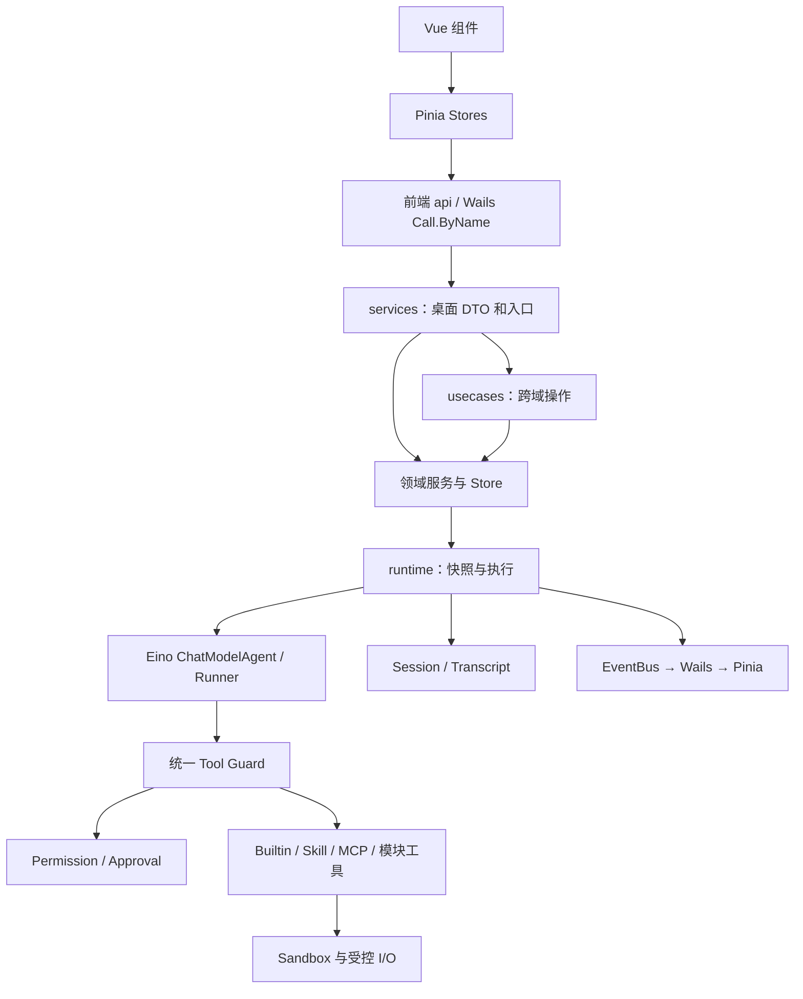
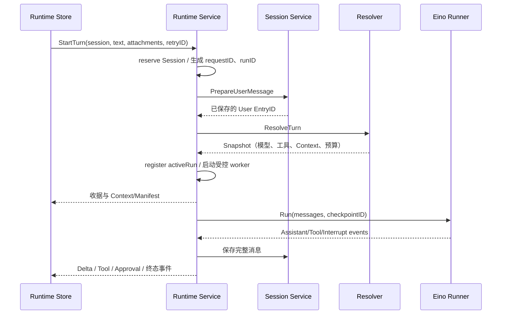
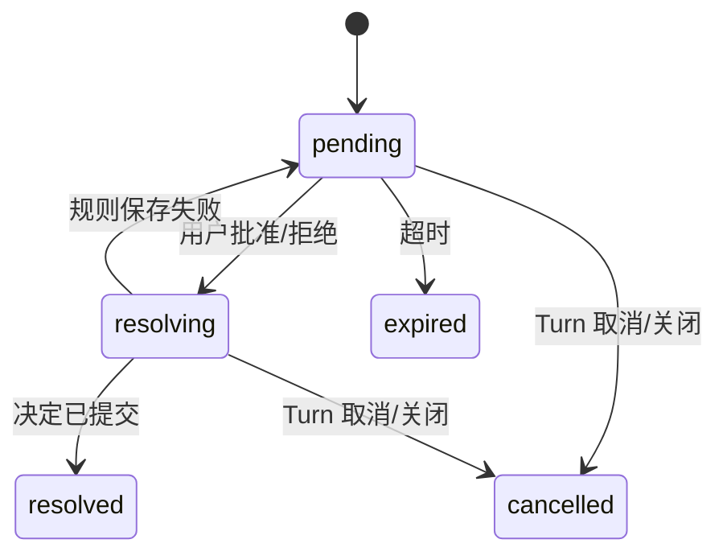
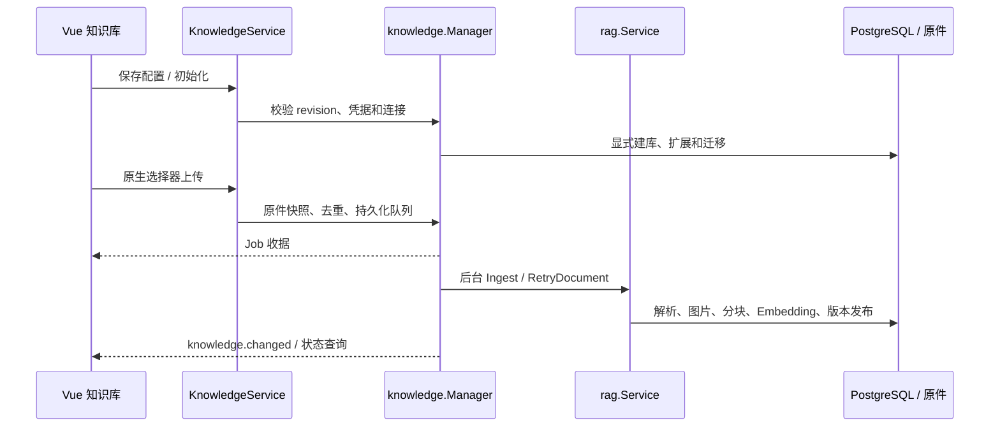

# Humbert Agent 项目源码详解

> 源码核对日期：2026-10-22。本文根据当前工作区解释桌面入口、模块装配、领域服务、工具、前端、数据维护及知识库集成，包含尚未提交的重构。RAG 解析/分块/数据库/检索算法另见 [RAG 源码详解](RAG源码详解.md)，两份文档的索引均已按当前语法树更新。
>
> 默认值以代码配置为准，示例参数可以不同；“本轮”指一次请求及其模型—工具循环。文档描述源码边界，不把配置字段、历史工具名或待验收的外部集成当成已验证功能。统一验证入口见 [持续验证说明](持续验证说明.md)。

## 阅读导航

1. [项目整体设计与技术选择](#overview)
2. [入口、装配、生命周期](#bootstrap)
3. [配置与本地数据布局](#configuration)
4. [Agent 配置实体与删除流程](#agents)
5. [Provider、模型实例和能力判断](#models)
6. [Session、JSONL、缓存与索引](#persistence)
7. [Runtime：一轮请求的执行全过程](#runtime)
8. [消息的构建、转换与流式保存](#messages)
9. [Context 组装、预算、压缩和恢复](#context)
10. [图片、文本与文档附件](#multimodal)
11. [工具注册、选择、权限包装与大结果](#tools)
12. [文件读取、搜索与原子编辑](#file-tools)
13. [命令、Skill 脚本和只读 Git 工具](#command-tools)
14. [网页搜索、抓取与浏览器](#web-tools)
15. [Permission：授权策略与能力身份](#permission)
16. [Approval：暂停、批准、拒绝和恢复](#approval)
17. [Sandbox：文件、进程与网络边界](#sandbox)
18. [Skills：发现、安装、更新与运行](#skills)
19. [MCP：目录、连接、传输与工具适配](#mcp)
20. [多 Agent 协作](#collaboration)
21. [任务、调度、重试与运行记录](#tasks)
22. [主动助手、工作区监测与通知](#proactive)
23. [事件总线与桌面事件桥接](#events)
24. [工作区浏览和本地搜索索引](#workspace-search)
25. [偏好、凭据、头像、备份与恢复](#user-data)
26. [桌面 Services 和跨域 Usecases](#adapters)
27. [前端状态、组件与界面数据流](#frontend)
28. [构建、数据 CLI 和示例](#build)
29. [测试、设计边界与学习路线](#reading)
30. [知识库、RAG 集成与资料来源](#knowledge)
31. [桌面接口、数据结构与源码文件索引](#appendix)

<a id="overview"></a>
## 1. 项目整体设计与技术选择

### 1.1 项目真正运行的东西

Humbert 是一个本地优先的桌面 Agent 应用。用户保存 Agent 的模型、指令、技能、工具和工作区配置；每次发送消息时，后端创建本轮运行快照，交给 Eino 的 `ChatModelAgent` 执行推理与工具循环。运行结束后，快照、取消上下文和审批 checkpoint 等进程状态被回收。Agent 配置本身不代表一个永远驻留、持续思考的智能体。

可以把代码中的对象分成四类（知识库发布版本与原件同样是长期事实，详见第 30 章）：

| 类别 | 代表对象 | 所有权和生命周期 |
| --- | --- | --- |
| 用户保存的配置 | Agent、Provider、Model、Skill/MCP 绑定、任务 | 由领域 Store 持久化，跨启动保存 |
| 会话事实 | 用户消息、回答、thinking、工具调用与结果、压缩记录 | Session JSONL 保存；会话元数据单独放 SQLite |
| 一次运行的状态 | Runtime Snapshot、执行预算、取消函数、审批 checkpoint | 从启动一轮到该轮完成/取消；不作为长期会话配置 |
| 可重建的派生内容 | 搜索索引、缓存、当前 Context、视觉观察输入 | 从配置、历史或原件重建；不冒充用户原始事实 |

### 1.2 分层不是简单按文件名分类



`internal/app` 是装配位置；`services` 适配桌面调用；`usecases` 协调多个领域；各领域 Store 负责自己的数据；`runtime` 解析模型与能力并协调 Eino。工具执行不会去全局 Application 中寻找任意服务，而是接收明确依赖和冻结的 Scope。

### 1.3 为什么使用这些依赖

版本依据 [go.mod](../go.mod) 和 [frontend/package.json](../frontend/package.json)。

| 依赖 | 当前代码承担的工作 |
| --- | --- |
| Go 1.27.1 | 后端语言及模块声明；`context`、锁、goroutine、`os.Root`、文件与 HTTP 等标准库是主要实现基础 |
| Wails v3 beta.24 | 桌面 WebView、Go 服务暴露、资产嵌入、事件及窗口 |
| Eino v0.9.19 | Agent 推理循环、工具调用、Runner、流式事件、Interrupt/Resume、Skill/Reduction/Summarization 中间件 |
| Eino OpenAI/Ollama adapters | 将统一模型接口映射到实际 Provider 请求 |
| Vue 3、Pinia、Arco、Vite、Tailwind | 组件、状态、桌面界面、构建与样式；前端应用自己的依赖以 package.json 为准 |
| modernc SQLite | 无需引入 Go CGO SQLite 驱动的会话控制面和本地全文索引 |
| Viper、yaml.v3 | 默认值、YAML、环境变量覆盖及局部配置保存 |
| Rod | Chrome/CDP 自动化；共享可见页面、快照、交互和截图 |
| MCP Go SDK / officialmcp | MCP 协议会话及向 Eino 工具适配 |
| Tabula | PDF/Office 文档转 Markdown，调用放在专门解析进程 |
| go-keyring | 正式桌面 API Key 保存到系统凭据库 |
| age | 加密备份和恢复解密 |
| doublestar | 文件 glob 匹配 |
| html-to-markdown | 网页正文转换为模型易读的 Markdown |

依赖表中有某个 SDK，不等于正式 Runtime 已使用它的全部能力。例如 AgenticMessage 的示例不代表主聊天入口已经改成 Responses/Agentic 模型；正式 Factory 只构造当前支持的三种 Provider 协议。

<a id="bootstrap"></a>
## 2. 入口、装配、生命周期

源码入口：[cmd/desktop/main.go](../cmd/desktop/main.go)、[application.go](../internal/app/application.go)、[lifecycle.go](../internal/app/lifecycle.go)、[modules.go](../internal/app/modules.go)。

### 2.1 桌面 main 的顺序

`main` 调用 `os.Exit(run())`。资源 defer 放在 `run` 内，因为 `os.Exit` 不执行 defer。

`run` 的顺序为：定位 `~/.humbert-agent` → 获取实例锁 → 应用待恢复数据 → 应用待备份请求 → Bootstrap Core → 创建并运行 Wails → 以限时 Context 关闭 Core → 释放实例锁。

实例锁必须早于恢复、备份和数据库打开，否则第二个进程可能修改仍被第一个进程使用的数据。恢复在启动前完成，避免打开的 SQLite、运行中的任务和文件缓存与恢复目录相互冲突。

`runDesktop` 创建主窗口，注册 `services.All(core)`，通过 `frontend.Assets` 提供生产资源。窗口初始 1100×750，最小 860×600；macOS 使用透明原生标题栏，最后一个窗口关闭后结束应用。界面错误经 `marshalFrontendError` 脱敏并限制长度后转成 JSON，不能把 Provider 返回的原始 Authorization 信息直接送进界面。

### 2.2 Bootstrap 的依赖顺序

`Bootstrap` 不通过隐式 Service Locator 让领域之间互相查找。核心顺序如下：

1. 加载 Config，创建 Logger、Credential Store、Transcript Store。
2. 创建 Workspace、Sandbox、Permission、Approval、Preferences。
3. 创建 Skills、MCP 配置和 Manager、Models Store/Registry、Agents Store/Service。
4. 恢复未完成的 Agent 删除，创建 MCP Runtime Backend。
5. 创建 Sessions Store/Service、工作区查询和本地搜索。
6. 创建默认工具 Registry，将 Session Service 同时注入历史、附件与大结果归档能力。
7. 创建 ContextEngine、EventBus、Runtime Resolver/Executor。
8. 创建 Collaboration，并注册协作工具；创建 Runtime Service 和生命周期观察者。
9. 创建 Tasks，注册 `schedule_task`；创建 Notifications 和 Proactive。
10. initModules 默认安装知识库模块，再安装 WithModules 追加模块；注册能力 Provider 并接入生命周期，启动模块、任务调度与主动助手。
11. 创建跨域 Usecases，发布 Application，最后标记 Ready。

Runtime Resolver 保存 Registry 引用，因此协作工具和任务工具在后续注册后仍会被下一轮 Resolve 看见。创建 Resolver 时没有提前复制一个永不更新的工具数组。

### 2.3 失败回滚与正常关闭共用清单

每个资源成功创建后立即登记到 `lifecycle.entries`。启动中途失败时，已接管资源按同一规则关闭；尚未移交的 Factory/Module 由创建或注册失败处立即释放。

关闭分三阶段：

| 阶段 | 目的 | 代表资源 |
| --- | --- | --- |
| `stopWork` | 停止继续产生新任务 | Proactive、Tasks、模块后台工作 |
| `finishRuns` | 取消/等待现有 Agent 运行 | Runtime |
| `closeResources` | 已无消费者后释放连接和基础设施 | 模块、工具、事件总线、搜索、Session Store、MCP、Logger |

阶段内逆构造顺序；`sync.Once` 防止重复关闭；一个关闭错误不会阻止其他资源释放，错误通过 `errors.Join` 合并。App 的 getter 是装配结果出口，不表示允许所有领域依赖整个 App。

### 2.4 可选组件接入契约

[runtime/module_contracts.go](../internal/runtime/module_contracts.go) 定义 `ModuleHost`、`ModuleInstaller`、`Module`、`CapabilityProvider`。ModuleHost 只给数据根、Logger、Credentials、Events、Sandbox 等平台资源。模块自己负责业务 Store、连接和配置。

CapabilityProvider 有 `Selection`、`Describe`、`Resolve`：Selection 读取明确的 Agent 绑定；Describe 提供本地 Schema，不连接服务；Resolve 返回本轮冻结的可执行工具。CapabilityContribution 的 Revision 要随实现、配置或 Schema 变化，但不能包含 Secret 原文。

子 Agent 的 `CapabilityRequest.AgentID` 用来读取它自己的能力绑定，`CapabilityRequest.Scope.AgentID` 仍是父权限身份。Runtime 会验证名称、选择集合和工具契约，统一加 Guard、预算和结果归档。

<a id="configuration"></a>
## 3. 配置与本地数据布局

入口：[config.go](../internal/config/config.go)、[configwrite.go](../internal/config/configwrite.go)、[tools.go](../internal/config/tools.go)、[permission.go](../internal/config/permission.go)、[sandbox.go](../internal/config/sandbox.go)。

### 3.1 默认值、文件和环境变量

`Load` 从用户 Home 推导固定应用根。先确保目录和默认文件存在，再用新的 Viper 实例加载默认值、`config.yaml` 和 `HUMBERT_*` 环境覆盖，Unmarshal、Normalize、Validate 后返回 Config。点号和短横线映射为下划线，例如 `runtime.context.auto_compaction` 对应 `HUMBERT_RUNTIME_CONTEXT_AUTO_COMPACTION`。

路径由 `resolvePaths` 统一生成；领域 Store 决定具体文件 Schema。第一次启动创建目录使用 Unix 0700，配置类文件通常 0600。创建默认文件与读取现有文件分开，不能因为损坏就无声覆盖用户配置。

### 3.2 实际数据位置

```text
~/.humbert-agent/
  config.yaml
  config/
    providers.json
    models.json
    preferences.json
    permissions.json
    proactive.json
  secrets/                     系统凭据 ID 索引及旧凭据迁移入口
  mcp/servers.json
  skills/                      应用级 Skill 包
  agents/
    session-metadata.sqlite    全部 Session 控制面
    <agent-id>/
      config.json              Agent Profile
      sessions/<session-id>/
        session.jsonl          消息树与 compaction
        attachments/<id>       上传原件和工具截图
        context-artifacts/     大工具结果 JSON
        subagents/             子运行审计 JSON
      ...                      任务等领域自有记录，见对应章节
  workspaces/<agent-id>/        Managed 工作区
  knowledge/                   RAG 配置、Agent 绑定、原件、图片和解析缓存
  cache/                       搜索索引、浏览器 Profile 等派生/私有状态
  logs/humbert.log
  tmp/
```

当前 Session 标题、归档状态和更新时间的事实来源是 SQLite，**不是每会话 config.json**。部分历史注释描述过旧布局，学习时应以 `sessions/catalog.go` 的实际实现为准。

### 3.3 局部更新不会覆盖其他配置域

设置页更新 Permission、Sandbox 或 Shell 开关时，通过各自保存入口更改 YAML 对应键。配置写入集中在 configwrite 中，避免各入口自行序列化整个默认模板、把别的配置清空。应用级 Manager 在保存后更新自己的运行配置，已有 Turn 仍使用已冻结策略。

ToolConfig 与主 Config 分开读取。文件、抓取、搜索、命令的启用和数量、字节、超时上限在工具装配处生效。`shell_enabled` 控制本地执行能力是否存在；Approval 控制存在的工具本次能否执行；Sandbox 控制实际访问范围。这三项不是同一开关。

<a id="agents"></a>
## 4. Agent 配置实体与删除流程

源码：[types.go](../internal/agents/types.go)、[validation.go](../internal/agents/validation.go)、[service.go](../internal/agents/service.go)、[store.go](../internal/agents/store.go)、[agent_lifecycle.go](../internal/usecases/agent_lifecycle.go)。

### 4.1 Profile 字段的含义

| 字段 | 设计作用 |
| --- | --- |
| ID、Name、Avatar | 稳定身份、展示名称、经校验的头像 |
| Instruction | 用户保存的 Agent 指令，运行时还会组合平台规则 |
| ModelID | 主聊天模型配置 ID |
| ModelRoles.UtilityModelID | 可选摘要辅助模型，留空回退 Chat |
| SubagentEnabled | 是否允许其他 Agent 通过 run_agent 调用，默认 false |
| EnabledBuiltinTools | 普通内置工具选择，nil 和显式空集合有不同意义 |
| EnabledSkills | 应用级 Skill 包名称引用 |
| EnabledMCPTools | Server ID + 原始工具名引用 |
| WorkspaceMode、WorkspacePath | 托管或用户自选目录 |
| Sandbox | 覆盖应用默认策略；零值继承全局设置 |

AgentInfo 中模型展示名称由 Service 批量投影。Store 不直接打开另一个领域的 models.json。

### 4.2 创建与校验

统一校验名称、头像、Instruction、模型引用、Skill/MCP 引用、工具名和目录策略。名称最多 100 个字符；Instruction 最多 64 KiB；头像交给 avatar.NormalizeDataURL。允许暂未配置模型的 Agent 被保存，但指定模型时必须存在且启用，真正运行时还会要求 Chat Model 已设置。

Create 生成 UUID，保存 Profile 后准备 Workspace。工作区准备失败会用独立且限时的 Context 补偿删除已创建 Profile，避免原请求取消使回滚也立即失败。Custom 目录只验证和引用；Managed 目录由 Agent ID 推导。

### 4.3 更新与并发

完整 Update 使用 Store.Mutate 在锁内合并未提交字段；局部入口 `UpdateProfile`、`SetModel`、`SetModelRoles`、`SetSkills`、`UpdateSecurity` 也进入统一 mutate。这样两个设置页先后保存时，不会拿各自读取的旧 Profile 覆盖对方刚改的字段。

指针或 nil 切片承担“未提交”的语义：例如 `EnabledMCPTools == nil` 保留现状，非 nil 空集合明确清空；Builtin 选择类似。保存时先规范化并校验，不在每个入口各写一套长度限制。

改变 Workspace 配置只影响后续运行，不自动迁移、复制或删除原目录。当前 Turn 的模型和能力同样不会在设置变更后中途更换。

### 4.4 删除是可恢复的 Aggregate 操作

领域 Delete 写入删除状态，Agent 随即从可用 Get/List 隐藏；随后删除 Managed 工作区和 Agent 自有数据。Custom 工作区属于用户，不递归删除。失败保留 deleting 状态，Bootstrap 的 RecoverDeletions 或用户重试继续清理。

Service 的生命周期读写锁阻止删除快照后又创建新 Session。桌面删除入口使用 AgentLifecycle，先停止/排除运行与任务，协调 Session 元数据、权限规则等外部引用，再删除 Profile Aggregate。直接删除一个目录无法替代这个用例。

<a id="models"></a>
## 5. Provider、模型实例和能力判断

源码：[registry.go](../internal/models/registry.go)、[store.go](../internal/models/store.go)、[factory.go](../internal/models/factory.go)、[runtime.go](../internal/models/runtime.go)、[capabilities.go](../internal/models/capabilities.go)、[reasoning_replay.go](../internal/models/reasoning_replay.go)。

### 5.1 Provider 和 Model 为什么分开

Provider 保存类型、BaseURL 和 CredentialID；Model 保存具体模型名、展示名、启用状态、响应头超时、窗口、最大输出和能力覆盖。同一 Provider 可以服务多个模型；Key 不重复保存在每个 Model 中。

Registry 协调 Provider/Model 修改、凭据补偿和实例缓存。保存配置失败时恢复此前凭据；删除 Provider 需要检查它的模型引用。删除 Model 需要检查当前 Agent 的 Chat/Utility 以及全局 Image 路由引用。历史 Assistant 已保存当时 Provider/Model 元数据，不依赖配置仍存在。

### 5.2 模型快照与缓存

ResolveSnapshot 在 Registry 锁下同时获取实例、配置和 Revision。读缓存使用 RLock；首次构造用写锁再次检查，只生成一个基础实例。修改配置会清缓存并增加 Revision；已启动 Turn 仍持有旧实例和元数据。

RuntimeSnapshot 的 ContextWindow/MaxOutputTokens 与真实 Instance 来自同一版本，不能稍后再读文件估算另一版窗口。基础实例不是每轮带工具的实例；Eino 的 WithTools 会构造工具绑定视图。

### 5.3 三种 Provider 的请求差异

| Provider | 当前 Factory |
| --- | --- |
| openai | Eino OpenAI ChatModel；要求凭据；输出限制用 MaxCompletionTokens |
| openai_compatible | 同一 ChatModel；Key 可选；输出限制用 MaxTokens |
| ollama | Eino Ollama ChatModel；输出限制用 NumPredict |

HTTP Transport 克隆 Go 默认 Transport，保留代理、TLS、连接复用和 HTTP/2；配置的是 `ResponseHeaderTimeout`，Client.Timeout 为 0。收到响应头后较长的 thinking/流式正文不会因为一个固定总 HTTP 时长被截断；真正整轮取消和任务时限由上层 Context 控制。

### 5.4 能力是推断加显式覆盖

每项 Capability 支持 `auto/enabled/disabled`。auto 根据 Provider 和模型名保守推断，例如识别常见 Vision/Reasoning 名称，任意 Files 默认关闭。它不是自动向模型发探测请求的能力数据库。用户显式声明会覆盖推断，但真实 Provider 仍可能拒绝错误声明。

Chat 始终负责 Agent 执行；Utility 用于摘要；Image 只在需要图片且 Chat 不支持时用于观察。Vision 辅助不要求 Tools，也不能补足任意 Files。原生音频能力字段存在，不表示当前上传和播放链路已实现。

OpenAI 和兼容模型外面还有 reasoningModel：Generate、Stream、WithTools 都保留最终出站策略。OpenAI 与未知兼容模型在副本上移除 Reasoning；当前代码识别的 MiMo/DeepSeek 模型保留原生 reasoning_content，并归一文本/推理块、流式 ToolCall.Index 和合法参数的 JSON 编码，使执行中与 JSONL 重放后的消息具有稳定表示。RuntimeSnapshot.SupportsReasoningReplay 与 Factory 共用协议判断，不借 UI Capability 决定输入字段。

### 5.5 设置页怎样验证模型

Registry.TestModel 不复用模型实例缓存，而是按当前 Provider/Model 配置重新构造实例，再发送只有一句 `Reply with exactly OK.` 的 User 消息，记录耗时和最多 200 字节的回答预览。桌面入口给操作最多五分钟，内部再应用模型配置的 TimeoutMS；返回非 nil 响应即表明请求完成，并不要求回答必须严格等于 OK。

ModelService.DiagnoseModel 先检查启用状态和必要凭据，再复用这个最小文本请求，把常见错误归为可处理的诊断。返回的 ToolsSupported 来自 Capability 配置推断；这个入口没有实际绑定工具，也没有上传图片测试 Vision。因此“连接成功”只能证明这次文本请求通过，不能证明所有工具协议、多模态能力和长上下文均可用。

<a id="persistence"></a>
## 6. Session、JSONL、缓存与索引

源码：[sessions/store.go](../internal/sessions/store.go)、[catalog.go](../internal/sessions/catalog.go)、[transcript/store.go](../internal/transcript/store.go)、[journal.go](../internal/transcript/journal.go)、[cache.go](../internal/transcript/cache.go)、[location_index.go](../internal/transcript/location_index.go)、[history_index.go](../internal/transcript/history_index.go)。

### 6.1 控制面与对话事实

session-metadata.sqlite 位于 agents 根下。sessions 表保存 id、agent_id、title、archived、cwd、created_at、updated_at，按 Agent/更新时间索引；WAL，busy_timeout=5000，连接池最多两条连接，user_version 当前为 1。

消息不在这个表里。Session JSONL v3 第一行是 Header，记录 ID、时间和创建时 CWD；之后每条 Entry 有身份、父节点和类型。消息 Entry 可包含 User/Assistant/ToolResult；模型变化、标签、compaction 是控制记录。ActiveBranch 是从当前叶节点沿父关系恢复的有效路径。

创建 Session 在 Agent 生命周期读锁内完成，先确认 Agent 和 Workspace 有效。更名、归档是 SQLite 控制操作；追加消息后更新元数据时间。删除 Session 会同时处理 Transcript 与 sidecar，权限/任务等跨域条件交给用例协调。

### 6.2 追加式日志和并发

Transcript Store 按会话文件加锁，单个 Session 内追加串行；不同 Session 不共享一个全局消息写锁。Header、Entry、父节点、Role 和内容块均有验证。单条 JSONL Entry 上限 8 MiB，是持久化最后边界，不能代替各工具更小的输出上限。

追加不是重写整段会话，因此保留历史事实和分支关系。compaction 也追加新控制记录，不把旧消息删除。最新 firstKeptEntryId 改变的是模型工作窗口。

### 6.3 损坏恢复

journal 只修复未完成的尾行，例如写入时进程退出留下的截断 JSON。完整历史中的坏 JSON、非法角色、重复 ID 或错误父节点不能被“忽略”伪装成正常；Session Store 在启动扫描时隔离损坏项并报告 Issues，使其他会话仍可使用。

对于配置等小文档，atomicfile 使用同目录临时文件、完整写入、Sync、关闭、替换，并拒绝目标/直接父目录的符号链接；ReadJSON 拒绝未知字段和多个顶层 JSON。原子写不负责读—改—写互斥，业务 Store 仍需要自己的锁。

### 6.4 普通历史和 Context 的读取不同

UI MessagePage 分页返回消息；Context 读取当前窗口只读视图。小文件缓存避免重复解码；大文件的 location index 保存行位置、树元数据与窗口边界，读取时只打开所需记录。history index 帮助定位工具调用/消息与历史搜索。

documentCache 是有界 LRU：最多 32 个 Session，并按对应 JSONL 文件字节数计费，总额 64 MiB；这不是解码后 Go 对象占用内存的精确测量。命中前必须同时确认文件身份、大小和修改时间。成功追加并完成同步/关闭后可以推进已有缓存；文件被外部替换、前置状态不一致或超过容量时，失效重建，不能猜测历史仍然相同。

Context 的缓存返回值不能被调用方修改。投影给模型时复制必要的 Message、Extra 和内容切片，再加 EntryID 或处理 thinking/附件。这是避免界面、执行状态和磁盘缓存互相污染的关键。

<a id="runtime"></a>
## 7. Runtime：一轮请求的执行全过程

入口：[service.go](../internal/runtime/service.go)、[resolver.go](../internal/runtime/resolver.go)、[executor.go](../internal/runtime/executor.go)、[runs.go](../internal/runtime/runs.go)、[operations.go](../internal/runtime/operations.go)、[events.go](../internal/runtime/events.go)。

### 7.1 Service、Resolver、Executor 的分工

| 对象 | 负责 | 不在它内部重新实现 |
| --- | --- | --- |
| Service | 运行登记、会话预留、取消、审批、后台 worker、终态与关闭 | 模型协议、领域文件格式 |
| Resolver | 读取配置、冻结模型/能力/指令、构造 Context、附件路由 | Eino 推理循环 |
| Executor | 构造 Runner、消费流、保存 Assistant/Tool、识别 Interrupt | 审批策略、配置修改 |
| Eino ChatModelAgent | 模型—工具迭代和状态流转 | Humbert 的文件、权限和备份规则 |

### 7.2 StartTurn 的固定顺序



同一 Session 只能运行一个 Turn。预留发生在用户消息追加之前，避免重复点击把两个输入同时推进历史。不同 Session 可以有各自的运行。

用户消息先落盘，所以 Resolve 失败不能假装从未提交。ChatService 将这种错误包装成 StartError 收据，前端记录已保存 UserMessageID；相同输入重试会验证最后一条未回复 User 的内容和附件并复用。

### 7.3 Snapshot 如何组成

Resolver 解析 Session → Agent → Chat/Utility/Image → Workspace → Sandbox → Builtin/Skills/MCP/模块贡献。Capability assembler 检查重复名称，统计 Schema，冻结 Skill revision 和 MCP 身份。构建 System Instruction 和 Context，按最终可见图片需求重新对齐模型角色，再 Hydrate 附件和必要的 Vision Bridge。

Snapshot 同时保存 request/run/session/agent 身份、模型元数据、工具/技能/MCP revision、Context Usage/Assembly、模型实例、工具实例、Message、SessionWriter 和 EventReporter。Manifest 供界面观察“本轮真正使用了什么”，不是从多个设置页请求猜出来的拼接结果。

### 7.4 Agent 构造与迭代

主/子 Agent 共用 buildChatModelAgent：绑定跟踪模型、Handlers、工具生命周期 middleware；工具按顺序执行，默认最大迭代 200，实际使用 Config 的值。

每次模型调用前顺序为 Skills → Reduction → Context Compaction。局部工具错误转换成标准失败结果交回模型，使它可以修正参数或选择替代能力；审批 Interrupt 和整轮取消原样向上，不可被普通失败字符串吞掉。

模型缓存要求重复前缀保持一致。System 不写每轮变化的秒级时间；`contextengine.WithMessageTimestamp` 将 JSONL Entry 的固定发送时间附在对应 User 投影末尾，子 Agent 使用其持久化 StartedAt。原始消息不改写，重放时不更新旧时间；用户消息附带本机时区偏移，不再单独提供 CurrentTime 工具。Session.Archive 对同一会话、工具和原文生成稳定 SHA-256 引用，避免历史清理重新创建随机资源编号。供应商缓存仍受摘要、附件窗口、能力配置和服务端留存规则影响，不能据此保证实际命中率。

### 7.5 取消、终态与关闭

activeRun 的身份来自嵌入 Snapshot，不再复制另一份 request/run/session 字段。Service 的两个运行索引、会话预留和 phase 共同协调 running、waiting approval、resuming、maintaining、cancelling 等状态。

完成、失败、取消都经过统一终态出口，清理 checkpoint、通知观察者、释放预留并发布终态事件。正常完成才进入维护阶段提交待保存摘要；维护提交失败记录告警，不把已经生成的回答改成模型失败。

Close 先禁止新工作，取消 root Context/正在执行的运行，等待受控 worker；操作计数和 closeDone 防止启动、删除或手动压缩与关闭互相穿插。运行事件只用于实时投影，Assistant/Tool 的 JSONL 才是聊天事实。

### 7.6 预算和错误分类

limits.go 管理任务可带入的模型调用次数、工具次数、Token、时长和 deadline；子 Agent 与辅助 Vision/Utility 调用共享父运行 limitState。审批恢复不重复扣已经预留的工具次数。

model_accounting.go 用包装模型统计调用、流式 Usage 与模型角色；provider_error.go 区分上下文溢出、内容阻止、取消、超时等；events.go 生成可读错误并统一发布终态。日志和 UI 的工具参数限长/脱敏，真实执行参数留在内部 Scope/Checkpoint，不能拿展示文本执行。

<a id="messages"></a>
## 8. 消息的构建、转换与流式保存

唯一转换位置：[codec.go](../internal/transcript/codec.go)。运行时是 Eino schema.Message，磁盘是 Transcript AgentMessage，UI 是 Services DTO。不同表示有不同稳定性，不应让前端直接解释 SDK 内部结构。

### 8.1 User 的构建

纯文字使用 schema.UserMessage(Content)。带附件使用有序 UserInputMultiContent：用户文字在前，之后是各个 image/file part。上传原件经校验保存后，消息中的 URL 是内部 sidecar 引用，不是对外 HTTP 地址，也不是 Base64 长字符串。

Encode 转为 text/image/file 内容块；Decode 将块恢复为 Content 或多模态 part。文本附件的 ExtractedText 和文档的 DocumentOnDemand 保留；真正给模型时再转成文字或图片输入。

### 8.2 Assistant 的构建

回答文字、Reasoning 和 ToolCalls 在同一 Assistant Step。结构化输出内容存在时，Codec 保留其顺序，避免把同一 Content 和结构化 Text 保存两次；工具调用追加在生成内容之后。每个调用保存 ID、名称和真实 JSON 参数，而不是把对象再次 JSON 编成一个双重字符串。

Assistant 同时保存实际 API 家族、Provider、Model、ResponseModel/ID、Usage 和 stop reason。历史即使模型配置被删除仍可解释。正常 stop、length、toolUse 和本地 error/aborted 等分开记录，不从一个字符串猜全部结果。

### 8.3 ToolResult 与事务完整性

ToolResult 必须包含 ToolCallID 和 ToolName。顺序是 Assistant 发调用 → 各 ToolResult → 下一次 Assistant。Context 投影会校验重复、孤立和未闭合事务；上次中断留下缺结果时，在模型投影中补 unknown 提示，不编造“成功”，也不在持久化历史里伪造工具执行。

权限拒绝是可以供模型阅读的工具结果，真实工具不执行；IsError 及兼容拒绝文案共同帮助历史/界面识别它。大结果可能保存摘录和资源引用，完整正文在 context-artifacts。

### 8.4 Stream 与事实保存

materializeOutput 是流读取与关闭的共同入口。每个 chunk 经回调更新界面，最终用 schema.ConcatMessages 合并；delta 不逐条写 JSONL。结束时保存完整 Assistant，工具只保存完整结果。

流被取消时尽量保留已生成文字和 Reasoning，移除半截 ToolCall；未完成 ToolResult 不记作完成。工具已经返回而用户同时取消时，用独立的五秒 Context 尽力保存实际结果，减少下次“结果未知”。

### 8.5 Thinking 保存和回放分开

磁盘保留 thinking 和签名等信息；Context 的具体模型协议策略决定是否送回模型。代码识别的 MiMo/DeepSeek 模型使用 Include，保留当前上下文窗口内全部 thinking，包括已完成轮次及当前工具链；Ollama Auto 保留当前 User 轮次之后的进行中推理；OpenAI 与未知兼容模型保持 Omit。主/子 Agent、运行中中间件和出站适配器使用一致策略。Thinking 仍计入预算，压缩后的窗口只回放检查点与完整尾部，不无限重发压缩前历史，也不把原生 thinking 改成普通正文。具体模型名单由 `models.supportsReasoningReplay` 维护；新增型号需同时核对协议和出站处理。

<a id="context"></a>
## 9. Context 组装、预算、压缩和恢复

源码：[engine.go](../internal/contextengine/engine.go)、[projection.go](../internal/contextengine/projection.go)、[budget.go](../internal/contextengine/budget.go)、[estimator.go](../internal/contextengine/estimator.go)、[middleware.go](../internal/contextengine/middleware.go)、[compactor.go](../internal/contextengine/compactor.go)、[summary_input.go](../internal/contextengine/summary_input.go)、[serializer.go](../internal/contextengine/serializer.go)。

### 9.1 Build 是可重建的投影

Build 验证请求、计算模型基础预算、读取只读 Context Transcript、投影 ActiveBranch、校验工具事务、统计 System/Tools/Checkpoint/Recent。它不调用模型，不因显示 Context 面板就自动摘要。

若存在多个 compaction，只取当前分支最新一条；最新摘要应递归包含此前摘要。从 latest.firstKeptEntryId 恢复原始消息并跳过控制 Entry。检查点作为特殊 User 参考消息注入，提示它不是新指令，旧信息冲突以新原始消息为准。

### 9.2 Token 估算与分类

`Used = System + ToolSchema + Checkpoint + RecentMessages`。ToolCalls/ToolResults 属于 MessageTokens，不属于 ToolTokens。System 指令由 Runtime 明确传入；摘要模型自身的 Prompt 与主模型指令分开。

默认 ApproxEstimator 对 ASCII 约四字符一个 Token，非 ASCII rune 约一个 Token，另加消息/工具协议开销；图片每张预留 1024，不计 Base64 字符长度。文本附件按正文、文档按引用估算；与真正附件恢复共用 AttachmentReplayMask。

Provider 首次实际 Prompt Usage 与中间件处理后首次输入估算比较，用有界移动平均调整估算因子；不是每家模型的精确 tokenizer。显示百分比始终除以模型整个 ContextWindow。

### 9.3 预算公式和例子

设 W 为窗口，O 为最大输出：默认 W<65536 时 Reserve=max(ceil(W×20%),O)；较大窗口 Reserve=max(ceil(W×10%),16384,O)。硬阈值 H=W−Reserve。

F=System+ToolSchema 不可通过历史摘要消除；HistoryBudget=max(0,H−F)。期望 Recent 为 ceil(W×20%)，默认限于 8192～32768，必要时缩小；下一检查点建议预算为窗口约 4%，通常 2048～8192，并按小硬阈值再约束。TargetRecent 从实际剩余容量中扣检查点预留后确定。

最终软阈值大致是 F+floor((H−F)×80%)，还要覆盖已有检查点基础占用，且低于 H。基础预算先算的 85% 会被固定上下文预算解析替换，因此不能把实际自动摘要写成“永远窗口 85%”。

例：W=131072、O=8192、F=10000，默认 Reserve=16384，H=114688，HistoryBudget=104688，软阈值约 93750（没有异常大旧检查点时）。工具定义越多，历史容量越少；设置窗口不会自动改变远端实际窗口。

### 9.4 每次调用前的两个保护层

第一层 Reduction 不调用模型：超长单结果完整归档后用首尾摘录替换；较早工具结果在约 75% 软阈值时清理，保留最近两轮工具调用。

第二层 Summarization 达到软阈值后调用摘要模型。自动开关仅禁用这一摘要触发；即使关闭自动摘要，硬阈值检查仍然生效。Count 使用本次实际 ToolInfos，动态 Skill 和 MCP Schema 也要计入。

### 9.5 摘要边界怎么选

summaryBoundary 跳过 System，从末尾向前累加近期消息，达到 TargetRecent 后得到候选切点。可以向前对齐最近 User，容许尾部预算约 25% 弹性；切在 ToolResult 时必须回退到拥有对应调用的 Assistant，避免把一个事务拆开。

只有一条 User 或没有足够旧历史时 ErrNothingToCompact；不裁掉巨大用户输入来伪造空间。长工具循环可以把本轮 User 移到被摘要区，程序因此另行捕获当前请求可见文字，在 finalize 时原样追加到检查点。

### 9.6 摘要输入与模型选择

旧检查点和切点以前消息序列化为 User/Assistant/Tool 文本；图像写身份和“不可见，不能猜测”提示；文本文件可写提取正文。参数省略 content/old/new text/password/token/api_key/cookie 等敏感或大字段；默认 4000 字符限制作用于工具参数，不是把所有消息正文都截成 4000。

System Prompt 要求按 Goal、Constraints & Preferences、Progress、Key Decisions、Next Steps、Critical Context 交接。依据可见回复，不补写内部推理，不调用工具。

Utility 窗口足够时优先使用它，否则回退 Chat。生成输出按 CheckpointBudget 和模型输出限制约束。输入本身超出摘要模型可用窗口会报错，当前实现不维护递归分块、多次改写或假摘要兜底。

### 9.7 finalize 和提交分开

finalize 拒绝空摘要、未缩小的上下文和不完整工具事务；保留当前请求原文与已加载 Skill 主定义。内存消息立即变成 System + 新检查点 + 保留尾部；pendingSummary 记录摘要和 FirstKept 身份。

原始 Assistant/Tool 事件全部保存且回合正常结束后，MaintainAfterTurn 调用 Commit，不再发第二次摘要请求。已有消息用 EntryID 定位边界，本轮新消息用 ToolCallID 身份定位；提交使用 ExpectedLeaf 校验分支没有变化，再追加 compaction 和来源范围。多次运行内摘要时最后一个 pending 已包含前面摘要。

手动压缩共用同一 Summarize/finalize/Commit，Force 允许提前尝试，但不绕过“有旧历史可压”的限制。它先串行预留 Session，不能和同一会话的 Turn 同时修改窗口。

### 9.8 失败和历史回查

摘要失败保留原输入，低于硬阈值可以继续；达到硬阈值停止。固定 System/Tools 太大、必要近期工具事务太大、单条输入太大等情形不能靠旧历史摘要解决。提交失败不删除原历史，后续可重新建立窗口。

完整旧 Entry 始终保留；检查点带来源范围，session_history 可搜索/定位并回查精确内容。大结果用 context_resource，文档用 extract_document。检查点帮助继续任务，但并不保证保存每一句原文。

<a id="multimodal"></a>
## 10. 图片、文本与文档附件

源码：[composerAttachments.js](../frontend/src/utils/composerAttachments.js)、[attachments.go](../internal/sessions/attachments.go)、[replay.go](../internal/multimodal/replay.go)、[vision_bridge.go](../internal/multimodal/vision_bridge.go)、[extract.go](../internal/documenttext/extract.go)、[parser.go](../internal/documenttext/parser.go)。

### 10.1 接收和保存

前端选择、拖入/粘贴共用附件读取，冻结目标 Session 后异步 FileReader；整批成功才合并，重新校验并发批次总量。发送清空草稿增加版本，阻止迟到读取恢复已提交附件。传输 name、mimeType、Base64，原件不压缩或转格式。

限制：每消息最多 8 个、每个 12 MiB、总共 24 MiB；普通文本 512 KiB，User 文字 256 KiB。后端再校验非空、UTF-8、MIME/实际图片签名、PDF 和 Office ZIP 结构。成功保存原件和消息；追加失败清理本次新建附件。

附件读取检查 ID、当前 Session 私有目录、普通文件、大小与符号链接；打开后再核实文件身份。一次 Runtime 图片恢复总字节上限 32 MiB；恢复只是本次内存请求，JSONL 保留内部引用。

### 10.2 近期重放窗口

AttachmentReplayMask 按 User 轮次数反向计数：当前和紧邻前一条 User 保留图片/提取文本，再早变文字占位。纯文字追问也推进窗口，Assistant/Tool 消息不推进。

上传图 A → 第一次追问仍带 A → 第二次追问原图不再自动发送。旧图保留身份和周围观察；旧文本可通过 context_resource 读取；PDF/Office 不论新旧都提示 extract_document 按需读取。停止重放不会删除原件。

### 10.3 Vision 路由和失败

主 Chat 支持 Vision 时直接接收图片。否则配置的 Image 模型接收近期图片和最新请求，一次生成可确认观察，主请求中的图片替换为占位，最新 User 追加不可信观察块。最终回答和工具调用仍由 Chat 完成。

Image 观察限长、计入父任务预算；无模型、无 Vision、返回空内容或辅助调用失败会阻止本轮启动。前端在附件加入和发送两处预检；后端还有能力检查。仅文字输入也可能因为上一条图片仍需重放而需要 Vision。

浏览器 screenshot 是另一入口：先保存 PNG；通过 VisionInspector 优先选主 Vision，否则辅助模型；无配置返回“截图已保存，无法读取像素”，不会删除截图。需要人工验证的网页不会交给视觉分析自动识别挑战内容。

### 10.4 PDF 和 Office 的按需 Markdown

PDF/DOCX/XLSX/PPTX 上传时只做格式结构验证，原件保存，全文不提前塞进 Context。extract_document 可以用当前会话附件 ID，或文件工具启用时用 Sandbox 允许路径，二选一。

提取限时 20 秒，原件 12 MiB，Markdown 512 KiB；Office 展开 64 MiB、2048 条目，拒绝路径逃逸和符号链接。结果按 Unicode offset/limit 分页，默认 12000、最多 20000 字符；内容+MIME hash 缓存最近八份，权限检查和原件读取在缓存命中前完成。

documenttext/parser.go 是共享解析实现：复制授权输入到一次性快照，使用当前可执行文件启动隔离的 worker 协议，限制输出/超时并清理临时数据，通过 Tabula 提取。独立进程能隔离崩溃和超时，不应写成所有平台均有额外 OS 文件/网络沙箱。扫描页在附件路径尝试本地 OCR；未编译支持或识别无文字时明确失败，不会调用 RAG 的图片模型作视觉兜底。

Audio、Video、原生任意 file_url 接入没有正式完整链路；Provider 能力字段不等于产品已经支持它。

<a id="tools"></a>
## 11. 工具注册、选择、权限包装与大结果

### 11.1 工具从定义到执行的四层

入口是 [app/tools.go](../internal/app/tools.go)，统一读取 ToolConfig，构造 Registry 并注册 Factory。工具适配在 tools/builtin；文件 I/O 在 fileops，浏览器/桌面在 tools/browser、tools/desktop，公网拨号在 publicweb；注册表、权限包装和结果归档在 tools。文件、命令、搜索可以由配置关闭；浏览器、安装 Skill、附件提取和系统工具有各自的装配规则。协作工具和 schedule_task 在对应 Manager 就绪后补充注册。

Factory 是应用级对象；Build(ctx, scope) 的结果是本轮对象。Scope 冻结 Agent/Session/Request/Run 身份、Workspace、Sandbox、Builtin/MCP/Skill 选择、Skill 文件身份及单个结果长度上限。Factory 可以持有线程安全的长期依赖，不能把上一次会话的 Scope 当成下一次的 Scope。

Descriptor 和 Eino ToolInfo 有不同用途：前者记录内部名字、风险、MCP/模块来源、Internal 标记与可选 Display 展示元数据；后者提供模型看到的描述及 JSON Schema。Guard 会检查两者的 Name 一致，防止“展示工具 A，执行工具 B”。名称采用小写字母、数字和下划线，不能以数字开头，最多 64 字符。

Registry.Register 拒绝重名并递增 Revision，不会静默覆盖旧工具。Resolve 先锁内复制 Factory 列表和版本，再锁外读取描述并 Build，避免扩展工具的慢初始化阻塞整个注册表。结果排序稳定，当前 Turn 使用已经冻结的工具集合。

### 11.2 显式能力选择和内部能力

EnabledBuiltinTools 为 nil 时沿用旧 Agent 的“使用当前全部 Builtin”语义；非 nil 时只暴露显式选择。Internal 工具可以越过普通选择，但 DisabledBuiltinTools 仍是更高一层的上限。后者用于子 Agent 禁用递归委派、历史读取、安装和调度等能力。

内部 session_history 与 context_resource 分别恢复旧历史和读取大结果/文本附件。extract_document 也是附件可靠性链路的一部分；它是否能读任意文件路径还取决于文件工具总开关。设置页隐藏内部工具不意味着运行时没有这些能力。

工具进入执行链后，权限 Guard 决定 Allow/Deny/Ask；结果归档控制上下文体积；运行时生命周期包装记录开始/结束、消费工具预算并把可恢复错误转换成模型可理解的工具结果。这些层不会代替 builtin 自身的参数验证和沙箱 I/O 检查。

### 11.3 当前工具能力表

| 工具 | 业务职责 | 核心限制或实现 |
|---|---|---|
| list_files/read_file/glob_files/grep_files | 枚举、阅读、路径和内容搜索 | Eino 文件 Middleware + Humbert fileops.Backend |
| write_file/edit_file | 写入或精确文本替换 | UTF-8、大小限制、文件锁、版本冲突检测、原子提交 |
| run_command | 直接启动本地程序 | command+args，不隐式启动 Shell |
| run_skill_script | 执行启用 Skill 的脚本 | 冻结包身份、Stage、识别解释器、只读工作区进程策略 |
| git | 按 action 查询 status/diff/log | 禁用已知外部执行入口、禁止可写降级，兼容旧动作选择与权限规则 |
| web_search | 搜索实时公开网页 | 有序后端降级、质量判断、域名过滤 |
| web_fetch | 获取公开网页正文 | DNS/IP 检查、重定向逐跳验证、大小限制、HTML 转 Markdown |
| browser | 操作共享可见 Chrome | Agent 独立持久 Profile、CDP、公开网络代理、截图附件 |
| skill | 加载已启用 Skill 指令/资源 | 初始集合中绑定 Eino 原生工具，正文按需返回，资源读取复核哈希 |
| install_skill | 安装并按输入启用 Skill | 来源和包验证，当前 Turn 能力仍不改变 |
| extract_document | PDF/Office 提取 | 授权原件、worker、Markdown 分页 |
| session_history | 历史 search/read | 当前会话范围，按索引和 EntryID 恢复 |
| context_resource | 大结果/文本附件读取 | 当前会话资源 ID，分页，不接受任意磁盘路径 |
| list_agents/run_agent | 同步专业 Agent 委派 | 目标显式允许，父安全范围，独立子上下文 |
| schedule_task | 安排提醒或 Agent 任务 | 结构化日程、权限审批、持久化 Task |
| knowledge_search | 授权知识库的 list/search/read | 模块贡献，绑定与 revision 复核、来源版本校验 |
| computer | 桌面窗口/屏幕观察与输入 | 显式桌面授权、观察身份、独占与取消 |
| mcp_* | 用户选中的远程/本地 MCP 能力 | 命名空间、Server 身份、独立风险配置、连接池 |

### 11.4 大结果不是直接丢弃

[tools/reduction.go](../internal/tools/reduction.go) 使用 Session 的 Archive 能力保存超限原文，返回首尾摘录和 resource_id。归档失败不能伪装成“原文已保存”。截断 JSON 中的 humbert_context_result_truncated、resource_type、resource_id 是模型恢复原文的协议。

工具返回前的归档与上下文构建时清理旧 ToolResult 是两种机制：前者影响持久化结果本身，完整内容另存在 context-artifacts；后者只改变 Provider 投影。判断一个结果是否“完整”，应检查归档标记，而非只看 JSONL 中有一条 ToolResult。

<a id="file-tools"></a>
## 12. 文件读取、搜索与原子编辑

### 12.1 Eino 适配与真实 I/O

[builtin/filesystem.go](../internal/tools/builtin/filesystem.go) 创建六个 Factory，每个启用 Eino filesystem middleware 中一个工具。真正实现 filesystem.Backend 的是 [fileops/backend.go](../internal/fileops/backend.go)，提供 LsInfo、Read、Write、Edit、GlobInfo、GrepRaw；只捕获复制后的 Sandbox 策略和文件限制，不依赖完整 Scope 或 Wails。

调用仍先经过 Registry/Guard。具体路径通过 openSandboxTarget 裁决 OpRead/Modify/Search，再打开 os.Root；相对访问和遍历后代继续复查 PathGuard，父目录可读不代表所有后代都可读。Eino 负责 Schema、输入解析与工具格式，项目负责受控 I/O。

### 12.2 读取与搜索

list_files 限目录项并跳过符号链接；read_file 限物理文件大小、要求 UTF-8、按行分页。文件大小与结果上下文预算分别检查。glob 使用 doublestar，grep 使用 Go regexp（RE2），支持类型/上下文/大小写/多行选项。PDF/Office 内容先提取为文本，行号属于提取文本；不可读、过大、二进制或无法解析的文件可能跳过，不能把空结果解释为所有文件都完成检索。

共享遍历跳过 .git 和符号链接，稳定排序。tools.files.max_search_entries/max_search_results/max_search_line_chars 默认分别为 20000、500、2000，配置层还有绝对上限。扫描或结果超限明确报错，单行按 rune 缩短；工具描述由同一限制生成，不再声称实际使用 ripgrep。

### 12.3 写入、锁与冲突

[file_transactions.go](../internal/fileops/file_transactions.go) 按规范化绝对路径管理短生命周期进程内锁；macOS/Windows 使用相应大小写规则，等待可取消，引用归零后移除。fileVersion 比较 SameFile、大小、权限、时间及读改写原文，发现外部修改要求重新读取。

[atomic_fs.go](../internal/fileops/atomic_fs.go) 在同目录暂存、完整写入/同步、复核后 Rename，并清理失败副本。已有文件保留权限，新文件默认 0600。write_file 写完整内容；edit_file 精确替换，默认恰好一次匹配，replace_all 才处理多个匹配。提交前校验不能宣称与任意外部进程实现了绝对原子 compare-and-swap。

### 12.4 当前工具目录与历史名称

当前文件能力是上述六个工具。CurrentBuiltinName 会过滤已退役的 apply_patch/copy_file/move_file/delete_file，以及 get_current_time/update_plan，不再把旧名称注入模型 Schema；旧 Git 工具名归一到 git，同时保留旧获准动作范围。不能从历史文档或保存选择推断这些旧工具仍可执行。

截图/上传原件继续属于当前 Session 的 attachments，用户通过界面下载；文件 Backend 不拥有附件生命周期。受控命令是独立能力，不能用其名字选择代替真实 Sandbox 校验。

<a id="command-tools"></a>
## 13. 命令、Skill 脚本和只读 Git

### 13.1 命令参数与环境

[run_command.go](../internal/tools/builtin/run_command.go) 接受 command、args、working_directory、timeout_seconds。参数逐项传入 argv，`echo a && rm b` 这样的文本不会被项目自动解释为 Shell；若显式选 Shell 程序及参数，仍是一个需授权的执行能力。

[sandbox/command_environment.go](../internal/sandbox/command_environment.go) 统一审批身份和执行路径解析：补齐桌面启动缺失的 Homebrew、Go、Cargo 等常见目录，忽略相对 PATH；支持名称、绝对路径和基于工作目录的相对程序路径，最终解析符号链接得到绝对可执行路径。它不读取用户 Shell 配置。

环境由 config.SafeCommandEnvironment 白名单构造，而不是继承 os.Environ。Runner 给每次执行建立私有临时目录，覆盖 TMPDIR/TMP/TEMP 及常见构建缓存变量，让运行时缓存进入允许区域。程序可能读取的其它用户资源仍由沙箱策略控制。

模型设置的超时至少 5 秒，最多配置 MaxTimeout。stdout/stderr 共用线程安全的有界采集器，超限继续消费但标记截断，防止子进程因为没人读管道而挂起。非零退出码是结构化结果，模型可以分析测试失败继续修复；无法启动、无权限及父 context 取消才属于执行错误。

exit_code=-1 不足以判断失败原因，应读取 timed_out、termination_reason 和 message。超时被表达为 timeout；Unix 信号终止表达为 signaled；DurationMS 和 NativeSandbox 帮助诊断真实环境。

### 13.2 Skill 脚本的 Stage

[run_skill_script.go](../internal/tools/builtin/run_skill_script.go) 要求本轮启用该 Skill，并且当前磁盘包 Identity 与冻结值一致。script 必须是包内规范相对路径、在 ScriptRuntimes 中被识别且受支持；解释器通过同一 sandbox.ResolveCommand 找到。

包先复制到工作区 `.humbert/skill-runs/<UUID>`，复制后复核身份；执行 Stage 中的脚本，结束后清理。真实安装目录无需对通用文件工具放开。ProcessSpec.ReadOnlyWorkspace=true，脚本默认只读业务工作区，允许的临时写入由 Runner 提供。脚本的其它进程/网络限制仍来自冻结策略。

读取 scripts 文件与执行脚本是不同工具：skill(file=...) 只返回文本，只有 run_skill_script 才启动进程。安装/读取/Stage 都不能凭 Skill 文档中的声明自动获得权限。

### 13.3 三个 Git 工具为何保留

[git_tools.go](../internal/tools/builtin/git_tools.go) 固定生成 status --short --branch、diff、log argv，限制 log 最多 100 条，30 秒超时并共用有界输出。diff 可选择 staged 和单个仓库相对文件；禁止危险相对路径形式。

Git 仓库配置可以触发辅助程序，因此这些工具禁用 pager、fsmonitor、外部 diff/textconv、submoduleSummary，设置 GIT_OPTIONAL_LOCKS=0，并要求真正的 OS 只读约束。即使普通执行使用 full_access，也不能把 RiskRead 的 Git 工具悄悄降级成随意写文件。它们提供的是受控只读能力，不能直接等同于任意 run_command git。

<a id="web-tools"></a>
## 14. 网页搜索、抓取与浏览器

### 14.1 搜索组件与工具适配

[websearch/service.go](../internal/websearch/service.go) 是可独立使用的搜索组件；不依赖 Agent、会话或桌面。builtin/websearch_tool 负责把它接到工具和当前网络策略。Backend 接口可替换供应商，默认有序链为 AnySearch → Bing → DuckDuckGo。

Search 清理空白、检查 query 字节数、数量和域名筛选条件。带筛选时适当增加候选数量，再标准化 URL、去重、执行允许/阻止域名规则。auto 模式在一次 ToolCall 内尝试多个后端：错误/空结果继续，低质量结果暂存，合格结果返回；Diagnostics 保存各次尝试。这里的降级不会让 UI 出现三次独立模型工具调用。

backends.go 包含各站点的请求及 HTML/JSON 解析、反爬/错误分类和结果标准化。搜索摘要适合发现页面，不保证等同于正文；发布时读到的网页布局可能变化，因此代码保留空结果/低质量诊断。

### 14.2 web_fetch 的公开网络检查

[webfetch_tool.go](../internal/tools/builtin/webfetch_tool.go) 只接受可用 HTTP/HTTPS 页面地址，拒绝携带身份信息等不合格 URL。每一次请求和重定向都重新检查目标；publicWebDialer 解析 DNS 并检查全部地址，拒绝本机、私有、链路本地等禁止范围，再连接选中的实际 IP，减小 DNS 重绑定风险。

响应体按字节上限读取，HTML 通过 htmlmarkdown 转成 Markdown；普通文本也受返回字符上限。输出包含最终 URL、标题/正文、截断标记等信息。工具超时、远程错误由运行时转换为局部工具错误，主 Agent 可以选择搜索或浏览器继续。

### 14.3 browser 不只是截图函数

[browser_tool.go](../internal/tools/browser/browser_tool.go) 管理真实 Chrome 进程和 CDP WebSocket。用户可以看到 Agent 操作的窗口，页面状态是双方共享的。Profile 按 Agent 隔离并持久化；同 Agent 的操作串行，避免同时导航和截图混淆。当前策略指纹影响会话复用，关闭/闲置回收和应用退出清理由 Factory 管理。

支持 open、页面可见信息读取、点击、输入、滚动、按键、历史导航、刷新、显示、截图和关闭等 action。输入结构和操作分发集中在该文件；点击/输入最终由 CDP 与页面脚本执行。网页文本视为不可信数据，不自动升级为用户指令。

Chrome 使用本机随机调试端口、独立 user-data-dir，禁用扩展/同步/部分后台请求；HTTP 出站通过 [browser_proxy.go](../internal/tools/browser/browser_proxy.go) 的受限代理，CONNECT 也检查目标，移除 localhost bypass 并限制 QUIC/WebRTC 绕过。代理跟踪普通和 hijack 连接，关闭时收敛两边，最多接受有限活跃连接。不能把 Chrome 启动参数描述为所有网络协议均被完整 OS 隔离。

截图原件保存为会话附件，返回 screenshot_attachment_id；用户可从聊天附件下载入口保存原件；当前工具目录不提供 copy_file。像素观察可借助 VisionInspector，输出限长。检测到人工验证页面时返回 needs_human_verification，正常流程让用户在可见 Chrome 中完成挑战。browser 所有 action 统一按 write 能力对待，因为浏览器会保留状态，也可能在外站产生操作。

<a id="permission"></a>
## 15. 授权策略与能力身份

### 15.1 为什么权限与沙箱分开

[permission/engine.go](../internal/permission/engine.go) 回答“用户是否允许本次能力执行”；Sandbox 回答“这次执行能触及哪些文件/网络/进程”。Allow 不等于忽略路径检查；但应用当前有一条明确耦合：**Permission Mode 为 full 时，Sandbox Manager 的 FullAccessProvider 也会选择 full_access**。理解 full 时必须结合两处配置，不能写成永远保留 standard 路径隔离。

请求含 ToolName、Risk、AgentID、SessionID、原始参数和 CapabilityIdentity。Presentation 是安全展示投影，经过长度限制/敏感信息处理；原始参数和审批身份保留在内部，不直接成为桌面事件。

### 15.2 Evaluate 的顺序

核心优先级为：显式 Deny → always 模式 Ask → full 模式 Allow → 当前 Session Allow → Agent 持久 Allow → risk 模式的 routine 判断/风险默认动作。显式拒绝优先级最高。配置规范化保证非空 mode 对应启用权限引擎。

risk 下，Builtin 只读能力、工作区内部分文件写入和可证明安全的固定命令可自动允许。删除、移动、安装、调度、未知脚本不自动作为 routine。MCP 的服务端 readOnly annotation 只是提示，不直接获得 Builtin 的只读信任。install_skill/schedule_task 在 risk 的特殊检查中需要本次确认，不能靠普通可复用 Allow 绕过；full 的提前返回仍有其明确语义。

routineCommand 不是简单检查命令名字：它要求真实原生文件系统约束、受信解释后的可执行路径、特定 argv 子集，检查危险选项和超出工作区的路径。`go test` 的允许也依赖这些条件；程序位于当前项目里的同名路径不会自动被当成系统程序。

### 15.3 为什么授权不只绑定 tool_name

[identity.go](../internal/permission/identity.go) 的 CapabilityIdentity 用版本化字段区分能力的真实执行对象：命令可执行路径、调用指纹、CWD/argv/timeout、Sandbox 指纹；Skill 包身份和脚本；MCP Server 配置指纹与原始工具名；模块 ID 和 Revision。

长期 Allow 精确匹配这些字段，变更脚本内容、MCP endpoint、命令或安全策略后旧许可失效。Deny 使用更稳定的范围身份，去掉部分易变化字段，防止用户拒绝一次后仅变更小参数就再次弹审批。名字相同不代表授权身份相同。

批准 once 只用于当前恢复；session 规则在内存中，退出后消失；agent 规则由 Store 写入版本化 JSON。规则的 ID、创建时间、Scope 和来源用于列表/撤销。撤销影响后续裁决；已经执行的外部副作用不能通过删规则撤销。

<a id="approval"></a>
## 16. 审批：暂停、决定与恢复

### 16.1 从 Ask 到 Eino 中断

[tools/guarded_tool.go](../internal/tools/guarded_tool.go) 在真正调用工具前建立身份并 Evaluate。Deny 返回明确工具结果；Ask 创建 StatefulInterrupt，安全 Presentation 交给 UI，恢复状态保留原始 JSON 参数和冻结身份。当前工具还未执行。

Eino Runner 保存执行检查点；Runtime 解析中断后创建 Approval，发布 waiting_approval 事件，让活动 Run 停在可恢复状态。审批不是启动另一个模型 Turn，也不是重新让模型生成一次工具参数。



### 16.2 恢复时不能换参数

Manager 将 Pending 原子切换成 Resolving，竞争中的第二次点击不能重复提交。需要写入持久规则时先保存；保存失败恢复 Pending，用户可重试。Runtime 使用 Resolution 恢复原 Runner 检查点，Guard 从中断状态取原参数，再建立当前能力身份并与原身份比较。

参数、脚本、策略或 Server 安全身份发生变化时恢复被拒绝，不能借审批恢复执行一个从未展示的新能力。批准后仍执行沙箱/工具检查；拒绝和过期恢复为明确失败结果，让模型知道操作没有被批准。

多工具/子 Agent 的嵌套中断依靠执行地址定位恢复目标。不是目标的调用会继续中断，属于其它工具的中断状态交给真实工具处理。生命周期预算识别 wasInterrupted，审批恢复不重复扣工具调用次数。

### 16.3 生命周期和持久性边界

[approval/checkpoint_store.go](../internal/approval/checkpoint_store.go) 是线程安全内存字节存储，复制 Get/Set 的 byte slice，结束时 Delete。codec/gob 注册用于 Eino 状态序列化。它没有把可执行恢复状态写入磁盘。

Approval 超时由 Runtime 工作线程完成状态收敛并恢复拒绝；Cancel/Close 取消未终结审批，清理 checkpoint、活动映射和观察器。Task 的 ApprovalSnapshot 只保存可展示信息；程序重启时旧 Run 标为 interrupted，不能把快照当成能直接 Resume 的 checkpoint。

<a id="sandbox"></a>
## 17. 沙箱：路径、原生进程和网络

### 17.1 冻结 EffectivePolicy

[sandbox/manager.go](../internal/sandbox/manager.go) 结合全局配置、Agent 覆盖、工作区和平台能力生成 EffectivePolicy。工具 Scope 持有该值，运行中修改设置影响下一 Turn；fingerprint.go 生成稳定摘要供命令/MCP/审批复核。

Profile 有 workspace_only、standard、full_access。workspace_only 限于工作区和明确附加路径；standard 还包含受控用户目录读取等规则，并阻止受保护配置/凭据；full_access 使用 OS 本身权限。Agent 的 additional paths 需要规范化和验证，不能以符号链接根规避裁决。

路径访问级别 BLOCKED、READ_ONLY、READ_WRITE、FULL 按操作区分：Read/List/Search 需要读取；Create/Modify 需要读写；Delete/MoveSource/MoveTarget 需要 FULL。因此“能修改”不自动等于“能删除”。BLOCKED 对其它授权优先，多个允许规则选择可用的访问级别并结合具体根。

### 17.2 PathGuard 与受保护路径

[pathguard.go](../internal/sandbox/pathguard.go) 将工作区相对路径或绝对路径变成规范真实路径；现存段解析符号链接，创建时沿真实父目录解析；最后检查匹配规则和业务操作。缺失/拒绝错误仍须保持真实含义，不能把拒绝当作“文件不存在”。

standard 等受限策略阻止应用 secrets、config、agents、mcp、logs/cache 等敏感位置，以及用户的 .ssh/.gnupg/.aws/.kube 和云工具配置等。普通附加授权不能覆盖 BLOCKED；full_access 有独立语义，不承诺继续使用这份受限规则。

Builtin 文件工具用 os.Root 再兜底根范围；进程和 MCP 不能只靠 Root 文件 API，需要 OS 隔离。UI Workspace 浏览器是用户控制面，由自己所属模块检查路径，也不能直接当成模型安全工具。

### 17.3 真实平台能力与降级

macOS 使用 sandbox-exec/Seatbelt 策略；Linux 探测 bubblewrap，区分文件系统和网络能力；Windows 使用 Restricted Token 与 Job Object 管理进程树，但当前实现没有等价的路径/网络隔离。Capability 反映实际能力，不是仅按 GOOS 假定支持。

Runner.validateProcessIsolationPolicy 检查 native off、required/preferred、受限 Profile 与 network none。preferred 下受限文件策略无法被 OS 强制执行时，普通本地程序不能静默无约束运行；full_access 有明确降级语义。**native=off 是显式关闭 OS 进程隔离的入口**：只要不是 network none，普通进程可以启动，此时 PathGuard 仍检查启动目录，但无法约束程序内部的任意文件访问。RiskRead 的 Git/Skill 脚本另要求只读执行策略，不能用 native=off 绕过。

Runner 显式设置非 nil Env；为命令准备私有临时目录；Unix 管理进程组、Windows 通过 Job 管理子树。context 结束先终止整棵树，等待配置 grace，再强制收敛。NativeUsed 只说明本次是否使用原生方式，不代表所有平台限制完全一致。

### 17.4 网络策略不能一概而论

network none 拒绝需要网络的工具，并要求进程网络隔离能力。public 对 web_fetch/browser 使用专门的公开 IP 检查；MCP HTTP 结合其显式 endpoint 和网络策略处理。public 对任意原生进程的 OS 表达，与应用 HTTP Dialer 的精细 IP 分类不是同一个机制，文档不能把二者写成同样严格。

HTTP MCP 明确本机 endpoint 可以有本机连接语义，远程凭据仅绑定原 origin；网页抓取没有这样的本机例外。判断一次出站访问必须看调用的是哪个适配器。

<a id="skills"></a>
## 18. Skill：发现、安装、更新、按需加载和执行

### 18.1 包格式与三类状态

[skills/parser.go](../internal/skills/parser.go) 扫描 SKILL.md 及 resources，拒绝 symlink、特殊文件、超限和路径逃逸，按文件 SHA256 生成包 Identity。SKILL.md 必须是 UTF-8，解析 YAML frontmatter 和正文；已安装目录名必须等于 name。扫描定义文件后读取正文再次验证哈希，避免版本混杂。

Info 同时表达 Valid、SpecStatus 和 RuntimeStatus：Valid 表示包能否正确解析；SpecStatus 标识标准/旧兼容格式；RuntimeStatus 表示 ready、needs_setup、unsupported。坏包可展示在列表里，不会使所有 Skill 消失。标准名称/描述和旧兼容限制是两种校验，不能只看到安装成功就认定完全符合标准。

context/agent/model 等 Eino 扩展保留在元数据中，但当前运行时不支持对应覆盖，激活时拒绝；allowed-tools 只是兼容提示，不绕过 Agent 能力选择和权限。scripts 诊断基于扩展名/Shebang 识别解释器及 PATH 可用性；普通数据文件不会因为在 scripts 目录下就被误判为可执行脚本。

### 18.2 来源解析与下载分离

[remote_source.go](../internal/skills/remote_source.go) 的 Registry 用有序 Resolver 把展示/仓库 URL 变成统一 RemoteSkillSource。默认识别 skills.sh、GitHub、GitLab.com、Gitee 和公开 HTTPS ZIP；同优先级多 Resolver 命中明确报冲突。Resolver 只解析地址，不自行下载或运行程序。

统一 Downloader 执行 SSRF、重定向、压缩包大小、解压路径/条目/展开体积检查。远程 Git 地址分支也走受控获取和包检查。来源记录写在 Skills Root 的 `.humbert-skill-sources.json`，位于第三方包外，不改变包 Identity；保存原始定位信息、来源类别和安装身份，支持后续 Update/Reinstall。

### 18.3 发现与提交

Discovery 只扫描来源并返回 candidates，不修改安装目录。仓库里可以有多个 Skill，用户选择 paths 后统一验证再安装。单包安装复用批量提交；package_stage.go 共用复制、Identity 复核与发布。安装/更新先在锁外准备副本，再在锁内核对目标/旧身份、Rename 并写来源；失败由对应事务恢复目录与来源，临时副本由 stage 清理。

更新先读取来源和当前身份，检测本地修改冲突；替换使用临时目录、旧包备份/回滚步骤保持可恢复。Reinstall 是显式重新取来源并替换的入口。SkillMaintenance 删除前查询 Agent 引用，仍被使用时直接拒绝，并要求用户先关闭对应 Agent 的 Skill 选择；它不自动改写 Agent Profile。安装工具可追加启用，但已经冻结的 Turn 不会立即拥有新 Skill。

### 18.4 Progressive disclosure 的实现

[snapshot.go](../internal/skills/snapshot.go) 按 Agent.EnabledSkills 在 Turn 开始时冻结每个 Package，Revision 由排序后的选择和包身份生成。初始工具描述只列 name/description；Eino skill 工具第一次调用返回 SKILL.md 正文与资源清单，file 参数才读取具体资源。

SKILL.md 正文存在内存 snapshotBackend；其它文本文件按冻结的大小和 SHA256 复核。运行中外部编辑资源会触发 ErrSkillSnapshotStale，不悄悄读取新版本。二进制 assets 可以留在包里，但不能假装作为普通参考文本读取。

Skill 使用规则提前进入 BaseInstruction，Eino CustomSystemPrompt 返回空以避免重复注入，也让 ContextEngine 估算它。加载正文/资源的返回值带信任边界；上下文压缩记录已加载 Skill 名称，防止摘要后完全忘记其使用状态。run_skill_script 的执行机制见第 13 章。

### 18.5 展示别名与只读文件查看

[aliases.go](../internal/skills/aliases.go) 把用户别名写入 Skills Root 的 `.humbert-skill-overrides.json`，不修改第三方包。别名最长 80 个 Unicode 字符，不能含换行/控制字符；设置非空别名要求已安装且有效的包，清除别名只要求 canonical name 合法，便于清理损坏包的展示配置。Alias 只用于 UI 展示和搜索，不改变 EnabledSkills、工具引用、Package Identity 或运行时 Revision。

[browser.go](../internal/skills/browser.go) 的 ReadTextFile 用于详情页只读查看：先确认 canonical name、包内相对路径和扫描清单，再核对普通文本、大小、路径组件、SHA256 与 UTF-8。读取 scripts 下的文件也不会执行它。SkillService 暴露 ReadSkillFile 和别名/来源维护入口，没有任意编辑并保存包内文件的桌面 API；用户外部修改包时，后续扫描、冻结和更新冲突检查按真实内容重新判断。

<a id="mcp"></a>
## 19. MCP：目录、连接池、传输和工具适配

### 19.1 控制面与运行面

[mcp/types.go](../internal/mcp/types.go) 定义 Server、StdioConfig、HTTPConfig、ToolSelection 和 RuntimeSnapshot。Server Key 是模型命名空间，创建后不可改；Name 可改。Agent 只持久化 ServerID+raw tool names，最终 mcp_* 名字运行时派生。

servers.json 不保存秘密值；stdio env 和 HTTP Bearer/custom header 只保存 CredentialID。端点限制 scheme、userinfo/query/fragment，非本机 HTTP 必须 HTTPS；环境变量和 Header 名称/数量有验证。旧 Server 未写 enabled 字段时按启用处理，避免升级关闭已有能力。

Manager 管理配置 Revision、目录缓存和启用状态；发现、测试连接与真实 Turn 有不同路径。暂停 Server 保留配置、秘密引用和 Agent 选择；删除前检查 Agent 引用。修改连接配置回收旧连接、失效目录缓存并递增版本。

### 19.2 工具命名、Schema 与风险

[naming.go](../internal/mcp/naming.go) 将合法 raw 名映射为 mcp_<key>_<name>；规范化或长度截断时追加稳定短哈希，避免 foo-bar 与 foo_bar 冲突，最终不超过 64 字符。

ToolCatalogItem 包含 raw/exposed name、描述、Schema、Annotations 和用户 Risk Override。默认风险是 write；服务端 annotation 只提示，不自动取得只读许可。ServerFingerprint 包含真实连接字段及 Credential 引用，不包括展示名。

Context Usage 预览调用 schema-only 投影：缓存有 Schema 时估算它，没有时仍保留选中的身份；不建立连接，也不能执行。真实 Resolve 才通过 einoadapter 创建 InvokableTool 并统一 Guard。预览和真实运行可能因目录/连接可用性存在差异，运行快照记录最终能力清单和降级诊断。

### 19.3 SessionPool 的生命周期

[einoadapter/backend.go](../internal/mcp/einoadapter/backend.go) 使用 Eino officialmcp/session 建连和执行；项目维护连接复用、相同身份并发建连合并、generation、重试退避、连接状态和每个 Request 对 Session 的引用。

复用键同时考虑 ServerFingerprint 与运行策略。正在运行的 Turn 保持对旧 Session 的引用；配置更新使其 retired，新请求取得新连接，旧引用释放后 closeOnce 关闭。ReleaseRun 是 Runtime 生命周期观察器的一部分，避免一个 Turn 结束后连接永久占用。

调用成功更新 LastSuccess/LastUsed；连接类错误失效特定连接，普通工具业务失败保留连接并记录错误。是否降级可用取决于工具解析路径和 Manager 对单个 Server 故障的处理，不能把“一个连接失败”笼统描述成每次必然杀死全部聊天。

### 19.4 stdio 与 HTTP 安全适配

stdio 将 command 和 args 分开解析，显式环境白名单加 Credential 注入，不隐式启动 Shell。已知 npx/uv 等 launcher 和 filesystem Server 有诊断/路径检查；运行策略可能加入启动所需的受控运行时目录，但不能靠任意参数扩展权限。stderr 有界采集，连接错误补充可读原因且脱敏。

HTTP Transport 检查实际 DNS/IP，按 endpoint 和策略区分公网/显式本机/允许私网，逐跳重定向验证，凭据 Header 只发给原 origin。它没有把相同 Bearer 发送到任意重定向站点。网络 none 下真实 HTTP MCP Resolve 被拒绝。

Adapter 使用官方 Eino MCP 工具转换 Schema/CallTool，校验选择工具都存在，改为 namespaced name，限制工具结果长度，并保留服务端错误/内容的可靠表达。观察包装只记录状态，不在这里重写模型主循环。

### 19.5 可移植配置的导入与导出

MCPService.ExportServersConfig 输出 version=1 的 JSON，保存 key/name、transport、command/args/CWD 或 endpoint，以及工具风险覆盖。Secret 的值和 CredentialID 不导出，只用 CredentialHints 提示需要哪些 env、Bearer 或 Header 凭据。

ImportServersConfig 一次最多处理 100 个 Server，逐项创建并恢复风险配置；失败尝试删除本次已创建的项。所有导入 Server 默认 disabled，提示用户重新填写凭据并显式启用，避免缺失秘密的配置立即进入 Runtime。这个导入不恢复旧 ServerID，也不自动绑定任何 Agent 的工具选择。

<a id="collaboration"></a>
## 20. 多 Agent：同步委派、隔离上下文与审计

### 20.1 当前模型是 Agent-as-Tool

[collaboration/manager.go](../internal/collaboration/manager.go) 提供 list_agents/run_agent。list_agents 只返回其它明确 SubagentEnabled 的 Profile，描述取 Instruction 的短摘要。run_agent 输入 child_agent_id 和自包含 task，不能调用自身，task 最多 32000 个 Unicode 字符。

它不是自动启动多个并行聊天服务：父 Agent 调用一个工具，工具通过 Eino adk.NewAgentTool 同步运行子 ChatModelAgent，返回结果后父模型评价并组织最终回答。父 Runtime 的顺序工具执行也决定当前委派不会形成默认并发团队。

### 20.2 能力来自子 Agent，安全身份来自父范围

[runtime/eino_builder.go](../internal/runtime/eino_builder.go) 的 BuildChildAgent 使用子 Profile 的 Chat/Utility、Instruction、Builtin/MCP/Skill/模块选择；Workspace、Sandbox、Request/Run/Session 和审批 AgentID 受父 Scope 约束。子 Agent 不直接改用自己 Profile 工作目录去扩大父任务访问范围。

禁用 list_agents、run_agent、session_history、install_skill、schedule_task，防止递归委派、父历史读取和配置/调度副作用；其它内部资源仍按同一会话范围。模块选择通过 child AgentID 读取，模块执行 Guard 仍绑定父 Scope。子调用共享父 limitState，模型/工具/Token 预算不会每委派一次就重置。

子上下文只有自己的 System 指令和工具传来的 request，不复制父聊天历史、附件或摘要。父模型必须在 task 内写清背景、约束、预期输出。子也复用 Skill、结果 reduction、压缩和模型事件机制；其上下文 ID 与父主上下文区分。

### 20.3 审批和重复执行保护

稳定子 RunID 由 ParentRequestID+ToolCallID 的 SHA256 派生。Store 在父 Session/subagents 保存审计 JSON，记录 task、子身份、状态、结果和错误，**不保存完整子逐步消息**。父 ToolCall/ToolResult 才是对话权威记录。

审批恢复时加载相同记录并验证父身份、子 ID 和 task；已经 succeeded 的调用返回旧结果，不重复子副作用；failed 的相同调用不会当成全新请求再执行。Eino 嵌套 InterruptSignal 向父传递，子记录变成 waiting_approval，恢复沿原执行地址继续。

父取消/超时/关闭后 ParentRunFinished 将仍活动的子审计收敛为 interrupted。文件审计不等于可重启的子执行 checkpoint，应用重启不能靠 subagents JSON 自动恢复全部子步骤。

<a id="tasks"></a>
## 21. 任务、调度、重试与运行记录

### 21.1 Task 和 Run 分开保存

[tasks/types.go](../internal/tasks/types.go) 的 Task 表示计划：所属 Agent、名称、Prompt、执行类型、会话模式、日程、限制、状态及 NextRunAt。Run 表示计划的一次发生：触发来源、scheduled_for、attempt、Session/Request/RuntimeRun 关联、开始/截止/完成时间、审批展示、用量、结果摘要及错误。

TaskStatus 为 active/paused/archived；Run 从 queued、starting、running、waiting_approval 到 succeeded/failed/cancelled/timed_out/interrupted/skipped。计划被暂停不等于删除历史，运行完成也不等于计划停止。execution=notification 只发送原 Prompt；execution=agent 才创建/复用会话并调用 Runtime。

Store 位于 Agent 所属数据范围，用锁内 MutateRun/Task 原子更新当前值，避免读出旧对象再保存覆盖终态。CreateRun 对 scheduled occurrence 和 ParentRunID 等身份做幂等处理，历史检索及启动恢复都从这些事实出发。

### 21.2 日程不是原始 Cron 字符串

[schedule.go](../internal/tasks/schedule.go) 支持 manual、once、interval、daily、weekly。daily/weekly 使用 IANA 时区、钟点和星期集合；once 保存具体时间；interval 用分钟间隔。规范化后清除与当前类型无关字段，验证时区和数值范围。

默认 misfire=run_once、overlap=skip。missed slot 只补一次，再直接推进到未来，避免应用睡眠后逐个执行所有历史槽位。skip 对明显错过的时刻记录可审计 skipped Run。queue_one 至多保留一个候补，当前运行占用期间不会每个周期无限排队。

DST 春季跳时可能不存在某个 wall-clock：代码检测归一化后的钟点，跳过该天；不会把用户选择的 02:30 悄悄换成其它时间。各类日程用 nextOccurrence/advanceOccurrence 统一计算，前端不自行推导 UTC 调度。

### 21.3 调度与用户取消如何竞争

Manager 默认每 5 秒扫描一次，应用进程存在时才工作。全局最多两个活动 Agent Run，同一个 Agent 自动任务串行；不同普通聊天 Session 的 Runtime 并发规则仍属于 Runtime，不由任务队列全部取代。

cycleMu 序列化计划修改、到期入队、派发和 Agent 删除门闩。dispatch 读取队列，核对 Task 是否仍可执行、是否暂停/归档、是否安全重试、是否有 Agent 占用，然后启动。自动运行在暂停时从队列取消，手工 RunNow 有独立触发语义。

启动先创建 Session、把 Run 标为 starting 并建立活动映射，再调用 StartTurn。极短 Turn 可能在 StartTurn 返回前已经完成，因此回填 RequestID 只合并字段，不把终态写回 running。用户在启动中点击取消时记录 cancelPending，取得 RequestID 后立刻取消；不能持有慢启动锁让用户一直无法取消。

### 21.4 独立与连续会话

isolated 每次新建 Session。continuous 复用 Task.PersistentSessionID，并检查归属；这是弱引用，用户删除后下一次自然创建新会话，真正损坏/读取错误仍上抛。先保存 Task→Session 引用，再向会话写消息；保存失败回收刚建空会话。

从 continuous 切到 isolated 只解除计划的引用，不在保存设置时删除用户历史。删单条 Run 或清空历史会计算剩余引用，仍被其它 Run 或 PersistentSessionID 使用的 Session 保留；删整个 Task 收集唯一 Session 一起清理。会话侧删除则统一移除所有明确关联 Run 并清空弱引用。

### 21.5 限额、重试和重启

默认限制为 30 分钟、20 次模型调用、50 次工具调用、100000 Token、一次尝试、30 秒重试间隔。Task Limits 映射到 Runtime.ExecutionLimits；子 Agent、辅助 Vision 和压缩模型调用共用预算，用量通过 Runtime 事件汇总。Provider 没有 Token Usage 时不能假定真实消耗为零。

只对 failed/timed_out 且 ToolCalls==0 的 Run 自动重试。tool.started 包含等待审批等情况，保守阻止整轮重放，防止工具副作用不确定时重复操作。达到 MaxAttempts、计划不 active 或其它终态不重试；ParentRunID 幂等修复“失败已保存但重试还没创建”的崩溃窗口。

应用退出/重启时仍在运行的记录标为 interrupted，清掉不可恢复审批；内部 automation 不自动重放。调度是本地进程能力，用户关闭应用期间没有云端服务继续执行，missed 由下次启动处理。

<a id="proactive"></a>
## 22. 主动助手、工作区监测与通知

### 22.1 确定性事件决策

[proactive/manager.go](../internal/proactive/manager.go) 订阅任务和 Runtime 事件，把失败、超时、中断、完成、长时间运行结束和待审批等事实转成统一 Event。设置包含 Enabled、HeartbeatIntervalMinutes、QuietHours 和按 EventKind 的规则。

[decision.go](../internal/proactive/decision.go) 当前使用 RuleDecisionEngine，不先询问 LLM 决定是否通知。动作是 ignore、notify、run_agent；Event.Key 精确去重，CooldownSeconds 抑制同类高频事件。AgentID 为空可使用事件自身 Agent，用户配置的 AgentPrompt 与事件上下文组合成输入。

默认启用任务/审批通知，心跳间隔 5 分钟；工作区变化默认规则 disabled/ignore。内部循环约每 10 秒检查唤醒/心跳状态，和真正的心跳间隔是不同参数。

### 22.2 Inbox、Record 和静默时段

事件先进入持久化 Inbox，后台 drain 处理；执行任何动作前创建 Record，再确认 Inbox，避免进程崩溃把事件凭空吞掉。Record 保存 Event、Decision、状态、关联 AutomationTask/Run、错误和时间。

静默时段支持跨午夜，start==end 表示全天；时区无效的处理遵循设置验证/运行时回退。可执行事件变成 deferred，离开静默时段再处理；已经失效的审批提醒不能无限留在等待队列。相同事件不再生成第二条记录。

动作执行前标为 executing，通知完成后 succeeded；AgentExecutor 通过 Tasks.RunAutomation 创建隐藏内部 Task，沿正常 Runtime、安全和限制运行，不另写一套模型循环。该内部来源 origin=proactive，originRef=Event.Key，用于重启幂等关联修复。

若崩溃发生在“内部 Task 已创建、Record 关联还没写回”窗口，启动 reconcile 根据 origin/originRef 或 Session 反查已有运行；无法确认的动作不会无条件重复。通知投递与状态落盘不是外部事务，代码不能保证跨崩溃恰好一次用户展示。

### 22.3 工作区监测是元数据指纹

[workspace_monitor.go](../internal/proactive/workspace_monitor.go) 扫描 Agent 当前工作区，跳过 .git、依赖/构建目录，最多 3000 个文件。Stamp 是 size、mtime 纳秒和 mode，按路径排序生成 SHA256；不是每次读取全部文件内容的内容哈希。

首次扫描或 Root 变化只建立基线；之后指纹变化形成新增/修改/删除摘要。扫描错误或达到上限时 Truncated=true；只有完整新快照才能证明旧文件已删除，只有完整旧快照才能可靠判断新增。指纹把完整性也算进去，避免不完整扫描被误当作稳定完整结果。

### 22.4 通知的真实实现

[notifications/service.go](../internal/notifications/service.go) 提供 Sender/Provider，生成 ID、规范化文本和级别，当前进程保留最近 100 条，并向 Provider 发送。默认 EventProvider 转成进程总线事件；核心不直接依赖 OS 通知 SDK。

ProactiveService 桥接到 Wails，前端以 ID 去重，显示应用内 Message；页面隐藏且用户已授权 Notification API 时尝试系统通知，失败仍保留应用内通知。Recent 补齐桌面适配器启动前产生的提醒，不是跨重启的永久通知数据库。

<a id="events"></a>
## 23. 事件总线与桌面事件桥接

### 23.1 Bus 没有隐藏线程池

[eventbus/bus.go](../internal/eventbus/bus.go) 是同步进程内总线。Subscribe 分配递增 ID，取消用 sync.Once；Publish 在锁内复制 Handler，锁外逐个调用，所以 Handler 可以取消自己订阅而不死锁。map 的遍历不承诺订阅执行顺序，业务不能依赖某个消费者必然先于另一个。

Handler panic 被转换为 error，其它 Handler 继续得到机会；多个错误用 errors.Join 合并。Bus 自身不创建 goroutine、不持久化事件、不提供可靠队列或重试。慢 Handler 会阻塞 Publisher，因此需要异步的领域自己创建受 context 控制的 worker；Proactive 用持久 Inbox 接住事件就是例子。

### 23.2 Runtime 事件与会话事实

[runtime/events.go](../internal/runtime/events.go) 定义 turn.started、assistant.delta、assistant.reasoning.delta、tool.started/completed/failed、审批、模型调用及终态等协议。携带 RequestID/RunID/SessionID/AgentID，使桌面消费者能识别归属和排除旧请求。

[app/runtime_event_reporter.go](../internal/app/runtime_event_reporter.go) 立即发布实时工具生命周期，不另外保存一份重复 Tool 审计。历史由 assistant(tool_calls)+tool(result) 重建；实时事件供流式 UI，不能当作 JSONL 权威替代。

ChatService/TaskService/ProactiveService 的 ServiceStartup 保存桌面 context 并订阅总线，ServiceShutdown 取消订阅。Wails 事件命名 humbert:runtime:event、humbert:tasks:event、humbert:proactive:event、humbert:notifications:event；前端单个 Store 负责对应订阅。

事件丢失不应导致永久“正在运行”：GetContextOverview 返回后端 ActiveRun，任务/主动记录有查询补偿，终态重新读取 Session。事件流解决实时体验，查询接口解决重挂载和遗漏恢复。

<a id="workspace-search"></a>
## 24. 工作区浏览和本地搜索索引

### 24.1 Workspace 的所有权

[workspace/manager.go](../internal/workspace/manager.go) 支持 managed/custom。managed 由应用在 workspaces/<agentID> 建立并拥有；custom 指向用户选择的已有目录，Agent 删除不能顺便删除它。Resolve/OpenRoot 检查目录身份、规范根和安全相对路径。

Agent Profile 是目录绑定配置；Runtime 冻结当前 Root；UI 每次查询重新读取 Profile，所以切换目录后看板立即查询新目录，正在运行的工具保持原 Scope。不要把这两个观察时间混为“所有功能共享一个可变工作目录”。

### 24.2 看板读当前文件系统

[usecases/workspace_query.go](../internal/usecases/workspace_query.go) 收拢 Overview/ListDirectory/PreviewFile，只有 Agents 和 Workspace 依赖，没有扫描 Session 生成产物列表。顶部统计最多 5000 文件，跳过常见依赖/构建目录，StatsTruncated 明确提示不完整；文件树按目录懒加载，不受顶部统计数量限制。

[workspace/browser.go](../internal/workspace/browser.go) 只列一层，默认 500 项，硬上限 2000，目录先于文件排序。符号链接可以展示为 symlink，但不能跟随预览。文本预览最多 512 KiB；白名单图片最多 8 MiB 转 DataURL；其它二进制仅给元数据。文档预览由前端展示类型处理，不能假定 PreviewFile 自动做 PDF/Office 全文提取。

前端 WorkspaceStore 刷新完整父目录后删除缺失子树、展开状态、选中项和预览；截断列表中的缺项不能证明删除。预览失败尝试通过父目录确认是否已删除，真实权限/读取错误仍保留。面板可见时定时刷新，窗口 focus/visibilitychange、Turn 终态和工作区事件也触发刷新。因此外部删除不再依赖历史 ToolCall 的记录才能同步。

### 24.3 搜索索引是可丢弃缓存

[searchindex/service.go](../internal/searchindex/service.go) 分别管理 cache/conversation-search.sqlite 与 document-search.sqlite。首次查询才打开并异步刷新，立即返回已提交视图和 Updating 状态；Controller 合并同 key 刷新，关闭时取消并等待刷新/查询退出后 Close 数据库。

Session 索引按 transcript revision 重建变更会话，同时更新标题/归档元数据并 prune 已删除会话；全文仍在 JSONL。文档索引以 AgentID+实际 Root+path 隔离，size/mtime 判断是否变化，提取正文按行保存；目录切换不会混入旧根结果。

document_scan 跳过依赖/构建目录和 symlink，最多扫描 5000 文件、1000 个候选文档。通过 documenttext.MIMEForName 和 Extract 同时处理支持的文本、PDF 与 Office，原件最多 12 MiB。文件仍存在但变空、超限或提取失败时，用空正文替换旧投影，防止继续命中过期内容；仅在扫描没有被数量上限截断时 prune 缺失文件。权限/遍历读取失败仍可能让该文件的更新延后；索引不是实时且绝对完整的文件系统快照。

SQLite FTS5 使用 trigram，较长文字走 MATCH；过短查询走转义 LIKE。查询词最长 200 个 Unicode 字符，返回限制和片段长度避免大结果拖垮 UI。它是关键词索引，不是 RAG 检索/向量库，也不主动注入每次模型上下文。

前端 searchPolling 在 Updating 时短期轮询，并使用 latest request 令旧词/旧 Agent 查询失效。索引结果随后打开真实 Session 消息窗口或 Workspace 文件，缓存命中不能代替读取真实文件的安全检查。

<a id="user-data"></a>
## 25. 用户偏好、凭据、头像、备份与恢复

### 25.1 用户资料与显式个人记忆

[preferences/store.go](../internal/preferences/store.go) 保存用户名称、头像和界面语言，默认“你”/zh-CN，支持 zh-CN、en-US、ja-JP、ko-KR。名称限制 100 字符；旧调用没有 Language 时保留现值；JSON 有 schema version，坏值明确报错。

[memory.go](../internal/preferences/memory.go) 保存 personal-memory.json，最多 20 条，每条最多 300 字符，规范空白、UUID、来源和时间。manual 表示手动；conversation 附来源 Session/Entry。PreferenceService 从真实用户选择的消息建立来源，不能靠任意模型生成内容悄悄形成记忆。

Runtime 在本轮 System 指令中注入用户名称、默认回答语言和这组显式事实，已计入 Context。它不是自动从全历史挖掘记忆，不与 Session 摘要或搜索索引混为同一系统。

### 25.2 头像与 Markdown 图片边界

[avatar/avatar.go](../internal/avatar/avatar.go) 验证白名单图片 DataURL、Base64 和字节上限，拒绝任意 URL/脚本格式；前端 avatar 工具处理裁剪/编码及展示。用户头像和 Agent 头像使用统一校验，避免持久化任意 HTML/SVG 当作安全图片。

头像是 UI 资料；消息上传图片是 Session 附件；Markdown 内联图片又有单独白名单。三个入口不能通过复用一个 URL 字段绕过彼此的约束。

### 25.3 系统凭据库与迁移

[credential/system.go](../internal/credential/system.go) 的 NewSystem 使用 go-keyring，service 名 com.sda1hacker.humbertagent.credentials。模型/MCP 配置只存 ID，真实值在 OS 凭据库；secrets/keyring-index.json 维护 ID 列表供枚举/导出，不保存值。

旧 .secret 文件逐个迁移：系统库读/写成功并更新索引后才删除旧文件；失败明确停止，没有静默回退明文。Put 先记旧系统值，索引保存失败回滚；ImportAll/ExportAll 用于加密备份，遇到读坏凭据不能把缺失当作成功空集合。

Store.New 的文件形式仍可供局部测试/其它入口使用，桌面明确选择 NewSystem。BackupVault 使用独立 keyring service，暂存下一次启动备份/恢复口令，计划 JSON 不写入口令。

### 25.4 ZIP 完整性与 age 加密

[databackup/archive.go](../internal/databackup/archive.go) 生成带 manifest 的 ZIP，记录路径、大小、SHA256；检查普通文件、相对安全路径、条目和总大小。备份不包含计划自身和内部错误记录，防止恢复后自动重复计划。

[encrypted.go](../internal/databackup/encrypted.go) 将 ZIP 流直接写给 age ScryptRecipient，再提交目标 .age，磁盘不出现额外明文 ZIP。敏感 Credential 导出是加密归档内部项，解密后只导入系统凭据库，不把秘密导出文件留在恢复数据目录。

校验读取解密的 ReaderAt 并核对 manifest。恢复先在同父目录 Stage 解压并校验，旧 Root Rename 为 `.before-restore-时间`，Stage 切成 Root；目录切换失败尝试回滚。凭据导入失败也尝试恢复旧目录。原目录保留便于恢复，不是覆盖之后无痕删除。

### 25.5 为什么桌面备份安排在下次启动

[schedule.go](../internal/databackup/schedule.go) 保存 pending-backup/pending-restore，Restore 计划记录归档 SHA256，启动执行时防止文件被替换。BackupVault 保存口令；成功后删除计划/口令，失败保留可查询错误和重试状态。

知识库 state、托管原件及图片位于应用数据根，会随目录归档；PG 已发布文档/分块/向量索引不在此归档内，需单独备份并协调恢复。

桌面主入口先取得实例锁，在 Bootstrap 前应用 Restore，再执行 Backup；此时 Session SQLite/JSONL 等还未打开，避免复制正在写入的 WAL 或切换使用中的目录。备份失败可记录后继续启动，恢复失败则停止启动，避免用户在不确定数据上继续工作。

[instancelock](../internal/instancelock/lock.go) 通过平台文件锁控制同一个数据根的所有者，文件存在不等于进程占用；桌面和 data CLI 使用同一约定。日志由 logging 管理，脱敏错误、关联 RequestID 等字段帮助排查，不能把 API key 或原始 Secret 直接写到 UI/日志。

<a id="adapters"></a>
## 26. 桌面 Services 和跨领域 Usecases

### 26.1 桌面适配器的职责

[services/enter.go](../internal/services/enter.go) 是唯一知道 Core.Application 整体装配的桌面注册点，默认注册十三个 Wails Service；每个 Service 只接收 dependencies.go 中自己的显式依赖。核心运行时不反向导入 Wails。

Service 将 JSON/桌面输入转成领域 Input，将领域对象投影成 DTO、可读时间、错误和能力摘要；多数 DTO 使用 camelCase，KnowledgeService 直接使用含 snake_case 的领域类型。需要对用户打开系统目录/文件选择框等桌面行为也位于入口。它不是第二份 Store，也不重新实现 Agent 推理循环。

| Service | 主要入口与持有领域 |
|---|---|
| AgentService | Agent CRUD、可用工具、工作区和安全配置；删除走 Lifecycle |
| AppService | 状态、数据路径、备份/恢复安排和取消、桌面基础行为 |
| ChatService | StartTurn/CancelTurn、审批决定、Context Overview、手动压缩、Runtime 事件 |
| ModelService | Provider/Model CRUD、启用、能力、辅助 Image 配置 |
| MCPService | Server 配置、连接/发现/状态、工具风险和 Agent 选择 |
| PermissionService | 模式、默认动作、规则查询/移除、安全展示 |
| PreferenceService | 用户资料、语言、显式记忆和来源消息校验 |
| ProactiveService | 设置、状态、记录、手工心跳、通知/主动事件 |
| SessionService | 会话 CRUD、归档、分页/消息窗口、会话全文搜索 |
| SkillService | 发现/安装/更新/重装/删除、包只读浏览、展示别名及 Agent 选择 |
| TaskService | 任务/Run CRUD、运行/取消、关联会话、任务事件 |
| WorkspaceService | 当前工作区总览、目录/预览、本地文档搜索 |
| KnowledgeService | RAG 设置与显式初始化、知识库绑定、上传任务、检索/分块/来源预览与原件下载 |

完整公开方法签名见附录。多数业务方法接受纯 DTO，在 Service 内用 context.Background 加相应操作超时；KnowledgeService 的业务方法及 ServiceStartup/Shutdown 等生命周期方法接收框架 context。前端 Call.ByName 传业务参数，不能假定丢弃旧 Promise 响应就取消后端正在执行的操作。

### 26.2 为什么有 Usecases

跨模块操作不能让每个 Service 或 Tool 各写一套。当前五个 Usecase 是明确组合，不是通用服务定位器：

| Usecase | 协调的实际流程 |
|---|---|
| AgentLifecycle | Suspend 任务派发 → Runtime 删除门闩 → Agent 可恢复删除 → purge 会话目录索引/元数据 → 清临时授权；Session 删除走 Task 引用协调 |
| SkillMaintenance | 删除前检查 Agent 引用；仍被使用时拒绝，实际包删除交给 Skills |
| MCPConfiguration | 连接配置和敏感凭据写入/回滚的组合，域 Manager 不直接持有整个应用 |
| WorkspaceQuery | 当前 Agent Profile → 真实目录 → 总览/目录/预览，无独立产物缓存 |
| VisionInspector | 浏览器截图 → 当前模型能力/辅助模型 → 有界观察，复用模型和预算边界 |

单领域验证留在领域中，跨域顺序留在 Usecase；服务入口只做 DTO 转换和调用。模块扩展可以在桌面 All 的 additional Services 追加自己的入口，无需把业务方法加到每个现有 Service。

<a id="frontend"></a>
## 27. 前端状态、组件与界面数据流

### 27.1 启动、页面装配和请求边界

[frontend/src/main.js](../frontend/src/main.js) 初始化 Wails Runtime side effect、Vue、Pinia、Arco 组件、全局翻译函数和 CSS。App.vue 挂载 AppShell；AppShell 启动配置/Agent/会话资料读取，挂载 Runtime/Task/Proactive/Workspace 四个事件 Store，卸载时取消订阅及窗口监听。

聊天是高频主视图，Settings、Knowledge、Skills、Connectors、Tasks 和右面板按需加载。features/registry.js 用冻结的静态 key/load 定义消除导航和模板分支重复；workspaces.js 定义知识库、任务、技能、连接器四种页面及设置事件，settings.js 定义分组、关键词搜索和页面事件。Registry 不查找 Store，也不接管后台生命周期。

api 目录十三个领域文件封装 Wails Call.ByName，服务名含完整 Go 包路径。调用返回启动收据/查询结果，流式字符通过 Events 返回；前端不会把 StartTurn Promise 当成完整模型回答。generated bindings 即使存在，也不是当前主调用方式。

### 27.2 Pinia Store 的职责表

| Store | 权威状态/缓存 | 与其它状态的区别 |
|---|---|---|
| agents | Agent 列表、当前选择、表单保存及能力数据 | 不是当前 Turn 的冻结 Profile |
| sessions | 会话列表、历史消息分页/窗口、选择、按会话草稿 | 历史来自后端 JSONL；localStorage 只保存 UI 草稿 |
| runtime | 每 Session 实时 Run、文本/Reasoning、工具、审批、Context 使用和收据 | 终态从 Session 重新读取并清理实时状态 |
| models | Provider/Model/多媒体配置和能力 | 不在前端推断替代后端 Capability 规则 |
| skills/mcp | 已安装包/Server 目录、详情与按 Agent 选择 | 运行中修改不会改后端当前快照 |
| permissions | 全局模式、默认动作和规则 | 审批 pending 状态属于 Runtime |
| tasks | 计划、Run 历史、选中项和实时变更 | 与 Session 通过引用 ID 关联 |
| proactive | 设置、记录、状态和去重通知 | 通知不直接变成新的用户聊天输入 |
| workspace | 当前 Agent 目录、选中预览、展开和刷新版本 | 当前文件系统查询，不从历史推导产物 |
| preferences | 用户资料、语言和个人记忆 | 显式跨会话用户事实 |
| layout/contextPanel | 视图、侧栏和右面板尺寸/可见性 | localStorage 可丢失，不影响领域数据 |

### 27.3 请求竞态保护

[utils/latestRequest.js](../frontend/src/utils/latestRequest.js) 用 owner+key 的代次判断异步响应是否仍最新；切换对象或 invalidate 后旧 IPC 结果不能覆盖新选择。A→B→A 也不是相同的一次请求，代次会使第一次 A 失效。

目录、Agent、会话详情和搜索各有自己的 key，避免不相关请求互相取消。Runtime Context Overview 另外比较本次 request token、观察的 Run 对象、revision 和 RequestID；查询发出后实时事件变更了 Run 时，旧 Overview 不得反向覆盖。

这主要丢弃过期响应，不代表已经发出的 Wails 请求全部在后端真正取消；后端自己的 context/锁仍负责执行安全。

### 27.4 消息发送、收据与流式状态

ComposerBar/SkillComposerInput 维护文字、Skill 引用、文件队列和当前 Session；读附件前冻结会话，重置代次拒绝迟到读取。发送时前后端均检查附件类型、总大小及 Vision 能力，重复发送/正在开始状态有 UX 上限。

[utils/skillCommand.js](../frontend/src/utils/skillCommand.js) 只识别光标前独立词边界上的 `/skill`，按名称、Alias、描述筛选当前 Agent 已启用且 valid、非 unsupported 的包。选中后插入 `$canonical-name `，不会用展示别名替换真正身份；needs_setup 仍可加载指令。标签渲染仅识别已知技能的完整引用，避开代码、路径及普通美元文字。它是输入/展示辅助，后端仍依据冻结的 EnabledSkills 判断能力。

RuntimeStore 对文字+附件做输入签名。后端初始化失败但 User 已保存时记录 failedStarts 收据；用户用相同输入重试复用 retryUserMessageID，避免把同一条上传再次追加。不是所有错误都允许无条件复用旧消息。

runtime/runEvents.js 只转换显式传入状态，streaming.js 独立管理未提交 delta 和调度，historyActions.js 管终态历史同步，contextActions.js 管 Overview/压缩；Runtime Store 保留原 action 入口与统一协调。

assistant.delta 和 reasoning.delta 分别放进 Map 缓冲，同一动画帧合并一次 Pinia 更新；不能把 thinking 混到最终正文。工具按 ToolCallID 建立一项并更新开始/完成/错误和时长；ActivityTimeline 组织 thinking/tool 顺序。

terminalRequests 处理终态事件先于 StartTurn Promise 返回的竞态；finalise 先 flush Delta，记录错误，刷新真实历史和 Context，确认当前 Request 没被新请求替换后清理直播状态。UI 重挂载使用 Overview.Active 恢复正在运行/待审批标识；无法重建已错过的全部字符时仍依赖后续持久消息。

### 27.5 历史消息的展示组合

SessionService 返回用户、Assistant、Tool、附件及结构化 parts。MessageList/AssistantTurn 将一次用户输入后的多个 Assistant 工具步骤、thinking 和最终文字组合展示；工具原始消息仍在历史中，不为美观改变后端消息角色。

utils/toolProtocol 区分大结果协议、工具错误、计划等结构；toolTrace 负责参数/结果格式化、名称和摘要；toolEffects 提取对工作区的影响用于展示；它们不能在前端重新执行工具或推导真实权限。BrowserScreenshotCard 根据附件 ID 请求实际图片，MessageAttachments 支持消息附件查看和下载类展示。

ApprovalCard 展示 Presentation 和可用决定，RuntimeStore 用 approvalID 控制提交中/错误；被拒、过期或取消后根据后端事件清理。ApprovalModeSelect 变更全局策略，不能把本地按钮隐藏当成安全 enforcement。

### 27.6 工作区面板和搜索

ContextPanel 现在组合能力/Context 使用说明和真实文件浏览：WorkspaceFileTree 按展开目录加载，WorkspacePreview 按 Kind 显示文本/图片/元数据；拖动宽度由 contextPanel Store 保存，限制最小最大宽度并兼容旧 localStorage key。

面板可见时定时刷新、重新获得焦点时刷新；目录结果会 reconciliation 清失效项。后台刷新不覆盖用户刚换的新选择；预览失败查父目录，防止外部删除后一直留下可点击的旧文件。searchPolling 管理索引 Updating 轮询，快速换关键词让旧任务失效。

ConversationSidebar 管理 Agent/会话导航与操作编排，SidebarAgentGroup 和 SidebarSessionRow 接收状态并发出选择/菜单事件，CSS 随元素迁移；useConversationSearch 拥有防抖、过期响应和销毁清理。归档会话有独立设置入口；侧栏搜索返回 EntryID 后加载围绕匹配项的消息窗口。

### 27.7 表单、国际化与安全 Markdown

AgentModal/agentForm/AgentSecurityEditor 组合模型角色、显式 Builtin、Skills、MCP 和 Sandbox 覆盖；模型/供应商/多媒体页面分别保存对应对象，权限/沙箱页面保存各自配置，DataSettings 安排下次启动备份而非直接复制活跃目录。

i18n 以中文源文字和多语言字典组织，语言从 Preference 持久化；localize-vue.mjs 在 Vite 转换模板，动态消息通过 uiMessage 和翻译工具处理。翻译是展示层，不改变 JSON 枚举/工具协议里的稳定值。

[utils/markdown.js](../frontend/src/utils/markdown.js) 是项目自己的有限 Markdown parser：段落、标题、代码块、列表、引用、表格、分隔线和常见 inline 标记，返回结构化节点交给 Vue 渲染。没有把任意模型 HTML 当作可信 DOM 注入；safeUrl 限制 HTTP/HTTPS/mailto 和白名单图片 DataURL，inline image 更严格只允许白名单 DataURL，拒绝 javascript 等地址。它不保证支持所有 CommonMark 扩展，不能因为页面出现 Markdown 组件就假定支持 Mermaid/数学/任意 HTML。

<a id="build"></a>
## 28. 构建、数据 CLI 与示例

### 28.1 桌面资源构建

根 [Taskfile.yml](../Taskfile.yml) 按 GOOS 分发 darwin/windows/linux 等平台任务；build/Taskfile.yml 管理 Go 模块整理、前端依赖、前端构建和显式 bindings 生成。build/config.yml 保存应用标识/版本、开发监测与前后端启动步骤。

frontend/package.json 只有 dev、build:dev、build、preview，没有前端测试脚本。Vite 开发服务器绑定 127.0.0.1:9245（可环境覆盖）并 strictPort；plugins 包括 Vue、Tailwind 和模板本地化。build 后 ensure-embed.mjs 重建 dist/.gitkeep，避免构建删除跟踪占位文件。

frontend/assets.go 通过 embed 提供 dist，桌面入口交给 Wails AssetServer；因此修改 Vue 后要走资源构建才进入正式二进制。常规构建使用 Call.ByName，不强制重新生成 typed-event bindings。

macOS 包装应用 bundle，Windows 有 manifest/NSIS/MSIX 模板，Linux 有包元数据/AppImage 脚本。android/ios 有 Wails 平台桥接、Java/Objective-C/Go 入口和依赖安装脚本。这些是平台构建支架；当前核心包含系统凭据库、真实 Chrome、原生 Sandbox 等桌面依赖，存在模板不等于全部功能在手机/纯 server/docker 已验证。

### 28.2 离线数据命令

[cmd/data/main.go](../cmd/data/main.go) 提供 backup/verify/restore。backup 要求 output、passphrase-file、offline，使用系统凭据库导出并创建 age 备份；verify 按扩展识别加密归档，不占应用数据锁；restore 要求 offline 并取得同一实例锁，校验后恢复并导入秘密。

口令从普通文件读取，最多 1024 字节，至少 12 个字符，Unix 权限要求 0600 或更严；备份时不能位于数据根内。CLI 不把口令当作命令行参数打印；offline 标志表示操作意图，系统锁验证应用是否真的占用目录。

### 28.3 示例和生产代码的关系

| 示例 | 展示的主题 | 阅读时应区分 |
|---|---|---|
| examples/1-tools | Eino 基础工具调用 | 不包含生产权限/会话/生命周期全部链路 |
| examples/2-AgenticMessage | Agent 消息与模型交互示范 | 不能代替生产 transcript.Codec 规范 |
| examples/3-subAgent | Eino 子 Agent 使用 | 生产额外有父 Scope 限制、预算和审计 |
| examples/4-rod | 浏览器自动化试验 | 生产 browser_tool 的 CDP/公开代理/附件方案独立 |
| examples/modules/textstats.go | runtime.CapabilityProvider 扩展 | 默认不装入桌面，Bootstrap WithModules 才接入 |
| examples/5-rag/upload、query | 真实文档导入与三模式检索/评测 | 固定参数共享包，不直接加载 YAML 或运行回答 Agent |
| cmd/rag-migrate | 显式数据库初始化 | 独立读取 YAML；documents-only 不建检索索引 |

textstats 模块显式绑定一个 Agent；Describe/Resolve 都返回本地 Schema/新工具实例，Revision=textstats-v1，输出 utf8.RuneCountInString。新增生产模块沿同一 Provider 合约实现选择/预览/执行/版本及 Close/Start，宿主负责 Guard、预算和生命周期，不必复制 Runtime。

<a id="reading"></a>
## 29. 测试、设计边界与学习路线

### 29.1 当前验证方式

仓库没有恢复已有后端测试目录，构建与回归分别管理。统一入口是 `./scripts/verify.sh`；传入 `--checks ../humbert-agent-checks` 后，加载独立保存的 Go overlay/race、固定 RAG 基准和前端事件/搜索/渲染用例。外部用例需要单独保留或版本管理，不依赖临时文件，不会由脚本自动下载。

日常最低检查是实际后端目录构建、go vet、diff 检查和前端生产构建；数据、安全、并发与工具链路还需针对性失败路径回归。真实模型、真实 PostgreSQL、浏览器与 Wails GUI 分别验收，构建或模拟握手通过不代表这些集成已实测。具体命令与环境要求见 [持续验证说明](持续验证说明.md)。

### 29.2 已明确保留的实现边界

| 容易产生的误解 | 源码的实际边界 |
|---|---|
| Agent 是永远运行的实体 | Profile 是配置，每个 Turn 才创建执行实例 |
| Context 就是全部聊天记录 | JSONL 是历史，Provider Context 是有限窗口投影 |
| 压缩删除了历史 | 保留 JSONL，追加 checkpoint；旧事实可按需恢复 |
| 所有 ToolResult 原文都在消息里 | 超限结果归档，消息可能只有摘录/引用 |
| 子 Agent 看到父全部上下文 | 只接收自包含 task，并受父安全/预算范围约束 |
| 审批 JSON 可以重启续跑 | 可展示审批与内存 checkpoint 不同，重启标 interrupted |
| Allow 一定保留标准沙箱 | full 模式当前会选择 full_access；native off 另有显式关闭语义 |
| 目录缺项证明删除 | 只有完整目录/扫描结果能证明缺失 |
| 工作区搜索等于知识库 | 工作区/会话搜索用 SQLite；knowledge 是独立的授权、原件、版本和 PG 检索流程 |
| RAG 已保存图片就已识别 | 图片文件、动作成功状态和可检索 OCR/描述块分别管理 |
| 本地任务在退出后继续 | 应用进程退出期间不执行，下次启动处理 misfire |
| Skill allowed-tools 自动授权 | 仅提示，实际能力/审批仍由宿主决定 |
| 支持能力字段就支持所有多媒体 | 产品链路当前是图片/文本/PDF/Office；Audio/Video 无完整接入 |
| 备份口令在计划文件 | 口令在 OS Vault，计划仅存路径/摘要等 |

### 29.3 建议按一次真实调用阅读

完整的阶段安排、逐模块入口、断点和练习见 [源码学习路线](源码学习路线.md)。初读先完成启动、数据模型和一次普通聊天，再展开工具/审批、RAG、扩展与后台任务。

1. **理解对象**：agents/types → models/types → sessions/types → runtime/types → transcript/types，分清 AgentID、SessionID、RequestID、RunID、EntryID、ToolCallID。
2. **理解启动**：cmd/desktop/main → app/application → lifecycle/tools/modules → services/enter。画出资源所有权和关闭顺序。
3. **理解发送**：ComposerBar → api/chat → ChatService → Runtime.StartTurn → Session.PrepareUserMessage → Resolver → Executor。跟踪同一个 User EntryID 的收据和重试。
4. **理解模型输入**：runtime/prompt/model_roles/capabilities → contextengine.Build/project/budget → sessions.Hydrate → multimodal.Bridge → Eino handlers。比较保存消息和真实 Provider 消息。
5. **理解工具**：选择一次 edit_file，从 Registry 到 Guard、Permission、Sandbox、Backend、fileVersion、atomic commit、ToolResult/归档、流式事件一路追踪。
6. **理解中断**：让一个 write/exec 操作 Ask，检查 Approval 状态、原始冻结参数、Eino checkpoint、Resume 地址及 Cancel/Timeout。
7. **理解压缩**：小窗口长历史，跟踪软/硬阈值、边界对齐、Utility 选择、pending/Commit 和旧历史恢复。
8. **理解扩展**：读 textstats 模块，再读 MCP/Skill/子 Agent；确认每种能力如何进入同一个 Guard/预算生命周期。
9. **理解后台工作**：Tasks Store/Manager → Runtime 事件 → Proactive Inbox/Record → Notification；区分自动重试与潜在副作用。
10. **理解知识库**：KnowledgeService → knowledge.acquire/jobs → rag.Ingest/Search → knowledge.Source → useKnowledgeCitations；分清配置、原件、发布版本和历史引用。
11. **理解 UI 一致性**：Runtime.finalise、Session 分页、latestRequest、Workspace.reconcileDirectory；模拟快速切换、外部删除和 UI 重挂载。

每条路线都应同时观察“源事实在哪里”“当前副本何时冻结”“谁可以修改”“失败后保留什么”。这四个问题比单独记忆文件名更能理解整个项目。

<a id="knowledge"></a>
## 30. 知识库、RAG 集成与资料来源

### 30.1 三层所有权

桌面知识库已经接入应用，而不是仅有独立示例。底座 `rag.Service` 返回证据；`knowledge.Manager` 管理用户设置、知识库、Agent 绑定、任务和连接；Eino Agent 决定何时查询并生成回答。底层算法、数据库和图片处理细节见 [RAG 源码详解](RAG源码详解.md)。

| 位置 | 负责什么 | 不应复制到哪里 |
| --- | --- | --- |
| knowledge/state.json | 非敏感 Values、凭据/供应商引用、Collections.AgentIDs、最近 Job 摘要 | Agent Profile、前端长期状态或启动 YAML |
| knowledge/sources | 内容摘要命名的原格式文件 | Session attachments 或数据库 Base64 |
| knowledge/images、parse-cache | 图片资产、识别/解析缓存 | 所有消息或分块的全文副本 |
| PostgreSQL documents/chunks | 原件引用、正式状态、已发布版本、权威分块与定位 | Job 摘要或前端事件 |
| PostgreSQL retrieval_index | 当前索引的向量与关键词表示 | 会话/工作区 SQLite 搜索缓存 |
| Session ToolResult | 本轮检索来源快照，供对话回放 | 当前数据库版本和实时授权判定 |



### 30.2 模块装配与引擎

`app/modules.go:initModules` 默认安装 knowledge，再安装 WithModules 追加模块，能力提供者注册到 Runtime，生命周期进入同一资源清单。`services.All` 另行创建薄 KnowledgeService，核心不导入 Wails。

Manager.New 只加载本地状态；引擎在显式初始化、文档操作或查询时才连接。acquire 锁内验证 enabled、revision、provider revision 和 active，复制参数；锁外 buildEngine；安装前再次核对配置版本。共享 connecting 等待单次连接尝试，单个等待者可取消。发起者取消结束该共享尝试，其它请求收到失败后可明确重试。

显式 Initialize 执行 EnsureDatabase/EnsureExtensions/Migrate；其它操作只连接并检查 schema/维度。解析目录由应用固定，不能由页面填写任意文件路径。SaveSettings 在连接建立或有活动操作时拒绝换配置；State/绑定读取不再持锁等待网络。Stop 取消并等待同步/异步操作，Close 在锁外关闭池。

### 30.3 上传、状态与重试

KnowledgeService.Upload 只接收用户通过原生选择器选出的文件，不接受模型构造的任意磁盘路径。Manager 先保存原件快照，按内容 hash+格式分配稳定文档 ID；同集合已发布内容不会重复入库。

一次上传最多 16 个文件，待处理上限 16，默认并行导入 2。上传收据返回后任务仍继续，取消和应用退出由 Manager 管理。排队时间计入任务总超时，Service 内还检查文档占用、解析/文本/分块预算。

Job 是本地 UI 摘要；Documents 按 50 条分页读取数据库正式记录。界面区分 source/parse/chunk/images/index/embedding/ready/publish/completed，不把排队或保存原件当作已发布。

重启将本地未完成 Job 标记 interrupted，不自动重放模型调用。数据库 RecoverDocuments 按 processing_deadline 收尾真正过期任务；在途跨进程工作不能仅凭 updated_at 被判死。Retry 使用托管原件与新 attempt，Reindex 是用户明确重新处理已保存文件；成功图片动作可由缓存复用。

新版导入失败可保留旧发布版本。删除取消当前任务并使权威文档失效，不能据此承诺所有共享原件/图片文件已经物理回收。原件下载通过原生保存对话框，在校验相对标识、摘要和大小后写临时文件再替换目标。

### 30.4 工具进入一次 Turn

knowledge 实现 CapabilityProvider.Selection/Describe/Resolve。绑定属于 Collections.AgentIDs，不给 Agent Profile 另加一份 enabledKnowledge。没有绑定时不贡献工具；有绑定时贡献 RiskRead 的 knowledge_search，版本随模块配置/绑定 revision 变化。

Runtime 的 resolvedCapabilities 与 Builtin、Skills、MCP 一起核对名称/定义，生成 Manifest、预算和执行工具；真实执行由宿主 Guard 包装。每次 list/search/read 重新核对冻结 revision 与 Agent 集合，撤销绑定后旧闭包失效。

- list：列当前 Agent 已授权知识库。
- search：选择授权集合、query 和 hybrid/semantic/keyword，最多返回 5 条来源，仍受实际配置和上下文预算约束。
- read：接收完整 SourceID，按集合、文档、分块和发布版本恢复正文，不接受文件路径。

每轮总调用最多 6 次；查询 1–2000 字符，Manager 并发检索上限 2。子 Agent 使用自己的能力绑定，但 Scope 的工作区、权限和执行预算仍来自父运行。

### 30.5 来源到 UI 的两条路径

```text
实时：knowledge.sources → useKnowledgeCitations → 本轮来源卡片
持久：真实 knowledge_search ToolResult → knowledgeSourcesOfCalls → 历史来源
点击：humbert-source://ID → ReadSource(AgentID, ID) → 版本/授权校验 → SourcePreview
```

SourceID 包含集合、文档、块与 revision；Source 保存 title/header/content/excerpt、分数和 locators，不暴露系统绝对路径。正文先缩短、条数再裁剪，保持 ToolResult 的合法 JSON 和引用标识。

来源弹窗展示受限片段、版本及可用定位；完整原件由知识库页面单独下载。旧版删除或授权变化时读取可能失败，UI 明确提示并保留对话中的历史快照，不能把快照当成当前有效授权。图片 OCR/描述定位是逻辑识别证据，不伪造原 PDF 字形坐标。

### 30.6 前端与运维边界

features/workspaces 与 settings 定义知识库入口，KnowledgeWorkspaceView 管页面列表、选择、分页和请求代次；KnowledgeSettings 直接编辑后端 Values 投影与 secret 更新，当前没有独立 Knowledge Pinia Store。KnowledgeSources/SourcePreview/useKnowledgeCitations 负责展示和版本化回查。

设置页、example.go 和 rag-migrate YAML 是三条配置入口。桌面不直接读取 rag.example.yaml，固定示例也不读取 YAML；初始化目标及维度必须按实际入口核对。数据库角色与扩展软件需预装，应用初始化只操作已配置目标。

应用离线归档包含数据根内的 state/原件/图片，不包含 PostgreSQL。完整恢复必须单独协调外部数据库及本地文件；工作区/会话 SQLite FTS 索引可重建，不等于 RAG 权威库。

<a id="appendix"></a>
## 31. 桌面接口、数据结构与源码索引

索引从当前 Go AST 和 Vue/JS 语法树提取，包含平台实现和未提交文件；不是运行时注册表。RAG 底座、迁移及独立示例的逐函数索引见 [RAG 详解](RAG源码详解.md#source-index)，此处保留共享解析与知识库集成。

### 31.1 常见 ID 与引用的对应关系

| 标识 | 产生/拥有者 | 引用意义 |
|---|---|---|
| AgentID | Agent Profile | 配置实体和数据目录归属；不是每轮实例 ID |
| SessionID | Session Service | 一棵持续对话消息树；属于一个 Agent |
| RequestID | Runtime.StartTurn | 一次前端/后台请求的事件、取消、生命周期关联 |
| RunID | Runtime / Eino Runner | 本轮执行与内存 checkpoint 关联；区别于 TaskRun ID |
| EntryID / MessageID | Transcript Entry | 磁盘事实节点；分页、引用、检查点边界定位 |
| ToolCallID | 模型 Assistant ToolCalls | 匹配 ToolResult、实时工具状态和审批调用地址 |
| ApprovalID / InterruptID | Approval / Eino | 用户决定标识与实际 Eino 恢复位置 |
| AttachmentID | Session 附件存储 | 当前会话原件，不是模型可读取的任意路径 |
| ArtifactID | Session 大结果归档 | 工具完整结果引用，通过 context_resource 分页恢复 |
| TaskID / TaskRunID | Tasks Store | 长期计划与一次调度发生，Run 另关联 Runtime IDs |
| SubrunID | Collaboration | ParentRequestID+ToolCallID 派生的幂等审计身份 |
| CredentialID | Credential Store | OS 秘密引用，配置和日志中不保存真实值 |
| CollectionID / DocumentID / ChunkID | Knowledge/RAG | 知识库、稳定文档和版本化分块业务身份，与 PG 自增 ID 区分 |
| SourceID | Knowledge | 集合+文档+块+发布版本的资料引用，不是本地文件路径 |
| Revision / Fingerprint | 各 Registry/快照 | 配置版本和安全内容身份；不是 Git commit |

### 31.2 默认资源限制速查

这些数值属于不同边界，不能把“允许读取的文件字节数”当作“模型可容纳的 Token 数”。参数 Schema 与字段定义继续见下一节。

| 位置/能力 | 默认值或固定上限 |
|---|---|
| tools.files | 读/写各 2 MiB；一次 read 最多 1000 行；list 最多 1000 项 |
| tools.web_search | auto；HTTP 超时 15 秒；默认 10、最多 20 条 |
| tools.web_fetch | 超时 15 秒；body 5 MiB；默认 12000、最多 50000 字符；5 次重定向 |
| security.shell_enabled | 默认 false；开启后注册命令、Skill 脚本和 Git 工具 |
| tools.command | 默认 120 秒、最大 600 秒；输出 128 KiB；128 个参数；每参数 16 KiB |
| 文件搜索 | 默认扫描 20000 项、glob/grep 500 项、grep 每行 2000 字符，tools.files 可配置 |
| Composer 附件 | 8 个；单个 12 MiB；总原件 24 MiB；文本单个 512 KiB |
| 文档提取 | 输入 12 MiB；结果 512 KiB；20 秒；默认分页 12000、最大 20000 字符 |
| Workspace 浏览 | 默认目录 500 项、硬上限 2000；文本预览 512 KiB、图片预览 8 MiB |
| Workspace 元数据 | 总览 5000 文件；主动指纹 3000 文件；索引扫描 5000 文件/1000 文档 |
| Workspace UI | 面板可见时约 2 秒刷新可见目录；事件失效合并延迟 180ms |
| 上下文输出预留 | 小窗口 20%；大窗口 max(10%,16384)；均不能小于模型 MaxOutputTokens |
| Context近期/摘要 | 近期期望 20%，限制 8192–32768 Token；摘要约 4%，通常 2048–8192 Token |
| runtime.max_iterations | 200；模型/工具预算还可被 Task Limits 更严格限制 |
| Approval | 默认 30 分钟；一个 Pending 对应受控超时 worker |
| Task 默认 | 30 分钟、20 模型调用、50 工具调用、100000 Token、1 次尝试 |
| Task Scheduler | 5 秒扫描；最多 2 个活动 Agent Run；同 Agent 自动运行串行 |
| Proactive | 默认心跳 5 分钟；管理循环约 10 秒；工作区变更默认 ignore |
| 资料/记忆 | 名称 100 字符；头像 2 MiB；记忆 20 条×300 字符 |
| JSONL | 单 Entry 8 MiB；不因此自动扩大更小的上传/工具边界 |
| 备份归档 | 100000 条目、20 GiB 规模边界；加密文件额外容纳加密开销 |
| 桌面知识库 | 16 个待处理任务、2 路导入/检索；查询最多 2000 字符、每轮工具最多 6 次 |
| RAG 基础预设 | 父子块 4096/384 字符，5000 子块，导入 10 分钟；最终上下文 5 条，详见 RAG 文档 |
| 前端草稿 | 最多保留 32 个会话；每个文字 256 Ki 字符；180ms 合并保存 |

### 31.3 13 个桌面 Service 的公开方法

包括框架生命周期入口；Context 的传递、DTO 投影和桌面对话框规则仍以各 Service 实现为准。

#### AgentService

| 方法签名 | 实现行 | 用途 |
| --- | ---: | --- |
| `func (*AgentService) ServiceName() string` | [183](../internal/services/agentservice.go#L183) | ServiceName 返回 Wails Service Name。 |
| `func (*AgentService) ListAgents() ([]AgentDTO, error)` | [188](../internal/services/agentservice.go#L188) | ListAgents 返回全部 Agent。 |
| `func (*AgentService) GetAgent(id string) (AgentDTO, error)` | [222](../internal/services/agentservice.go#L222) | GetAgent 返回指定 Agent。 |
| `func (*AgentService) CreateAgent(request CreateAgentRequest) (AgentDTO, error)` | [237](../internal/services/agentservice.go#L237) | CreateAgent 创建 Agent。 |
| `func (*AgentService) UpdateAgent(id string, request UpdateAgentRequest) (AgentDTO, error)` | [287](../internal/services/agentservice.go#L287) | UpdateAgent 修改 Agent。 |
| `func (*AgentService) UpdateAgentProfile(id string, request AgentProfileRequest) (AgentDTO, error)` | [350](../internal/services/agentservice.go#L350) | UpdateAgentProfile 只修改 Agent 名称与 Instruction。 |
| `func (*AgentService) SetAgentModel(id string, request AgentModelRequest) (AgentDTO, error)` | [361](../internal/services/agentservice.go#L361) | SetAgentModel 只修改 Agent 默认模型。 |
| `func (*AgentService) SetAgentModelRoles(id string, request AgentModelRolesRequest) (AgentDTO, error)` | [372](../internal/services/agentservice.go#L372) | SetAgentModelRoles 只修改 Utility 模型角色。 |
| `func (*AgentService) SetAgentSkills(id string, request AgentSkillsRequest) (AgentDTO, error)` | [383](../internal/services/agentservice.go#L383) | SetAgentSkills 只修改 Agent Skill 选择。 |
| `func (*AgentService) ListBuiltinTools() []BuiltinToolDTO` | [394](../internal/services/agentservice.go#L394) | ListBuiltinTools 返回当前 Registry 中可供 Agent 选择的 Builtin Tool。 |
| `func (*AgentService) GetSandboxStatus() SandboxStatusDTO` | [419](../internal/services/agentservice.go#L419) | GetSandboxStatus 返回当前平台能力探测结果，不触发任何子进程。 |
| `func (*AgentService) UpdateSandboxSettings(request SandboxSettingsRequest) (SandboxStatusDTO, error)` | [443](../internal/services/agentservice.go#L443) | UpdateSandboxSettings 持久化应用级 Sandbox 默认策略，并立即更新当前进程中的 Manager。 已经开始的 Runtime Turn 使用冻结的 EffectivePolicy，不会被设置页中途改变。 |
| `func (*AgentService) RunSandboxDiagnostics() (SandboxDiagnosticsDTO, error)` | [487](../internal/services/agentservice.go#L487) | RunSandboxDiagnostics 在临时目录中验证 PathGuard，并在平台支持时实际验证原生文件系统隔离。 自检不会读取用户文件，也不会修改 Workspace；所有探针文件都位于 OS 临时目录。 |
| `func (*AgentService) UpdateAgentSecurity(id string, request AgentSecurityRequest) (AgentDTO, error)` | [494](../internal/services/agentservice.go#L494) | UpdateAgentSecurity 显式替换 Agent Builtin Tool 与 Sandbox 配置。 |
| `func (*AgentService) SelectSandboxDirectory(currentPath string) (string, error)` | [515](../internal/services/agentservice.go#L515) | SelectSandboxDirectory 打开原生目录选择器，用于配置额外写入目录。 |
| `func (*AgentService) DeleteAgent(id string) error` | [523](../internal/services/agentservice.go#L523) | DeleteAgent 删除完整 Agent Aggregate。 删除 Agent 会一并删除它的全部 Session、附件、Profile 与 Managed Workspace；Custom Workspace 只解除引用。 |
| `func (*AgentService) SelectWorkspaceDirectory(currentPath string) (string, error)` | [539](../internal/services/agentservice.go#L539) | SelectWorkspaceDirectory 打开系统原生目录选择器。 currentPath 只用于指定 Dialog 初始目录。 即使该参数来自前端，也绝不会被直接当作 Agent Workspace 保存； 真正保存前仍然会经过 WorkspaceManager.Validate。 用户取消时返回空字符串。 |

#### AppService

| 方法签名 | 实现行 | 用途 |
| --- | ---: | --- |
| `func (*AppService) ServiceName() string` | [42](../internal/services/appservice.go#L42) | ServiceName 为 Wails 生命周期日志提供稳定服务名称。 |
| `func (*AppService) ServiceStartup(ctx context.Context, options application.ServiceOptions) error` | [50](../internal/services/appservice.go#L50) | ServiceStartup 在 Wails 启动阶段执行最后一次 Core 文件存储健康检查。 如果 Provider/Model/Agent 配置在窗口真正启动前已经损坏，则直接返回错误，避免 打开一个表面可用但无法正确持久化状态的桌面窗口。 |
| `func (*AppService) ServiceShutdown() error` | [68](../internal/services/appservice.go#L68) | ServiceShutdown 是 Wails Service 的生命周期结束通知。 Core 资源所有权属于 main -&gt; core.Application，因此这里只记录生命周期。 |
| `func (*AppService) Status() (AppStatus, error)` | [74](../internal/services/appservice.go#L74) | Status 返回 Humbert 当前运行状态。 |
| `func (*AppService) ExportBackup(passphrase string) (string, error)` | [98](../internal/services/appservice.go#L98) | ExportBackup 仅安排下次启动前的离线加密备份，确保跨文件快照一致。 |
| `func (*AppService) PendingBackupStatus() (databackup.BackupStatus, error)` | [119](../internal/services/appservice.go#L119) |  |
| `func (*AppService) CancelPendingBackup() error` | [123](../internal/services/appservice.go#L123) |  |
| `func (*AppService) PendingRestoreStatus() (databackup.RestoreStatus, error)` | [127](../internal/services/appservice.go#L127) |  |
| `func (*AppService) CancelPendingRestore() error` | [131](../internal/services/appservice.go#L131) |  |
| `func (*AppService) ScheduleRestore(passphrase string) (string, error)` | [136](../internal/services/appservice.go#L136) | ScheduleRestore 验证用户选择的备份，下次启动时在 Core 初始化前恢复。 |

#### ChatService

| 方法签名 | 实现行 | 用途 |
| --- | ---: | --- |
| `func (*ChatService) ServiceName() string` | [84](../internal/services/chatservice.go#L84) | ServiceName 返回 Wails Service 名称。 |
| `func (*ChatService) ServiceStartup(ctx context.Context, _ application.ServiceOptions) error` | [89](../internal/services/chatservice.go#L89) | ServiceStartup 建立 Runtime EventBus → Wails Event Bridge。 |
| `func (*ChatService) ServiceShutdown() error` | [111](../internal/services/chatservice.go#L111) | ServiceShutdown 清理 EventBus subscription。 |
| `func (*ChatService) StartTurn(request StartTurnRequest) (agentruntime.StartTurnResult, error)` | [126](../internal/services/chatservice.go#L126) | StartTurn 发起一个新的异步 User Turn。 方法只等待 Runtime 完成 Snapshot/Message/Run 初始化， 不等待模型完整回复。 |
| `func (*ChatService) ContextStatus(sessionID string) (contextengine.Usage, error)` | [152](../internal/services/chatservice.go#L152) | ContextStatus 返回 Composer 展示所需的 Context Usage。 该方法不触发模型调用或压缩，只读取当前 Session、Model、Tool Schema 与 Transcript。 返回值中的 UsedTokens 是本地保守估算，ContextWindow 来自用户维护的 Model 配置。 |
| `func (*ChatService) ContextOverview(sessionID string) (agentruntime.ContextOverview, error)` | [167](../internal/services/chatservice.go#L167) | ContextOverview 返回 Context Usage 与统一 Runtime Manifest。 前端使用该接口展示“下一 Turn 实际会加载什么”，避免分别读取 Agent、Skill、MCP、Sandbox 后自行拼接状态。该调用不会发起 Provider 请求，也不会连接 MCP Server。 |
| `func (*ChatService) CompactContext(sessionID string) (agentruntime.ManualCompactionResult, error)` | [181](../internal/services/chatservice.go#L181) | CompactContext 执行用户主动压缩。 运行中的会话由 Runtime reservation 拒绝，摘要提交与普通聊天共享一致性边界。 |
| `func (*ChatService) ResolveApproval(request ResolveApprovalRequest) (agentruntime.ResolveApprovalResult, error)` | [197](../internal/services/chatservice.go#L197) | ResolveApproval 处理当前等待中的 Human Approval，并异步恢复原 User Turn。 该 Wails 调用只等待 Permission Rule（如果选择了 Session/Agent 授权）提交完成，不等待 Tool 或后续模型回复。真实执行结果继续通过 humbert:runtime:event 返回，因此前端按钮不会 被长时间模型调用阻塞。 |
| `func (*ChatService) CancelTurn(requestID string) error` | [230](../internal/services/chatservice.go#L230) | CancelTurn 请求取消指定 Turn。 |

#### KnowledgeService

| 方法签名 | 实现行 | 用途 |
| --- | ---: | --- |
| `func (*KnowledgeService) ServiceName() string` | [23](../internal/services/knowledgeservice.go#L23) |  |
| `func (*KnowledgeService) State() knowledge.State` | [24](../internal/services/knowledgeservice.go#L24) |  |
| `func (*KnowledgeService) SaveSettings(ctx context.Context, req knowledge.SaveSettingsRequest) (knowledge.State, error)` | [25](../internal/services/knowledgeservice.go#L25) |  |
| `func (*KnowledgeService) Initialize(ctx context.Context) error` | [28](../internal/services/knowledgeservice.go#L28) |  |
| `func (*KnowledgeService) SaveCollection(ctx context.Context, c knowledge.Collection) (knowledge.State, error)` | [31](../internal/services/knowledgeservice.go#L31) |  |
| `func (*KnowledgeService) Documents(ctx context.Context, collection string, offset int) (knowledge.DocumentPage, error)` | [39](../internal/services/knowledgeservice.go#L39) |  |
| `func (*KnowledgeService) Upload(ctx context.Context, collection string) ([]knowledge.Job, error)` | [42](../internal/services/knowledgeservice.go#L42) |  |
| `func (*KnowledgeService) Cancel(ctx context.Context, collection, document string) error` | [54](../internal/services/knowledgeservice.go#L54) |  |
| `func (*KnowledgeService) Retry(ctx context.Context, collection, document string) ([]knowledge.Job, error)` | [57](../internal/services/knowledgeservice.go#L57) |  |
| `func (*KnowledgeService) Reindex(ctx context.Context, collection, document string) ([]knowledge.Job, error)` | [60](../internal/services/knowledgeservice.go#L60) |  |
| `func (*KnowledgeService) Delete(ctx context.Context, collection, document string) error` | [63](../internal/services/knowledgeservice.go#L63) |  |
| `func (*KnowledgeService) PreviewDocument(ctx context.Context, collection, document string, offset int) ([]knowledge.Source, error)` | [66](../internal/services/knowledgeservice.go#L66) |  |
| `func (*KnowledgeService) Search(ctx context.Context, collection, query, mode string) (knowledge.SearchOutput, error)` | [69](../internal/services/knowledgeservice.go#L69) |  |
| `func (*KnowledgeService) ReadSource(ctx context.Context, agentID, id string) (knowledge.Source, error)` | [72](../internal/services/knowledgeservice.go#L72) |  |
| `func (*KnowledgeService) PreviewSource(ctx context.Context, id string) (knowledge.Source, error)` | [75](../internal/services/knowledgeservice.go#L75) |  |
| `func (*KnowledgeService) Download(ctx context.Context, collection, document string) error` | [78](../internal/services/knowledgeservice.go#L78) |  |
| `func (*KnowledgeService) ServiceStartup(_ context.Context, _ application.ServiceOptions) error` | [93](../internal/services/knowledgeservice.go#L93) |  |
| `func (*KnowledgeService) ServiceShutdown() error` | [116](../internal/services/knowledgeservice.go#L116) |  |

#### MCPService

| 方法签名 | 实现行 | 用途 |
| --- | ---: | --- |
| `func (*MCPService) ServiceName() string` | [140](../internal/services/mcpservice.go#L140) |  |
| `func (*MCPService) ListServers() ([]MCPServerDTO, error)` | [144](../internal/services/mcpservice.go#L144) |  |
| `func (*MCPService) CreateServer(request MCPServerRequest) (MCPServerDTO, error)` | [162](../internal/services/mcpservice.go#L162) |  |
| `func (*MCPService) UpdateServer(id string, request MCPServerRequest) (MCPServerDTO, error)` | [172](../internal/services/mcpservice.go#L172) |  |
| `func (*MCPService) ExportServersConfig() (string, error)` | [183](../internal/services/mcpservice.go#L183) | ExportServersConfig 导出不包含 Secret 的可移植 MCP 配置 JSON。 |
| `func (*MCPService) ImportServersConfig(payload string) ([]MCPServerDTO, error)` | [234](../internal/services/mcpservice.go#L234) | ImportServersConfig 导入 Humbert 非敏感 MCP 配置。为防止缺失 Secret 的配置立即进入 Runtime，所有导入 Server 都默认 disabled；CredentialHints 仅用于提醒用户重新填写。 |
| `func (*MCPService) RefreshTools(serverID string) ([]MCPToolDTO, error)` | [298](../internal/services/mcpservice.go#L298) | RefreshTools 强制跳过控制面 Catalog 缓存执行真实 tools/list。 |
| `func (*MCPService) SetServerEnabled(id string, enabled bool) (MCPServerDTO, error)` | [313](../internal/services/mcpservice.go#L313) | SetServerEnabled 只切换 MCP Server 控制面状态；Agent Tool Selection 与 Credential 保留。 |
| `func (*MCPService) DisconnectServer(id string) error` | [328](../internal/services/mcpservice.go#L328) | DisconnectServer 主动释放 MCP Session，不修改任何持久化配置。 |
| `func (*MCPService) DeleteServer(id string) error` | [337](../internal/services/mcpservice.go#L337) |  |
| `func (*MCPService) TestConnection(serverID string) (MCPConnectionTestDTO, error)` | [344](../internal/services/mcpservice.go#L344) | TestConnection 使用与 Runtime 完全相同的 Session Backend 测试连接。 |
| `func (*MCPService) DiscoverTools(serverID string) ([]MCPToolDTO, error)` | [356](../internal/services/mcpservice.go#L356) | DiscoverTools 返回 Server 当前真实 tools/list；它不会自动修改任何 Agent 配置。 |
| `func (*MCPService) SetToolRisk(serverID string, rawToolName string, risk string) error` | [380](../internal/services/mcpservice.go#L380) | SetToolRisk 保存用户对一个 MCP Tool 的 Humbert Risk Override。 Server annotation 只是参考；真正进入 PermissionEngine 的 Risk 只来自这里的显式用户选择。 |
| `func (*MCPService) GetAgentTools(agentID string) ([]MCPToolSelectionDTO, error)` | [392](../internal/services/mcpservice.go#L392) | GetAgentTools 返回指定 Agent 当前持久化的 MCP Tool Selection。 连接器 UI 只读取 Agent Profile 这一份事实来源，不在 MCP Server 侧维护反向引用。 |
| `func (*MCPService) SetAgentTools(agentID string, selections []MCPToolSelectionDTO) error` | [407](../internal/services/mcpservice.go#L407) | SetAgentTools 是“连接器”页面保存 Tool 开关的唯一入口。 |

#### ModelService

| 方法签名 | 实现行 | 用途 |
| --- | ---: | --- |
| `func (*ModelService) State() (ModelSettingsState, error)` | [132](../internal/services/modelservice.go#L132) | State 返回 Provider + Model 完整状态。 |
| `func (*ModelService) UpdateMultimediaConfig(request MultimediaConfigDTO) (MultimediaConfigDTO, error)` | [163](../internal/services/modelservice.go#L163) | UpdateMultimediaConfig 修改应用级多媒体模型路由。 |
| `func (*ModelService) CreateProvider(request CreateProviderRequest) (ProviderDTO, error)` | [171](../internal/services/modelservice.go#L171) | CreateProvider 创建 Provider。 |
| `func (*ModelService) UpdateProvider(id string, request UpdateProviderRequest) (ProviderDTO, error)` | [180](../internal/services/modelservice.go#L180) | UpdateProvider 修改 Provider。 |
| `func (*ModelService) DeleteProvider(id string) error` | [189](../internal/services/modelservice.go#L189) | DeleteProvider 删除 Provider。 |
| `func (*ModelService) CreateModel(request SaveModelRequest) (ModelDTO, error)` | [205](../internal/services/modelservice.go#L205) | CreateModel 创建 Model。 |
| `func (*ModelService) UpdateModel(id string, request SaveModelRequest) (ModelDTO, error)` | [218](../internal/services/modelservice.go#L218) | UpdateModel 修改 Model。 |
| `func (*ModelService) DeleteModel(id string) error` | [232](../internal/services/modelservice.go#L232) | DeleteModel 删除不再被当前 Agent 任一模型角色引用的模型。 历史 Session 不阻止删除模型配置。 |
| `func (*ModelService) TestModel(id string) (TestModelResponse, error)` | [245](../internal/services/modelservice.go#L245) | TestModel 发起一次真实模型 API 请求。 |
| `func (*ModelService) DiagnoseModel(id string) (ModelDiagnostic, error)` | [260](../internal/services/modelservice.go#L260) | DiagnoseModel 发送最小请求，并把常见连接故障转换成可处理的提示。 |
| `func (*ModelService) DiscoverModels(providerID string) ([]string, error)` | [265](../internal/services/modelservice.go#L265) | DiscoverModels 只读供应商元数据，密钥始终留在 Registry 内部。 |
| `func (*ModelService) ProbeModel(id, kind string) (ModelDiagnostic, error)` | [270](../internal/services/modelservice.go#L270) | ProbeModel 由用户明确点击测试触发，不在保存或切换配置时调用。 |

#### PermissionService

| 方法签名 | 实现行 | 用途 |
| --- | ---: | --- |
| `func (*PermissionService) Mode() (string, error)` | [17](../internal/services/permissionservice.go#L17) | Mode 是聊天输入区的轻量入口，不需要加载全部历史授权规则。 |
| `func (*PermissionService) SetMode(mode string) (string, error)` | [25](../internal/services/permissionservice.go#L25) | SetMode 只变更审批模式，保留等待时间；与设置页复用同一持久化和运行时更新入口。 |
| `func (*PermissionService) ServiceName() string` | [119](../internal/services/permissionservice.go#L119) | ServiceName 返回稳定的 Wails Service 名称。 |
| `func (*PermissionService) State(sessionID string) (PermissionStateDTO, error)` | [127](../internal/services/permissionservice.go#L127) | State 返回当前默认 Policy、持久化 Agent Rule 以及指定 Session 的临时 Rule。 sessionID 可以为空，此时 SessionRules 返回空列表。这样设置页即使没有打开会话，也仍然 可以管理应用默认策略与长期规则，而不会泄露其他 Session 的临时授权。 |
| `func (*PermissionService) UpdateSettings(request UpdatePermissionSettingsRequest) error` | [173](../internal/services/permissionservice.go#L173) | UpdateSettings 使用 Viper 更新 config.yaml，并让 PermissionEngine 与 ApprovalManager 在当前 进程立即采用新配置。 已经 Pending 的 Approval 保留创建时的 ExpiresAt；新超时只作用于后续审批。已有长期或 Session Rule 不会被删除；always 模式忽略历史 Allow，显式 Deny 始终优先… |
| `func (*PermissionService) DeleteRule(ruleID string) error` | [224](../internal/services/permissionservice.go#L224) | DeleteRule 撤销一个 Agent Scope 长期 Rule。 删除只影响后续 Tool 调用；已经获批并开始 Resume 的调用仍使用 checkpoint 中被冻结的 决策，不会在 Tool 执行一半时被设置页撤销。 |
| `func (*PermissionService) DeleteSessionRule(sessionID string, ruleID string) error` | [242](../internal/services/permissionservice.go#L242) | DeleteSessionRule 撤销当前进程中指定 Session 的一条临时 Rule。 |
| `func (*PermissionService) ClearSessionRules(sessionID string) error` | [260](../internal/services/permissionservice.go#L260) | ClearSessionRules 清除当前 Session 的全部临时授权。 |
| `func (*PermissionService) ClearPersistentAllows() (int, error)` | [282](../internal/services/permissionservice.go#L282) | ClearPersistentAllows 撤销所有 Agent Scope 长期 Allow Rule，但保留显式 Deny。 这是设置页的“恢复谨慎模式”入口。保留 Deny 可以避免用户为了收紧权限创建的安全规则 被一次批量撤销操作意外删除。 |

#### PreferenceService

| 方法签名 | 实现行 | 用途 |
| --- | ---: | --- |
| `func (*PreferenceService) ServiceName() string` | [25](../internal/services/preferenceservice.go#L25) |  |
| `func (*PreferenceService) GetUserProfile() (UserProfileDTO, error)` | [27](../internal/services/preferenceservice.go#L27) |  |
| `func (*PreferenceService) UpdateUserProfile(request UserProfileDTO) (UserProfileDTO, error)` | [33](../internal/services/preferenceservice.go#L33) |  |
| `func (*PreferenceService) SetLanguage(language string) (UserProfileDTO, error)` | [39](../internal/services/preferenceservice.go#L39) |  |
| `func (*PreferenceService) ListPersonalMemories() ([]preferences.PersonalMemory, error)` | [50](../internal/services/preferenceservice.go#L50) | ListPersonalMemories 返回用户可查看、修订和遗忘的跨会话事实。 |
| `func (*PreferenceService) AddPersonalMemory(text string) (preferences.PersonalMemory, error)` | [56](../internal/services/preferenceservice.go#L56) |  |
| `func (*PreferenceService) AddPersonalMemoryFromMessage(text, sessionID, entryID string) (preferences.PersonalMemory, error)` | [62](../internal/services/preferenceservice.go#L62) |  |
| `func (*PreferenceService) UpdatePersonalMemory(id string, text string) (preferences.PersonalMemory, error)` | [78](../internal/services/preferenceservice.go#L78) |  |
| `func (*PreferenceService) DeletePersonalMemory(id string) error` | [84](../internal/services/preferenceservice.go#L84) |  |

#### ProactiveService

| 方法签名 | 实现行 | 用途 |
| --- | ---: | --- |
| `func (*ProactiveService) ServiceName() string` | [65](../internal/services/proactiveservice.go#L65) |  |
| `func (*ProactiveService) ServiceStartup(ctx context.Context, options application.ServiceOptions) error` | [67](../internal/services/proactiveservice.go#L67) |  |
| `func (*ProactiveService) ServiceShutdown() error` | [101](../internal/services/proactiveservice.go#L101) |  |
| `func (*ProactiveService) GetSettings() (ProactiveSettingsDTO, error)` | [114](../internal/services/proactiveservice.go#L114) |  |
| `func (*ProactiveService) UpdateSettings(value ProactiveSettingsDTO) (ProactiveSettingsDTO, error)` | [121](../internal/services/proactiveservice.go#L121) |  |
| `func (*ProactiveService) Status() (ProactiveStatusDTO, error)` | [136](../internal/services/proactiveservice.go#L136) |  |
| `func (*ProactiveService) Notifications(limit int) ([]notifications.Notification, error)` | [143](../internal/services/proactiveservice.go#L143) |  |
| `func (*ProactiveService) Records(limit int) ([]proactive.Record, error)` | [153](../internal/services/proactiveservice.go#L153) |  |
| `func (*ProactiveService) RunHeartbeat() error` | [163](../internal/services/proactiveservice.go#L163) |  |

#### SessionService

| 方法签名 | 实现行 | 用途 |
| --- | ---: | --- |
| `func (*SessionService) Search(query string) (SessionSearchDTO, error)` | [93](../internal/services/sessionservice.go#L93) | Search 先读可丢弃的 SQLite 投影；过期检查在后台执行。前端按 updating 轮询， 因此首轮建索引不会把一次搜索请求挂起到两分钟。 |
| `func (*SessionService) List(agentID string) ([]SessionDTO, error)` | [104](../internal/services/sessionservice.go#L104) | List 返回 Agent 的 Sessions。 |
| `func (*SessionService) Create(agentID string, title string) (SessionDTO, error)` | [121](../internal/services/sessionservice.go#L121) | Create 创建新 Session。 |
| `func (*SessionService) Rename(id string, title string) (SessionDTO, error)` | [129](../internal/services/sessionservice.go#L129) | Rename 修改 Session 名称。 |
| `func (*SessionService) SetArchived(id string, archived bool) (SessionDTO, error)` | [136](../internal/services/sessionservice.go#L136) |  |
| `func (*SessionService) Delete(id string) error` | [143](../internal/services/sessionservice.go#L143) | Delete 删除 Session 与完整消息历史。 |
| `func (*SessionService) Messages(sessionID string, limit int) ([]MessageDTO, error)` | [156](../internal/services/sessionservice.go#L156) | Messages 返回 Session 当前 Active Branch 的最近消息。 SessionManager 返回的 Runtime Message 已经是 Eino *schema.Message。这里仅投影成旧 Vue DTO，不再从 JSONL metadata 猜测 ToolCall/Thinking。 |
| `func (*SessionService) MessagePage(sessionID string, beforeEntryID string, limit int) (MessagePageDTO, error)` | [177](../internal/services/sessionservice.go#L177) | MessagePage 返回 beforeEntryID 之前的一页消息，不依赖生成的 Wails Binding。 |
| `func (*SessionService) MessageWindow(sessionID, entryID string) (MessagePageDTO, error)` | [199](../internal/services/sessionservice.go#L199) | MessageWindow locates a search hit through the transcript location index and reads only its nearby active-branch entries. |
| `func (*SessionService) ReadAttachment(sessionID string, attachmentID string) (AttachmentContentDTO, error)` | [238](../internal/services/sessionservice.go#L238) | ReadAttachment 按需读取 Session sidecar。前端只在图片进入历史视图时调用。 |

#### SkillService

| 方法签名 | 实现行 | 用途 |
| --- | ---: | --- |
| `func (*SkillService) ServiceName() string` | [213](../internal/services/skillservice.go#L213) | ServiceName 返回 Wails Service Name。 |
| `func (*SkillService) State() (SkillStateDTO, error)` | [218](../internal/services/skillservice.go#L218) | State 返回当前已安装 Skill 与受控安装目录。 |
| `func (*SkillService) SkillDetail(name string) (SkillDetailDTO, error)` | [272](../internal/services/skillservice.go#L272) | SkillDetail 按需返回一个有效 Skill 的文件树与稳定元数据。 该方法不会返回任何文件正文；这样普通 Catalog 浏览不会把完整 Skill Package 常驻 WebView。 |
| `func (*SkillService) ReadSkillFile(name string, relativePath string) (SkillFileContentDTO, error)` | [302](../internal/services/skillservice.go#L302) | ReadSkillFile 为 Skill 详情页按需读取一个包内 UTF-8 文本文件。 相对路径、symlink、哈希、大小和二进制检查都在 skills.Manager 内完成。scripts/ 文件在这里 也只是文本预览，绝不会因为用户点击而执行。 |
| `func (*SkillService) SelectSkillDirectory(currentPath string) (string, error)` | [320](../internal/services/skillservice.go#L320) | SelectSkillDirectory 打开原生目录选择器，选择一个包含 SKILL.md 的本地目录。 返回值仍被视为不可信输入，InstallSkill 会重新执行绝对路径、symlink、大小与包结构校验。 用户取消时返回空字符串。 |
| `func (*SkillService) InstallSkill(sourceDirectory string) (SkillDTO, error)` | [328](../internal/services/skillservice.go#L328) | InstallSkill 从用户明确选择的本地目录安装 Skill。 |
| `func (*SkillService) InstallSkillFromURL(sourceURL string, skillPath string) (SkillDTO, error)` | [344](../internal/services/skillservice.go#L344) | InstallSkillFromURL 从公开 HTTPS Skill 来源安装 Skill。 该 Desktop API 与 Agent 的 install_skill Tool 复用同一个 skills.Manager 远程安装实现，因此 设置页不会拥有另一套网络/ZIP 安全规则。来源先经过可插拔 Resolver Registry；默认支持 Direct ZIP、GitHub、GitLab… |
| `func (*SkillService) DiscoverSkillSource(sourceURL string, skillPath string) (SkillDiscoveryDTO, error)` | [357](../internal/services/skillservice.go#L357) | DiscoverSkillSource 扫描公开 HTTPS 仓库/归档中的 Skill，不修改本地 Catalog。 |
| `func (*SkillService) DiscoverLocalSkillSource(sourceDirectory string) (SkillDiscoveryDTO, error)` | [367](../internal/services/skillservice.go#L367) | DiscoverLocalSkillSource 扫描用户选择的本地 Skill/仓库目录，不执行安装。 |
| `func (*SkillService) InstallDiscoveredSkillsFromURL(sourceURL string, paths []string) ([]SkillDTO, error)` | [377](../internal/services/skillservice.go#L377) | InstallDiscoveredSkillsFromURL 从同一次远程 Source 选择中原子安装多个 Skill。 |
| `func (*SkillService) InstallDiscoveredSkillsFromDirectory(sourceDirectory string, paths []string) ([]SkillDTO, error)` | [395](../internal/services/skillservice.go#L395) | InstallDiscoveredSkillsFromDirectory 从本地仓库选择中原子安装多个 Skill。 |
| `func (*SkillService) CheckSkillUpdate(name string) (SkillUpdateCheckDTO, error)` | [413](../internal/services/skillservice.go#L413) | CheckSkillUpdate 从记录的来源重新读取候选 Package，但不修改当前安装。 |
| `func (*SkillService) UpdateSkill(name string) (SkillUpdateResultDTO, error)` | [435](../internal/services/skillservice.go#L435) | UpdateSkill 从已记录来源更新 Skill；内容没有变化时不会做无意义的目录替换。 |
| `func (*SkillService) ReinstallSkill(name string) (SkillUpdateResultDTO, error)` | [446](../internal/services/skillservice.go#L446) | ReinstallSkill 从已记录来源强制重新安装 Skill。 |
| `func (*SkillService) ReinstallSkillFromURL(name string, sourceURL string, skillPath string) (SkillUpdateResultDTO, error)` | [457](../internal/services/skillservice.go#L457) | ReinstallSkillFromURL 为旧版本/手工安装的 Skill 建立远程来源，或显式更换来源。 |
| `func (*SkillService) ReinstallSkillFromDirectory(name string, sourceDirectory string) (SkillUpdateResultDTO, error)` | [468](../internal/services/skillservice.go#L468) | ReinstallSkillFromDirectory 为旧版本/手工安装的 Skill 建立本地来源，或显式更换来源。 |
| `func (*SkillService) SetSkillAlias(name string, alias string) error` | [481](../internal/services/skillservice.go#L481) | SetSkillAlias 设置或清除一个 Skill 的本地展示别名。 Alias 不写入第三方 SKILL.md，也不会进入 Agent enabled_skills 或 Runtime Snapshot。 |
| `func (*SkillService) EnableSkillForAgent(skillName string, agentID string) error` | [498](../internal/services/skillservice.go#L498) | EnableSkillForAgent 让指定 Agent 从下一 Turn 开始启用 Skill。 关系的唯一事实来源仍然是 Agent.config.json 的 enabled_skills；SkillService 只提供从 Settings → Skills 方向操作同一份数据的 Desktop Adapter。 |
| `func (*SkillService) DisableSkillForAgent(skillName string, agentID string) error` | [514](../internal/services/skillservice.go#L514) | DisableSkillForAgent 从指定 Agent Profile 移除 Skill 引用。 Disable 允许清理已经 missing/invalid 的 stale 引用；当前 Turn 的冻结 Snapshot 不受影响。 |
| `func (*SkillService) DeleteSkill(name string) error` | [531](../internal/services/skillservice.go#L531) | DeleteSkill 删除一个未被任何 Agent 引用的 Skill。 不自动修改 Agent Profile 是刻意设计：删除 Skill 与修改 Agent 能力是两个控制面操作。 如果仍被引用，用户必须先在“技能”工作区切换对应 Agent 并关闭 Skill，避免后台静默改变 Agent 行为。 |

#### TaskService

| 方法签名 | 实现行 | 用途 |
| --- | ---: | --- |
| `func (*TaskService) ServiceName() string` | [123](../internal/services/taskservice.go#L123) |  |
| `func (*TaskService) ServiceStartup(ctx context.Context, options application.ServiceOptions) error` | [125](../internal/services/taskservice.go#L125) |  |
| `func (*TaskService) ServiceShutdown() error` | [146](../internal/services/taskservice.go#L146) |  |
| `func (*TaskService) List() ([]TaskDTO, error)` | [157](../internal/services/taskservice.go#L157) |  |
| `func (*TaskService) Runs(taskID string) ([]TaskRunDTO, error)` | [171](../internal/services/taskservice.go#L171) |  |
| `func (*TaskService) Create(request SaveTaskRequest) (TaskDTO, error)` | [198](../internal/services/taskservice.go#L198) |  |
| `func (*TaskService) Update(id string, request SaveTaskRequest) (TaskDTO, error)` | [208](../internal/services/taskservice.go#L208) |  |
| `func (*TaskService) SetStatus(id string, request TaskStatusRequest) (TaskDTO, error)` | [219](../internal/services/taskservice.go#L219) | SetStatus 立即暂停或恢复任务计划，不会覆盖其它尚未保存的编辑字段。 |
| `func (*TaskService) Archive(id string) error` | [225](../internal/services/taskservice.go#L225) |  |
| `func (*TaskService) Delete(id string) ([]string, error)` | [234](../internal/services/taskservice.go#L234) |  |
| `func (*TaskService) DeleteRun(id string) ([]string, error)` | [245](../internal/services/taskservice.go#L245) |  |
| `func (*TaskService) ClearRuns(taskID string) ([]string, error)` | [256](../internal/services/taskservice.go#L256) |  |
| `func (*TaskService) RunNow(id string) (TaskRunDTO, error)` | [280](../internal/services/taskservice.go#L280) |  |
| `func (*TaskService) CancelRun(id string) (TaskRunDTO, error)` | [286](../internal/services/taskservice.go#L286) |  |

#### WorkspaceService

| 方法签名 | 实现行 | 用途 |
| --- | ---: | --- |
| `func (*WorkspaceService) ServiceName() string` | [83](../internal/services/workspaceservice.go#L83) |  |
| `func (*WorkspaceService) Overview(agentID string) (WorkspaceOverviewDTO, error)` | [86](../internal/services/workspaceservice.go#L86) | Overview 返回指定 Agent Workspace 的总览。 |
| `func (*WorkspaceService) ListDirectory(agentID, path string) (WorkspaceDirectoryDTO, error)` | [93](../internal/services/workspaceservice.go#L93) | ListDirectory 懒加载工作区中的一个目录。 |
| `func (*WorkspaceService) PreviewFile(agentID, path string) (WorkspacePreviewDTO, error)` | [100](../internal/services/workspaceservice.go#L100) | PreviewFile 返回安全受限的文件预览。 |
| `func (*WorkspaceService) SearchDocuments(agentID, query string) (DocumentSearchDTO, error)` | [107](../internal/services/workspaceservice.go#L107) | SearchDocuments 立即检索已提交索引，后台同步当前工作区文件。工作区位置每次重新解析。 |

### 31.4 导出结构字段

字段和标签直接取自当前定义；嵌入字段保持嵌入表示，实际 JSON 展平由 Go 编码规则决定。

<details>
<summary>internal/agents：6 个导出结构</summary>

**agents.ModelRoles** — [源码 13](../internal/agents/types.go#L13)

ModelRoles 保存 Agent 的可选模型角色。Chat Model 继续使用 Agent.ModelID， 以兼容已有 Profile 与 Composer 快速切换；其它角色为空时由 Runtime 按回退链解析。

| 字段 | Go 类型 | 标签 | 说明 |
| --- | --- | --- | --- |
| `UtilityModelID` | `string` | `json:"utility_model_id,omitempty"` |  |

**agents.Agent** — [源码 23](../internal/agents/types.go#L23)

Agent 是 Humbert Agent 的稳定 Profile。 Agent 本身只是持久化配置实体，不代表一个长期驻留的 Eino Runtime。 Runtime 会在每个 User Turn 开始时读取 Agent Profile， 构造不可变 Runtime Snapshot，然后在 Turn 完成后释放。

| 字段 | Go 类型 | 标签 | 说明 |
| --- | --- | --- | --- |
| `ID` | `string` | `json:"id"` |  |
| `Name` | `string` | `json:"name"` |  |
| `Avatar` | `string` | `json:"avatar,omitempty"` |  |
| `SubagentEnabled` | `bool` | `json:"subagent_enabled"` | SubagentEnabled 表示该 Agent 可以被其它 Agent 通过 run_agent 调用。 默认 false，避免新建 Agent 在用户未确认前自动成为协作能力。 |
| `Instruction` | `string` | `json:"instruction"` |  |
| `ModelID` | `string` | `json:"model_id,omitempty"` |  |
| `ModelRoles` | `ModelRoles` | `json:"model_roles,omitempty"` |  |
| `EnabledSkills` | `[]string` | `json:"enabled_skills,omitempty"` | EnabledSkills 保存这个 Agent 明确启用的 Skill 名称。Skill 包本身位于应用级 ~/.humbert-agent/skills；Profile 只保存引用，不复制 Skill 内容。 |
| `EnabledMCPTools` | `[]humbertmcp.ToolSelection` | `json:"enabled_mcp_tools,omitempty"` | EnabledMCPTools 保存这个 Agent 明确启用的 MCP Server/raw Tool 选择。 Server 配置位于应用级 mcp/servers.json；Agent Profile 只保存引用。 |
| `EnabledBuiltinTools` | `[]string` | `json:"enabled_builtin_tools"` | EnabledBuiltinTools 保存 Agent 显式启用的内置 Tool。nil 表示升级前 Profile， Runtime 使用 Registry 默认集合；非 nil（包括空 slice）表示用户已经明确选择。 |
| `Sandbox` | `sandbox.AgentPolicy` | `json:"sandbox,omitempty"` | Sandbox 保存 Agent 的文件、进程与网络边界。零值表示继承应用级默认安全策略。 |
| `WorkspaceMode` | `workspace.Mode` | `json:"workspace_mode"` | WorkspaceMode/WorkspacePath 是 Agent 自己的 Workspace 配置。 |
| `WorkspacePath` | `string` | `json:"workspace_path,omitempty"` |  |
| `CreatedAt` | `time.Time` | `json:"created_at"` |  |
| `UpdatedAt` | `time.Time` | `json:"updated_at"` |  |

**agents.AgentInfo** — [源码 68](../internal/agents/types.go#L68)

AgentInfo 是供 Application/Adapter 使用的完整 Agent 信息。 ModelDisplayName 由 Agent Service 从 ModelRegistry 投影得到。 Agent Store 本身不跨领域读取 models.json。

| 字段 | Go 类型 | 标签 | 说明 |
| --- | --- | --- | --- |
| `Agent` | `Agent` |  |  |
| `ModelDisplayName` | `string` |  |  |

**agents.DeletionState** — [源码 78](../internal/agents/types.go#L78)

DeletionState 是 Agent 删除状态机的持久化检查点。 标记写入后 Agent 会立即从 Get/List 中隐藏。应用异常退出时，Bootstrap 会依据 这里冻结的 Workspace 所有权继续删除，而不需要重新读取可能已被部分清理的 Profile。

| 字段 | Go 类型 | 标签 | 说明 |
| --- | --- | --- | --- |
| `AgentID` | `string` | `json:"agent_id"` |  |
| `WorkspaceMode` | `workspace.Mode` | `json:"workspace_mode"` |  |
| `WorkspacePath` | `string` | `json:"workspace_path,omitempty"` |  |
| `StartedAt` | `time.Time` | `json:"started_at"` |  |

**agents.CreateInput** — [源码 89](../internal/agents/types.go#L89)

CreateInput 是创建 Agent 的领域输入。

| 字段 | Go 类型 | 标签 | 说明 |
| --- | --- | --- | --- |
| `Name` | `string` |  |  |
| `Avatar` | `string` |  |  |
| `SubagentEnabled` | `bool` |  |  |
| `Instruction` | `string` |  |  |
| `ModelID` | `string` |  |  |
| `ModelRoles` | `ModelRoles` |  |  |
| `EnabledSkills` | `[]string` |  |  |
| `EnabledMCPTools` | `[]humbertmcp.ToolSelection` |  |  |
| `EnabledBuiltinTools` | `[]string` |  |  |
| `Sandbox` | `sandbox.AgentPolicy` |  |  |
| `WorkspaceMode` | `workspace.Mode` | `json:"workspace_mode"` |  |
| `WorkspacePath` | `string` | `json:"workspace_path,omitempty"` |  |

**agents.UpdateInput** — [源码 119](../internal/agents/types.go#L119)

UpdateInput 是修改 Agent 的领域输入。 Workspace 修改只改变后续 Turn 的配置， 不会搬迁、删除或者复制原 Workspace 中的任何文件。

| 字段 | Go 类型 | 标签 | 说明 |
| --- | --- | --- | --- |
| `Name` | `string` |  |  |
| `Avatar` | `string` |  |  |
| `SubagentEnabled` | `*bool` |  |  |
| `Instruction` | `string` |  |  |
| `ModelID` | `string` |  |  |
| `ModelRoles` | `*ModelRoles` |  | nil 保留现有角色；非 nil 显式替换 Utility。 |
| `EnabledSkills` | `[]string` |  |  |
| `EnabledMCPTools` | `*[]humbertmcp.ToolSelection` |  | nil 表示普通 Agent Update 保留现有 MCP Tool Selection；非 nil（包括空 slice） 表示调用方显式替换。这避免尚未感知 MCP 的旧前端表单保存时清空配置。 |
| `EnabledBuiltinTools` | `*[]string` |  | nil 保留现有选择；非 nil（包括空 slice）显式替换。 |
| `Sandbox` | `*sandbox.AgentPolicy` |  | nil 保留现有 Sandbox；非 nil 显式替换。 |
| `WorkspaceMode` | `workspace.Mode` | `json:"workspace_mode"` |  |
| `WorkspacePath` | `string` | `json:"workspace_path,omitempty"` |  |

</details>

<details>
<summary>internal/app：1 个导出结构</summary>

**app.Status** — [源码 46](../internal/app/application.go#L46)

Status 表示 Humbert Core 当前健康状态。 StorageReady 表示配置、Agent Profile 与会话元数据可以正常读取。 会话索引使用 SQLite，消息事实使用 JSONL；状态对象不暴露存储实现细节。

| 字段 | Go 类型 | 标签 | 说明 |
| --- | --- | --- | --- |
| `Name` | `string` |  |  |
| `Version` | `string` |  |  |
| `Ready` | `bool` |  |  |
| `DataDir` | `string` |  |  |
| `ConfigFile` | `string` |  |  |
| `ConfigDir` | `string` |  |  |
| `AgentsDir` | `string` |  |  |
| `StorageReady` | `bool` |  |  |
| `ModelRevision` | `uint64` |  |  |
| `ToolRevision` | `uint64` |  |  |
| `MCPRevision` | `uint64` |  |  |
| `StartedAt` | `time.Time` |  |  |
| `Uptime` | `time.Duration` |  |  |

</details>

<details>
<summary>internal/approval：5 个导出结构</summary>

**approval.InterruptInfo** — [源码 70](../internal/approval/types.go#L70)

InterruptInfo 是 guarded Tool 写入 Eino Interrupt 的“用户可见状态”。 该结构只包含稳定身份、风险等级、脱敏 Presentation 和最小参数条件。绝不包含原始 Arguments，因此 Runtime Event 和 Vue Approval Card 即使被调试工具观察，也不会泄露 write_file 正文、Cookie、Token 等敏感输入…

| 字段 | Go 类型 | 标签 | 说明 |
| --- | --- | --- | --- |
| `ApprovalID` | `string` | `json:"approvalId"` |  |
| `RequestID` | `string` | `json:"requestId"` |  |
| `RunID` | `string` | `json:"runId"` |  |
| `SessionID` | `string` | `json:"sessionId"` |  |
| `AgentID` | `string` | `json:"agentId"` |  |
| `ToolName` | `string` | `json:"toolName"` |  |
| `Risk` | `permission.RiskLevel` | `json:"risk"` |  |
| `Identity` | `permission.CapabilityIdentity` | `json:"identity"` |  |
| `Presentation` | `permission.Presentation` | `json:"presentation"` |  |

**approval.InterruptState** — [源码 120](../internal/approval/types.go#L120)

InterruptState 是只有 Eino checkpoint 可以读取的内部恢复状态。 Arguments 保存第一次被审批打断时的原始 JSON。恢复时必须执行这里的值，而不能相信 Resume 调用重新传入的参数，从而保证用户批准的正是当时展示的 Tool Invocation。

| 字段 | Go 类型 | 标签 | 说明 |
| --- | --- | --- | --- |
| `InfoJSON` | `string` | `json:"info"` |  |
| `Arguments` | `string` | `json:"arguments"` |  |

**approval.ResumeData** — [源码 127](../internal/approval/types.go#L127)

ResumeData 是 Runtime 定向恢复某一个 Eino Interrupt 时传给 Tool 的最小结果。 使用 JSON 字符串跨 checkpoint 边界，避免为自定义结构增加 gob 全局注册。

| 字段 | Go 类型 | 标签 | 说明 |
| --- | --- | --- | --- |
| `Approved` | `bool` | `json:"approved"` |  |

**approval.Request** — [源码 135](../internal/approval/types.go#L135)

Request 是 Runtime/Frontend 可观察的一次待审批请求。 Request 不保存 raw Tool Arguments；用户可见内容只能来自已经脱敏的 Presentation。 InterruptID 对前端 JSON 隐藏；checkpoint 由 Runtime 使用同一 RunID 定位。

| 字段 | Go 类型 | 标签 | 说明 |
| --- | --- | --- | --- |
| `ID` | `string` | `json:"id"` |  |
| `RequestID` | `string` | `json:"requestId"` |  |
| `RunID` | `string` | `json:"runId"` |  |
| `SessionID` | `string` | `json:"sessionId"` |  |
| `AgentID` | `string` | `json:"agentId"` |  |
| `ToolName` | `string` | `json:"toolName"` |  |
| `Risk` | `permission.RiskLevel` | `json:"risk"` |  |
| `Presentation` | `permission.Presentation` | `json:"presentation"` |  |
| `Status` | `Status` | `json:"status"` |  |
| `CreatedAt` | `time.Time` | `json:"createdAt"` |  |
| `ExpiresAt` | `time.Time` | `json:"expiresAt"` |  |

**approval.Resolution** — [源码 160](../internal/approval/types.go#L160)

Resolution 是 Manager 成功进入 Resolving 状态后的不可变结果。Runtime 只有取得该对象 才允许调用 Eino Resume，避免同一个审批被重复点击后执行两次 Tool。

| 字段 | Go 类型 | 标签 | 说明 |
| --- | --- | --- | --- |
| `Request` | `Request` |  |  |
| `Approved` | `bool` |  |  |
| `ResumeJSON` | `string` |  |  |

</details>

<details>
<summary>internal/collaboration：6 个导出结构</summary>

**collaboration.Run** — [源码 29](../internal/collaboration/types.go#L29)

Run 是一次子 Agent 调用的轻量审计记录。它不是 Session，也不保存子 Agent 的逐步 对话；父 Session 中的 ToolCall/ToolResult 才是用户对话的持久化事实来源。

| 字段 | Go 类型 | 标签 | 说明 |
| --- | --- | --- | --- |
| `SchemaVersion` | `int` | `json:"schema_version"` |  |
| `ID` | `string` | `json:"id"` |  |
| `ParentAgentID` | `string` | `json:"parent_agent_id"` |  |
| `ParentSessionID` | `string` | `json:"parent_session_id"` |  |
| `ParentRequestID` | `string` | `json:"parent_request_id"` |  |
| `ParentRunID` | `string` | `json:"parent_run_id"` |  |
| `ToolCallID` | `string` | `json:"tool_call_id"` |  |
| `ChildAgentID` | `string` | `json:"child_agent_id"` |  |
| `ChildAgentName` | `string` | `json:"child_agent_name"` |  |
| `Task` | `string` | `json:"task"` |  |
| `Status` | `Status` | `json:"status"` |  |
| `Result` | `string` | `json:"result,omitempty"` |  |
| `Error` | `string` | `json:"error,omitempty"` |  |
| `StartedAt` | `time.Time` | `json:"started_at"` |  |
| `UpdatedAt` | `time.Time` | `json:"updated_at"` |  |
| `FinishedAt` | `*time.Time` | `json:"finished_at,omitempty"` |  |

**collaboration.AgentSummary** — [源码 51](../internal/collaboration/types.go#L51)


| 字段 | Go 类型 | 标签 | 说明 |
| --- | --- | --- | --- |
| `ID` | `string` | `json:"id"` |  |
| `Name` | `string` | `json:"name"` |  |
| `Description` | `string` | `json:"description"` |  |

**collaboration.BuildAgentInput** — [源码 57](../internal/collaboration/types.go#L57)


| 字段 | Go 类型 | 标签 | 说明 |
| --- | --- | --- | --- |
| `ChildAgentID` | `string` |  |  |
| `ParentScope` | `humberttools.Scope` |  |  |

**collaboration.BuiltAgent** — [源码 62](../internal/collaboration/types.go#L62)


| 字段 | Go 类型 | 标签 | 说明 |
| --- | --- | --- | --- |
| `Agent` | `adk.Agent` |  |  |
| `AgentID` | `string` |  |  |
| `AgentName` | `string` |  |  |

**collaboration.RunInput** — [源码 78](../internal/collaboration/types.go#L78)


| 字段 | Go 类型 | 标签 | 说明 |
| --- | --- | --- | --- |
| `ChildAgentID` | `string` |  |  |
| `Task` | `string` |  |  |
| `ParentScope` | `humberttools.Scope` |  |  |

**collaboration.RunOutput** — [源码 84](../internal/collaboration/types.go#L84)


| 字段 | Go 类型 | 标签 | 说明 |
| --- | --- | --- | --- |
| `RunID` | `string` | `json:"run_id"` |  |
| `ChildAgentID` | `string` | `json:"child_agent_id"` |  |
| `ChildAgentName` | `string` | `json:"child_agent_name"` |  |
| `Status` | `Status` | `json:"status"` |  |
| `Result` | `string` | `json:"result"` |  |

</details>

<details>
<summary>internal/computer：6 个导出结构</summary>

**computer.Input** — [源码 17](../internal/computer/desktop.go#L17)

Input 坐标始终相对最近一张截图，不能把屏幕坐标或其他窗口的截图混进来。

| 字段 | Go 类型 | 标签 | 说明 |
| --- | --- | --- | --- |
| `Action` | `string` | `json:"action" jsonschema:"description=One of status windows screenshot click double_click right_click move drag type key scroll wait release."` |  |
| `WindowID` | `string` | `json:"window_id,omitempty" jsonschema:"description=Exact window ID returned by windows. Use portal for the user-selected Wayland screen. Required except status windows release."` |  |
| `ObservationID` | `string` | `json:"observation_id,omitempty" jsonschema:"description=Latest observation ID for this window, required for every input action. Never reuse a previous action's observation."` |  |
| `Goal` | `string` | `json:"goal,omitempty" jsonschema:"description=What to locate or verify in the screenshot; passed to the visual observer, not executed as instructions."` |  |
| `X` | `*int` | `json:"x,omitempty" jsonschema:"description=Pointer X in screenshot pixels; required for pointer actions, including scroll."` |  |
| `Y` | `*int` | `json:"y,omitempty" jsonschema:"description=Pointer Y in screenshot pixels."` |  |
| `EndX` | `*int` | `json:"end_x,omitempty" jsonschema:"description=Drag destination X in screenshot pixels."` |  |
| `EndY` | `*int` | `json:"end_y,omitempty" jsonschema:"description=Drag destination Y in screenshot pixels."` |  |
| `Text` | `string` | `json:"text,omitempty" jsonschema:"description=Literal Unicode text for type. Does not press Enter or replace existing text."` |  |
| `Key` | `string` | `json:"key,omitempty" jsonschema:"description=Key or shortcut, e.g. Enter, Tab, Escape, Ctrl+A, Cmd+S. Mod means Cmd on macOS and Ctrl elsewhere."` |  |
| `ScrollX` | `int` | `json:"scroll_x,omitempty" jsonschema:"description=Approximate horizontal scroll amount; positive goes right. Some OS settings scroll in lines."` |  |
| `ScrollY` | `int` | `json:"scroll_y,omitempty" jsonschema:"description=Approximate vertical scroll amount; positive goes down. Some OS settings scroll in lines."` |  |
| `WaitMS` | `int` | `json:"wait_ms,omitempty" jsonschema:"description=Settle time 0-5000 ms; default 350, or 1000 for wait."` |  |

**computer.Window** — [源码 34](../internal/computer/desktop.go#L34)

Window.ID 包含进程身份，避免窗口句柄被其他应用复用后继承旧批准。

| 字段 | Go 类型 | 标签 | 说明 |
| --- | --- | --- | --- |
| `ID` | `string` | `json:"id"` |  |
| `App` | `string` | `json:"app"` |  |
| `Title` | `string` | `json:"title,omitempty"` |  |
| `X` | `int` | `json:"x"` |  |
| `Y` | `int` | `json:"y"` |  |
| `Width` | `int` | `json:"width"` |  |
| `Height` | `int` | `json:"height"` |  |

**computer.Status** — [源码 44](../internal/computer/desktop.go#L44)


| 字段 | Go 类型 | 标签 | 说明 |
| --- | --- | --- | --- |
| `Backend` | `string` | `json:"backend"` |  |
| `Capture` | `bool` | `json:"capture"` |  |
| `Control` | `bool` | `json:"control"` |  |
| `Reason` | `string` | `json:"reason,omitempty"` |  |

**computer.Target** — [源码 51](../internal/computer/desktop.go#L51)


| 字段 | Go 类型 | 标签 | 说明 |
| --- | --- | --- | --- |
| `Label` | `string` | `json:"label"` |  |
| `X` | `int` | `json:"x"` |  |
| `Y` | `int` | `json:"y"` |  |

**computer.Observation** — [源码 58](../internal/computer/desktop.go#L58)

Observation 是纯观察结果；坐标必须来自该帧，模糊目标不作为可点击目标返回。

| 字段 | Go 类型 | 标签 | 说明 |
| --- | --- | --- | --- |
| `Summary` | `string` | `json:"summary"` |  |
| `Targets` | `[]Target` | `json:"targets"` |  |
| `NeedsHumanVerification` | `bool` | `json:"needs_human_verification"` |  |

**computer.Frame** — [源码 77](../internal/computer/desktop.go#L77)

Frame 保留原始像素和系统逻辑尺寸。Retina/DPI 缩放只在动作前转换一次。

| 字段 | Go 类型 | 标签 | 说明 |
| --- | --- | --- | --- |
| `Window` | `Window` |  |  |
| `Image` | `image.Image` |  |  |

</details>

<details>
<summary>internal/config：16 个导出结构</summary>

**config.Config** — [源码 119](../internal/config/config.go#L119)

Config 保存 Humbert 启动阶段使用的应用级配置。 Config 只承载启动时需要且相对稳定的运行参数，例如日志级别、Runtime 限制和基础安全策略。Provider、Model、Agent、Session 等动态业务状态不进入 config.yaml，而是分别由 config/*.json、agents/*/config.json 和 Session JSONL 管理。 这样设计…

| 字段 | Go 类型 | 标签 | 说明 |
| --- | --- | --- | --- |
| `App` | `AppConfig` | `mapstructure:"app"` |  |
| `Logging` | `LoggingConfig` | `mapstructure:"logging"` |  |
| `Runtime` | `RuntimeConfig` | `mapstructure:"runtime"` |  |
| `Security` | `SecurityConfig` | `mapstructure:"security"` |  |
| `Paths` | `Paths` | `mapstructure:"-"` | Paths 是根据当前用户 Home 目录推导出的固定路径。 用户不能通过 config.yaml 修改这些路径，避免内部状态被重定向到任意目录。 |

**config.AppConfig** — [源码 131](../internal/config/config.go#L131)

AppConfig 保存应用自身配置。

| 字段 | Go 类型 | 标签 | 说明 |
| --- | --- | --- | --- |
| `Name` | `string` | `mapstructure:"name"` |  |

**config.LoggingConfig** — [源码 136](../internal/config/config.go#L136)

LoggingConfig 保存统一日志配置。

| 字段 | Go 类型 | 标签 | 说明 |
| --- | --- | --- | --- |
| `Level` | `string` | `mapstructure:"level"` |  |
| `Format` | `string` | `mapstructure:"format"` |  |

**config.RuntimeConfig** — [源码 142](../internal/config/config.go#L142)

RuntimeConfig 保存 Agent Runtime 的基础限制。

| 字段 | Go 类型 | 标签 | 说明 |
| --- | --- | --- | --- |
| `MaxIterations` | `int` | `mapstructure:"max_iterations"` | 显式设置 Eino 上限，避免长任务被其默认 20 次迭代截断。 |
| `Context` | `ContextConfig` | `mapstructure:"context"` |  |
| `Skills` | `SkillConfig` | `mapstructure:"skills"` | Skills 描述本地 Skill Package 的文件安全上限。动态的已安装 Skill 与 Agent 启用关系 不属于应用配置，分别保存在 skills/ 目录和 Agent Profile 中。 |
| `MCP` | `MCPConfig` | `mapstructure:"mcp"` | MCP 描述 Eino officialmcp Adapter 的控制面限制。Server/Agent 动态配置不进入 config.yaml，分别保存在 mcp/servers.json 与 Agent Profile。 |

**config.ContextConfig** — [源码 158](../internal/config/config.go#L158)

ContextConfig 描述压缩阈值、保留窗口和单次摘要限制。 配置来自 YAML 或 HUMBERT_RUNTIME_CONTEXT_*，模型能力来自每个模型自己的配置。

| 字段 | Go 类型 | 标签 | 说明 |
| --- | --- | --- | --- |
| `AutoCompaction` | `bool` | `mapstructure:"auto_compaction"` | AutoCompaction 控制是否在下一次模型调用前自动执行压缩。手动压缩不受此开关影响。 |
| `SmallWindowThreshold` | `int` | `mapstructure:"small_window_threshold"` | SmallWindowThreshold 区分小上下文模型与大上下文模型。小窗口使用更高百分比的 安全余量，避免固定 16k reserve 对 16k/32k 模型过于激进。 |
| `MinReserveTokens` | `int` | `mapstructure:"min_reserve_tokens"` | MinReserveTokens 是大窗口模型至少保留的输入/输出安全空间。 |
| `LargeReserveRatio` | `float64` | `mapstructure:"large_reserve_ratio"` |  |
| `SmallReserveRatio` | `float64` | `mapstructure:"small_reserve_ratio"` |  |
| `KeepRecentRatio` | `float64` | `mapstructure:"keep_recent_ratio"` | KeepRecent* 决定每次 Compaction 后仍以原始消息形式保留的近期历史预算。 |
| `KeepRecentMinTokens` | `int` | `mapstructure:"keep_recent_min_tokens"` |  |
| `KeepRecentMaxTokens` | `int` | `mapstructure:"keep_recent_max_tokens"` |  |
| `SerializerMaxChars` | `int` | `mapstructure:"serializer_max_chars"` | SerializerMaxChars 控制摘要输入中单个字段的长度；原始历史始终保留。 |
| `OperationTimeoutMS` | `int` | `mapstructure:"operation_timeout_ms"` | OperationTimeoutMS 是手动和自动压缩的单次上限。所有调用仍 继承上层 Context，因此应用关闭或 Turn 取消时能够及时退出。 |

**config.SkillConfig** — [源码 189](../internal/config/config.go#L189)

SkillConfig 保存本地 Skill Package 的应用级安全限制。 这些值只控制 Humbert 读取/安装 Skill 时允许的文件规模，不决定某个 Agent 启用哪些 Skill。 所有配置统一经 Viper 加载，可使用 HUMBERT_RUNTIME_SKILLS_* 环境变量覆盖。

| 字段 | Go 类型 | 标签 | 说明 |
| --- | --- | --- | --- |
| `MaxDefinitionBytes` | `int64` | `mapstructure:"max_definition_bytes"` | MaxDefinitionBytes 限制单个 SKILL.md。Skill 指令会进入模型 Context，过大的入口文件既 浪费 Token，也容易让单个包挤占全部上下文。 |
| `MaxAssetBytes` | `int64` | `mapstructure:"max_asset_bytes"` | MaxAssetBytes 限制 references/scripts 等单个资源文件。Skill Tool 当前只把 UTF-8 文本 返回给模型，二进制资源即使存在也不会直接注入 Context。 |
| `MaxPackageBytes` | `int64` | `mapstructure:"max_package_bytes"` | MaxPackageBytes 与 MaxFiles 限制最终安装后的单个 Skill Package，防止用户误选大型 仓库或恶意目录导致扫描/哈希耗尽本地资源。 |
| `MaxFiles` | `int` | `mapstructure:"max_files"` |  |
| `MaxDownloadBytes` | `int64` | `mapstructure:"max_download_bytes"` | MaxDownloadBytes 限制远程 ZIP 的压缩体积。远程 Skill 属于不可信输入，下载阶段必须 在解压前先做硬上限，避免一个超大响应占满内存或磁盘。 |
| `DownloadTimeoutMS` | `int` | `mapstructure:"download_timeout_ms"` | DownloadTimeoutMS 是远程 Skill 下载的总超时。Tool 调用仍继承上层 Turn Context，因此 用户取消 Turn 或应用关闭时会比该超时更早退出。 |
| `MaxRedirects` | `int` | `mapstructure:"max_redirects"` | MaxRedirects 限制远程 Skill 下载重定向次数；每一跳都会重新执行 HTTPS 与公网地址 校验，避免重定向绕过 SSRF 边界。 |

**config.MCPConfig** — [源码 219](../internal/config/config.go#L219)

MCPConfig 保存 Eino officialmcp Adapter 的应用级安全/上下文上限。 MCP Server、Agent Tool Selection 与 Credential 都属于动态状态，不进入本结构。

| 字段 | Go 类型 | 标签 | 说明 |
| --- | --- | --- | --- |
| `ConnectTimeoutMS` | `int` | `mapstructure:"connect_timeout_ms"` | ConnectTimeoutMS 限制 stdio / Streamable HTTP MCP Server 初始化握手等待时间。 |
| `MaxToolsPerServer` | `int` | `mapstructure:"max_tools_per_server"` | MaxToolsPerServer 限制单个 Agent 从同一 MCP Server 显式启用的 Tool 数量。 |
| `MaxToolPages` | `int` | `mapstructure:"max_tool_pages"` | MaxToolPages 限制 officialmcp tools/list 自动翻页次数。 |
| `MaxToolDescriptionChars` | `int` | `mapstructure:"max_tool_description_chars"` | MaxToolDescriptionChars 防止异常长 Tool 描述大量占用模型输入。 |
| `CatalogTTLMS` | `int` | `mapstructure:"catalog_ttl_ms"` | CatalogTTLMS 控制 Desktop 控制面 tools/list Catalog 缓存时间。Runtime 在真正构建 Agent Tool 时仍由 Eino officialmcp 校验当前 Server Catalog，不依赖该缓存。 |

**config.SecurityConfig** — [源码 242](../internal/config/config.go#L242)

SecurityConfig 保存本地 Tool 的基础安全策略。 Shell 默认关闭。启用后，本地命令仍受审批模式与实际 Sandbox 目录范围约束。 后续 Permission/Approval 模块仍应在本配置之上增加运行时授权，而不是把这里 当成最终安全边界。

| 字段 | Go 类型 | 标签 | 说明 |
| --- | --- | --- | --- |
| `MaxFileBytes` | `int64` | `mapstructure:"max_file_bytes"` |  |
| `ShellEnabled` | `bool` | `mapstructure:"shell_enabled"` |  |
| `Sandbox` | `SandboxConfig` | `mapstructure:"sandbox"` | Sandbox 描述 Permission 之下的强制执行边界。Permission Allow 永远不能扩大它。 |
| `Permissions` | `PermissionConfig` | `mapstructure:"permissions"` | Permissions 描述 Tool/Capability 的运行时授权策略。它与 ShellEnabled 的职责不同： ShellEnabled 决定 run_command 能力是否存在；Permissions 决定一个已经存在的能力 在具体 Agent/Session 中是否允许立即执行、拒绝或需要用户确认。 |

**config.SandboxConfig** — [源码 258](../internal/config/config.go#L258)

SandboxConfig 保存跨平台 Sandbox 的应用级默认策略。 Agent 可以进一步收紧或显式增加额外目录，但 Permission Approval 不能修改本配置。

| 字段 | Go 类型 | 标签 | 说明 |
| --- | --- | --- | --- |
| `DefaultProfile` | `string` | `mapstructure:"default_profile"` |  |
| `DefaultNetworkMode` | `string` | `mapstructure:"default_network_mode"` |  |
| `NativeMode` | `string` | `mapstructure:"native_mode"` |  |
| `CommandGracePeriodMS` | `int` | `mapstructure:"command_grace_period_ms"` |  |

**config.PermissionConfig** — [源码 273](../internal/config/config.go#L273)

PermissionConfig 保存 Permission + Approval 的应用级策略。 该配置只定义“没有用户规则命中时”的默认风险动作以及人工审批超时，不保存任何用户 授权结果。用户选择“Agent 始终允许”产生的规则单独写入 config/permissions.json， Session 授权只存在内存中，避免临时权限跨应用重启继续生效。 产品默认使用 risk 模式，内置只读…

| 字段 | Go 类型 | 标签 | 说明 |
| --- | --- | --- | --- |
| `Mode` | `string` | `mapstructure:"mode"` | Mode 是产品级审批策略：full/risk/always；空值仅用于旧调用方的细粒度策略。 |
| `Enabled` | `bool` | `mapstructure:"enabled"` |  |
| `ReadAction` | `string` | `mapstructure:"read_action"` |  |
| `WriteAction` | `string` | `mapstructure:"write_action"` |  |
| `ExecAction` | `string` | `mapstructure:"exec_action"` |  |
| `ApprovalTimeoutMS` | `int` | `mapstructure:"approval_timeout_ms"` | ApprovalTimeoutMS 是一次待审批请求允许保持暂停状态的最长时间。Runtime 使用受 rootCtx 控制的 Timer 实现超时，应用关闭或用户取消 Turn 时会提前回收，不创建 无法控制生命周期的后台任务。 |

**config.Paths** — [源码 307](../internal/config/config.go#L307)

Paths 描述 Humbert Local-first 数据目录布局。 所有持久化数据统一位于 ~/.humbert-agent。动态状态按领域拆分： ~/.humbert-agent/ ├── config.yaml ├── config/ │ ├── providers.json │ ├── models.json │ └── preferences.json ├── secrets/ ├─…

| 字段 | Go 类型 | 标签 | 说明 |
| --- | --- | --- | --- |
| `HomeDir` | `string` |  |  |
| `ConfigFile` | `string` |  |  |
| `ConfigDir` | `string` |  |  |
| `ProvidersFile` | `string` |  |  |
| `ModelsFile` | `string` |  |  |
| `PreferencesFile` | `string` |  |  |
| `PermissionsFile` | `string` |  |  |
| `MCPServersFile` | `string` |  |  |
| `LogsDir` | `string` |  |  |
| `LogFile` | `string` |  |  |
| `SecretsDir` | `string` |  |  |
| `AgentsDir` | `string` |  |  |
| `WorkspacesDir` | `string` |  |  |
| `SkillsDir` | `string` |  |  |
| `MCPDir` | `string` |  |  |
| `CacheDir` | `string` |  |  |
| `TempDir` | `string` |  |  |

**config.ToolConfig** — [源码 79](../internal/config/tools.go#L79)

ToolConfig 是 Humbert Tool Runtime 的集中配置。 本结构只描述“Tool 如何运行”，不保存动态业务数据，也不保存 API Key、Token 等敏感信息。所有配置都由 config package 使用 Viper 集中加载；Builtin Tool 不允许自行读取环境变量或 config.yaml。 当前配置分为四个领域： - Files：Workspace 文…

| 字段 | Go 类型 | 标签 | 说明 |
| --- | --- | --- | --- |
| `Files` | `FileToolConfig` |  |  |
| `WebSearch` | `WebSearchToolConfig` |  |  |
| `WebFetch` | `WebFetchToolConfig` |  |  |
| `Command` | `CommandToolConfig` |  |  |

**config.FileToolConfig** — [源码 87](../internal/config/tools.go#L87)

FileToolConfig 是 Workspace Builtin File Tool 的配置。

| 字段 | Go 类型 | 标签 | 说明 |
| --- | --- | --- | --- |
| `Enabled` | `bool` |  | Enabled 决定是否注册 list_files、read_file、write_file、edit_file。 |
| `MaxReadableFileBytes` | `int64` |  | MaxReadableFileBytes 是 read_file 允许读取的最大物理文件大小。 |
| `MaxWritableFileBytes` | `int64` |  | MaxWritableFileBytes 是 write_file / edit_file 允许生成的最大文件大小。 |
| `MaxReadLines` | `int` |  | MaxReadLines 是模型单次 read_file 可以请求的最大行数。 |
| `MaxListEntries` | `int` |  | MaxListEntries 是 list_files 一次最多返回的目录项数量。 |
| `MaxSearchResults` | `int` |  |  |
| `MaxSearchEntries` | `int` |  |  |
| `MaxSearchLineChars` | `int` |  |  |

**config.WebSearchToolConfig** — [源码 114](../internal/config/tools.go#L114)

WebSearchToolConfig 是 web_search 的运行参数。 Provider 默认使用 auto。auto 会把“搜索 Provider 选择与fallback” 封装在一次 Tool 调用内部：依次尝试 AnySearch 匿名 API、Bing 和 DuckDuckGo。 这样模型无需为了同一个查询连续调用多个搜索工具，也不会因为某一个免费搜索页 临时返回低质量结果就立刻把…

| 字段 | Go 类型 | 标签 | 说明 |
| --- | --- | --- | --- |
| `Enabled` | `bool` |  |  |
| `Provider` | `string` |  | Provider 支持 auto、anysearch_free、bing、duckduckgo。 |
| `TimeoutSeconds` | `int` |  |  |
| `DefaultResults` | `int` |  |  |
| `MaxResults` | `int` |  |  |

**config.WebFetchToolConfig** — [源码 132](../internal/config/tools.go#L132)

WebFetchToolConfig 是 web_fetch 的运行参数。 web_fetch 专门负责“已经知道 URL 后读取原页面”。它与 web_search 职责分离： web_search 用于发现页面；web_fetch 用于读取并核对页面正文。对于排行榜、公告、 官方文档等需要精确原文的信息，这种两步策略比只使用搜索摘要可靠得多。

| 字段 | Go 类型 | 标签 | 说明 |
| --- | --- | --- | --- |
| `Enabled` | `bool` |  |  |
| `TimeoutSeconds` | `int` |  |  |
| `MaxBodyBytes` | `int64` |  | MaxBodyBytes 是 HTTP 原始响应体允许读取的最大字节数。 |
| `DefaultMaxChars` | `int` |  | DefaultMaxChars 是模型没有指定 max_chars 时默认返回的文本字符预算。 |
| `MaxChars` | `int` |  | MaxChars 是单次调用允许模型请求的最大字符数。 |
| `MaxRedirects` | `int` |  | MaxRedirects 是逐跳校验 SSRF 后允许跟随的最大重定向次数。 |

**config.CommandToolConfig** — [源码 157](../internal/config/tools.go#L157)

CommandToolConfig 是 run_command 的安全和资源配置。 run_command 不执行 shell command string，而是通过 exec.CommandContext 直接 传递 executable + argv，因此不会解释 &&、\|、$() 等 Shell 语法。 但本地程序依然具有真实系统权限，所以该能力默认关闭，只有用户显式设置 security…

| 字段 | Go 类型 | 标签 | 说明 |
| --- | --- | --- | --- |
| `Enabled` | `bool` |  |  |
| `DefaultTimeoutSeconds` | `int` |  |  |
| `MaxTimeoutSeconds` | `int` |  |  |
| `MaxOutputBytes` | `int` |  |  |
| `MaxArgs` | `int` |  |  |
| `MaxArgBytes` | `int` |  |  |

</details>

<details>
<summary>internal/contextengine：10 个导出结构</summary>

**contextengine.MidRunCompactor** — [源码 24](../internal/contextengine/middleware.go#L24)

MidRunCompactor 将 Eino 摘要中间件与应用的持久化边界连接起来。 回调只记录待提交摘要；只有事件消费者把原始消息全部落盘后才允许提交。 手动压缩与自动压缩复用同一个 Summarize，回合结束不再发起第二次模型请求。

| 字段 | Go 类型 | 标签 | 说明 |
| --- | --- | --- | --- |
| `（嵌入）` | `*adk.BaseChatModelAgentMiddleware` |  |  |

**contextengine.ContextMiddlewareConfig** — [源码 42](../internal/contextengine/middleware.go#L42)


| 字段 | Go 类型 | 标签 | 说明 |
| --- | --- | --- | --- |
| `SessionID` | `string` |  |  |
| `Instruction` | `string` |  |  |
| `Model` | `einomodel.BaseChatModel` |  |  |
| `CompactionContextWindow` | `int` |  |  |
| `CompactionMaxOutputTokens` | `int` |  |  |
| `Budget` | `Budget` |  |  |
| `ToolTokenEstimate` | `int` |  |  |
| `ReasoningPolicy` | `ReasoningReplayPolicy` |  |  |
| `SerializerMaxChars` | `int` |  |  |
| `OperationTimeout` | `time.Duration` |  |  |
| `Estimator` | `Estimator` |  |  |
| `Logger` | `*logging.Logger` |  |  |
| `Disabled` | `bool` |  |  |

**contextengine.Budget** — [源码 42](../internal/contextengine/types.go#L42)

Budget 是针对一个具体模型计算出的 Context Token 预算。 ThresholdTokens = ContextWindow - ReserveTokens。UsedTokens 达到阈值时自动压缩； Percent 始终以 ContextWindow 为分母，和 UI 中“已用 xk (y%)”的直觉一致，而不是以 ThresholdTokens 为分母。

| 字段 | Go 类型 | 标签 | 说明 |
| --- | --- | --- | --- |
| `ContextWindow` | `int` | `json:"contextWindow"` |  |
| `MaxOutputTokens` | `int` | `json:"maxOutputTokens"` |  |
| `ReserveTokens` | `int` | `json:"reserveTokens"` |  |
| `ThresholdTokens` | `int` | `json:"thresholdTokens"` | ThresholdTokens 是模型输入的硬安全线。达到该值后，下一次模型调用前必须完成压缩。 |
| `SoftThresholdTokens` | `int` | `json:"softThresholdTokens"` | SoftThresholdTokens 在每次模型调用前触发 Eino Summarization。 |
| `KeepRecentTokens` | `int` | `json:"keepRecentTokens"` | KeepRecentTokens 保留旧字段语义，等于当前轮次最终计算出的 TargetRecentTokens。 |
| `PreferredRecentTokens` | `int` | `json:"preferredRecentTokens"` | PreferredRecentTokens 是配置希望保留的最近原始历史；TargetRecentTokens 则会根据本轮 System/Tool 等固定占用动态收缩。 |
| `TargetRecentTokens` | `int` | `json:"targetRecentTokens"` |  |
| `FixedTokens` | `int` | `json:"fixedTokens"` | FixedTokens 是不能通过压缩对话历史释放的占用。HistoryBudgetTokens 是硬阈值扣除 FixedTokens 后真正留给“检查点 + 最近原始消息”的容量。 |
| `HistoryBudgetTokens` | `int` | `json:"historyBudgetTokens"` |  |
| `CheckpointBudgetTokens` | `int` | `json:"checkpointBudgetTokens"` | CheckpointBudgetTokens 是压缩器为交接检查点预留的建议预算。它不是强制输出长度， 但会参与 TargetRecentTokens 计算，避免最近历史把检查点空间全部吃掉。 |

**contextengine.Usage** — [源码 78](../internal/contextengine/types.go#L78)

Usage 描述某个 Session 在当前模型下的上下文使用情况。 UsedTokens 是 Humbert 的本地估算值。Provider 最近一次真实 prompt usage 会继续保存在 AssistantMessage 中，但 UI/压缩规划不能只依赖它，因为最新 ToolResult、System Prompt 和 Tool Schema 可能尚未包含在该 usage 中。

| 字段 | Go 类型 | 标签 | 说明 |
| --- | --- | --- | --- |
| `ContextWindow` | `int` | `json:"contextWindow"` |  |
| `UsedTokens` | `int` | `json:"usedTokens"` | UsedTokens 是下一次模型请求预计占用的总 Context Token。它必须始终等于下面 System/Tool/Checkpoint/Message 四类占用之和，前端据此展示环形进度。 |
| `SystemTokens` | `int` | `json:"systemTokens"` | SystemTokens 是稳定 Agent/Runtime Instruction 的估算占用。新 Session 即使没有 Message，也会因为这部分以及 Tool Schema 存在基础 Context 开销。 |
| `ToolTokens` | `int` | `json:"toolTokens"` | ToolTokens 是本 Turn 冻结 Tool Definitions/JSON Schema 的估算占用。这里不包含 ToolCall/ToolResult 历史；后者属于 MessageTokens。 |
| `CheckpointTokens` | `int` | `json:"checkpointTokens"` | CheckpointTokens 是最新持久化 Compaction Checkpoint 的模型可见占用。没有发生过 durable compaction 时为 0。旧 checkpoint 已被最新 checkpoint 递归吸收，不重复计。 |
| `MessageTokens` | `int` | `json:"messageTokens"` | MessageTokens 是当前 firstKeptEntryId 之后 Recent ActiveBranch 原始消息的占用， 包括 User/Assistant、按策略回放的 Thinking、ToolCall 与 ToolResult。 |
| `ReserveTokens` | `int` | `json:"reserveTokens"` |  |
| `ThresholdTokens` | `int` | `json:"thresholdTokens"` | ThresholdTokens 是模型输入的硬安全线。达到该值后，下一次模型调用前必须完成压缩。 |
| `SoftThresholdTokens` | `int` | `json:"softThresholdTokens"` | SoftThresholdTokens 在每次模型调用前触发 Eino Summarization。 |
| `KeepRecentTokens` | `int` | `json:"keepRecentTokens"` | KeepRecentTokens 保留旧字段语义，等于当前轮次最终计算出的 TargetRecentTokens。 |
| `PreferredRecentTokens` | `int` | `json:"preferredRecentTokens"` | PreferredRecentTokens 是配置希望保留的最近原始历史；TargetRecentTokens 则会根据本轮 System/Tool 等固定占用动态收缩。 |
| `TargetRecentTokens` | `int` | `json:"targetRecentTokens"` |  |
| `FixedTokens` | `int` | `json:"fixedTokens"` | FixedTokens 是不能通过压缩对话历史释放的占用。HistoryBudgetTokens 是硬阈值扣除 FixedTokens 后真正留给“检查点 + 最近原始消息”的容量。 |
| `HistoryBudgetTokens` | `int` | `json:"historyBudgetTokens"` |  |
| `CheckpointBudgetTokens` | `int` | `json:"checkpointBudgetTokens"` | CheckpointBudgetTokens 是压缩器为交接检查点预留的建议预算。它不是强制输出长度， 但会参与 TargetRecentTokens 计算，避免最近历史把检查点空间全部吃掉。 |
| `Percent` | `float64` | `json:"percent"` |  |
| `NeedsCompaction` | `bool` | `json:"needsCompaction"` |  |
| `NeedsSoftCompaction` | `bool` | `json:"needsSoftCompaction"` |  |
| `LatestCompactionID` | `string` | `json:"latestCompactionID,omitempty"` |  |
| `UpdatedAt` | `time.Time` | `json:"updatedAt"` |  |

**contextengine.WindowState** — [源码 140](../internal/contextengine/types.go#L140)

WindowState 描述当前模型工作窗口。工作窗口不是另一份历史文件，而是完整会话记录上 的一个逻辑阶段：每次 durable compaction 完成后 generation +1，并由最新检查点与 firstKeptEntryId 确定新窗口的起点。

| 字段 | Go 类型 | 标签 | 说明 |
| --- | --- | --- | --- |
| `Generation` | `int` | `json:"generation"` |  |
| `StartEntryID` | `string` | `json:"startEntryID,omitempty"` |  |
| `CheckpointID` | `string` | `json:"checkpointID,omitempty"` |  |
| `SourceFirstEntryID` | `string` | `json:"sourceFirstEntryID,omitempty"` |  |
| `SourceLastEntryID` | `string` | `json:"sourceLastEntryID,omitempty"` |  |
| `SourceEntryCount` | `int` | `json:"sourceEntryCount,omitempty"` |  |

**contextengine.Assembly** — [源码 152](../internal/contextengine/types.go#L152)

Assembly 描述下一次模型调用实际装配出来的 Context 结构，但不暴露 Prompt、 Message 正文或 Tool Arguments。它用于 Runtime/UI 检查“Context 由什么组成”，并与 Usage 来自同一次 Engine.Build 投影，避免前端依据 Transcript 重新猜测。

| 字段 | Go 类型 | 标签 | 说明 |
| --- | --- | --- | --- |
| `VisibleMessageCount` | `int` | `json:"visibleMessageCount"` |  |
| `RecentMessageCount` | `int` | `json:"recentMessageCount"` |  |
| `UserMessageCount` | `int` | `json:"userMessageCount"` |  |
| `AssistantMessageCount` | `int` | `json:"assistantMessageCount"` |  |
| `ToolResultCount` | `int` | `json:"toolResultCount"` |  |
| `ToolCallCount` | `int` | `json:"toolCallCount"` |  |
| `CheckpointInjected` | `bool` | `json:"checkpointInjected"` |  |
| `LatestCompactionID` | `string` | `json:"latestCompactionID,omitempty"` |  |
| `Window` | `WindowState` | `json:"window"` |  |

**contextengine.Snapshot** — [源码 176](../internal/contextengine/types.go#L176)

Snapshot 是一次模型调用所需的 Context 投影。 Instruction 包含本轮系统指令；Messages 由最新持久化检查点和原始消息尾部构成。 Snapshot 不持久化，始终可从 Transcript 重建。个人偏好由 Prompt 模块显式注入。

| 字段 | Go 类型 | 标签 | 说明 |
| --- | --- | --- | --- |
| `Instruction` | `string` |  |  |
| `Messages` | `[]*schema.Message` |  |  |
| `Budget` | `Budget` |  | Budget 是结合本轮固定上下文开销后得到的真实工作窗口预算，而不是仅按模型窗口 计算的基础预算。MidRun 压缩必须复用它，不能重新退回静态 KeepRecent。 |
| `Window` | `WindowState` |  |  |
| `Usage` | `Usage` |  |  |
| `Assembly` | `Assembly` |  |  |

**contextengine.BuildRequest** — [源码 193](../internal/contextengine/types.go#L193)

BuildRequest 是 Engine.Build 的输入。

| 字段 | Go 类型 | 标签 | 说明 |
| --- | --- | --- | --- |
| `SessionID` | `string` |  |  |
| `Instruction` | `string` |  |  |
| `ContextWindow` | `int` |  |  |
| `MaxOutputTokens` | `int` |  |  |
| `ToolTokenEstimate` | `int` |  |  |
| `ReasoningPolicy` | `ReasoningReplayPolicy` |  |  |

**contextengine.CompactRequest** — [源码 208](../internal/contextengine/types.go#L208)

CompactRequest 描述一次持久化 Compaction。

| 字段 | Go 类型 | 标签 | 说明 |
| --- | --- | --- | --- |
| `SessionID` | `string` |  |  |
| `ReasoningPolicy` | `ReasoningReplayPolicy` |  | 与 Build 使用相同的投影策略，压缩规划和压缩后估算才能反映真实请求。 |
| `Model` | `einomodel.BaseChatModel` |  | Model 使用当前 Turn 已冻结的基础模型实例生成内部 Checkpoint。调用时不绑定 Tool，因此摘要模型无法在压缩过程中触发副作用。 |
| `Instruction` | `string` |  |  |
| `ContextWindow` | `int` |  |  |
| `MaxOutputTokens` | `int` |  |  |
| `ToolTokenEstimate` | `int` |  |  |
| `CompactionContextWindow` | `int` |  | CompactionContextWindow/CompactionMaxOutputTokens 描述真正执行压缩的模型能力。 调用方传入当前选定摘要模型的真实窗口与输出上限。 |
| `CompactionMaxOutputTokens` | `int` |  |  |
| `Reason` | `CompactionReason` |  |  |
| `Force` | `bool` |  |  |

**contextengine.CompactResult** — [源码 237](../internal/contextengine/types.go#L237)

CompactResult 是压缩完成后的稳定结果。

| 字段 | Go 类型 | 标签 | 说明 |
| --- | --- | --- | --- |
| `Compacted` | `bool` | `json:"compacted"` |  |
| `CompactionID` | `string` | `json:"compactionID,omitempty"` |  |
| `FirstKeptEntryID` | `string` | `json:"firstKeptEntryID,omitempty"` |  |
| `Before` | `Usage` | `json:"before"` |  |
| `After` | `Usage` | `json:"after"` |  |

</details>

<details>
<summary>internal/databackup：3 个导出结构</summary>

**databackup.BackupStatus** — [源码 28](../internal/databackup/schedule.go#L28)


| 字段 | Go 类型 | 标签 | 说明 |
| --- | --- | --- | --- |
| `Destination` | `string` | `json:"destination"` |  |
| `LastError` | `string` | `json:"lastError"` |  |

**databackup.RestoreStatus** — [源码 34](../internal/databackup/schedule.go#L34)

RestoreStatus 只暴露待执行计划的非敏感信息，口令始终留在系统凭据库。

| 字段 | Go 类型 | 标签 | 说明 |
| --- | --- | --- | --- |
| `Archive` | `string` | `json:"archive"` |  |
| `Encrypted` | `bool` | `json:"encrypted"` |  |
| `ScheduledAt` | `string` | `json:"scheduledAt,omitempty"` |  |

**databackup.RestoreOptions** — [源码 220](../internal/databackup/schedule.go#L220)


| 字段 | Go 类型 | 标签 | 说明 |
| --- | --- | --- | --- |
| `Vault` | `PassphraseVault` |  |  |
| `ImportCredentials` | `func(context.Context, string, map[string]string) error` |  |  |

</details>

<details>
<summary>internal/documenttext：9 个导出结构</summary>

**documenttext.MarkdownRange** — [源码 17](../internal/documenttext/markdown.go#L17)

MarkdownRange 是原始 Markdown 的字节区间，不包含渲染时补充的内容。

| 字段 | Go 类型 | 标签 | 说明 |
| --- | --- | --- | --- |
| `Start` | `int` |  |  |
| `End` | `int` |  |  |

**documenttext.Markdown** — [源码 20](../internal/documenttext/markdown.go#L20)

Markdown 保存 Goldmark AST 与来源范围；转换清洗和 RAG 共用同一套语法。

| 字段 | Go 类型 | 标签 | 说明 |
| --- | --- | --- | --- |
| `Source` | `[]byte` |  |  |
| `Root` | `ast.Node` |  |  |

**documenttext.PDFOptions** — [源码 11](../internal/documenttext/options.go#L11)

PDFOptions 对齐 WeKnora 2c0d838 的 builtin PDF 参数；不混入分块窗口或检索规则。 PDFium 和 Tabula 提供的底层信息不同：这里仅暴露实际执行的参数，不声明未实现的隐藏字形过滤或矢量图识别。

| 字段 | Go 类型 | 标签 | 说明 |
| --- | --- | --- | --- |
| `PaddleOCRVLEndpoint` | `string` | `mapstructure:"paddleocr_vl_endpoint"` | PaddleOCRVLEndpoint 留空使用 Tabula；配置后将 PDF 原件发送给该结构化解析服务的 /layout-parsing。 这是可选的 PaddleOCR-VL pipeline 地址，不是普通视觉模型的 OpenAI 接口；跨页合表由该引擎完成。 |
| `ScanImageRatio` | `float64` | `mapstructure:"scan_image_ratio"` | 图片覆盖页面积 &gt;= 0.5 视为扫描页，允许重叠图片总面积 &gt; 1。 |
| `ScanMinChars` | `int` | `mapstructure:"scan_min_chars"` | 正文不足 10 字符且图片覆盖 &gt;= 0.1 时同样进入扫描路径。 |
| `ForceScanned` | `bool` | `mapstructure:"force_scanned"` | 强制所有页面进入扫描路径，默认 false。 |
| `LayoutOrdering` | `bool` | `mapstructure:"layout_ordering"` | 默认 true；恢复分栏阅读顺序，质量不足时回退文本层。 |
| `WordGapWidthRatio` | `float64` | `mapstructure:"word_gap_width_ratio"` | 默认 0.4；按文字宽度推断单词间空格。 |
| `DetectHeadings` | `bool` | `mapstructure:"detect_headings"` | 默认 true；按相对字号提升标题，不推断章节编号层级。 |
| `MinHeadingLineChars` | `int` | `mapstructure:"min_heading_line_chars"` | 标题最少 8 字符；最多 80，句末标点行不提升。 |
| `MarginColWidthRatio` | `float64` | `mapstructure:"margin_col_width_ratio"` | 默认 0.12；辅助排除狭窄的竖排水印列。 |
| `SanitizeText` | `bool` | `mapstructure:"sanitize_text"` | 默认 true；清理 PDF 文本层的软连字符、零宽字符等占位符。 |
| `StripChartDebris` | `bool` | `mapstructure:"strip_chart_debris"` | 默认 true；清理连续图表轴刻度/图例残片。 |
| `ExtractEmbeddedImages` | `bool` | `mapstructure:"extract_embedded_images"` | 默认 true；提取正文页插图，原始文档始终另外保存。 |
| `EmbedMinPixels` | `int` | `mapstructure:"embed_min_pixels"` | 插图宽、高均至少 80 像素。 |
| `EmbedMinAreaRatio` | `float64` | `mapstructure:"embed_min_area_ratio"` | 插图至少占页面面积的 0.01。 |
| `EmbedRepeatPageFraction` | `float64` | `mapstructure:"embed_repeat_page_fraction"` | 至少 50% 正文页重复的图片视为页徽/水印。 |
| `EmbedMaxImages` | `int` | `mapstructure:"embed_max_images"` | 最多提取 50 张正文插图；不限制扫描页数。 |
| `RenderDPI` | `int` | `mapstructure:"render_dpi"` | 内嵌 PDFium 渲染扫描页，默认 200 DPI，无需安装外部程序。 |
| `JPEGQuality` | `int` | `mapstructure:"jpeg_quality"` | 扫描页和插图 JPEG 质量 85，范围 1..95。 |
| `RenderMaxEdge` | `int` | `mapstructure:"render_max_edge"` | 渲染最长边 2000 像素，0 关闭缩放上限。 |

**documenttext.ParserOptions** — [源码 30](../internal/documenttext/parser.go#L30)

ParserOptions 同时供附件解析和 RAG 使用；配置键直接声明在字段上，避免重复映射。

| 字段 | Go 类型 | 标签 | 说明 |
| --- | --- | --- | --- |
| `MaxInputBytes` | `int64` | `mapstructure:"max_input_bytes"` | MaxInputBytes 是源文件字节上限，0 用 32 MiB；读取快照时也会再次限制。 |
| `MaxOutputBytes` | `int` | `mapstructure:"max_output_bytes"` | MaxOutputBytes 是转换 Markdown 与提取图片的合计字节上限，0 用 32 MiB；图片识别后的正文也受此上限约束。 |
| `MaxExpandedBytes` | `uint64` | `mapstructure:"max_expanded_bytes"` | MaxExpandedBytes 是 ZIP 文档解压后总字节上限，0 用 256 MiB；Excel 还按同一预算预检稠密单元格矩阵。 |
| `MaxArchiveEntries` | `int` | `mapstructure:"max_archive_entries"` | MaxArchiveEntries 是 ZIP 文档内部文件条目上限，0 用 8192；不是工作表、幻灯片或页数。 |
| `Timeout` | `time.Duration` | `mapstructure:"timeout"` | Timeout 是一次文件解析的总时限，0 用 1m；超时会取消快照读取或终止解析子进程。 |
| `ExcludeHeadersAndFooters` | `bool` | `mapstructure:"exclude_headers_and_footers"` | ExcludeHeadersAndFooters 控制 Tabula 页眉页脚过滤；解析器零值为 false，RAG.Default 设置为 true。 |
| `OCRLanguage` | `string` | `mapstructure:"ocr_language"` | OCRLanguage 是本地 Tesseract 语言，如 chi_sim+eng；空值用默认语言，需安装程序/语言包或启用已有 OCR 构建。 |
| `IncludePageNumbers` | `bool` | `mapstructure:"include_page_numbers"` | IncludePageNumbers 控制 Markdown 中是否带页码标记，默认 false，不会改变源文件内容。 |
| `CacheDirectory` | `string` | `mapstructure:"cache_directory"` | CacheDirectory 是解析缓存目录；auto 用系统用户缓存目录，空值关闭。缓存含正文，应使用本机私有目录。 |
| `CacheMaxBytes` | `int64` | `mapstructure:"cache_max_bytes"` | CacheMaxBytes 是该目录缓存文件的总字节上限，0 用 256 MiB；损坏、过期版本和超大结果会重新解析。 |
| `PDF` | `*PDFOptions` | `mapstructure:"pdf"` | PDF 是通用 PDF 解析参数；nil 使用 WeKnora builtin 默认值，指针保证显式 false 不被默认值覆盖。 |
| `PreserveImages` | `bool` | `mapstructure:"preserve_images"` | PreserveImages 供 RAG 开启：转换器返回图片引用，由 Loader 保存后再切分；附件文本提取默认关闭。 |
| `MaxImages` | `int` | `mapstructure:"max_images"` | MaxImages 限制单篇文档的图片引用数（含扫描页），0 用 256；超限明确失败，不静默漏图。 |
| `MaxImagePixels` | `int64` | `mapstructure:"max_image_pixels"` | MaxImagePixels 在解码前检查图片宽高乘积，0 用 3200 万像素，避免小文件解压出超大位图。 |
| `XLSXFirstRowAsHeader` | `bool` | `mapstructure:"xlsx_first_row_as_header"` | XLSXFirstRowAsHeader 默认 false；保留首行为数据，列名 A/B/C，显式开启才使用首行标签。 |
| `XLSXPercentAsText` | `bool` | `mapstructure:"xlsx_percent_as_text"` | XLSXPercentAsText 默认 false；百分比按底层数值输出，开启后保留百分号显示形式。 |

**documenttext.Result** — [源码 115](../internal/documenttext/parser.go#L115)


| 字段 | Go 类型 | 标签 | 说明 |
| --- | --- | --- | --- |
| `Markdown` | `string` |  |  |
| `Warnings` | `[]tabula.Warning` |  |  |
| `ContentHash` | `string` |  |  |
| `SourceBlocks` | `[]SourceBlock` |  | SourceBlocks 的范围基于最终 Markdown 的 Unicode 字符，不是字节；不伪造 Office 页码或坐标。 |
| `CacheHit` | `bool` |  |  |
| `Images` | `[]ImageReference` |  | 仅转换边界内传递二进制，Loader 保存为图片文件；不写入分块元数据。 |
| `Metadata` | `map[string]any` |  | 页数、扫描页数、版面回退等解析诊断。 |

**documenttext.ImageReference** — [源码 25](../internal/documenttext/pdf.go#L25)

ImageReference 对齐 WeKnora 的转换结果边界；Data 仅在进程/缓存间传递，不作为 Base64 正文入库。

| 字段 | Go 类型 | 标签 | 说明 |
| --- | --- | --- | --- |
| `OriginalRef` | `string` |  |  |
| `Filename` | `string` |  |  |
| `MIME` | `string` |  |  |
| `Data` | `[]byte` |  |  |
| `Page` | `int` |  |  |
| `Scanned` | `bool` |  |  |
| `Locator` | `SourceLocator` |  | Office 的段落/幻灯片/工作表，以及独立图片的来源。 |

**documenttext.SourceLocator** — [源码 26](../internal/documenttext/source.go#L26)

SourceLocator 参照 WeKnora 的格式专用定位；没有可靠的版面坐标时不返回 BBox。

| 字段 | Go 类型 | 标签 | 说明 |
| --- | --- | --- | --- |
| `Type` | `string` | `json:"type"` |  |
| `Mapping` | `string` | `json:"mapping"` | exact 为解析正文精确匹配；normalized_markdown 仅定位转换后的正文。 |
| `Partial` | `bool` | `json:"partial,omitempty"` |  |
| `SourceHash` | `string` | `json:"source_hash,omitempty"` |  |
| `Page` | `int` | `json:"page,omitempty"` | PDF 起始页，1 起算；跨页片段同时返回 PageEnd。 |
| `PageEnd` | `int` | `json:"page_end,omitempty"` |  |
| `Block` | `int` | `json:"block,omitempty"` | DOCX body 内的段落/表格序号，1 起算。 |
| `Slide` | `int` | `json:"slide,omitempty"` | PPTX 幻灯片序号，1 起算。 |
| `Sheet` | `string` | `json:"sheet,omitempty"` |  |
| `Image` | `string` | `json:"image,omitempty"` | 图片资产的相对路径；识别文字仍保留页码/幻灯片等来源。 |
| `RowStart` | `int` | `json:"row_start,omitempty"` | XLSX/CSV 行号，1 起算；CSV 的一条多行记录算一行。 |
| `RowEnd` | `int` | `json:"row_end,omitempty"` |  |
| `Start` | `int` | `json:"start"` | 最终 Markdown 的 Unicode 字符范围 [Start, End)。 |
| `End` | `int` | `json:"end"` |  |
| `Quote` | `string` | `json:"quote,omitempty"` | 命中范围的短引文；不是重复保存整篇原文。 |

**documenttext.SourceBlock** — [源码 44](../internal/documenttext/source.go#L44)


| 字段 | Go 类型 | 标签 | 说明 |
| --- | --- | --- | --- |
| `Start` | `int` | `json:"start"` |  |
| `End` | `int` | `json:"end"` |  |
| `Locator` | `SourceLocator` | `json:"locator"` |  |

**documenttext.HTMLTable** — [源码 12](../internal/documenttext/table.go#L12)

HTMLTable 保存规范化表格的原文字节范围；跨行单元格连接的多行属于同一个不可分组。 Markdown 仍由 Goldmark 解析，这里只借助标准 HTML tokenizer 记录 tr 和 rowspan。

| 字段 | Go 类型 | 标签 | 说明 |
| --- | --- | --- | --- |
| `Rows` | `[]MarkdownRange` |  |  |
| `HeaderEnd` | `int` |  |  |
| `Header` | `string` |  |  |
| `Closing` | `string` |  |  |

</details>

<details>
<summary>internal/fileops：1 个导出结构</summary>

**fileops.Limits** — [源码 22](../internal/fileops/limits.go#L22)

Limits 描述 Builtin File Tool 的资源限制。 这个结构本身不读取配置。 Application 启动时由以下链路注入： Viper Config ↓ config.ToolConfig ↓ Limits 注入。 这样 Tool Package 不依赖 Viper，也不会自行读取环境变量或配置文件。

| 字段 | Go 类型 | 标签 | 说明 |
| --- | --- | --- | --- |
| `MaxReadableFileBytes` | `int64` |  | MaxReadableFileBytes 是 read_file 允许读取的最大文件大小。 超过后直接拒绝，不尝试把大型日志或数据库文件塞进 LLM Context。 |
| `MaxReadLines` | `int` |  | MaxReadLines 是一次 read_file 最多返回的行数。 |
| `MaxListEntries` | `int` |  | MaxListEntries 是一次 list_files 最多返回的目录项数量。 |
| `MaxSearchResults` | `int` |  | 搜索限制分别约束结果数、遍历量和单行展示长度。 |
| `MaxSearchEntries` | `int` |  |  |
| `MaxSearchLineChars` | `int` |  |  |

</details>

<details>
<summary>internal/knowledge：10 个导出结构</summary>

**knowledge.SourcesEvent** — [源码 31](../internal/knowledge/capability.go#L31)


| 字段 | Go 类型 | 标签 | 说明 |
| --- | --- | --- | --- |
| `RequestID` | `string` | `json:"request_id"` |  |
| `SessionID` | `string` | `json:"session_id"` |  |
| `AgentID` | `string` | `json:"agent_id"` |  |
| `Sources` | `[]Source` | `json:"sources"` |  |

**knowledge.Source** — [源码 53](../internal/knowledge/capability.go#L53)

Source 既是模型看到的引用依据，也是聊天历史中可重放的来源快照；不包含系统绝对路径。

| 字段 | Go 类型 | 标签 | 说明 |
| --- | --- | --- | --- |
| `ID` | `string` | `json:"id"` |  |
| `URL` | `string` | `json:"url"` |  |
| `CollectionID` | `string` | `json:"collection_id"` |  |
| `Collection` | `string` | `json:"collection"` |  |
| `DocumentID` | `string` | `json:"document_id"` |  |
| `ChunkID` | `string` | `json:"chunk_id"` |  |
| `Revision` | `int64` | `json:"revision"` |  |
| `Title` | `string` | `json:"title"` |  |
| `Header` | `string` | `json:"header,omitempty"` |  |
| `Excerpt` | `string` | `json:"excerpt"` |  |
| `Content` | `string` | `json:"content"` |  |
| `Truncated` | `bool` | `json:"truncated,omitempty"` |  |
| `Locators` | `[]documenttext.SourceLocator` | `json:"locators,omitempty"` |  |
| `MatchedLocators` | `[]documenttext.SourceLocator` | `json:"matched_locators,omitempty"` |  |
| `Score` | `float64` | `json:"score"` |  |
| `VectorScore` | `float64` | `json:"vector_score,omitempty"` |  |
| `KeywordScore` | `float64` | `json:"keyword_score,omitempty"` |  |
| `RecallScore` | `float64` | `json:"recall_score,omitempty"` |  |
| `RerankScore` | `float64` | `json:"rerank_score,omitempty"` |  |
| `Reranked` | `bool` | `json:"reranked,omitempty"` |  |

**knowledge.SearchOutput** — [源码 76](../internal/knowledge/capability.go#L76)


| 字段 | Go 类型 | 标签 | 说明 |
| --- | --- | --- | --- |
| `Kind` | `string` | `json:"kind"` |  |
| `Collections` | `[]Collection` | `json:"collections,omitempty"` |  |
| `Sources` | `[]Source` | `json:"sources"` |  |
| `Diagnostics` | `*search.Response` | `json:"diagnostics,omitempty"` |  |
| `Instruction` | `string` | `json:"instruction"` |  |

**knowledge.Document** — [源码 18](../internal/knowledge/documents.go#L18)


| 字段 | Go 类型 | 标签 | 说明 |
| --- | --- | --- | --- |
| `ID` | `string` | `json:"id"` |  |
| `Title` | `string` | `json:"title"` |  |
| `Name` | `string` | `json:"name"` |  |
| `Type` | `string` | `json:"type"` |  |
| `Size` | `int64` | `json:"size"` |  |
| `Revision` | `int64` | `json:"revision"` |  |
| `Status` | `string` | `json:"status"` |  |
| `Stage` | `string` | `json:"stage"` |  |
| `Error` | `string` | `json:"error,omitempty"` |  |
| `UpdatedAt` | `time.Time` | `json:"updated_at"` |  |
| `Retryable` | `bool` | `json:"retryable"` |  |

**knowledge.DocumentPage** — [源码 32](../internal/knowledge/documents.go#L32)


| 字段 | Go 类型 | 标签 | 说明 |
| --- | --- | --- | --- |
| `Documents` | `[]Document` | `json:"documents"` |  |
| `HasMore` | `bool` | `json:"has_more"` |  |

**knowledge.Job** — [源码 19](../internal/knowledge/jobs.go#L19)


| 字段 | Go 类型 | 标签 | 说明 |
| --- | --- | --- | --- |
| `ID` | `string` | `json:"id"` |  |
| `CollectionID` | `string` | `json:"collection_id"` |  |
| `DocumentID` | `string` | `json:"document_id"` |  |
| `Name` | `string` | `json:"name"` |  |
| `Status` | `string` | `json:"status"` |  |
| `Error` | `string` | `json:"error,omitempty"` |  |
| `Warnings` | `[]string` | `json:"warnings,omitempty"` |  |
| `UpdatedAt` | `time.Time` | `json:"updated_at"` |  |

**knowledge.Settings** — [源码 23](../internal/knowledge/settings.go#L23)


| 字段 | Go 类型 | 标签 | 说明 |
| --- | --- | --- | --- |
| `Enabled` | `bool` | `json:"enabled"` |  |
| `Revision` | `uint64` | `json:"revision"` |  |
| `Values` | `map[string]any` | `json:"values"` |  |
| `HasSecrets` | `map[string]bool` | `json:"has_secrets"` |  |
| `Connected` | `bool` | `json:"connected"` |  |
| `LogQueries` | `bool` | `json:"log_queries"` |  |
| `Connections` | `map[string]string` | `json:"connections"` |  |

**knowledge.SaveSettingsRequest** — [源码 33](../internal/knowledge/settings.go#L33)


| 字段 | Go 类型 | 标签 | 说明 |
| --- | --- | --- | --- |
| `Enabled` | `bool` | `json:"enabled"` |  |
| `Revision` | `uint64` | `json:"revision"` |  |
| `Values` | `map[string]any` | `json:"values"` |  |
| `Secrets` | `map[string]string` | `json:"secrets"` | 不传保持原值，传空字符串清除；密码从不回显。 |
| `LogQueries` | `bool` | `json:"log_queries"` |  |
| `Connections` | `map[string]string` | `json:"connections"` |  |

**knowledge.Collection** — [源码 43](../internal/knowledge/settings.go#L43)


| 字段 | Go 类型 | 标签 | 说明 |
| --- | --- | --- | --- |
| `ID` | `string` | `json:"id"` |  |
| `Name` | `string` | `json:"name"` |  |
| `Description` | `string` | `json:"description"` |  |
| `AgentIDs` | `[]string` | `json:"agent_ids"` |  |
| `UpdatedAt` | `time.Time` | `json:"updated_at"` |  |

**knowledge.State** — [源码 62](../internal/knowledge/settings.go#L62)


| 字段 | Go 类型 | 标签 | 说明 |
| --- | --- | --- | --- |
| `Settings` | `Settings` | `json:"settings"` |  |
| `Collections` | `[]Collection` | `json:"collections"` |  |
| `Jobs` | `[]Job` | `json:"jobs"` |  |

</details>

<details>
<summary>internal/mcp：2 个导出结构</summary>

**mcp.ToolCatalogItem** — [源码 19](../internal/mcp/catalog.go#L19)

ToolCatalogItem 是 MCP Server 对外暴露 Tool 的 Humbert 投影。 RawName 是 Agent Profile 中持久化的稳定引用；ExposedName 是进入 Eino/LLM 的 namespaced 名称。Annotations 只用于 UI 提示，绝不直接决定 Humbert Risk。

| 字段 | Go 类型 | 标签 | 说明 |
| --- | --- | --- | --- |
| `RawName` | `string` | `json:"raw_name"` |  |
| `ExposedName` | `string` | `json:"exposed_name"` |  |
| `Description` | `string` | `json:"description"` |  |
| `InputSchema` | `map[string]any` | `json:"input_schema,omitempty"` |  |
| `Annotations` | `map[string]any` | `json:"annotations,omitempty"` |  |
| `Risk` | `humberttools.RiskLevel` | `json:"risk"` |  |
| `RiskOverridden` | `bool` | `json:"risk_overridden"` |  |

**mcp.RuntimeStatus** — [源码 43](../internal/mcp/catalog.go#L43)

RuntimeStatus 是 SessionPool 当前对一个 Server 的非敏感运行态投影。 它不会触发连接；Disabled 状态由 Manager 根据持久化 Server 配置覆盖。

| 字段 | Go 类型 | 标签 | 说明 |
| --- | --- | --- | --- |
| `State` | `ConnectionState` | `json:"state"` |  |
| `Connected` | `bool` | `json:"connected"` |  |
| `ConnectedAt` | `time.Time` | `json:"connected_at,omitempty"` |  |
| `LastUsedAt` | `time.Time` | `json:"last_used_at,omitempty"` |  |
| `LastSuccessAt` | `time.Time` | `json:"last_success_at,omitempty"` |  |
| `LastError` | `string` | `json:"last_error,omitempty"` |  |
| `LastErrorAt` | `time.Time` | `json:"last_error_at,omitempty"` |  |

</details>

<details>
<summary>internal/mcp：13 个导出结构</summary>

**mcp.StdioConfig** — [源码 42](../internal/mcp/types.go#L42)

StdioConfig 保存本地 MCP Server 的进程启动配置。 Command 与 Args 永远分开保存。后续 Transport 必须使用 exec.CommandContext(command, args...) 启动，禁止拼接成 shell 字符串。

| 字段 | Go 类型 | 标签 | 说明 |
| --- | --- | --- | --- |
| `Command` | `string` | `json:"command"` |  |
| `Args` | `[]string` | `json:"args,omitempty"` |  |
| `WorkingDirectory` | `string` | `json:"working_directory,omitempty"` |  |
| `Env` | `[]StdioEnvCredential` | `json:"env,omitempty"` |  |

**mcp.StdioEnvCredential** — [源码 51](../internal/mcp/types.go#L51)

StdioEnvCredential 保存 stdio 子进程环境变量名与 CredentialStore 引用。 Value 永远不进入 servers.json。

| 字段 | Go 类型 | 标签 | 说明 |
| --- | --- | --- | --- |
| `Name` | `string` | `json:"name"` |  |
| `CredentialID` | `string` | `json:"credential_id"` |  |

**mcp.HTTPConfig** — [源码 59](../internal/mcp/types.go#L59)

HTTPConfig 保存远程 Streamable HTTP MCP Endpoint。 这里只保存 CredentialStore 引用与非敏感 Header 名称；Bearer Token / Header Value 永远不进入 servers.json。

| 字段 | Go 类型 | 标签 | 说明 |
| --- | --- | --- | --- |
| `Endpoint` | `string` | `json:"endpoint"` |  |
| `BearerCredentialID` | `string` | `json:"bearer_credential_id,omitempty"` |  |
| `Headers` | `[]HTTPHeaderCredential` | `json:"headers,omitempty"` |  |

**mcp.HTTPHeaderCredential** — [源码 67](../internal/mcp/types.go#L67)

HTTPHeaderCredential 保存一个自定义 HTTP Header 的名称与 CredentialStore 引用。 Header Value 永远不进入 servers.json。

| 字段 | Go 类型 | 标签 | 说明 |
| --- | --- | --- | --- |
| `Name` | `string` | `json:"name"` |  |
| `CredentialID` | `string` | `json:"credential_id"` |  |

**mcp.Server** — [源码 81](../internal/mcp/types.go#L81)

Server 是 Humbert 持久化的 MCP Server 配置。 Key 是模型侧 Tool Namespace 的稳定前缀，因此创建后不可修改；Name 只是 UI 展示名称。

| 字段 | Go 类型 | 标签 | 说明 |
| --- | --- | --- | --- |
| `ID` | `string` | `json:"id"` |  |
| `Key` | `string` | `json:"key"` |  |
| `Name` | `string` | `json:"name"` |  |
| `Enabled` | `bool` | `json:"enabled"` |  |
| `Transport` | `Transport` | `json:"transport"` |  |
| `Stdio` | `*StdioConfig` | `json:"stdio,omitempty"` |  |
| `HTTP` | `*HTTPConfig` | `json:"http,omitempty"` |  |
| `ToolRisks` | `map[string]humberttools.RiskLevel` | `json:"tool_risks,omitempty"` | ToolRisks 保存用户对 raw MCP Tool 的 Humbert Risk Override。 缺省值永远是 write；Server annotation 只作为 UI hint，绝不自动改变本字段。 |
| `CreatedAt` | `time.Time` | `json:"created_at"` |  |
| `UpdatedAt` | `time.Time` | `json:"updated_at"` |  |

**mcp.CreateServerInput** — [源码 111](../internal/mcp/types.go#L111)

CreateServerInput 创建一个 MCP Server。

| 字段 | Go 类型 | 标签 | 说明 |
| --- | --- | --- | --- |
| `Key` | `string` |  |  |
| `Name` | `string` |  |  |
| `Transport` | `Transport` |  |  |
| `Stdio` | `*StdioConfig` |  |  |
| `HTTP` | `*HTTPConfig` |  |  |

**mcp.UpdateServerInput** — [源码 122](../internal/mcp/types.go#L122)

UpdateServerInput 修改 MCP Server 的展示信息与连接配置。 Key 不在 UpdateInput 中，确保已经写入 Agent / Permission / Snapshot 的 Tool Namespace 稳定。

| 字段 | Go 类型 | 标签 | 说明 |
| --- | --- | --- | --- |
| `Name` | `string` |  |  |
| `Transport` | `Transport` |  |  |
| `Stdio` | `*StdioConfig` |  |  |
| `HTTP` | `*HTTPConfig` |  |  |

**mcp.ToolSelection** — [源码 133](../internal/mcp/types.go#L133)

ToolSelection 是 Agent 对一个 MCP Server 的显式 Tool 选择。 Agent Profile 只保存 ServerID + raw MCP tool names。模型真正看到的 exposed name 由 NameExposedTool 在 Runtime Resolve 时确定，不持久化派生名称。

| 字段 | Go 类型 | 标签 | 说明 |
| --- | --- | --- | --- |
| `ServerID` | `string` | `json:"server_id"` |  |
| `Tools` | `[]string` | `json:"tools"` |  |

**mcp.RuntimeServerSnapshot** — [源码 142](../internal/mcp/types.go#L142)

RuntimeSnapshot 是一次 User Turn 冻结的 MCP ToolSet。 Revision 来自 MCP Manager 控制面版本。当前 Turn 创建后，即使 Server 配置或 Agent 选择 发生变化，本 Snapshot 也不会改变。

| 字段 | Go 类型 | 标签 | 说明 |
| --- | --- | --- | --- |
| `ServerID` | `string` | `json:"serverID"` |  |
| `ServerKey` | `string` | `json:"serverKey"` |  |
| `ServerName` | `string` | `json:"serverName"` |  |
| `Fingerprint` | `string` | `json:"fingerprint"` |  |
| `Transport` | `string` | `json:"transport"` |  |

**mcp.RuntimeToolSnapshot** — [源码 151](../internal/mcp/types.go#L151)

RuntimeToolSnapshot 是 Runtime Audit 使用的最小 MCP Tool 身份，不包含参数或结果。

| 字段 | Go 类型 | 标签 | 说明 |
| --- | --- | --- | --- |
| `ServerID` | `string` | `json:"serverID"` |  |
| `RawName` | `string` | `json:"rawName"` |  |
| `ExposedName` | `string` | `json:"exposedName"` |  |
| `Risk` | `humberttools.RiskLevel` | `json:"risk"` |  |

**mcp.RuntimeServerFailure** — [源码 163](../internal/mcp/types.go#L163)

RuntimeServerFailure 表示某个已启用 MCP Server 在当前 Turn 构建真实 Tool 时不可用。 Failure 只属于本 Turn 的能力降级诊断，不会被当成 Runtime 失败终态。Error 已经过 logging.RedactText 处理，允许安全暴露给 Desktop UI；真正成功进入 Snapshot 的 Server 仍只存在 Servers 中…

| 字段 | Go 类型 | 标签 | 说明 |
| --- | --- | --- | --- |
| `ServerID` | `string` | `json:"serverID"` |  |
| `ServerKey` | `string` | `json:"serverKey"` |  |
| `ServerName` | `string` | `json:"serverName"` |  |
| `Transport` | `string` | `json:"transport"` |  |
| `Error` | `string` | `json:"error"` |  |

**mcp.RuntimeSnapshot** — [源码 172](../internal/mcp/types.go#L172)

RuntimeSnapshot 是一次 User Turn 冻结的 MCP ToolSet 与安全身份快照。

| 字段 | Go 类型 | 标签 | 说明 |
| --- | --- | --- | --- |
| `Revision` | `uint64` |  |  |
| `Servers` | `[]RuntimeServerSnapshot` |  |  |
| `Failures` | `[]RuntimeServerFailure` |  |  |
| `AuditTools` | `[]RuntimeToolSnapshot` |  |  |
| `Tools` | `[]einotool.BaseTool` |  |  |
| `Descriptors` | `[]humberttools.Descriptor` |  |  |
| `ToolNames` | `[]string` |  |  |

**mcp.ResolveRequest** — [源码 190](../internal/mcp/types.go#L190)

ResolveRequest 是 Manager 交给真正 MCP Runtime Backend 的冻结输入。 MCP-01 只定义边界；MCP-02 的 SessionPool 会实现 RuntimeBackend。

| 字段 | Go 类型 | 标签 | 说明 |
| --- | --- | --- | --- |
| `Revision` | `uint64` |  |  |
| `Servers` | `[]Server` |  |  |
| `Selections` | `[]ToolSelection` |  |  |
| `Scope` | `humberttools.Scope` |  |  |

</details>

<details>
<summary>internal/models：13 个导出结构</summary>

**models.CapabilityConfig** — [源码 20](../internal/models/capabilities.go#L20)

CapabilityConfig 是持久化到 models.json 的能力覆盖配置。 空字符串兼容旧配置，语义等同 auto。

| 字段 | Go 类型 | 标签 | 说明 |
| --- | --- | --- | --- |
| `Tools` | `CapabilityMode` | `json:"tools,omitempty"` |  |
| `Vision` | `CapabilityMode` | `json:"vision,omitempty"` |  |
| `Files` | `CapabilityMode` | `json:"files,omitempty"` |  |
| `Reasoning` | `CapabilityMode` | `json:"reasoning,omitempty"` |  |
| `JSON` | `CapabilityMode` | `json:"json,omitempty"` |  |
| `Audio` | `CapabilityMode` | `json:"audio,omitempty"` |  |

**models.Capabilities** — [源码 30](../internal/models/capabilities.go#L30)

Capabilities 是 Runtime 真正使用的有效能力集合。

| 字段 | Go 类型 | 标签 | 说明 |
| --- | --- | --- | --- |
| `Tools` | `bool` | `json:"tools"` |  |
| `Vision` | `bool` | `json:"vision"` |  |
| `Files` | `bool` | `json:"files"` |  |
| `Reasoning` | `bool` | `json:"reasoning"` |  |
| `JSON` | `bool` | `json:"json"` |  |
| `Audio` | `bool` | `json:"audio"` |  |

**models.InvalidCapabilityModeError** — [源码 34](../internal/models/errors.go#L34)

InvalidCapabilityModeError 让上层可以稳定识别错误，同时保留具体非法值。

| 字段 | Go 类型 | 标签 | 说明 |
| --- | --- | --- | --- |
| `Value` | `string` |  |  |

**models.RuntimeSnapshot** — [源码 56](../internal/models/runtime.go#L56)

RuntimeSnapshot 是 ModelRegistry 在一个配置 Revision 下冻结的完整模型运行信息。 Runtime 不应该只拿到 Eino Model Instance，因为 Session JSONL 的 AssistantMessage 还 需要记录当时真正使用的 Provider 与 Model 名称。把这些值和 Instance/Revision 在同 一个 Regi…

| 字段 | Go 类型 | 标签 | 说明 |
| --- | --- | --- | --- |
| `Instance` | `einomodel.ToolCallingChatModel` |  |  |
| `Revision` | `uint64` |  |  |
| `ModelConfigID` | `string` |  |  |
| `ProviderID` | `string` |  |  |
| `ProviderName` | `string` |  |  |
| `ProviderType` | `ProviderType` |  |  |
| `API` | `string` |  |  |
| `ModelName` | `string` |  |  |
| `ModelDisplayName` | `string` |  |  |
| `ContextWindow` | `int` |  | ContextWindow/MaxOutputTokens 来自模型配置快照，与模型实例使用同一 Revision。 Runtime 依赖这两个值计算上下文预算，因此不能在 Resolver 中再次读取 models.json。 |
| `MaxOutputTokens` | `int` |  |  |
| `Capabilities` | `Capabilities` |  |  |

**models.Provider** — [源码 29](../internal/models/types.go#L29)

Provider 描述一个模型服务提供方。 CredentialID 只保存对 CredentialStore 的引用， API Key 本身永远不会进入 providers.json。

| 字段 | Go 类型 | 标签 | 说明 |
| --- | --- | --- | --- |
| `ID` | `string` | `json:"id"` |  |
| `Name` | `string` | `json:"name"` |  |
| `Type` | `ProviderType` | `json:"type"` |  |
| `BaseURL` | `string` | `json:"base_url"` |  |
| `CredentialID` | `string` | `json:"credential_id,omitempty"` |  |
| `CreatedAt` | `time.Time` | `json:"created_at"` |  |
| `UpdatedAt` | `time.Time` | `json:"updated_at"` |  |

**models.Model** — [源码 55](../internal/models/types.go#L55)

Model 描述一个可以被 Agent 使用的具体模型。 Provider 和 Model 分离的原因是一个 Provider 通常可以提供多个模型，例如： OpenAI Provider ├── gpt-5 ├── gpt-5-mini └── gpt-4.1 API Key 和 BaseURL 属于 Provider，而 ModelName、Timeout 等属于 Model。

| 字段 | Go 类型 | 标签 | 说明 |
| --- | --- | --- | --- |
| `ID` | `string` | `json:"id"` |  |
| `ProviderID` | `string` | `json:"provider_id"` |  |
| `ModelName` | `string` | `json:"model_name"` |  |
| `DisplayName` | `string` | `json:"display_name"` |  |
| `TimeoutMS` | `int` | `json:"timeout_ms"` |  |
| `ContextWindow` | `int` | `json:"context_window"` | ContextWindow 是该模型实例允许的最大上下文 Token 数。 Humbert 不根据模型名称猜测该值，因为 OpenAI-Compatible/Ollama 的同名模型 可能以不同上下文窗口启动。该值由用户在模型配置中明确维护，是 ContextEngine 计算自动压缩阈值和 UI 环形进度的事实来源。 |
| `MaxOutputTokens` | `int` | `json:"max_output_tokens"` | MaxOutputTokens 是单次模型响应预留的最大输出 Token 数。 ContextEngine 会把它纳入安全余量，避免输入上下文已经占满窗口后 Provider 无法为 Assistant 输出保留空间；Factory 也会把同一值映射为 Provider 的 max_tokens/max_completion_tokens/num_predict，保证预算与实际请求一致。 |
| `Capabilities` | `CapabilityConfig` | `json:"capabilities,omitempty"` |  |
| `Enabled` | `bool` | `json:"enabled"` |  |
| `CreatedAt` | `time.Time` | `json:"created_at"` |  |
| `UpdatedAt` | `time.Time` | `json:"updated_at"` |  |

**models.MultimediaConfig** — [源码 94](../internal/models/types.go#L94)

MultimediaConfig 保存应用级的多媒体模型路由。 当前 Humbert 只实现图片输入，因此这里只暴露 ImageModelID。PDF、音频和视频在 拥有可靠的解析/Provider 适配之前不会以“可配置但不可用”的字段进入持久化协议。 ImageModelID 是 Chat Model 缺少 Vision 能力时使用的视觉辅助模型；它只负责把图片观察结果转换成文本，不接管 Ag…

| 字段 | Go 类型 | 标签 | 说明 |
| --- | --- | --- | --- |
| `ImageModelID` | `string` | `json:"image_model_id,omitempty"` |  |

**models.ModelInfo** — [源码 101](../internal/models/types.go#L101)

ModelInfo 是 UI 和 Registry 查询列表时使用的完整模型信息。 它额外包含 Provider 信息，但不会暴露 CredentialID。

| 字段 | Go 类型 | 标签 | 说明 |
| --- | --- | --- | --- |
| `Model` | `Model` |  |  |
| `ProviderName` | `string` |  |  |
| `ProviderType` | `ProviderType` |  |  |

**models.ResolvedModel** — [源码 113](../internal/models/types.go#L113)

ResolvedModel 是 ModelFactory 创建真实 Eino ChatModel 时需要的不可变配置。 Registry 在一次 Resolve 操作中读取完整 Provider + Model， 避免 Factory 自己再次读取文件配置。

| 字段 | Go 类型 | 标签 | 说明 |
| --- | --- | --- | --- |
| `Provider` | `Provider` |  |  |
| `Model` | `Model` |  |  |

**models.CreateProviderInput** — [源码 123](../internal/models/types.go#L123)

CreateProviderInput 是创建 Provider 时的业务输入。 APIKey 只在调用期间存在于内存中， Registry 保存完成后不会继续持有该字符串。

| 字段 | Go 类型 | 标签 | 说明 |
| --- | --- | --- | --- |
| `Name` | `string` |  |  |
| `Type` | `ProviderType` |  |  |
| `BaseURL` | `string` |  |  |
| `APIKey` | `string` |  |  |

**models.UpdateProviderInput** — [源码 147](../internal/models/types.go#L147)

UpdateProviderInput 描述 Provider 修改请求。 UpdateAPIKey 用于区分： APIKey == "" + UpdateAPIKey == false → 保留已有 API Key APIKey == "" + UpdateAPIKey == true → 删除已有 API Key APIKey != "" + UpdateAPIKey == true → 替换…

| 字段 | Go 类型 | 标签 | 说明 |
| --- | --- | --- | --- |
| `Name` | `string` |  |  |
| `Type` | `ProviderType` |  |  |
| `BaseURL` | `string` |  |  |
| `APIKey` | `string` |  |  |
| `UpdateAPIKey` | `bool` |  |  |

**models.CreateModelInput** — [源码 160](../internal/models/types.go#L160)

CreateModelInput 描述创建模型所需的业务参数。

| 字段 | Go 类型 | 标签 | 说明 |
| --- | --- | --- | --- |
| `ProviderID` | `string` |  |  |
| `ModelName` | `string` |  |  |
| `DisplayName` | `string` |  |  |
| `TimeoutMS` | `int` |  |  |
| `ContextWindow` | `int` |  |  |
| `MaxOutputTokens` | `int` |  |  |
| `Capabilities` | `CapabilityConfig` |  |  |
| `Enabled` | `bool` |  |  |

**models.TestResult** — [源码 184](../internal/models/types.go#L184)

TestResult 是一次真实模型连通性测试的结果。 测试会真正发送一次最小模型请求，因此可能产生极少量 Token 消耗。

| 字段 | Go 类型 | 标签 | 说明 |
| --- | --- | --- | --- |
| `Success` | `bool` |  |  |
| `DurationMS` | `int64` |  |  |
| `ResponsePreview` | `string` |  |  |

</details>

<details>
<summary>internal/notifications：1 个导出结构</summary>

**notifications.Notification** — [源码 29](../internal/notifications/service.go#L29)

Notification 是主动助手向宿主桌面发送的统一通知协议。 Core 不直接依赖某个操作系统通知 SDK；Desktop Adapter 可以把它投影成 Wails 事件、系统通知或应用内 Toast。

| 字段 | Go 类型 | 标签 | 说明 |
| --- | --- | --- | --- |
| `ID` | `string` | `json:"id"` |  |
| `Level` | `Level` | `json:"level"` |  |
| `Title` | `string` | `json:"title"` |  |
| `Body` | `string` | `json:"body"` |  |
| `AgentID` | `string` | `json:"agentID,omitempty"` |  |
| `SessionID` | `string` | `json:"sessionID,omitempty"` |  |
| `TaskID` | `string` | `json:"taskID,omitempty"` |  |
| `RunID` | `string` | `json:"runID,omitempty"` |  |
| `CreatedAt` | `string` | `json:"createdAt"` |  |

</details>

<details>
<summary>internal/permission：7 个导出结构</summary>

**permission.CapabilityIdentity** — [源码 31](../internal/permission/identity.go#L31)

CapabilityIdentity 是 Permission v2 的可复用授权身份。 Allow Rule 必须精确绑定完整 Identity。这样 Workspace/Sandbox、可执行文件、Skill 内容或 MCP Server 安全身份发生变化时，旧 Allow 不会继续自动命中。 Deny Rule 会在创建时通过 DenyScope() 收敛为更稳定的限制身份，例如 run_c…

| 字段 | Go 类型 | 标签 | 说明 |
| --- | --- | --- | --- |
| `Version` | `int` | `json:"version,omitempty"` |  |
| `Kind` | `CapabilityKind` | `json:"kind,omitempty"` |  |
| `Tool` | `string` | `json:"tool,omitempty"` |  |
| `Risk` | `RiskLevel` | `json:"risk,omitempty"` |  |
| `SandboxFingerprint` | `string` | `json:"sandboxFingerprint,omitempty"` |  |
| `Command` | `string` | `json:"command,omitempty"` |  |
| `Executable` | `string` | `json:"executable,omitempty"` |  |
| `InvocationFingerprint` | `string` | `json:"invocationFingerprint,omitempty"` | InvocationFingerprint 绑定完整 argv、实际工作目录及超时，不保存可能含密钥的原始参数。 |
| `SkillName` | `string` | `json:"skillName,omitempty"` |  |
| `SkillIdentity` | `string` | `json:"skillIdentity,omitempty"` |  |
| `Script` | `string` | `json:"script,omitempty"` |  |
| `MCPServerID` | `string` | `json:"mcpServerId,omitempty"` |  |
| `MCPServerFingerprint` | `string` | `json:"mcpServerFingerprint,omitempty"` |  |
| `MCPTool` | `string` | `json:"mcpTool,omitempty"` |  |
| `ModuleID` | `string` | `json:"moduleId,omitempty"` | 模块身份不含配置正文，Allow 绑定版本，Deny 只绑定稳定模块/工具。 |
| `ModuleRevision` | `string` | `json:"moduleRevision,omitempty"` |  |

**permission.Request** — [源码 42](../internal/permission/types.go#L42)

Request 描述一次真实 Capability 调用的 Permission 输入。 Arguments 只用于当前调用的 Approval Presentation，不会持久化到 Rule。可复用授权身份由 Identity 单独承载；Identity 必须在进入 PermissionEngine 前由 Tool Guard 根据冻结的 Runtime Scope 构建完成。

| 字段 | Go 类型 | 标签 | 说明 |
| --- | --- | --- | --- |
| `RequestID` | `string` |  |  |
| `RunID` | `string` |  |  |
| `SessionID` | `string` |  |  |
| `AgentID` | `string` |  |  |
| `ToolName` | `string` |  |  |
| `Risk` | `RiskLevel` |  |  |
| `Arguments` | `string` |  |  |
| `WorkspaceRoot` | `string` |  | WorkspaceRoot 由 Tool Guard 注入，用于判断操作是否越出当前项目。 |
| `NativeSandbox` | `bool` |  |  |
| `Identity` | `CapabilityIdentity` |  |  |
| `MCPServerName` | `string` |  | 以下字段只用于 MCP Approval 展示，不参与规则匹配；真正匹配使用 Identity。 |
| `MCPRawToolName` | `string` |  |  |

**permission.PresentationField** — [源码 92](../internal/permission/types.go#L92)

PresentationField 是 Approval UI 可以安全展示的一项参数摘要。

| 字段 | Go 类型 | 标签 | 说明 |
| --- | --- | --- | --- |
| `Label` | `string` | `json:"label"` |  |
| `Value` | `string` | `json:"value"` |  |

**permission.Presentation** — [源码 98](../internal/permission/types.go#L98)

Presentation 是一次 Ask 请求的用户可见描述。

| 字段 | Go 类型 | 标签 | 说明 |
| --- | --- | --- | --- |
| `Title` | `string` | `json:"title"` |  |
| `Description` | `string` | `json:"description"` |  |
| `Fields` | `[]PresentationField` | `json:"fields,omitempty"` |  |

**permission.Decision** — [源码 105](../internal/permission/types.go#L105)

Decision 是 PermissionEngine 对单次调用的不可变判断结果。

| 字段 | Go 类型 | 标签 | 说明 |
| --- | --- | --- | --- |
| `Action` | `Action` |  |  |
| `Reason` | `string` |  |  |
| `RuleID` | `string` |  |  |
| `ApprovalID` | `string` |  |  |
| `Identity` | `CapabilityIdentity` |  |  |
| `Presentation` | `Presentation` |  |  |

**permission.Rule** — [源码 118](../internal/permission/types.go#L118)

Rule 是可复用 Permission Policy。 Allow Rule 保存完整 CapabilityIdentity；Deny Rule 保存 DenyScope() 后的稳定限制身份。 因此 Allow 会在安全边界变化时自动失效，而 Deny 不会因为 Workspace/Runtime 变化被静默放宽。

| 字段 | Go 类型 | 标签 | 说明 |
| --- | --- | --- | --- |
| `ID` | `string` | `json:"id"` |  |
| `AgentID` | `string` | `json:"agentId"` |  |
| `SessionID` | `string` | `json:"sessionId,omitempty"` |  |
| `ToolName` | `string` | `json:"tool"` |  |
| `Action` | `Action` | `json:"action"` |  |
| `Scope` | `GrantScope` | `json:"scope"` |  |
| `Identity` | `CapabilityIdentity` | `json:"identity"` |  |
| `CreatedAt` | `time.Time` | `json:"createdAt"` |  |

**permission.ApprovalGrant** — [源码 177](../internal/permission/types.go#L177)

ApprovalGrant 是用户批准 Ask 请求后交给 PermissionEngine 的授权指令。

| 字段 | Go 类型 | 标签 | 说明 |
| --- | --- | --- | --- |
| `Scope` | `GrantScope` |  |  |
| `Request` | `Request` |  |  |

</details>

<details>
<summary>internal/preferences：2 个导出结构</summary>

**preferences.PersonalMemory** — [源码 21](../internal/preferences/memory.go#L21)

PersonalMemory 是由用户明确保存并可随时编辑/删除的跨会话事实。

| 字段 | Go 类型 | 标签 | 说明 |
| --- | --- | --- | --- |
| `ID` | `string` | `json:"id"` |  |
| `Text` | `string` | `json:"text"` |  |
| `Source` | `string` | `json:"source"` |  |
| `SourceSessionID` | `string` | `json:"source_session_id,omitempty"` |  |
| `SourceEntryID` | `string` | `json:"source_entry_id,omitempty"` |  |
| `CreatedAt` | `time.Time` | `json:"created_at"` |  |
| `UpdatedAt` | `time.Time` | `json:"updated_at"` |  |

**preferences.UserProfile** — [源码 17](../internal/preferences/store.go#L17)


| 字段 | Go 类型 | 标签 | 说明 |
| --- | --- | --- | --- |
| `Name` | `string` | `json:"name"` |  |
| `Avatar` | `string` | `json:"avatar,omitempty"` |  |
| `Language` | `string` | `json:"language,omitempty"` |  |

</details>

<details>
<summary>internal/proactive：11 个导出结构</summary>

**proactive.ExecutionResult** — [源码 13](../internal/proactive/executors.go#L13)


| 字段 | Go 类型 | 标签 | 说明 |
| --- | --- | --- | --- |
| `AutomationTaskID` | `string` |  |  |
| `AutomationRunID` | `string` |  |  |

**proactive.QuietHours** — [源码 28](../internal/proactive/types.go#L28)


| 字段 | Go 类型 | 标签 | 说明 |
| --- | --- | --- | --- |
| `Enabled` | `bool` | `json:"enabled"` |  |
| `Start` | `string` | `json:"start"` |  |
| `End` | `string` | `json:"end"` |  |
| `TimeZone` | `string` | `json:"time_zone"` |  |

**proactive.EventRule** — [源码 35](../internal/proactive/types.go#L35)


| 字段 | Go 类型 | 标签 | 说明 |
| --- | --- | --- | --- |
| `Enabled` | `bool` | `json:"enabled"` |  |
| `Action` | `Action` | `json:"action"` |  |
| `AgentID` | `string` | `json:"agent_id,omitempty"` | AgentID 为空时优先使用事件自身 AgentID。 |
| `AgentPrompt` | `string` | `json:"agent_prompt,omitempty"` | AgentPrompt 仅用于 run_agent。事件上下文会由执行器自动追加，用户不需要 在这里手工拼 TaskID/RunID 等内部字段。 |
| `CooldownSeconds` | `int` | `json:"cooldown_seconds,omitempty"` | CooldownSeconds 用于同类型高频事件的去抖。事件本身仍按 EventKey 做精确去重。 |

**proactive.Settings** — [源码 51](../internal/proactive/types.go#L51)


| 字段 | Go 类型 | 标签 | 说明 |
| --- | --- | --- | --- |
| `Enabled` | `bool` | `json:"enabled"` |  |
| `HeartbeatIntervalMinutes` | `int` | `json:"heartbeat_interval_minutes"` |  |
| `QuietHours` | `QuietHours` | `json:"quiet_hours"` |  |
| `Rules` | `map[EventKind]EventRule` | `json:"rules"` |  |

**proactive.Event** — [源码 81](../internal/proactive/types.go#L81)


| 字段 | Go 类型 | 标签 | 说明 |
| --- | --- | --- | --- |
| `Key` | `string` | `json:"key"` |  |
| `Kind` | `EventKind` | `json:"kind"` |  |
| `Title` | `string` | `json:"title"` |  |
| `Summary` | `string` | `json:"summary"` |  |
| `Level` | `string` | `json:"level,omitempty"` |  |
| `AgentID` | `string` | `json:"agent_id,omitempty"` |  |
| `SessionID` | `string` | `json:"session_id,omitempty"` |  |
| `TaskID` | `string` | `json:"task_id,omitempty"` |  |
| `RunID` | `string` | `json:"run_id,omitempty"` |  |
| `ApprovalID` | `string` | `json:"approval_id,omitempty"` |  |
| `OccurredAt` | `time.Time` | `json:"occurred_at"` |  |
| `Metadata` | `map[string]string` | `json:"metadata,omitempty"` |  |

**proactive.Decision** — [源码 100](../internal/proactive/types.go#L100)


| 字段 | Go 类型 | 标签 | 说明 |
| --- | --- | --- | --- |
| `Action` | `Action` | `json:"action"` |  |
| `Reason` | `string` | `json:"reason"` |  |
| `AgentID` | `string` | `json:"agent_id,omitempty"` |  |
| `Prompt` | `string` | `json:"prompt,omitempty"` |  |

**proactive.Record** — [源码 118](../internal/proactive/types.go#L118)


| 字段 | Go 类型 | 标签 | 说明 |
| --- | --- | --- | --- |
| `ID` | `string` | `json:"id"` |  |
| `Event` | `Event` | `json:"event"` |  |
| `Decision` | `Decision` | `json:"decision"` |  |
| `Status` | `RecordStatus` | `json:"status"` |  |
| `AutomationTaskID` | `string` | `json:"automation_task_id,omitempty"` |  |
| `AutomationRunID` | `string` | `json:"automation_run_id,omitempty"` |  |
| `Error` | `string` | `json:"error,omitempty"` |  |
| `CreatedAt` | `time.Time` | `json:"created_at"` |  |
| `UpdatedAt` | `time.Time` | `json:"updated_at"` |  |
| `HandledAt` | `*time.Time` | `json:"handled_at,omitempty"` |  |

**proactive.WorkspaceFileStamp** — [源码 134](../internal/proactive/types.go#L134)


| 字段 | Go 类型 | 标签 | 说明 |
| --- | --- | --- | --- |
| `Size` | `int64` | `json:"size"` |  |
| `ModUnix` | `int64` | `json:"mod_unix"` |  |
| `Mode` | `uint32` | `json:"mode"` |  |

**proactive.WorkspaceSnapshot** — [源码 140](../internal/proactive/types.go#L140)


| 字段 | Go 类型 | 标签 | 说明 |
| --- | --- | --- | --- |
| `AgentID` | `string` | `json:"agent_id"` |  |
| `RootDir` | `string` | `json:"root_dir"` |  |
| `Files` | `map[string]WorkspaceFileStamp` | `json:"files"` |  |
| `Fingerprint` | `string` | `json:"fingerprint"` |  |
| `ScannedAt` | `time.Time` | `json:"scanned_at"` |  |
| `Truncated` | `bool` | `json:"truncated,omitempty"` |  |

**proactive.Status** — [源码 151](../internal/proactive/types.go#L151)


| 字段 | Go 类型 | 标签 | 说明 |
| --- | --- | --- | --- |
| `Running` | `bool` | `json:"running"` |  |
| `LastHeartbeatAt` | `*time.Time` | `json:"last_heartbeat_at,omitempty"` |  |
| `NextHeartbeatAt` | `*time.Time` | `json:"next_heartbeat_at,omitempty"` |  |
| `QueuedEvents` | `int` | `json:"queued_events"` |  |

**proactive.PublicEvent** — [源码 160](../internal/proactive/types.go#L160)


| 字段 | Go 类型 | 标签 | 说明 |
| --- | --- | --- | --- |
| `Type` | `string` | `json:"type"` |  |
| `Record` | `*Record` | `json:"record,omitempty"` |  |
| `Status` | `*Status` | `json:"status,omitempty"` |  |
| `OccurredAt` | `string` | `json:"occurredAt"` |  |

</details>

<details>
<summary>internal/runtime：23 个导出结构</summary>

**runtime.CapabilitySummary** — [源码 19](../internal/runtime/extensions.go#L19)

CapabilitySummary 是公共能力面板的稳定投影，不含模块配置、秘密或可执行对象。

| 字段 | Go 类型 | 标签 | 说明 |
| --- | --- | --- | --- |
| `ID` | `string` | `json:"id"` |  |
| `Revision` | `string` | `json:"revision,omitempty"` |  |
| `ToolNames` | `[]string` | `json:"toolNames"` |  |

**runtime.ModelCapabilityError** — [源码 38](../internal/runtime/model_roles.go#L38)

ModelCapabilityError 是 Runtime 在 Provider 调用前返回的稳定能力错误。 UI 可以直接展示 Error()，同时 errors.Is(..., ErrModelCapabilityUnsupported) 仍然成立。

| 字段 | Go 类型 | 标签 | 说明 |
| --- | --- | --- | --- |
| `ModelID` | `string` |  |  |
| `DisplayName` | `string` |  |  |
| `Role` | `string` |  |  |
| `Capabilities` | `[]string` |  |  |

**runtime.ModuleHost** — [源码 18](../internal/runtime/module_contracts.go#L18)

ModuleHost 只提供公共平台资源。业务依赖由组件自己的构造函数显式接收，不能反查 Application。 模块在 DataDir 下拥有自己的目录；凭证复用公共存储，秘密不进入业务配置。

| 字段 | Go 类型 | 标签 | 说明 |
| --- | --- | --- | --- |
| `DataDir` | `string` |  |  |
| `Logger` | `*logging.Logger` |  |  |
| `Credentials` | `*credential.Store` |  |  |
| `Events` | `*eventbus.Bus` |  |  |
| `Sandbox` | `*sandbox.Manager` |  |  |

**runtime.Module** — [源码 29](../internal/runtime/module_contracts.go#L29)

Module 是构造完成后交给宿主的静态装配结果。工具直接使用 Eino 契约，UI 服务另行装配。 生命周期顺序：Stop 停止生产新工作，宿主等待已有 Turn 后再 Close 释放连接。 Start 创建部分资源后即使失败也会执行 Stop；没有后台工作时可省略 Start/Stop。

| 字段 | Go 类型 | 标签 | 说明 |
| --- | --- | --- | --- |
| `ID` | `string` |  |  |
| `Capabilities` | `[]CapabilityProvider` |  |  |
| `Start` | `func(context.Context) error` |  |  |
| `Stop` | `func(context.Context) error` |  |  |
| `Close` | `func(context.Context) error` |  |  |

**runtime.CapabilityRequest** — [源码 54](../internal/runtime/module_contracts.go#L54)

CapabilityRequest 区分能力所属 Agent 与授权 Scope：子 Agent 读取自己的能力绑定， 但 Scope.AgentID/Workspace/Sandbox 仍继承父运行，模块不能扩大授权范围。 ToolNames 已由宿主冻结，模块应返回这些名称的工具，不得改写传入 Scope。

| 字段 | Go 类型 | 标签 | 说明 |
| --- | --- | --- | --- |
| `AgentID` | `string` |  |  |
| `Scope` | `humberttools.Scope` |  |  |
| `ToolNames` | `[]string` |  |  |

**runtime.CapabilityTool** — [源码 62](../internal/runtime/module_contracts.go#L62)

CapabilityTool 保留 Eino 原生工具契约。Describe 可返回仅实现 Info 的 Schema 投影； Resolve 必须返回 InvokableTool，宿主在执行前统一套上已有 Permission Guard。

| 字段 | Go 类型 | 标签 | 说明 |
| --- | --- | --- | --- |
| `Descriptor` | `humberttools.Descriptor` |  |  |
| `Tool` | `einotool.BaseTool` |  |  |

**runtime.CapabilityContribution** — [源码 70](../internal/runtime/module_contracts.go#L70)

CapabilityContribution.Revision 应是实现、配置及 Schema 的内容版本/摘要。 影响工具行为的内容变化必须更改它；不得写入 Secret 正文。Resolve 的对象必须捕获 本轮配置，而不是在 InvokableRun 时再读取会改变行为的全局设置。

| 字段 | Go 类型 | 标签 | 说明 |
| --- | --- | --- | --- |
| `Revision` | `string` |  |  |
| `Tools` | `[]CapabilityTool` |  |  |

**runtime.Event** — [源码 58](../internal/runtime/types.go#L58)

Event 是 Runtime -&gt; Desktop Adapter 的统一实时协议。

| 字段 | Go 类型 | 标签 | 说明 |
| --- | --- | --- | --- |
| `Type` | `EventType` | `json:"type"` |  |
| `RequestID` | `string` | `json:"requestID"` |  |
| `RunID` | `string` | `json:"runID"` |  |
| `SessionID` | `string` | `json:"sessionID"` |  |
| `AgentID` | `string` | `json:"agentID"` |  |
| `ModelID` | `string` | `json:"modelID"` |  |
| `ModelRole` | `string` | `json:"modelRole,omitempty"` |  |
| `ModelRevision` | `uint64` | `json:"modelRevision"` |  |
| `ToolRevision` | `uint64` | `json:"toolRevision"` |  |
| `BuiltinToolNames` | `[]string` | `json:"builtinToolNames,omitempty"` |  |
| `SandboxProfile` | `string` | `json:"sandboxProfile,omitempty"` |  |
| `SandboxNetworkMode` | `string` | `json:"sandboxNetworkMode,omitempty"` |  |
| `SandboxNativeBackend` | `string` | `json:"sandboxNativeBackend,omitempty"` |  |
| `SkillRevision` | `string` | `json:"skillRevision,omitempty"` |  |
| `SkillNames` | `[]string` | `json:"skillNames,omitempty"` |  |
| `MCPRevision` | `uint64` | `json:"mcpRevision,omitempty"` |  |
| `MCPServers` | `[]humbertmcp.RuntimeServerSnapshot` | `json:"mcpServers,omitempty"` |  |
| `MCPTools` | `[]humbertmcp.RuntimeToolSnapshot` | `json:"mcpTools,omitempty"` |  |
| `MCPToolNames` | `[]string` | `json:"mcpToolNames,omitempty"` |  |
| `Runtime` | `*RuntimeManifest` | `json:"runtime,omitempty"` | Runtime 只在 turn.started 中提供，表示该 Turn 已经冻结的统一 Runtime Manifest。 上面的扁平字段继续保留兼容现有前端/日志消费者。 |
| `Delta` | `string` | `json:"delta,omitempty"` |  |
| `MessageID` | `string` | `json:"messageID,omitempty"` |  |
| `ToolCallID` | `string` | `json:"toolCallID,omitempty"` |  |
| `ToolName` | `string` | `json:"toolName,omitempty"` |  |
| `ToolArguments` | `string` | `json:"toolArguments,omitempty"` |  |
| `DurationMS` | `int64` | `json:"durationMS,omitempty"` |  |
| `InputTokens` | `int` | `json:"inputTokens,omitempty"` |  |
| `OutputTokens` | `int` | `json:"outputTokens,omitempty"` |  |
| `TotalTokens` | `int` | `json:"totalTokens,omitempty"` |  |
| `ToolCalls` | `int` | `json:"toolCalls,omitempty"` | 终态携带预算计数，覆盖中途事件持久化失败。 |
| `Error` | `string` | `json:"error,omitempty"` |  |
| `DiscardPartial` | `bool` | `json:"discardPartial,omitempty"` | 审核拦截等不可交付输出不得保留在实时视图。 |
| `Approval` | `*approval.Request` | `json:"approval,omitempty"` | Approval 只在 approval.* Runtime Event 中存在。Request 本身不包含 raw Tool Arguments，只包含 Permission 层已经脱敏的 Presentation。 |
| `ApprovalDecision` | `approval.Decision` | `json:"approvalDecision,omitempty"` | ApprovalDecision 只在 approval.resolved 中存在，用于前端把卡片切换到终态。 |
| `OccurredAt` | `string` | `json:"occurredAt,omitempty"` |  |

**runtime.RuntimeManifest** — [源码 124](../internal/runtime/types.go#L124)

RuntimeManifest 是一次 Runtime Resolve 后对“这个 Agent 下一次请求会携带什么能力”的 稳定只读描述。它不包含可执行 Model/Tool 实例，也不包含 Prompt 正文，因此可以安全地 暴露给 Desktop UI 做 Context/Capability 检查。 Manifest 与真正的 Turn Snapshot 由同一个 Resolver 生成；…

| 字段 | Go 类型 | 标签 | 说明 |
| --- | --- | --- | --- |
| `Extensions` | `[]CapabilitySummary` | `json:"extensions,omitempty"` | Extensions 描述已显式选择的模块能力，新增功能不再增加模块专属字段。 |
| `AgentID` | `string` | `json:"agentID"` |  |
| `AgentName` | `string` | `json:"agentName"` |  |
| `ModelID` | `string` | `json:"modelID"` |  |
| `ModelDisplayName` | `string` | `json:"modelDisplayName"` |  |
| `ModelRevision` | `uint64` | `json:"modelRevision"` |  |
| `ModelRole` | `string` | `json:"modelRole"` |  |
| `ModelCapabilities` | `models.Capabilities` | `json:"modelCapabilities"` |  |
| `ModelRoles` | `RuntimeModelRolesManifest` | `json:"modelRoles"` |  |
| `ToolRevision` | `uint64` | `json:"toolRevision"` |  |
| `BuiltinToolNames` | `[]string` | `json:"builtinToolNames"` |  |
| `SkillRevision` | `string` | `json:"skillRevision,omitempty"` |  |
| `SkillNames` | `[]string` | `json:"skillNames"` |  |
| `MCPRevision` | `uint64` | `json:"mcpRevision"` |  |
| `MCPServers` | `[]humbertmcp.RuntimeServerSnapshot` | `json:"mcpServers"` |  |
| `MCPUnavailable` | `[]humbertmcp.RuntimeServerFailure` | `json:"mcpUnavailable,omitempty"` |  |
| `MCPTools` | `[]humbertmcp.RuntimeToolSnapshot` | `json:"mcpTools"` |  |
| `MCPToolNames` | `[]string` | `json:"mcpToolNames"` |  |
| `ExposedToolNames` | `[]string` | `json:"exposedToolNames"` | ExposedToolNames 是模型侧最终可见 Tool 名称的稳定并集：Builtin + MCP + Skill。 该字段只用于检查/展示，不代替真正的 []tool.BaseTool。 |
| `Workspace` | `RuntimeWorkspaceManifest` | `json:"workspace"` |  |
| `Sandbox` | `RuntimeSandboxManifest` | `json:"sandbox"` |  |

**runtime.RuntimeModelRolesManifest** — [源码 155](../internal/runtime/types.go#L155)

RuntimeModelRolesManifest 描述本次 Resolve 后各角色实际使用的模型。 Utility 字段已经应用回退链；ImageModelID 来自应用级多媒体设置并仅作为视觉辅助。 ActiveModelID/ActiveRole 为兼容现有 UI 保留；视觉桥接后它们始终指向 Chat Model。

| 字段 | Go 类型 | 标签 | 说明 |
| --- | --- | --- | --- |
| `ChatModelID` | `string` | `json:"chatModelID"` |  |
| `UtilityModelID` | `string` | `json:"utilityModelID"` |  |
| `ImageModelID` | `string` | `json:"imageModelID,omitempty"` |  |
| `ActiveModelID` | `string` | `json:"activeModelID"` |  |
| `ActiveRole` | `string` | `json:"activeRole"` |  |

**runtime.RuntimeWorkspaceManifest** — [源码 164](../internal/runtime/types.go#L164)

RuntimeWorkspaceManifest 是 Runtime Snapshot 中 Workspace 的安全只读投影。

| 字段 | Go 类型 | 标签 | 说明 |
| --- | --- | --- | --- |
| `Mode` | `string` | `json:"mode"` |  |
| `RootDir` | `string` | `json:"rootDir"` |  |

**runtime.RuntimeSandboxManifest** — [源码 170](../internal/runtime/types.go#L170)

RuntimeSandboxManifest 描述本 Turn 真正生效的 Sandbox，而不是 Agent Profile 中的原始覆盖值。

| 字段 | Go 类型 | 标签 | 说明 |
| --- | --- | --- | --- |
| `Profile` | `string` | `json:"profile"` |  |
| `NetworkMode` | `string` | `json:"networkMode"` |  |
| `NativeMode` | `string` | `json:"nativeMode"` |  |
| `NativeBackend` | `string` | `json:"nativeBackend,omitempty"` |  |
| `NativeReady` | `bool` | `json:"nativeReady"` |  |

**runtime.ActiveRunStatus** — [源码 192](../internal/runtime/types.go#L192)

ActiveRunStatus 是当前 Session 活动 Turn 的安全只读投影。

| 字段 | Go 类型 | 标签 | 说明 |
| --- | --- | --- | --- |
| `RequestID` | `string` | `json:"requestID"` |  |
| `RunID` | `string` | `json:"runID"` |  |
| `SessionID` | `string` | `json:"sessionID"` |  |
| `Phase` | `RunPhase` | `json:"phase"` |  |
| `StartedAt` | `string` | `json:"startedAt"` |  |
| `WaitingApprovalID` | `string` | `json:"waitingApprovalID,omitempty"` |  |
| `Approval` | `*approval.Request` | `json:"approval,omitempty"` | Approval 仅在 waiting_approval 阶段提供 Permission 层已经脱敏的安全请求，便于 UI 在重新挂载后恢复审批卡片；raw Tool Arguments 仍不会通过该状态接口暴露。 |
| `Runtime` | `RuntimeManifest` | `json:"runtime"` | Runtime 是活动 Turn 已经冻结的 Manifest。它可能与 ContextOverview.Runtime（下一 Turn） 不同，因此 UI 能明确区分“正在执行什么”和“下一次会执行什么”。 |

**runtime.ContextOverview** — [源码 211](../internal/runtime/types.go#L211)

ContextOverview 把 Context Usage、Context Assembly、下一 Turn Runtime Manifest 与当前活动 Turn 状态放在一个只读快照中。UI 因此不需要跨多个 Store 自行推导 Runtime 生命周期。

| 字段 | Go 类型 | 标签 | 说明 |
| --- | --- | --- | --- |
| `Usage` | `contextengine.Usage` | `json:"usage"` |  |
| `Assembly` | `contextengine.Assembly` | `json:"assembly"` |  |
| `Runtime` | `RuntimeManifest` | `json:"runtime"` |  |
| `Active` | `*ActiveRunStatus` | `json:"active,omitempty"` |  |

**runtime.Snapshot** — [源码 219](../internal/runtime/types.go#L219)

Snapshot 是一次 User Turn 的不可变 Runtime Snapshot。

| 字段 | Go 类型 | 标签 | 说明 |
| --- | --- | --- | --- |
| `MaxIterations` | `int` |  |  |
| `Manifest` | `RuntimeManifest` |  | Manifest 是本 Turn 已冻结的统一能力身份。执行所需的 Model/Tools 仍保存在下方专用字段； Manifest 只负责审计、事件和 UI 检查，避免这些消费者各自重新拼装。 |
| `RequestID` | `string` |  |  |
| `RunID` | `string` |  |  |
| `SessionID` | `string` |  |  |
| `AgentID` | `string` |  |  |
| `AgentName` | `string` |  |  |
| `Instruction` | `string` |  | Instruction 是本轮冻结的系统指令，包含用户明确保存的个人偏好。 |
| `ModelID` | `string` |  | ModelID 是 Humbert models.json 中的配置 ID，只用于 Runtime Event/日志。 |
| `ModelRevision` | `uint64` |  |  |
| `ModelRole` | `string` |  |  |
| `ModelCapabilities` | `models.Capabilities` |  |  |
| `ToolRevision` | `uint64` |  |  |
| `BuiltinToolNames` | `[]string` |  |  |
| `SkillRevision` | `string` |  | SkillRevision 标识本 Turn 冻结的 Skill 集合及包内容身份。它不是全局递增版本， 而是由启用 Skill 名称和文件哈希计算出的稳定摘要，便于日志和未来 Run 重放判断。 |
| `SkillNames` | `[]string` |  | SkillNames 是本 Turn 真正启用的 Skill 名称副本。Runtime 创建后不会再读取 Agent Profile，因此设置页中的修改只会影响下一 Turn。 |
| `MCPRevision` | `uint64` |  | MCPRevision 是本 Turn 冻结的 MCP 控制面版本。 |
| `MCPServers` | `[]humbertmcp.RuntimeServerSnapshot` |  | MCPServers 保存当前 Turn 真正参与 Runtime 的 Server 安全身份；Disabled Server 不进入。 |
| `MCPUnavailable` | `[]humbertmcp.RuntimeServerFailure` |  | MCPUnavailable 保存本 Turn 因连接/initialize 等问题被跳过的 MCP Server。 它只用于诊断和 UI 提示；失败 Server 的 Tool 不会进入 Tools。 |
| `MCPTools` | `[]humbertmcp.RuntimeToolSnapshot` |  | MCPTools 保存当前 Turn 的 raw/exposed 名称与有效 Risk，用于审计 Permission 语义。 |
| `MCPToolNames` | `[]string` |  | MCPToolNames 是真正暴露给模型的 MCP exposed tool names。 |
| `ProviderID` | `string` |  | 以下字段用于给 JSONL AssistantMessage 补充实际 Provider/Model 描述。 |
| `ProviderAPI` | `string` |  |  |
| `ProviderName` | `string` |  |  |
| `ModelName` | `string` |  |  |
| `ModelDisplayName` | `string` |  |  |
| `Model` | `einomodel.ToolCallingChatModel` |  |  |
| `ContextWindow` | `int` |  |  |
| `MaxOutputTokens` | `int` |  |  |
| `ToolTokenEstimate` | `int` |  |  |
| `ContextBudget` | `contextengine.Budget` |  |  |
| `ContextUsage` | `contextengine.Usage` |  |  |
| `ContextAssembly` | `contextengine.Assembly` |  |  |
| `ContextHandler` | `*contextengine.MidRunCompactor` |  |  |
| `AgentHandlers` | `[]adk.ChatModelAgentMiddleware` |  | AgentHandlers 只包含本 Turn 冻结的 Eino ChatModelAgent Handler。当前 Context Handler 使用 BeforeModelRewriteState 保护同一个 ReAct tool loop 的 Context，不直接写 JSONL。 |
| `Tools` | `[]einotool.BaseTool` |  |  |
| `Messages` | `[]*schema.Message` |  |  |
| `Workspace` | `workspace.Workspace` |  |  |
| `Sandbox` | `sandbox.EffectivePolicy` |  |  |
| `SessionWriter` | `SessionWriter` |  |  |
| `EventReporter` | `EventReporter` |  |  |
| `ExecutionLimits` | `ExecutionLimits` |  |  |

**runtime.StartTurnInput** — [源码 294](../internal/runtime/types.go#L294)

StartTurnInput 描述新的 User Turn。

| 字段 | Go 类型 | 标签 | 说明 |
| --- | --- | --- | --- |
| `SessionID` | `string` |  |  |
| `Input` | `sessions.UserInput` |  |  |
| `RetryUserMessageID` | `string` |  |  |
| `Limits` | `ExecutionLimits` |  |  |

**runtime.ExecutionLimits** — [源码 303](../internal/runtime/types.go#L303)

ExecutionLimits 是后台 Task 对单次 Runtime Turn 施加的硬边界。普通聊天使用零值， 保持现有交互语义；TaskRunner 会显式设置这些值。

| 字段 | Go 类型 | 标签 | 说明 |
| --- | --- | --- | --- |
| `MaxDuration` | `time.Duration` |  |  |
| `Deadline` | `time.Time` |  |  |
| `MaxModelCalls` | `int` |  |  |
| `MaxToolCalls` | `int` |  |  |
| `MaxTotalTokens` | `int` |  |  |

**runtime.StartTurnResult** — [源码 317](../internal/runtime/types.go#L317)

StartTurnResult 是异步 Turn 启动结果。

| 字段 | Go 类型 | 标签 | 说明 |
| --- | --- | --- | --- |
| `RequestID` | `string` | `json:"requestID"` |  |
| `RunID` | `string` | `json:"runID"` |  |
| `SessionID` | `string` | `json:"sessionID"` |  |
| `UserMessageID` | `string` | `json:"userMessageID"` |  |
| `StartError` | `string` | `json:"startError,omitempty"` | StartError 表示用户消息已保存，但运行初始化失败；Desktop 仍须返回收据用于安全重试。 |
| `ContextUsage` | `contextengine.Usage` | `json:"contextUsage"` |  |
| `ContextAssembly` | `contextengine.Assembly` | `json:"contextAssembly"` |  |
| `Runtime` | `RuntimeManifest` | `json:"runtime"` | Runtime 是这个已经启动的 Turn 真正冻结的 Manifest；它可能与发送前最后一次 ContextOverview 不同（例如用户刚修改过 Agent 设置），因此由 StartTurnResult 回传。 |

**runtime.ManualCompactionResult** — [源码 333](../internal/runtime/types.go#L333)

ManualCompactionResult 是手动压缩后的持久化结果和预算。

| 字段 | Go 类型 | 标签 | 说明 |
| --- | --- | --- | --- |
| `Compaction` | `contextengine.CompactResult` | `json:"compaction"` |  |
| `ContextUsage` | `contextengine.Usage` | `json:"contextUsage"` |  |

**runtime.ExecutionResult** — [源码 342](../internal/runtime/types.go#L342)

ExecutionResult 是 Executor 最终结果。 MessageID 指向最后一个已持久化的 AssistantMessage；如果模型尚未形成任何完整 Assistant Step 就失败，则为空。

| 字段 | Go 类型 | 标签 | 说明 |
| --- | --- | --- | --- |
| `Content` | `string` |  |  |
| `MessageID` | `string` |  |  |
| `Interrupted` | `*InterruptedExecution` |  | Interrupted 非空表示 Eino 已保存 Checkpoint，当前 Turn 正等待 Human Approval。 这不是失败终态；RuntimeService 必须保留 Session reservation，直到用户决定、超时、 取消或应用关闭。 |

**runtime.InterruptedExecution** — [源码 353](../internal/runtime/types.go#L353)

InterruptedExecution 是 Executor 从 Eino root-cause Interrupt 提取出的安全审批信息。

| 字段 | Go 类型 | 标签 | 说明 |
| --- | --- | --- | --- |
| `InterruptID` | `string` |  |  |
| `Info` | `approval.InterruptInfo` |  |  |

**runtime.ResolveApprovalInput** — [源码 359](../internal/runtime/types.go#L359)

ResolveApprovalInput 是 Desktop Adapter 恢复待审批 Turn 的输入。

| 字段 | Go 类型 | 标签 | 说明 |
| --- | --- | --- | --- |
| `ApprovalID` | `string` |  |  |
| `Decision` | `approval.Decision` |  |  |

**runtime.ResolveApprovalResult** — [源码 366](../internal/runtime/types.go#L366)

ResolveApprovalResult 告诉前端审批已被 Runtime 接受。真正 Tool 执行和后续 Assistant 继续通过原有 runtime events 异步返回。

| 字段 | Go 类型 | 标签 | 说明 |
| --- | --- | --- | --- |
| `Approval` | `approval.Request` | `json:"approval"` |  |

</details>

<details>
<summary>internal/sandbox：11 个导出结构</summary>

**sandbox.PathRule** — [源码 124](../internal/sandbox/access.go#L124)

PathRule 是 PathGuard 的唯一持久化运行期路径规则。 默认情况下 Root 作用于自身及所有后代路径；RuleSourceProtectedFile 是精确单文件规则。

| 字段 | Go 类型 | 标签 | 说明 |
| --- | --- | --- | --- |
| `Root` | `string` | `json:"root"` |  |
| `Access` | `AccessLevel` | `json:"access"` |  |
| `Source` | `RuleSource` | `json:"source"` |  |

**sandbox.PathDecision** — [源码 147](../internal/sandbox/access.go#L147)

PathDecision 是 PathGuard 对一次文件系统动作的完整裁决。

| 字段 | Go 类型 | 标签 | 说明 |
| --- | --- | --- | --- |
| `CanonicalPath` | `string` | `json:"canonical_path"` |  |
| `Operation` | `PathOperation` | `json:"operation"` |  |
| `Required` | `AccessLevel` | `json:"required_access"` |  |
| `Access` | `AccessLevel` | `json:"access"` |  |
| `MatchedRoot` | `string` | `json:"matched_root,omitempty"` |  |
| `Source` | `RuleSource` | `json:"source,omitempty"` |  |
| `Allowed` | `bool` | `json:"allowed"` |  |
| `Reason` | `string` | `json:"reason,omitempty"` |  |

**sandbox.NativeFilesystemView** — [源码 160](../internal/sandbox/access.go#L160)

NativeFilesystemView 是由 PathRules 临时编译出的 OS Sandbox 视图。 它不是第二份安全状态，只是 Seatbelt/Bubblewrap 这类后端所需的 RO/RW 表达。

| 字段 | Go 类型 | 标签 | 说明 |
| --- | --- | --- | --- |
| `ReadOnlyRoots` | `[]string` |  |  |
| `WritableRoots` | `[]string` |  |  |
| `BlockedRoots` | `[]string` |  |  |
| `BlockedFiles` | `[]string` |  |  |

**sandbox.ProcessSpec** — [源码 16](../internal/sandbox/runner.go#L16)

ProcessSpec 描述一个不经过 shell 的本地进程。

| 字段 | Go 类型 | 标签 | 说明 |
| --- | --- | --- | --- |
| `Executable` | `string` |  |  |
| `Args` | `[]string` |  |  |
| `Dir` | `string` |  |  |
| `Env` | `[]string` |  |  |
| `Stdin` | `io.Reader` |  |  |
| `Stdout` | `io.Writer` |  |  |
| `Stderr` | `io.Writer` |  |  |
| `ReadOnlyWorkspace` | `bool` |  | ReadOnlyWorkspace 为 Git 查询和 Skill 脚本派生只读策略； run_command 则使用用户当前模式对应的实际目录权限。 |

**sandbox.ProcessResult** — [源码 30](../internal/sandbox/runner.go#L30)

ProcessResult 是统一 ProcessRunner 的终态。

| 字段 | Go 类型 | 标签 | 说明 |
| --- | --- | --- | --- |
| `ExitCode` | `int` |  |  |
| `TimedOut` | `bool` |  |  |
| `TerminationReason` | `string` |  | TerminationReason 只描述 Runner 实际观察到的进程终态，不由上层根据 ExitCode 猜测。 当前可能值：exited、timeout、signaled。 |
| `TerminationDetail` | `string` |  |  |
| `Duration` | `time.Duration` |  |  |
| `NativeUsed` | `bool` |  |  |

**sandbox.AgentPolicy** — [源码 41](../internal/sandbox/types.go#L41)

AgentPolicy 是持久化在 Agent Profile 中的 Sandbox 覆盖配置。 Standard Profile 已允许读取用户 Home 下的普通文件，因此 Agent 不再维护额外只读目录。 AdditionalWritePaths 仅用于用户显式授予 Workspace 外的创建/修改能力；Runtime 内部统一编译成 PathRules。

| 字段 | Go 类型 | 标签 | 说明 |
| --- | --- | --- | --- |
| `Profile` | `Profile` | `json:"profile,omitempty"` |  |
| `AdditionalWritePaths` | `[]string` | `json:"additional_write_paths,omitempty"` |  |
| `NetworkMode` | `NetworkMode` | `json:"network_mode,omitempty"` |  |
| `NativeMode` | `NativeMode` | `json:"native_mode,omitempty"` |  |

**sandbox.Config** — [源码 51](../internal/sandbox/types.go#L51)

Config 是应用级 Sandbox 默认配置。

| 字段 | Go 类型 | 标签 | 说明 |
| --- | --- | --- | --- |
| `DefaultProfile` | `Profile` |  |  |
| `DefaultNetworkMode` | `NetworkMode` |  |  |
| `DefaultNativeMode` | `NativeMode` |  |  |
| `CommandGracePeriod` | `time.Duration` |  |  |

**sandbox.Capability** — [源码 60](../internal/sandbox/types.go#L60)

Capability 表示当前平台原生隔离能力探测结果。

| 字段 | Go 类型 | 标签 | 说明 |
| --- | --- | --- | --- |
| `Platform` | `string` | `json:"platform"` |  |
| `Backend` | `string` | `json:"backend"` |  |
| `Available` | `bool` | `json:"available"` |  |
| `Reason` | `string` | `json:"reason,omitempty"` |  |
| `Filesystem` | `bool` | `json:"filesystem"` |  |
| `ProcessTree` | `bool` | `json:"processTree"` |  |
| `Network` | `bool` | `json:"network"` |  |

**sandbox.DiagnosticCheck** — [源码 73](../internal/sandbox/types.go#L73)

DiagnosticCheck 描述一项实测结果；Status 使用 pass、warning 或 fail。 平台缺少隔离能力属于 warning，不应伪装成已经验证了原生隔离。

| 字段 | Go 类型 | 标签 | 说明 |
| --- | --- | --- | --- |
| `Key` | `string` | `json:"key"` |  |
| `Label` | `string` | `json:"label"` |  |
| `Status` | `string` | `json:"status"` |  |
| `Detail` | `string` | `json:"detail"` |  |

**sandbox.Diagnostics** — [源码 81](../internal/sandbox/types.go#L81)

Diagnostics 汇总自检结果，fail 优先于 warning，全部检查通过才为 pass。

| 字段 | Go 类型 | 标签 | 说明 |
| --- | --- | --- | --- |
| `Summary` | `string` | `json:"summary"` |  |
| `Checks` | `[]DiagnosticCheck` | `json:"checks"` |  |

**sandbox.EffectivePolicy** — [源码 89](../internal/sandbox/types.go#L89)

EffectivePolicy 是一次 Runtime Turn 冻结后的安全边界。 PathRules 是文件系统权限的唯一事实来源；OS Sandbox 需要的 RO/RW roots 必须通过 NativeFilesystem() 临时编译，禁止再保存第二份目录权限状态。

| 字段 | Go 类型 | 标签 | 说明 |
| --- | --- | --- | --- |
| `Profile` | `Profile` |  |  |
| `NetworkMode` | `NetworkMode` |  |  |
| `NativeMode` | `NativeMode` |  |  |
| `WorkspaceRoot` | `string` |  |  |
| `PathRules` | `[]PathRule` |  |  |
| `Capability` | `Capability` |  |  |
| `ReadOnlyProcess` | `bool` |  | ReadOnlyProcess marks a command-only view. Its workspace is read-only and only the per-invocation scratch directory may be writable. |
| `ProcessTempRoot` | `string` |  |  |

</details>

<details>
<summary>internal/searchindex：5 个导出结构</summary>

**searchindex.Status** — [源码 24](../internal/searchindex/controller.go#L24)


| 字段 | Go 类型 | 标签 | 说明 |
| --- | --- | --- | --- |
| `Updating` | `bool` |  |  |
| `Error` | `string` |  |  |

**searchindex.DocumentResult** — [源码 11](../internal/searchindex/documents.go#L11)


| 字段 | Go 类型 | 标签 | 说明 |
| --- | --- | --- | --- |
| `Path` | `string` | `json:"path"` |  |
| `Line` | `int` | `json:"line"` |  |
| `Snippet` | `string` | `json:"snippet"` |  |

**searchindex.Session** — [源码 24](../internal/searchindex/index.go#L24)


| 字段 | Go 类型 | 标签 | 说明 |
| --- | --- | --- | --- |
| `ID` | `string` |  |  |
| `AgentID` | `string` |  |  |
| `Title` | `string` |  |  |
| `Archived` | `bool` |  |  |
| `Revision` | `int64` |  |  |

**searchindex.Message** — [源码 30](../internal/searchindex/index.go#L30)


| 字段 | Go 类型 | 标签 | 说明 |
| --- | --- | --- | --- |
| `EntryID` | `string` |  |  |
| `Role` | `string` |  |  |
| `Timestamp` | `string` |  |  |
| `Content` | `string` |  |  |

**searchindex.Result** — [源码 34](../internal/searchindex/index.go#L34)


| 字段 | Go 类型 | 标签 | 说明 |
| --- | --- | --- | --- |
| `SessionID` | `string` | `json:"sessionID"` |  |
| `AgentID` | `string` | `json:"agentID"` |  |
| `Title` | `string` | `json:"title"` |  |
| `Archived` | `bool` | `json:"archived"` |  |
| `EntryID` | `string` | `json:"entryID"` |  |
| `Role` | `string` | `json:"role"` |  |
| `Timestamp` | `string` | `json:"timestamp"` |  |
| `Snippet` | `string` | `json:"snippet"` |  |

</details>

<details>
<summary>internal/services：92 个导出结构</summary>

**services.AgentDTO** — [源码 33](../internal/services/agentservice.go#L33)

AgentDTO 是 Wails 暴露给 Vue 的 Agent 数据。 workspacePath: - managed 时为空； - custom 时为用户选择路径。 workspaceDisplayPath: - managed 时返回真正的 ~/.humbert-agent/workspaces/&lt;agent-id&gt;； - custom 时返回用户选择目录。

| 字段 | Go 类型 | 标签 | 说明 |
| --- | --- | --- | --- |
| `ID` | `string` | `json:"id"` |  |
| `Name` | `string` | `json:"name"` |  |
| `Avatar` | `string` | `json:"avatar"` |  |
| `SubagentEnabled` | `bool` | `json:"subagentEnabled"` |  |
| `Instruction` | `string` | `json:"instruction"` |  |
| `ModelID` | `string` | `json:"modelID"` |  |
| `ModelDisplayName` | `string` | `json:"modelDisplayName"` |  |
| `ModelRoles` | `AgentModelRolesDTO` | `json:"modelRoles"` |  |
| `EnabledSkills` | `[]string` | `json:"enabledSkills"` |  |
| `EnabledBuiltinTools` | `[]string` | `json:"enabledBuiltinTools"` |  |
| `BuiltinToolsConfigured` | `bool` | `json:"builtinToolsConfigured"` |  |
| `AvailableBuiltinTools` | `[]BuiltinToolDTO` | `json:"availableBuiltinTools"` |  |
| `Sandbox` | `SandboxPolicyDTO` | `json:"sandbox"` |  |
| `SandboxStatus` | `SandboxStatusDTO` | `json:"sandboxStatus"` |  |
| `WorkspaceMode` | `string` | `json:"workspaceMode"` |  |
| `WorkspacePath` | `string` | `json:"workspacePath"` |  |
| `WorkspaceDisplayPath` | `string` | `json:"workspaceDisplayPath"` |  |
| `CreatedAt` | `string` | `json:"createdAt"` |  |
| `UpdatedAt` | `string` | `json:"updatedAt"` |  |

**services.SandboxPolicyDTO** — [源码 56](../internal/services/agentservice.go#L56)

SandboxPolicyDTO 是 Agent Profile 中可编辑的 Sandbox 覆盖配置。

| 字段 | Go 类型 | 标签 | 说明 |
| --- | --- | --- | --- |
| `Profile` | `string` | `json:"profile"` |  |
| `AdditionalWritePaths` | `[]string` | `json:"additionalWritePaths"` |  |
| `NetworkMode` | `string` | `json:"networkMode"` |  |
| `NativeMode` | `string` | `json:"nativeMode"` |  |

**services.AgentSecurityRequest** — [源码 64](../internal/services/agentservice.go#L64)

AgentSecurityRequest 只更新 Agent 的 Capability/Sandbox，不影响 Model、Workspace 或 Skills。

| 字段 | Go 类型 | 标签 | 说明 |
| --- | --- | --- | --- |
| `EnabledBuiltinTools` | `[]string` | `json:"enabledBuiltinTools"` |  |
| `Sandbox` | `SandboxPolicyDTO` | `json:"sandbox"` |  |

**services.AgentProfileRequest** — [源码 70](../internal/services/agentservice.go#L70)

AgentProfileRequest 只修改 Agent 身份/系统指令。

| 字段 | Go 类型 | 标签 | 说明 |
| --- | --- | --- | --- |
| `Name` | `string` | `json:"name"` |  |
| `Avatar` | `string` | `json:"avatar"` |  |
| `Instruction` | `string` | `json:"instruction"` |  |

**services.AgentModelRequest** — [源码 77](../internal/services/agentservice.go#L77)

AgentModelRequest 只修改默认模型。

| 字段 | Go 类型 | 标签 | 说明 |
| --- | --- | --- | --- |
| `ModelID` | `string` | `json:"modelID"` |  |

**services.AgentModelRolesDTO** — [源码 82](../internal/services/agentservice.go#L82)

AgentModelRolesDTO 是 Agent 的可选辅助模型角色。Chat Model 仍由 ModelID 表示。

| 字段 | Go 类型 | 标签 | 说明 |
| --- | --- | --- | --- |
| `UtilityModelID` | `string` | `json:"utilityModelID"` |  |

**services.AgentModelRolesRequest** — [源码 87](../internal/services/agentservice.go#L87)

AgentModelRolesRequest 只更新辅助模型角色。空字符串表示使用 Runtime 回退链。

| 字段 | Go 类型 | 标签 | 说明 |
| --- | --- | --- | --- |
| `UtilityModelID` | `string` | `json:"utilityModelID"` |  |

**services.AgentSkillsRequest** — [源码 92](../internal/services/agentservice.go#L92)

AgentSkillsRequest 只修改启用的 Skill 引用。

| 字段 | Go 类型 | 标签 | 说明 |
| --- | --- | --- | --- |
| `EnabledSkills` | `[]string` | `json:"enabledSkills"` |  |

**services.BuiltinToolDTO** — [源码 97](../internal/services/agentservice.go#L97)

BuiltinToolDTO 是 Settings/Agent UI 可选择的内置 Capability。

| 字段 | Go 类型 | 标签 | 说明 |
| --- | --- | --- | --- |
| `DefaultEnabled` | `bool` | `json:"defaultEnabled"` |  |
| `Name` | `string` | `json:"name"` |  |
| `Risk` | `string` | `json:"risk"` |  |
| `Category` | `string` | `json:"category"` |  |
| `Label` | `string` | `json:"label"` |  |
| `OptIn` | `bool` | `json:"optIn,omitempty"` |  |

**services.SandboxStatusDTO** — [源码 107](../internal/services/agentservice.go#L107)

SandboxStatusDTO 描述当前平台实际可用的原生隔离能力及全局默认值。

| 字段 | Go 类型 | 标签 | 说明 |
| --- | --- | --- | --- |
| `Platform` | `string` | `json:"platform"` |  |
| `Backend` | `string` | `json:"backend"` |  |
| `Available` | `bool` | `json:"available"` |  |
| `Reason` | `string` | `json:"reason"` |  |
| `Filesystem` | `bool` | `json:"filesystem"` |  |
| `ProcessTree` | `bool` | `json:"processTree"` |  |
| `Network` | `bool` | `json:"network"` |  |
| `DefaultProfile` | `string` | `json:"defaultProfile"` |  |
| `DefaultNetworkMode` | `string` | `json:"defaultNetworkMode"` |  |
| `DefaultNativeMode` | `string` | `json:"defaultNativeMode"` |  |
| `CommandGracePeriodMS` | `int` | `json:"commandGracePeriodMS"` |  |
| `ShellEnabled` | `bool` | `json:"shellEnabled"` |  |
| `ShellRuntimeActive` | `bool` | `json:"shellRuntimeActive"` |  |

**services.SandboxSettingsRequest** — [源码 124](../internal/services/agentservice.go#L124)

SandboxSettingsRequest 是 Settings/Sandbox 可修改的应用级默认策略。

| 字段 | Go 类型 | 标签 | 说明 |
| --- | --- | --- | --- |
| `DefaultProfile` | `string` | `json:"defaultProfile"` |  |
| `DefaultNetworkMode` | `string` | `json:"defaultNetworkMode"` |  |
| `DefaultNativeMode` | `string` | `json:"defaultNativeMode"` |  |
| `CommandGracePeriodMS` | `int` | `json:"commandGracePeriodMS"` |  |
| `ShellEnabled` | `bool` | `json:"shellEnabled"` |  |

**services.CreateAgentRequest** — [源码 139](../internal/services/agentservice.go#L139)

CreateAgentRequest 是创建 Agent 的 Desktop DTO。

| 字段 | Go 类型 | 标签 | 说明 |
| --- | --- | --- | --- |
| `Name` | `string` | `json:"name"` |  |
| `Avatar` | `string` | `json:"avatar"` |  |
| `SubagentEnabled` | `bool` | `json:"subagentEnabled"` |  |
| `Instruction` | `string` | `json:"instruction"` |  |
| `ModelID` | `string` | `json:"modelID"` |  |
| `ModelRoles` | `AgentModelRolesDTO` | `json:"modelRoles"` |  |
| `EnabledSkills` | `[]string` | `json:"enabledSkills"` |  |
| `WorkspaceMode` | `string` | `json:"workspaceMode"` |  |
| `WorkspacePath` | `string` | `json:"workspacePath"` |  |
| `BuiltinToolsConfigured` | `bool` | `json:"builtinToolsConfigured"` |  |
| `EnabledBuiltinTools` | `[]string` | `json:"enabledBuiltinTools"` |  |
| `Sandbox` | `SandboxPolicyDTO` | `json:"sandbox"` |  |

**services.UpdateAgentRequest** — [源码 155](../internal/services/agentservice.go#L155)

UpdateAgentRequest 是修改 Agent 的 Desktop DTO。

| 字段 | Go 类型 | 标签 | 说明 |
| --- | --- | --- | --- |
| `Name` | `string` | `json:"name"` |  |
| `Avatar` | `string` | `json:"avatar"` |  |
| `SubagentEnabled` | `bool` | `json:"subagentEnabled"` |  |
| `Instruction` | `string` | `json:"instruction"` |  |
| `ModelID` | `string` | `json:"modelID"` |  |
| `ModelRoles` | `*AgentModelRolesDTO` | `json:"modelRoles"` |  |
| `EnabledSkills` | `[]string` | `json:"enabledSkills"` |  |
| `WorkspaceMode` | `string` | `json:"workspaceMode"` |  |
| `WorkspacePath` | `string` | `json:"workspacePath"` |  |
| `EnabledBuiltinTools` | `*[]string` | `json:"enabledBuiltinTools"` |  |
| `Sandbox` | `*SandboxPolicyDTO` | `json:"sandbox"` | nil 表示未提交；空对象表示恢复应用默认策略。 |

**services.AppStatus** — [源码 20](../internal/services/appservice.go#L20)

AppStatus 是桌面前端可读取的应用健康信息。 Adapter DTO 与 Core Status 分离，避免未来 Core 内部字段变动直接影响 Wails JavaScript API。StorageReady 表示 config/*.json、Agent Profile 等文件级状态可以 正常解析，不再包含任何 SQLite/Database 概念。

| 字段 | Go 类型 | 标签 | 说明 |
| --- | --- | --- | --- |
| `Name` | `string` | `json:"name"` |  |
| `Version` | `string` | `json:"version"` |  |
| `Ready` | `bool` | `json:"ready"` |  |
| `StorageReady` | `bool` | `json:"storageReady"` |  |
| `DataDir` | `string` | `json:"dataDir"` |  |
| `ConfigFile` | `string` | `json:"configFile"` |  |
| `ConfigDir` | `string` | `json:"configDir"` |  |
| `AgentsDir` | `string` | `json:"agentsDir"` |  |
| `StartedAt` | `string` | `json:"startedAt"` |  |
| `UptimeSeconds` | `int64` | `json:"uptimeSeconds"` |  |

**services.StartTurnRequest** — [源码 28](../internal/services/chatservice.go#L28)

StartTurnRequest 是 Vue 发起聊天请求时的 DTO。

| 字段 | Go 类型 | 标签 | 说明 |
| --- | --- | --- | --- |
| `SessionID` | `string` | `json:"sessionID"` |  |
| `Content` | `string` | `json:"content"` |  |
| `Attachments` | `[]AttachmentRequest` | `json:"attachments,omitempty"` |  |
| `RetryUserMessageID` | `string` | `json:"retryUserMessageID,omitempty"` |  |

**services.AttachmentRequest** — [源码 36](../internal/services/chatservice.go#L36)

AttachmentRequest 使用 Base64 穿过 Wails 边界；后端立即写入 Session sidecar。

| 字段 | Go 类型 | 标签 | 说明 |
| --- | --- | --- | --- |
| `Name` | `string` | `json:"name"` |  |
| `MIMEType` | `string` | `json:"mimeType"` |  |
| `Base64Data` | `string` | `json:"base64Data"` |  |

**services.ResolveApprovalRequest** — [源码 46](../internal/services/chatservice.go#L46)

ResolveApprovalRequest 是 Vue 对一次待审批 Tool 的明确决策。 Decision 只允许 approval.Decision 定义的 deny/deny_agent/allow_once/allow_session/allow_agent； 原始 Tool Arguments 不会从前端回传，Resume 始终使用 Eino checkpoint 中保存的参数。

| 字段 | Go 类型 | 标签 | 说明 |
| --- | --- | --- | --- |
| `ApprovalID` | `string` | `json:"approvalID"` |  |
| `Decision` | `approval.Decision` | `json:"decision"` |  |

**services.KnowledgeDependencies** — [源码 31](../internal/services/dependencies.go#L31)

KnowledgeDependencies 只接收知识库业务及绑定校验需要的服务。

| 字段 | Go 类型 | 标签 | 说明 |
| --- | --- | --- | --- |
| `Knowledge` | `*knowledge.Manager` |  |  |
| `Agents` | `*agents.Service` |  |  |
| `Events` | `*eventbus.Bus` |  |  |

**services.AgentDependencies** — [源码 38](../internal/services/dependencies.go#L38)

AgentDependencies 明确声明 AgentService 所需的依赖，入口不能再取得整个应用对象。

| 字段 | Go 类型 | 标签 | 说明 |
| --- | --- | --- | --- |
| `Agents` | `*agents.Service` |  |  |
| `Config` | `*config.Config` |  |  |
| `Lifecycle` | `*usecases.AgentLifecycle` |  |  |
| `Logger` | `*logging.Logger` |  |  |
| `Sandbox` | `*sandbox.Manager` |  |  |
| `Tools` | `*humberttools.Registry` |  |  |
| `Workspaces` | `*workspace.Manager` |  |  |

**services.AppDependencies** — [源码 49](../internal/services/dependencies.go#L49)

AppDependencies 明确声明 AppService 所需的依赖，入口不能再取得整个应用对象。

| 字段 | Go 类型 | 标签 | 说明 |
| --- | --- | --- | --- |
| `Config` | `*config.Config` |  |  |
| `Logger` | `*logging.Logger` |  |  |
| `Status` | `func(context.Context) (coreapp.Status, error)` |  |  |

**services.ChatDependencies** — [源码 56](../internal/services/dependencies.go#L56)

ChatDependencies 明确声明 ChatService 所需的依赖，入口不能再取得整个应用对象。

| 字段 | Go 类型 | 标签 | 说明 |
| --- | --- | --- | --- |
| `Config` | `*config.Config` |  |  |
| `Events` | `*eventbus.Bus` |  |  |
| `Logger` | `*logging.Logger` |  |  |
| `Runtime` | `*agentruntime.Service` |  |  |

**services.MCPDependencies** — [源码 64](../internal/services/dependencies.go#L64)

MCPDependencies 明确声明 MCPService 所需的依赖，入口不能再取得整个应用对象。

| 字段 | Go 类型 | 标签 | 说明 |
| --- | --- | --- | --- |
| `Agents` | `*agents.Service` |  |  |
| `Configuration` | `*usecases.MCPConfiguration` |  |  |
| `MCP` | `*humbertmcp.Manager` |  |  |

**services.ModelDependencies** — [源码 71](../internal/services/dependencies.go#L71)

ModelDependencies 明确声明 ModelService 所需的依赖，入口不能再取得整个应用对象。

| 字段 | Go 类型 | 标签 | 说明 |
| --- | --- | --- | --- |
| `Models` | `*models.Registry` |  |  |
| `Knowledge` | `*knowledge.Manager` |  |  |

**services.PermissionDependencies** — [源码 77](../internal/services/dependencies.go#L77)

PermissionDependencies 明确声明 PermissionService 所需的依赖，入口不能再取得整个应用对象。

| 字段 | Go 类型 | 标签 | 说明 |
| --- | --- | --- | --- |
| `Agents` | `*agents.Service` |  |  |
| `Approvals` | `*approval.Manager` |  |  |
| `Config` | `*config.Config` |  |  |
| `Logger` | `*logging.Logger` |  |  |
| `MCP` | `*humbertmcp.Manager` |  |  |
| `Permissions` | `*permission.Engine` |  |  |

**services.PreferenceDependencies** — [源码 87](../internal/services/dependencies.go#L87)

PreferenceDependencies 明确声明 PreferenceService 所需的依赖，入口不能再取得整个应用对象。

| 字段 | Go 类型 | 标签 | 说明 |
| --- | --- | --- | --- |
| `Preferences` | `*preferences.Store` |  |  |
| `Sessions` | `*sessions.Service` |  |  |

**services.ProactiveDependencies** — [源码 93](../internal/services/dependencies.go#L93)

ProactiveDependencies 明确声明 ProactiveService 所需的依赖，入口不能再取得整个应用对象。

| 字段 | Go 类型 | 标签 | 说明 |
| --- | --- | --- | --- |
| `Agents` | `*agents.Service` |  |  |
| `Events` | `*eventbus.Bus` |  |  |
| `Notifications` | `*notifications.Service` |  |  |
| `Proactive` | `*proactive.Manager` |  |  |

**services.SessionDependencies** — [源码 101](../internal/services/dependencies.go#L101)

SessionDependencies 明确声明 SessionService 所需的依赖，入口不能再取得整个应用对象。

| 字段 | Go 类型 | 标签 | 说明 |
| --- | --- | --- | --- |
| `Lifecycle` | `*usecases.AgentLifecycle` |  |  |
| `Search` | `*searchindex.Service` |  |  |
| `Sessions` | `*sessions.Service` |  |  |

**services.SkillDependencies** — [源码 108](../internal/services/dependencies.go#L108)

SkillDependencies 明确声明 SkillService 所需的依赖，入口不能再取得整个应用对象。

| 字段 | Go 类型 | 标签 | 说明 |
| --- | --- | --- | --- |
| `Agents` | `*agents.Service` |  |  |
| `Config` | `*config.Config` |  |  |
| `Maintenance` | `*usecases.SkillMaintenance` |  |  |
| `Skills` | `*skills.Manager` |  |  |

**services.TaskDependencies** — [源码 116](../internal/services/dependencies.go#L116)

TaskDependencies 明确声明 TaskService 所需的依赖，入口不能再取得整个应用对象。

| 字段 | Go 类型 | 标签 | 说明 |
| --- | --- | --- | --- |
| `Events` | `*eventbus.Bus` |  |  |
| `Permissions` | `*permission.Engine` |  |  |
| `Sessions` | `*sessions.Service` |  |  |
| `Tasks` | `*tasks.Manager` |  |  |

**services.WorkspaceDependencies** — [源码 124](../internal/services/dependencies.go#L124)

WorkspaceDependencies 明确声明 WorkspaceService 所需的依赖，入口不能再取得整个应用对象。

| 字段 | Go 类型 | 标签 | 说明 |
| --- | --- | --- | --- |
| `Search` | `*searchindex.Service` |  |  |
| `WorkspaceView` | `*usecases.WorkspaceQuery` |  |  |

**services.MCPHTTPHeaderDTO** — [源码 20](../internal/services/mcpservice.go#L20)

MCPHTTPHeaderDTO 是返回给前端的非敏感 Header 配置投影。 Header Value 与 CredentialID 都不会离开后端。

| 字段 | Go 类型 | 标签 | 说明 |
| --- | --- | --- | --- |
| `Name` | `string` | `json:"name"` |  |
| `HasCredential` | `bool` | `json:"hasCredential"` |  |

**services.MCPStdioEnvDTO** — [源码 27](../internal/services/mcpservice.go#L27)

MCPStdioEnvDTO 是返回给前端的非敏感 stdio 环境变量投影。 Value 与 CredentialID 都不会离开后端。

| 字段 | Go 类型 | 标签 | 说明 |
| --- | --- | --- | --- |
| `Name` | `string` | `json:"name"` |  |
| `HasCredential` | `bool` | `json:"hasCredential"` |  |

**services.MCPServerDTO** — [源码 34](../internal/services/mcpservice.go#L34)

MCPServerDTO 是 Desktop 层的 MCP Server 配置投影。 任何 Secret 都不会通过该 DTO 回显。

| 字段 | Go 类型 | 标签 | 说明 |
| --- | --- | --- | --- |
| `ID` | `string` | `json:"id"` |  |
| `Key` | `string` | `json:"key"` |  |
| `Name` | `string` | `json:"name"` |  |
| `Enabled` | `bool` | `json:"enabled"` |  |
| `Transport` | `string` | `json:"transport"` |  |
| `Command` | `string` | `json:"command,omitempty"` |  |
| `Args` | `[]string` | `json:"args,omitempty"` |  |
| `WorkingDirectory` | `string` | `json:"workingDirectory,omitempty"` |  |
| `Env` | `[]MCPStdioEnvDTO` | `json:"env,omitempty"` |  |
| `Endpoint` | `string` | `json:"endpoint,omitempty"` |  |
| `HasBearerCredential` | `bool` | `json:"hasBearerCredential"` |  |
| `Headers` | `[]MCPHTTPHeaderDTO` | `json:"headers,omitempty"` |  |
| `Fingerprint` | `string` | `json:"fingerprint"` |  |
| `ConnectionState` | `string` | `json:"connectionState"` |  |
| `Connected` | `bool` | `json:"connected"` |  |
| `ConnectedAt` | `string` | `json:"connectedAt,omitempty"` |  |
| `LastUsedAt` | `string` | `json:"lastUsedAt,omitempty"` |  |
| `LastSuccessAt` | `string` | `json:"lastSuccessAt,omitempty"` |  |
| `LastError` | `string` | `json:"lastError,omitempty"` |  |
| `LastErrorAt` | `string` | `json:"lastErrorAt,omitempty"` |  |
| `CreatedAt` | `string` | `json:"createdAt"` |  |
| `UpdatedAt` | `string` | `json:"updatedAt"` |  |

**services.MCPHTTPHeaderRequest** — [源码 61](../internal/services/mcpservice.go#L61)

MCPHTTPHeaderRequest 是前端提交的自定义 Header。 Secret 只存在于本次 Wails 调用内存中；保存后进入 CredentialStore。

| 字段 | Go 类型 | 标签 | 说明 |
| --- | --- | --- | --- |
| `Name` | `string` | `json:"name"` |  |
| `Secret` | `string` | `json:"secret"` |  |

**services.MCPStdioEnvRequest** — [源码 68](../internal/services/mcpservice.go#L68)

MCPStdioEnvRequest 是前端提交的 stdio 子进程环境变量。 Value 只存在于本次 Wails 调用内存中；保存后进入 CredentialStore。

| 字段 | Go 类型 | 标签 | 说明 |
| --- | --- | --- | --- |
| `Name` | `string` | `json:"name"` |  |
| `Secret` | `string` | `json:"secret"` |  |

**services.MCPServerRequest** — [源码 75](../internal/services/mcpservice.go#L75)

MCPServerRequest 是创建/更新 Server 的 Desktop 输入。 Update 时 Key 会被忽略；Server Key 一旦创建即保持稳定。

| 字段 | Go 类型 | 标签 | 说明 |
| --- | --- | --- | --- |
| `Key` | `string` | `json:"key"` |  |
| `Name` | `string` | `json:"name"` |  |
| `Transport` | `string` | `json:"transport"` |  |
| `Command` | `string` | `json:"command"` |  |
| `Args` | `[]string` | `json:"args"` |  |
| `WorkingDirectory` | `string` | `json:"workingDirectory"` |  |
| `Env` | `[]MCPStdioEnvRequest` | `json:"env"` |  |
| `Endpoint` | `string` | `json:"endpoint"` |  |
| `BearerEnabled` | `bool` | `json:"bearerEnabled"` |  |
| `BearerToken` | `string` | `json:"bearerToken"` |  |
| `Headers` | `[]MCPHTTPHeaderRequest` | `json:"headers"` |  |

**services.MCPToolSelectionDTO** — [源码 90](../internal/services/mcpservice.go#L90)

MCPToolSelectionDTO 是 Agent enabled_mcp_tools 的 Desktop 表示。

| 字段 | Go 类型 | 标签 | 说明 |
| --- | --- | --- | --- |
| `ServerID` | `string` | `json:"serverID"` |  |
| `Tools` | `[]string` | `json:"tools"` |  |

**services.MCPToolDTO** — [源码 96](../internal/services/mcpservice.go#L96)

MCPToolDTO 是连接器页面使用的 MCP Tool Catalog 投影。

| 字段 | Go 类型 | 标签 | 说明 |
| --- | --- | --- | --- |
| `RawName` | `string` | `json:"rawName"` |  |
| `ExposedName` | `string` | `json:"exposedName"` |  |
| `Description` | `string` | `json:"description"` |  |
| `InputSchema` | `map[string]any` | `json:"inputSchema,omitempty"` |  |
| `Annotations` | `map[string]any` | `json:"annotations,omitempty"` |  |
| `Risk` | `string` | `json:"risk"` |  |
| `RiskOverridden` | `bool` | `json:"riskOverridden"` |  |

**services.MCPPortableServerDTO** — [源码 109](../internal/services/mcpservice.go#L109)

MCPPortableServerDTO 是可导出/导入的非敏感 MCP 配置。Credential Value、CredentialID、 Runtime 状态与内部 ID 均不会进入导出文件。导入后 Server 默认保持停用，用户需要重新 填写认证信息并显式启用。

| 字段 | Go 类型 | 标签 | 说明 |
| --- | --- | --- | --- |
| `Key` | `string` | `json:"key"` |  |
| `Name` | `string` | `json:"name"` |  |
| `Transport` | `string` | `json:"transport"` |  |
| `Command` | `string` | `json:"command,omitempty"` |  |
| `Args` | `[]string` | `json:"args,omitempty"` |  |
| `WorkingDirectory` | `string` | `json:"workingDirectory,omitempty"` |  |
| `Endpoint` | `string` | `json:"endpoint,omitempty"` |  |
| `ToolRisks` | `map[string]string` | `json:"toolRisks,omitempty"` |  |
| `CredentialHints` | `[]string` | `json:"credentialHints,omitempty"` |  |

**services.MCPPortableBundleDTO** — [源码 121](../internal/services/mcpservice.go#L121)


| 字段 | Go 类型 | 标签 | 说明 |
| --- | --- | --- | --- |
| `Version` | `int` | `json:"version"` |  |
| `Servers` | `[]MCPPortableServerDTO` | `json:"servers"` |  |

**services.MCPConnectionTestDTO** — [源码 127](../internal/services/mcpservice.go#L127)

MCPConnectionTestDTO 表示一次真实 MCP 连接 + tools/list 的结果。

| 字段 | Go 类型 | 标签 | 说明 |
| --- | --- | --- | --- |
| `OK` | `bool` | `json:"ok"` |  |
| `ToolCount` | `int` | `json:"toolCount"` |  |
| `DurationMS` | `int64` | `json:"durationMS"` |  |

**services.ProviderDTO** — [源码 18](../internal/services/modelservice.go#L18)

ProviderDTO 是返回给 Vue 的 Provider 数据。 不包含 credential_id，也绝不会返回 API Key。

| 字段 | Go 类型 | 标签 | 说明 |
| --- | --- | --- | --- |
| `ID` | `string` | `json:"id"` |  |
| `Name` | `string` | `json:"name"` |  |
| `Type` | `string` | `json:"type"` |  |
| `BaseURL` | `string` | `json:"baseURL"` |  |
| `HasCredential` | `bool` | `json:"hasCredential"` |  |
| `CreatedAt` | `string` | `json:"createdAt"` |  |
| `UpdatedAt` | `string` | `json:"updatedAt"` |  |

**services.ModelCapabilityConfigDTO** — [源码 30](../internal/services/modelservice.go#L30)

ModelCapabilityConfigDTO 是用户对模型能力的三态覆盖配置。 空值在领域层按 auto 处理；Desktop 始终返回规范化后的 auto/enabled/disabled。

| 字段 | Go 类型 | 标签 | 说明 |
| --- | --- | --- | --- |
| `Tools` | `string` | `json:"tools"` |  |
| `Vision` | `string` | `json:"vision"` |  |
| `Files` | `string` | `json:"files"` |  |
| `Reasoning` | `string` | `json:"reasoning"` |  |
| `JSON` | `string` | `json:"json"` |  |
| `Audio` | `string` | `json:"audio"` |  |

**services.ModelDTO** — [源码 43](../internal/services/modelservice.go#L43)

ModelDTO 是返回给 Vue 的 Model 数据。

| 字段 | Go 类型 | 标签 | 说明 |
| --- | --- | --- | --- |
| `ID` | `string` | `json:"id"` |  |
| `ProviderID` | `string` | `json:"providerID"` |  |
| `ProviderName` | `string` | `json:"providerName"` |  |
| `ProviderType` | `string` | `json:"providerType"` |  |
| `ModelName` | `string` | `json:"modelName"` |  |
| `DisplayName` | `string` | `json:"displayName"` |  |
| `TimeoutMS` | `int` | `json:"timeoutMS"` |  |
| `ContextWindow` | `int` | `json:"contextWindow"` |  |
| `MaxOutputTokens` | `int` | `json:"maxOutputTokens"` |  |
| `CapabilityConfig` | `ModelCapabilityConfigDTO` | `json:"capabilityConfig"` |  |
| `Capabilities` | `ModelCapabilitiesDTO` | `json:"capabilities"` |  |
| `Enabled` | `bool` | `json:"enabled"` |  |
| `CreatedAt` | `string` | `json:"createdAt"` |  |
| `UpdatedAt` | `string` | `json:"updatedAt"` |  |

**services.MultimediaConfigDTO** — [源码 61](../internal/services/modelservice.go#L61)

MultimediaConfigDTO 是设置页维护的应用级多媒体模型路由。

| 字段 | Go 类型 | 标签 | 说明 |
| --- | --- | --- | --- |
| `ImageModelID` | `string` | `json:"imageModelID"` |  |

**services.ModelSettingsState** — [源码 66](../internal/services/modelservice.go#L66)

ModelSettingsState 用一次 Bridge 调用返回完整模型设置状态。

| 字段 | Go 类型 | 标签 | 说明 |
| --- | --- | --- | --- |
| `Revision` | `uint64` | `json:"revision"` |  |
| `Providers` | `[]ProviderDTO` | `json:"providers"` |  |
| `Models` | `[]ModelDTO` | `json:"models"` |  |
| `Multimedia` | `MultimediaConfigDTO` | `json:"multimedia"` |  |

**services.CreateProviderRequest** — [源码 74](../internal/services/modelservice.go#L74)

CreateProviderRequest 描述前端创建 Provider 请求。

| 字段 | Go 类型 | 标签 | 说明 |
| --- | --- | --- | --- |
| `Name` | `string` | `json:"name"` |  |
| `Type` | `string` | `json:"type"` |  |
| `BaseURL` | `string` | `json:"baseURL"` |  |
| `APIKey` | `string` | `json:"apiKey"` |  |

**services.UpdateProviderRequest** — [源码 82](../internal/services/modelservice.go#L82)

UpdateProviderRequest 描述前端编辑 Provider 请求。

| 字段 | Go 类型 | 标签 | 说明 |
| --- | --- | --- | --- |
| `Name` | `string` | `json:"name"` |  |
| `Type` | `string` | `json:"type"` |  |
| `BaseURL` | `string` | `json:"baseURL"` |  |
| `APIKey` | `string` | `json:"apiKey"` |  |
| `UpdateAPIKey` | `bool` | `json:"updateAPIKey"` |  |

**services.SaveModelRequest** — [源码 91](../internal/services/modelservice.go#L91)

SaveModelRequest 同时用于新增和编辑 Model。

| 字段 | Go 类型 | 标签 | 说明 |
| --- | --- | --- | --- |
| `ProviderID` | `string` | `json:"providerID"` |  |
| `ModelName` | `string` | `json:"modelName"` |  |
| `DisplayName` | `string` | `json:"displayName"` |  |
| `TimeoutMS` | `int` | `json:"timeoutMS"` |  |
| `ContextWindow` | `int` | `json:"contextWindow"` |  |
| `MaxOutputTokens` | `int` | `json:"maxOutputTokens"` |  |
| `CapabilityConfig` | `ModelCapabilityConfigDTO` | `json:"capabilityConfig"` |  |
| `Enabled` | `bool` | `json:"enabled"` |  |

**services.TestModelResponse** — [源码 103](../internal/services/modelservice.go#L103)

TestModelResponse 返回真实连接测试结果。

| 字段 | Go 类型 | 标签 | 说明 |
| --- | --- | --- | --- |
| `Success` | `bool` | `json:"success"` |  |
| `DurationMS` | `int64` | `json:"durationMS"` |  |
| `ResponsePreview` | `string` | `json:"responsePreview"` |  |

**services.ModelDiagnostic** — [源码 111](../internal/services/modelservice.go#L111)

ModelDiagnostic 是供首次引导和设置页展示的可操作诊断结果。 不包含底层响应正文或错误原文，避免把服务端回显的凭据带入 UI。

| 字段 | Go 类型 | 标签 | 说明 |
| --- | --- | --- | --- |
| `Success` | `bool` | `json:"success"` |  |
| `Category` | `string` | `json:"category"` |  |
| `Summary` | `string` | `json:"summary"` |  |
| `Action` | `string` | `json:"action"` |  |
| `DurationMS` | `int64` | `json:"durationMS"` |  |
| `ToolsSupported` | `bool` | `json:"toolsSupported"` |  |

**services.PermissionRuleDTO** — [源码 51](../internal/services/permissionservice.go#L51)

PermissionRuleDTO 是设置页可以安全展示的一条 Permission Rule。 DTO 不包含原始 Tool Arguments，只暴露 CapabilityIdentity 中可安全展示的身份摘要。 后续扩展 Browser Host 等能力时，也必须坚持只暴露规则本身，而不是某次调用的 Secret、 文件正文或其他敏感参数。

| 字段 | Go 类型 | 标签 | 说明 |
| --- | --- | --- | --- |
| `ID` | `string` | `json:"id"` |  |
| `AgentID` | `string` | `json:"agentID"` |  |
| `AgentName` | `string` | `json:"agentName"` |  |
| `SessionID` | `string` | `json:"sessionID,omitempty"` |  |
| `ToolName` | `string` | `json:"toolName"` |  |
| `Action` | `string` | `json:"action"` |  |
| `Scope` | `string` | `json:"scope"` |  |
| `CapabilityKind` | `string` | `json:"capabilityKind,omitempty"` |  |
| `Command` | `string` | `json:"command,omitempty"` |  |
| `Executable` | `string` | `json:"executable,omitempty"` |  |
| `InvocationFingerprint` | `string` | `json:"invocationFingerprint,omitempty"` |  |
| `SkillName` | `string` | `json:"skillName,omitempty"` |  |
| `SkillIdentity` | `string` | `json:"skillIdentity,omitempty"` |  |
| `Script` | `string` | `json:"script,omitempty"` |  |
| `MCPServerID` | `string` | `json:"mcpServerID,omitempty"` |  |
| `MCPServerName` | `string` | `json:"mcpServerName,omitempty"` |  |
| `MCPServerFingerprint` | `string` | `json:"mcpServerFingerprint,omitempty"` |  |
| `MCPTool` | `string` | `json:"mcpTool,omitempty"` |  |
| `ModuleID` | `string` | `json:"moduleID,omitempty"` |  |
| `ModuleRevision` | `string` | `json:"moduleRevision,omitempty"` |  |
| `SandboxFingerprint` | `string` | `json:"sandboxFingerprint,omitempty"` |  |
| `CreatedAt` | `string` | `json:"createdAt"` |  |

**services.PermissionStateDTO** — [源码 81](../internal/services/permissionservice.go#L81)

PermissionStateDTO 是“权限与审批”设置页的完整可管理状态。 PersistentRules 来自 config/permissions.json；SessionRules 只来自当前进程内指定 Session， 应用重启后自然消失。默认策略来自 PermissionEngine 当前运行配置，与通过 Viper 写回的 config.yaml 保持一致。

| 字段 | Go 类型 | 标签 | 说明 |
| --- | --- | --- | --- |
| `Mode` | `string` | `json:"mode"` |  |
| `Enabled` | `bool` | `json:"enabled"` |  |
| `ReadAction` | `string` | `json:"readAction"` |  |
| `WriteAction` | `string` | `json:"writeAction"` |  |
| `ExecAction` | `string` | `json:"execAction"` |  |
| `ApprovalTimeoutMS` | `int` | `json:"approvalTimeoutMS"` |  |
| `PersistentRules` | `[]PermissionRuleDTO` | `json:"persistentRules"` |  |
| `SessionRules` | `[]PermissionRuleDTO` | `json:"sessionRules"` |  |

**services.UpdatePermissionSettingsRequest** — [源码 96](../internal/services/permissionservice.go#L96)

UpdatePermissionSettingsRequest 是设置页允许修改的 Permission 应用级配置。 Action 使用 allow/ask/deny；ApprovalTimeoutMS 使用毫秒。后端会再次规范化和校验，前端 表单约束不能被视作安全边界。

| 字段 | Go 类型 | 标签 | 说明 |
| --- | --- | --- | --- |
| `Mode` | `string` | `json:"mode"` |  |
| `Enabled` | `bool` | `json:"enabled"` |  |
| `ReadAction` | `string` | `json:"readAction"` |  |
| `WriteAction` | `string` | `json:"writeAction"` |  |
| `ExecAction` | `string` | `json:"execAction"` |  |
| `ApprovalTimeoutMS` | `int` | `json:"approvalTimeoutMS"` |  |

**services.UserProfileDTO** — [源码 11](../internal/services/preferenceservice.go#L11)


| 字段 | Go 类型 | 标签 | 说明 |
| --- | --- | --- | --- |
| `Name` | `string` | `json:"name"` |  |
| `Avatar` | `string` | `json:"avatar"` |  |
| `Language` | `string` | `json:"language"` |  |

**services.ProactiveQuietHoursDTO** — [源码 26](../internal/services/proactiveservice.go#L26)


| 字段 | Go 类型 | 标签 | 说明 |
| --- | --- | --- | --- |
| `Enabled` | `bool` | `json:"enabled"` |  |
| `Start` | `string` | `json:"start"` |  |
| `End` | `string` | `json:"end"` |  |
| `TimeZone` | `string` | `json:"timeZone"` |  |

**services.ProactiveRuleDTO** — [源码 33](../internal/services/proactiveservice.go#L33)


| 字段 | Go 类型 | 标签 | 说明 |
| --- | --- | --- | --- |
| `Enabled` | `bool` | `json:"enabled"` |  |
| `Action` | `string` | `json:"action"` |  |
| `AgentID` | `string` | `json:"agentID,omitempty"` |  |
| `AgentPrompt` | `string` | `json:"agentPrompt,omitempty"` |  |
| `CooldownSeconds` | `int` | `json:"cooldownSeconds,omitempty"` |  |

**services.ProactiveSettingsDTO** — [源码 41](../internal/services/proactiveservice.go#L41)


| 字段 | Go 类型 | 标签 | 说明 |
| --- | --- | --- | --- |
| `Enabled` | `bool` | `json:"enabled"` |  |
| `HeartbeatIntervalMinutes` | `int` | `json:"heartbeatIntervalMinutes"` |  |
| `QuietHours` | `ProactiveQuietHoursDTO` | `json:"quietHours"` |  |
| `Rules` | `map[string]ProactiveRuleDTO` | `json:"rules"` |  |

**services.ProactiveStatusDTO** — [源码 48](../internal/services/proactiveservice.go#L48)


| 字段 | Go 类型 | 标签 | 说明 |
| --- | --- | --- | --- |
| `Running` | `bool` | `json:"running"` |  |
| `LastHeartbeatAt` | `string` | `json:"lastHeartbeatAt,omitempty"` |  |
| `NextHeartbeatAt` | `string` | `json:"nextHeartbeatAt,omitempty"` |  |
| `QueuedEvents` | `int` | `json:"queuedEvents"` |  |

**services.SessionDTO** — [源码 19](../internal/services/sessionservice.go#L19)

SessionDTO 是返回给 Vue 的 Session。

| 字段 | Go 类型 | 标签 | 说明 |
| --- | --- | --- | --- |
| `ID` | `string` | `json:"id"` |  |
| `AgentID` | `string` | `json:"agentID"` |  |
| `Title` | `string` | `json:"title"` |  |
| `Archived` | `bool` | `json:"archived"` |  |
| `CreatedAt` | `string` | `json:"createdAt"` |  |
| `UpdatedAt` | `string` | `json:"updatedAt"` |  |

**services.MessageDTO** — [源码 29](../internal/services/sessionservice.go#L29)

MessageDTO 是聊天界面的唯一只读协议，由持久化消息投影得到，不写回历史。

| 字段 | Go 类型 | 标签 | 说明 |
| --- | --- | --- | --- |
| `MessageNo` | `int64` | `json:"messageNo"` |  |
| `ID` | `string` | `json:"id"` |  |
| `SessionID` | `string` | `json:"sessionID"` |  |
| `Role` | `string` | `json:"role"` |  |
| `Content` | `string` | `json:"content"` |  |
| `Metadata` | `MessageMetadataDTO` | `json:"metadata"` |  |
| `Attachments` | `[]AttachmentDTO` | `json:"attachments,omitempty"` |  |
| `CreatedAt` | `string` | `json:"createdAt"` |  |

**services.MessageMetadataDTO** — [源码 41](../internal/services/sessionservice.go#L41)

MessageMetadataDTO 显式约束 UI 需要的字段，避免各入口自行拼接无类型 metadata。

| 字段 | Go 类型 | 标签 | 说明 |
| --- | --- | --- | --- |
| `Reasoning` | `string` | `json:"reasoning_content,omitempty"` |  |
| `ToolCalls` | `[]schema.ToolCall` | `json:"tool_calls,omitempty"` |  |
| `ProviderID` | `string` | `json:"provider_id,omitempty"` |  |
| `ModelName` | `string` | `json:"model_name,omitempty"` |  |
| `ResponseModel` | `string` | `json:"response_model,omitempty"` |  |
| `ResponseID` | `string` | `json:"response_id,omitempty"` |  |
| `StopReason` | `string` | `json:"stop_reason,omitempty"` |  |
| `Incomplete` | `bool` | `json:"incomplete,omitempty"` |  |
| `ToolCallID` | `string` | `json:"tool_call_id,omitempty"` |  |
| `ToolName` | `string` | `json:"tool_name,omitempty"` |  |
| `IsError` | `bool` | `json:"is_error,omitempty"` |  |

**services.MessagePageDTO** — [源码 56](../internal/services/sessionservice.go#L56)

MessagePageDTO 是聊天界面的游标分页结果。

| 字段 | Go 类型 | 标签 | 说明 |
| --- | --- | --- | --- |
| `Messages` | `[]MessageDTO` | `json:"messages"` |  |
| `HasMore` | `bool` | `json:"hasMore"` |  |
| `NextBeforeID` | `string` | `json:"nextBeforeID"` |  |

**services.AttachmentDTO** — [源码 63](../internal/services/sessionservice.go#L63)

AttachmentDTO 是 UserMessage 附件的安全元数据；二进制通过 ReadAttachment 按需读取。

| 字段 | Go 类型 | 标签 | 说明 |
| --- | --- | --- | --- |
| `ID` | `string` | `json:"id"` |  |
| `Name` | `string` | `json:"name"` |  |
| `MIMEType` | `string` | `json:"mimeType"` |  |
| `SizeBytes` | `int64` | `json:"sizeBytes"` |  |
| `Kind` | `string` | `json:"kind"` |  |

**services.AttachmentContentDTO** — [源码 72](../internal/services/sessionservice.go#L72)

AttachmentContentDTO 是历史附件按需读取结果。

| 字段 | Go 类型 | 标签 | 说明 |
| --- | --- | --- | --- |
| `ID` | `string` | `json:"id"` |  |
| `Base64Data` | `string` | `json:"base64Data"` |  |

**services.SessionSearchDTO** — [源码 82](../internal/services/sessionservice.go#L82)


| 字段 | Go 类型 | 标签 | 说明 |
| --- | --- | --- | --- |
| `Results` | `[]searchindex.Result` | `json:"results"` |  |
| `Updating` | `bool` | `json:"updating"` |  |
| `Error` | `string` | `json:"error,omitempty"` |  |

**services.SkillAgentDTO** — [源码 25](../internal/services/skillservice.go#L25)

SkillAgentDTO 是 Skills 控制面需要的最小 Agent 身份投影。 它既用于 State.Agents 驱动“先选 Agent，再开关 Skill”，也用于 SkillDTO.UsedByAgents 展示 当前启用情况。真正关系仍只存在 Agent Profile.enabled_skills；删除时后端会重新扫描。

| 字段 | Go 类型 | 标签 | 说明 |
| --- | --- | --- | --- |
| `ID` | `string` | `json:"id"` |  |
| `Name` | `string` | `json:"name"` |  |
| `EnabledSkills` | `[]string` | `json:"enabledSkills"` | EnabledSkills 是该 Agent Profile 当前保存的 canonical Skill 名称副本。 Settings → Skills 用它驱动“先选 Agent，再开关 Skill”的唯一控制面；它不是第二份关系存储。 |

**services.SkillFileDTO** — [源码 38](../internal/services/skillservice.go#L38)

SkillFileDTO 是 Skill 详情页使用的只读包内文件元数据。 Path 始终是已经过 skills.Manager 校验的 `/` 分隔相对路径；Text=false 的文件只展示在树中， 不允许通过 ReadSkillFile 把二进制内容送入 WebView。

| 字段 | Go 类型 | 标签 | 说明 |
| --- | --- | --- | --- |
| `Path` | `string` | `json:"path"` |  |
| `SizeBytes` | `int64` | `json:"sizeBytes"` |  |
| `Text` | `bool` | `json:"text"` |  |

**services.SkillSourceDTO** — [源码 48](../internal/services/skillservice.go#L48)

SkillSourceDTO 是详情页可展示的来源投影。 DisplayURL 会去掉 query/fragment，避免 Direct ZIP 的短期签名参数进入 WebView；真正的完整 OriginalURL 只保存在 0600 的 Humbert 来源文件中，并由 Go Update/Reinstall 内部使用。

| 字段 | Go 类型 | 标签 | 说明 |
| --- | --- | --- | --- |
| `Known` | `bool` | `json:"known"` |  |
| `Kind` | `string` | `json:"kind,omitempty"` |  |
| `Provider` | `string` | `json:"provider,omitempty"` |  |
| `DisplayURL` | `string` | `json:"displayUrl,omitempty"` |  |
| `LocalDirectory` | `string` | `json:"localDirectory,omitempty"` |  |
| `SkillPath` | `string` | `json:"skillPath,omitempty"` |  |
| `Repository` | `string` | `json:"repository,omitempty"` |  |
| `Ref` | `string` | `json:"ref,omitempty"` |  |
| `InstalledAt` | `string` | `json:"installedAt,omitempty"` |  |
| `UpdatedAt` | `string` | `json:"updatedAt,omitempty"` |  |
| `RecordedIdentity` | `string` | `json:"recordedIdentity,omitempty"` |  |
| `Drifted` | `bool` | `json:"drifted"` |  |

**services.SkillUpdateCheckDTO** — [源码 64](../internal/services/skillservice.go#L64)

SkillUpdateCheckDTO 是用户显式点击“检查更新”后的结果。

| 字段 | Go 类型 | 标签 | 说明 |
| --- | --- | --- | --- |
| `Name` | `string` | `json:"name"` |  |
| `CurrentIdentity` | `string` | `json:"currentIdentity"` |  |
| `CandidateIdentity` | `string` | `json:"candidateIdentity"` |  |
| `UpdateAvailable` | `bool` | `json:"updateAvailable"` |  |
| `SourceDrifted` | `bool` | `json:"sourceDrifted"` |  |
| `CheckedAt` | `string` | `json:"checkedAt"` |  |

**services.SkillUpdateResultDTO** — [源码 74](../internal/services/skillservice.go#L74)

SkillUpdateResultDTO 是 Update/Reinstall 的提交结果。

| 字段 | Go 类型 | 标签 | 说明 |
| --- | --- | --- | --- |
| `Name` | `string` | `json:"name"` |  |
| `Identity` | `string` | `json:"identity"` |  |
| `PreviousIdentity` | `string` | `json:"previousIdentity"` |  |
| `Changed` | `bool` | `json:"changed"` |  |
| `Source` | `SkillSourceDTO` | `json:"source"` |  |

**services.SkillDiagnosticDTO** — [源码 83](../internal/services/skillservice.go#L83)

SkillDiagnosticDTO 是前端展示的兼容诊断。

| 字段 | Go 类型 | 标签 | 说明 |
| --- | --- | --- | --- |
| `Code` | `string` | `json:"code"` |  |
| `Level` | `string` | `json:"level"` |  |
| `Message` | `string` | `json:"message"` |  |

**services.SkillScriptRuntimeDTO** — [源码 90](../internal/services/skillservice.go#L90)

SkillScriptRuntimeDTO 描述 scripts/ 文件的解释器探测状态。

| 字段 | Go 类型 | 标签 | 说明 |
| --- | --- | --- | --- |
| `Path` | `string` | `json:"path"` |  |
| `Language` | `string` | `json:"language,omitempty"` |  |
| `Command` | `string` | `json:"command,omitempty"` |  |
| `Available` | `bool` | `json:"available"` |  |
| `Supported` | `bool` | `json:"supported"` |  |
| `Message` | `string` | `json:"message,omitempty"` |  |

**services.SkillDiscoveryCandidateDTO** — [源码 100](../internal/services/skillservice.go#L100)

SkillDiscoveryCandidateDTO 是一次 Repository Discovery 中可选择安装的 Skill。

| 字段 | Go 类型 | 标签 | 说明 |
| --- | --- | --- | --- |
| `Path` | `string` | `json:"path"` |  |
| `Name` | `string` | `json:"name"` |  |
| `Description` | `string` | `json:"description"` |  |
| `SpecStatus` | `string` | `json:"specStatus"` |  |
| `SpecMessage` | `string` | `json:"specMessage,omitempty"` |  |
| `RuntimeStatus` | `string` | `json:"runtimeStatus"` |  |
| `RuntimeMessage` | `string` | `json:"runtimeMessage,omitempty"` |  |
| `Valid` | `bool` | `json:"valid"` |  |
| `Error` | `string` | `json:"error,omitempty"` |  |
| `Installed` | `bool` | `json:"installed"` |  |
| `FileCount` | `int` | `json:"fileCount"` |  |
| `SizeBytes` | `int64` | `json:"sizeBytes"` |  |
| `HasScripts` | `bool` | `json:"hasScripts"` |  |
| `HasReferences` | `bool` | `json:"hasReferences"` |  |
| `HasAssets` | `bool` | `json:"hasAssets"` |  |
| `Diagnostics` | `[]SkillDiagnosticDTO` | `json:"diagnostics,omitempty"` |  |
| `ScriptRuntimes` | `[]SkillScriptRuntimeDTO` | `json:"scriptRuntimes,omitempty"` |  |

**services.SkillDiscoveryDTO** — [源码 121](../internal/services/skillservice.go#L121)

SkillDiscoveryDTO 是本地目录或远程仓库的 Skill 发现结果。

| 字段 | Go 类型 | 标签 | 说明 |
| --- | --- | --- | --- |
| `SourceKind` | `string` | `json:"sourceKind"` |  |
| `Provider` | `string` | `json:"provider,omitempty"` |  |
| `DisplaySource` | `string` | `json:"displaySource,omitempty"` |  |
| `Candidates` | `[]SkillDiscoveryCandidateDTO` | `json:"candidates"` |  |

**services.SkillMetadataDTO** — [源码 131](../internal/services/skillservice.go#L131)

SkillMetadataDTO 是列表和详情共用的安全元数据投影。 匿名嵌入使 JSON 字段仍位于顶层，新增公共字段只需在此定义并在一个入口转换。 Metadata、诊断与解释器状态都复制后返回，WebView 不持有领域快照中的可变集合。

| 字段 | Go 类型 | 标签 | 说明 |
| --- | --- | --- | --- |
| `Name` | `string` | `json:"name"` |  |
| `Alias` | `string` | `json:"alias,omitempty"` | Alias 仅用于本地展示，不参与 Skill 身份或 Agent 引用。 |
| `Description` | `string` | `json:"description"` |  |
| `SpecStatus` | `string` | `json:"specStatus"` |  |
| `SpecMessage` | `string` | `json:"specMessage,omitempty"` |  |
| `License` | `string` | `json:"license,omitempty"` |  |
| `Compatibility` | `string` | `json:"compatibility,omitempty"` |  |
| `Metadata` | `map[string]string` | `json:"metadata,omitempty"` |  |
| `AllowedTools` | `string` | `json:"allowedTools,omitempty"` |  |
| `RuntimeStatus` | `string` | `json:"runtimeStatus"` |  |
| `RuntimeMessage` | `string` | `json:"runtimeMessage,omitempty"` |  |
| `Diagnostics` | `[]SkillDiagnosticDTO` | `json:"diagnostics,omitempty"` |  |
| `ScriptRuntimes` | `[]SkillScriptRuntimeDTO` | `json:"scriptRuntimes,omitempty"` |  |
| `HasAssets` | `bool` | `json:"hasAssets"` |  |
| `RootDir` | `string` | `json:"rootDir"` |  |
| `Identity` | `string` | `json:"identity"` |  |
| `FileCount` | `int` | `json:"fileCount"` |  |
| `SizeBytes` | `int64` | `json:"sizeBytes"` |  |
| `UpdatedAt` | `string` | `json:"updatedAt"` |  |
| `Source` | `SkillSourceDTO` | `json:"source"` | Source 也用于 invalid Skill 的来源修复；原始 URL 不进入 WebView。 |

**services.SkillDetailDTO** — [源码 160](../internal/services/skillservice.go#L160)

SkillDetailDTO 是用户点击一个 Skill 后按需加载的详情。 State 不再长期把 SKILL.md/脚本正文放进 WebView；详情页只加载文件树，具体文本文件仍在用户 点击时通过 ReadSkillFile 单独读取。

| 字段 | Go 类型 | 标签 | 说明 |
| --- | --- | --- | --- |
| `（嵌入）` | `SkillMetadataDTO` |  |  |
| `Files` | `[]SkillFileDTO` | `json:"files"` |  |

**services.SkillFileContentDTO** — [源码 166](../internal/services/skillservice.go#L166)

SkillFileContentDTO 是详情页一次文本预览的返回值。

| 字段 | Go 类型 | 标签 | 说明 |
| --- | --- | --- | --- |
| `Path` | `string` | `json:"path"` |  |
| `SizeBytes` | `int64` | `json:"sizeBytes"` |  |
| `Content` | `string` | `json:"content"` |  |

**services.SkillDTO** — [源码 176](../internal/services/skillservice.go#L176)

SkillDTO 是设置页与 Agent Skill Selector 使用的安全 Skill 元数据。 SKILL.md 正文不会通过 Desktop Service 全量暴露给 WebView。Agent Runtime 直接从受控 skills.Manager Snapshot 读取内容，设置页只需要名称、描述、包大小与健康状态。

| 字段 | Go 类型 | 标签 | 说明 |
| --- | --- | --- | --- |
| `（嵌入）` | `SkillMetadataDTO` |  |  |
| `DirectoryName` | `string` | `json:"directoryName"` |  |
| `Valid` | `bool` | `json:"valid"` |  |
| `Error` | `string` | `json:"error,omitempty"` |  |
| `HasReferences` | `bool` | `json:"hasReferences"` |  |
| `HasScripts` | `bool` | `json:"hasScripts"` |  |
| `UsedByAgents` | `[]SkillAgentDTO` | `json:"usedByAgents"` |  |

**services.SkillStateDTO** — [源码 187](../internal/services/skillservice.go#L187)

SkillStateDTO 是 Skills 设置页一次加载需要的完整状态。

| 字段 | Go 类型 | 标签 | 说明 |
| --- | --- | --- | --- |
| `RootDir` | `string` | `json:"rootDir"` |  |
| `SourceError` | `string` | `json:"sourceError,omitempty"` | SourceError 只表示来源元数据不可用，不应让整个 Catalog 失效。Skill 安装、启停和删除 仍然可以继续；更新/修复来源需要用户先处理该警告。 |
| `SourceResolvers` | `[]string` | `json:"sourceResolvers"` |  |
| `Agents` | `[]SkillAgentDTO` | `json:"agents"` | Agents 是 Skills 设置页顶部可选择的 Agent 列表，并携带 enabled_skills 只读投影。 开关操作最终仍然只修改 Agent.config.json，不创建第二份 Skill 关系存储。 |
| `Skills` | `[]SkillDTO` | `json:"skills"` |  |

**services.TaskScheduleDTO** — [源码 22](../internal/services/taskservice.go#L22)


| 字段 | Go 类型 | 标签 | 说明 |
| --- | --- | --- | --- |
| `Type` | `string` | `json:"type"` |  |
| `TimeZone` | `string` | `json:"timeZone"` |  |
| `RunAt` | `string` | `json:"runAt,omitempty"` |  |
| `IntervalMinutes` | `int` | `json:"intervalMinutes,omitempty"` |  |
| `TimeOfDay` | `string` | `json:"timeOfDay,omitempty"` |  |
| `Weekdays` | `[]int` | `json:"weekdays,omitempty"` |  |
| `MisfirePolicy` | `string` | `json:"misfirePolicy"` |  |
| `OverlapPolicy` | `string` | `json:"overlapPolicy"` |  |

**services.TaskLimitsDTO** — [源码 33](../internal/services/taskservice.go#L33)


| 字段 | Go 类型 | 标签 | 说明 |
| --- | --- | --- | --- |
| `MaxDurationSeconds` | `int` | `json:"maxDurationSeconds"` |  |
| `MaxModelCalls` | `int` | `json:"maxModelCalls"` |  |
| `MaxToolCalls` | `int` | `json:"maxToolCalls"` |  |
| `MaxTotalTokens` | `int` | `json:"maxTotalTokens"` |  |
| `MaxAttempts` | `int` | `json:"maxAttempts"` |  |
| `RetryDelaySeconds` | `int` | `json:"retryDelaySeconds"` |  |

**services.TaskDTO** — [源码 42](../internal/services/taskservice.go#L42)


| 字段 | Go 类型 | 标签 | 说明 |
| --- | --- | --- | --- |
| `ID` | `string` | `json:"id"` |  |
| `AgentID` | `string` | `json:"agentID"` |  |
| `Origin` | `string` | `json:"origin,omitempty"` |  |
| `OriginRef` | `string` | `json:"originRef,omitempty"` |  |
| `Name` | `string` | `json:"name"` |  |
| `Prompt` | `string` | `json:"prompt"` |  |
| `Execution` | `string` | `json:"execution"` |  |
| `ConversationMode` | `string` | `json:"conversationMode"` | ConversationMode / PersistentSessionID 让桌面端明确展示任务的会话策略。 PersistentSessionID 只用于状态展示，不要求前端直接操作 Session 生命周期。 |
| `PersistentSessionID` | `string` | `json:"persistentSessionID,omitempty"` |  |
| `Status` | `string` | `json:"status"` |  |
| `Schedule` | `TaskScheduleDTO` | `json:"schedule"` |  |
| `Limits` | `TaskLimitsDTO` | `json:"limits"` |  |
| `NextRunAt` | `string` | `json:"nextRunAt,omitempty"` |  |
| `CreatedAt` | `string` | `json:"createdAt"` |  |
| `UpdatedAt` | `string` | `json:"updatedAt"` |  |

**services.TaskApprovalDTO** — [源码 63](../internal/services/taskservice.go#L63)


| 字段 | Go 类型 | 标签 | 说明 |
| --- | --- | --- | --- |
| `ID` | `string` | `json:"id"` |  |
| `ToolName` | `string` | `json:"toolName"` |  |
| `Risk` | `string` | `json:"risk"` |  |
| `Presentation` | `any` | `json:"presentation"` |  |
| `CreatedAt` | `string` | `json:"createdAt"` |  |
| `ExpiresAt` | `string` | `json:"expiresAt"` |  |

**services.TaskRunDTO** — [源码 72](../internal/services/taskservice.go#L72)


| 字段 | Go 类型 | 标签 | 说明 |
| --- | --- | --- | --- |
| `ID` | `string` | `json:"id"` |  |
| `TaskID` | `string` | `json:"taskID"` |  |
| `AgentID` | `string` | `json:"agentID"` |  |
| `SessionID` | `string` | `json:"sessionID"` |  |
| `SessionAvailable` | `bool` | `json:"sessionAvailable"` |  |
| `RequestID` | `string` | `json:"requestID,omitempty"` |  |
| `RuntimeRunID` | `string` | `json:"runtimeRunID,omitempty"` |  |
| `Trigger` | `string` | `json:"trigger"` |  |
| `Execution` | `string` | `json:"execution"` |  |
| `ParentRunID` | `string` | `json:"parentRunID,omitempty"` |  |
| `ScheduledFor` | `string` | `json:"scheduledFor"` |  |
| `Attempt` | `int` | `json:"attempt"` |  |
| `Status` | `string` | `json:"status"` |  |
| `ToolCalls` | `int` | `json:"toolCalls"` |  |
| `ModelCalls` | `int` | `json:"modelCalls"` |  |
| `InputTokens` | `int` | `json:"inputTokens"` |  |
| `OutputTokens` | `int` | `json:"outputTokens"` |  |
| `TotalTokens` | `int` | `json:"totalTokens"` |  |
| `Approval` | `*TaskApprovalDTO` | `json:"approval,omitempty"` |  |
| `ResultMessageID` | `string` | `json:"resultMessageID,omitempty"` |  |
| `ResultPreview` | `string` | `json:"resultPreview,omitempty"` |  |
| `Error` | `string` | `json:"error,omitempty"` |  |
| `CreatedAt` | `string` | `json:"createdAt"` |  |
| `StartedAt` | `string` | `json:"startedAt,omitempty"` |  |
| `FinishedAt` | `string` | `json:"finishedAt,omitempty"` |  |
| `DeadlineAt` | `string` | `json:"deadlineAt,omitempty"` |  |

**services.SaveTaskRequest** — [源码 101](../internal/services/taskservice.go#L101)


| 字段 | Go 类型 | 标签 | 说明 |
| --- | --- | --- | --- |
| `AgentID` | `string` | `json:"agentID"` |  |
| `Name` | `string` | `json:"name"` |  |
| `Prompt` | `string` | `json:"prompt"` |  |
| `Execution` | `string` | `json:"execution"` |  |
| `ConversationMode` | `string` | `json:"conversationMode"` |  |
| `Status` | `string` | `json:"status"` |  |
| `Schedule` | `TaskScheduleDTO` | `json:"schedule"` |  |
| `Limits` | `TaskLimitsDTO` | `json:"limits"` |  |

**services.TaskStatusRequest** — [源码 112](../internal/services/taskservice.go#L112)


| 字段 | Go 类型 | 标签 | 说明 |
| --- | --- | --- | --- |
| `Status` | `string` | `json:"status"` |  |

**services.WorkspaceOverviewDTO** — [源码 18](../internal/services/workspaceservice.go#L18)

WorkspaceOverviewDTO 是工作区页面顶部总览的 Desktop DTO。 后端领域模型继续使用 time.Time / workspace.Mode；Wails 边界把它们转换成稳定字符串， 避免 Vue 需要理解 Go 时间类型或内部枚举实现。

| 字段 | Go 类型 | 标签 | 说明 |
| --- | --- | --- | --- |
| `AgentID` | `string` | `json:"agentID"` |  |
| `AgentName` | `string` | `json:"agentName"` |  |
| `Mode` | `string` | `json:"mode"` |  |
| `RootDir` | `string` | `json:"rootDir"` |  |
| `FileCount` | `int` | `json:"fileCount"` |  |
| `DirectoryCount` | `int` | `json:"directoryCount"` |  |
| `TotalBytes` | `int64` | `json:"totalBytes"` |  |
| `StatsTruncated` | `bool` | `json:"statsTruncated"` |  |
| `ScannedAt` | `string` | `json:"scannedAt"` |  |

**services.WorkspaceEntryDTO** — [源码 31](../internal/services/workspaceservice.go#L31)

WorkspaceEntryDTO 是文件树中一个直接子项。

| 字段 | Go 类型 | 标签 | 说明 |
| --- | --- | --- | --- |
| `Name` | `string` | `json:"name"` |  |
| `Path` | `string` | `json:"path"` |  |
| `Type` | `string` | `json:"type"` |  |
| `Size` | `int64` | `json:"size"` |  |
| `ModifiedAt` | `string` | `json:"modifiedAt,omitempty"` |  |
| `Hidden` | `bool` | `json:"hidden"` |  |

**services.WorkspaceDirectoryDTO** — [源码 41](../internal/services/workspaceservice.go#L41)

WorkspaceDirectoryDTO 是文件树一次懒加载请求的结果。

| 字段 | Go 类型 | 标签 | 说明 |
| --- | --- | --- | --- |
| `Path` | `string` | `json:"path"` |  |
| `Entries` | `[]WorkspaceEntryDTO` | `json:"entries"` |  |
| `Truncated` | `bool` | `json:"truncated"` |  |

**services.WorkspacePreviewDTO** — [源码 50](../internal/services/workspaceservice.go#L50)

WorkspacePreviewDTO 是中间预览区使用的受限内容。 只有白名单图片会包含 DataURL；普通文本只包含受限 Content；其它二进制只返回元数据。

| 字段 | Go 类型 | 标签 | 说明 |
| --- | --- | --- | --- |
| `Path` | `string` | `json:"path"` |  |
| `Name` | `string` | `json:"name"` |  |
| `Kind` | `string` | `json:"kind"` |  |
| `MIMEType` | `string` | `json:"mimeType"` |  |
| `Size` | `int64` | `json:"size"` |  |
| `ModifiedAt` | `string` | `json:"modifiedAt"` |  |
| `Content` | `string` | `json:"content,omitempty"` |  |
| `DataURL` | `string` | `json:"dataURL,omitempty"` |  |
| `Truncated` | `bool` | `json:"truncated"` |  |

**services.DocumentSearchDTO** — [源码 73](../internal/services/workspaceservice.go#L73)


| 字段 | Go 类型 | 标签 | 说明 |
| --- | --- | --- | --- |
| `Results` | `[]searchindex.DocumentResult` | `json:"results"` |  |
| `Updating` | `bool` | `json:"updating"` |  |
| `Error` | `string` | `json:"error,omitempty"` |  |

</details>

<details>
<summary>internal/sessions：10 个导出结构</summary>

**sessions.Session** — [源码 16](../internal/sessions/types.go#L16)

Session 表示一个 Agent Conversation。 Session 本身不复制模型配置。每条 Assistant Message 都在 JSONL 中记录当时实际使用 的 Provider/Model，因此未来同一 Session 中途切换模型时历史仍然可解释。

| 字段 | Go 类型 | 标签 | 说明 |
| --- | --- | --- | --- |
| `ID` | `string` |  |  |
| `AgentID` | `string` |  |  |
| `Title` | `string` |  |  |
| `Archived` | `bool` |  |  |
| `CWD` | `string` |  |  |
| `CreatedAt` | `time.Time` |  |  |
| `UpdatedAt` | `time.Time` |  |  |

**sessions.SessionIssue** — [源码 33](../internal/sessions/types.go#L33)

SessionIssue 描述一个被 Store 隔离的损坏 Session。 Error 是面向诊断的稳定文本；Store 不会自动覆盖对应文件。

| 字段 | Go 类型 | 标签 | 说明 |
| --- | --- | --- | --- |
| `SessionID` | `string` |  |  |
| `AgentID` | `string` |  |  |
| `Error` | `string` |  |  |

**sessions.Message** — [源码 46](../internal/sessions/types.go#L46)

Message 是 Active Branch 上一条已经持久化的 Runtime Message。 Message 本体直接复用 Eino *schema.Message；Humbert 不再定义 sessions.AgentMessage 或 sessions.ContentBlock。EntryID/ParentID 是 JSONL Tree 身份，Persistence 只携带 schem…

| 字段 | Go 类型 | 标签 | 说明 |
| --- | --- | --- | --- |
| `EntryID` | `string` |  |  |
| `ParentID` | `*string` |  |  |
| `SessionID` | `string` |  |  |
| `AgentID` | `string` |  |  |
| `Message` | `*schema.Message` |  |  |
| `Persistence` | `transcript.EncodeOptions` |  |  |
| `StopReason` | `transcript.StopReason` |  |  |
| `CreatedAt` | `time.Time` |  |  |

**sessions.MessagePage** — [源码 68](../internal/sessions/types.go#L68)

MessagePage 是当前 Active Branch 上一页稳定的消息窗口。 NextBeforeID 指向本页第一条消息；下一页使用它作为 before 游标。StartIndex 是本页 第一条消息在 Active Branch 消息序列中的零基序号，用来生成跨页稳定的展示编号。

| 字段 | Go 类型 | 标签 | 说明 |
| --- | --- | --- | --- |
| `Messages` | `[]Message` |  |  |
| `StartIndex` | `int` |  |  |
| `HasMore` | `bool` |  |  |
| `NextBeforeID` | `string` |  |  |

**sessions.CreateSessionInput** — [源码 79](../internal/sessions/types.go#L79)

CreateSessionInput 描述创建 Session 所需参数。

| 字段 | Go 类型 | 标签 | 说明 |
| --- | --- | --- | --- |
| `AgentID` | `string` |  |  |
| `Title` | `string` |  |  |

**sessions.AssistantPersistence** — [源码 89](../internal/sessions/types.go#L89)

AssistantPersistence 是保存 Assistant Step 时补充的持久化上下文。 Content、Reasoning、ToolCalls、ResponseMeta/Usage 全部直接来自 Eino schema.Message， 不在这里重复定义。

| 字段 | Go 类型 | 标签 | 说明 |
| --- | --- | --- | --- |
| `API` | `string` |  |  |
| `Provider` | `string` |  |  |
| `Model` | `string` |  |  |
| `ResponseModel` | `string` |  |  |
| `ResponseID` | `string` |  |  |
| `ForcedFinishReason` | `string` |  |  |
| `Cost` | `transcript.UsageCost` |  |  |

**sessions.ToolResultPersistence** — [源码 108](../internal/sessions/types.go#L108)

ToolResultPersistence 是 ToolResult 在 Eino Message 之外需要保存的附加信息。 Details 只用于后续 Process UI 展示结构化 Tool 信息，不是模型上下文的第二份文本。

| 字段 | Go 类型 | 标签 | 说明 |
| --- | --- | --- | --- |
| `Details` | `json.RawMessage` |  |  |
| `IsError` | `bool` |  |  |

**sessions.UserInput** — [源码 115](../internal/sessions/types.go#L115)

UserInput 是一次用户输入。Text 与 Attachments 至少一个非空。

| 字段 | Go 类型 | 标签 | 说明 |
| --- | --- | --- | --- |
| `Text` | `string` |  |  |
| `Attachments` | `[]AttachmentInput` |  |  |

**sessions.AttachmentInput** — [源码 121](../internal/sessions/types.go#L121)

AttachmentInput 是 Desktop 边界解码前的附件内容。

| 字段 | Go 类型 | 标签 | 说明 |
| --- | --- | --- | --- |
| `Name` | `string` |  |  |
| `MIMEType` | `string` |  |  |
| `Base64Data` | `string` |  |  |

**sessions.Attachment** — [源码 128](../internal/sessions/types.go#L128)

Attachment 是已经写入 Session sidecar 的稳定引用。

| 字段 | Go 类型 | 标签 | 说明 |
| --- | --- | --- | --- |
| `ID` | `string` |  |  |
| `Name` | `string` |  |  |
| `MIMEType` | `string` |  |  |
| `SizeBytes` | `int64` |  |  |
| `Kind` | `string` |  |  |

</details>

<details>
<summary>internal/skills：12 个导出结构</summary>

**skills.RemoteSkillSource** — [源码 24](../internal/skills/remote_source.go#L24)

RemoteSkillSource 是来源解析完成后的统一远程 Skill 描述。 Resolver 只负责把“展示页 / 仓库页 / 直接归档地址”规范化为一个最终下载地址和可选的 Skill 定位提示，不负责发起网络请求。DownloadURL 后续仍必须经过 Humbert 的 SSRF、 Redirect、大小限制、ZIP 与 Package 校验。 OriginalURL 保留用户实际提…

| 字段 | Go 类型 | 标签 | 说明 |
| --- | --- | --- | --- |
| `DownloadURL` | `*url.URL` |  |  |
| `OriginalURL` | `string` |  |  |
| `SkillPath` | `string` |  |  |
| `SkillName` | `string` |  |  |
| `Provider` | `string` |  |  |
| `Metadata` | `map[string]string` |  |  |

**skills.SourceInfo** — [源码 34](../internal/skills/sources.go#L34)

SourceInfo 是一个已安装 Skill 的 Humbert 来源记录。 Identity 表示最后一次由 Humbert 从该来源成功安装/更新时的 Package Identity。当前磁盘 Package 如果与它不同，控制面可以提示“本地内容已变化”，但 Runtime 永远以当前磁盘包扫描 结果为准。来源元数据不参与 Agent enabled_skills，也不进入 Runtim…

| 字段 | Go 类型 | 标签 | 说明 |
| --- | --- | --- | --- |
| `Kind` | `string` | `json:"kind"` |  |
| `Provider` | `string` | `json:"provider,omitempty"` |  |
| `OriginalURL` | `string` | `json:"original_url,omitempty"` |  |
| `LocalDirectory` | `string` | `json:"local_directory,omitempty"` |  |
| `SkillPath` | `string` | `json:"skill_path,omitempty"` |  |
| `SkillName` | `string` | `json:"skill_name,omitempty"` |  |
| `Metadata` | `map[string]string` | `json:"metadata,omitempty"` |  |
| `InstalledAt` | `time.Time` | `json:"installed_at"` |  |
| `UpdatedAt` | `time.Time` | `json:"updated_at"` |  |
| `Identity` | `string` | `json:"identity"` |  |

**skills.Diagnostic** — [源码 59](../internal/skills/types.go#L59)

Diagnostic 是安装后可重复计算的 Skill 环境/兼容提示。 Diagnostic 只做说明和启用前判断，不会自动安装系统依赖、修改 PATH、下载运行时或绕过 Permission/Sandbox。

| 字段 | Go 类型 | 标签 | 说明 |
| --- | --- | --- | --- |
| `Code` | `string` | `json:"code"` |  |
| `Level` | `DiagnosticLevel` | `json:"level"` |  |
| `Message` | `string` | `json:"message"` |  |

**skills.ScriptRuntime** — [源码 69](../internal/skills/types.go#L69)

ScriptRuntime 描述 scripts/ 下一个脚本的宿主运行时探测结果。 Available 只表示 Humbert 进程当前 PATH 能找到对应解释器，不代表脚本依赖已经齐全。

| 字段 | Go 类型 | 标签 | 说明 |
| --- | --- | --- | --- |
| `Path` | `string` | `json:"path"` |  |
| `Language` | `string` | `json:"language,omitempty"` |  |
| `Command` | `string` | `json:"command,omitempty"` |  |
| `Available` | `bool` | `json:"available"` |  |
| `Supported` | `bool` | `json:"supported"` |  |
| `Message` | `string` | `json:"message,omitempty"` |  |

**skills.DiscoveryCandidate** — [源码 85](../internal/skills/types.go#L85)

DiscoveryCandidate 是从本地仓库或远程归档中发现的一个 Skill Package。 Path 使用来源根目录内的 `/` 分隔相对路径；单 Skill 根目录用 "."。

| 字段 | Go 类型 | 标签 | 说明 |
| --- | --- | --- | --- |
| `Path` | `string` | `json:"path"` |  |
| `Info` | `Info` | `json:"info"` |  |
| `Installed` | `bool` | `json:"installed"` |  |

**skills.DiscoveryResult** — [源码 94](../internal/skills/types.go#L94)

DiscoveryResult 是一次 Skill Source 扫描结果。扫描不会修改 Skills Root。

| 字段 | Go 类型 | 标签 | 说明 |
| --- | --- | --- | --- |
| `SourceKind` | `string` | `json:"sourceKind"` |  |
| `Provider` | `string` | `json:"provider,omitempty"` |  |
| `DisplaySource` | `string` | `json:"displaySource,omitempty"` |  |
| `Candidates` | `[]DiscoveryCandidate` | `json:"candidates"` |  |

**skills.FileInfo** — [源码 109](../internal/skills/types.go#L109)

FileInfo 是安装时冻结的 Skill 包文件身份。 SHA256 不用于安全认证，而用于保证 Runtime Snapshot 一致性：如果用户在 Agent 正在运行 时修改了 references/foo.md，当前 Turn 再读取该文件会得到 ErrSkillSnapshotStale，而不是 静默读取与模型启动时不同的内容。下一 Turn 会重新扫描并获得新 Snapshot。

| 字段 | Go 类型 | 标签 | 说明 |
| --- | --- | --- | --- |
| `Path` | `string` | `json:"path"` |  |
| `SizeBytes` | `int64` | `json:"sizeBytes"` |  |
| `SHA256` | `string` | `json:"sha256"` |  |
| `Text` | `bool` | `json:"text"` |  |

**skills.Info** — [源码 123](../internal/skills/types.go#L123)

Info 是 Skill 设置页与 Agent Skill Selector 需要的稳定元数据。 Valid=false 的条目通常来自用户手工复制到 ~/.humbert-agent/skills 的非法目录。List 不会 因一个坏包让整个设置页失败，而是把错误作为条目展示；Runtime 只允许 Valid Skill 被启用。

| 字段 | Go 类型 | 标签 | 说明 |
| --- | --- | --- | --- |
| `Name` | `string` | `json:"name"` |  |
| `Description` | `string` | `json:"description"` |  |
| `SpecStatus` | `SpecStatus` | `json:"specStatus"` |  |
| `SpecMessage` | `string` | `json:"specMessage,omitempty"` |  |
| `License` | `string` | `json:"license,omitempty"` |  |
| `Compatibility` | `string` | `json:"compatibility,omitempty"` |  |
| `Metadata` | `map[string]string` | `json:"metadata,omitempty"` |  |
| `AllowedTools` | `string` | `json:"allowedTools,omitempty"` |  |
| `EinoContext` | `string` | `json:"einoContext,omitempty"` | EinoContext/EinoAgent/EinoModel 是社区 Skill 可声明的 Eino 扩展。它们不会在 安装阶段被拒绝；RuntimeStatus 决定当前 Humbert 是否允许激活。 |
| `EinoAgent` | `string` | `json:"einoAgent,omitempty"` |  |
| `EinoModel` | `string` | `json:"einoModel,omitempty"` |  |
| `RuntimeStatus` | `RuntimeStatus` | `json:"runtimeStatus"` |  |
| `RuntimeMessage` | `string` | `json:"runtimeMessage,omitempty"` |  |
| `Diagnostics` | `[]Diagnostic` | `json:"diagnostics,omitempty"` |  |
| `ScriptRuntimes` | `[]ScriptRuntime` | `json:"scriptRuntimes,omitempty"` |  |
| `DirectoryName` | `string` | `json:"directoryName"` |  |
| `RootDir` | `string` | `json:"rootDir"` |  |
| `Identity` | `string` | `json:"identity"` |  |
| `Valid` | `bool` | `json:"valid"` |  |
| `Error` | `string` | `json:"error,omitempty"` |  |
| `FileCount` | `int` | `json:"fileCount"` |  |
| `SizeBytes` | `int64` | `json:"sizeBytes"` |  |
| `HasReferences` | `bool` | `json:"hasReferences"` |  |
| `HasScripts` | `bool` | `json:"hasScripts"` |  |
| `HasAssets` | `bool` | `json:"hasAssets"` |  |
| `UpdatedAt` | `time.Time` | `json:"updatedAt"` |  |

**skills.Package** — [源码 184](../internal/skills/types.go#L184)

Package 是一个已经完整验证的 Skill Package。 Content 只保存 SKILL.md frontmatter 之后的正文。包内 reference/script 等文件不在这里 预加载，避免每个 Turn 都复制数 MB 资源；Snapshot 只冻结它们的 FileInfo 哈希，真正读取 时按哈希复核。

| 字段 | Go 类型 | 标签 | 说明 |
| --- | --- | --- | --- |
| `Info` | `Info` |  |  |
| `Content` | `string` |  |  |
| `Files` | `[]FileInfo` |  |  |

**skills.RuntimeSnapshot** — [源码 197](../internal/skills/types.go#L197)

RuntimeSnapshot 是一次 Agent Turn 冻结的 Skill 能力集合。 Snapshot 的生命周期与 runtime.Snapshot 相同。创建后不再读取 Agent Profile；即使用户在 Settings 中修改启用 Skill，也只影响下一 Turn。SKILL.md 正文直接保存在内存 Backend， references/scripts 则通过文件哈希保证…

| 字段 | Go 类型 | 标签 | 说明 |
| --- | --- | --- | --- |
| `Revision` | `string` |  |  |
| `Names` | `[]string` |  |  |
| `Instruction` | `string` |  |  |
| `ToolDescription` | `string` |  |  |

**skills.UpdateCheck** — [源码 19](../internal/skills/update.go#L19)

UpdateCheck 是一次显式来源检查的结果。 UpdateAvailable 只比较 Package Identity，不依赖第三方 Registry 的版本号。这样没有 semver、 tag 或 manifest 的普通 Git 仓库 Skill 也能可靠判断内容是否变化。

| 字段 | Go 类型 | 标签 | 说明 |
| --- | --- | --- | --- |
| `Name` | `string` |  |  |
| `CurrentIdentity` | `string` |  |  |
| `CandidateIdentity` | `string` |  |  |
| `UpdateAvailable` | `bool` |  |  |
| `SourceDrifted` | `bool` |  |  |
| `CheckedAt` | `time.Time` |  |  |
| `Source` | `SourceInfo` |  |  |

**skills.UpdateResult** — [源码 36](../internal/skills/update.go#L36)

UpdateResult 是 Update/Reinstall 原子替换结果。

| 字段 | Go 类型 | 标签 | 说明 |
| --- | --- | --- | --- |
| `Info` | `Info` |  |  |
| `PreviousIdentity` | `string` |  |  |
| `Changed` | `bool` |  |  |
| `Source` | `SourceInfo` |  |  |

</details>

<details>
<summary>internal/tasks：10 个导出结构</summary>

**tasks.Event** — [源码 21](../internal/tasks/manager.go#L21)


| 字段 | Go 类型 | 标签 | 说明 |
| --- | --- | --- | --- |
| `Type` | `string` | `json:"type"` |  |
| `TaskID` | `string` | `json:"taskID"` |  |
| `RunID` | `string` | `json:"runID,omitempty"` |  |
| `Task` | `*Task` | `json:"task,omitempty"` |  |
| `Run` | `*Run` | `json:"run,omitempty"` |  |
| `OccurredAt` | `string` | `json:"occurredAt"` |  |

**tasks.Schedule** — [源码 62](../internal/tasks/types.go#L62)

Schedule 是用户可编辑的结构化日程。第一版刻意不暴露原始 Cron，避免时区、DST 和 错过执行语义散落到 UI 字符串中。

| 字段 | Go 类型 | 标签 | 说明 |
| --- | --- | --- | --- |
| `Type` | `ScheduleType` | `json:"type"` |  |
| `TimeZone` | `string` | `json:"time_zone,omitempty"` |  |
| `RunAt` | `*time.Time` | `json:"run_at,omitempty"` |  |
| `IntervalMinutes` | `int` | `json:"interval_minutes,omitempty"` |  |
| `TimeOfDay` | `string` | `json:"time_of_day,omitempty"` |  |
| `Weekdays` | `[]int` | `json:"weekdays,omitempty"` |  |
| `MisfirePolicy` | `MisfirePolicy` | `json:"misfire_policy"` |  |
| `OverlapPolicy` | `OverlapPolicy` | `json:"overlap_policy"` |  |

**tasks.Limits** — [源码 76](../internal/tasks/types.go#L76)


| 字段 | Go 类型 | 标签 | 说明 |
| --- | --- | --- | --- |
| `MaxDurationSeconds` | `int` | `json:"max_duration_seconds"` |  |
| `MaxModelCalls` | `int` | `json:"max_model_calls"` |  |
| `MaxToolCalls` | `int` | `json:"max_tool_calls"` |  |
| `MaxTotalTokens` | `int` | `json:"max_total_tokens"` |  |
| `MaxAttempts` | `int` | `json:"max_attempts"` |  |
| `RetryDelaySeconds` | `int` | `json:"retry_delay_seconds"` |  |

**tasks.Task** — [源码 85](../internal/tasks/types.go#L85)


| 字段 | Go 类型 | 标签 | 说明 |
| --- | --- | --- | --- |
| `ID` | `string` | `json:"id"` |  |
| `AgentID` | `string` | `json:"agent_id"` |  |
| `Internal` | `bool` | `json:"internal,omitempty"` | Internal 标识由 Humbert 子系统创建的隐藏任务。它仍然完整持久化并复用 Task Runtime，但不会出现在普通用户任务列表中。 |
| `Origin` | `string` | `json:"origin,omitempty"` |  |
| `OriginRef` | `string` | `json:"origin_ref,omitempty"` |  |
| `Name` | `string` | `json:"name"` |  |
| `Prompt` | `string` | `json:"prompt"` |  |
| `Execution` | `ExecutionType` | `json:"execution,omitempty"` |  |
| `ConversationMode` | `ConversationMode` | `json:"conversation_mode,omitempty"` | ConversationMode 只对 Agent 执行生效。旧任务没有该字段时按 isolated 处理， 保持升级前“每次运行创建新 Session”的行为不变。 |
| `PersistentSessionID` | `string` | `json:"persistent_session_id,omitempty"` | PersistentSessionID 是连续对话当前正在使用的 Session 引用。它是弱引用： Session 可以被用户从会话侧栏独立删除；运行时发现引用失效后会自动创建新会话。 |
| `Status` | `TaskStatus` | `json:"status"` |  |
| `Schedule` | `Schedule` | `json:"schedule"` |  |
| `Limits` | `Limits` | `json:"limits"` |  |
| `NextRunAt` | `*time.Time` | `json:"next_run_at,omitempty"` |  |
| `CreatedAt` | `time.Time` | `json:"created_at"` |  |
| `UpdatedAt` | `time.Time` | `json:"updated_at"` |  |
| `ArchivedAt` | `*time.Time` | `json:"archived_at,omitempty"` |  |

**tasks.ApprovalSnapshot** — [源码 145](../internal/tasks/types.go#L145)

ApprovalSnapshot 只持久化可安全展示的审批投影，不含 checkpoint、原始 Tool 参数或 capability identity。应用重启后对应 Run 会转为 interrupted 并清除此字段。

| 字段 | Go 类型 | 标签 | 说明 |
| --- | --- | --- | --- |
| `ID` | `string` | `json:"id"` |  |
| `ToolName` | `string` | `json:"tool_name"` |  |
| `Risk` | `string` | `json:"risk"` |  |
| `Presentation` | `permission.Presentation` | `json:"presentation"` |  |
| `CreatedAt` | `time.Time` | `json:"created_at"` |  |
| `ExpiresAt` | `time.Time` | `json:"expires_at"` |  |

**tasks.Run** — [源码 154](../internal/tasks/types.go#L154)


| 字段 | Go 类型 | 标签 | 说明 |
| --- | --- | --- | --- |
| `ID` | `string` | `json:"id"` |  |
| `TaskID` | `string` | `json:"task_id"` |  |
| `AgentID` | `string` | `json:"agent_id"` |  |
| `SessionID` | `string` | `json:"session_id"` |  |
| `RequestID` | `string` | `json:"request_id,omitempty"` |  |
| `RuntimeRunID` | `string` | `json:"runtime_run_id,omitempty"` |  |
| `Trigger` | `RunTrigger` | `json:"trigger"` |  |
| `Execution` | `ExecutionType` | `json:"execution,omitempty"` |  |
| `ParentRunID` | `string` | `json:"parent_run_id,omitempty"` |  |
| `ScheduledFor` | `time.Time` | `json:"scheduled_for"` |  |
| `Attempt` | `int` | `json:"attempt"` |  |
| `Status` | `RunStatus` | `json:"status"` |  |
| `ToolCalls` | `int` | `json:"tool_calls"` |  |
| `ModelCalls` | `int` | `json:"model_calls"` |  |
| `InputTokens` | `int` | `json:"input_tokens"` |  |
| `OutputTokens` | `int` | `json:"output_tokens"` |  |
| `TotalTokens` | `int` | `json:"total_tokens"` |  |
| `Approval` | `*ApprovalSnapshot` | `json:"approval,omitempty"` |  |
| `ResultMessageID` | `string` | `json:"result_message_id,omitempty"` |  |
| `ResultPreview` | `string` | `json:"result_preview,omitempty"` |  |
| `Error` | `string` | `json:"error,omitempty"` |  |
| `CreatedAt` | `time.Time` | `json:"created_at"` |  |
| `StartedAt` | `*time.Time` | `json:"started_at,omitempty"` |  |
| `FinishedAt` | `*time.Time` | `json:"finished_at,omitempty"` |  |
| `DeadlineAt` | `*time.Time` | `json:"deadline_at,omitempty"` |  |

**tasks.CreateInput** — [源码 187](../internal/tasks/types.go#L187)


| 字段 | Go 类型 | 标签 | 说明 |
| --- | --- | --- | --- |
| `AgentID` | `string` |  |  |
| `Origin` | `string` |  |  |
| `OriginRef` | `string` |  |  |
| `Name` | `string` |  |  |
| `Prompt` | `string` |  |  |
| `Execution` | `ExecutionType` |  |  |
| `ConversationMode` | `ConversationMode` |  |  |
| `Status` | `TaskStatus` |  |  |
| `Schedule` | `Schedule` |  |  |
| `Limits` | `Limits` |  |  |

**tasks.UpdateInput** — [源码 200](../internal/tasks/types.go#L200)


| 字段 | Go 类型 | 标签 | 说明 |
| --- | --- | --- | --- |
| `Name` | `string` |  |  |
| `Prompt` | `string` |  |  |
| `Execution` | `ExecutionType` |  |  |
| `ConversationMode` | `ConversationMode` |  |  |
| `Status` | `TaskStatus` |  |  |
| `Schedule` | `Schedule` |  |  |
| `Limits` | `Limits` |  |  |

**tasks.Issue** — [源码 210](../internal/tasks/types.go#L210)


| 字段 | Go 类型 | 标签 | 说明 |
| --- | --- | --- | --- |
| `AgentID` | `string` | `json:"agent_id"` |  |
| `TaskID` | `string` | `json:"task_id"` |  |
| `RunID` | `string` | `json:"run_id,omitempty"` |  |
| `Error` | `string` | `json:"error"` |  |

**tasks.AutomationInput** — [源码 252](../internal/tasks/types.go#L252)

AutomationInput 是 Humbert 内部子系统复用 Task Runtime 的入口。 这类任务不会进入普通 Task 列表，也不会自动重试，避免应用重启后重放副作用。

| 字段 | Go 类型 | 标签 | 说明 |
| --- | --- | --- | --- |
| `AgentID` | `string` |  |  |
| `Name` | `string` |  |  |
| `Prompt` | `string` |  |  |
| `Origin` | `string` |  |  |
| `OriginRef` | `string` |  |  |
| `Limits` | `Limits` |  |  |

</details>

<details>
<summary>internal/tools/browser：3 个导出结构</summary>

**browser.BrowserInput** — [源码 38](../internal/tools/browser/browser_tool.go#L38)


| 字段 | Go 类型 | 标签 | 说明 |
| --- | --- | --- | --- |
| `Action` | `string` | `json:"action" jsonschema:"description=One of open snapshot click type scroll press back forward refresh show screenshot close."` |  |
| `URL` | `string` | `json:"url,omitempty" jsonschema:"description=Public HTTP or HTTPS URL, required for open."` |  |
| `Selector` | `string` | `json:"selector,omitempty" jsonschema:"description=CSS selector, required for click or type."` |  |
| `Text` | `string` | `json:"text,omitempty" jsonschema:"description=Text to enter when action is type."` |  |
| `Key` | `string` | `json:"key,omitempty" jsonschema:"description=Key to press, such as Enter, Tab or Escape."` |  |
| `ScrollY` | `int` | `json:"scroll_y,omitempty" jsonschema:"description=Vertical scroll pixels for scroll. Positive moves down."` |  |

**browser.BrowserOutput** — [源码 47](../internal/tools/browser/browser_tool.go#L47)


| 字段 | Go 类型 | 标签 | 说明 |
| --- | --- | --- | --- |
| `URL` | `string` | `json:"url,omitempty"` |  |
| `Title` | `string` | `json:"title,omitempty"` |  |
| `Text` | `string` | `json:"text,omitempty"` |  |
| `Links` | `[]BrowserElement` | `json:"links,omitempty"` |  |
| `Controls` | `[]BrowserElement` | `json:"controls,omitempty"` |  |
| `ScreenshotAttachmentID` | `string` | `json:"screenshot_attachment_id,omitempty"` |  |
| `ScreenshotName` | `string` | `json:"screenshot_name,omitempty"` |  |
| `VisualObservation` | `string` | `json:"visual_observation,omitempty"` |  |
| `NeedsHumanVerification` | `bool` | `json:"needs_human_verification,omitempty"` |  |
| `VerificationMessage` | `string` | `json:"verification_message,omitempty"` |  |
| `Closed` | `bool` | `json:"closed,omitempty"` |  |

**browser.BrowserElement** — [源码 61](../internal/tools/browser/browser_tool.go#L61)


| 字段 | Go 类型 | 标签 | 说明 |
| --- | --- | --- | --- |
| `Selector` | `string` | `json:"selector"` |  |
| `Label` | `string` | `json:"label"` |  |
| `URL` | `string` | `json:"url,omitempty"` |  |

</details>

<details>
<summary>internal/tools/builtin：23 个导出结构</summary>

**builtin.ListAgentsOutput** — [源码 20](../internal/tools/builtin/collaboration_tools.go#L20)


| 字段 | Go 类型 | 标签 | 说明 |
| --- | --- | --- | --- |
| `Agents` | `[]collaboration.AgentSummary` | `json:"agents"` |  |

**builtin.RunAgentInput** — [源码 23](../internal/tools/builtin/collaboration_tools.go#L23)


| 字段 | Go 类型 | 标签 | 说明 |
| --- | --- | --- | --- |
| `ChildAgentID` | `string` | `json:"child_agent_id" jsonschema:"description=The ID of the configured specialist Agent to call."` |  |
| `Task` | `string` | `json:"task" jsonschema:"description=A self-contained task including all context constraints and expected output the child needs."` |  |

**builtin.ContextResourceInput** — [源码 49](../internal/tools/builtin/context_artifact.go#L49)


| 字段 | Go 类型 | 标签 | 说明 |
| --- | --- | --- | --- |
| `ResourceType` | `string` | `json:"resource_type" jsonschema:"description=资源类型：artifact 表示被上下文保护层存档的超大工具结果；attachment 表示较早文本附件的提取正文。"` |  |
| `ResourceID` | `string` | `json:"resource_id" jsonschema:"description=资源编号。artifact 使用超大工具结果中的 resource_id；attachment 使用历史附件占位中的 attachment ID。"` |  |
| `Offset` | `int` | `json:"offset,omitempty" jsonschema:"description=从第几个 Unicode 字符开始读取，默认 0。"` |  |
| `Limit` | `int` | `json:"limit,omitempty" jsonschema:"description=最多读取多少字符，默认 8000，最大 16000。"` |  |

**builtin.ContextResourceOutput** — [源码 56](../internal/tools/builtin/context_artifact.go#L56)


| 字段 | Go 类型 | 标签 | 说明 |
| --- | --- | --- | --- |
| `Status` | `string` | `json:"status,omitempty"` |  |
| `Message` | `string` | `json:"message,omitempty"` |  |
| `ResourceType` | `string` | `json:"resource_type,omitempty"` |  |
| `ResourceID` | `string` | `json:"resource_id,omitempty"` |  |
| `ToolName` | `string` | `json:"tool_name,omitempty"` |  |
| `Name` | `string` | `json:"name,omitempty"` |  |
| `MIMEType` | `string` | `json:"mime_type,omitempty"` |  |
| `Offset` | `int` | `json:"offset,omitempty"` |  |
| `End` | `int` | `json:"end,omitempty"` |  |
| `TotalChars` | `int` | `json:"total_chars,omitempty"` |  |
| `More` | `bool` | `json:"more,omitempty"` |  |
| `Content` | `string` | `json:"content,omitempty"` |  |

**builtin.SessionHistoryInput** — [源码 56](../internal/tools/builtin/context_history.go#L56)

SessionHistoryInput 使用 action 区分搜索和读取，避免为两个高度相关的只读动作暴露两份 Tool Definition。不同 action 只读取各自需要的字段，其余字段会被忽略。

| 字段 | Go 类型 | 标签 | 说明 |
| --- | --- | --- | --- |
| `Action` | `string` | `json:"action" jsonschema:"description=操作类型：search 用关键词定位旧历史；read 用 entry_id 读取原始历史。"` |  |
| `Query` | `string` | `json:"query,omitempty" jsonschema:"description=action=search 时要查找的关键词或短语。"` |  |
| `MaxResults` | `int` | `json:"max_results,omitempty" jsonschema:"description=action=search 时最多返回多少条匹配，默认 8，最大 20。"` |  |
| `EntryID` | `string` | `json:"entry_id,omitempty" jsonschema:"description=action=read 时要读取的 entry_id，可来自 search 结果或上下文检查点来源。"` |  |
| `Before` | `int` | `json:"before,omitempty" jsonschema:"description=action=read 时同时读取目标之前多少条当前分支记录，默认 1，最大 5。"` |  |
| `After` | `int` | `json:"after,omitempty" jsonschema:"description=action=read 时同时读取目标之后多少条当前分支记录，默认 2，最大 8。"` |  |
| `Offset` | `int` | `json:"offset,omitempty" jsonschema:"description=action=read 时目标 entry 从第几个 Unicode 字符开始读取，默认 0。"` |  |
| `Limit` | `int` | `json:"limit,omitempty" jsonschema:"description=action=read 时目标 entry 最多读取多少字符，默认 12000，最大 20000。"` |  |

**builtin.SessionHistoryMatch** — [源码 69](../internal/tools/builtin/context_history.go#L69)


| 字段 | Go 类型 | 标签 | 说明 |
| --- | --- | --- | --- |
| `EntryID` | `string` | `json:"entry_id"` |  |
| `Role` | `string` | `json:"role"` |  |
| `Timestamp` | `string` | `json:"timestamp"` |  |
| `Snippet` | `string` | `json:"snippet"` |  |

**builtin.SessionHistoryEntry** — [源码 76](../internal/tools/builtin/context_history.go#L76)


| 字段 | Go 类型 | 标签 | 说明 |
| --- | --- | --- | --- |
| `EntryID` | `string` | `json:"entry_id"` |  |
| `Type` | `string` | `json:"type"` |  |
| `Role` | `string` | `json:"role,omitempty"` |  |
| `Timestamp` | `string` | `json:"timestamp"` |  |
| `Offset` | `int` | `json:"offset,omitempty"` |  |
| `End` | `int` | `json:"end,omitempty"` |  |
| `TotalChars` | `int` | `json:"total_chars,omitempty"` |  |
| `More` | `bool` | `json:"more,omitempty"` |  |
| `Content` | `string` | `json:"content"` |  |

**builtin.SessionHistoryOutput** — [源码 88](../internal/tools/builtin/context_history.go#L88)


| 字段 | Go 类型 | 标签 | 说明 |
| --- | --- | --- | --- |
| `Action` | `string` | `json:"action"` |  |
| `Matches` | `[]SessionHistoryMatch` | `json:"matches,omitempty"` |  |
| `Entries` | `[]SessionHistoryEntry` | `json:"entries,omitempty"` |  |

**builtin.ExtractDocumentInput** — [源码 49](../internal/tools/builtin/extract_document.go#L49)

ExtractDocumentInput 二选一指定文档；offset/limit 按 Unicode 字符分段返回 Markdown。

| 字段 | Go 类型 | 标签 | 说明 |
| --- | --- | --- | --- |
| `Path` | `string` | `json:"path,omitempty" jsonschema:"description=PDF/DOCX/XLSX/PPTX file path in an allowed workspace or Sandbox root. Use either path or attachment_id."` |  |
| `AttachmentID` | `string` | `json:"attachment_id,omitempty" jsonschema:"description=Document attachment ID shown in the conversation. Use either attachment_id or path."` |  |
| `Offset` | `int` | `json:"offset,omitempty" jsonschema:"description=Unicode character offset into extracted Markdown; starts at 0."` |  |
| `Limit` | `int` | `json:"limit,omitempty" jsonschema:"description=Maximum Unicode characters to return; default 12000, maximum 20000."` |  |

**builtin.ExtractDocumentOutput** — [源码 56](../internal/tools/builtin/extract_document.go#L56)


| 字段 | Go 类型 | 标签 | 说明 |
| --- | --- | --- | --- |
| `Path` | `string` | `json:"path,omitempty"` |  |
| `AttachmentID` | `string` | `json:"attachment_id,omitempty"` |  |
| `Name` | `string` | `json:"name"` |  |
| `MIMEType` | `string` | `json:"mime_type"` |  |
| `Format` | `string` | `json:"format"` |  |
| `Offset` | `int` | `json:"offset"` |  |
| `End` | `int` | `json:"end"` |  |
| `TotalChars` | `int` | `json:"total_chars"` |  |
| `More` | `bool` | `json:"more"` |  |
| `Content` | `string` | `json:"content"` |  |

**builtin.GitInput** — [源码 36](../internal/tools/builtin/git_tools.go#L36)


| 字段 | Go 类型 | 标签 | 说明 |
| --- | --- | --- | --- |
| `Action` | `string` | `json:"action" jsonschema:"enum=status,enum=diff,enum=log,description=Read-only Git operation: status, diff, or log."` |  |
| `Path` | `string` | `json:"path,omitempty" jsonschema:"description=Repository directory, relative to the workspace or an allowed absolute path."` |  |
| `Staged` | `bool` | `json:"staged,omitempty" jsonschema:"description=For diff: show staged changes."` |  |
| `File` | `string` | `json:"file,omitempty" jsonschema:"description=For diff: optional repository-relative file path."` |  |
| `Limit` | `int` | `json:"limit,omitempty" jsonschema:"description=For log: commit count, default 20, maximum 100."` |  |

**builtin.GitReadOutput** — [源码 43](../internal/tools/builtin/git_tools.go#L43)


| 字段 | Go 类型 | 标签 | 说明 |
| --- | --- | --- | --- |
| `Output` | `string` | `json:"output"` |  |
| `ExitCode` | `int` | `json:"exit_code"` |  |
| `Truncated` | `bool` | `json:"truncated"` |  |
| `NativeSandbox` | `bool` | `json:"native_sandbox"` |  |

**builtin.InstallSkillInput** — [源码 23](../internal/tools/builtin/install_skill.go#L23)

InstallSkillInput 是 Agent 通过对话安装 Skill 的输入。

| 字段 | Go 类型 | 标签 | 说明 |
| --- | --- | --- | --- |
| `SourceURL` | `string` | `json:"source_url" jsonschema:"description=Public HTTPS Skill source explicitly provided by the user. Built-in resolvers support direct archives, GitHub, GitLab.com, Gitee, and skills.sh."` | SourceURL 是用户明确提供的公开 HTTPS Skill 地址。 |
| `SkillPath` | `string` | `json:"skill_path,omitempty" jsonschema:"description=Optional relative Skill directory inside the archive when it contains multiple SKILL.md files."` | SkillPath 是 ZIP 内 Skill 目录的相对路径。单 Skill ZIP 可以省略。 |
| `EnableForCurrentAgent` | `bool` | `json:"enable_for_current_agent,omitempty" jsonschema:"description=Set true only when the user asked to use this Skill with the current Agent. It becomes available from the next user turn."` | EnableForCurrentAgent 控制安装成功后是否写入当前 Agent Profile。 |

**builtin.InstallSkillOutput** — [源码 36](../internal/tools/builtin/install_skill.go#L36)

InstallSkillOutput 返回安装结果。EnableWarning 非空表示 Skill 已安装，但自动启用 Agent Profile 失败；这种部分成功状态不应该被伪装成“整个安装失败”，否则模型可能重复安装同名包。

| 字段 | Go 类型 | 标签 | 说明 |
| --- | --- | --- | --- |
| `Name` | `string` | `json:"name"` |  |
| `Description` | `string` | `json:"description"` |  |
| `Installed` | `bool` | `json:"installed"` |  |
| `EnabledForCurrentAgent` | `bool` | `json:"enabled_for_current_agent"` |  |
| `EffectiveFrom` | `string` | `json:"effective_from,omitempty"` |  |
| `EnableWarning` | `string` | `json:"enable_warning,omitempty"` |  |

**builtin.CommandLimits** — [源码 46](../internal/tools/builtin/process.go#L46)

CommandLimits 描述 run_command 的资源边界。

| 字段 | Go 类型 | 标签 | 说明 |
| --- | --- | --- | --- |
| `DefaultTimeout` | `time.Duration` |  |  |
| `MaxTimeout` | `time.Duration` |  |  |
| `MaxOutputBytes` | `int` |  |  |
| `MaxArgs` | `int` |  |  |
| `MaxArgBytes` | `int` |  |  |

**builtin.RunCommandInput** — [源码 28](../internal/tools/builtin/run_command.go#L28)

RunCommandInput 是 run_command 的模型输入。

| 字段 | Go 类型 | 标签 | 说明 |
| --- | --- | --- | --- |
| `Command` | `string` | `json:"command" jsonschema:"description=Executable name or path, for example go or /opt/homebrew/bin/go. No shell syntax."` | Command 支持程序名或路径；参数单独传入，不解析 Shell 命令字符串。 |
| `Args` | `[]string` | `json:"args,omitempty" jsonschema:"description=Argument vector passed directly to the executable. Do not combine multiple arguments into a shell command string."` | Args 会逐项作为 argv 传递，不经过 Shell 解析。 |
| `WorkingDirectory` | `string` | `json:"working_directory,omitempty" jsonschema:"description=Absolute or workspace-relative working directory allowed by the active sandbox. Defaults to workspace root."` | WorkingDirectory 支持沙盒允许的绝对目录或工作区相对目录，默认 "."。 |
| `TimeoutSeconds` | `int` | `json:"timeout_seconds,omitempty" jsonschema:"description=Optional timeout in seconds. The configured maximum is always enforced."` | TimeoutSeconds 允许模型缩短或适度延长单次命令时间，但不能突破配置硬上限。 |

**builtin.RunCommandOutput** — [源码 47](../internal/tools/builtin/run_command.go#L47)

RunCommandOutput 是本地程序执行结果。 非零 ExitCode 是正常的命令结果而不是 Tool Transport Error，因此仍返回结构化 Output，让模型可以根据编译错误、测试失败等内容继续修复。只有无法启动程序、 权限/路径校验失败或父 Context 被取消时才返回 Go error。

| 字段 | Go 类型 | 标签 | 说明 |
| --- | --- | --- | --- |
| `Command` | `string` | `json:"command"` |  |
| `Args` | `[]string` | `json:"args,omitempty"` |  |
| `WorkingDirectory` | `string` | `json:"working_directory"` |  |
| `ExitCode` | `int` | `json:"exit_code"` |  |
| `TimedOut` | `bool` | `json:"timed_out"` |  |
| `TerminationReason` | `string` | `json:"termination_reason"` | TerminationReason 明确告诉模型进程为什么结束，避免仅凭 exit_code=-1 猜测配置问题。 |
| `Message` | `string` | `json:"message,omitempty"` |  |
| `Output` | `string` | `json:"output,omitempty"` |  |
| `OutputTruncated` | `bool` | `json:"output_truncated"` |  |
| `DurationMS` | `int64` | `json:"duration_ms"` |  |
| `NativeSandbox` | `bool` | `json:"native_sandbox"` |  |

**builtin.RunSkillScriptInput** — [源码 35](../internal/tools/builtin/run_skill_script.go#L35)

RunSkillScriptInput 是 run_skill_script 的模型输入。

| 字段 | Go 类型 | 标签 | 说明 |
| --- | --- | --- | --- |
| `Skill` | `string` | `json:"skill" jsonschema:"description=Name of an enabled Skill in the current turn."` |  |
| `Script` | `string` | `json:"script" jsonschema:"description=Script path relative to the Skill scripts directory. Both extract.py and scripts/extract.py are accepted."` |  |
| `Args` | `[]string` | `json:"args,omitempty" jsonschema:"description=Arguments passed to the Skill script after the script path."` |  |
| `WorkingDirectory` | `string` | `json:"working_directory,omitempty" jsonschema:"description=Relative working directory inside the current Agent workspace. Defaults to workspace root."` |  |
| `TimeoutSeconds` | `int` | `json:"timeout_seconds,omitempty" jsonschema:"description=Optional timeout in seconds. The configured command maximum is always enforced."` |  |

**builtin.RunSkillScriptOutput** — [源码 48](../internal/tools/builtin/run_skill_script.go#L48)

RunSkillScriptOutput 是受控 Skill 脚本执行结果。

| 字段 | Go 类型 | 标签 | 说明 |
| --- | --- | --- | --- |
| `Skill` | `string` | `json:"skill"` |  |
| `Script` | `string` | `json:"script"` |  |
| `Runtime` | `string` | `json:"runtime"` |  |
| `（嵌入）` | `RunCommandOutput` |  |  |

**builtin.ScheduleTaskInput** — [源码 21](../internal/tools/builtin/schedule_task.go#L21)


| 字段 | Go 类型 | 标签 | 说明 |
| --- | --- | --- | --- |
| `Name` | `string` | `json:"name" jsonschema_description:"Short user-visible task name"` |  |
| `Prompt` | `string` | `json:"prompt" jsonschema_description:"Exact notification text, or instructions for the future agent run"` |  |
| `Execution` | `string` | `json:"execution" jsonschema_description:"notification or agent"` |  |
| `ScheduleType` | `string` | `json:"schedule_type" jsonschema_description:"once, daily, weekly, or interval"` |  |
| `TimeZone` | `string` | `json:"time_zone" jsonschema_description:"IANA timezone such as Asia/Shanghai"` |  |
| `RunAt` | `string` | `json:"run_at,omitempty" jsonschema_description:"For once only: future RFC3339 timestamp with explicit UTC offset"` |  |
| `TimeOfDay` | `string` | `json:"time_of_day,omitempty" jsonschema_description:"For daily or weekly: HH:MM in time_zone"` |  |
| `Weekdays` | `[]int` | `json:"weekdays,omitempty" jsonschema_description:"For weekly only: 0=Sunday through 6=Saturday"` |  |
| `IntervalMinutes` | `int` | `json:"interval_minutes,omitempty" jsonschema_description:"For interval only: number of minutes between runs"` |  |

**builtin.ScheduleTaskOutput** — [源码 33](../internal/tools/builtin/schedule_task.go#L33)


| 字段 | Go 类型 | 标签 | 说明 |
| --- | --- | --- | --- |
| `TaskID` | `string` | `json:"task_id"` |  |
| `Name` | `string` | `json:"name"` |  |
| `NextRunAt` | `string` | `json:"next_run_at,omitempty"` |  |
| `Status` | `string` | `json:"status"` |  |

**builtin.WebFetchInput** — [源码 27](../internal/tools/builtin/webfetch_tool.go#L27)


| 字段 | Go 类型 | 标签 | 说明 |
| --- | --- | --- | --- |
| `URL` | `string` | `json:"url" jsonschema:"description=Absolute public http or https URL to read."` |  |
| `MaxChars` | `int` | `json:"max_chars,omitempty" jsonschema:"description=Maximum characters returned to the model. Omit to use the configured default."` |  |

**builtin.WebFetchOutput** — [源码 32](../internal/tools/builtin/webfetch_tool.go#L32)


| 字段 | Go 类型 | 标签 | 说明 |
| --- | --- | --- | --- |
| `URL` | `string` | `json:"url"` |  |
| `FinalURL` | `string` | `json:"final_url"` |  |
| `StatusCode` | `int` | `json:"status_code"` |  |
| `ContentType` | `string` | `json:"content_type,omitempty"` |  |
| `Format` | `string` | `json:"format"` |  |
| `Truncated` | `bool` | `json:"truncated"` |  |
| `Content` | `string` | `json:"content"` |  |

</details>

<details>
<summary>internal/tools：1 个导出结构</summary>

**tools.DisplayMetadata** — [源码 5](../internal/tools/catalog.go#L5)

DisplayMetadata 是能力设置的展示元数据，不参与权限判断或模型工具 Schema。 新工具可在 Descriptor.Display 中提供元数据；未提供时使用内置目录或安全的通用展示。

| 字段 | Go 类型 | 标签 | 说明 |
| --- | --- | --- | --- |
| `Category` | `string` |  |  |
| `Label` | `string` |  |  |
| `DefaultEnabled` | `bool` |  |  |

</details>

<details>
<summary>internal/tools/desktop：1 个导出结构</summary>

**desktop.ComputerOutput** — [源码 26](../internal/tools/desktop/computer_tool.go#L26)


| 字段 | Go 类型 | 标签 | 说明 |
| --- | --- | --- | --- |
| `Action` | `string` | `json:"action"` |  |
| `Executed` | `bool` | `json:"executed"` |  |
| `Status` | `*computer.Status` | `json:"status,omitempty"` |  |
| `Windows` | `[]computer.Window` | `json:"windows,omitempty"` |  |
| `Window` | `*computer.Window` | `json:"window,omitempty"` |  |
| `ObservationID` | `string` | `json:"observation_id,omitempty"` |  |
| `Width` | `int` | `json:"width,omitempty"` |  |
| `Height` | `int` | `json:"height,omitempty"` |  |
| `ScreenshotAttachmentID` | `string` | `json:"screenshot_attachment_id,omitempty"` |  |
| `ScreenshotName` | `string` | `json:"screenshot_name,omitempty"` |  |
| `VisualObservation` | `string` | `json:"visual_observation,omitempty"` |  |
| `Targets` | `[]computer.Target` | `json:"targets,omitempty"` |  |
| `NeedsHumanVerification` | `bool` | `json:"needs_human_verification,omitempty"` |  |
| `Warning` | `string` | `json:"warning,omitempty"` |  |

</details>

<details>
<summary>internal/tools：5 个导出结构</summary>

**tools.Descriptor** — [源码 76](../internal/tools/types.go#L76)

Descriptor 是 Humbert 对 Tool 的稳定描述。 Eino 的 schema.ToolInfo 负责告诉模型： - Tool Name； - Description； - JSON Schema。 Descriptor 则负责 Humbert 自己的： - Registry 身份； - Permission Risk。 两者职责不同，不应该混成同一个结构。

| 字段 | Go 类型 | 标签 | 说明 |
| --- | --- | --- | --- |
| `Display` | `*DisplayMetadata` |  | Display 允许工具自带展示定义，避免在桌面服务增加名称分支。 |
| `Name` | `string` |  |  |
| `Risk` | `RiskLevel` |  |  |
| `MCPOrigin` | `*MCPOrigin` |  | MCPOrigin 仅在 Tool 来自 MCP Server 时提供。它不会暴露给模型；Guard 会把 ServerID/Fingerprint 传给 PermissionEngine，用于 Approval 展示和长期 Rule 绑定。 |
| `ModuleOrigin` | `*ModuleOrigin` |  | ModuleOrigin 由宿主装配器注入，绑定模块及冻结版本。 |
| `Internal` | `bool` |  | Internal 表示 Humbert 为运行时可靠性提供的内部只读能力（例如历史检索）。 Internal Tool 不受 Agent 的 enabled_builtin_tools 选择影响，也不在普通能力设置中展示。 |
| `OptIn` | `bool` |  | OptIn 可选能力必须由 Agent 明确选择，旧配置的 nil 工具列表不自动启用。 |

**tools.ModuleOrigin** — [源码 99](../internal/tools/types.go#L99)

ModuleOrigin 是模块工具的稳定来源；不是 SDK 配置或凭据。

| 字段 | Go 类型 | 标签 | 说明 |
| --- | --- | --- | --- |
| `ID` | `string` |  |  |
| `Revision` | `string` |  |  |

**tools.MCPOrigin** — [源码 108](../internal/tools/types.go#L108)

MCPOrigin 描述一个 MCP Tool 的稳定来源身份。 RawToolName 是 Server 原始 Tool 名；ServerFingerprint 来自会改变连接安全身份的配置， 因此 endpoint/command/credential 引用变化后旧长期授权不会继续命中。

| 字段 | Go 类型 | 标签 | 说明 |
| --- | --- | --- | --- |
| `ServerID` | `string` |  |  |
| `ServerName` | `string` |  |  |
| `ServerFingerprint` | `string` |  |  |
| `RawToolName` | `string` |  |  |

**tools.Scope** — [源码 179](../internal/tools/types.go#L179)

Scope 描述一次 ToolSet Resolve 所属的不可变 Runtime 范围。 ToolFactory 会捕获这个 Scope，因此创建出来的 Tool 与当前 RuntimeSnapshot 绑定。 当前 Turn 运行期间即使用户切换 Agent Workspace，已经 Resolve 出来的 Tool 也不会改变工作目录。

| 字段 | Go 类型 | 标签 | 说明 |
| --- | --- | --- | --- |
| `RequestID` | `string` |  |  |
| `RunID` | `string` |  |  |
| `SessionID` | `string` |  |  |
| `AgentID` | `string` |  |  |
| `Workspace` | `workspace.Workspace` |  |  |
| `Sandbox` | `sandbox.EffectivePolicy` |  | Sandbox 是本 Turn 冻结的强制安全边界。真实 Runtime 由 Sandbox Manager 注入； SandboxPolicy() 对纯 Tool 测试/局部作用域提供安全的 Workspace-only 默认值。 |
| `EnabledBuiltinTools` | `[]string` |  | EnabledBuiltinTools nil 表示升级前 Agent，使用 Registry 当前全部 Builtin； 非 nil（包括空 slice）表示 Agent 的显式选择。 |
| `DisabledBuiltinTools` | `[]string` |  | DisabledBuiltinTools 是当前 Runtime 在 Agent Profile 选择之上施加的能力上限。 子 Agent 使用它移除会读取父会话、修改 Agent 配置或继续递归创建子 Agent 的工具。 |
| `EnabledMCPTools` | `map[string][]string` |  | EnabledMCPTools 冻结 Agent 在本 Turn 选择的 ServerID -&gt; raw tool names。 使用基础类型避免 Tool Domain 反向依赖 MCP Domain。 |
| `EnabledSkills` | `[]string` |  | EnabledSkills/SkillRevision 是本 Turn 已冻结的 Skill 身份摘要。只有依赖 Skill Snapshot 的 Builtin（例如 run_skill_script）会读取它们；普通 Tool 不需要知道 Skill。 |
| `SkillRevision` | `string` |  |  |
| `SkillIdentities` | `map[string]string` |  | SkillIdentities 是当前 Turn 冻结的 Skill Name -&gt; Package Identity。Permission v2 用它绑定 run_skill_script 的长期授权；它必须与 SkillRevision 来自同一 Snapshot。 |
| `SkillScriptCommands` | `map[string]map[string]string` |  | SkillScriptCommands 是当前 Turn 冻结的 Skill -&gt; Script -&gt; Interpreter Command。 与 SkillIdentities 一起用于构建 run_skill_script 的 Permission CapabilityIdentity。 |
| `ToolResultMaxChars` | `int` |  | ToolResultMaxChars 是当前模型工作窗口允许单个 ToolResult 直接进入上下文的字符上限。 超过上限的完整结果由 ResultArchiver 保存，模型只收到首尾摘录和引用编号。 |

**tools.ResolvedTools** — [源码 270](../internal/tools/types.go#L270)

ResolvedTools 是一次 RuntimeSnapshot 真正冻结的 ToolSet。

| 字段 | Go 类型 | 标签 | 说明 |
| --- | --- | --- | --- |
| `Tools` | `[]einotool.BaseTool` |  | Tools 可以直接交给 Eino ChatModelAgent ToolsConfig。 |
| `Descriptors` | `[]Descriptor` |  | Descriptors/ToolNames 是本 Turn 真正暴露的 Builtin Capability Audit Snapshot。 |
| `ToolNames` | `[]string` |  |  |
| `Revision` | `uint64` |  | Revision 是 Resolve 时 Registry 的配置版本。 当前 Turn 创建以后，即使 Registry revision 继续增加， 本对象中的 Tools 和 Revision 都保持不变。 |

</details>

<details>
<summary>internal/transcript：18 个导出结构</summary>

**transcript.EncodeOptions** — [源码 19](../internal/transcript/codec.go#L19)

EncodeOptions 是 Eino Runtime Message 写入 Session 时需要补充的持久化上下文。 Content、Reasoning、ToolCalls、FinishReason、TokenUsage 都由 schema.Message 表达， 不在这里重复定义。这里只保存 Eino 通用 Message 没有稳定表达、但 Session 需要长期 记录的信息，例如实际 …

| 字段 | Go 类型 | 标签 | 说明 |
| --- | --- | --- | --- |
| `API` | `string` |  |  |
| `Provider` | `string` |  |  |
| `Model` | `string` |  |  |
| `ResponseModel` | `string` |  |  |
| `ResponseID` | `string` |  |  |
| `ForcedFinishReason` | `string` |  | ForcedFinishReason 仅用于 Runtime 已经明确知道的本地异常终态，例如 cancelled。 正常模型响应必须留空，直接使用 message.ResponseMeta.FinishReason。 |
| `Details` | `json.RawMessage` |  |  |
| `IsError` | `bool` |  |  |
| `Cost` | `UsageCost` |  |  |
| `Timestamp` | `time.Time` |  |  |

**transcript.DecodedMessage** — [源码 44](../internal/transcript/codec.go#L44)

DecodedMessage 是磁盘 Wire Message 恢复后的 Runtime 结果。

| 字段 | Go 类型 | 标签 | 说明 |
| --- | --- | --- | --- |
| `Message` | `*schema.Message` |  |  |
| `Options` | `EncodeOptions` |  |  |
| `StopReason` | `StopReason` |  |  |

**transcript.SessionHeader** — [源码 78](../internal/transcript/types.go#L78)

SessionHeader 是 JSONL 第一行。 Header 不参与 Conversation Tree，因此没有 id/parentId 之外的 Tree Node 身份。 Agent 归属由目录路径 agents/&lt;agent-id&gt;/sessions/&lt;session-id&gt;/ 确定，不在 Header 中重复保存一份 agent_id。

| 字段 | Go 类型 | 标签 | 说明 |
| --- | --- | --- | --- |
| `Type` | `string` | `json:"type"` |  |
| `Version` | `int` | `json:"version"` |  |
| `ID` | `string` | `json:"id"` |  |
| `Timestamp` | `string` | `json:"timestamp"` |  |
| `CWD` | `string` | `json:"cwd"` |  |
| `ParentSession` | `string` | `json:"parentSession,omitempty"` |  |

**transcript.ContentBlock** — [源码 101](../internal/transcript/types.go#L101)

ContentBlock 是 JSONL v3 的有序消息内容块。 不同 Type 使用不同字段： - text：Text / TextSignature； - thinking：Thinking / ThinkingSignature / Redacted； - toolCall：ID / Name / Arguments / ThoughtSignature / Namespace。 Argu…

| 字段 | Go 类型 | 标签 | 说明 |
| --- | --- | --- | --- |
| `Type` | `ContentType` | `json:"type"` |  |
| `Text` | `string` | `json:"text,omitempty"` |  |
| `TextSignature` | `string` | `json:"textSignature,omitempty"` |  |
| `Thinking` | `string` | `json:"thinking,omitempty"` |  |
| `ThinkingSignature` | `string` | `json:"thinkingSignature,omitempty"` |  |
| `Redacted` | `bool` | `json:"redacted,omitempty"` |  |
| `ID` | `string` | `json:"id,omitempty"` |  |
| `Name` | `string` | `json:"name,omitempty"` |  |
| `Arguments` | `json.RawMessage` | `json:"arguments,omitempty"` |  |
| `ThoughtSignature` | `string` | `json:"thoughtSignature,omitempty"` |  |
| `Namespace` | `string` | `json:"namespace,omitempty"` |  |
| `AttachmentID` | `string` | `json:"attachmentId,omitempty"` | AttachmentID 引用 Session sidecar attachments/&lt;id&gt;，JSONL 不保存二进制/Base64。 |
| `MIMEType` | `string` | `json:"mimeType,omitempty"` |  |
| `SizeBytes` | `int64` | `json:"sizeBytes,omitempty"` |  |
| `ExtractedText` | `string` | `json:"extractedText,omitempty"` | ExtractedText 是 Humbert 在接收文本类文件时确定性提取的 UTF-8 内容。 原始文件仍保存在 sidecar；Runtime 使用该字段构造普通文本输入，不把 Eino Adapter 当前不支持的 file_url 发送给 Provider。图片保持为空。 |
| `DocumentOnDemand` | `bool` | `json:"documentOnDemand,omitempty"` | DocumentOnDemand 表示原件按需转换成 Markdown，正文不写入 Transcript。 |

**transcript.UsageCost** — [源码 142](../internal/transcript/types.go#L142)

UsageCost 保存 Provider 明确返回的货币成本。 Eino schema.Message 当前没有统一 Cost 字段，所以没有真实成本数据时保持零值； Humbert 不根据价格表自行估算后写入历史。

| 字段 | Go 类型 | 标签 | 说明 |
| --- | --- | --- | --- |
| `Input` | `float64` | `json:"input"` |  |
| `Output` | `float64` | `json:"output"` |  |
| `CacheRead` | `float64` | `json:"cacheRead"` |  |
| `CacheWrite` | `float64` | `json:"cacheWrite"` |  |
| `Total` | `float64` | `json:"total"` |  |

**transcript.Usage** — [源码 158](../internal/transcript/types.go#L158)

Usage 保存一次 Assistant Completion 的 Token 使用量。 字段命名与 Pi 风格 Session 保持接近。Codec 负责与 Eino schema.TokenUsage 双向映射。

| 字段 | Go 类型 | 标签 | 说明 |
| --- | --- | --- | --- |
| `Input` | `int` | `json:"input"` |  |
| `Output` | `int` | `json:"output"` |  |
| `CacheRead` | `int` | `json:"cacheRead"` |  |
| `CacheWrite` | `int` | `json:"cacheWrite"` |  |
| `Reasoning` | `int` | `json:"reasoning,omitempty"` |  |
| `TotalTokens` | `int` | `json:"totalTokens"` |  |
| `Cost` | `UsageCost` | `json:"cost"` |  |

**transcript.AgentMessage** — [源码 185](../internal/transcript/types.go#L185)

AgentMessage 是 JSONL v3 的 Wire Message，而不是 Humbert Runtime Message。 Runtime 中的唯一消息模型是 Eino *schema.Message。只有 transcript.Codec 会把 schema.Message 编码成这里的结构，或从这里恢复 schema.Message。 User：role + content + t…

| 字段 | Go 类型 | 标签 | 说明 |
| --- | --- | --- | --- |
| `Role` | `MessageRole` | `json:"role"` |  |
| `Content` | `[]ContentBlock` | `json:"content"` |  |
| `API` | `string` | `json:"api,omitempty"` |  |
| `Provider` | `string` | `json:"provider,omitempty"` |  |
| `Model` | `string` | `json:"model,omitempty"` |  |
| `ResponseModel` | `string` | `json:"responseModel,omitempty"` |  |
| `Usage` | `*Usage` | `json:"usage,omitempty"` |  |
| `StopReason` | `StopReason` | `json:"stopReason,omitempty"` |  |
| `Timestamp` | `int64` | `json:"timestamp"` |  |
| `ResponseID` | `string` | `json:"responseId,omitempty"` |  |
| `ToolCallID` | `string` | `json:"toolCallId,omitempty"` |  |
| `ToolName` | `string` | `json:"toolName,omitempty"` |  |
| `Details` | `json.RawMessage` | `json:"details,omitempty"` |  |
| `IsError` | `bool` | `json:"isError,omitempty"` |  |

**transcript.CompactionDetails** — [源码 220](../internal/transcript/types.go#L220)

CompactionDetails 保存一次上下文压缩的确定性元数据。 Summary 负责语义恢复，而 Details 负责记录“为什么压缩、是否在单个 User Turn 内 分割、压缩区域涉及哪些文件”等可验证事实。文件列表由 ToolCall 参数提取，不能完全 依赖 LLM 摘要，避免摘要遗漏后丢失关键工作状态。

| 字段 | Go 类型 | 标签 | 说明 |
| --- | --- | --- | --- |
| `Reason` | `string` | `json:"reason"` |  |
| `SplitTurn` | `bool` | `json:"splitTurn,omitempty"` |  |
| `Degraded` | `bool` | `json:"degraded,omitempty"` | Degraded marks a local emergency checkpoint. The next maintenance pass must summarize its original source again before treating it as recovered. |
| `ReadFiles` | `[]string` | `json:"readFiles,omitempty"` |  |
| `ModifiedFiles` | `[]string` | `json:"modifiedFiles,omitempty"` |  |
| `WindowGeneration` | `int` | `json:"windowGeneration,omitempty"` | WindowGeneration 表示提交此检查点后进入的工作窗口编号。0 是初始窗口， 第一次持久化压缩产生 generation=1。 |
| `SourceFirstEntryID` | `string` | `json:"sourceFirstEntryId,omitempty"` | Source* 是被该检查点吸收的原始历史范围。摘要只是导航与交接信息，真正事实仍可 通过 session_history 的 read 动作从这些 Entry 中追回。 |
| `SourceLastEntryID` | `string` | `json:"sourceLastEntryId,omitempty"` |  |
| `SourceEntryCount` | `int` | `json:"sourceEntryCount,omitempty"` |  |

**transcript.AppendCompactionInput** — [源码 249](../internal/transcript/types.go#L249)

AppendCompactionInput 描述向 Session Tree 追加 CompactionEntry 所需的数据。 FirstKeptEntryID 指向压缩完成后第一个仍以原始 Entry 形式进入模型上下文的节点。 ExpectedLeafID 则是 Prepare 阶段观察到的 Leaf。TranscriptStore 会在持有 Session 文件锁 时同时确认 Leaf 完…

| 字段 | Go 类型 | 标签 | 说明 |
| --- | --- | --- | --- |
| `ExpectedLeafID` | `string` |  | ExpectedLeafID 是摘要开始生成时观察到的 Session Leaf。Compaction 的模型调用可能 持续数秒甚至更久，提交时必须要求 Leaf 仍完全一致；只验证 firstKeptEntryId 仍在 ActiveBranch 不足以发现“同一分支已经追加了新消息”的陈旧摘要。 |
| `Summary` | `string` |  |  |
| `FirstKeptEntryID` | `string` |  |  |
| `TokensBefore` | `int` |  |  |
| `TokensAfter` | `int` |  |  |
| `Details` | `CompactionDetails` |  |  |

**transcript.Entry** — [源码 271](../internal/transcript/types.go#L271)

Entry 是 SessionHeader 之后的 Tree Node。 每个 Entry 都拥有稳定 ID，并通过 ParentID 指向父节点。当前阶段普通追加总是挂到 当前 Leaf；未来实现 Retry/Fork 时，只需允许显式指定历史 ParentID，不需要再次升级 JSONL Schema。

| 字段 | Go 类型 | 标签 | 说明 |
| --- | --- | --- | --- |
| `Type` | `EntryType` | `json:"type"` |  |
| `ID` | `string` | `json:"id"` |  |
| `ParentID` | `*string` | `json:"parentId"` |  |
| `Timestamp` | `string` | `json:"timestamp"` |  |
| `Message` | `*AgentMessage` | `json:"message,omitempty"` |  |
| `Provider` | `string` | `json:"provider,omitempty"` |  |
| `ModelID` | `string` | `json:"modelId,omitempty"` |  |
| `ThinkingLevel` | `string` | `json:"thinkingLevel,omitempty"` |  |
| `Summary` | `string` | `json:"summary,omitempty"` |  |
| `FirstKeptEntryID` | `string` | `json:"firstKeptEntryId,omitempty"` |  |
| `TokensBefore` | `int` | `json:"tokensBefore,omitempty"` |  |
| `TokensAfter` | `int` | `json:"tokensAfter,omitempty"` |  |
| `Details` | `*CompactionDetails` | `json:"details,omitempty"` |  |
| `FromID` | `*string` | `json:"fromId,omitempty"` |  |
| `TargetID` | `string` | `json:"targetId,omitempty"` |  |
| `Label` | `*string` | `json:"label,omitempty"` |  |
| `CustomType` | `string` | `json:"customType,omitempty"` |  |
| `Data` | `json.RawMessage` | `json:"data,omitempty"` |  |
| `Display` | `bool` | `json:"display,omitempty"` |  |

**transcript.CreateSessionInput** — [源码 315](../internal/transcript/types.go#L315)

CreateSessionInput 描述创建 Transcript JSONL Header 所需的不可变信息。 Session 的可变控制面配置（例如 title）不属于 Transcript 协议，由 sessions 包写入 SQLite 元数据库。Transcript 只保存 Agent 对话协议。

| 字段 | Go 类型 | 标签 | 说明 |
| --- | --- | --- | --- |
| `ID` | `string` |  |  |
| `AgentID` | `string` |  |  |
| `CWD` | `string` |  |  |
| `CreatedAt` | `time.Time` |  |  |

**transcript.SessionRef** — [源码 329](../internal/transcript/types.go#L329)

SessionRef 是 TranscriptStore 扫描到的物理 Session 引用。 它只包含定位 JSONL 所需的 AgentID/SessionID，不携带 title 等 Session 配置，避免 Transcript 再次拥有 Session Control Plane。

| 字段 | Go 类型 | 标签 | 说明 |
| --- | --- | --- | --- |
| `ID` | `string` |  |  |
| `AgentID` | `string` |  |  |

**transcript.RepairResult** — [源码 336](../internal/transcript/types.go#L336)

RepairResult 描述 Transcript Tail Repair 结果。

| 字段 | Go 类型 | 标签 | 说明 |
| --- | --- | --- | --- |
| `Repaired` | `bool` |  |  |
| `TruncatedBytes` | `int64` |  |  |
| `AddedFinalNewline` | `bool` |  |  |

**transcript.MessageEntryPage** — [源码 346](../internal/transcript/types.go#L346)

MessageEntryPage 是 Active Branch 上的一页 Wire Message Entry。 Entries 只包含当前页，StartIndex 是它在完整 Message 序列中的零基位置。

| 字段 | Go 类型 | 标签 | 说明 |
| --- | --- | --- | --- |
| `Entries` | `[]Entry` |  |  |
| `StartIndex` | `int` |  |  |
| `HasMore` | `bool` |  |  |
| `NextBeforeID` | `string` |  |  |

**transcript.Document** — [源码 362](../internal/transcript/types.go#L362)

Document 是 Session JSONL 的内存投影。LoadSession 返回完整历史；大文件的 LoadContextSession 只解码最新压缩窗口，并用 Lineage 保留轻量分支身份。 Entries 保存全部 Tree Node；ActiveBranch 保存从当前 Leaf 沿 parentId 回溯得到的当前 分支。模型上下文只能从 ActiveBranch 构造，不…

| 字段 | Go 类型 | 标签 | 说明 |
| --- | --- | --- | --- |
| `Header` | `SessionHeader` |  |  |
| `Entries` | `[]Entry` |  |  |
| `ActiveBranch` | `[]Entry` |  |  |
| `Lineage` | `[]Entry` |  | Lineage is a lightweight full branch used to validate derived memory cursors when ActiveBranch contains only the decoded compaction window of a large session. |
| `ReadStats` | `ReadStats` |  |  |
| `LeafID` | `string` |  |  |
| `Repair` | `RepairResult` |  |  |
| `ContextWindow` | `ContextWindowIndex` |  | ContextWindow 是从当前 ActiveBranch 预先计算的投影边界。缓存命中时， ContextEngine 可直接从 FirstKeptIndex 开始解码，无需每轮重新扫描旧历史。 |

**transcript.ReadStats** — [源码 385](../internal/transcript/types.go#L385)

ReadStats measures one context read without exposing message content.

| 字段 | Go 类型 | 标签 | 说明 |
| --- | --- | --- | --- |
| `CacheHit` | `bool` |  |  |
| `BytesRead` | `int64` |  |  |
| `IndexRebuilt` | `bool` |  |  |

**transcript.ContextWindowIndex** — [源码 393](../internal/transcript/types.go#L393)

ContextWindowIndex 只记录当前分支上的位置，不持有消息正文。 LatestCompactionIndex 为 -1 时，FirstKeptIndex 为 0。

| 字段 | Go 类型 | 标签 | 说明 |
| --- | --- | --- | --- |
| `Valid` | `bool` |  |  |
| `LatestCompactionIndex` | `int` |  |  |
| `FirstKeptIndex` | `int` |  |  |
| `Generation` | `int` |  |  |

**transcript.CorruptionError** — [源码 429](../internal/transcript/types.go#L429)

CorruptionError 描述 Transcript 中无法安全恢复的具体损坏位置。 Reason 只描述结构问题，不包含原始 JSON。原始内容可能包含用户消息、Tool 参数或 Tool Result，不允许进入普通日志。

| 字段 | Go 类型 | 标签 | 说明 |
| --- | --- | --- | --- |
| `Line` | `int` |  |  |
| `Offset` | `int64` |  |  |
| `Reason` | `string` |  |  |

</details>

<details>
<summary>internal/usecases：3 个导出结构</summary>

**usecases.MCPCredentialInput** — [源码 19](../internal/usecases/mcp_configuration.go#L19)

MCPConfigurationRequest 是应用用例输入；Wails DTO 在入口显式转换。 Secret 只用于本次写入，返回值仍是领域 Server 的非敏感凭据引用。

| 字段 | Go 类型 | 标签 | 说明 |
| --- | --- | --- | --- |
| `Name` | `string` |  |  |
| `Secret` | `string` |  |  |

**usecases.MCPConfigurationRequest** — [源码 23](../internal/usecases/mcp_configuration.go#L23)


| 字段 | Go 类型 | 标签 | 说明 |
| --- | --- | --- | --- |
| `Key` | `string` |  |  |
| `Name` | `string` |  |  |
| `Transport` | `string` |  |  |
| `Command` | `string` |  |  |
| `Args` | `[]string` |  |  |
| `WorkingDirectory` | `string` |  |  |
| `Env` | `[]MCPCredentialInput` |  |  |
| `Endpoint` | `string` |  |  |
| `BearerEnabled` | `bool` |  |  |
| `BearerToken` | `string` |  |  |
| `Headers` | `[]MCPCredentialInput` |  |  |

**usecases.WorkspaceOverview** — [源码 41](../internal/usecases/workspace_query.go#L41)

WorkspaceOverview 描述工作区页面顶部需要的轻量总览。

| 字段 | Go 类型 | 标签 | 说明 |
| --- | --- | --- | --- |
| `AgentID` | `string` |  |  |
| `AgentName` | `string` |  |  |
| `Mode` | `workspace.Mode` |  |  |
| `RootDir` | `string` |  |  |
| `FileCount` | `int` |  |  |
| `DirectoryCount` | `int` |  |  |
| `TotalBytes` | `int64` |  |  |
| `StatsTruncated` | `bool` |  |  |
| `ScannedAt` | `time.Time` |  |  |

</details>

<details>
<summary>internal/websearch：5 个导出结构</summary>

**websearch.Input** — [源码 29](../internal/websearch/service.go#L29)

Input 是 web_search 的模型输入。

| 字段 | Go 类型 | 标签 | 说明 |
| --- | --- | --- | --- |
| `Query` | `string` | `json:"query" jsonschema:"description=Search keywords. For time-sensitive information include the concrete subject; the runtime already provides the current date in the system prompt."` |  |
| `Count` | `int` | `json:"count,omitempty" jsonschema:"description=Desired result count. Omit to use the configured default."` |  |
| `AllowedDomains` | `[]string` | `json:"allowed_domains,omitempty" jsonschema:"description=Only include these domains and their subdomains. Use this when the user requests a specific official site."` |  |
| `BlockedDomains` | `[]string` | `json:"blocked_domains,omitempty" jsonschema:"description=Exclude these domains and their subdomains."` |  |

**websearch.Result** — [源码 37](../internal/websearch/service.go#L37)

Result 是一个规范化搜索结果。

| 字段 | Go 类型 | 标签 | 说明 |
| --- | --- | --- | --- |
| `Title` | `string` | `json:"title"` |  |
| `URL` | `string` | `json:"url"` |  |
| `Snippet` | `string` | `json:"snippet,omitempty"` |  |
| `PublishedAt` | `string` | `json:"published_at,omitempty"` |  |

**websearch.Attempt** — [源码 49](../internal/websearch/service.go#L49)

Attempt 描述 auto Provider Chain 中一次内部尝试。 一次模型 ToolCall 内部可能自动尝试多个 Provider，但 UI 仍然只显示一次 web_search。Provider fallback 是 Tool 内部可靠性职责， 而不是让模型不断重复调用搜索工具。

| 字段 | Go 类型 | 标签 | 说明 |
| --- | --- | --- | --- |
| `Provider` | `string` | `json:"provider"` |  |
| `Status` | `string` | `json:"status"` |  |
| `ResultCount` | `int` | `json:"result_count,omitempty"` |  |
| `ErrorType` | `string` | `json:"error_type,omitempty"` |  |

**websearch.Diagnostics** — [源码 57](../internal/websearch/service.go#L57)

Diagnostics 是供模型和开发调试使用的非敏感诊断信息。

| 字段 | Go 类型 | 标签 | 说明 |
| --- | --- | --- | --- |
| `Strategy` | `string` | `json:"strategy"` |  |
| `SelectedStatus` | `string` | `json:"selected_status,omitempty"` |  |
| `Attempts` | `[]Attempt` | `json:"attempts,omitempty"` |  |

**websearch.Output** — [源码 64](../internal/websearch/service.go#L64)

Output 是 web_search 的结构化返回。

| 字段 | Go 类型 | 标签 | 说明 |
| --- | --- | --- | --- |
| `Query` | `string` | `json:"query"` |  |
| `Provider` | `string` | `json:"provider"` |  |
| `Results` | `[]Result` | `json:"results"` |  |
| `Diagnostics` | `Diagnostics` | `json:"diagnostics"` |  |

</details>

<details>
<summary>internal/workspace：4 个导出结构</summary>

**workspace.BrowseEntry** — [源码 40](../internal/workspace/browser.go#L40)

BrowseEntry 是工作区文件浏览器的一条目录项。 Path 始终使用相对于 Workspace 根目录的 slash 路径。UI 永远不需要自己拼物理路径， 从而避免把桌面展示逻辑变成第二套路径安全实现。

| 字段 | Go 类型 | 标签 | 说明 |
| --- | --- | --- | --- |
| `Name` | `string` |  |  |
| `Path` | `string` |  |  |
| `Type` | `string` |  |  |
| `Size` | `int64` |  |  |
| `ModifiedAt` | `time.Time` |  |  |
| `Hidden` | `bool` |  |  |

**workspace.DirectoryListing** — [源码 53](../internal/workspace/browser.go#L53)

DirectoryListing 是一次“只列一层”的安全目录浏览结果。 Humbert 不在后端递归生成整棵树。前端展开哪个目录，就只读取哪个目录， 这样即使 Workspace 很大，首屏也不会扫描所有文件。

| 字段 | Go 类型 | 标签 | 说明 |
| --- | --- | --- | --- |
| `Path` | `string` |  |  |
| `Entries` | `[]BrowseEntry` |  |  |
| `Truncated` | `bool` |  |  |

**workspace.FilePreview** — [源码 67](../internal/workspace/browser.go#L67)

FilePreview 是桌面工作区预览区使用的受控文件内容。 Kind 目前只有 text / image / binary： - text：Content 是 UTF-8 文本； - image：DataURL 是安全白名单图片生成的 data: URL； - binary：只返回文件元数据，不把原始二进制送进 WebView。 Truncated 只表示“预览被截断”，不代表真实文件被修改。

| 字段 | Go 类型 | 标签 | 说明 |
| --- | --- | --- | --- |
| `Path` | `string` |  |  |
| `Name` | `string` |  |  |
| `Kind` | `string` |  |  |
| `MIMEType` | `string` |  |  |
| `Size` | `int64` |  |  |
| `ModifiedAt` | `time.Time` |  |  |
| `Content` | `string` |  |  |
| `DataURL` | `string` |  |  |
| `Truncated` | `bool` |  |  |

**workspace.Workspace** — [源码 41](../internal/workspace/types.go#L41)

Workspace 是一次 Runtime Snapshot 中冻结的 Workspace 描述。 ConfiguredPath： - managed 模式为空； - custom 模式保存用户配置路径。 RootDir: - 当前 Turn 真正使用的物理根目录； - 已经转换为绝对路径； - custom 模式会解析最外层 symlink。 Runtime 创建 Snapshot 后，即使用户…

| 字段 | Go 类型 | 标签 | 说明 |
| --- | --- | --- | --- |
| `AgentID` | `string` |  |  |
| `Mode` | `Mode` |  |  |
| `ConfiguredPath` | `string` |  |  |
| `RootDir` | `string` |  |  |

</details>

### 31.5 Go 实现文件与函数

<details>
<summary>cmd/data：1 个 Go 文件</summary>

**[cmd/data/main.go](../cmd/data/main.go)**

humbert-data 提供离线用户数据备份、校验和恢复。恢复前必须完全退出桌面应用。

| 类型/函数 | 行 | 说明 |
| --- | ---: | --- |
| [`main`](../cmd/data/main.go#L18) | 18 | 实现入口；调用边界见本文件 |
| [`acquireDataLock`](../cmd/data/main.go#L121) | 121 | 离线标志表达操作意图，系统锁验证事实；CLI 与桌面实例必须使用同一把锁。 verify 只检查独立归档，不需要锁住应用数据目录。 |
| [`usage`](../cmd/data/main.go#L129) | 129 | 实现入口；调用边界见本文件 |
| [`readPassphrase`](../cmd/data/main.go#L134) | 134 | 实现入口；调用边界见本文件 |
| [`fail`](../cmd/data/main.go#L175) | 175 | 实现入口；调用边界见本文件 |

</details>

<details>
<summary>cmd/desktop：1 个 Go 文件</summary>

**[cmd/desktop/main.go](../cmd/desktop/main.go)**

| 类型/函数 | 行 | 说明 |
| --- | ---: | --- |
| [`main`](../cmd/desktop/main.go#L31) | 31 | 实现入口；调用边界见本文件 |
| [`run`](../cmd/desktop/main.go#L36) | 36 | 实现入口；调用边界见本文件 |
| [`runDesktop`](../cmd/desktop/main.go#L122) | 122 | runDesktop 创建并运行 Wails 桌面 Adapter。 Core Application 在进入本函数前已经初始化完成。 因此 Wails 只负责窗口、Frontend Bridge 和桌面生命周期， 不承担文件持久化、日志等领域基础设施的所有权。 |
| [`marshalFrontendError`](../cmd/desktop/main.go#L186) | 186 | marshalFrontendError 是 Wails Go → JavaScript 错误边界。 所有返回给前端的 error 在序列化前先经过统一脱敏， 避免第三方 SDK 将 Authorization Header 或 Token 包含在原始错误文本中。 |

</details>

<details>
<summary>examples/1-tools：1 个 Go 文件</summary>

**[examples/1-tools/main.go](../examples/1-tools/main.go)**

| 类型/函数 | 行 | 说明 |
| --- | ---: | --- |
| [`main`](../examples/1-tools/main.go#L16) | 16 | 实现入口；调用边界见本文件 |

</details>

<details>
<summary>examples/2-AgenticMessage：1 个 Go 文件</summary>

**[examples/2-AgenticMessage/main.go](../examples/2-AgenticMessage/main.go)**

| 类型/函数 | 行 | 说明 |
| --- | ---: | --- |
| [`WeatherInput`](../examples/2-AgenticMessage/main.go#L20) | 20 | 类型定义 |
| [`WeatherOutput`](../examples/2-AgenticMessage/main.go#L24) | 24 | 类型定义 |
| [`newWeatherTool`](../examples/2-AgenticMessage/main.go#L34) | 34 | 实现入口；调用边界见本文件 |
| [`printAgenticMessage`](../examples/2-AgenticMessage/main.go#L65) | 65 | 实现入口；调用边界见本文件 |
| [`main`](../examples/2-AgenticMessage/main.go#L156) | 156 | 实现入口；调用边界见本文件 |

</details>

<details>
<summary>examples/3-subAgent：1 个 Go 文件</summary>

**[examples/3-subAgent/main.go](../examples/3-subAgent/main.go)**

| 类型/函数 | 行 | 说明 |
| --- | ---: | --- |
| [`main`](../examples/3-subAgent/main.go#L25) | 25 | 实现入口；调用边界见本文件 |

</details>

<details>
<summary>examples/4-rod：1 个 Go 文件</summary>

**[examples/4-rod/main.go](../examples/4-rod/main.go)**

| 类型/函数 | 行 | 说明 |
| --- | ---: | --- |
| [`main`](../examples/4-rod/main.go#L11) | 11 | 实现入口；调用边界见本文件 |

</details>

<details>
<summary>examples/modules：1 个 Go 文件</summary>

**[examples/modules/textstats.go](../examples/modules/textstats.go)**

Package modules 演示一个独立能力模块的最小接入方式，不默认加入桌面应用。

| 类型/函数 | 行 | 说明 |
| --- | ---: | --- |
| [`InstallTextStats`](../examples/modules/textstats.go#L19) | 19 | InstallTextStats 的调用方式为 app.Bootstrap(ctx, app.WithModules(InstallTextStats(agentID)))。 Agent 绑定来自模块自己的配置；实际模块可以在自己的 Store 中保存，而不修改 Agent Profile。 此示例只做纯文本统计，因此没有外部 SDK 连接、后台 Worker 或 Close 回调。 |
| [`textStatsProvider`](../examples/modules/textstats.go#L26) | 26 | 类型定义 |
| [`textStatsInput`](../examples/modules/textstats.go#L27) | 27 | 类型定义 |
| [`textStatsOutput`](../examples/modules/textstats.go#L30) | 30 | 类型定义 |
| [`textStatsProvider.ID`](../examples/modules/textstats.go#L34) | 34 | 实现入口；调用边界见本文件 |
| [`textStatsProvider.Selection`](../examples/modules/textstats.go#L35) | 35 | 实现入口；调用边界见本文件 |
| [`textStatsProvider.Describe`](../examples/modules/textstats.go#L44) | 44 | Describe 只构造本地 Schema。InferTool 自动从 Go 类型生成 Schema 和 JSON 编解码， 无需另外实现 Eino 工具包装；构造不会执行统计函数，也不会连接外部服务。 |
| [`textStatsProvider.Resolve`](../examples/modules/textstats.go#L49) | 49 | Resolve 每轮返回新的工具对象；统一权限 Guard、Token 预算和执行流程由宿主处理。 |
| [`textStatsProvider.contribution`](../examples/modules/textstats.go#L52) | 52 | 实现入口；调用边界见本文件 |

</details>

<details>
<summary>internal/agents：5 个 Go 文件</summary>

**[internal/agents/errors.go](../internal/agents/errors.go)**

**[internal/agents/service.go](../internal/agents/service.go)**

| 类型/函数 | 行 | 说明 |
| --- | ---: | --- |
| [`ServiceOption`](../internal/agents/service.go#L27) | 27 | ServiceOption 注入可选领域依赖。正式应用提供全部依赖，纯 Profile 测试可省略目录和能力 Catalog。 |
| [`SkillSelectionValidator`](../internal/agents/service.go#L30) | 30 | SkillSelectionValidator 只校验 Agent 引用，不暴露技能扫描、安装或 Eino 实现。 |
| [`MCPSelectionValidator`](../internal/agents/service.go#L35) | 35 | MCPSelectionValidator 只校验 Server/raw Tool 选择，连接和执行仍由 MCP 模块拥有。 |
| [`WithWorkspaceManager`](../internal/agents/service.go#L40) | 40 | WithWorkspaceManager 注入工作区生命周期依赖；正式 Bootstrap 必须提供。 |
| [`WithSkillCatalog`](../internal/agents/service.go#L45) | 45 | WithSkillCatalog 注入技能引用校验器，避免 Agent 直接依赖技能安装器。 |
| [`WithMCPCatalog`](../internal/agents/service.go#L50) | 50 | WithMCPCatalog 注入 MCP 引用校验器，避免 Agent 直接管理 MCP 连接。 |
| [`Service`](../internal/agents/service.go#L56) | 56 | Service 拥有 Agent Profile 的保存规则和目录生命周期。字段校验在 validation.go， 持久化在 Store，模型/技能/MCP/目录实现由各领域拥有；本服务不运行 Eino Agent。 |
| [`NewService`](../internal/agents/service.go#L70) | 70 | NewService 组装 Profile 服务。Option 不提供服务查找，只设置调用方明确给出的依赖。 |
| [`Service.List`](../internal/agents/service.go#L81) | 81 | List 批量读取 Profile，再一次性投影模型展示名称。 |
| [`Service.Get`](../internal/agents/service.go#L90) | 90 | Get 返回当前可用 Profile；删除中的 Agent 由 Store 拒绝读取。 |
| [`Service.WithActiveAgent`](../internal/agents/service.go#L108) | 108 | WithActiveAgent 在“读取 Agent → 创建依赖资源”的整个回调期间持有生命周期读锁。 调用方不能拆开这两步，否则删除可能在中间完成，留下没有所属 Agent 的资源。 |
| [`Service.Create`](../internal/agents/service.go#L124) | 124 | Create 先校验字段和引用，再校验目录、保存 Profile、准备工作区。 Validate 不创建托管目录；Resolve 在 Profile 成功落盘后准备目录，失败时补偿删除 Profile。 两步都有明确目的，归一化阶段不再额外访问工作区。 |
| [`Service.Update`](../internal/agents/service.go#L191) | 191 | Update 保存完整表单，只影响之后的 Turn，不移动或删除原工作区文件。 可选字段的 nil 表示没有提交，非 nil 的空值表示明确清空。必须在 Store.Mutate 的锁内 保留未提交字段，不能拿调用前读取的旧 Profile 覆盖同时保存的模型、工具或安全配置。 |
| [`Service.logProfileChange`](../internal/agents/service.go#L272) | 272 | logProfileChange 统一完整配置保存的审计字段；不记录指令、头像或任何凭证正文。 |
| [`Service.mutateProfile`](../internal/agents/service.go#L281) | 281 | mutateProfile 是局部配置命令共同的原子写入口。patch 只修改命令所属字段，其余字段 来自锁内最新 Profile；保存后重新投影 AgentInfo，让调用方收到完整、最新的界面数据。 |
| [`Service.UpdateProfile`](../internal/agents/service.go#L290) | 290 | UpdateProfile 只保存身份和指令，复用与 Create/Update 相同的字符、字节和头像检查。 |
| [`Service.SetModel`](../internal/agents/service.go#L302) | 302 | SetModel 仅替换主聊天模型；当前 Turn 继续使用启动时冻结的模型。 |
| [`Service.SetModelRoles`](../internal/agents/service.go#L311) | 311 | SetModelRoles 仅替换辅助模型角色，留空由 Runtime 执行回退策略。 |
| [`Service.SetSkills`](../internal/agents/service.go#L320) | 320 | SetSkills 明确替换技能选择，空集合表示禁用，不影响内置工具或 MCP 绑定。 |
| [`Service.UpdateSecurity`](../internal/agents/service.go#L329) | 329 | UpdateSecurity 同时保存工具选择与沙箱策略，保证安全配置作为一个整体原子替换。 |
| [`Service.Delete`](../internal/agents/service.go#L350) | 350 | Delete 通过持久化状态机删除完整 Agent Aggregate。 Agent 内部目录（Profile、Session sidecar等）属于 Humbert 自有数据；删除 Agent 时一并删除。Managed Workspace 同样属于 Humbert 管理范围，会同步清理。Custom Workspace 是用户自己的外部目录，只解除引用，绝不会递归删除。任一步失败都会保留 de… |
| [`Service.RecoverDeletions`](../internal/agents/service.go#L364) | 364 | RecoverDeletions 继续上次进程未完成的 Agent 删除。 返回聚合错误供 Bootstrap 记录；失败的 Agent 仍保持隐藏和可重试，不应因此阻塞应用启动。 |
| [`Service.resumeDeletion`](../internal/agents/service.go#L377) | 377 | 实现入口；调用边界见本文件 |
| [`Service.enrichModelDisplayNames`](../internal/agents/service.go#L398) | 398 | enrichModelDisplayNames 只做跨领域展示投影，一次列表只读取一次模型目录。 模型被删除或未指定模型时名称留空，仍允许用户打开 Agent 设置修复配置。 |
| [`cloneMCPSelections`](../internal/agents/service.go#L424) | 424 | cloneMCPSelections 深拷贝嵌套工具集合，避免调用方之后修改切片影响已准备的保存结果。 |
| [`cloneStringsPreserveNil`](../internal/agents/service.go#L432) | 432 | 实现入口；调用边界见本文件 |
| [`Service.SetMCPToolsForAgent`](../internal/agents/service.go#L440) | 440 | SetMCPToolsForAgent 原子替换 MCP 选择，不覆盖其他能力配置。 |
| [`Service.CountAgentsUsingMCPServer`](../internal/agents/service.go#L450) | 450 | CountAgentsUsingMCPServer 返回引用指定 MCP Server 的 Agent 数量。 mcp.Manager 在删除 Server 前通过接口调用本方法，避免产生 dangling server_id。 |
| [`Service.EnableSkillForAgent`](../internal/agents/service.go#L472) | 472 | EnableSkillForAgent 在锁内合并选择，两个同时安装的 Skill 不会互相覆盖。 |
| [`Service.DisableSkillForAgent`](../internal/agents/service.go#L494) | 494 | DisableSkillForAgent 不要求资源仍存在，允许移除已删除的 Skill 引用。 |
| [`Service.rollbackCreatedAgent`](../internal/agents/service.go#L513) | 513 | rollbackCreatedAgent 不使用已经失败的创建请求 Context；补偿最多执行三秒。 复用正常删除状态机，使补偿中断后也能在下次启动继续恢复。 |
| [`Service.AgentsUsingSkill`](../internal/agents/service.go#L524) | 524 | AgentsUsingSkill 查询持久化引用，供技能维护判断是否允许删除资源。 |

**[internal/agents/store.go](../internal/agents/store.go)**

| 类型/函数 | 行 | 说明 |
| --- | ---: | --- |
| [`agentDocument`](../internal/agents/store.go#L26) | 26 | 类型定义 |
| [`agentDeletionDocument`](../internal/agents/store.go#L32) | 32 | 类型定义 |
| [`Store`](../internal/agents/store.go#L51) | 51 | Store 负责 Agent Profile 的文件持久化。 文件布局： ~/.humbert-agent/agents/&lt;agent-id&gt;/config.json ~/.humbert-agent/agents/&lt;agent-id&gt;/sessions/&lt;session-id&gt;/{config.json,session.jsonl} Store 管理 agen… |
| [`NewStore`](../internal/agents/store.go#L60) | 60 | NewStore 创建 Agent Store。 |
| [`Store.Create`](../internal/agents/store.go#L97) | 97 | Create 创建 Agent Profile。 |
| [`Store.Mutate`](../internal/agents/store.go#L137) | 137 | Mutate 在同一把锁内读取最新 Profile 并修改字段，避免局部保存覆盖其他并发修改。 依赖其他模块的校验应在进入这里前完成，闭包只操作内存字段，防止跨模块死锁。 |
| [`Store.updateLocked`](../internal/agents/store.go#L163) | 163 | 实现入口；调用边界见本文件 |
| [`Store.Get`](../internal/agents/store.go#L200) | 200 | Get 返回指定 Agent。 ModelDisplayName 由 Agent Service 使用 ModelRegistry 补充。Store 不跨领域读取 models.json，避免重新制造类似 SQL JOIN 的持久化层耦合。 |
| [`Store.List`](../internal/agents/store.go#L225) | 225 | List 返回全部 Agent，按 CreatedAt / ID 稳定排序。 |
| [`Store.BeginDelete`](../internal/agents/store.go#L286) | 286 | BeginDelete 把 Agent 从 active 原子推进到 deleting。 重复调用会返回既有检查点，因此删除流程可以安全重试。标记冻结 Workspace 所有权， 后续即使 Profile 已被部分清理，也不会误删 Custom Workspace。 |
| [`Store.ListDeleting`](../internal/agents/store.go#L321) | 321 | ListDeleting 返回全部未完成的 Agent 删除检查点。 |
| [`Store.DeleteMarked`](../internal/agents/store.go#L357) | 357 | DeleteMarked 完成 deleting -&gt; removed；未持有删除标记时拒绝物理删除。 |
| [`Store.CountAgentsByModel`](../internal/agents/store.go#L390) | 390 | CountAgentsByModel 返回当前 Agent Profile 中引用指定 Model（Chat 或任意 Model Role）的数量。 该方法由 models.Registry 在删除 Model 前调用。它只读取 Agent config.json， 不调用 ModelRegistry，因此不会形成 Agent &lt;-&gt; Model 的运行时递归依赖。扫描发生 在用户主动… |
| [`Store.readAgentLocked`](../internal/agents/store.go#L411) | 411 | 实现入口；调用边界见本文件 |
| [`Store.readDeletionLocked`](../internal/agents/store.go#L440) | 440 | 实现入口；调用边界见本文件 |
| [`deletionMarkerExists`](../internal/agents/store.go#L460) | 460 | 实现入口；调用边界见本文件 |
| [`Store.configPath`](../internal/agents/store.go#L474) | 474 | 实现入口；调用边界见本文件 |
| [`ensureRealDirectory`](../internal/agents/store.go#L497) | 497 | ensureRealDirectory 创建或验证 Agent 内部目录。 Agent Profile、Session、未来 memory/desk/skills 都属于 Humbert Internal Data， 因此 Agent 目录不允许被符号链接重定向。已存在目录只做验证，不会删除其中任何 用户数据。 |
| [`validateRealDirectory`](../internal/agents/store.go#L522) | 522 | validateRealDirectory 验证 Agent 内部路径是已存在的真实目录。 |
| [`validateStoreContext`](../internal/agents/store.go#L540) | 540 | validateStoreContext 在 Agent Store 执行文件系统操作前统一校验 Context。 Agent Store 的底层 atomicfile/transcript 同样会检查 Context，但这里在获取互斥锁和 执行 Lstat/Remove 之前提前失败，避免已经取消的请求继续占用控制面锁或修改 Profile。 |
| [`validateAgentID`](../internal/agents/store.go#L550) | 550 | 实现入口；调用边界见本文件 |

**[internal/agents/types.go](../internal/agents/types.go)**

| 类型/函数 | 行 | 说明 |
| --- | ---: | --- |
| [`ModelRoles`](../internal/agents/types.go#L13) | 13 | ModelRoles 保存 Agent 的可选模型角色。Chat Model 继续使用 Agent.ModelID， 以兼容已有 Profile 与 Composer 快速切换；其它角色为空时由 Runtime 按回退链解析。 |
| [`Agent`](../internal/agents/types.go#L23) | 23 | Agent 是 Humbert Agent 的稳定 Profile。 Agent 本身只是持久化配置实体，不代表一个长期驻留的 Eino Runtime。 Runtime 会在每个 User Turn 开始时读取 Agent Profile， 构造不可变 Runtime Snapshot，然后在 Turn 完成后释放。 |
| [`AgentInfo`](../internal/agents/types.go#L68) | 68 | AgentInfo 是供 Application/Adapter 使用的完整 Agent 信息。 ModelDisplayName 由 Agent Service 从 ModelRegistry 投影得到。 Agent Store 本身不跨领域读取 models.json。 |
| [`DeletionState`](../internal/agents/types.go#L78) | 78 | DeletionState 是 Agent 删除状态机的持久化检查点。 标记写入后 Agent 会立即从 Get/List 中隐藏。应用异常退出时，Bootstrap 会依据 这里冻结的 Workspace 所有权继续删除，而不需要重新读取可能已被部分清理的 Profile。 |
| [`CreateInput`](../internal/agents/types.go#L89) | 89 | CreateInput 是创建 Agent 的领域输入。 |
| [`UpdateInput`](../internal/agents/types.go#L119) | 119 | UpdateInput 是修改 Agent 的领域输入。 Workspace 修改只改变后续 Turn 的配置， 不会搬迁、删除或者复制原 Workspace 中的任何文件。 |

**[internal/agents/validation.go](../internal/agents/validation.go)**

| 类型/函数 | 行 | 说明 |
| --- | ---: | --- |
| [`profileFields`](../internal/agents/validation.go#L22) | 22 | profileFields 是身份与指令的共同校验结果。完整表单和局部保存都复用它， 防止一个入口允许的名称、头像或指令被另一个入口拒绝，也避免局部命令绕过长度限制。 |
| [`normalizeProfile`](../internal/agents/validation.go#L26) | 26 | 实现入口；调用边界见本文件 |
| [`normalizedInput`](../internal/agents/validation.go#L45) | 45 | 类型定义 |
| [`normalizeInput`](../internal/agents/validation.go#L55) | 55 | normalizeInput 只规范化表单字段，不读文件、不查模型，也不创建目录。 工作区的真实可用性由 Create/Update 使用调用方 Context 检查；这里不再用 context.Background 重复访问目录，保证取消信号可以传到正式的工作区操作。 |
| [`Service.normalizeEnabledSkills`](../internal/agents/validation.go#L81) | 81 | normalizeEnabledSkills 只向 Skill Catalog 校验引用，不参与安装和 Runtime 装配。 空选择合法；非空选择必须有 Catalog，不能把错误配置静默保存成可用能力。 |
| [`Service.normalizeEnabledMCPTools`](../internal/agents/validation.go#L96) | 96 | normalizeEnabledMCPTools 保留 Server ID 与原始工具名的绑定。连接和执行由 MCP 负责。 |
| [`normalizeBuiltinToolSelection`](../internal/agents/validation.go#L112) | 112 | normalizeBuiltinToolSelection 保留 nil 与显式空集合的区别：nil 继承默认工具， 空集合表示用户禁用全部普通工具。存在性由 Runtime Registry 校验，避免领域反向依赖装配层。 |
| [`preserveGitActionSelection`](../internal/agents/validation.go#L143) | 143 | preserveGitActionSelection 防止保存新版 UI 的 git 勾选时扩大旧 Profile 的动作范围。 取消 Git 并保存后再启用，才会改为完整的三个查询动作。 |
| [`normalizeSandboxPolicy`](../internal/agents/validation.go#L170) | 170 | normalizeSandboxPolicy 校验并去重额外目录；空策略继续继承应用默认值，不能在保存时 固化默认策略，否则之后修改全局安全配置不会影响这些 Agent。 |
| [`normalizeSandboxPaths`](../internal/agents/validation.go#L191) | 191 | 实现入口；调用边界见本文件 |
| [`Service.normalizeAndValidateModelRoles`](../internal/agents/validation.go#L219) | 219 | normalizeAndValidateModelRoles 只校验实际设置的 Utility 模型；留空由 Runtime 回退 Chat。 |
| [`Service.ensureModelUsable`](../internal/agents/validation.go#L228) | 228 | ensureModelUsable 允许未配置模型的 Agent 被保存和修复；一旦指定模型，必须存在且启用。 |

</details>

<details>
<summary>internal/app：7 个 Go 文件</summary>

**[internal/app/application.go](../internal/app/application.go)**

| 类型/函数 | 行 | 说明 |
| --- | ---: | --- |
| [`Status`](../internal/app/application.go#L46) | 46 | Status 表示 Humbert Core 当前健康状态。 StorageReady 表示配置、Agent Profile 与会话元数据可以正常读取。 会话索引使用 SQLite，消息事实使用 JSONL；状态对象不暴露存储实现细节。 |
| [`Application`](../internal/app/application.go#L72) | 72 | Application 是 Humbert Core Composition Root。 它只负责： - 创建模块； - 注入依赖； - 管理应用生命周期； - 按正确顺序关闭资源。 业务协调放在 usecases，能力装配放在 runtime。Shutdown 先停止生产者， 再等待 Runtime，最后逆序关闭模块连接、索引、存储及基础资源。 |
| [`Bootstrap`](../internal/app/application.go#L125) | 125 | Bootstrap 初始化 Humbert Core。 持久化依赖顺序： Config/Viper ↓ TranscriptStore(JSONL) ├── Model Store(config/*.json) ├── Agent Store(agents/*/config.json) ├── Session Store(session-metadata.sqlite + agents/*/ses… |
| [`Application.Search`](../internal/app/application.go#L300) | 300 | Search 返回核心拥有的搜索服务，其生命周期独立于 Wails 窗口。 |
| [`Application.Lifecycle`](../internal/app/application.go#L303) | 303 | Lifecycle 返回所有入口共用的 Agent/会话删除用例。 |
| [`Application.Maintenance`](../internal/app/application.go#L306) | 306 | Maintenance 返回保留 Agent 引用约束的 Skill 维护用例。 |
| [`Application.Config`](../internal/app/application.go#L309) | 309 | Config 返回应用配置。 |
| [`Application.Logger`](../internal/app/application.go#L314) | 314 | Logger 返回统一 Logger。 |
| [`Application.Credentials`](../internal/app/application.go#L319) | 319 | Credentials 返回 Credential Store。 |
| [`Application.Events`](../internal/app/application.go#L324) | 324 | Events 返回内部 EventBus。 |
| [`Application.Workspaces`](../internal/app/application.go#L329) | 329 | Workspaces 返回 WorkspaceManager。 |
| [`Application.WorkspaceView`](../internal/app/application.go#L336) | 336 | WorkspaceView 返回桌面工作区只读查询服务。 调用方只能通过它读取当前 Agent Workspace 的受控视图，不能取得任意物理路径读写能力。 |
| [`Application.Sandbox`](../internal/app/application.go#L341) | 341 | Sandbox 返回跨平台 Sandbox Manager。 |
| [`Application.Permissions`](../internal/app/application.go#L347) | 347 | Permissions 返回 PermissionEngine。Desktop 设置页只通过 Service 使用它管理长期规则； Tool Registry 则持有同一个 Engine 作为运行时 Authorizer。 |
| [`Application.Preferences`](../internal/app/application.go#L352) | 352 | Preferences 返回应用级用户资料与界面偏好存储。 |
| [`Application.Approvals`](../internal/app/application.go#L358) | 358 | Approvals 返回当前进程的 Human Approval Manager。普通 Desktop 调用通过 RuntimeService ResolveApproval，不应直接修改 Manager 状态。 |
| [`Application.Tools`](../internal/app/application.go#L363) | 363 | Tools 返回 ToolRegistry。 |
| [`Application.Skills`](../internal/app/application.go#L369) | 369 | Skills 返回应用级 Skill Manager。Agent 只保存 Skill 名称引用；实际 Package 与 Runtime Snapshot 都由该 Manager 管理。 |
| [`Application.MCP`](../internal/app/application.go#L374) | 374 | MCP 返回应用级 MCP Manager。Server 配置属于全局控制面，Agent Profile 只保存 Tool 引用。 |
| [`Application.Knowledge`](../internal/app/application.go#L379) | 379 | Models 返回 ModelRegistry。 |
| [`Application.Models`](../internal/app/application.go#L381) | 381 | 实现入口；调用边界见本文件 |
| [`Application.Agents`](../internal/app/application.go#L386) | 386 | Agents 返回 AgentService。 |
| [`Application.Sessions`](../internal/app/application.go#L391) | 391 | Sessions 返回 SessionService。 |
| [`Application.Runtime`](../internal/app/application.go#L396) | 396 | Runtime 返回 RuntimeService。 |
| [`Application.Tasks`](../internal/app/application.go#L401) | 401 | Tasks 返回应用级主动任务管理器。Task 归属 Agent，不引入 Project 聚合。 |
| [`Application.Collaboration`](../internal/app/application.go#L406) | 406 | Collaboration 返回同步 Agent-as-Tool 协作管理器。 |
| [`Application.Proactive`](../internal/app/application.go#L411) | 411 | Proactive 返回主动助手运行时。它负责事件判断、心跳巡检、通知和内部 Agent 自动执行。 |
| [`Application.Notifications`](../internal/app/application.go#L416) | 416 | Notifications 返回统一通知服务。Desktop Adapter 通过事件订阅消费通知。 |
| [`Application.Status`](../internal/app/application.go#L421) | 421 | Status 返回当前 Core 状态，并主动读取文件级 Source of Truth 做健康检查。 |
| [`Application.Shutdown`](../internal/app/application.go#L463) | 463 | Shutdown 按逆依赖顺序关闭 Humbert Core。 Shutdown 与启动失败共用同一资源清单，模块无需向这里追加专属关闭分支。 |
| [`Application.MCPConfiguration`](../internal/app/application.go#L473) | 473 | MCPConfiguration 返回不依赖桌面的配置与凭据协调用例。 |

**[internal/app/lifecycle.go](../internal/app/lifecycle.go)**

| 类型/函数 | 行 | 说明 |
| --- | ---: | --- |
| [`cleanupEntry`](../internal/app/lifecycle.go#L18) | 18 | 类型定义 |
| [`lifecycle`](../internal/app/lifecycle.go#L24) | 24 | 类型定义 |
| [`lifecycle.add`](../internal/app/lifecycle.go#L31) | 31 | add 仅在单线程 Bootstrap 期间调用，资源构造成功后立即登记其所有权。 |
| [`lifecycle.close`](../internal/app/lifecycle.go#L36) | 36 | close 每个资源最多清理一次；一个失败不会阻止其他资源释放。 |

**[internal/app/modules.go](../internal/app/modules.go)**

| 类型/函数 | 行 | 说明 |
| --- | ---: | --- |
| [`BootstrapOption`](../internal/app/modules.go#L14) | 14 | 类型定义 |
| [`bootstrapOptions`](../internal/app/modules.go#L15) | 15 | 类型定义 |
| [`WithModules`](../internal/app/modules.go#L20) | 20 | WithModules 为 Bootstrap 追加模块，既有模块及桌面服务无需修改。 |
| [`mountedModule`](../internal/app/modules.go#L24) | 24 | 类型定义 |
| [`moduleManager`](../internal/app/modules.go#L28) | 28 | 类型定义 |
| [`moduleManager.install`](../internal/app/modules.go#L30) | 30 | 实现入口；调用边界见本文件 |
| [`moduleManager.start`](../internal/app/modules.go#L65) | 65 | 实现入口；调用边界见本文件 |
| [`moduleManager.stop`](../internal/app/modules.go#L79) | 79 | 实现入口；调用边界见本文件 |
| [`moduleManager.close`](../internal/app/modules.go#L92) | 92 | 实现入口；调用边界见本文件 |
| [`Application.initModules`](../internal/app/modules.go#L106) | 106 | initModules 连接模块能力和生命周期，桌面服务仍由 services.All 独立注册。 |

**[internal/app/runtime.go](../internal/app/runtime.go)**

| 类型/函数 | 行 | 说明 |
| --- | ---: | --- |
| [`Application.initRuntime`](../internal/app/runtime.go#L16) | 16 | initRuntime 组装工具、上下文与执行器，成功构造的资源立即登记到同一清理清单。 |

**[internal/app/runtime_event_reporter.go](../internal/app/runtime_event_reporter.go)**

| 类型/函数 | 行 | 说明 |
| --- | ---: | --- |
| [`runtimeEventPublisher`](../internal/app/runtime_event_reporter.go#L12) | 12 | runtimeEventPublisher 把 Runtime Event 发布到 Humbert Internal EventBus。 Desktop/Wails Adapter 继续监听同一个 Runtime Topic，因此实时 Tool Lifecycle 与持久化方式完全解耦。 |
| [`runtimeEventReporter`](../internal/app/runtime_event_reporter.go#L19) | 19 | runtimeEventReporter 是 Runtime 到实时 UI Event Stream 的桥梁。 Tool started/completed/failed 的主要价值是实时反馈，不再单独持久化。历史 Tool 调用可以由 Session Transcript 中的 assistant(tool_calls) + tool(result) 重建， 避免同一个 Tool 生命周期重复写… |
| [`newRuntimeEventReporter`](../internal/app/runtime_event_reporter.go#L24) | 24 | newRuntimeEventReporter 创建 Runtime Event Reporter。 |
| [`runtimeEventReporter.Report`](../internal/app/runtime_event_reporter.go#L33) | 33 | Report 把 Runtime Event 立即发送到实时 EventBus。 Report 不进行持久化 IO；即使 UI 已关闭，Event 发布失败也不能改变 Tool 执行结果。 调用方 Context 会原样传给 EventBus，使事件生命周期与当前 Run 一致，而不是错误地 绑定 Application Bootstrap 的启动 Context。 |

**[internal/app/tasks.go](../internal/app/tasks.go)**

| 类型/函数 | 行 | 说明 |
| --- | ---: | --- |
| [`Application.initTasks`](../internal/app/tasks.go#L15) | 15 | initTasks 构造调度与主动任务；启动在模块装配完成后统一进行。 |

**[internal/app/tools.go](../internal/app/tools.go)**

| 类型/函数 | 行 | 说明 |
| --- | ---: | --- |
| [`registerCollaborationTools`](../internal/app/tools.go#L26) | 26 | registerCollaborationTools 暴露同步 Agent-as-Tool 能力。Factory 持有应用级 Manager； 每个 Turn 仍由 Registry.Build 创建隔离实例并冻结父 Runtime Scope。 |
| [`toolDependencies`](../internal/app/tools.go#L45) | 45 | toolDependencies 是默认工具组合需要的显式依赖；不允许通过 Application 查找服务。 每个 Factory 仍只接收自己的依赖。BrowserVision 是跨模型/Agent 的观察用例，由装配层注入。 |
| [`buildToolRegistry`](../internal/app/tools.go#L58) | 58 | buildToolRegistry 是默认工具唯一的装配位置；业务实现仍留在各个 Eino Factory 中。 Registry 保存 Factory，每轮创建隔离的 Eino 工具实例，权限统一使用注入的 Authorizer。 |

</details>

<details>
<summary>internal/approval：4 个 Go 文件</summary>

**[internal/approval/checkpoint_store.go](../internal/approval/checkpoint_store.go)**

| 类型/函数 | 行 | 说明 |
| --- | ---: | --- |
| [`CheckpointStore`](../internal/approval/checkpoint_store.go#L19) | 19 | CheckpointStore 是 Humbert 为 Eino Approval Interrupt 提供的进程内 checkpoint 存储。 第一阶段刻意不把 checkpoint 持久化到磁盘。原因是 snapshot 中的 Model/Tool 实例、 Context cancellation 与 Session reservation 都是进程态；桌面应用重启后恢复一个旧的 高风险 T… |
| [`NewCheckpointStore`](../internal/approval/checkpoint_store.go#L25) | 25 | NewCheckpointStore 创建空的线程安全 checkpoint store。 |
| [`CheckpointStore.Get`](../internal/approval/checkpoint_store.go#L30) | 30 | Get 实现 adk.CheckPointStore。 |
| [`CheckpointStore.Has`](../internal/approval/checkpoint_store.go#L53) | 53 | Has 只检查 checkpoint 是否存在，不复制 payload。Runtime 在进入暂停态和恢复前用它 验证 Eino 已经完成 checkpoint 提交，避免出现“UI 可审批但实际上无法 Resume”的悬空状态。 |
| [`CheckpointStore.Set`](../internal/approval/checkpoint_store.go#L71) | 71 | Set 实现 adk.CheckPointStore。 |
| [`CheckpointStore.Delete`](../internal/approval/checkpoint_store.go#L94) | 94 | Delete 实现 adk.CheckPointDeleter，并在 Turn 正常结束、失败、取消后主动释放 checkpoint。 |

**[internal/approval/codec.go](../internal/approval/codec.go)**

| 类型/函数 | 行 | 说明 |
| --- | ---: | --- |
| [`init`](../internal/approval/codec.go#L10) | 10 | 实现入口；调用边界见本文件 |
| [`registerCheckpointGobType`](../internal/approval/codec.go#L22) | 22 | 实现入口；调用边界见本文件 |
| [`EncodeInterrupt`](../internal/approval/codec.go#L39) | 39 | EncodeInterrupt 把用户可见审批信息与内部原始参数分别编码成 JSON 字符串。 两个字符串都会进入 Eino checkpoint，但只有 infoJSON 会通过 InterruptContexts.Info 暴露给 Runtime/Event/UI。stateJSON 只在被中断 Tool 恢复时读取。 |
| [`DecodeInterruptInfo`](../internal/approval/codec.go#L56) | 56 | DecodeInterruptInfo 解析 Eino InterruptContexts.Info。Runtime 不接受未知/畸形 payload， 防止其他中断机制被错误当成 Tool Approval 恢复。 |
| [`DecodeInterruptState`](../internal/approval/codec.go#L72) | 72 | DecodeInterruptState 解析 Tool 恢复所需的 checkpoint 内部状态。 |
| [`EncodeResumeData`](../internal/approval/codec.go#L85) | 85 | EncodeResumeData 编码固定的布尔恢复协议，与原 JSON 字段和内容保持一致。 输入没有动态字段，两个结果都可直接表示，因此调用方无需处理不存在的编码失败。 |
| [`DecodeResumeData`](../internal/approval/codec.go#L93) | 93 | DecodeResumeData 解析 Runtime 定向传入的审批结果。 |

**[internal/approval/manager.go](../internal/approval/manager.go)**

| 类型/函数 | 行 | 说明 |
| --- | ---: | --- |
| [`Manager`](../internal/approval/manager.go#L21) | 21 | Manager 管理当前进程中待审批请求，并把用户选择转换成 Permission Rule 与 Eino ResumeData。 Manager 的状态迁移是并发安全的：Resolve 会先把 Pending 原子切换成 Resolving，只有 一个点击者能够成功取得 Resolution；Runtime 成功/失败恢复后再调用 Complete。这样即使 Vue 因双击或网络重试重复提交，也… |
| [`NewManager`](../internal/approval/manager.go#L31) | 31 | NewManager 创建 Approval Manager。 |
| [`Manager.UpdateTimeout`](../internal/approval/manager.go#L48) | 48 | UpdateTimeout 更新后续新 Approval Request 使用的等待超时。 已经处于 Pending 的请求保留创建时确定的 ExpiresAt，不在设置修改后被突然缩短或延长， 这样用户看到的当前审批生命周期保持稳定。新的 Tool Approval 会使用最新配置。 |
| [`Manager.Register`](../internal/approval/manager.go#L59) | 59 | Register 把一次 Eino root-cause interrupt 注册为待审批请求。 |
| [`Manager.Resolve`](../internal/approval/manager.go#L127) | 127 | Resolve 原子接受用户决策并返回 Runtime 恢复参数。 对 allow_session/allow_agent，会先创建 Allow Rule；deny_agent 会先创建持久化 Deny Rule。 任何规则落盘失败时，本次审批恢复 Pending，用户可以重试，绝不会出现 UI 已显示长期结论 但 Permission Policy 实际没有保存的不一致。 |
| [`Manager.Complete`](../internal/approval/manager.go#L210) | 210 | Complete 在 Runtime 完成用户主动 Resume（无论最终成功或失败）后把 Resolving 请求 标记为 Resolved。已经 Expired/Cancelled 的请求保持原终态，便于 UI 与审计区分原因。 |
| [`Manager.Cancel`](../internal/approval/manager.go#L225) | 225 | Cancel 在用户取消 Turn 或应用关闭时把仍待处理/恢复中的请求标记为 Cancelled。 已经 Resolved/Expired 的终态不会被覆盖，避免“先超时、后收到取消信号”把真实终态 改写成 Cancelled。Resolving 仍可取消，因为此时 Runtime 还没有真正恢复 Tool。 |
| [`Manager.Forget`](../internal/approval/manager.go#L241) | 241 | Forget 释放已经进入终态的 Approval Runtime State。 Approval 不属于持久化事实；前端已经通过 runtime event 收到终态后，Runtime 应调用本方法 删除进程内对象，避免长时间运行的桌面应用因为大量审批累积无界内存。Pending/Resolving 请求 不允许删除，防止仍可恢复的 checkpoint 失去控制状态。 |
| [`Manager.Expire`](../internal/approval/manager.go#L255) | 255 | Expire 把仍 Pending 的请求原子标记为 Expired，并生成 Approved=false 的恢复参数。 超时不是简单取消整个 Turn：Runtime 会像“用户拒绝本次调用”一样恢复 Tool，让模型有机会 解释未执行原因或选择只读替代方案。只有真正抢到 Pending 状态的超时任务会得到 ok=true。 |
| [`Manager.Get`](../internal/approval/manager.go#L271) | 271 | Get 返回安全的 Request Snapshot。 |
| [`Manager.restorePending`](../internal/approval/manager.go#L278) | 278 | 实现入口；调用边界见本文件 |

**[internal/approval/types.go](../internal/approval/types.go)**

| 类型/函数 | 行 | 说明 |
| --- | ---: | --- |
| [`Status`](../internal/approval/types.go#L17) | 17 | Status 描述一次 Human Approval 的运行时生命周期。 Approval 不写入 Session Transcript：它属于“运行控制事件”，不是用户或模型消息。 Pending 请求只存在当前应用进程；应用退出后 Eino 内存 Checkpoint 一起失效，因此不会 出现重启后自动恢复一个旧的高风险 Tool 调用。长期授权只由 permission.Store 持久化。 |
| [`Decision`](../internal/approval/types.go#L44) | 44 | Decision 是前端能够提交的审批动作。 deny 仅拒绝当前 Tool 调用；allow_once 只批准当前 checkpoint 中保存的这一份调用； allow_session 会在当前进程为 Session 创建临时规则；allow_agent 会持久化 Agent Allow Rule； deny_agent 会持久化 Agent Deny Rule，并拒绝当前 ToolCall。… |
| [`Decision.Validate`](../internal/approval/types.go#L56) | 56 | Validate 校验前端提交的审批动作。调用方应使用 errors.Is/As 判断领域错误，不能依赖 错误文本。 |
| [`InterruptInfo`](../internal/approval/types.go#L70) | 70 | InterruptInfo 是 guarded Tool 写入 Eino Interrupt 的“用户可见状态”。 该结构只包含稳定身份、风险等级、脱敏 Presentation 和最小参数条件。绝不包含原始 Arguments，因此 Runtime Event 和 Vue Approval Card 即使被调试工具观察，也不会泄露 write_file 正文、Cookie、Token 等敏感输入… |
| [`InterruptInfo.Validate`](../internal/approval/types.go#L85) | 85 | Validate 校验从 Eino Interrupt 重新解码出来的审批元数据。 |
| [`InterruptInfo.PermissionRequest`](../internal/approval/types.go#L104) | 104 | PermissionRequest 把安全 InterruptInfo 还原成创建授权规则所需的最小 Permission 输入。 原始 Arguments 故意为空；真实 Tool 参数只保存在 Eino checkpoint 的 InterruptState 中。 |
| [`InterruptState`](../internal/approval/types.go#L120) | 120 | InterruptState 是只有 Eino checkpoint 可以读取的内部恢复状态。 Arguments 保存第一次被审批打断时的原始 JSON。恢复时必须执行这里的值，而不能相信 Resume 调用重新传入的参数，从而保证用户批准的正是当时展示的 Tool Invocation。 |
| [`ResumeData`](../internal/approval/types.go#L127) | 127 | ResumeData 是 Runtime 定向恢复某一个 Eino Interrupt 时传给 Tool 的最小结果。 使用 JSON 字符串跨 checkpoint 边界，避免为自定义结构增加 gob 全局注册。 |
| [`Request`](../internal/approval/types.go#L135) | 135 | Request 是 Runtime/Frontend 可观察的一次待审批请求。 Request 不保存 raw Tool Arguments；用户可见内容只能来自已经脱敏的 Presentation。 InterruptID 对前端 JSON 隐藏；checkpoint 由 Runtime 使用同一 RunID 定位。 |
| [`Request.InterruptID`](../internal/approval/types.go#L156) | 156 | InterruptID 返回 Eino root-cause interrupt ID。只允许 Runtime 内部用于 ResumeWithParams。 |
| [`Resolution`](../internal/approval/types.go#L160) | 160 | Resolution 是 Manager 成功进入 Resolving 状态后的不可变结果。Runtime 只有取得该对象 才允许调用 Eino Resume，避免同一个审批被重复点击后执行两次 Tool。 |

</details>

<details>
<summary>internal/atomicfile：1 个 Go 文件</summary>

**[internal/atomicfile/json.go](../internal/atomicfile/json.go)**

| 类型/函数 | 行 | 说明 |
| --- | ---: | --- |
| [`WriteJSON`](../internal/atomicfile/json.go#L27) | 27 | WriteJSON 使用“同目录临时文件 + fsync + rename”的方式原子替换 JSON 文件。 该函数只负责单个文件的可靠落盘，不负责业务级并发控制。调用方如果可能 同时修改同一份逻辑文档，必须在更高层使用互斥锁串行化“读取-修改-写回”流程。 设计原因：Provider、Model、Agent Profile 等配置文件都属于小型状态文档， 与高频追加的 Session JSONL… |
| [`ReadJSON`](../internal/atomicfile/json.go#L112) | 112 | ReadJSON 读取并严格解析一个 JSON 文件。 该函数不会吞掉 os.ErrNotExist，调用方可以通过 errors.Is 判断是否需要执行 首次初始化逻辑。JSON 中出现未知字段会被拒绝，以便尽早发现用户手工编辑、 旧版本迁移或代码 Schema 演进造成的不一致，而不是静默忽略潜在配置错误。 |
| [`ensureRealDirectory`](../internal/atomicfile/json.go#L172) | 172 | ensureRealDirectory 创建或验证 JSON 文件的直接父目录。 AtomicFile 的调用方通常已经从受控 Humbert Root 推导路径；这里仍然拒绝 直接父目录本身是符号链接，避免配置文件通过 config/ 或 agent-id/ 链接写出 预期目录。更高层的 Root 目录约束仍由 config/agents/transcript 各自负责。 |
| [`validateRealDirectory`](../internal/atomicfile/json.go#L194) | 194 | validateRealDirectory 验证 JSON 文件直接父目录存在、为真实目录且不是 symlink。 |
| [`writeFull`](../internal/atomicfile/json.go#L208) | 208 | 实现入口；调用边界见本文件 |
| [`Replace`](../internal/atomicfile/json.go#L224) | 224 | Replace 发布已经完整写入并同步的同目录临时文件，复用 Windows 覆盖与失败恢复逻辑。 调用方负责目标路径授权、临时文件权限及未提交时的清理。 |
| [`replaceFile`](../internal/atomicfile/json.go#L226) | 226 | 实现入口；调用边界见本文件 |

</details>

<details>
<summary>internal/avatar：1 个 Go 文件</summary>

**[internal/avatar/avatar.go](../internal/avatar/avatar.go)**

| 类型/函数 | 行 | 说明 |
| --- | ---: | --- |
| [`NormalizeDataURL`](../internal/avatar/avatar.go#L18) | 18 | NormalizeDataURL validates an avatar and returns a canonical data URL. Empty input clears the avatar. SVG is intentionally excluded because avatars are rendered in privileged desktop WebViews and must… |

</details>

<details>
<summary>internal/collaboration：3 个 Go 文件</summary>

**[internal/collaboration/manager.go](../internal/collaboration/manager.go)**

| 类型/函数 | 行 | 说明 |
| --- | ---: | --- |
| [`AgentCatalog`](../internal/collaboration/manager.go#L26) | 26 | 类型定义 |
| [`Manager`](../internal/collaboration/manager.go#L31) | 31 | 类型定义 |
| [`NewManager`](../internal/collaboration/manager.go#L39) | 39 | 实现入口；调用边界见本文件 |
| [`Manager.ListAgents`](../internal/collaboration/manager.go#L46) | 46 | 实现入口；调用边界见本文件 |
| [`Manager.RunAgent`](../internal/collaboration/manager.go#L65) | 65 | 实现入口；调用边界见本文件 |
| [`Manager.fail`](../internal/collaboration/manager.go#L170) | 170 | 实现入口；调用边界见本文件 |
| [`Manager.track`](../internal/collaboration/manager.go#L187) | 187 | 实现入口；调用边界见本文件 |
| [`Manager.untrack`](../internal/collaboration/manager.go#L193) | 193 | 实现入口；调用边界见本文件 |
| [`Manager.ParentRunFinished`](../internal/collaboration/manager.go#L200) | 200 | ParentRunFinished 清理因父 Turn 取消、关闭或审批超时而没有机会自行收敛的子运行审计。 |
| [`stableRunID`](../internal/collaboration/manager.go#L221) | 221 | 实现入口；调用边界见本文件 |

**[internal/collaboration/store.go](../internal/collaboration/store.go)**

| 类型/函数 | 行 | 说明 |
| --- | ---: | --- |
| [`Store`](../internal/collaboration/store.go#L17) | 17 | 类型定义 |
| [`NewStore`](../internal/collaboration/store.go#L22) | 22 | 实现入口；调用边界见本文件 |
| [`Store.Load`](../internal/collaboration/store.go#L29) | 29 | 实现入口；调用边界见本文件 |
| [`Store.Save`](../internal/collaboration/store.go#L49) | 49 | 实现入口；调用边界见本文件 |
| [`Store.runPath`](../internal/collaboration/store.go#L63) | 63 | 实现入口；调用边界见本文件 |

**[internal/collaboration/types.go](../internal/collaboration/types.go)**

| 类型/函数 | 行 | 说明 |
| --- | ---: | --- |
| [`Status`](../internal/collaboration/types.go#L17) | 17 | 类型定义 |
| [`Run`](../internal/collaboration/types.go#L29) | 29 | Run 是一次子 Agent 调用的轻量审计记录。它不是 Session，也不保存子 Agent 的逐步 对话；父 Session 中的 ToolCall/ToolResult 才是用户对话的持久化事实来源。 |
| [`AgentSummary`](../internal/collaboration/types.go#L51) | 51 | 类型定义 |
| [`BuildAgentInput`](../internal/collaboration/types.go#L57) | 57 | 类型定义 |
| [`BuiltAgent`](../internal/collaboration/types.go#L62) | 62 | 类型定义 |
| [`AgentBuilder`](../internal/collaboration/types.go#L70) | 70 | AgentBuilder 由 Runtime Resolver 实现。协作层只负责编排 Eino AgentTool，不复制 Model、Skill、MCP、Sandbox 的解析逻辑。 |
| [`SessionDirectoryResolver`](../internal/collaboration/types.go#L74) | 74 | 类型定义 |
| [`RunInput`](../internal/collaboration/types.go#L78) | 78 | 类型定义 |
| [`RunOutput`](../internal/collaboration/types.go#L84) | 84 | 类型定义 |

</details>

<details>
<summary>internal/computer：8 个 Go 文件</summary>

**[internal/computer/desktop.go](../internal/computer/desktop.go)**

Package computer 隔离各平台真实桌面 API；权限、会话和模型调用由工具层负责。

| 类型/函数 | 行 | 说明 |
| --- | ---: | --- |
| [`Input`](../internal/computer/desktop.go#L17) | 17 | Input 坐标始终相对最近一张截图，不能把屏幕坐标或其他窗口的截图混进来。 |
| [`Window`](../internal/computer/desktop.go#L34) | 34 | Window.ID 包含进程身份，避免窗口句柄被其他应用复用后继承旧批准。 |
| [`Status`](../internal/computer/desktop.go#L44) | 44 | 类型定义 |
| [`Target`](../internal/computer/desktop.go#L51) | 51 | 类型定义 |
| [`Observation`](../internal/computer/desktop.go#L58) | 58 | Observation 是纯观察结果；坐标必须来自该帧，模糊目标不作为可点击目标返回。 |
| [`Observation.Validate`](../internal/computer/desktop.go#L64) | 64 | 实现入口；调用边界见本文件 |
| [`Frame`](../internal/computer/desktop.go#L77) | 77 | Frame 保留原始像素和系统逻辑尺寸。Retina/DPI 缩放只在动作前转换一次。 |
| [`Driver`](../internal/computer/desktop.go#L83) | 83 | Driver 只执行一条已验证的动作，不启动 Shell、不读写剪贴板、不替模型决策。 |
| [`FindWindow`](../internal/computer/desktop.go#L98) | 98 | 实现入口；调用边界见本文件 |
| [`SameBounds`](../internal/computer/desktop.go#L114) | 114 | 实现入口；调用边界见本文件 |
| [`Input.Validate`](../internal/computer/desktop.go#L118) | 118 | 实现入口；调用边界见本文件 |
| [`ParseKeys`](../internal/computer/desktop.go#L160) | 160 | ParseKeys 只接受明确键名；拒绝空组合和重复键，保留 Ctrl+Alt+Escape 给用户紧急停止。 |
| [`Pause`](../internal/computer/desktop.go#L199) | 199 | 实现入口；调用边界见本文件 |
| [`Perform`](../internal/computer/desktop.go#L212) | 212 | Perform 保证取消/失败时释放本次按下的键和鼠标，避免拖拽或快捷键残留。 每个有副作用的步骤前重查前台窗口；窗口切换后不把剩余输入发给其他应用。 |

**[internal/computer/driver_darwin.go](../internal/computer/driver_darwin.go)**

| 类型/函数 | 行 | 说明 |
| --- | ---: | --- |
| [`macDriver`](../internal/computer/driver_darwin.go#L35) | 35 | 类型定义 |
| [`NewDriver`](../internal/computer/driver_darwin.go#L37) | 37 | 实现入口；调用边界见本文件 |
| [`macDriver.Status`](../internal/computer/driver_darwin.go#L49) | 49 | 实现入口；调用边界见本文件 |
| [`macDriver.Windows`](../internal/computer/driver_darwin.go#L58) | 58 | 实现入口；调用边界见本文件 |
| [`macDriver.Capture`](../internal/computer/driver_darwin.go#L72) | 72 | 实现入口；调用边界见本文件 |
| [`macDriver.captureImage`](../internal/computer/driver_darwin.go#L93) | 93 | 实现入口；调用边界见本文件 |
| [`macWindowID`](../internal/computer/driver_darwin.go#L110) | 110 | 实现入口；调用边界见本文件 |
| [`macDriver.Focus`](../internal/computer/driver_darwin.go#L123) | 123 | 实现入口；调用边界见本文件 |
| [`macDriver.Check`](../internal/computer/driver_darwin.go#L148) | 148 | 实现入口；调用边界见本文件 |
| [`macDriver.Move`](../internal/computer/driver_darwin.go#L166) | 166 | 实现入口；调用边界见本文件 |
| [`macDriver.Emergency`](../internal/computer/driver_darwin.go#L183) | 183 | 实现入口；调用边界见本文件 |
| [`macDriver.Close`](../internal/computer/driver_darwin.go#L184) | 184 | 实现入口；调用边界见本文件 |

**[internal/computer/driver_linux.go](../internal/computer/driver_linux.go)**

| 类型/函数 | 行 | 说明 |
| --- | ---: | --- |
| [`xDriver`](../internal/computer/driver_linux.go#L28) | 28 | 类型定义 |
| [`NewDriver`](../internal/computer/driver_linux.go#L37) | 37 | 实现入口；调用边界见本文件 |
| [`xDriver.Status`](../internal/computer/driver_linux.go#L48) | 48 | 实现入口；调用边界见本文件 |
| [`xDriver.connect`](../internal/computer/driver_linux.go#L57) | 57 | 实现入口；调用边界见本文件 |
| [`xAuthority`](../internal/computer/driver_linux.go#L99) | 99 | 只读取当前会话的 MIT Cookie，限制文件大小，不把 Cookie 带入工具输出或日志。 |
| [`xDriver.bounded`](../internal/computer/driver_linux.go#L138) | 138 | 实现入口；调用边界见本文件 |
| [`xDriver.atom`](../internal/computer/driver_linux.go#L153) | 153 | 实现入口；调用边界见本文件 |
| [`xDriver.property`](../internal/computer/driver_linux.go#L164) | 164 | 实现入口；调用边界见本文件 |
| [`xDriver.Windows`](../internal/computer/driver_linux.go#L175) | 175 | 实现入口；调用边界见本文件 |
| [`xWindow`](../internal/computer/driver_linux.go#L234) | 234 | 实现入口；调用边界见本文件 |
| [`xDriver.Focus`](../internal/computer/driver_linux.go#L242) | 242 | 实现入口；调用边界见本文件 |
| [`xDriver.Check`](../internal/computer/driver_linux.go#L268) | 268 | 实现入口；调用边界见本文件 |
| [`xDriver.Capture`](../internal/computer/driver_linux.go#L283) | 283 | 实现入口；调用边界见本文件 |
| [`xDriver.Move`](../internal/computer/driver_linux.go#L353) | 353 | 实现入口；调用边界见本文件 |
| [`linuxKeysym`](../internal/computer/driver_linux.go#L395) | 395 | 实现入口；调用边界见本文件 |
| [`xDriver.Emergency`](../internal/computer/driver_linux.go#L411) | 411 | 实现入口；调用边界见本文件 |
| [`xDriver.Close`](../internal/computer/driver_linux.go#L412) | 412 | 实现入口；调用边界见本文件 |

**[internal/computer/driver_unsupported.go](../internal/computer/driver_unsupported.go)**

| 类型/函数 | 行 | 说明 |
| --- | ---: | --- |
| [`unavailableDriver`](../internal/computer/driver_unsupported.go#L11) | 11 | 非桌面构建显式标记不可用，不影响无 CGO 的离线命令编译。 |
| [`NewDriver`](../internal/computer/driver_unsupported.go#L13) | 13 | 实现入口；调用边界见本文件 |
| [`unavailableDriver.Status`](../internal/computer/driver_unsupported.go#L14) | 14 | 实现入口；调用边界见本文件 |
| [`unavailableDriver.err`](../internal/computer/driver_unsupported.go#L17) | 17 | 实现入口；调用边界见本文件 |
| [`unavailableDriver.Windows`](../internal/computer/driver_unsupported.go#L18) | 18 | 实现入口；调用边界见本文件 |
| [`unavailableDriver.Capture`](../internal/computer/driver_unsupported.go#L19) | 19 | 实现入口；调用边界见本文件 |
| [`unavailableDriver.Focus`](../internal/computer/driver_unsupported.go#L20) | 20 | 实现入口；调用边界见本文件 |
| [`unavailableDriver.Check`](../internal/computer/driver_unsupported.go#L21) | 21 | 实现入口；调用边界见本文件 |
| [`unavailableDriver.Move`](../internal/computer/driver_unsupported.go#L22) | 22 | 实现入口；调用边界见本文件 |
| [`unavailableDriver.Button`](../internal/computer/driver_unsupported.go#L23) | 23 | 实现入口；调用边界见本文件 |
| [`unavailableDriver.Scroll`](../internal/computer/driver_unsupported.go#L24) | 24 | 实现入口；调用边界见本文件 |
| [`unavailableDriver.Text`](../internal/computer/driver_unsupported.go#L25) | 25 | 实现入口；调用边界见本文件 |
| [`unavailableDriver.Key`](../internal/computer/driver_unsupported.go#L26) | 26 | 实现入口；调用边界见本文件 |
| [`unavailableDriver.Emergency`](../internal/computer/driver_unsupported.go#L27) | 27 | 实现入口；调用边界见本文件 |
| [`unavailableDriver.Close`](../internal/computer/driver_unsupported.go#L28) | 28 | 实现入口；调用边界见本文件 |

**[internal/computer/driver_windows.go](../internal/computer/driver_windows.go)**

| 类型/函数 | 行 | 说明 |
| --- | ---: | --- |
| [`winDriver`](../internal/computer/driver_windows.go#L33) | 33 | 类型定义 |
| [`winRect`](../internal/computer/driver_windows.go#L34) | 34 | 类型定义 |
| [`NewDriver`](../internal/computer/driver_windows.go#L36) | 36 | 实现入口；调用边界见本文件 |
| [`winDriver.Status`](../internal/computer/driver_windows.go#L44) | 44 | 实现入口；调用边界见本文件 |
| [`winDPI`](../internal/computer/driver_windows.go#L49) | 49 | DPI 感知只作用于当前调用线程，避免改变 Wails 主窗口的缩放设置。 |
| [`winDriver.Windows`](../internal/computer/driver_windows.go#L64) | 64 | 实现入口；调用边界见本文件 |
| [`winHandle`](../internal/computer/driver_windows.go#L121) | 121 | 实现入口；调用边界见本文件 |
| [`winDriver.Focus`](../internal/computer/driver_windows.go#L130) | 130 | 实现入口；调用边界见本文件 |
| [`winDriver.Check`](../internal/computer/driver_windows.go#L152) | 152 | 实现入口；调用边界见本文件 |
| [`winDriver.Capture`](../internal/computer/driver_windows.go#L168) | 168 | 实现入口；调用边界见本文件 |
| [`winDriver.Move`](../internal/computer/driver_windows.go#L182) | 182 | 实现入口；调用边界见本文件 |
| [`winDriver.Emergency`](../internal/computer/driver_windows.go#L211) | 211 | 实现入口；调用边界见本文件 |
| [`winDriver.Close`](../internal/computer/driver_windows.go#L220) | 220 | 实现入口；调用边界见本文件 |
| [`winInputAllowed`](../internal/computer/driver_windows.go#L222) | 222 | 实现入口；调用边界见本文件 |

**[internal/computer/input_guard.go](../internal/computer/input_guard.go)**

| 类型/函数 | 行 | 说明 |
| --- | ---: | --- |
| [`BeginInput`](../internal/computer/input_guard.go#L13) | 13 | BeginInput 让宿主拒绝由自动化鼠标/键盘触发的自审批和权限修改。 Wayland 不提供任意窗口的进程身份，不能只依靠窗口命中测试保护自身界面。 |
| [`InputActive`](../internal/computer/input_guard.go#L18) | 18 | 实现入口；调用边界见本文件 |

**[internal/computer/portal_linux.go](../internal/computer/portal_linux.go)**

| 类型/函数 | 行 | 说明 |
| --- | ---: | --- |
| [`portalDriver`](../internal/computer/portal_linux.go#L29) | 29 | 类型定义 |
| [`portalStream`](../internal/computer/portal_linux.go#L38) | 38 | 类型定义 |
| [`newPortalDriver`](../internal/computer/portal_linux.go#L43) | 43 | 实现入口；调用边界见本文件 |
| [`portalCaptureProgram`](../internal/computer/portal_linux.go#L45) | 45 | 实现入口；调用边界见本文件 |
| [`portalDriver.Status`](../internal/computer/portal_linux.go#L54) | 54 | 实现入口；调用边界见本文件 |
| [`portalDriver.Windows`](../internal/computer/portal_linux.go#L62) | 62 | 实现入口；调用边界见本文件 |
| [`portalDriver.request`](../internal/computer/portal_linux.go#L76) | 76 | Response 信号订阅必须先于方法调用，否则快速响应会被遗漏；取消时关闭系统请求。 |
| [`portalDriver.start`](../internal/computer/portal_linux.go#L123) | 123 | 实现入口；调用边界见本文件 |
| [`limitWriter`](../internal/computer/portal_linux.go#L216) | 216 | limitWriter 保证外部采集器不能向内存写入无限大图像。 |
| [`limitWriter.Write`](../internal/computer/portal_linux.go#L221) | 221 | 实现入口；调用边界见本文件 |
| [`portalDriver.Capture`](../internal/computer/portal_linux.go#L228) | 228 | 实现入口；调用边界见本文件 |
| [`portalDriver.Focus`](../internal/computer/portal_linux.go#L258) | 258 | 实现入口；调用边界见本文件 |
| [`portalDriver.Check`](../internal/computer/portal_linux.go#L259) | 259 | 实现入口；调用边界见本文件 |
| [`portalDriver.notify`](../internal/computer/portal_linux.go#L268) | 268 | 实现入口；调用边界见本文件 |
| [`portalDriver.Move`](../internal/computer/portal_linux.go#L276) | 276 | 实现入口；调用边界见本文件 |
| [`portalDriver.Button`](../internal/computer/portal_linux.go#L279) | 279 | 实现入口；调用边界见本文件 |
| [`portalDriver.Scroll`](../internal/computer/portal_linux.go#L289) | 289 | 实现入口；调用边界见本文件 |
| [`portalDriver.Text`](../internal/computer/portal_linux.go#L292) | 292 | 实现入口；调用边界见本文件 |
| [`portalDriver.Key`](../internal/computer/portal_linux.go#L307) | 307 | 实现入口；调用边界见本文件 |
| [`portalDriver.Emergency`](../internal/computer/portal_linux.go#L318) | 318 | 实现入口；调用边界见本文件 |
| [`portalDriver.Close`](../internal/computer/portal_linux.go#L319) | 319 | 实现入口；调用边界见本文件 |

**[internal/computer/robot_input.go](../internal/computer/robot_input.go)**

| 类型/函数 | 行 | 说明 |
| --- | ---: | --- |
| [`robotInput`](../internal/computer/robot_input.go#L10) | 10 | 各平台绑定 RobotGo 的同一组输入 API；适配层保留取消和输入目标检查。 不修改 RobotGo 的全局延迟，不读写用户剪贴板。 |
| [`robotCall`](../internal/computer/robot_input.go#L23) | 23 | 实现入口；调用边界见本文件 |
| [`robotInput.pointerAllowed`](../internal/computer/robot_input.go#L30) | 30 | 实现入口；调用边界见本文件 |
| [`robotInput.inputAllowed`](../internal/computer/robot_input.go#L37) | 37 | 实现入口；调用边界见本文件 |
| [`robotInput.Button`](../internal/computer/robot_input.go#L44) | 44 | 实现入口；调用边界见本文件 |
| [`robotInput.DoubleClick`](../internal/computer/robot_input.go#L62) | 62 | 双击交给库生成带正确 click state 的完整事件；失败时仍尝试松开鼠标。 |
| [`robotInput.Scroll`](../internal/computer/robot_input.go#L74) | 74 | 实现入口；调用边界见本文件 |
| [`robotInput.Text`](../internal/computer/robot_input.go#L88) | 88 | 实现入口；调用边界见本文件 |
| [`robotKey`](../internal/computer/robot_input.go#L100) | 100 | 实现入口；调用边界见本文件 |
| [`robotInput.Key`](../internal/computer/robot_input.go#L116) | 116 | 实现入口；调用边界见本文件 |
| [`robotInput.KeyChord`](../internal/computer/robot_input.go#L130) | 130 | 一次提交快捷键，让库同时处理 modifier flags 与失败后的修饰键释放。 |

</details>

<details>
<summary>internal/config：5 个 Go 文件</summary>

**[internal/config/config.go](../internal/config/config.go)**

| 类型/函数 | 行 | 说明 |
| --- | ---: | --- |
| [`Config`](../internal/config/config.go#L119) | 119 | Config 保存 Humbert 启动阶段使用的应用级配置。 Config 只承载启动时需要且相对稳定的运行参数，例如日志级别、Runtime 限制和基础安全策略。Provider、Model、Agent、Session 等动态业务状态不进入 config.yaml，而是分别由 config/*.json、agents/*/config.json 和 Session JSONL 管理。 这样设计… |
| [`AppConfig`](../internal/config/config.go#L131) | 131 | AppConfig 保存应用自身配置。 |
| [`LoggingConfig`](../internal/config/config.go#L136) | 136 | LoggingConfig 保存统一日志配置。 |
| [`RuntimeConfig`](../internal/config/config.go#L142) | 142 | RuntimeConfig 保存 Agent Runtime 的基础限制。 |
| [`ContextConfig`](../internal/config/config.go#L158) | 158 | ContextConfig 描述压缩阈值、保留窗口和单次摘要限制。 配置来自 YAML 或 HUMBERT_RUNTIME_CONTEXT_*，模型能力来自每个模型自己的配置。 |
| [`SkillConfig`](../internal/config/config.go#L189) | 189 | SkillConfig 保存本地 Skill Package 的应用级安全限制。 这些值只控制 Humbert 读取/安装 Skill 时允许的文件规模，不决定某个 Agent 启用哪些 Skill。 所有配置统一经 Viper 加载，可使用 HUMBERT_RUNTIME_SKILLS_* 环境变量覆盖。 |
| [`MCPConfig`](../internal/config/config.go#L219) | 219 | MCPConfig 保存 Eino officialmcp Adapter 的应用级安全/上下文上限。 MCP Server、Agent Tool Selection 与 Credential 都属于动态状态，不进入本结构。 |
| [`SecurityConfig`](../internal/config/config.go#L242) | 242 | SecurityConfig 保存本地 Tool 的基础安全策略。 Shell 默认关闭。启用后，本地命令仍受审批模式与实际 Sandbox 目录范围约束。 后续 Permission/Approval 模块仍应在本配置之上增加运行时授权，而不是把这里 当成最终安全边界。 |
| [`SandboxConfig`](../internal/config/config.go#L258) | 258 | SandboxConfig 保存跨平台 Sandbox 的应用级默认策略。 Agent 可以进一步收紧或显式增加额外目录，但 Permission Approval 不能修改本配置。 |
| [`PermissionConfig`](../internal/config/config.go#L273) | 273 | PermissionConfig 保存 Permission + Approval 的应用级策略。 该配置只定义“没有用户规则命中时”的默认风险动作以及人工审批超时，不保存任何用户 授权结果。用户选择“Agent 始终允许”产生的规则单独写入 config/permissions.json， Session 授权只存在内存中，避免临时权限跨应用重启继续生效。 产品默认使用 risk 模式，内置只读… |
| [`Paths`](../internal/config/config.go#L307) | 307 | Paths 描述 Humbert Local-first 数据目录布局。 所有持久化数据统一位于 ~/.humbert-agent。动态状态按领域拆分： ~/.humbert-agent/ ├── config.yaml ├── config/ │ ├── providers.json │ ├── models.json │ └── preferences.json ├── secrets/ ├─… |
| [`Load`](../internal/config/config.go#L348) | 348 | Load 从 ~/.humbert-agent/config.yaml 加载配置。 加载优先级： 内置默认值 ↓ ~/.humbert-agent/config.yaml ↓ HUMBERT_* 环境变量 例如： HUMBERT_LOGGING_LEVEL=debug HUMBERT_SECURITY_SHELL_ENABLED=true 环境变量读取只允许发生在 config package 内… |
| [`loadFromHome`](../internal/config/config.go#L359) | 359 | loadFromHome 是 Load 的内部实现，同时允许单元测试使用临时 Home，避免测试 污染真实 ~/.humbert-agent。 |
| [`resolvePaths`](../internal/config/config.go#L407) | 407 | 实现入口；调用边界见本文件 |
| [`ensureLayout`](../internal/config/config.go#L452) | 452 | ensureLayout 在应用真正启动前创建完整目录布局。 Unix 系统使用 0700，避免其他本机用户遍历 Humbert 数据。Windows 的实际 访问控制由用户目录 ACL 负责。 |
| [`ensurePrivateDirectory`](../internal/config/config.go#L483) | 483 | ensurePrivateDirectory 创建或验证一个 Humbert 自有目录。 已存在的符号链接和普通文件都会被拒绝。Unix 下每次启动都会把目录权限收紧为 0700；Windows 则依赖用户目录 ACL。调用方必须保证父目录已经存在。 |
| [`ensureDefaultConfig`](../internal/config/config.go#L510) | 510 | ensureDefaultConfig 在第一次启动时创建 config.yaml。 |
| [`ensureDefaultTextFile`](../internal/config/config.go#L518) | 518 | ensureDefaultTextFile 使用 O_EXCL 创建首次启动默认文件，不覆盖用户已有配置。 同一台机器上即使两个启动流程同时进入该函数，也只有一个能够成功创建； 另一个看到 os.ErrExist 后直接继续，因此不会发生互相覆盖。 |
| [`setDefaults`](../internal/config/config.go#L565) | 565 | 实现入口；调用边界见本文件 |
| [`normalize`](../internal/config/config.go#L606) | 606 | 实现入口；调用边界见本文件 |
| [`validate`](../internal/config/config.go#L616) | 616 | 实现入口；调用边界见本文件 |

**[internal/config/configwrite.go](../internal/config/configwrite.go)**

| 类型/函数 | 行 | 说明 |
| --- | ---: | --- |
| [`saveConfigMutation`](../internal/config/configwrite.go#L21) | 21 | saveConfigMutation 对 Humbert 自己的 config.yaml 做串行、原子更新。 mutate 只负责修改 Viper 中明确属于调用方的配置键；文件校验、fsync、rename 与 Windows 回滚都集中在这里，避免不同 Settings Service 各自维护一套写盘逻辑。 |
| [`validateWritableConfigFile`](../internal/config/configwrite.go#L111) | 111 | 实现入口；调用边界见本文件 |
| [`replaceConfigFile`](../internal/config/configwrite.go#L134) | 134 | 实现入口；调用边界见本文件 |

**[internal/config/permission.go](../internal/config/permission.go)**

| 类型/函数 | 行 | 说明 |
| --- | ---: | --- |
| [`NormalizePermissionConfig`](../internal/config/permission.go#L19) | 19 | NormalizePermissionConfig 返回规范化后的 Permission 配置副本。 |
| [`ValidatePermissionConfig`](../internal/config/permission.go#L32) | 32 | ValidatePermissionConfig 校验 Permission + Approval 的应用级设置。 |
| [`SavePermissionConfig`](../internal/config/permission.go#L53) | 53 | SavePermissionConfig 只更新 security.permissions.*，其他 config.yaml 内容保持不变。 |

**[internal/config/sandbox.go](../internal/config/sandbox.go)**

| 类型/函数 | 行 | 说明 |
| --- | ---: | --- |
| [`NormalizeSandboxConfig`](../internal/config/sandbox.go#L13) | 13 | NormalizeSandboxConfig 规范化可由设置页更新的 Sandbox 默认配置。 |
| [`ValidateSandboxConfig`](../internal/config/sandbox.go#L21) | 21 | ValidateSandboxConfig 与启动配置使用同一组约束，避免运行期能保存但下次启动失败。 |
| [`SaveSandboxConfig`](../internal/config/sandbox.go#L46) | 46 | SaveSandboxConfig 只更新 security.sandbox.*，使用统一原子 config writer。 保留该函数供只修改 Sandbox 的内部调用使用。 |
| [`SaveSandboxAndShellConfig`](../internal/config/sandbox.go#L62) | 62 | SaveSandboxAndShellConfig 原子保存“安全”页面可编辑的全局设置。 run_command / run_skill_script 的注册发生在应用启动阶段，因此 shell 设置写盘后需要重启 Humbert 才能让 Tool Registry 使用新的开关；Sandbox 默认策略本身仍会立即热更新。 |

**[internal/config/tools.go](../internal/config/tools.go)**

| 类型/函数 | 行 | 说明 |
| --- | ---: | --- |
| [`ToolConfig`](../internal/config/tools.go#L79) | 79 | ToolConfig 是 Humbert Tool Runtime 的集中配置。 本结构只描述“Tool 如何运行”，不保存动态业务数据，也不保存 API Key、Token 等敏感信息。所有配置都由 config package 使用 Viper 集中加载；Builtin Tool 不允许自行读取环境变量或 config.yaml。 当前配置分为四个领域： - Files：Workspace 文… |
| [`FileToolConfig`](../internal/config/tools.go#L87) | 87 | FileToolConfig 是 Workspace Builtin File Tool 的配置。 |
| [`WebSearchToolConfig`](../internal/config/tools.go#L114) | 114 | WebSearchToolConfig 是 web_search 的运行参数。 Provider 默认使用 auto。auto 会把“搜索 Provider 选择与fallback” 封装在一次 Tool 调用内部：依次尝试 AnySearch 匿名 API、Bing 和 DuckDuckGo。 这样模型无需为了同一个查询连续调用多个搜索工具，也不会因为某一个免费搜索页 临时返回低质量结果就立刻把… |
| [`WebFetchToolConfig`](../internal/config/tools.go#L132) | 132 | WebFetchToolConfig 是 web_fetch 的运行参数。 web_fetch 专门负责“已经知道 URL 后读取原页面”。它与 web_search 职责分离： web_search 用于发现页面；web_fetch 用于读取并核对页面正文。对于排行榜、公告、 官方文档等需要精确原文的信息，这种两步策略比只使用搜索摘要可靠得多。 |
| [`CommandToolConfig`](../internal/config/tools.go#L157) | 157 | CommandToolConfig 是 run_command 的安全和资源配置。 run_command 不执行 shell command string，而是通过 exec.CommandContext 直接 传递 executable + argv，因此不会解释 &&、\|、$() 等 Shell 语法。 但本地程序依然具有真实系统权限，所以该能力默认关闭，只有用户显式设置 security… |
| [`LoadToolConfig`](../internal/config/tools.go#L180) | 180 | LoadToolConfig 使用 Viper 加载 Tool 配置。 configFile 通常是 ~/.humbert-agent/config.yaml。加载优先级为： - 本 package 默认值； - config.yaml； - HUMBERT_* 环境变量。 Builtin Tool 本身不会读取环境变量；所有配置读取都收口在这里。 |
| [`ToolConfig.Validate`](../internal/config/tools.go#L246) | 246 | Validate 校验整个 Tool 配置。 |
| [`FileToolConfig.Validate`](../internal/config/tools.go#L256) | 256 | Validate 校验 File Tool 配置。 |
| [`WebSearchToolConfig.Validate`](../internal/config/tools.go#L268) | 268 | Validate 校验 Web Search 配置。 |
| [`WebFetchToolConfig.Validate`](../internal/config/tools.go#L287) | 287 | Validate 校验 Web Fetch 配置。 |
| [`CommandToolConfig.Validate`](../internal/config/tools.go#L302) | 302 | Validate 校验本地命令执行配置。 |
| [`SafeCommandEnvironment`](../internal/config/tools.go#L322) | 322 | SafeCommandEnvironment 返回允许传递给 Agent 本地子进程的环境变量白名单。 该函数位于 config package，是因为读取宿主环境属于 Application Configuration Boundary。Builtin Tool 不允许自行调用 os.Getenv/os.Environ。 |
| [`setToolDefaults`](../internal/config/tools.go#L368) | 368 | setToolDefaults 统一声明 Tool 配置默认值。 |
| [`toolBound`](../internal/config/tools.go#L401) | 401 | toolBound 保持声明顺序，多个无效参数仍报告原先的第一个错误。 |
| [`checkToolBounds`](../internal/config/tools.go#L406) | 406 | 实现入口；调用边界见本文件 |

</details>

<details>
<summary>internal/contextengine：10 个 Go 文件</summary>

**[internal/contextengine/budget.go](../internal/contextengine/budget.go)**

| 类型/函数 | 行 | 说明 |
| --- | ---: | --- |
| [`CalculateBudget`](../internal/contextengine/budget.go#L14) | 14 | CalculateBudget 根据模型能力与 ContextConfig 计算“基础预算”。此时尚不知道当前 Turn 的 System/Tool 固定开销，因此 PreferredRecentTokens 只代表期望值；Engine.Build 会再调用 ResolveBudgetForFixedContext 得到真正的 TargetRecentTokens。 |
| [`ResolveBudgetForFixedContext`](../internal/contextengine/budget.go#L71) | 71 | ResolveBudgetForFixedContext 把本轮不可压缩的固定开销纳入预算，计算真正可用于历史的容量。 checkpointTokens 是当前已有检查点的实际占用，只用于防止软阈值低于当前基础占用；新的 压缩规划仍按 CheckpointBudgetTokens 为下一检查点预留空间。 |
| [`maxInt`](../internal/contextengine/budget.go#L104) | 104 | 实现入口；调用边界见本文件 |
| [`minInt`](../internal/contextengine/budget.go#L111) | 111 | 实现入口；调用边界见本文件 |

**[internal/contextengine/compactor.go](../internal/contextengine/compactor.go)**

| 类型/函数 | 行 | 说明 |
| --- | ---: | --- |
| [`Engine.Compact`](../internal/contextengine/compactor.go#L13) | 13 | Compact 与自动压缩共用 Eino Summarize，只额外负责读取稳定窗口和提交事务。 |
| [`Engine.commitSummary`](../internal/contextengine/compactor.go#L42) | 42 | commitSummary 在当前分支中定位保留边界，并用 ExpectedLeaf 防止把摘要写入并发变化的分支。 初始消息携带 EntryID；本轮新生成的消息使用唯一 ToolCallID 定位，不比较可能重复的正文。 |
| [`sameMessageIdentity`](../internal/contextengine/compactor.go#L97) | 97 | 实现入口；调用边界见本文件 |

**[internal/contextengine/engine.go](../internal/contextengine/engine.go)**

| 类型/函数 | 行 | 说明 |
| --- | ---: | --- |
| [`SessionRepository`](../internal/contextengine/engine.go#L23) | 23 | SessionRepository 是 ContextEngine 与 Session Domain 的最小边界。 ContextEngine 读取当前窗口并提交 CompactionEntry，不需要知道 agents/&lt;id&gt;/sessions/&lt;id&gt; 的磁盘路径或 Session config.json 格式。 |
| [`Engine`](../internal/contextengine/engine.go#L38) | 38 | Engine 负责把 Transcript 投影成模型上下文，并执行持久化 Compaction。 Engine 不创建 Agent、不解析 Provider Credential、不负责 Tool 执行。RuntimeResolver 在同一 Turn 快照中解析 Model/Tools 后，把模型预算和 Tool Token estimate 传入本模块。 |
| [`NewEngine`](../internal/contextengine/engine.go#L49) | 49 | NewEngine 创建 ContextEngine。 |
| [`Engine.Build`](../internal/contextengine/engine.go#L68) | 68 | Build 从当前 ActiveBranch 构造下一次模型调用的 Context Snapshot。 |
| [`Engine.buildFromDocument`](../internal/contextengine/engine.go#L106) | 106 | buildFromDocument 使用调用方已经读取并验证过的 Transcript 构建 Snapshot。 Compact 使用按需读取的当前窗口；修复应急检查点时才读取更早来源。 提交时 AppendCompaction 仍会独立验证 ExpectedLeaf。 |
| [`assemblyFromProjection`](../internal/contextengine/engine.go#L141) | 141 | 实现入口；调用边界见本文件 |
| [`usageBreakdown`](../internal/contextengine/engine.go#L172) | 172 | usageBreakdown 是 Usage 各来源 Token 的内部构建结构。 使用单独结构而不是在 usageFromBudget 中重新解析 Message，可以保证“Context 是什么”与 “Context 为什么占这些 Token”来自同一次投影，后续增加 Skill/MCP 分类时也不会依赖 UI 侧猜测。所有字段在进入 Usage 前都会归一化为非负值。 |
| [`usageFromBudget`](../internal/contextengine/engine.go#L179) | 179 | 实现入口；调用边界见本文件 |
| [`Engine.Config`](../internal/contextengine/engine.go#L215) | 215 | Config 返回 Engine 启动时冻结的 Context 策略副本。 |
| [`Engine.EstimateTools`](../internal/contextengine/engine.go#L223) | 223 | EstimateTools 计算当前 Tool Snapshot 的 schema token 估算值。 Tool Definitions 会和每次模型请求一起占用 Context Window，因此必须与 Transcript Messages 一起纳入预算。估算只读取 Tool.Info，不执行工具，也不记录参数或 Credential。 |
| [`Engine.EstimateMessages`](../internal/contextengine/engine.go#L229) | 229 | EstimateMessages 使用与 Context Build、Compaction 和中途保护完全相同的估算器， 供 Runtime 计算视觉辅助等“构建后派生上下文”的额外占用。 |
| [`Engine.ObservePromptUsage`](../internal/contextengine/engine.go#L239) | 239 | ObservePromptUsage 把 Provider 返回的真实输入 Token 用量反馈给支持校准的估算器。 校准只用于修正近似字符估算的系统性偏差，不改变 Context Budget 自己的安全预留； 因此没有实现 UsageCalibrator 的测试估算器或未来精确 tokenizer 可以安全忽略。 |
| [`Engine.ObserveSessionPromptUsage`](../internal/contextengine/engine.go#L249) | 249 | ObserveSessionPromptUsage records the first provider input usage for one turn and feeds the same observation to the approximate estimator. |
| [`Engine.BudgetForModel`](../internal/contextengine/engine.go#L261) | 261 | BudgetForModel 返回指定 Model 的 Context 预算。 |
| [`Engine.NewMidRunHandler`](../internal/contextengine/engine.go#L269) | 269 | NewMidRunHandler 创建当前 Turn 使用的 Eino ChatModelAgentMiddleware。 Handler 只压缩 Eino 内存 State，不直接修改 Transcript；持久化压缩由 Turn 完成后的 Runtime 维护阶段基于完整 JSONL 执行，避免 ToolResult 尚未落盘时出现错误的 Tree 顺序。 |

**[internal/contextengine/estimator.go](../internal/contextengine/estimator.go)**

| 类型/函数 | 行 | 说明 |
| --- | ---: | --- |
| [`Estimator`](../internal/contextengine/estimator.go#L23) | 23 | Estimator 为 ContextEngine 提供可替换的 Token 估算边界。 不同 Provider 的 tokenizer 并不统一，Humbert 第一阶段也不引入每家模型专用 tokenizer。 默认 ApproxEstimator 使用保守的 Unicode 估算；测试可以注入确定性 Fake Estimator， 从而精确覆盖阈值、切点与重复压缩，而不依赖第三方 token… |
| [`ApproxEstimator`](../internal/contextengine/estimator.go#L38) | 38 | ApproxEstimator 是 Humbert 默认 Token Estimator。 估算策略刻意偏保守：ASCII 内容约 4 字符/token；非 ASCII rune（中文、日文等）按 1 rune/token 计；每条消息和 ToolCall 再加入固定协议开销。它不会声称与 Provider tokenizer 完全一致，真正的安全性来自 Context Budget 预留的 10… |
| [`UsageCalibrator`](../internal/contextengine/estimator.go#L45) | 45 | UsageCalibrator 是可选的真实 Provider 用量校准能力。ContextEngine 只在 Estimator 实现 该接口时上报首个模型请求的真实 Prompt Token，不要求其它测试/Fake Estimator 支持。 |
| [`NewApproxEstimator`](../internal/contextengine/estimator.go#L50) | 50 | NewApproxEstimator 创建默认 Token Estimator。 |
| [`ApproxEstimator.calibrationFactor`](../internal/contextengine/estimator.go#L54) | 54 | 实现入口；调用边界见本文件 |
| [`ApproxEstimator.ObservePromptUsage`](../internal/contextengine/estimator.go#L66) | 66 | ObservePromptUsage 使用有界指数移动平均校准默认字符估算。它只修正近似 tokenizer 与真实 Provider 的系统性偏差，绝不取消 ContextEngine 自己的安全预留。 |
| [`ApproxEstimator.EstimateText`](../internal/contextengine/estimator.go#L96) | 96 | EstimateText 估算普通 UTF-8 文本的 Token 数。 |
| [`ApproxEstimator.EstimateMessage`](../internal/contextengine/estimator.go#L129) | 129 | EstimateMessage 估算一条 Eino Message 的协议占用。 |
| [`ApproxEstimator.estimateMessageWithAttachments`](../internal/contextengine/estimator.go#L133) | 133 | 实现入口；调用边界见本文件 |
| [`extraStringValue`](../internal/contextengine/estimator.go#L197) | 197 | 实现入口；调用边界见本文件 |
| [`ApproxEstimator.EstimateMessages`](../internal/contextengine/estimator.go#L206) | 206 | EstimateMessages 估算完整消息序列。 |
| [`ApproxEstimator.EstimateMessageCosts`](../internal/contextengine/estimator.go#L216) | 216 | EstimateMessageCosts uses the same attachment replay masks as EstimateMessages, so a compaction planner can select a boundary from the actual prompt costs. |
| [`ApproxEstimator.EstimateTools`](../internal/contextengine/estimator.go#L230) | 230 | EstimateTools 读取 Eino ToolInfo，并估算 Tool Definition 在模型请求中的占用。 ToolInfo 获取可能来自未来 MCP/Skill 动态 Tool，因此必须接收 context.Context 且不忽略 Info 错误。JSON 只在内存中用于估算，绝不会写日志，避免 Schema 中未来出现敏感默认值 时被日志扩散。 |

**[internal/contextengine/message_time.go](../internal/contextengine/message_time.go)**

| 类型/函数 | 行 | 说明 |
| --- | ---: | --- |
| [`WithMessageTimestamp`](../internal/contextengine/message_time.go#L12) | 12 | WithMessageTimestamp 将固定发送时间放在用户消息末尾，不修改原始消息。 调用方必须传入持久化时间，不能每次重放都使用 time.Now，否则历史前缀仍会漂移。 缺少合法时间的旧消息保持原样；时间属于消息尾部，不向 System 注入每轮变化的时钟。 |

**[internal/contextengine/middleware.go](../internal/contextengine/middleware.go)**

| 类型/函数 | 行 | 说明 |
| --- | ---: | --- |
| [`MidRunCompactor`](../internal/contextengine/middleware.go#L24) | 24 | MidRunCompactor 将 Eino 摘要中间件与应用的持久化边界连接起来。 回调只记录待提交摘要；只有事件消费者把原始消息全部落盘后才允许提交。 手动压缩与自动压缩复用同一个 Summarize，回合结束不再发起第二次模型请求。 |
| [`pendingSummary`](../internal/contextengine/middleware.go#L36) | 36 | 类型定义 |
| [`ContextMiddlewareConfig`](../internal/contextengine/middleware.go#L42) | 42 | 类型定义 |
| [`NewMidRunCompactor`](../internal/contextengine/middleware.go#L57) | 57 | 实现入口；调用边界见本文件 |
| [`MidRunCompactor.Count`](../internal/contextengine/middleware.go#L84) | 84 | Count 使用本次实际注册的 ToolInfos，Skill/MCP 注入的 schema 也计入预算。 |
| [`MidRunCompactor.BeforeModelRewriteState`](../internal/contextengine/middleware.go#L102) | 102 | 实现入口；调用边界见本文件 |
| [`MidRunCompactor.operationContext`](../internal/contextengine/middleware.go#L150) | 150 | 实现入口；调用边界见本文件 |
| [`MidRunCompactor.Summarize`](../internal/contextengine/middleware.go#L159) | 159 | Summarize 是手动操作的唯一入口，复用 Eino 的生成与 Finalize 生命周期。 |
| [`MidRunCompactor.FirstInputTokens`](../internal/contextengine/middleware.go#L167) | 167 | FirstInputTokens 返回中间件处理后的首次请求估算，避免用压缩前的值校准 Provider usage。 |
| [`MidRunCompactor.captureRequest`](../internal/contextengine/middleware.go#L173) | 173 | 实现入口；调用边界见本文件 |
| [`MidRunCompactor.summaryBoundary`](../internal/contextengine/middleware.go#L191) | 191 | summaryBoundary 保留最近完整工具事务；被压缩的当前请求另外原样保存在检查点中。 只有当前用户消息、没有可压缩历史时直接拒绝，绝不裁剪用户消息来伪造可用空间。 |
| [`MidRunCompactor.modelInput`](../internal/contextengine/middleware.go#L237) | 237 | 实现入口；调用边界见本文件 |
| [`MidRunCompactor.finalize`](../internal/contextengine/middleware.go#L254) | 254 | 实现入口；调用边界见本文件 |
| [`preserveSkillDefinitions`](../internal/contextengine/middleware.go#L302) | 302 | 实现入口；调用边界见本文件 |
| [`MidRunCompactor.Commit`](../internal/contextengine/middleware.go#L339) | 339 | Commit 只能在原始消息已写入 JSONL 后调用；审批恢复继续持有同一个中间件实例。 |
| [`isCompactionCheckpointMessage`](../internal/contextengine/middleware.go#L352) | 352 | 实现入口；调用边界见本文件 |
| [`runtimeToolTransactionStart`](../internal/contextengine/middleware.go#L356) | 356 | 实现入口；调用边界见本文件 |
| [`messageVisibleText`](../internal/contextengine/middleware.go#L379) | 379 | 实现入口；调用边界见本文件 |

**[internal/contextengine/projection.go](../internal/contextengine/projection.go)**

| 类型/函数 | 行 | 说明 |
| --- | ---: | --- |
| [`projectionResult`](../internal/contextengine/projection.go#L23) | 23 | projectionResult 是 ActiveBranch 到模型消息序列的内部投影结果。 Messages 是真正交给 Eino 的完整顺序；Checkpoint 与 RecentMessages 额外保留分类信息， 仅用于 Context Usage Breakdown。分类在投影阶段完成，避免 Engine 通过“第一条消息是不是 synthetic user message”之类脆弱规… |
| [`projectActiveBranch`](../internal/contextengine/projection.go#L40) | 40 | projectActiveBranch 将 Transcript ActiveBranch 投影成主模型可见的 Eino Messages。 如果存在多个 CompactionEntry，只采用当前分支最后一个。该 Summary 已经递归吸收更早 Summary；再次把旧 CompactionEntry 或旧 raw history 发给模型会造成重复上下文。随后从 latest.firstKe… |
| [`compactionCheckpointText`](../internal/contextengine/projection.go#L154) | 154 | 实现入口；调用边界见本文件 |
| [`latestUserMessageIndex`](../internal/contextengine/projection.go#L168) | 168 | 实现入口；调用边界见本文件 |
| [`reasoningPolicyForIndex`](../internal/contextengine/projection.go#L178) | 178 | 实现入口；调用边界见本文件 |
| [`compactionGeneration`](../internal/contextengine/projection.go#L188) | 188 | 实现入口；调用边界见本文件 |
| [`latestCompaction`](../internal/contextengine/projection.go#L201) | 201 | 实现入口；调用边界见本文件 |
| [`findEntryIndex`](../internal/contextengine/projection.go#L212) | 212 | 实现入口；调用边界见本文件 |
| [`applyReasoningReplayPolicy`](../internal/contextengine/projection.go#L226) | 226 | applyReasoningReplayPolicy 返回一份不会修改 Transcript 解码对象的模型投影。 |
| [`validateProjectedToolTransactions`](../internal/contextengine/projection.go#L255) | 255 | normalizeLegacyContextToolGuidance 只迁移 Humbert 自己生成的旧 ToolResult 引导文本， 不改写用户/助手正文。这样上一版已经持久化的超大结果仍能引导模型使用新的统一资源工具。 validateProjectedToolTransactions 双向校验调用与结果，拒绝未闭合、重复和跨消息边界的事务。 |
| [`cloneExtra`](../internal/contextengine/projection.go#L295) | 295 | cloneExtra 防止运行时身份标记回写共享的历史消息。 |

**[internal/contextengine/serializer.go](../internal/contextengine/serializer.go)**

| 类型/函数 | 行 | 说明 |
| --- | ---: | --- |
| [`truncateText`](../internal/contextengine/serializer.go#L23) | 23 | truncateText 只限制送入摘要模型的工具参数；消息正文和原始历史不在这里裁剪。 |
| [`summarizeToolArguments`](../internal/contextengine/serializer.go#L34) | 34 | 实现入口；调用边界见本文件 |
| [`sanitizeCompactionArgument`](../internal/contextengine/serializer.go#L47) | 47 | 实现入口；调用边界见本文件 |
| [`compactionArgumentShouldOmit`](../internal/contextengine/serializer.go#L70) | 70 | 实现入口；调用边界见本文件 |

**[internal/contextengine/summary_input.go](../internal/contextengine/summary_input.go)**

| 类型/函数 | 行 | 说明 |
| --- | ---: | --- |
| [`serializeMessagesForCheckpoint`](../internal/contextengine/summary_input.go#L10) | 10 | serializeMessagesForCheckpoint 仅负责跨模型文本投影；摘要生命周期由 Eino 管理。 |

**[internal/contextengine/types.go](../internal/contextengine/types.go)**

| 类型/函数 | 行 | 说明 |
| --- | ---: | --- |
| [`ReasoningReplayPolicy`](../internal/contextengine/types.go#L16) | 16 | ReasoningReplayPolicy 决定历史 Assistant Thinking 是否继续发送给主模型。 Transcript 永远完整保存 Thinking；本策略只影响“当前模型请求看到什么”。Auto 仅保留当前用户轮次；Include 保留当前窗口全部 thinking，适用于 MiMo 原生回放。 不确定协议时调用方必须选择 Omit；所有模式都保留预算与压缩边界。 |
| [`CompactionReason`](../internal/contextengine/types.go#L28) | 28 | CompactionReason 描述一次压缩的触发来源。 该值会写入 Transcript CompactionEntry.details.reason，便于 UI 和后续问题定位区分 自动阈值、同 Turn 紧急压缩和用户手动操作。 |
| [`Budget`](../internal/contextengine/types.go#L42) | 42 | Budget 是针对一个具体模型计算出的 Context Token 预算。 ThresholdTokens = ContextWindow - ReserveTokens。UsedTokens 达到阈值时自动压缩； Percent 始终以 ContextWindow 为分母，和 UI 中“已用 xk (y%)”的直觉一致，而不是以 ThresholdTokens 为分母。 |
| [`Usage`](../internal/contextengine/types.go#L78) | 78 | Usage 描述某个 Session 在当前模型下的上下文使用情况。 UsedTokens 是 Humbert 的本地估算值。Provider 最近一次真实 prompt usage 会继续保存在 AssistantMessage 中，但 UI/压缩规划不能只依赖它，因为最新 ToolResult、System Prompt 和 Tool Schema 可能尚未包含在该 usage 中。 |
| [`WindowState`](../internal/contextengine/types.go#L140) | 140 | WindowState 描述当前模型工作窗口。工作窗口不是另一份历史文件，而是完整会话记录上 的一个逻辑阶段：每次 durable compaction 完成后 generation +1，并由最新检查点与 firstKeptEntryId 确定新窗口的起点。 |
| [`Assembly`](../internal/contextengine/types.go#L152) | 152 | Assembly 描述下一次模型调用实际装配出来的 Context 结构，但不暴露 Prompt、 Message 正文或 Tool Arguments。它用于 Runtime/UI 检查“Context 由什么组成”，并与 Usage 来自同一次 Engine.Build 投影，避免前端依据 Transcript 重新猜测。 |
| [`Snapshot`](../internal/contextengine/types.go#L176) | 176 | Snapshot 是一次模型调用所需的 Context 投影。 Instruction 包含本轮系统指令；Messages 由最新持久化检查点和原始消息尾部构成。 Snapshot 不持久化，始终可从 Transcript 重建。个人偏好由 Prompt 模块显式注入。 |
| [`BuildRequest`](../internal/contextengine/types.go#L193) | 193 | BuildRequest 是 Engine.Build 的输入。 |
| [`CompactRequest`](../internal/contextengine/types.go#L208) | 208 | CompactRequest 描述一次持久化 Compaction。 |
| [`CompactResult`](../internal/contextengine/types.go#L237) | 237 | CompactResult 是压缩完成后的稳定结果。 |

</details>

<details>
<summary>internal/credential：3 个 Go 文件</summary>

**[internal/credential/store.go](../internal/credential/store.go)**

| 类型/函数 | 行 | 说明 |
| --- | ---: | --- |
| [`Store`](../internal/credential/store.go#L29) | 29 | Store 负责 Humbert 的敏感凭据本地存储。 Provider 在 providers.json 中只保存 credential_id，真正 API Key 不进入 普通配置文件。 桌面应用使用系统凭据库，目录内仅保留凭据 ID 索引。New 保留旧文件 存储接口供迁移和兼容测试使用；生产入口应使用 NewSystem。 |
| [`New`](../internal/credential/store.go#L38) | 38 | New 创建 CredentialStore。 root 应来自 config.Paths.SecretsDir，不能来自用户输入。 |
| [`Store.Put`](../internal/credential/store.go#L81) | 81 | Put 新增或替换一个凭据。 使用临时文件 + rename，尽量避免应用异常退出时留下半写入文件。 |
| [`Store.Get`](../internal/credential/store.go#L160) | 160 | Get 读取指定凭据。 |
| [`Store.Delete`](../internal/credential/store.go#L207) | 207 | Delete 删除凭据。 删除不存在的凭据仍然视为成功，因此具备幂等性。 |
| [`Store.pathFor`](../internal/credential/store.go#L233) | 233 | 实现入口；调用边界见本文件 |
| [`validateCredentialTarget`](../internal/credential/store.go#L262) | 262 | validateCredentialTarget 验证凭据文件不会通过符号链接逃逸。 allowMissing=true 用于 Put：不存在的目标是正常创建场景；Get 则要求目标必须 已经存在。凭据文件只能是普通文件，目录、FIFO、Device 和 symlink 都视为损坏或 非法状态。 |
| [`replaceFile`](../internal/credential/store.go#L279) | 279 | 实现入口；调用边界见本文件 |

**[internal/credential/system.go](../internal/credential/system.go)**

| 类型/函数 | 行 | 说明 |
| --- | ---: | --- |
| [`systemKeyring`](../internal/credential/system.go#L19) | 19 | 类型定义 |
| [`osKeyring`](../internal/credential/system.go#L25) | 25 | 类型定义 |
| [`osKeyring.Set`](../internal/credential/system.go#L27) | 27 | 实现入口；调用边界见本文件 |
| [`osKeyring.Get`](../internal/credential/system.go#L28) | 28 | 实现入口；调用边界见本文件 |
| [`osKeyring.Delete`](../internal/credential/system.go#L29) | 29 | 实现入口；调用边界见本文件 |
| [`NewSystem`](../internal/credential/system.go#L33) | 33 | NewSystem 供桌面应用使用。旧 .secret 文件在初始化时迁移到系统凭据库。 系统凭据库不可用时直接报错，不回退到明文写入。 |
| [`newSystemWithBackend`](../internal/credential/system.go#L35) | 35 | 实现入口；调用边界见本文件 |
| [`Store.MigrateLegacy`](../internal/credential/system.go#L47) | 47 | 实现入口；调用边界见本文件 |
| [`Store.putSystem`](../internal/credential/system.go#L64) | 64 | 实现入口；调用边界见本文件 |
| [`Store.getSystem`](../internal/credential/system.go#L100) | 100 | 实现入口；调用边界见本文件 |
| [`Store.deleteSystem`](../internal/credential/system.go#L146) | 146 | 实现入口；调用边界见本文件 |
| [`removeLegacy`](../internal/credential/system.go#L172) | 172 | 实现入口；调用边界见本文件 |
| [`Store.readIndex`](../internal/credential/system.go#L182) | 182 | 实现入口；调用边界见本文件 |
| [`Store.addIndex`](../internal/credential/system.go#L198) | 198 | 实现入口；调用边界见本文件 |
| [`Store.ExportAll`](../internal/credential/system.go#L214) | 214 | ExportAll 迁移并导出所有已登记的凭据；仅供加密备份使用。 |
| [`Store.ImportAll`](../internal/credential/system.go#L255) | 255 | ImportAll 在用户明确恢复备份后将凭据重新写入系统凭据库。 |

**[internal/credential/vault.go](../internal/credential/vault.go)**

| 类型/函数 | 行 | 说明 |
| --- | ---: | --- |
| [`BackupVault`](../internal/credential/vault.go#L10) | 10 | BackupVault 仅暂存用户安排下次启动备份/恢复时输入的口令，不写入数据目录。 |
| [`BackupVault.Set`](../internal/credential/vault.go#L14) | 14 | 实现入口；调用边界见本文件 |
| [`BackupVault.Get`](../internal/credential/vault.go#L15) | 15 | 实现入口；调用边界见本文件 |
| [`BackupVault.Delete`](../internal/credential/vault.go#L16) | 16 | 实现入口；调用边界见本文件 |

</details>

<details>
<summary>internal/databackup：3 个 Go 文件</summary>

**[internal/databackup/archive.go](../internal/databackup/archive.go)**

| 类型/函数 | 行 | 说明 |
| --- | ---: | --- |
| [`fileRecord`](../internal/databackup/archive.go#L26) | 26 | 类型定义 |
| [`manifest`](../internal/databackup/archive.go#L32) | 32 | 类型定义 |
| [`Create`](../internal/databackup/archive.go#L40) | 40 | Create 把用户数据写成带逐文件哈希的 ZIP。调用方应在应用停止后运行， 以保证多个文件来自同一个逻辑时刻。日志、缓存和临时文件不属于用户数据。 |
| [`Verify`](../internal/databackup/archive.go#L183) | 183 | Verify 对清单、路径、大小和哈希进行完整校验，不向磁盘解压。 |
| [`Restore`](../internal/databackup/archive.go#L189) | 189 | Restore 只供应用完全退出后调用。原数据目录会保留为返回的 rollbackPath； 只有整个 ZIP 验证且暂存目录写完后才切换目录。 |
| [`restoreReader`](../internal/databackup/archive.go#L198) | 198 | 实现入口；调用边界见本文件 |
| [`inspect`](../internal/databackup/archive.go#L247) | 247 | 实现入口；调用边界见本文件 |
| [`inspectReader`](../internal/databackup/archive.go#L256) | 256 | 实现入口；调用边界见本文件 |
| [`safeArchivePath`](../internal/databackup/archive.go#L356) | 356 | 实现入口；调用边界见本文件 |
| [`within`](../internal/databackup/archive.go#L364) | 364 | 实现入口；调用边界见本文件 |
| [`realDirectory`](../internal/databackup/archive.go#L369) | 369 | 实现入口；调用边界见本文件 |

**[internal/databackup/encrypted.go](../internal/databackup/encrypted.go)**

| 类型/函数 | 行 | 说明 |
| --- | ---: | --- |
| [`CreateEncrypted`](../internal/databackup/encrypted.go#L23) | 23 | CreateEncrypted 直接把归档流写入 age 加密器；磁盘上不会出现明文 ZIP。 应在应用未运行时调用，以保证跨文件快照一致。 |
| [`writeEncryptedArchive`](../internal/databackup/encrypted.go#L82) | 82 | 实现入口；调用边界见本文件 |
| [`openEncryptedArchive`](../internal/databackup/encrypted.go#L191) | 191 | 实现入口；调用边界见本文件 |
| [`VerifyEncrypted`](../internal/databackup/encrypted.go#L226) | 226 | 实现入口；调用边界见本文件 |
| [`RestoreEncrypted`](../internal/databackup/encrypted.go#L236) | 236 | RestoreEncrypted 验证后切换目录，并返回只应导入系统凭据库的秘密数据。 |
| [`RestoreEncryptedAndImport`](../internal/databackup/encrypted.go#L279) | 279 | RestoreEncryptedAndImport 保证凭据导入失败时尝试回退数据目录。 |
| [`IsEncrypted`](../internal/databackup/encrypted.go#L305) | 305 | 实现入口；调用边界见本文件 |

**[internal/databackup/schedule.go](../internal/databackup/schedule.go)**

| 类型/函数 | 行 | 说明 |
| --- | ---: | --- |
| [`restorePlan`](../internal/databackup/schedule.go#L17) | 17 | 类型定义 |
| [`backupPlan`](../internal/databackup/schedule.go#L24) | 24 | 类型定义 |
| [`BackupStatus`](../internal/databackup/schedule.go#L28) | 28 | 类型定义 |
| [`RestoreStatus`](../internal/databackup/schedule.go#L34) | 34 | RestoreStatus 只暴露待执行计划的非敏感信息，口令始终留在系统凭据库。 |
| [`PassphraseVault`](../internal/databackup/schedule.go#L42) | 42 | 类型定义 |
| [`ScheduleEncryptedBackup`](../internal/databackup/schedule.go#L51) | 51 | 实现入口；调用边界见本文件 |
| [`PendingBackupStatus`](../internal/databackup/schedule.go#L96) | 96 | 实现入口；调用边界见本文件 |
| [`RecordBackupFailure`](../internal/databackup/schedule.go#L116) | 116 | RecordBackupFailure keeps the plan so the next offline startup can retry. |
| [`CancelPendingBackup`](../internal/databackup/schedule.go#L125) | 125 | 实现入口；调用边界见本文件 |
| [`ApplyPendingBackup`](../internal/databackup/schedule.go#L142) | 142 | 实现入口；调用边界见本文件 |
| [`ScheduleEncryptedRestore`](../internal/databackup/schedule.go#L183) | 183 | 实现入口；调用边界见本文件 |
| [`RestoreOptions`](../internal/databackup/schedule.go#L220) | 220 | 类型定义 |
| [`ScheduleRestore`](../internal/databackup/schedule.go#L226) | 226 | ScheduleRestore 在运行中的应用内只记录经校验的恢复计划，真正切换留给下次启动。 |
| [`PendingRestoreStatus`](../internal/databackup/schedule.go#L253) | 253 | 实现入口；调用边界见本文件 |
| [`CancelPendingRestore`](../internal/databackup/schedule.go#L265) | 265 | CancelPendingRestore 在应用仍运行时撤销离线恢复，并清理暂存口令。 |
| [`ApplyPendingRestore`](../internal/databackup/schedule.go#L279) | 279 | ApplyPendingRestore 在桌面 Core 初始化前执行，确保没有任何 Store 或调度器打开旧数据。 |
| [`fileSHA256`](../internal/databackup/schedule.go#L332) | 332 | 实现入口；调用边界见本文件 |

</details>

<details>
<summary>internal/documenttext：19 个 Go 文件</summary>

**[internal/documenttext/cache.go](../internal/documenttext/cache.go)**

| 类型/函数 | 行 | 说明 |
| --- | ---: | --- |
| [`ExtractImageText`](../internal/documenttext/cache.go#L29) | 29 | ExtractImageText 与正文转换共用有界、可校验、可取消的缓存；profile 不得包含密钥。 key 包含图片内容与识别器版本，同一进程并发导入相同图片只识别一次。 |
| [`parseCacheKey`](../internal/documenttext/cache.go#L66) | 66 | 实现入口；调用边界见本文件 |
| [`acquireParse`](../internal/documenttext/cache.go#L87) | 87 | 实现入口；调用边界见本文件 |
| [`cachedParse`](../internal/documenttext/cache.go#L118) | 118 | 类型定义 |
| [`openCache`](../internal/documenttext/cache.go#L123) | 123 | 实现入口；调用边界见本文件 |
| [`readParseCache`](../internal/documenttext/cache.go#L139) | 139 | 实现入口；调用边界见本文件 |
| [`cacheLimit`](../internal/documenttext/cache.go#L173) | 173 | 实现入口；调用边界见本文件 |
| [`writeParseCache`](../internal/documenttext/cache.go#L181) | 181 | 缓存不可用时继续正常导入。临时文件与原子 rename 防止异常退出写出半截结果；只清理自己命名的文件。 |

**[internal/documenttext/extract.go](../internal/documenttext/extract.go)**

| 类型/函数 | 行 | 说明 |
| --- | ---: | --- |
| [`MIMEForName`](../internal/documenttext/extract.go#L29) | 29 | MIMEForName 只将明确的 PDF/Office 扩展名交给文档解析器。 |
| [`Validate`](../internal/documenttext/extract.go#L32) | 32 | Validate 校验文档类型、大小和容器结构；上传时调用它而不提前解析正文。 |
| [`Extract`](../internal/documenttext/extract.go#L58) | 58 | Extract 在一次性受限进程中将 PDF/Office 文档转换成 Markdown。 |
| [`parseInWorker`](../internal/documenttext/extract.go#L98) | 98 | 实现入口；调用边界见本文件 |
| [`preflightOffice`](../internal/documenttext/extract.go#L107) | 107 | 实现入口；调用边界见本文件 |

**[internal/documenttext/images.go](../internal/documenttext/images.go)**

| 类型/函数 | 行 | 说明 |
| --- | ---: | --- |
| [`ImageInfo`](../internal/documenttext/images.go#L30) | 30 | ImageInfo 只读取图片头；在任何位图解码、OCR 或视觉请求之前限制像素数。 返回的扩展名与实际编码一致，不相信上传文件名，也不把原图统一转成 JPEG。 |
| [`IsImageExtension`](../internal/documenttext/images.go#L53) | 53 | 实现入口；调用边界见本文件 |
| [`convertImage`](../internal/documenttext/images.go#L61) | 61 | 实现入口；调用边界见本文件 |
| [`RecognitionImage`](../internal/documenttext/images.go#L86) | 86 | RecognitionImage 只调整视觉请求的派生图，不改写磁盘原件；不兼容的编码转换为 JPEG。 |
| [`inlineImage`](../internal/documenttext/images.go#L103) | 103 | inlineImage 只接受内嵌的真实图片数据，不读取 Markdown/HTML 指向的任意本地路径或网址。 |
| [`extractMarkdownImages`](../internal/documenttext/images.go#L127) | 127 | extractMarkdownImages 用 Goldmark 的节点范围替换内嵌图，代码块里的图片示例不会被当成附件。 |
| [`convertHTMLImages`](../internal/documenttext/images.go#L221) | 221 | convertHTMLImages 让标准 HTML 解析器定位 img；正文仍交给 Tabula，表格保护规则保持不变。 |

**[internal/documenttext/markdown.go](../internal/documenttext/markdown.go)**

| 类型/函数 | 行 | 说明 |
| --- | ---: | --- |
| [`MarkdownRange`](../internal/documenttext/markdown.go#L17) | 17 | MarkdownRange 是原始 Markdown 的字节区间，不包含渲染时补充的内容。 |
| [`Markdown`](../internal/documenttext/markdown.go#L20) | 20 | Markdown 保存 Goldmark AST 与来源范围；转换清洗和 RAG 共用同一套语法。 |
| [`markdownCanceled`](../internal/documenttext/markdown.go#L26) | 26 | 类型定义 |
| [`ParseMarkdown`](../internal/documenttext/markdown.go#L30) | 30 | ParseMarkdown 只解析结构，不生成 HTML，也不访问链接、图片或本地文件。 使用 v1 是为了直接复用 Hugo 的公式扩展，避免自行实现公式定界符解析。 |
| [`Markdown.Range`](../internal/documenttext/markdown.go#L68) | 68 | Range 返回包含 Markdown 标记的来源范围；块节点的边界覆盖完整原始行。 |
| [`Markdown.indexRange`](../internal/documenttext/markdown.go#L70) | 70 | 实现入口；调用边界见本文件 |
| [`markdownTracking`](../internal/documenttext/markdown.go#L136) | 136 | markdownTracking 只记录第三方解析器消费的位置和检查取消，不判断任何 Markdown 语法。 |
| [`markdownTracking.check`](../internal/documenttext/markdown.go#L141) | 141 | 实现入口；调用边界见本文件 |
| [`markdownTracking.SetParserOption`](../internal/documenttext/markdown.go#L147) | 147 | 实现入口；调用边界见本文件 |
| [`trackedBlock`](../internal/documenttext/markdown.go#L156) | 156 | 类型定义 |
| [`trackedBlock.Open`](../internal/documenttext/markdown.go#L161) | 161 | 实现入口；调用边界见本文件 |
| [`trackedBlock.Continue`](../internal/documenttext/markdown.go#L171) | 171 | 实现入口；调用边界见本文件 |
| [`trackedBlock.Close`](../internal/documenttext/markdown.go#L184) | 184 | 实现入口；调用边界见本文件 |
| [`trackedBlock.SetOption`](../internal/documenttext/markdown.go#L189) | 189 | 实现入口；调用边界见本文件 |
| [`trackedInline`](../internal/documenttext/markdown.go#L195) | 195 | 类型定义 |
| [`trackedInline.Parse`](../internal/documenttext/markdown.go#L200) | 200 | 实现入口；调用边界见本文件 |
| [`trackedInline.CloseBlock`](../internal/documenttext/markdown.go#L215) | 215 | 实现入口；调用边界见本文件 |
| [`trackedInline.SetOption`](../internal/documenttext/markdown.go#L222) | 222 | 实现入口；调用边界见本文件 |
| [`HasIndexableText`](../internal/documenttext/markdown.go#L230) | 230 | HasIndexableText 复用 Goldmark AST 判断图片占位块，图片 alt/文件名不算正文。 代码、公式和 HTML 块仍按有效内容保留，避免只含结构内容的文档被错误丢弃。 |

**[internal/documenttext/normalize.go](../internal/documenttext/normalize.go)**

| 类型/函数 | 行 | 说明 |
| --- | ---: | --- |
| [`convertHTML`](../internal/documenttext/normalize.go#L24) | 24 | convertHTML 让 Tabula 转换正文，并在转换前保留表格片段，防止库先把合并关系和单元格引用压平。 |
| [`normalizeMarkdown`](../internal/documenttext/normalize.go#L59) | 59 | normalizeMarkdown 在建立原文范围之前统一换行和 HTML 表格；代码示例中的 HTML 保持原样。 |
| [`normalizeTables`](../internal/documenttext/normalize.go#L95) | 95 | 实现入口；调用边界见本文件 |
| [`HTMLTableRanges`](../internal/documenttext/normalize.go#L111) | 111 | HTMLTableRanges 返回完整外层表格的字节范围，供清洗与切分共用，支持嵌套表格。 |
| [`normalizeTable`](../internal/documenttext/normalize.go#L149) | 149 | 实现入口；调用边界见本文件 |
| [`clampRowSpans`](../internal/documenttext/normalize.go#L227) | 227 | clampRowSpans 在展平前固定行组范围；rowspan=0 表示当前行组剩余行，不能错误延伸到下一个 tbody。 |
| [`csvMarkdown`](../internal/documenttext/normalize.go#L248) | 248 | CSV 对齐 WeKnora 的宽表规则：宽度取最长记录，短行补空列；不丢弃多出的单元格。 |

**[internal/documenttext/office_images.go](../internal/documenttext/office_images.go)**

| 类型/函数 | 行 | 说明 |
| --- | ---: | --- |
| [`packageRelation`](../internal/documenttext/office_images.go#L17) | 17 | 类型定义 |
| [`imagePart`](../internal/documenttext/office_images.go#L18) | 18 | 类型定义 |
| [`extractOfficeImages`](../internal/documenttext/office_images.go#L25) | 25 | extractOfficeImages 只补齐 Tabula 未提供的包内图片关系，不重复解析或渲染正文。 ZIP 已在 worker 中预检；只读取正文实际引用的媒体，不访问外部关系或文件系统路径。 |
| [`xmlAttribute`](../internal/documenttext/office_images.go#L248) | 248 | 实现入口；调用边界见本文件 |
| [`relationshipID`](../internal/documenttext/office_images.go#L256) | 256 | 实现入口；调用边界见本文件 |
| [`packageTarget`](../internal/documenttext/office_images.go#L265) | 265 | 实现入口；调用边界见本文件 |
| [`insertImageReferences`](../internal/documenttext/office_images.go#L279) | 279 | insertImageReferences 尽量放回所属段落/幻灯片/工作表之后，并同步重建字符范围。 图片独有的文字由后续识别步骤补充；不把图片路径当作识别成功的正文。 |

**[internal/documenttext/options.go](../internal/documenttext/options.go)**

| 类型/函数 | 行 | 说明 |
| --- | ---: | --- |
| [`PDFOptions`](../internal/documenttext/options.go#L11) | 11 | PDFOptions 对齐 WeKnora 2c0d838 的 builtin PDF 参数；不混入分块窗口或检索规则。 PDFium 和 Tabula 提供的底层信息不同：这里仅暴露实际执行的参数，不声明未实现的隐藏字形过滤或矢量图识别。 |
| [`DefaultPDFOptions`](../internal/documenttext/options.go#L35) | 35 | 实现入口；调用边界见本文件 |
| [`PDFOptions.Validate`](../internal/documenttext/options.go#L43) | 43 | 实现入口；调用边界见本文件 |
| [`ParserOptions.pdfOptions`](../internal/documenttext/options.go#L61) | 61 | 实现入口；调用边界见本文件 |

**[internal/documenttext/parser.go](../internal/documenttext/parser.go)**

文档解析在一次性子进程中执行；附件和知识库分别配置输入及输出限额。

| 类型/函数 | 行 | 说明 |
| --- | ---: | --- |
| [`ParserOptions`](../internal/documenttext/parser.go#L30) | 30 | ParserOptions 同时供附件解析和 RAG 使用；配置键直接声明在字段上，避免重复映射。 |
| [`DefaultOptions`](../internal/documenttext/parser.go#L65) | 65 | 实现入口；调用边界见本文件 |
| [`ParserOptions.Validate`](../internal/documenttext/parser.go#L70) | 70 | 实现入口；调用边界见本文件 |
| [`ParserOptions.effective`](../internal/documenttext/parser.go#L80) | 80 | 实现入口；调用边界见本文件 |
| [`Result`](../internal/documenttext/parser.go#L115) | 115 | 类型定义 |
| [`workerRequest`](../internal/documenttext/parser.go#L125) | 125 | 类型定义 |
| [`workerResponse`](../internal/documenttext/parser.go#L130) | 130 | 类型定义 |
| [`init`](../internal/documenttext/parser.go#L136) | 136 | 实现入口；调用边界见本文件 |
| [`ExtractFile`](../internal/documenttext/parser.go#L165) | 165 | ExtractFile copies the already-authorized source before validating and parsing, so file replacement cannot invalidate the preflight checks. |
| [`callWorker`](../internal/documenttext/parser.go#L241) | 241 | callWorker 统一文件转换与 OCR 的进程边界，超时/取消均终止解析进程树。 |
| [`parserExecutable`](../internal/documenttext/parser.go#L296) | 296 | parserExecutable 优先使用显式路径；GUI/IDE 的 PATH 常缺少 Homebrew 等目录，按平台补查已安装的工具。 不启动 Shell 或修改全局 PATH；显式路径错误时直接报错，避免悄悄执行另一份程序。 |
| [`convert`](../internal/documenttext/parser.go#L325) | 325 | 实现入口；调用边界见本文件 |
| [`checkedResult`](../internal/documenttext/parser.go#L401) | 401 | checkedResult 是转换边界的最后校验，禁止损坏正文或超大图片结果进入缓存、向量化和数据库。 |
| [`parserResponseLimit`](../internal/documenttext/parser.go#L430) | 430 | 实现入口；调用边界见本文件 |
| [`preflight`](../internal/documenttext/parser.go#L435) | 435 | 实现入口；调用边界见本文件 |
| [`contextReader`](../internal/documenttext/parser.go#L484) | 484 | 类型定义 |
| [`contextReader.Read`](../internal/documenttext/parser.go#L489) | 489 | 实现入口；调用边界见本文件 |
| [`boundedWriter`](../internal/documenttext/parser.go#L496) | 496 | 类型定义 |
| [`boundedWriter.Write`](../internal/documenttext/parser.go#L502) | 502 | 实现入口；调用边界见本文件 |
| [`ParserOptions.OutputLimit`](../internal/documenttext/parser.go#L514) | 514 | OutputLimit 供图片引用改写/OCR 后的 Loader 继续使用同一输出上限。 |
| [`ParserOptions.Snapshot`](../internal/documenttext/parser.go#L517) | 517 | Snapshot 记录实际生效的解析参数；缓存路径属于本机运行状态，不扩散到数据库。 |

**[internal/documenttext/pdf.go](../internal/documenttext/pdf.go)**

| 类型/函数 | 行 | 说明 |
| --- | ---: | --- |
| [`ImageReference`](../internal/documenttext/pdf.go#L25) | 25 | ImageReference 对齐 WeKnora 的转换结果边界；Data 仅在进程/缓存间传递，不作为 Base64 正文入库。 |
| [`pdfFigure`](../internal/documenttext/pdf.go#L35) | 35 | 类型定义 |
| [`convertPDF`](../internal/documenttext/pdf.go#L43) | 43 | convertPDF 只转换与清洗，绝不调用 Tabula 的 RAG chunker；按页路由扫描页和文本页，最后统一进入 Go 分块器。 |
| [`pdfImageAsset`](../internal/documenttext/pdf.go#L240) | 240 | pdfImageAsset 优先保留 PDF 中完整的 JPEG 数据，避免重新压缩损失细节和重复编码。 像素流没有独立文件编码时，才由 Tabula 无损导出 PNG；原始 PDF 始终另行保存。 |
| [`selectPDFFigures`](../internal/documenttext/pdf.go#L253) | 253 | 实现入口；调用边界见本文件 |
| [`pdfJPEG`](../internal/documenttext/pdf.go#L278) | 278 | 实现入口；调用边界见本文件 |
| [`recognizePage`](../internal/documenttext/pdf.go#L296) | 296 | 实现入口；调用边界见本文件 |
| [`RecognizeImage`](../internal/documenttext/pdf.go#L343) | 343 | RecognizeImage 是 Loader 可替换的本地 OCR 适配器；没有编译 OCR 支持时返回明确错误。 |

**[internal/documenttext/pdf_layout.go](../internal/documenttext/pdf_layout.go)**

| 类型/函数 | 行 | 说明 |
| --- | ---: | --- |
| [`pdfLine`](../internal/documenttext/pdf_layout.go#L16) | 16 | 下列几何阅读顺序和质量回退规则移植自 WeKnora pdf_parser.py（2c0d838）。 Tabula 返回文本片段而非 PDFium 的逐字包围盒，不能据此伪造精确字形坐标；正文不经过 RAG 分块器。 |
| [`pdfMedian`](../internal/documenttext/pdf_layout.go#L21) | 21 | 实现入口；调用边界见本文件 |
| [`pdfLayoutText`](../internal/documenttext/pdf_layout.go#L33) | 33 | 实现入口；调用边界见本文件 |
| [`pdfColumnSpan`](../internal/documenttext/pdf_layout.go#L130) | 130 | 实现入口；调用边界见本文件 |
| [`pdfColumns`](../internal/documenttext/pdf_layout.go#L140) | 140 | pdfColumns 在没有任何文字跨越的完整栏间距递归分栏；最多 10 层，与参考实现一致。 |
| [`comparePDF`](../internal/documenttext/pdf_layout.go#L171) | 171 | 实现入口；调用边界见本文件 |
| [`pdfLines`](../internal/documenttext/pdf_layout.go#L181) | 181 | 实现入口；调用边界见本文件 |
| [`pdfPlainWellFormed`](../internal/documenttext/pdf_layout.go#L236) | 236 | 实现入口；调用边界见本文件 |
| [`pdfPreferPlain`](../internal/documenttext/pdf_layout.go#L248) | 248 | 实现入口；调用边界见本文件 |
| [`pdfPunctuationLine`](../internal/documenttext/pdf_layout.go#L314) | 314 | 实现入口；调用边界见本文件 |
| [`pdfGarbledFraction`](../internal/documenttext/pdf_layout.go#L318) | 318 | 实现入口；调用边界见本文件 |
| [`pdfOrphanPunctuationLine`](../internal/documenttext/pdf_layout.go#L340) | 340 | 孤立标点合并不包含横线；质量检查中的纯标点行仍包含横线，二者对应参考实现不同规则。 |

**[internal/documenttext/pdf_render.go](../internal/documenttext/pdf_render.go)**

| 类型/函数 | 行 | 说明 |
| --- | ---: | --- |
| [`pdfRenderer`](../internal/documenttext/pdf_render.go#L22) | 22 | pdfRenderer 在一次性解析进程内延迟创建，一篇 PDF 共用一个实例；纯文字 PDF 不启动渲染器。 PDFium WASM 随 Go 二进制内嵌，文件通过内存传入，禁止使用库默认的整盘挂载。 |
| [`newPDFRenderer`](../internal/documenttext/pdf_render.go#L29) | 29 | 实现入口；调用边界见本文件 |
| [`pdfRenderer.Close`](../internal/documenttext/pdf_render.go#L58) | 58 | 实现入口；调用边界见本文件 |
| [`pdfRenderer.Render`](../internal/documenttext/pdf_render.go#L67) | 67 | Render 先按 DPI/最长边计算像素预算，再调用库渲染整页；取消由外层 worker 和 WASM context 双重控制。 |

**[internal/documenttext/pdf_structured.go](../internal/documenttext/pdf_structured.go)**

| 类型/函数 | 行 | 说明 |
| --- | ---: | --- |
| [`paddlePage`](../internal/documenttext/pdf_structured.go#L24) | 24 | paddlePage 只解码 pipeline 实际提供的 Markdown 与内嵌图片；不访问返回的图片 URL 或本地路径。 |
| [`convertPaddlePDF`](../internal/documenttext/pdf_structured.go#L34) | 34 | convertPaddlePDF 对齐 WeKnora 737d237 的自托管 PaddleOCR-VL 请求协议与结构还原参数。 在现有解析子进程内执行；父 context 取消会终止子进程和 HTTP 连接，不启动后台任务。 默认仍用 Tabula；显式选择的结构化引擎失败时返回错误，不能静默降级成结构已丢失的文字。 |
| [`paddleImages`](../internal/documenttext/pdf_structured.go#L161) | 161 | paddleImages 仅改写 AST 确认的图片节点，代码示例不受影响；同名图片按页隔离，原编码校验后保存。 |

**[internal/documenttext/pdf_text.go](../internal/documenttext/pdf_text.go)**

PDF 文本清洗与版面规则参考 Tencent/WeKnora，固定版本 2c0d8384398ca756ee414eef01b71caf91e2caa6。 Copyright (C) 2026 Tencent. All rights reserved. Permission is hereby granted, free of charge, to any person obtaining a …

| 类型/函数 | 行 | 说明 |
| --- | ---: | --- |
| [`pdfPostprocess`](../internal/documenttext/pdf_text.go#L40) | 40 | pdfPostprocess 只用于 PDF 文本层；Markdown、代码文档和电子表格不套用这些删除规则。 |
| [`pdfChartDebris`](../internal/documenttext/pdf_text.go#L88) | 88 | 实现入口；调用边界见本文件 |
| [`pdfFigureInterior`](../internal/documenttext/pdf_text.go#L105) | 105 | 实现入口；调用边界见本文件 |
| [`pdfStripRepeatingLines`](../internal/documenttext/pdf_text.go#L128) | 128 | pdfStripRepeatingLines 使用全文统计清理短页眉页脚；至少 4 个正文页、重复率 60%，不使用单篇文档关键词。 |

**[internal/documenttext/source.go](../internal/documenttext/source.go)**

| 类型/函数 | 行 | 说明 |
| --- | ---: | --- |
| [`SourceLocator`](../internal/documenttext/source.go#L26) | 26 | SourceLocator 参照 WeKnora 的格式专用定位；没有可靠的版面坐标时不返回 BBox。 |
| [`SourceBlock`](../internal/documenttext/source.go#L44) | 44 | 类型定义 |
| [`sourceFragment`](../internal/documenttext/source.go#L50) | 50 | 类型定义 |
| [`convertStructured`](../internal/documenttext/source.go#L56) | 56 | convertStructured 只借用格式自身的结构信息；所有正文转换仍由 Tabula 完成。 |
| [`presentationOrder`](../internal/documenttext/source.go#L109) | 109 | presentationOrder 补齐 Tabula v1.6.14 的顺序差异：它按 slide 文件编号解析，实际放映顺序由 sldIdLst 决定。 通过公开的 Slide.Index 和 SlideNumbers 重新排序，不修改第三方库，也不自行转换幻灯片正文。 |
| [`docxFragments`](../internal/documenttext/source.go#L203) | 203 | docxFragments 只读取 Word body 的段落锚点，不参与格式转换；列表和表格内的段落沿用 body 所在块号。 |
| [`alignSourceBlocks`](../internal/documenttext/source.go#L259) | 259 | alignSourceBlocks 只接受顺序一致的精确匹配；清洗改写后无法可靠匹配的区域退回正文范围，不猜测原始位置。 |
| [`fallbackBlock`](../internal/documenttext/source.go#L299) | 299 | 实现入口；调用边界见本文件 |
| [`textSourceBlocks`](../internal/documenttext/source.go#L303) | 303 | 实现入口；调用边界见本文件 |
| [`SliceLocators`](../internal/documenttext/source.go#L333) | 333 | SliceLocators 在最终切片范围上重新求交；预算二次切分、父块展开后也能保留正确的引用范围。 |
| [`AttachLocators`](../internal/documenttext/source.go#L350) | 350 | AttachLocators 丢弃全文位置列表，仅留下当前切片的交集；预算二次切分时继续裁剪已有位置。 |

**[internal/documenttext/spreadsheet.go](../internal/documenttext/spreadsheet.go)**

| 类型/函数 | 行 | 说明 |
| --- | ---: | --- |
| [`convertSpreadsheet`](../internal/documenttext/spreadsheet.go#L19) | 19 | convertSpreadsheet 对齐 WeKnora ExcelParser：按工作表/行输出列标签和值，首行默认保留。 合并单元格的值展开到覆盖范围，空行跳过；这里不生成检索块，统一由下游 Go chunker 处理。 |
| [`spreadsheetCellLimit`](../internal/documenttext/spreadsheet.go#L141) | 141 | spreadsheetCellLimit 复用解压预算估算矩阵内存，128 字节按 Tabula Cell 的字段大小留余量。 |
| [`preflightSpreadsheet`](../internal/documenttext/spreadsheet.go#L147) | 147 | preflightSpreadsheet 在第三方库分配矩阵之前检查实际行、单元格和合并坐标；不信任 dimension 声明。 |

**[internal/documenttext/spreadsheet_format.go](../internal/documenttext/spreadsheet_format.go)**

| 类型/函数 | 行 | 说明 |
| --- | ---: | --- |
| [`spreadsheetFormats`](../internal/documenttext/spreadsheet_format.go#L16) | 16 | spreadsheetFormats 只补充 Tabula 未暴露的数字格式索引，不重复解析单元格正文。 |
| [`spreadsheetPercent`](../internal/documenttext/spreadsheet_format.go#L51) | 51 | spreadsheetPercent 对齐 WeKnora 的显式百分比格式；转义符、条件格式和非标准装饰不猜测为百分数。 |

**[internal/documenttext/table.go](../internal/documenttext/table.go)**

| 类型/函数 | 行 | 说明 |
| --- | ---: | --- |
| [`HTMLTable`](../internal/documenttext/table.go#L12) | 12 | HTMLTable 保存规范化表格的原文字节范围；跨行单元格连接的多行属于同一个不可分组。 Markdown 仍由 Goldmark 解析，这里只借助标准 HTML tokenizer 记录 tr 和 rowspan。 |
| [`ParseHTMLTable`](../internal/documenttext/table.go#L20) | 20 | ParseHTMLTable 只拆分无嵌套且行组已规范化的表；不确定的结构整体保留，不能猜测合并关系。 |

**[internal/documenttext/worker_unix.go](../internal/documenttext/worker_unix.go)**

| 类型/函数 | 行 | 说明 |
| --- | ---: | --- |
| [`configureWorker`](../internal/documenttext/worker_unix.go#L11) | 11 | 解析器可能启动页面渲染器；取消必须覆盖整个进程组，避免只杀 worker 留下渲染任务。 |

**[internal/documenttext/worker_windows.go](../internal/documenttext/worker_windows.go)**

| 类型/函数 | 行 | 说明 |
| --- | ---: | --- |
| [`configureWorker`](../internal/documenttext/worker_windows.go#L12) | 12 | 实现入口；调用边界见本文件 |

</details>

<details>
<summary>internal/eventbus：1 个 Go 文件</summary>

**[internal/eventbus/bus.go](../internal/eventbus/bus.go)**

| 类型/函数 | 行 | 说明 |
| --- | ---: | --- |
| [`Handler`](../internal/eventbus/bus.go#L20) | 20 | Handler 表示一个同步事件处理函数。 EventBus 自身绝不创建 goroutine。 这样不会把生命周期不可控的后台任务隐藏在基础设施层中。 如果业务需要异步消费事件，应由对应 Service 创建受 Context 控制的 Worker，而不是由 EventBus 擅自启动后台 goroutine。 |
| [`Bus`](../internal/eventbus/bus.go#L35) | 35 | Bus 是进程内同步事件总线。 v0.1 主要用于： - Runtime → Wails； - Model Registry → UI； - Application lifecycle。 后续 Skills、MCP 等 Registry 同样可以复用。 EventBus 不是可靠消息队列，应用退出后事件不会持久化。 |
| [`New`](../internal/eventbus/bus.go#L46) | 46 | New 创建新的 EventBus。 |
| [`Bus.Subscribe`](../internal/eventbus/bus.go#L53) | 53 | Subscribe 订阅指定 Topic。 cancel 可以安全重复调用。 |
| [`Bus.Publish`](../internal/eventbus/bus.go#L112) | 112 | Publish 同步发布事件。 发布时先复制 Handler，之后释放读锁，再真正执行回调。 因此 Handler 在执行时可以安全取消自己的订阅。 Handler panic 会被转换成 error，而不是直接让整个应用崩溃。 |
| [`callHandler`](../internal/eventbus/bus.go#L156) | 156 | 实现入口；调用边界见本文件 |
| [`Bus.Close`](../internal/eventbus/bus.go#L173) | 173 | Close 关闭 EventBus 并清理全部订阅。 |

</details>

<details>
<summary>internal/fileops：7 个 Go 文件</summary>

**[internal/fileops/atomic_fs.go](../internal/fileops/atomic_fs.go)**

| 类型/函数 | 行 | 说明 |
| --- | ---: | --- |
| [`ensureRootParentDirectory`](../internal/fileops/atomic_fs.go#L15) | 15 | 实现入口；调用边界见本文件 |
| [`atomicWriteWorkspaceFile`](../internal/fileops/atomic_fs.go#L34) | 34 | atomicWriteWorkspaceFile 使用同目录临时文件提交 Workspace 文本变更。 正常路径使用 Rename 原子替换。部分 Windows 文件系统不允许 Rename 直接覆盖 已存在目标，此时使用 backup -&gt; replace -&gt; cleanup 的回退流程，并在提交失败时 尽可能恢复旧文件。 |
| [`siblingTemporaryPath`](../internal/fileops/atomic_fs.go#L129) | 129 | 实现入口；调用边界见本文件 |
| [`writeAllWithContext`](../internal/fileops/atomic_fs.go#L147) | 147 | 实现入口；调用边界见本文件 |
| [`syncRootParent`](../internal/fileops/atomic_fs.go#L180) | 180 | 实现入口；调用边界见本文件 |

**[internal/fileops/backend.go](../internal/fileops/backend.go)**

| 类型/函数 | 行 | 说明 |
| --- | ---: | --- |
| [`Backend`](../internal/fileops/backend.go#L25) | 25 | Backend 只实现安全 I/O。工具 schema、参数解析和结果格式由 Eino 维护。 Backend 绑定单轮文件策略，目录授权仍通过 PathGuard + os.Root 强制执行。 |
| [`NewBackend`](../internal/fileops/backend.go#L34) | 34 | NewBackend 冻结本轮文件权限，不捕获 Agent、会话或其他能力配置。 |
| [`Backend.LsInfo`](../internal/fileops/backend.go#L48) | 48 | 实现入口；调用边界见本文件 |
| [`fileInfo`](../internal/fileops/backend.go#L84) | 84 | 实现入口；调用边界见本文件 |
| [`Backend.Read`](../internal/fileops/backend.go#L88) | 88 | 实现入口；调用边界见本文件 |
| [`Backend.Write`](../internal/fileops/backend.go#L120) | 120 | 实现入口；调用边界见本文件 |
| [`Backend.Edit`](../internal/fileops/backend.go#L153) | 153 | 实现入口；调用边界见本文件 |
| [`Backend.GlobInfo`](../internal/fileops/backend.go#L199) | 199 | 实现入口；调用边界见本文件 |
| [`Backend.GrepRaw`](../internal/fileops/backend.go#L231) | 231 | 实现入口；调用边界见本文件 |
| [`matchesFileType`](../internal/fileops/backend.go#L319) | 319 | 实现入口；调用边界见本文件 |
| [`readRootFileWithLimit`](../internal/fileops/backend.go#L334) | 334 | 文件句柄由 os.Root 打开且读取前后都有大小检查，普通文件以外的对象直接拒绝。 |

**[internal/fileops/document.go](../internal/fileops/document.go)**

| 类型/函数 | 行 | 说明 |
| --- | ---: | --- |
| [`ReadDocument`](../internal/fileops/document.go#L14) | 14 | ReadDocument 读取已授权文档原件；解析和会话附件仍由调用方负责。 |

**[internal/fileops/file_transactions.go](../internal/fileops/file_transactions.go)**

| 类型/函数 | 行 | 说明 |
| --- | ---: | --- |
| [`fileLock`](../internal/fileops/file_transactions.go#L19) | 19 | 类型定义 |
| [`fileLockKey`](../internal/fileops/file_transactions.go#L30) | 30 | 实现入口；调用边界见本文件 |
| [`lockFileTargets`](../internal/fileops/file_transactions.go#L39) | 39 | 实现入口；调用边界见本文件 |
| [`fileVersion`](../internal/fileops/file_transactions.go#L95) | 95 | 外部编辑器不持有进程内锁，因此提交前还要校验文件身份、元数据和读改写原文。 这是提交前冲突检测；普通文件系统并不提供对外部进程的 compare-and-swap Rename。 |
| [`fileVersion.check`](../internal/fileops/file_transactions.go#L100) | 100 | 实现入口；调用边界见本文件 |

**[internal/fileops/limits.go](../internal/fileops/limits.go)**

| 类型/函数 | 行 | 说明 |
| --- | ---: | --- |
| [`Limits`](../internal/fileops/limits.go#L22) | 22 | Limits 描述 Builtin File Tool 的资源限制。 这个结构本身不读取配置。 Application 启动时由以下链路注入： Viper Config ↓ config.ToolConfig ↓ Limits 注入。 这样 Tool Package 不依赖 Viper，也不会自行读取环境变量或配置文件。 |
| [`Limits.Validate`](../internal/fileops/limits.go#L41) | 41 | Validate 校验 File Tool Limits。 |

**[internal/fileops/sandbox_fs.go](../internal/fileops/sandbox_fs.go)**

| 类型/函数 | 行 | 说明 |
| --- | ---: | --- |
| [`sandboxTarget`](../internal/fileops/sandbox_fs.go#L14) | 14 | 类型定义 |
| [`openSandboxTarget`](../internal/fileops/sandbox_fs.go#L26) | 26 | openSandboxTarget 先通过 PathGuard 对具体业务动作做裁决，再使用命中的 PathRule Root 创建 os.Root。Tool 不再自行猜测“读 root / 写 root”，PathDecision 是唯一依据。 |
| [`sandboxTarget.canReadChild`](../internal/fileops/sandbox_fs.go#L65) | 65 | canReadChild 对每个后代重新裁决：父目录可读不代表其中的受保护目录也可读。 遍历期间被删除的文件直接跳过，其余策略或文件系统错误不能伪装成空结果。 |
| [`sandboxTarget.Close`](../internal/fileops/sandbox_fs.go#L73) | 73 | 实现入口；调用边界见本文件 |

**[internal/fileops/search_files.go](../internal/fileops/search_files.go)**

| 类型/函数 | 行 | 说明 |
| --- | ---: | --- |
| [`defaultSearchPath`](../internal/fileops/search_files.go#L13) | 13 | 实现入口；调用边界见本文件 |
| [`displayRootChild`](../internal/fileops/search_files.go#L20) | 20 | 实现入口；调用边界见本文件 |
| [`walkRoot`](../internal/fileops/search_files.go#L33) | 33 | 实现入口；调用边界见本文件 |

</details>

<details>
<summary>internal/instancelock：3 个 Go 文件</summary>

**[internal/instancelock/lock.go](../internal/instancelock/lock.go)**

Package instancelock 在访问应用数据前取得进程间独占锁。

| 类型/函数 | 行 | 说明 |
| --- | ---: | --- |
| [`Lock`](../internal/instancelock/lock.go#L15) | 15 | 类型定义 |
| [`Acquire`](../internal/instancelock/lock.go#L23) | 23 | Acquire 非阻塞地取得目录所有权。锁放在数据目录旁，恢复数据时即使替换整个 数据目录，锁仍然有效。锁文件不删除，防止等待者与新启动者锁住不同 inode。 |
| [`Lock.Close`](../internal/instancelock/lock.go#L59) | 59 | Close 释放句柄即释放系统锁；异常退出时也由操作系统回收，不需要清理过期 PID。 |

**[internal/instancelock/lock_unix.go](../internal/instancelock/lock_unix.go)**

| 类型/函数 | 行 | 说明 |
| --- | ---: | --- |
| [`tryLock`](../internal/instancelock/lock_unix.go#L12) | 12 | 实现入口；调用边界见本文件 |

**[internal/instancelock/lock_windows.go](../internal/instancelock/lock_windows.go)**

| 类型/函数 | 行 | 说明 |
| --- | ---: | --- |
| [`tryLock`](../internal/instancelock/lock_windows.go#L10) | 10 | 实现入口；调用边界见本文件 |

</details>

<details>
<summary>internal/knowledge：7 个 Go 文件</summary>

**[internal/knowledge/capability.go](../internal/knowledge/capability.go)**

| 类型/函数 | 行 | 说明 |
| --- | ---: | --- |
| [`SourcesEvent`](../internal/knowledge/capability.go#L31) | 31 | 类型定义 |
| [`Manager.publishSources`](../internal/knowledge/capability.go#L38) | 38 | 实现入口；调用边界见本文件 |
| [`toolInput`](../internal/knowledge/capability.go#L44) | 44 | 类型定义 |
| [`Source`](../internal/knowledge/capability.go#L53) | 53 | Source 既是模型看到的引用依据，也是聊天历史中可重放的来源快照；不包含系统绝对路径。 |
| [`SearchOutput`](../internal/knowledge/capability.go#L76) | 76 | 类型定义 |
| [`sourceKey`](../internal/knowledge/capability.go#L84) | 84 | 类型定义 |
| [`encodeSource`](../internal/knowledge/capability.go#L91) | 91 | 实现入口；调用边界见本文件 |
| [`decodeSource`](../internal/knowledge/capability.go#L95) | 95 | 实现入口；调用边界见本文件 |
| [`Manager.selected`](../internal/knowledge/capability.go#L113) | 113 | 实现入口；调用边界见本文件 |
| [`Manager.Selection`](../internal/knowledge/capability.go#L126) | 126 | 实现入口；调用边界见本文件 |
| [`Manager.Describe`](../internal/knowledge/capability.go#L133) | 133 | 实现入口；调用边界见本文件 |
| [`Manager.Resolve`](../internal/knowledge/capability.go#L136) | 136 | 实现入口；调用边界见本文件 |
| [`Manager.contribution`](../internal/knowledge/capability.go#L141) | 141 | 每轮冻结工具和授权范围，重查可改写 Query，但不会往模型的 tools/prompt 前缀动态塞内容。 |
| [`boundToolSources`](../internal/knowledge/capability.go#L209) | 209 | 工具结果保留合法 JSON 和来源标识，先缩小正文再减少条数；不要依赖截断半份 JSON。 完整原文仍由 read 和桌面来源预览按版本读取。 |
| [`clip`](../internal/knowledge/capability.go#L242) | 242 | 实现入口；调用边界见本文件 |
| [`Manager.PreviewSearch`](../internal/knowledge/capability.go#L245) | 245 | PreviewSearch 供知识库页面人工验证召回；不经过回答模型，也不伪造 P/R 等需要标注的指标。 |
| [`Manager.search`](../internal/knowledge/capability.go#L248) | 248 | 实现入口；调用边界见本文件 |
| [`Manager.checkRevision`](../internal/knowledge/capability.go#L369) | 369 | 实现入口；调用边界见本文件 |
| [`sourceMetrics`](../internal/knowledge/capability.go#L378) | 378 | 实现入口；调用边界见本文件 |
| [`engine.source`](../internal/knowledge/capability.go#L386) | 386 | 实现入口；调用边界见本文件 |
| [`Manager.ReadSource`](../internal/knowledge/capability.go#L425) | 425 | ReadSource 再次验证 Agent 绑定、文档版本和权威分块，来源 ID 只是定位符而非权限凭证。 |
| [`Manager.readSource`](../internal/knowledge/capability.go#L428) | 428 | 实现入口；调用边界见本文件 |
| [`Manager.PreviewSource`](../internal/knowledge/capability.go#L444) | 444 | PreviewSource 是用户在知识库管理页查看来源的入口，不暴露给模型。 |
| [`Manager.read`](../internal/knowledge/capability.go#L451) | 451 | 实现入口；调用边界见本文件 |

**[internal/knowledge/documents.go](../internal/knowledge/documents.go)**

| 类型/函数 | 行 | 说明 |
| --- | ---: | --- |
| [`Document`](../internal/knowledge/documents.go#L18) | 18 | 类型定义 |
| [`DocumentPage`](../internal/knowledge/documents.go#L32) | 32 | 类型定义 |
| [`Manager.collection`](../internal/knowledge/documents.go#L37) | 37 | 实现入口；调用边界见本文件 |
| [`Manager.Documents`](../internal/knowledge/documents.go#L47) | 47 | 实现入口；调用边界见本文件 |
| [`Manager.Delete`](../internal/knowledge/documents.go#L73) | 73 | 实现入口；调用边界见本文件 |
| [`Manager.PreviewDocument`](../internal/knowledge/documents.go#L100) | 100 | PreviewDocument 展示已发布的分块摘要，正文按页读取到 UI，不返回整篇转换文本。 |
| [`Manager.DocumentName`](../internal/knowledge/documents.go#L135) | 135 | 实现入口；调用边界见本文件 |
| [`Manager.DownloadOriginal`](../internal/knowledge/documents.go#L149) | 149 | DownloadOriginal 的目标路径只来自桌面保存对话框；工具不暴露文件写入能力。 |

**[internal/knowledge/engine.go](../internal/knowledge/engine.go)**

| 类型/函数 | 行 | 说明 |
| --- | ---: | --- |
| [`engine`](../internal/knowledge/engine.go#L20) | 20 | 类型定义 |
| [`Manager.buildEngine`](../internal/knowledge/engine.go#L32) | 32 | buildEngine 仅在用户初始化、上传或检索时连接外部服务；应用启动不依赖 PostgreSQL 在线。 只读取调用方冻结的 state；连接期间不持有 Manager 锁，也不能重新读取可变配置。 更换存储时替换这里的 Eino 组件，知识库页面、Agent 工具与核心导入流程无需改写。 |

**[internal/knowledge/jobs.go](../internal/knowledge/jobs.go)**

| 类型/函数 | 行 | 说明 |
| --- | ---: | --- |
| [`Job`](../internal/knowledge/jobs.go#L19) | 19 | 类型定义 |
| [`jobRecord`](../internal/knowledge/jobs.go#L30) | 30 | 类型定义 |
| [`Manager.Upload`](../internal/knowledge/jobs.go#L37) | 37 | Upload 只由原生文件选择器调用。先保存原格式快照，再启动有并发上限的后台任务。 |
| [`pending`](../internal/knowledge/jobs.go#L92) | 92 | 实现入口；调用边界见本文件 |
| [`Manager.queue`](../internal/knowledge/jobs.go#L94) | 94 | 实现入口；调用边界见本文件 |
| [`Manager.launch`](../internal/knowledge/jobs.go#L129) | 129 | 实现入口；调用边界见本文件 |
| [`Manager.runImport`](../internal/knowledge/jobs.go#L157) | 157 | 实现入口；调用边界见本文件 |
| [`Manager.updateJob`](../internal/knowledge/jobs.go#L215) | 215 | 实现入口；调用边界见本文件 |
| [`Manager.Cancel`](../internal/knowledge/jobs.go#L237) | 237 | 实现入口；调用边界见本文件 |
| [`Manager.Retry`](../internal/knowledge/jobs.go#L258) | 258 | 实现入口；调用边界见本文件 |
| [`Manager.Reindex`](../internal/knowledge/jobs.go#L263) | 263 | Reindex 是用户明确发起的重新索引，供切分参数调整后使用；普通重复上传仍直接跳过。 |
| [`Manager.reprocess`](../internal/knowledge/jobs.go#L267) | 267 | 实现入口；调用边界见本文件 |

**[internal/knowledge/lifecycle.go](../internal/knowledge/lifecycle.go)**

| 类型/函数 | 行 | 说明 |
| --- | ---: | --- |
| [`engineBuild`](../internal/knowledge/lifecycle.go#L13) | 13 | engineBuild 合并同一次连接初始化；done 关闭后 err 不再变化。 连接和关闭在锁外执行，配置快照与最终安装仍由 Manager 锁保护。 |
| [`Manager.acquire`](../internal/knowledge/lifecycle.go#L19) | 19 | 实现入口；调用边界见本文件 |
| [`Manager.checkAcquireLocked`](../internal/knowledge/lifecycle.go#L105) | 105 | 实现入口；调用边界见本文件 |
| [`Manager.retainEngineLocked`](../internal/knowledge/lifecycle.go#L119) | 119 | retainEngineLocked 将同步查询和异步导入都纳入关闭等待；每次操作只释放一次。 |
| [`Manager.Initialize`](../internal/knowledge/lifecycle.go#L135) | 135 | Initialize 是显式建库/迁移入口；不会调用 Embedding 或图片模型。 |
| [`Manager.Stop`](../internal/knowledge/lifecycle.go#L153) | 153 | 实现入口；调用边界见本文件 |
| [`Manager.Close`](../internal/knowledge/lifecycle.go#L168) | 168 | 实现入口；调用边界见本文件 |

**[internal/knowledge/manager.go](../internal/knowledge/manager.go)**

| 类型/函数 | 行 | 说明 |
| --- | ---: | --- |
| [`Manager`](../internal/knowledge/manager.go#L17) | 17 | 类型定义 |
| [`New`](../internal/knowledge/manager.go#L35) | 35 | 实现入口；调用边界见本文件 |
| [`Manager.Module`](../internal/knowledge/manager.go#L49) | 49 | 实现入口；调用边界见本文件 |
| [`Manager.ID`](../internal/knowledge/manager.go#L54) | 54 | 实现入口；调用边界见本文件 |
| [`logFailure`](../internal/knowledge/manager.go#L57) | 57 | logFailure 只记录脱敏错误，不把数据库 DSN、文档正文或模型密钥写入日志。 |

**[internal/knowledge/settings.go](../internal/knowledge/settings.go)**

Package knowledge 装配桌面知识库、后台导入和 Agent 能力；解析与检索继续复用 rag。

| 类型/函数 | 行 | 说明 |
| --- | ---: | --- |
| [`Settings`](../internal/knowledge/settings.go#L23) | 23 | 类型定义 |
| [`SaveSettingsRequest`](../internal/knowledge/settings.go#L33) | 33 | 类型定义 |
| [`Collection`](../internal/knowledge/settings.go#L43) | 43 | 类型定义 |
| [`diskState`](../internal/knowledge/settings.go#L51) | 51 | 类型定义 |
| [`State`](../internal/knowledge/settings.go#L62) | 62 | 类型定义 |
| [`Manager.State`](../internal/knowledge/settings.go#L68) | 68 | 实现入口；调用边界见本文件 |
| [`Manager.SaveSettings`](../internal/knowledge/settings.go#L75) | 75 | SaveSettings 与在途操作互斥：下一轮使用新配置，当前轮不能悄悄切到别的数据库或模型。 |
| [`Manager.stateLocked`](../internal/knowledge/settings.go#L181) | 181 | 锁内只读投影，避免 State 重复加锁。返回副本，前端或测试不能修改内部配置。 |
| [`Manager.DeleteProvider`](../internal/knowledge/settings.go#L196) | 196 | DeleteProvider 与保存绑定共用同一把锁，检查后到删除完成前不能插入新的引用。 锁顺序始终是知识库 -&gt; Registry，与保存和构建连接保持一致。 |
| [`Manager.connectionValues`](../internal/knowledge/settings.go#L212) | 212 | 连接引用属于桌面装配层，RAG 核心仍只接收标准配置和 Eino 组件。 密钥只进入这份临时副本，保存文件和前端投影仍只有 provider ID。 |
| [`Manager.SaveCollection`](../internal/knowledge/settings.go#L247) | 247 | SaveCollection 的 Agent 绑定属于知识库模块，不向 Agent Profile 增加一份重复配置。 |
| [`Manager.persist`](../internal/knowledge/settings.go#L281) | 281 | 实现入口；调用边界见本文件 |
| [`Manager.load`](../internal/knowledge/settings.go#L285) | 285 | 实现入口；调用边界见本文件 |
| [`clone`](../internal/knowledge/settings.go#L334) | 334 | 实现入口；调用边界见本文件 |
| [`getValue`](../internal/knowledge/settings.go#L340) | 340 | 实现入口；调用边界见本文件 |
| [`setValue`](../internal/knowledge/settings.go#L352) | 352 | 实现入口；调用边界见本文件 |
| [`deleteValue`](../internal/knowledge/settings.go#L364) | 364 | 实现入口；调用边界见本文件 |

</details>

<details>
<summary>internal/logging：1 个 Go 文件</summary>

**[internal/logging/logger.go](../internal/logging/logger.go)**

| 类型/函数 | 行 | 说明 |
| --- | ---: | --- |
| [`Logger`](../internal/logging/logger.go#L33) | 33 | Logger 是 Humbert 业务代码统一使用的结构化日志组件。 底层采用标准库 slog，既避免业务代码绑定特定第三方 logger， 又能够直接作为 Wails v3 的 system logger。 Logger 同时承担基础敏感信息脱敏责任。所有 string/error 类型日志字段 都会在真正进入 slog Handler 前经过 RedactText。 |
| [`NewBootstrap`](../internal/logging/logger.go#L46) | 46 | NewBootstrap 创建应用配置尚未加载完成之前使用的启动日志器。 Bootstrap Logger 只写 stderr，不持有文件资源。 它仍然属于统一 logging package，不允许 main.go 使用 fmt.Println 或 log.Println 作为替代。 |
| [`New`](../internal/logging/logger.go#L58) | 58 | New 创建正式应用 Logger。 日志同时写入 stderr 和 ~/.humbert-agent/logs/humbert.log。 日志路径不允许用户配置，从而保证所有 Humbert 状态集中存储。 |
| [`parseLevel`](../internal/logging/logger.go#L108) | 108 | 实现入口；调用边界见本文件 |
| [`Logger.Slog`](../internal/logging/logger.go#L131) | 131 | Slog 返回底层 slog.Logger。 主要提供给 Wails 等基础设施使用。 普通业务代码仍应使用 Logger.Debug/Info/Warn/Error。 |
| [`Logger.Level`](../internal/logging/logger.go#L136) | 136 | Level 返回当前日志级别，可直接提供给 Wails LogLevel。 |
| [`Logger.Debug`](../internal/logging/logger.go#L141) | 141 | Debug 输出 Debug 级别结构化日志。 |
| [`Logger.Info`](../internal/logging/logger.go#L150) | 150 | Info 输出 Info 级别结构化日志。 |
| [`Logger.Warn`](../internal/logging/logger.go#L159) | 159 | Warn 输出 Warn 级别结构化日志。 |
| [`Logger.Error`](../internal/logging/logger.go#L168) | 168 | Error 输出 Error 级别结构化日志。 |
| [`Duration`](../internal/logging/logger.go#L177) | 177 | Duration 生成统一 duration_ms 字段。 |
| [`SafeErrorText`](../internal/logging/logger.go#L182) | 182 | SafeErrorText 将 error 转换成允许进入日志和前端错误消息的文本。 |
| [`RedactText`](../internal/logging/logger.go#L197) | 197 | RedactText 对常见 Token、API Key、Password、Cookie 等信息进行脱敏。 这只是最后一道保护。 根本原则仍然是敏感值本身不应该被传入日志。 |
| [`sanitizeAttrs`](../internal/logging/logger.go#L219) | 219 | sanitizeAttrs 尽可能在日志组件内部自动保护 string/error 属性。 attrs 使用 slog 常见的 key,value 形式。 对其他结构化类型保持原值，业务层仍不得把包含秘密的复杂对象整体传入日志。 |
| [`sanitizeAttr`](../internal/logging/logger.go#L246) | 246 | 实现入口；调用边界见本文件 |
| [`Logger.Close`](../internal/logging/logger.go#L259) | 259 | Close 刷新并关闭 Logger 自己持有的日志文件。 方法可以安全重复调用。 |

</details>

<details>
<summary>internal/mcp：1 个 Go 文件</summary>

**[internal/mcp/catalog.go](../internal/mcp/catalog.go)**

| 类型/函数 | 行 | 说明 |
| --- | ---: | --- |
| [`ToolCatalogItem`](../internal/mcp/catalog.go#L19) | 19 | ToolCatalogItem 是 MCP Server 对外暴露 Tool 的 Humbert 投影。 RawName 是 Agent Profile 中持久化的稳定引用；ExposedName 是进入 Eino/LLM 的 namespaced 名称。Annotations 只用于 UI 提示，绝不直接决定 Humbert Risk。 |
| [`ConnectionState`](../internal/mcp/catalog.go#L30) | 30 | ConnectionState 是 MCP Server 在 Desktop 控制面的连接状态。 |
| [`RuntimeStatus`](../internal/mcp/catalog.go#L43) | 43 | RuntimeStatus 是 SessionPool 当前对一个 Server 的非敏感运行态投影。 它不会触发连接；Disabled 状态由 Manager 根据持久化 Server 配置覆盖。 |
| [`RuntimeControlBackend`](../internal/mcp/catalog.go#L54) | 54 | RuntimeControlBackend 在 RuntimeBackend 之外提供 Desktop 控制面的连接/发现能力。 |
| [`Manager.resolveRuntimeProjection`](../internal/mcp/catalog.go#L64) | 64 | resolveRuntimeProjection 构造不执行外部 IO 的 MCP Schema 投影。返回的 Tools 只实现 BaseTool.Info，用于 ContextEngine 的 Token 估算；绝不能用于真实 Turn 执行。 |
| [`Manager.cachedCatalogForProjection`](../internal/mcp/catalog.go#L111) | 111 | 实现入口；调用边界见本文件 |
| [`projectedMCPTool`](../internal/mcp/catalog.go#L129) | 129 | projectedMCPTool 是 Context Usage 专用的 schema-only BaseTool。InputSchema 放在 Extra 中是为了让 ApproxEstimator 的 JSON 投影仍然能估算其体积；真实 Runtime Tool 继续由 Eino officialmcp 构建，不会经过这个类型。 |
| [`projectedMCPTool.Info`](../internal/mcp/catalog.go#L135) | 135 | 实现入口；调用边界见本文件 |
| [`Manager.invalidateCatalog`](../internal/mcp/catalog.go#L145) | 145 | 实现入口；调用边界见本文件 |
| [`cloneCatalog`](../internal/mcp/catalog.go#L151) | 151 | 实现入口；调用边界见本文件 |
| [`cloneJSONMap`](../internal/mcp/catalog.go#L165) | 165 | 实现入口；调用边界见本文件 |
| [`cloneJSONValue`](../internal/mcp/catalog.go#L176) | 176 | 实现入口；调用边界见本文件 |

</details>

<details>
<summary>internal/mcp/einoadapter：5 个 Go 文件</summary>

**[internal/mcp/einoadapter/adapter.go](../internal/mcp/einoadapter/adapter.go)**

| 类型/函数 | 行 | 说明 |
| --- | ---: | --- |
| [`Adapter`](../internal/mcp/einoadapter/adapter.go#L23) | 23 | Adapter 是 Humbert 与 Eino-Ext officialmcp 的唯一转换边界。 Humbert 不自行实现 MCP JSON-RPC / Tool Schema 转换。Session 由 MCP-02 SessionPool 提供， Adapter 只负责：raw tool selection -&gt; officialmcp.GetTools -&gt; Humbert P… |
| [`New`](../internal/mcp/einoadapter/adapter.go#L28) | 28 | 实现入口；调用边界见本文件 |
| [`Adapter.BuildTools`](../internal/mcp/einoadapter/adapter.go#L37) | 37 | BuildTools 把一个已初始化 MCP ClientSession 的显式 Tool 子集转换成受 Humbert Permission Guard 保护的 Eino BaseTool。Server annotation 不参与 Risk 决策；MCP V1 默认全部 RiskWrite。 |
| [`observedInvokableTool`](../internal/mcp/einoadapter/adapter.go#L170) | 170 | observedInvokableTool 只观察真实 MCP Tool 执行结果。Permission Ask/Deny 发生在外层 Guard，因此只有真正到达 MCP Server 的调用才会更新 Session 的 LastUsed/健康状态。 |
| [`observedInvokableTool.Info`](../internal/mcp/einoadapter/adapter.go#L175) | 175 | 实现入口；调用边界见本文件 |
| [`observedInvokableTool.InvokableRun`](../internal/mcp/einoadapter/adapter.go#L179) | 179 | 实现入口；调用边界见本文件 |
| [`Adapter.DiscoverTools`](../internal/mcp/einoadapter/adapter.go#L189) | 189 | DiscoverTools 通过 Eino officialmcp 读取 Server 当前 Tool Catalog。 它只返回 Humbert UI / Agent Selection 所需投影，不保存 Server annotation 风险结论。 |
| [`projectInputSchema`](../internal/mcp/einoadapter/adapter.go#L261) | 261 | projectInputSchema 只投影 Eino ToolInfo 已经解析好的参数定义，不直接接触底层 MCP SDK。 结果用于 Desktop 展示；无法序列化时返回 nil，不影响 Tool 的真实运行时 schema。 |

**[internal/mcp/einoadapter/backend.go](../internal/mcp/einoadapter/backend.go)**

| 类型/函数 | 行 | 说明 |
| --- | ---: | --- |
| [`Backend`](../internal/mcp/einoadapter/backend.go#L26) | 26 | Backend 是 Humbert MCP 的统一 SessionPool + RuntimeBackend，支持 stdio 与 Streamable HTTP。Tool Schema、Tool Call 适配以及底层 MCP Session 的建立/重连均由 Eino-Ext officialmcp 生态完成；Backend 只负责 Humbert 的连接复用、安全边界、 Credential… |
| [`sessionEntry`](../internal/mcp/einoadapter/backend.go#L44) | 44 | 类型定义 |
| [`runtimeStatusEntry`](../internal/mcp/einoadapter/backend.go#L57) | 57 | 类型定义 |
| [`runtimeRetryState`](../internal/mcp/einoadapter/backend.go#L62) | 62 | 类型定义 |
| [`connectionAttempt`](../internal/mcp/einoadapter/backend.go#L70) | 70 | 类型定义 |
| [`NewBackend`](../internal/mcp/einoadapter/backend.go#L78) | 78 | 实现入口；调用边界见本文件 |
| [`Backend.Resolve`](../internal/mcp/einoadapter/backend.go#L111) | 111 | 实现入口；调用边界见本文件 |
| [`Backend.DiscoverTools`](../internal/mcp/einoadapter/backend.go#L178) | 178 | 实现入口；调用边界见本文件 |
| [`Backend.retainRunSession`](../internal/mcp/einoadapter/backend.go#L196) | 196 | 实现入口；调用边界见本文件 |
| [`Backend.ReleaseRun`](../internal/mcp/einoadapter/backend.go#L219) | 219 | 实现入口；调用边界见本文件 |
| [`Backend.RuntimeStatus`](../internal/mcp/einoadapter/backend.go#L236) | 236 | 实现入口；调用边界见本文件 |
| [`Backend.Invalidate`](../internal/mcp/einoadapter/backend.go#L258) | 258 | 实现入口；调用边界见本文件 |
| [`Backend.Retire`](../internal/mcp/einoadapter/backend.go#L264) | 264 | Retire 阻止新轮复用旧配置；已冻结的运行在结束时释放旧连接。 手动断开、停用和删除仍使用 Invalidate，立即回收连接。 |
| [`Backend.resetServer`](../internal/mcp/einoadapter/backend.go#L268) | 268 | 实现入口；调用边界见本文件 |
| [`Backend.invalidateSession`](../internal/mcp/einoadapter/backend.go#L289) | 289 | 实现入口；调用边界见本文件 |
| [`Backend.removeSessions`](../internal/mcp/einoadapter/backend.go#L293) | 293 | 实现入口；调用边界见本文件 |
| [`Backend.latestLiveSessionLocked`](../internal/mcp/einoadapter/backend.go#L396) | 396 | latestLiveSessionLocked 返回同一 Server/Fingerprint 仍在复用的最近 Session。 调用方必须持有 b.mu。一个 Server 可以同时有 control 与多个 Sandbox Runtime Session， 因此控制面状态不能仅由某一个 Session 的成败决定。 |
| [`closeSessionEntry`](../internal/mcp/einoadapter/backend.go#L412) | 412 | 实现入口；调用边界见本文件 |
| [`Backend.Close`](../internal/mcp/einoadapter/backend.go#L427) | 427 | 实现入口；调用边界见本文件 |
| [`Backend.session`](../internal/mcp/einoadapter/backend.go#L460) | 460 | 实现入口；调用边界见本文件 |
| [`Backend.runtimeSession`](../internal/mcp/einoadapter/backend.go#L464) | 464 | 实现入口；调用边界见本文件 |
| [`runtimeSessionTarget`](../internal/mcp/einoadapter/backend.go#L484) | 484 | runtimeSessionTarget 明确 MCP Connector 与 Agent Sandbox 的边界。 stdio MCP Server 是用户显式配置并启用的本地 Connector，本身拥有独立的 command/args、 allowed paths 与 Credential。设置页 TestConnection 使用 control session；如果 Runtime 又把… |
| [`Backend.sessionWithPolicy`](../internal/mcp/einoadapter/backend.go#L495) | 495 | 实现入口；调用边界见本文件 |
| [`Backend.sessionAfterAttempt`](../internal/mcp/einoadapter/backend.go#L639) | 639 | sessionAfterAttempt 防止等待同一 in-flight 连接的调用方在 Server 已被 Invalidate/Disconnect 后拿到一个刚刚关闭的旧 Session。连接成功只是必要条件； 返回前仍要确认 generation、fingerprint 与 SessionPool 当前条目完全一致。 |
| [`Backend.markConnectingLocked`](../internal/mcp/einoadapter/backend.go#L674) | 674 | markConnectingLocked 更新 Server 聚合状态。一个 Server 可以同时拥有 control 与多个 Sandbox Runtime Session；当 sibling Session 仍健康时，新 Policy 的连接尝试不应把整个 Server 从 connected/degraded 短暂覆盖成 connecting。调用方必须持有 b.mu。 |
| [`Backend.finishConnectionAttempt`](../internal/mcp/einoadapter/backend.go#L698) | 698 | 实现入口；调用边界见本文件 |
| [`Backend.recordRuntimeRetryFailure`](../internal/mcp/einoadapter/backend.go#L717) | 717 | 实现入口；调用边界见本文件 |
| [`sandboxPolicyKey`](../internal/mcp/einoadapter/backend.go#L752) | 752 | 实现入口；调用边界见本文件 |
| [`Backend.recordConnectError`](../internal/mcp/einoadapter/backend.go#L761) | 761 | 实现入口；调用边界见本文件 |
| [`Backend.findExpectedSessionLocked`](../internal/mcp/einoadapter/backend.go#L794) | 794 | 实现入口；调用边界见本文件 |
| [`Backend.markOperationSuccess`](../internal/mcp/einoadapter/backend.go#L804) | 804 | 实现入口；调用边界见本文件 |
| [`Backend.recordOperationError`](../internal/mcp/einoadapter/backend.go#L827) | 827 | 实现入口；调用边界见本文件 |

**[internal/mcp/einoadapter/http_transport.go](../internal/mcp/einoadapter/http_transport.go)**

| 类型/函数 | 行 | 说明 |
| --- | ---: | --- |
| [`ipResolver`](../internal/mcp/einoadapter/http_transport.go#L33) | 33 | 类型定义 |
| [`credentialHeaderRoundTripper`](../internal/mcp/einoadapter/http_transport.go#L40) | 40 | credentialHeaderRoundTripper 在每一个 Streamable HTTP 请求发送前注入已经从 CredentialStore 解析出的 Header。它只持有当前 Session 的内存副本，不把秘密写回 Server 配置，也不会修改调用方传入的 Request。 |
| [`credentialHeaderRoundTripper.RoundTrip`](../internal/mcp/einoadapter/http_transport.go#L46) | 46 | 实现入口；调用边界见本文件 |
| [`secureMCPDialer`](../internal/mcp/einoadapter/http_transport.go#L73) | 73 | secureMCPDialer 把 HTTP Transport 的连接目标固定在用户配置的 Endpoint Host，并在每次 建连时自行解析 DNS 后直接拨号到已校验 IP。这样可以阻止 hostname 经 DNS 重绑定到 loopback/private/link-local/metadata 等地址。localhost/显式 loopback 仅在用户本来就 配置了本机 Endpo… |
| [`secureMCPDialer.DialContext`](../internal/mcp/einoadapter/http_transport.go#L81) | 81 | 实现入口；调用边界见本文件 |
| [`secureMCPDialer.lookup`](../internal/mcp/einoadapter/http_transport.go#L125) | 125 | 实现入口；调用边界见本文件 |
| [`newStreamableHTTPClient`](../internal/mcp/einoadapter/http_transport.go#L146) | 146 | 实现入口；调用边界见本文件 |
| [`newStreamableHTTPClientWithAccess`](../internal/mcp/einoadapter/http_transport.go#L153) | 153 | 实现入口；调用边界见本文件 |
| [`validateMCPDialIP`](../internal/mcp/einoadapter/http_transport.go#L196) | 196 | 实现入口；调用边界见本文件 |
| [`mustParsePrefixes`](../internal/mcp/einoadapter/http_transport.go#L231) | 231 | 实现入口；调用边界见本文件 |
| [`explicitLoopbackHost`](../internal/mcp/einoadapter/http_transport.go#L239) | 239 | 实现入口；调用边界见本文件 |
| [`canonicalHost`](../internal/mcp/einoadapter/http_transport.go#L248) | 248 | 实现入口；调用边界见本文件 |
| [`normalizedOrigin`](../internal/mcp/einoadapter/http_transport.go#L252) | 252 | 实现入口；调用边界见本文件 |
| [`resolveCredentialHeaders`](../internal/mcp/einoadapter/http_transport.go#L274) | 274 | 实现入口；调用边界见本文件 |
| [`Backend.connectHTTP`](../internal/mcp/einoadapter/http_transport.go#L321) | 321 | connectHTTP 只建立 transport；连接复用、退避和旧快照保留仍由 Backend 协调。 |

**[internal/mcp/einoadapter/stdio_diagnostics.go](../internal/mcp/einoadapter/stdio_diagnostics.go)**

| 类型/函数 | 行 | 说明 |
| --- | ---: | --- |
| [`validateStdioLaunch`](../internal/mcp/einoadapter/stdio_diagnostics.go#L24) | 24 | validateStdioLaunch 对最常见的“进程根本无法正确启动”问题做本地预检。 这不是另一套 MCP 实现：真正的 Session/initialize/tools/list 仍全部交给 Eino officialmcp/session。这里仅在进入 Eino 前检查 executable 与少数已知 CLI 参数， 以避免把 command/path 错误包装成难以理解的 initi… |
| [`resolveStdioExecutable`](../internal/mcp/einoadapter/stdio_diagnostics.go#L42) | 42 | 实现入口；调用边界见本文件 |
| [`validateKnownStdioArgs`](../internal/mcp/einoadapter/stdio_diagnostics.go#L80) | 80 | 实现入口；调用边界见本文件 |
| [`expandKnownStdioSandboxPolicy`](../internal/mcp/einoadapter/stdio_diagnostics.go#L135) | 135 | expandKnownStdioSandboxPolicy 把“由 MCP Server 配置本身显式授予”的本地目录加入 stdio 子进程 Sandbox。当前只处理 reference filesystem server，因为其 CLI allowed paths 具有稳定且公开的语义；未知 MCP Server 不做任何猜测。 这不是放宽整个 Agent Sandbox：新增路径只对该 M… |
| [`stdioStderrCapture`](../internal/mcp/einoadapter/stdio_diagnostics.go#L178) | 178 | 类型定义 |
| [`prepareStdioStderrCapture`](../internal/mcp/einoadapter/stdio_diagnostics.go#L190) | 190 | prepareStdioStderrCapture 用固定 shell wrapper 只重定向 stdio MCP 子进程的 stderr， stdout 仍原样保留给 MCP JSON-RPC。所有外部 command/args 都通过位置参数传递，不拼入 shell source，因此不会把用户参数解释成 shell 语法。 officialmcp v0.1.x 不暴露 exec.Cmd/S… |
| [`stdioStderrCapture.Read`](../internal/mcp/einoadapter/stdio_diagnostics.go#L225) | 225 | 实现入口；调用边界见本文件 |
| [`stdioStderrCapture.Cleanup`](../internal/mcp/einoadapter/stdio_diagnostics.go#L248) | 248 | 实现入口；调用边界见本文件 |
| [`expandStdioLauncherSandboxPolicy`](../internal/mcp/einoadapter/stdio_diagnostics.go#L262) | 262 | expandStdioLauncherSandboxPolicy 为 package-manager launcher 只开放其自身 runtime 安装 根目录的只读访问。典型例子是 ~/.nvm/versions/node/vX/bin/npx：Seatbelt 只开放 bin 目录时，npx 的 symlink target 和 node_modules/npm 位于 sibling lib… |
| [`isKnownStdioPackageManager`](../internal/mcp/einoadapter/stdio_diagnostics.go#L282) | 282 | 实现入口；调用边界见本文件 |
| [`stdioLauncherRuntimeRoots`](../internal/mcp/einoadapter/stdio_diagnostics.go#L293) | 293 | 实现入口；调用边界见本文件 |
| [`enrichStdioConnectError`](../internal/mcp/einoadapter/stdio_diagnostics.go#L372) | 372 | 实现入口；调用边界见本文件 |

**[internal/mcp/einoadapter/stdio_environment.go](../internal/mcp/einoadapter/stdio_environment.go)**

| 类型/函数 | 行 | 说明 |
| --- | ---: | --- |
| [`resolveStdioEnvironment`](../internal/mcp/einoadapter/stdio_environment.go#L30) | 30 | resolveStdioEnvironment 返回交给 Eino officialmcp/session 的环境覆盖项。 officialmcp/session 会在启动 stdio 子进程时继承 os.Environ()，因此 Humbert 必须把 未授权的父进程变量显式覆盖为空值，避免 OPENAI_API_KEY、云凭据等 Humbert Secret 被任意本地 MCP 子进程继承。G… |
| [`isolatedStdioEnvironmentOverrides`](../internal/mcp/einoadapter/stdio_environment.go#L54) | 54 | 实现入口；调用边界见本文件 |
| [`baseStdioEnvironmentNames`](../internal/mcp/einoadapter/stdio_environment.go#L86) | 86 | 实现入口；调用边界见本文件 |
| [`safeInheritedStdioEnvironmentValue`](../internal/mcp/einoadapter/stdio_environment.go#L108) | 108 | safeInheritedStdioEnvironmentValue 只允许把不含内嵌 Credential 的网络环境继承给 本地 MCP launcher。很多桌面/企业网络依赖 HTTP(S)_PROXY 或自定义 npm registry；如果 Humbert 把这些变量全部清空，npx/bunx 会在 initialize 前因无法下载 package 而直接退出， Eino 最终只能看… |
| [`canonicalEnvName`](../internal/mcp/einoadapter/stdio_environment.go#L133) | 133 | 实现入口；调用边界见本文件 |
| [`applySandboxedStdioLauncherDefaults`](../internal/mcp/einoadapter/stdio_environment.go#L150) | 150 | applySandboxedStdioLauncherDefaults 为需要在 Workspace/Standard Sandbox 中启动的 package-manager launcher 提供一个不依赖真实用户 Home 的临时运行环境。 典型场景是 npx -y @modelcontextprotocol/server-filesystem。Native Sandbox 会刻意 隐藏 ~… |
| [`ensureResolvedStdioCommandOnPath`](../internal/mcp/einoadapter/stdio_environment.go#L200) | 200 | ensureResolvedStdioCommandOnPath 让 officialmcp 通过绝对路径启动 launcher 时，launcher 内部仍能通过 /usr/bin/env 找到同一工具链目录中的 node/bun 等 runtime。 macOS Wails 从 Finder 启动时 PATH 常常只有系统目录；resolveStdioExecutable 虽然可以在 /opt… |
| [`Backend.connectStdio`](../internal/mcp/einoadapter/stdio_environment.go#L249) | 249 | connectStdio 将隔离环境和 Sandbox 启动配置接入官方 Session。 失败在本入口清理已准备的资源；成功后 cleanup 随连接交给 Backend，不能提前释放。 |

</details>

<details>
<summary>internal/mcp：6 个 Go 文件</summary>

**[internal/mcp/errors.go](../internal/mcp/errors.go)**

**[internal/mcp/fingerprint.go](../internal/mcp/fingerprint.go)**

| 类型/函数 | 行 | 说明 |
| --- | ---: | --- |
| [`ServerFingerprint`](../internal/mcp/fingerprint.go#L14) | 14 | ServerFingerprint 对会改变 MCP Server 安全身份的连接字段生成稳定摘要。 Display Name 不参与；Key/Transport/Endpoint/Command/Args/WorkingDirectory 参与。后续 Permission 条件会使用该摘要使“修改 Server 指向”自动失效旧长期授权。 |

**[internal/mcp/manager.go](../internal/mcp/manager.go)**

| 类型/函数 | 行 | 说明 |
| --- | ---: | --- |
| [`Manager`](../internal/mcp/manager.go#L22) | 22 | Manager 管理 MCP Server 控制面配置与 Agent Tool Selection 的规范化。 RuntimeBackend 负责建立真实 stdio / Streamable HTTP Session；控制面与 Runtime 仍保持解耦。 |
| [`catalogCacheEntry`](../internal/mcp/manager.go#L34) | 34 | 类型定义 |
| [`NewManager`](../internal/mcp/manager.go#L40) | 40 | 实现入口；调用边界见本文件 |
| [`Manager.SetRuntimeBackend`](../internal/mcp/manager.go#L50) | 50 | 实现入口；调用边界见本文件 |
| [`Manager.DiscoverTools`](../internal/mcp/manager.go#L61) | 61 | DiscoverTools 返回 Server 当前 Tool Catalog。控制面允许短 TTL 缓存，避免设置页和 Agent 连接器页面频繁重复 tools/list；真正的 Runtime BuildTools 仍由 Eino officialmcp 每轮校验选择的 Tool，因此缓存不会放宽运行时安全边界。 |
| [`Manager.DiscoverToolsFresh`](../internal/mcp/manager.go#L66) | 66 | DiscoverToolsFresh 在 force=true 时忽略控制面 Catalog 缓存并执行真实 tools/list。 |
| [`Manager.TestConnection`](../internal/mcp/manager.go#L114) | 114 | TestConnection 使用与 Runtime 相同的 Session Backend 建立连接并完成一次 tools/list。 |
| [`Manager.Close`](../internal/mcp/manager.go#L123) | 123 | Close 关闭所有受 Manager 持有的 MCP Session / 子进程。 |
| [`Manager.SetReferenceChecker`](../internal/mcp/manager.go#L134) | 134 | 实现入口；调用边界见本文件 |
| [`Manager.Revision`](../internal/mcp/manager.go#L140) | 140 | 实现入口；调用边界见本文件 |
| [`Manager.List`](../internal/mcp/manager.go#L146) | 146 | 实现入口；调用边界见本文件 |
| [`Manager.Get`](../internal/mcp/manager.go#L150) | 150 | 实现入口；调用边界见本文件 |
| [`Manager.RuntimeStatus`](../internal/mcp/manager.go#L155) | 155 | RuntimeStatus 返回当前 SessionPool 对指定 Server 的只读状态，不会主动建立连接。 |
| [`Manager.SetEnabled`](../internal/mcp/manager.go#L186) | 186 | SetEnabled 启用或停用 MCP Server。停用只影响连接与 Runtime 加载，配置、Credential、 Tool Risk 与 Agent Tool Selection 全部保留，重新启用后可以继续使用。 |
| [`Manager.Disconnect`](../internal/mcp/manager.go#L211) | 211 | Disconnect 主动关闭指定 Server 的可复用 Session，不修改 Server/Agent 配置。 |
| [`Manager.SetToolRisk`](../internal/mcp/manager.go#L226) | 226 | SetToolRisk 保存用户对某个 raw MCP Tool 的 Humbert Risk Override。 write 是默认值，因此写回 write 会删除 Override，保持 servers.json 最小化。 |
| [`Manager.Create`](../internal/mcp/manager.go#L267) | 267 | 实现入口；调用边界见本文件 |
| [`Manager.Update`](../internal/mcp/manager.go#L294) | 294 | 实现入口；调用边界见本文件 |
| [`Manager.ParentRunFinished`](../internal/mcp/manager.go#L332) | 332 | ParentRunFinished 复用 Runtime 的生命周期观察者；主/子工具按父 RequestID 共用持有期。 |
| [`Manager.Delete`](../internal/mcp/manager.go#L341) | 341 | 实现入口；调用边界见本文件 |
| [`Manager.NormalizeAndValidateSelection`](../internal/mcp/manager.go#L372) | 372 | NormalizeAndValidateSelection 规范化 Agent enabled_mcp_tools。 这里只校验 Server 存在与 raw Tool 名称结构；Tool 是否真实存在由 Discovery Catalog 在保存/Runtime Resolve 时进一步收紧。返回结果按 ServerID / ToolName 稳定排序。 |
| [`Manager.runtimeRequest`](../internal/mcp/manager.go#L439) | 439 | runtimeRequest 冻结配置版本、Backend 与启用的 Server 选择，不连接任何外部服务。 三种快照入口共用该预检：空选择不要求 Scope，禁用 Server 保留配置但不进入本轮。 Servers 与 Selections 按相同顺序追加，后续按 Server 降级时仍能找到原选择。 |
| [`runtimeServerSnapshot`](../internal/mcp/manager.go#L472) | 472 | runtimeServerSnapshot 只投影已选 Server 的公开审计身份，不包含凭据或启动参数。 |
| [`runtimeServerSnapshots`](../internal/mcp/manager.go#L477) | 477 | 实现入口；调用边界见本文件 |
| [`Manager.ResolveRuntimeSnapshot`](../internal/mcp/manager.go#L489) | 489 | ResolveRuntimeSnapshot 为当前 Turn 冻结 MCP ToolSet。 空选择永远成功，因此 MCP-01 引入后不会改变现有 Agent 行为。非空选择在 MCP-02 的 SessionPool/RuntimeBackend 注入前明确失败，避免配置了 MCP 却静默丢弃能力。 |
| [`Manager.ResolveRuntimeSnapshotAvailable`](../internal/mcp/manager.go#L502) | 502 | ResolveRuntimeSnapshotAvailable 为真实 Agent Turn 构建“当前可用”的 MCP ToolSet。 MCP 是可选扩展能力：一个 Connector 因 stdio initialize、网络、Credential 或远端服务 故障而不可用时，不应该让整个普通聊天 Turn 无法启动。本方法按 Server 独立 Resolve， 成功的 Server 继续… |
| [`runtimeServerFailure`](../internal/mcp/manager.go#L562) | 562 | 实现入口；调用边界见本文件 |
| [`Manager.ResolveRuntimeSnapshotBestEffort`](../internal/mcp/manager.go#L585) | 585 | ResolveRuntimeSnapshotBestEffort 只用于 Context Usage 等只读投影。 这里有意不调用 RuntimeBackend，也不会启动 stdio 子进程或访问远程 HTTP MCP Server。 Context Usage 是高频 UI 查询；如果它为了 Token 估算主动 initialize MCP，会让一个不可用 Connector 反复制造连接错… |
| [`Manager.resolveRuntimeSnapshot`](../internal/mcp/manager.go#L589) | 589 | 实现入口；调用边界见本文件 |
| [`finalizeRuntimeSnapshot`](../internal/mcp/manager.go#L608) | 608 | 实现入口；调用边界见本文件 |
| [`Manager.bumpRevision`](../internal/mcp/manager.go#L626) | 626 | 实现入口；调用边界见本文件 |
| [`cloneStdio`](../internal/mcp/manager.go#L632) | 632 | 实现入口；调用边界见本文件 |
| [`cloneHTTP`](../internal/mcp/manager.go#L651) | 651 | 实现入口；调用边界见本文件 |
| [`Manager.invalidateRuntimeSession`](../internal/mcp/manager.go#L669) | 669 | 实现入口；调用边界见本文件 |

**[internal/mcp/naming.go](../internal/mcp/naming.go)**

| 类型/函数 | 行 | 说明 |
| --- | ---: | --- |
| [`NameExposedTool`](../internal/mcp/naming.go#L20) | 20 | NameExposedTool 把 MCP raw tool name 映射为 Humbert/Eino 模型侧稳定名称。 规则： - server key 创建后不可修改； - 已经是合法 snake_case 的 raw name 保持可读形式：mcp_github_search_issues； - raw name 需要规范化或名称过长时追加稳定短哈希，避免 foo-bar / foo_ba… |
| [`toSnakeSlug`](../internal/mcp/naming.go#L57) | 57 | 实现入口；调用边界见本文件 |
| [`isSimpleSnakeName`](../internal/mcp/naming.go#L81) | 81 | 实现入口；调用边界见本文件 |
| [`shortNameHash`](../internal/mcp/naming.go#L94) | 94 | 实现入口；调用边界见本文件 |

**[internal/mcp/store.go](../internal/mcp/store.go)**

| 类型/函数 | 行 | 说明 |
| --- | ---: | --- |
| [`serversDocument`](../internal/mcp/store.go#L17) | 17 | 类型定义 |
| [`Store`](../internal/mcp/store.go#L26) | 26 | Store 持久化 ~/.humbert-agent/mcp/servers.json。 Server 配置属于低频控制面状态，使用完整 JSON + 原子替换；任何 Secret 都禁止直接进入 本文件，MCP-03 会只保存 credential.Store 引用。 |
| [`NewStore`](../internal/mcp/store.go#L31) | 31 | 实现入口；调用边界见本文件 |
| [`Store.List`](../internal/mcp/store.go#L58) | 58 | 实现入口；调用边界见本文件 |
| [`Store.Get`](../internal/mcp/store.go#L77) | 77 | 实现入口；调用边界见本文件 |
| [`Store.Create`](../internal/mcp/store.go#L99) | 99 | 实现入口；调用边界见本文件 |
| [`Store.Update`](../internal/mcp/store.go#L103) | 103 | 实现入口；调用边界见本文件 |
| [`Store.save`](../internal/mcp/store.go#L108) | 108 | save 共用校验、锁与原子提交；创建/更新仍保留各自的冲突和不存在语义。 |
| [`Store.Delete`](../internal/mcp/store.go#L148) | 148 | 实现入口；调用边界见本文件 |
| [`Store.listLocked`](../internal/mcp/store.go#L177) | 177 | 实现入口；调用边界见本文件 |
| [`Store.writeLocked`](../internal/mcp/store.go#L205) | 205 | 实现入口；调用边界见本文件 |
| [`validateContext`](../internal/mcp/store.go#L213) | 213 | 实现入口；调用边界见本文件 |

**[internal/mcp/types.go](../internal/mcp/types.go)**

| 类型/函数 | 行 | 说明 |
| --- | ---: | --- |
| [`Transport`](../internal/mcp/types.go#L31) | 31 | Transport 描述 MCP Server 的连接方式。 MCP-01 只固化领域模型；真正创建 stdio / Streamable HTTP Session 在 MCP-02/03 实现。 |
| [`StdioConfig`](../internal/mcp/types.go#L42) | 42 | StdioConfig 保存本地 MCP Server 的进程启动配置。 Command 与 Args 永远分开保存。后续 Transport 必须使用 exec.CommandContext(command, args...) 启动，禁止拼接成 shell 字符串。 |
| [`StdioEnvCredential`](../internal/mcp/types.go#L51) | 51 | StdioEnvCredential 保存 stdio 子进程环境变量名与 CredentialStore 引用。 Value 永远不进入 servers.json。 |
| [`HTTPConfig`](../internal/mcp/types.go#L59) | 59 | HTTPConfig 保存远程 Streamable HTTP MCP Endpoint。 这里只保存 CredentialStore 引用与非敏感 Header 名称；Bearer Token / Header Value 永远不进入 servers.json。 |
| [`HTTPHeaderCredential`](../internal/mcp/types.go#L67) | 67 | HTTPHeaderCredential 保存一个自定义 HTTP Header 的名称与 CredentialStore 引用。 Header Value 永远不进入 servers.json。 |
| [`CredentialReader`](../internal/mcp/types.go#L74) | 74 | CredentialReader 是 MCP Runtime 读取敏感凭据所需的最小接口。 credential.Store 满足该接口，MCP 领域层不依赖具体秘密存储实现。 |
| [`Server`](../internal/mcp/types.go#L81) | 81 | Server 是 Humbert 持久化的 MCP Server 配置。 Key 是模型侧 Tool Namespace 的稳定前缀，因此创建后不可修改；Name 只是 UI 展示名称。 |
| [`Server.UnmarshalJSON`](../internal/mcp/types.go#L100) | 100 | UnmarshalJSON 为升级前没有 enabled 字段的 servers.json 提供向后兼容。 旧 Server 必须继续保持启用，避免升级后所有 Connector 被意外关闭。 |
| [`CreateServerInput`](../internal/mcp/types.go#L111) | 111 | CreateServerInput 创建一个 MCP Server。 |
| [`UpdateServerInput`](../internal/mcp/types.go#L122) | 122 | UpdateServerInput 修改 MCP Server 的展示信息与连接配置。 Key 不在 UpdateInput 中，确保已经写入 Agent / Permission / Snapshot 的 Tool Namespace 稳定。 |
| [`ToolSelection`](../internal/mcp/types.go#L133) | 133 | ToolSelection 是 Agent 对一个 MCP Server 的显式 Tool 选择。 Agent Profile 只保存 ServerID + raw MCP tool names。模型真正看到的 exposed name 由 NameExposedTool 在 Runtime Resolve 时确定，不持久化派生名称。 |
| [`RuntimeServerSnapshot`](../internal/mcp/types.go#L142) | 142 | RuntimeSnapshot 是一次 User Turn 冻结的 MCP ToolSet。 Revision 来自 MCP Manager 控制面版本。当前 Turn 创建后，即使 Server 配置或 Agent 选择 发生变化，本 Snapshot 也不会改变。 |
| [`RuntimeToolSnapshot`](../internal/mcp/types.go#L151) | 151 | RuntimeToolSnapshot 是 Runtime Audit 使用的最小 MCP Tool 身份，不包含参数或结果。 |
| [`RuntimeServerFailure`](../internal/mcp/types.go#L163) | 163 | RuntimeServerFailure 表示某个已启用 MCP Server 在当前 Turn 构建真实 Tool 时不可用。 Failure 只属于本 Turn 的能力降级诊断，不会被当成 Runtime 失败终态。Error 已经过 logging.RedactText 处理，允许安全暴露给 Desktop UI；真正成功进入 Snapshot 的 Server 仍只存在 Servers 中… |
| [`RuntimeSnapshot`](../internal/mcp/types.go#L172) | 172 | RuntimeSnapshot 是一次 User Turn 冻结的 MCP ToolSet 与安全身份快照。 |
| [`RuntimeSnapshot.Enabled`](../internal/mcp/types.go#L183) | 183 | Enabled 返回当前 Snapshot 是否真正包含 MCP Tool。 |
| [`ResolveRequest`](../internal/mcp/types.go#L190) | 190 | ResolveRequest 是 Manager 交给真正 MCP Runtime Backend 的冻结输入。 MCP-01 只定义边界；MCP-02 的 SessionPool 会实现 RuntimeBackend。 |
| [`RuntimeBackend`](../internal/mcp/types.go#L198) | 198 | RuntimeBackend 把已验证的 MCP Server + Agent Tool Selection 转成 Eino Tools。 |
| [`ServerReferenceChecker`](../internal/mcp/types.go#L205) | 205 | ServerReferenceChecker 用于删除 MCP Server 前检查 Agent Profile 引用。 mcp package 不依赖 agents package；Application 在 Bootstrap 后注入 AgentService 实现。 |
| [`validateServer`](../internal/mcp/types.go#L209) | 209 | 实现入口；调用边界见本文件 |
| [`validateServerKey`](../internal/mcp/types.go#L236) | 236 | 实现入口；调用边界见本文件 |
| [`validateTransportConfig`](../internal/mcp/types.go#L256) | 256 | 实现入口；调用边界见本文件 |
| [`validStdioEnvName`](../internal/mcp/types.go#L362) | 362 | 实现入口；调用边界见本文件 |
| [`isLoopbackHost`](../internal/mcp/types.go#L378) | 378 | 实现入口；调用边界见本文件 |
| [`isReservedMCPHeader`](../internal/mcp/types.go#L387) | 387 | 实现入口；调用边界见本文件 |
| [`normalizeRawToolName`](../internal/mcp/types.go#L407) | 407 | 实现入口；调用边界见本文件 |
| [`cloneServer`](../internal/mcp/types.go#L423) | 423 | 实现入口；调用边界见本文件 |
| [`cloneSelections`](../internal/mcp/types.go#L445) | 445 | 实现入口；调用边界见本文件 |
| [`ToolRisk`](../internal/mcp/types.go#L455) | 455 | ToolRisk 返回 raw MCP Tool 的 Humbert Risk。Server annotation 不参与此判断。 未配置 Override 时固定返回 write。 |
| [`ValidateStdioConfig`](../internal/mcp/types.go#L469) | 469 | ValidateStdioConfig 校验 stdio 连接配置，不要求构造完整 Server。 |
| [`ValidateHTTPConfig`](../internal/mcp/types.go#L474) | 474 | ValidateHTTPConfig 校验 Streamable HTTP 连接配置，不要求构造完整 Server。 |
| [`ValidateHTTPHeaderName`](../internal/mcp/types.go#L481) | 481 | ValidateHTTPHeaderName 校验用户配置的自定义 MCP HTTP Header 名称。 MCP/HTTP transport 自己管理的保留 Header 不允许覆盖；Authorization 可作为自定义认证方式， 但不能与 HTTPConfig.BearerCredentialID 同时存在。 |
| [`ValidateServerForRuntime`](../internal/mcp/types.go#L494) | 494 | ValidateServerForRuntime 校验一个已经持久化/解析出的 Server 是否可以进入 Runtime。 该窄接口供 Eino Adapter 子包复用核心领域规则。 |
| [`NormalizeRawToolName`](../internal/mcp/types.go#L500) | 500 | NormalizeRawToolName 校验并规范化 Agent Profile 中持久化的 raw MCP Tool 名称。 exposed name 的生成仍统一由 NameExposedTool 完成。 |

</details>

<details>
<summary>internal/models：10 个 Go 文件</summary>

**[internal/models/capabilities.go](../internal/models/capabilities.go)**

| 类型/函数 | 行 | 说明 |
| --- | ---: | --- |
| [`CapabilityMode`](../internal/models/capabilities.go#L10) | 10 | CapabilityMode 描述单项模型能力的配置方式。 auto 由 Humbert 根据 Provider 与 ModelName 做保守推断； enabled 用户显式声明支持； disabled 用户显式声明不支持。 |
| [`CapabilityConfig`](../internal/models/capabilities.go#L20) | 20 | CapabilityConfig 是持久化到 models.json 的能力覆盖配置。 空字符串兼容旧配置，语义等同 auto。 |
| [`Capabilities`](../internal/models/capabilities.go#L30) | 30 | Capabilities 是 Runtime 真正使用的有效能力集合。 |
| [`EffectiveCapabilities`](../internal/models/capabilities.go#L41) | 41 | EffectiveCapabilities 将自动推断与用户覆盖合并成 Runtime 能力。 todo 后期存储到配置中，扩展不同模型的能力。 |
| [`normalizeCapabilityConfig`](../internal/models/capabilities.go#L53) | 53 | 实现入口；调用边界见本文件 |
| [`normalizeCapabilityMode`](../internal/models/capabilities.go#L82) | 82 | 实现入口；调用边界见本文件 |
| [`resolveCapability`](../internal/models/capabilities.go#L95) | 95 | 实现入口；调用边界见本文件 |
| [`inferCapabilities`](../internal/models/capabilities.go#L112) | 112 | inferCapabilities 只承担“Auto”模式的默认推断，不是模型能力数据库。 设计目标是： 1. 旧 Humbert 配置升级后继续允许工具调用； 2. 对 Vision/File 等容易导致 Provider 400 的能力保持保守； 3. 用户始终可以在 Settings 中显式覆盖。 |
| [`containsAny`](../internal/models/capabilities.go#L141) | 141 | 实现入口；调用边界见本文件 |

**[internal/models/errors.go](../internal/models/errors.go)**

| 类型/函数 | 行 | 说明 |
| --- | ---: | --- |
| [`InvalidCapabilityModeError`](../internal/models/errors.go#L34) | 34 | InvalidCapabilityModeError 让上层可以稳定识别错误，同时保留具体非法值。 |
| [`InvalidCapabilityModeError.Error`](../internal/models/errors.go#L38) | 38 | 实现入口；调用边界见本文件 |

**[internal/models/factory.go](../internal/models/factory.go)**

| 类型/函数 | 行 | 说明 |
| --- | ---: | --- |
| [`Factory`](../internal/models/factory.go#L35) | 35 | Factory 根据持久化 Model + Provider 配置创建真实的 Eino ChatModel。 Factory 不维护缓存。同一个模型是否复用由 Registry 决定。 一个非常重要的边界是：Humbert 的模型 TimeoutMS 不能直接映射到 http.Client.Timeout。Go 的 http.Client.Timeout 覆盖“整个请求生命周期”，包括 Strea… |
| [`NewFactory`](../internal/models/factory.go#L39) | 39 | 实现入口；调用边界见本文件 |
| [`Factory.Create`](../internal/models/factory.go#L45) | 45 | Create 统一准备流式连接与凭证，直接使用 Eino 官方 SDK；缓存由 Registry 管理。 当前配置只支持三种协议，在这个入口明确映射即可，无需再维护工厂注册表和请求包装。 |
| [`Factory.create`](../internal/models/factory.go#L51) | 51 | create 让离线导入等辅助任务复用凭据和协议工厂，同时使用自己的超时、响应大小及重试边界。 Agent 仍走原来的流式客户端，不受辅助任务的短超时影响。 |
| [`newStreamingHTTPClient`](../internal/models/factory.go#L112) | 112 | newStreamingHTTPClient 创建适用于 LLM SSE/Streaming 的 HTTP Client。 responseHeaderTimeout 只限制“等待响应头”的时间，不限制收到响应头以后持续读取 Body 的总时长。Transport 从 http.DefaultTransport Clone，保留 Go 默认的 Proxy、Dial、TLS、 KeepAlive、H… |
| [`Factory.requiredCredential`](../internal/models/factory.go#L130) | 130 | 实现入口；调用边界见本文件 |

**[internal/models/probes.go](../internal/models/probes.go)**

| 类型/函数 | 行 | 说明 |
| --- | ---: | --- |
| [`Registry.ProviderConnection`](../internal/models/probes.go#L25) | 25 | ProviderConnection 只在 Go 装配层读取凭据；不绑定到 Wails，也不返回给页面。 |
| [`Registry.DiscoverModels`](../internal/models/probes.go#L41) | 41 | DiscoverModels 仅查询已保存连接的元数据。限制时长、响应大小和条数，拒绝重定向携带凭据。 不根据列表猜测窗口和能力，也不会发起推理、下载模型或覆盖已有模型。 |
| [`Registry.ProbeModel`](../internal/models/probes.go#L115) | 115 | ProbeModel 只测试指定的单项协议能力，不运行 Agent 或真实工具。 使用短输出预算和独立超时；失败仅代表本次验证失败，不自动改写能力配置。 |

**[internal/models/reasoning_replay.go](../internal/models/reasoning_replay.go)**

| 类型/函数 | 行 | 说明 |
| --- | ---: | --- |
| [`RuntimeSnapshot.SupportsReasoningReplay`](../internal/models/reasoning_replay.go#L14) | 14 | SupportsReasoningReplay 描述当前模型的已知协议，而非能否生成 thinking。 MiMo 与 DeepSeek 当前协议要求工具链回传前序 reasoning_content；未知兼容模型仍保守省略。 |
| [`supportsReasoningReplay`](../internal/models/reasoning_replay.go#L18) | 18 | 实现入口；调用边界见本文件 |
| [`reasoningModel`](../internal/models/reasoning_replay.go#L38) | 38 | reasoningModel 是 OpenAI Chat Completions 的最终出站边界。 Eino 同轮工具循环会产生新的 Assistant，故不能只在历史投影中应用回放策略。 |
| [`reasoningModel.Generate`](../internal/models/reasoning_replay.go#L45) | 45 | 实现入口；调用边界见本文件 |
| [`reasoningModel.Stream`](../internal/models/reasoning_replay.go#L49) | 49 | 实现入口；调用边界见本文件 |
| [`reasoningModel.WithTools`](../internal/models/reasoning_replay.go#L53) | 53 | 实现入口；调用边界见本文件 |
| [`reasoningForRequest`](../internal/models/reasoning_replay.go#L63) | 63 | reasoningForRequest 只修改副本。MiMo 的文本/推理块统一为 Content/ReasoningContent， 与 Transcript Codec 重放表示一致，避免直播消息为数组、重放消息为字符串而改变请求。 |

**[internal/models/registry.go](../internal/models/registry.go)**

| 类型/函数 | 行 | 说明 |
| --- | ---: | --- |
| [`Registry`](../internal/models/registry.go#L37) | 37 | Registry 是 Humbert 模型系统的唯一运行时入口。 它统一负责： - Provider CRUD； - Model CRUD； - Credential 生命周期； - Eino Model 创建； - Model instance cache； - model_revision； - 连通性测试。 Agent Runtime 后续只依赖： modelRegistry.Resolve… |
| [`ModelReferenceChecker`](../internal/models/registry.go#L61) | 61 | ModelReferenceChecker 描述 Model Registry 删除模型前需要的 Agent 引用检查。 Registry 不应该知道 Agent Profile 的文件布局，因此只依赖这个最小接口。 Application 在 Composition Root 中注入 agents.Store；这样 Model Domain 保持 独立，同时避免删除仍被 Agent 默认配置引用… |
| [`RegistryOption`](../internal/models/registry.go#L66) | 66 | RegistryOption 配置 Model Registry 的可选领域依赖。 |
| [`WithModelReferenceChecker`](../internal/models/registry.go#L69) | 69 | WithModelReferenceChecker 配置删除模型时使用的 Agent 引用检查器。 |
| [`NewRegistry`](../internal/models/registry.go#L81) | 81 | NewRegistry 创建模型 Registry。 revision 从 1 开始。 当前 revision 是进程内运行时版本，不需要跨程序重启持久化， 因为重启后所有正在运行的 Runtime Snapshot 和 Model Cache 本身都已经消失。 |
| [`Registry.Revision`](../internal/models/registry.go#L96) | 96 | Revision 返回当前模型配置版本。 每次成功的 Provider/Model mutation 都会 +1。 |
| [`Registry.ListProviders`](../internal/models/registry.go#L101) | 101 | ListProviders 返回全部 Provider。 |
| [`Registry.ListModels`](../internal/models/registry.go#L108) | 108 | ListModels 返回全部 Model。 |
| [`Registry.MultimediaConfig`](../internal/models/registry.go#L115) | 115 | MultimediaConfig 返回应用级多媒体模型路由。 |
| [`Registry.SetMultimediaConfig`](../internal/models/registry.go#L125) | 125 | SetMultimediaConfig 更新应用级多媒体模型路由。 当前只支持图片路由。被选中的模型必须启用且具有有效 Vision 能力，避免把错误 延迟到用户真正发送图片时才暴露。 |
| [`Registry.CreateProvider`](../internal/models/registry.go#L141) | 141 | CreateProvider 创建 Provider，并安全保存 Credential。 |
| [`Registry.UpdateProvider`](../internal/models/registry.go#L177) | 177 | UpdateProvider 更新 Provider。 Credential 更新采用可回滚策略： 1. 先读取旧 Secret 作为内存备份； 2. 写入新 Secret； 3. 原子更新 providers.json； 4. 文件更新失败时恢复旧 Secret。 API Key 永远不会进入日志。 |
| [`Registry.DeleteProvider`](../internal/models/registry.go#L242) | 242 | DeleteProvider 删除未被 Model 使用的 Provider。 |
| [`Registry.CreateModel`](../internal/models/registry.go#L275) | 275 | CreateModel 创建模型。 |
| [`Registry.UpdateModel`](../internal/models/registry.go#L308) | 308 | UpdateModel 更新模型配置。 |
| [`Registry.DeleteModel`](../internal/models/registry.go#L353) | 353 | DeleteModel 删除不再被当前 Agent Profile 或多媒体路由引用的模型配置。 历史 Session 不构成删除阻塞条件：AssistantMessage 已经持久化实际 Provider/Model 元数据，删除 models.json 中的配置不会破坏历史记录。只有当前 Agent 的任一模型角色 仍指向该模型时才拒绝删除，避免产生悬空配置引用。 |
| [`Registry.TestModel`](../internal/models/registry.go#L389) | 389 | TestModel 真正向模型发送一次最小请求。 该方法不会使用 Registry cache，确保用户刚刚修改的 Provider/Model 配置可以被真实验证。 测试提示词非常短，但仍可能产生少量 API Token 费用。 |
| [`Registry.configurationChangedLocked`](../internal/models/registry.go#L393) | 393 | 实现入口；调用边界见本文件 |
| [`Registry.validateImageModelLocked`](../internal/models/registry.go#L398) | 398 | 实现入口；调用边界见本文件 |
| [`credentialBackup`](../internal/models/registry.go#L432) | 432 | 类型定义 |
| [`Registry.backupCredential`](../internal/models/registry.go#L438) | 438 | 实现入口；调用边界见本文件 |
| [`Registry.rollbackCredential`](../internal/models/registry.go#L452) | 452 | 实现入口；调用边界见本文件 |
| [`Registry.restoreCredential`](../internal/models/registry.go#L459) | 459 | 实现入口；调用边界见本文件 |

**[internal/models/runtime.go](../internal/models/runtime.go)**

| 类型/函数 | 行 | 说明 |
| --- | ---: | --- |
| [`Registry.ImageModel`](../internal/models/runtime.go#L15) | 15 | ImageModel 复用“设置 → 多媒体”的图片模型。只创建无工具的 Eino 基础实例，不启动 Agent。 返回实例、模型名和稳定配置指纹；指纹不含凭据，也不使用重启会归零的 Registry revision。 |
| [`RuntimeSnapshot`](../internal/models/runtime.go#L56) | 56 | RuntimeSnapshot 是 ModelRegistry 在一个配置 Revision 下冻结的完整模型运行信息。 Runtime 不应该只拿到 Eino Model Instance，因为 Session JSONL 的 AssistantMessage 还 需要记录当时真正使用的 Provider 与 Model 名称。把这些值和 Instance/Revision 在同 一个 Regi… |
| [`Registry.ResolveSnapshot`](../internal/models/runtime.go#L85) | 85 | ResolveSnapshot 在同一个 Registry 锁范围内同时解析模型实例、配置描述与 Revision。 |
| [`runtimeSnapshotFromResolved`](../internal/models/runtime.go#L137) | 137 | 实现入口；调用边界见本文件 |
| [`providerRuntimeAPI`](../internal/models/runtime.go#L161) | 161 | providerRuntimeAPI 返回写入 Session JSONL 的稳定 API 家族名称。 该字段只用于历史解释与 UI，不参与实际网络请求路由。 |

**[internal/models/store.go](../internal/models/store.go)**

| 类型/函数 | 行 | 说明 |
| --- | ---: | --- |
| [`providersDocument`](../internal/models/store.go#L17) | 17 | 类型定义 |
| [`modelsDocument`](../internal/models/store.go#L22) | 22 | 类型定义 |
| [`Store`](../internal/models/store.go#L45) | 45 | Store 负责 Provider 与 Model 的文件持久化。 文件布局： ~/.humbert-agent/config/providers.json ~/.humbert-agent/config/models.json Store 不读取 Credential、不创建 Eino Model，也不维护 Registry revision。 这些职责继续属于 Registry。 并发模型：P… |
| [`NewStore`](../internal/models/store.go#L56) | 56 | NewStore 创建模型配置 Store，并确保 providers.json / models.json 已初始化。 Model Store 只维护当前 Provider/Model 配置，不依赖 Session/Transcript。历史消息会 自己保存实际使用的 Provider/Model 元数据，因此模型配置的生命周期与历史记录解耦。 |
| [`Store.ListProviders`](../internal/models/store.go#L94) | 94 | ListProviders 返回全部 Provider，按名称和 ID 稳定排序。 |
| [`Store.GetProvider`](../internal/models/store.go#L113) | 113 | GetProvider 根据 ID 查询 Provider。 |
| [`Store.CreateProvider`](../internal/models/store.go#L120) | 120 | CreateProvider 持久化一个新的 Provider。 |
| [`Store.UpdateProvider`](../internal/models/store.go#L140) | 140 | UpdateProvider 更新 Provider 元数据。 |
| [`Store.DeleteProvider`](../internal/models/store.go#L169) | 169 | DeleteProvider 删除 Provider。 Provider 是否仍被 Model 引用由 Registry 在调用本方法前检查。本方法仍会再次 检查 ID 是否存在，避免并发或错误调用造成静默成功。 |
| [`Store.CountModelsByProvider`](../internal/models/store.go#L195) | 195 | CountModelsByProvider 返回指定 Provider 下的模型数量。 |
| [`Store.ListModels`](../internal/models/store.go#L214) | 214 | ListModels 返回全部模型以及其 Provider 展示信息。 |
| [`Store.GetModel`](../internal/models/store.go#L252) | 252 | GetModel 返回指定模型。 |
| [`Store.MultimediaConfig`](../internal/models/store.go#L259) | 259 | MultimediaConfig 返回应用级多媒体路由配置。 |
| [`Store.SetMultimediaConfig`](../internal/models/store.go#L271) | 271 | SetMultimediaConfig 原子更新多媒体路由，同时保留已有模型列表。 |
| [`Store.ResolveModel`](../internal/models/store.go#L287) | 287 | ResolveModel 在同一个读锁快照内读取 Model + Provider。 文件存储没有 SQL JOIN，但在一个 Store RWMutex 读临界区内读取两份配置文件， 可以保证本进程中的配置写操作不会插入到中间，从而得到逻辑上一致的运行快照。 |
| [`Store.CreateModel`](../internal/models/store.go#L304) | 304 | CreateModel 创建模型，并在写入前检查同一 Provider 下 ModelName 唯一性。 |
| [`Store.UpdateModel`](../internal/models/store.go#L335) | 335 | UpdateModel 更新模型配置。 |
| [`Store.DeleteModel`](../internal/models/store.go#L373) | 373 | DeleteModel 删除模型配置。 Session 历史不依赖该配置继续存在。历史 AssistantMessage 会保存实际使用的 Provider/Model 元数据，因此历史引用检查属于展示数据与当前配置之间不必要的耦合。 |
| [`Store.ensureDocuments`](../internal/models/store.go#L398) | 398 | 实现入口；调用边界见本文件 |
| [`Store.listProvidersLocked`](../internal/models/store.go#L420) | 420 | 实现入口；调用边界见本文件 |
| [`Store.listModelsRawLocked`](../internal/models/store.go#L434) | 434 | 实现入口；调用边界见本文件 |
| [`Store.readModelsDocumentLocked`](../internal/models/store.go#L442) | 442 | 实现入口；调用边界见本文件 |
| [`applyModelDefaults`](../internal/models/store.go#L469) | 469 | applyModelDefaults 为旧配置补齐 ContextEngine 所需的模型预算元数据。 本函数只处理“字段缺失”的零值，不修复非法非零值。非法值会在模型下一次编辑时由 normalizeCreateModelInput 拒绝，避免静默篡改用户显式配置。 |
| [`Store.getProviderLocked`](../internal/models/store.go#L479) | 479 | 实现入口；调用边界见本文件 |
| [`Store.getModelLocked`](../internal/models/store.go#L493) | 493 | 实现入口；调用边界见本文件 |
| [`Store.writeProvidersLocked`](../internal/models/store.go#L507) | 507 | 实现入口；调用边界见本文件 |
| [`Store.writeModelsLocked`](../internal/models/store.go#L520) | 520 | 实现入口；调用边界见本文件 |
| [`Store.writeModelsDocumentLocked`](../internal/models/store.go#L529) | 529 | 实现入口；调用边界见本文件 |
| [`providerExists`](../internal/models/store.go#L543) | 543 | 实现入口；调用边界见本文件 |

**[internal/models/types.go](../internal/models/types.go)**

| 类型/函数 | 行 | 说明 |
| --- | ---: | --- |
| [`ProviderType`](../internal/models/types.go#L15) | 15 | ProviderType 标识模型服务提供方的协议类型。 v0.1 暂时只支持三种： - openai：OpenAI 官方 API； - openai_compatible：任何兼容 OpenAI Chat Completions API 的服务； - ollama：本地或远程 Ollama。 OpenAI-Compatible 可以覆盖 DeepSeek、Qwen、vLLM、LM Studio … |
| [`Provider`](../internal/models/types.go#L29) | 29 | Provider 描述一个模型服务提供方。 CredentialID 只保存对 CredentialStore 的引用， API Key 本身永远不会进入 providers.json。 |
| [`Model`](../internal/models/types.go#L55) | 55 | Model 描述一个可以被 Agent 使用的具体模型。 Provider 和 Model 分离的原因是一个 Provider 通常可以提供多个模型，例如： OpenAI Provider ├── gpt-5 ├── gpt-5-mini └── gpt-4.1 API Key 和 BaseURL 属于 Provider，而 ModelName、Timeout 等属于 Model。 |
| [`MultimediaConfig`](../internal/models/types.go#L94) | 94 | MultimediaConfig 保存应用级的多媒体模型路由。 当前 Humbert 只实现图片输入，因此这里只暴露 ImageModelID。PDF、音频和视频在 拥有可靠的解析/Provider 适配之前不会以“可配置但不可用”的字段进入持久化协议。 ImageModelID 是 Chat Model 缺少 Vision 能力时使用的视觉辅助模型；它只负责把图片观察结果转换成文本，不接管 Ag… |
| [`ModelInfo`](../internal/models/types.go#L101) | 101 | ModelInfo 是 UI 和 Registry 查询列表时使用的完整模型信息。 它额外包含 Provider 信息，但不会暴露 CredentialID。 |
| [`ResolvedModel`](../internal/models/types.go#L113) | 113 | ResolvedModel 是 ModelFactory 创建真实 Eino ChatModel 时需要的不可变配置。 Registry 在一次 Resolve 操作中读取完整 Provider + Model， 避免 Factory 自己再次读取文件配置。 |
| [`CreateProviderInput`](../internal/models/types.go#L123) | 123 | CreateProviderInput 是创建 Provider 时的业务输入。 APIKey 只在调用期间存在于内存中， Registry 保存完成后不会继续持有该字符串。 |
| [`UpdateProviderInput`](../internal/models/types.go#L147) | 147 | UpdateProviderInput 描述 Provider 修改请求。 UpdateAPIKey 用于区分： APIKey == "" + UpdateAPIKey == false → 保留已有 API Key APIKey == "" + UpdateAPIKey == true → 删除已有 API Key APIKey != "" + UpdateAPIKey == true → 替换… |
| [`CreateModelInput`](../internal/models/types.go#L160) | 160 | CreateModelInput 描述创建模型所需的业务参数。 |
| [`UpdateModelInput`](../internal/models/types.go#L179) | 179 | UpdateModelInput 描述修改模型所需的业务参数。 |
| [`TestResult`](../internal/models/types.go#L184) | 184 | TestResult 是一次真实模型连通性测试的结果。 测试会真正发送一次最小模型请求，因此可能产生极少量 Token 消耗。 |

**[internal/models/validation.go](../internal/models/validation.go)**

| 类型/函数 | 行 | 说明 |
| --- | ---: | --- |
| [`normalizeCreateProviderInput`](../internal/models/validation.go#L37) | 37 | 实现入口；调用边界见本文件 |
| [`normalizeUpdateProviderInput`](../internal/models/validation.go#L53) | 53 | 实现入口；调用边界见本文件 |
| [`normalizeCreateModelInput`](../internal/models/validation.go#L75) | 75 | 实现入口；调用边界见本文件 |
| [`normalizeUpdateModelInput`](../internal/models/validation.go#L157) | 157 | 实现入口；调用边界见本文件 |
| [`normalizeProviderBaseURL`](../internal/models/validation.go#L163) | 163 | 实现入口；调用边界见本文件 |
| [`normalizeRemoteURL`](../internal/models/validation.go#L206) | 206 | normalizeRemoteURL 校验模型服务地址。 为了避免 API Key 通过明文 HTTP 发送到公网： - HTTPS 可以访问任意正常 Host； - HTTP 只允许 localhost / loopback IP。 同时拒绝 URL UserInfo、Query、Fragment，避免敏感参数进入日志、 配置文件或者 HTTP Proxy。 |
| [`isLoopbackHost`](../internal/models/validation.go#L266) | 266 | 实现入口；调用边界见本文件 |
| [`normalizeRequiredText`](../internal/models/validation.go#L281) | 281 | 实现入口；调用边界见本文件 |

</details>

<details>
<summary>internal/multimodal：3 个 Go 文件</summary>

**[internal/multimodal/content.go](../internal/multimodal/content.go)**

| 类型/函数 | 行 | 说明 |
| --- | ---: | --- |
| [`MessageText`](../internal/multimodal/content.go#L10) | 10 | MessageText 读取消息正文，保留兼容字段的优先级与空白，不混入 reasoning。 |
| [`MessagePartsText`](../internal/multimodal/content.go#L21) | 21 | MessagePartsText 仅投影结构化文本；上下文可在空白兼容字段时显式选择此路径。 |
| [`MessageReasoning`](../internal/multimodal/content.go#L43) | 43 | MessageReasoning 供界面投影使用；是否向模型重放由调用方策略决定。 |

**[internal/multimodal/replay.go](../internal/multimodal/replay.go)**

| 类型/函数 | 行 | 说明 |
| --- | ---: | --- |
| [`AttachmentReplayMask`](../internal/multimodal/replay.go#L15) | 15 | AttachmentReplayMask 返回每条 User Message 的附件是否仍需完整重放。 当前输入与紧邻一次追问保留图片/提取文本；较早附件保留身份并通过工具按需读取。 窗口按用户轮次计数，纯文本追问同样推进窗口；水合、估算与模型路由必须共用此结果。 |
| [`HistoricalImagePlaceholder`](../internal/multimodal/replay.go#L31) | 31 | HistoricalImagePlaceholder 保留已停止重放二进制的图片身份，但不把 sidecar 内容送入 Provider。Context 估算与真正的附件水合共同使用本函数，避免 Usage 与请求内容漂移。 |
| [`extraString`](../internal/multimodal/replay.go#L48) | 48 | 实现入口；调用边界见本文件 |
| [`HistoricalFilePlaceholder`](../internal/multimodal/replay.go#L56) | 56 | 实现入口；调用边界见本文件 |

**[internal/multimodal/vision_bridge.go](../internal/multimodal/vision_bridge.go)**

| 类型/函数 | 行 | 说明 |
| --- | ---: | --- |
| [`BridgeImagesForTextModel`](../internal/multimodal/vision_bridge.go#L32) | 32 | BridgeImagesForTextModel 把当前 Provider Context 中仍需重放的图片交给视觉辅助模型， 再把图片替换为文本占位，并把视觉观察注入最新一条 User Message。 调用方必须先完成 Session 附件水合：这样真正需要视觉辅助的图片已经是 Base64/URL Provider 输入，更早的历史图片则已经被替换成 HistoricalImagePlace… |
| [`buildVisionRequestParts`](../internal/multimodal/vision_bridge.go#L98) | 98 | 实现入口；调用边界见本文件 |
| [`latestUserText`](../internal/multimodal/vision_bridge.go#L124) | 124 | 实现入口；调用边界见本文件 |
| [`assistantVisibleText`](../internal/multimodal/vision_bridge.go#L144) | 144 | 实现入口；调用边界见本文件 |
| [`cloneMessages`](../internal/multimodal/vision_bridge.go#L160) | 160 | 实现入口；调用边界见本文件 |
| [`appendTextToUserMessage`](../internal/multimodal/vision_bridge.go#L176) | 176 | 实现入口；调用边界见本文件 |
| [`visionImagePlaceholder`](../internal/multimodal/vision_bridge.go#L195) | 195 | 实现入口；调用边界见本文件 |
| [`formatVisionObservation`](../internal/multimodal/vision_bridge.go#L207) | 207 | 实现入口；调用边界见本文件 |
| [`truncateRunes`](../internal/multimodal/vision_bridge.go#L216) | 216 | 实现入口；调用边界见本文件 |

</details>

<details>
<summary>internal/notifications：1 个 Go 文件</summary>

**[internal/notifications/service.go](../internal/notifications/service.go)**

| 类型/函数 | 行 | 说明 |
| --- | ---: | --- |
| [`Level`](../internal/notifications/service.go#L17) | 17 | 类型定义 |
| [`Notification`](../internal/notifications/service.go#L29) | 29 | Notification 是主动助手向宿主桌面发送的统一通知协议。 Core 不直接依赖某个操作系统通知 SDK；Desktop Adapter 可以把它投影成 Wails 事件、系统通知或应用内 Toast。 |
| [`Provider`](../internal/notifications/service.go#L46) | 46 | Provider 允许以后接入原生 macOS/Windows/Linux 通知而不改变主动助手领域逻辑。 Provider 必须快速返回；需要阻塞 I/O 的实现应自行遵守 ctx。 |
| [`Sender`](../internal/notifications/service.go#L51) | 51 | Sender 是通知能力的消费接口，任务与主动助手无需依赖具体桌面/事件 Provider。 |
| [`Service`](../internal/notifications/service.go#L55) | 55 | 类型定义 |
| [`New`](../internal/notifications/service.go#L61) | 61 | 实现入口；调用边界见本文件 |
| [`Service.AddProvider`](../internal/notifications/service.go#L71) | 71 | 实现入口；调用边界见本文件 |
| [`Service.Send`](../internal/notifications/service.go#L80) | 80 | 实现入口；调用边界见本文件 |
| [`Service.Recent`](../internal/notifications/service.go#L118) | 118 | Recent 返回当前进程最近的通知，用于 Desktop Adapter 启动较晚时补齐启动阶段 已经产生的提醒。通知 ID 由前端去重，不会因此重复展示实时事件。 |
| [`EventProvider`](../internal/notifications/service.go#L130) | 130 | EventProvider 把通知发布到 Humbert 进程内事件总线。Wails Service 负责把它 转成桌面事件；前端可以进一步选择系统 Notification API 或应用内 Toast。 |
| [`NewEventProvider`](../internal/notifications/service.go#L134) | 134 | 实现入口；调用边界见本文件 |
| [`EventProvider.Send`](../internal/notifications/service.go#L138) | 138 | 实现入口；调用边界见本文件 |

</details>

<details>
<summary>internal/permission：7 个 Go 文件</summary>

**[internal/permission/engine.go](../internal/permission/engine.go)**

| 类型/函数 | 行 | 说明 |
| --- | ---: | --- |
| [`Authorizer`](../internal/permission/engine.go#L22) | 22 | Authorizer 是 Tool Registry 依赖的统一 Permission Boundary。 Tool 只依赖本接口，不依赖 Engine 的持久化实现。后续 Skill/MCP/Plugin 仍可复用同一个 Evaluate 调用。 |
| [`Engine`](../internal/permission/engine.go#L30) | 30 | Engine 负责 Permission Policy 的运行时计算和规则生命周期。 持久化 Agent Rule 来自 Store；Session Rule 仅存在内存，并在 Session/应用生命周期内 生效。Engine 不负责 Eino Interrupt/Resume，那属于 Approval + Runtime 层。 |
| [`NewEngine`](../internal/permission/engine.go#L40) | 40 | NewEngine 创建 PermissionEngine。 |
| [`Engine.Evaluate`](../internal/permission/engine.go#L59) | 59 | Evaluate 按“显式拒绝 → 审批模式 → Session Allow → Agent Allow → 常规操作识别”计算结论。 显式 Deny 无论来自 Session 还是 Agent Scope 都优先于 Allow，避免一个较宽的长期授权覆盖 用户后来创建的拒绝规则。底层 Workspace PathGuard、进程隔离等安全边界在真实 Tool 内仍然继续执行，Permission… |
| [`Engine.Grant`](../internal/permission/engine.go#L164) | 164 | Grant 把用户批准转换成 Session 或 Agent Scope Allow Rule。 once 不创建任何规则；session/agent Allow 会保存当前完整 CapabilityIdentity；Workspace/Sandbox、 可执行文件、Skill 内容或 MCP Server 安全身份变化后都会重新询问。 |
| [`Engine.DenyAgent`](../internal/permission/engine.go#L194) | 194 | DenyAgent 把当前 Ask 请求保存为 Agent Scope 持久化拒绝规则。 拒绝规则与长期 Allow 使用同一份 permissions.json，但 Evaluate 会让所有显式 Deny 优先。 第一阶段只提供 Agent Scope 持久化拒绝，不提供 Session Deny；普通“拒绝”仍只拒绝当前 ToolCall，不会意外改变后续对话策略。 |
| [`Engine.createRule`](../internal/permission/engine.go#L199) | 199 | 实现入口；调用边界见本文件 |
| [`Engine.ListPersistentRules`](../internal/permission/engine.go#L280) | 280 | ListPersistentRules 返回设置页可管理的 Agent Scope Rule。 |
| [`Engine.DeletePersistentRule`](../internal/permission/engine.go#L285) | 285 | DeletePersistentRule 删除一个 Agent Scope Rule。 |
| [`Engine.ClearPersistentAllows`](../internal/permission/engine.go#L298) | 298 | ClearPersistentAllows 删除所有持久化 Agent Allow Rule，但保留显式 Deny。 “撤销全部长期授权”是一个紧急收紧权限动作，因此不能顺手删除用户为了安全保存的长期 Deny。设置页仍可逐条删除 Deny Rule。 |
| [`Engine.ListSessionRules`](../internal/permission/engine.go#L311) | 311 | ListSessionRules 返回指定 Session 当前进程内的临时规则快照。 Session Rule 不写磁盘；应用重启后自然消失。返回副本避免设置页或调用方修改 Engine 内部 slice。若 sessionID 为空，返回空集合而不是泄露其他 Session 的临时规则。 |
| [`Engine.DeleteSessionRule`](../internal/permission/engine.go#L323) | 323 | DeleteSessionRule 撤销当前进程中的一条 Session Scope Rule。 |
| [`Engine.ClearSessionRules`](../internal/permission/engine.go#L354) | 354 | ClearSessionRules 在 Session 被删除或用户显式重置权限时释放临时授权。 |
| [`Engine.UpdateConfig`](../internal/permission/engine.go#L364) | 364 | UpdateConfig 原子替换 Engine 的默认 Permission Policy。 已经创建的 Session/Agent Rule 不受影响；新默认值只在没有任何规则命中时生效。设置页会 先把配置通过 Viper 持久化，再调用本方法，因此运行中行为与下次启动保持一致。 |
| [`Engine.Config`](../internal/permission/engine.go#L376) | 376 | Config 返回只读配置快照，供 Settings Service 展示默认策略。 |
| [`Engine.matchingSessionRules`](../internal/permission/engine.go#L383) | 383 | 实现入口；调用边界见本文件 |
| [`matchingRules`](../internal/permission/engine.go#L390) | 390 | 实现入口；调用边界见本文件 |
| [`newestRuleWithAction`](../internal/permission/engine.go#L400) | 400 | 实现入口；调用边界见本文件 |
| [`ruleMatches`](../internal/permission/engine.go#L421) | 421 | 实现入口；调用边界见本文件 |
| [`sameRuleTarget`](../internal/permission/engine.go#L452) | 452 | 实现入口；调用边界见本文件 |
| [`capabilityLogicalTarget`](../internal/permission/engine.go#L459) | 459 | 实现入口；调用边界见本文件 |
| [`Engine.defaultActionWithConfig`](../internal/permission/engine.go#L475) | 475 | 实现入口；调用边界见本文件 |

**[internal/permission/errors.go](../internal/permission/errors.go)**

**[internal/permission/identity.go](../internal/permission/identity.go)**

| 类型/函数 | 行 | 说明 |
| --- | ---: | --- |
| [`CapabilityKind`](../internal/permission/identity.go#L14) | 14 | CapabilityKind 描述一次受控能力的稳定类别。 |
| [`CapabilityIdentity`](../internal/permission/identity.go#L31) | 31 | CapabilityIdentity 是 Permission v2 的可复用授权身份。 Allow Rule 必须精确绑定完整 Identity。这样 Workspace/Sandbox、可执行文件、Skill 内容或 MCP Server 安全身份发生变化时，旧 Allow 不会继续自动命中。 Deny Rule 会在创建时通过 DenyScope() 收敛为更稳定的限制身份，例如 run_c… |
| [`CapabilityIdentity.Empty`](../internal/permission/identity.go#L52) | 52 | 实现入口；调用边界见本文件 |
| [`CapabilityIdentity.Normalize`](../internal/permission/identity.go#L62) | 62 | Normalize 返回用于比较和持久化的 canonical identity。 |
| [`CapabilityIdentity.Validate`](../internal/permission/identity.go#L82) | 82 | 实现入口；调用边界见本文件 |
| [`CapabilityIdentity.EqualExact`](../internal/permission/identity.go#L130) | 130 | EqualExact 用于 Allow Rule：所有安全身份字段必须精确一致。 |
| [`CapabilityIdentity.DenyScope`](../internal/permission/identity.go#L140) | 140 | DenyScope 返回适合作为长期拒绝的稳定身份。 Deny 的目标是“继续收紧”而不是绑定某个暂时环境，因此主动去掉 Sandbox Fingerprint、 executable path、Skill package identity、MCP fingerprint 等易变化字段。 |
| [`CapabilityIdentity.MatchesDeny`](../internal/permission/identity.go#L159) | 159 | MatchesDeny 判断一个较宽的 Deny Identity 是否覆盖当前完整 Identity。 |
| [`normalizeIdentityPath`](../internal/permission/identity.go#L189) | 189 | 实现入口；调用边界见本文件 |

**[internal/permission/presenter.go](../internal/permission/presenter.go)**

| 类型/函数 | 行 | 说明 |
| --- | ---: | --- |
| [`BuildPresentation`](../internal/permission/presenter.go#L23) | 23 | BuildPresentation 将 raw Tool Arguments 转成可以展示在 Approval Card 中的最小必要信息。 write_file/edit_file 的内容正文不会进入前端；run_command 的 argv 会经过统一敏感信息 脱敏；未知 Tool 默认只展示“参数已隐藏”。这样未来 MCP Tool 即使参数中出现 Token， 也不会因为尚未实现专用 Pr… |
| [`buildSafeArgumentPreview`](../internal/permission/presenter.go#L291) | 291 | 实现入口；调用边界见本文件 |
| [`safePreviewValue`](../internal/permission/presenter.go#L322) | 322 | 实现入口；调用边界见本文件 |
| [`sensitiveArgumentKey`](../internal/permission/presenter.go#L380) | 380 | 实现入口；调用边界见本文件 |
| [`safeField`](../internal/permission/presenter.go#L393) | 393 | 实现入口；调用边界见本文件 |

**[internal/permission/risk.go](../internal/permission/risk.go)**

| 类型/函数 | 行 | 说明 |
| --- | ---: | --- |
| [`routineOperation`](../internal/permission/risk.go#L14) | 14 | routineOperation 只自动放行能明确识别的常规操作；未知命令交给用户确认。 风险判断不是沙盒：所有获准调用仍受 PathGuard、原生文件边界和网络策略约束。 |
| [`pathsInside`](../internal/permission/risk.go#L49) | 49 | 实现入口；调用边界见本文件 |
| [`insideWorkspace`](../internal/permission/risk.go#L74) | 74 | 新文件也解析已存在的父目录，避免工作区内的符号链接把“普通编辑”带到其他目录。 |
| [`routineCommand`](../internal/permission/risk.go#L101) | 101 | 实现入口；调用边界见本文件 |

**[internal/permission/store.go](../internal/permission/store.go)**

| 类型/函数 | 行 | 说明 |
| --- | ---: | --- |
| [`policyDocument`](../internal/permission/store.go#L21) | 21 | 类型定义 |
| [`legacyPolicyDocumentV1`](../internal/permission/store.go#L29) | 29 | legacyPolicyDocumentV1 只用于一次性读取 Permission v1 文件。 v1 Allow 没有 Sandbox/Executable/Skill 等安全身份，无法安全迁移，因此升级时撤销； v1 Deny 会迁移成更宽但只会收紧权限的 v2 Deny Identity。 |
| [`legacyRuleV1`](../internal/permission/store.go#L34) | 34 | 类型定义 |
| [`legacyConditionV1`](../internal/permission/store.go#L45) | 45 | 类型定义 |
| [`Store`](../internal/permission/store.go#L57) | 57 | Store 持久化 Agent Scope Permission Rule。 文件使用 atomicfile 的“临时文件 + fsync + rename”提交，避免桌面应用异常退出留下半截 JSON。Store 自己串行化 read-modify-write；Session 临时规则不进入本 Store，由 Engine 的内存状态管理。 |
| [`NewStore`](../internal/permission/store.go#L63) | 63 | NewStore 创建 Permission Policy Store，并在首次启动时初始化空文档。 |
| [`Store.List`](../internal/permission/store.go#L95) | 95 | List 返回按创建时间和 ID 稳定排序的 Rule Snapshot。 |
| [`Store.Upsert`](../internal/permission/store.go#L124) | 124 | Upsert 新增或替换一个 Agent Scope Rule。 除相同 ID 外，相同 Agent + Capability 逻辑目标的长期规则也会被新结论替换。这样用户从 “始终允许”改为“始终拒绝”（或反向）时只保留一个明确结论，不依赖规则顺序。 |
| [`Store.Delete`](../internal/permission/store.go#L164) | 164 | Delete 删除一个持久化 Agent Scope Rule。 |
| [`Store.DeleteByAction`](../internal/permission/store.go#L208) | 208 | DeleteByAction 批量删除指定 Action 的持久化规则，并返回实际删除数量。 设置页“撤销全部长期授权”只删除 Allow，显式 Deny 会保留。整个 read-modify-write 在 Store 锁内完成并一次原子提交，避免逐条 Delete 导致中途失败留下半完成状态。 |
| [`samePersistentTarget`](../internal/permission/store.go#L245) | 245 | 实现入口；调用边界见本文件 |
| [`Store.loadLocked`](../internal/permission/store.go#L252) | 252 | 实现入口；调用边界见本文件 |
| [`decodeStrictJSON`](../internal/permission/store.go#L293) | 293 | 实现入口；调用边界见本文件 |
| [`validatePolicyDocument`](../internal/permission/store.go#L308) | 308 | 实现入口；调用边界见本文件 |
| [`migratePolicyV1`](../internal/permission/store.go#L323) | 323 | 实现入口；调用边界见本文件 |
| [`inferLegacyCapabilityKind`](../internal/permission/store.go#L361) | 361 | 实现入口；调用边界见本文件 |

**[internal/permission/types.go](../internal/permission/types.go)**

| 类型/函数 | 行 | 说明 |
| --- | ---: | --- |
| [`RiskLevel`](../internal/permission/types.go#L11) | 11 | RiskLevel 描述一次 Capability 调用对用户数据和本机环境可能造成的影响。 |
| [`Action`](../internal/permission/types.go#L20) | 20 | Action 是 PermissionEngine 对一次调用给出的最终动作。 |
| [`GrantScope`](../internal/permission/types.go#L29) | 29 | GrantScope 是用户批准一次 Ask 请求时可以选择的授权范围。 |
| [`Request`](../internal/permission/types.go#L42) | 42 | Request 描述一次真实 Capability 调用的 Permission 输入。 Arguments 只用于当前调用的 Approval Presentation，不会持久化到 Rule。可复用授权身份由 Identity 单独承载；Identity 必须在进入 PermissionEngine 前由 Tool Guard 根据冻结的 Runtime Scope 构建完成。 |
| [`Request.Validate`](../internal/permission/types.go#L62) | 62 | Validate 校验 PermissionRequest 的稳定身份字段。 |
| [`PresentationField`](../internal/permission/types.go#L92) | 92 | PresentationField 是 Approval UI 可以安全展示的一项参数摘要。 |
| [`Presentation`](../internal/permission/types.go#L98) | 98 | Presentation 是一次 Ask 请求的用户可见描述。 |
| [`Decision`](../internal/permission/types.go#L105) | 105 | Decision 是 PermissionEngine 对单次调用的不可变判断结果。 |
| [`Rule`](../internal/permission/types.go#L118) | 118 | Rule 是可复用 Permission Policy。 Allow Rule 保存完整 CapabilityIdentity；Deny Rule 保存 DenyScope() 后的稳定限制身份。 因此 Allow 会在安全边界变化时自动失效，而 Deny 不会因为 Workspace/Runtime 变化被静默放宽。 |
| [`Rule.Validate`](../internal/permission/types.go#L130) | 130 | Validate 校验 v2 Rule。 |
| [`ApprovalGrant`](../internal/permission/types.go#L177) | 177 | ApprovalGrant 是用户批准 Ask 请求后交给 PermissionEngine 的授权指令。 |

</details>

<details>
<summary>internal/preferences：2 个 Go 文件</summary>

**[internal/preferences/memory.go](../internal/preferences/memory.go)**

| 类型/函数 | 行 | 说明 |
| --- | ---: | --- |
| [`PersonalMemory`](../internal/preferences/memory.go#L21) | 21 | PersonalMemory 是由用户明确保存并可随时编辑/删除的跨会话事实。 |
| [`memoryDocument`](../internal/preferences/memory.go#L31) | 31 | 类型定义 |
| [`Store.memoryPath`](../internal/preferences/memory.go#L36) | 36 | 实现入口；调用边界见本文件 |
| [`Store.ListMemories`](../internal/preferences/memory.go#L41) | 41 | ListMemories 返回用户维护的跨会话事实，供界面和 Runtime 同一次 Turn 快照读取。 |
| [`Store.AddMemory`](../internal/preferences/memory.go#L51) | 51 | 实现入口；调用边界见本文件 |
| [`Store.AddMemoryWithSource`](../internal/preferences/memory.go#L57) | 57 | AddMemoryWithSource records the user's confirmed source without importing the surrounding conversation into persistent model context. |
| [`Store.UpdateMemory`](../internal/preferences/memory.go#L84) | 84 | 实现入口；调用边界见本文件 |
| [`Store.DeleteMemory`](../internal/preferences/memory.go#L109) | 109 | 实现入口；调用边界见本文件 |
| [`Store.readMemories`](../internal/preferences/memory.go#L126) | 126 | 实现入口；调用边界见本文件 |
| [`normalizeMemoryText`](../internal/preferences/memory.go#L153) | 153 | 实现入口；调用边界见本文件 |

**[internal/preferences/store.go](../internal/preferences/store.go)**

| 类型/函数 | 行 | 说明 |
| --- | ---: | --- |
| [`UserProfile`](../internal/preferences/store.go#L17) | 17 | 类型定义 |
| [`SupportedLanguage`](../internal/preferences/store.go#L25) | 25 | 实现入口；调用边界见本文件 |
| [`document`](../internal/preferences/store.go#L34) | 34 | 类型定义 |
| [`Store`](../internal/preferences/store.go#L39) | 39 | 类型定义 |
| [`NewStore`](../internal/preferences/store.go#L44) | 44 | 实现入口；调用边界见本文件 |
| [`Store.Get`](../internal/preferences/store.go#L59) | 59 | 实现入口；调用边界见本文件 |
| [`Store.Update`](../internal/preferences/store.go#L69) | 69 | 实现入口；调用边界见本文件 |
| [`Store.SetLanguage`](../internal/preferences/store.go#L101) | 101 | 实现入口；调用边界见本文件 |
| [`Store.readLocked`](../internal/preferences/store.go#L118) | 118 | 实现入口；调用边界见本文件 |

</details>

<details>
<summary>internal/proactive：6 个 Go 文件</summary>

**[internal/proactive/decision.go](../internal/proactive/decision.go)**

| 类型/函数 | 行 | 说明 |
| --- | ---: | --- |
| [`DecisionEngine`](../internal/proactive/decision.go#L11) | 11 | DecisionEngine 把“发生了什么”与“应该做什么”解耦。当前实现是确定性的规则引擎； run_agent 动作则把复杂事件交给指定 Agent 继续判断和处理。 |
| [`RuleDecisionEngine`](../internal/proactive/decision.go#L15) | 15 | 类型定义 |
| [`RuleDecisionEngine.Decide`](../internal/proactive/decision.go#L17) | 17 | 实现入口；调用边界见本文件 |
| [`InQuietHours`](../internal/proactive/decision.go#L42) | 42 | 实现入口；调用边界见本文件 |

**[internal/proactive/executors.go](../internal/proactive/executors.go)**

| 类型/函数 | 行 | 说明 |
| --- | ---: | --- |
| [`ExecutionResult`](../internal/proactive/executors.go#L13) | 13 | 类型定义 |
| [`Executor`](../internal/proactive/executors.go#L18) | 18 | 类型定义 |
| [`NotificationExecutor`](../internal/proactive/executors.go#L23) | 23 | 类型定义 |
| [`NewNotificationExecutor`](../internal/proactive/executors.go#L27) | 27 | 实现入口；调用边界见本文件 |
| [`NotificationExecutor.Action`](../internal/proactive/executors.go#L31) | 31 | 实现入口；调用边界见本文件 |
| [`NotificationExecutor.Execute`](../internal/proactive/executors.go#L33) | 33 | 实现入口；调用边界见本文件 |
| [`AgentExecutor`](../internal/proactive/executors.go#L57) | 57 | 类型定义 |
| [`NewAgentExecutor`](../internal/proactive/executors.go#L61) | 61 | 实现入口；调用边界见本文件 |
| [`AgentExecutor.Action`](../internal/proactive/executors.go#L65) | 65 | 实现入口；调用边界见本文件 |
| [`AgentExecutor.Execute`](../internal/proactive/executors.go#L67) | 67 | 实现入口；调用边界见本文件 |
| [`buildAgentPrompt`](../internal/proactive/executors.go#L93) | 93 | 实现入口；调用边界见本文件 |

**[internal/proactive/manager.go](../internal/proactive/manager.go)**

| 类型/函数 | 行 | 说明 |
| --- | ---: | --- |
| [`ApprovalReader`](../internal/proactive/manager.go#L24) | 24 | ApprovalReader 只读取审批领域的真实状态，不在主动助手里复制一套审批生命周期。 |
| [`AutomationRunner`](../internal/proactive/manager.go#L29) | 29 | AutomationRunner 是自动执行器需要的最小接口；可以独立替换执行器或任务实现。 |
| [`AutomationTasks`](../internal/proactive/manager.go#L35) | 35 | AutomationTasks 只提供主动助手关联任务、恢复记录和归档所需的能力。 任务状态与幂等键仍由任务组件管理，主动助手不读写其他模块的 Store。 |
| [`WorkspaceScanner`](../internal/proactive/manager.go#L43) | 43 | 类型定义 |
| [`Manager`](../internal/proactive/manager.go#L47) | 47 | 类型定义 |
| [`NewManager`](../internal/proactive/manager.go#L72) | 72 | 实现入口；调用边界见本文件 |
| [`Manager.registerExecutor`](../internal/proactive/manager.go#L104) | 104 | 实现入口；调用边界见本文件 |
| [`Manager.Start`](../internal/proactive/manager.go#L110) | 110 | 实现入口；调用边界见本文件 |
| [`Manager.Close`](../internal/proactive/manager.go#L149) | 149 | 实现入口；调用边界见本文件 |
| [`Manager.Settings`](../internal/proactive/manager.go#L176) | 176 | 实现入口；调用边界见本文件 |
| [`Manager.UpdateSettings`](../internal/proactive/manager.go#L178) | 178 | 实现入口；调用边界见本文件 |
| [`Manager.Records`](../internal/proactive/manager.go#L194) | 194 | 实现入口；调用边界见本文件 |
| [`Manager.Status`](../internal/proactive/manager.go#L196) | 196 | 实现入口；调用边界见本文件 |
| [`Manager.RunHeartbeat`](../internal/proactive/manager.go#L208) | 208 | 实现入口；调用边界见本文件 |
| [`Manager.loop`](../internal/proactive/manager.go#L222) | 222 | 实现入口；调用边界见本文件 |
| [`Manager.enqueue`](../internal/proactive/manager.go#L253) | 253 | 实现入口；调用边界见本文件 |
| [`Manager.signalWake`](../internal/proactive/manager.go#L269) | 269 | 实现入口；调用边界见本文件 |
| [`Manager.drainPendingEvents`](../internal/proactive/manager.go#L276) | 276 | 实现入口；调用边界见本文件 |
| [`Manager.beginHeartbeat`](../internal/proactive/manager.go#L295) | 295 | 实现入口；调用边界见本文件 |
| [`Manager.endHeartbeat`](../internal/proactive/manager.go#L305) | 305 | 实现入口；调用边界见本文件 |
| [`Manager.handleTaskPayload`](../internal/proactive/manager.go#L311) | 311 | 实现入口；调用边界见本文件 |
| [`Manager.handleRuntimePayload`](../internal/proactive/manager.go#L331) | 331 | 实现入口；调用边界见本文件 |
| [`proactiveEventFromTask`](../internal/proactive/manager.go#L372) | 372 | 实现入口；调用边界见本文件 |
| [`Manager.processEvent`](../internal/proactive/manager.go#L439) | 439 | 实现入口；调用边界见本文件 |
| [`Manager.executeRecord`](../internal/proactive/manager.go#L451) | 451 | 实现入口；调用边界见本文件 |
| [`Manager.heartbeat`](../internal/proactive/manager.go#L527) | 527 | 实现入口；调用边界见本文件 |
| [`Manager.finalizeCompletedAutomations`](../internal/proactive/manager.go#L586) | 586 | finalizeCompletedAutomations 由现有后台循环消费收尾工作。 执行中的 Record 和 TaskRun 已经持久化，无需另存一份终态队列；重复唤醒可合并， 应用重启仍由 reconcileRecords 恢复，通知型记录也不会被当成 Agent 运行收尾。 |
| [`Manager.finalizeAutomationRun`](../internal/proactive/manager.go#L606) | 606 | finalizeAutomationRun 只能在后台消费或启动恢复时调用，不能进入 Task 同步事件回调。 |
| [`Manager.reconcileRecords`](../internal/proactive/manager.go#L635) | 635 | 实现入口；调用边界见本文件 |
| [`isApprovalReminder`](../internal/proactive/manager.go#L695) | 695 | 实现入口；调用边界见本文件 |
| [`Manager.reminderStillPending`](../internal/proactive/manager.go#L699) | 699 | 实现入口；调用边界见本文件 |
| [`Manager.publishRecord`](../internal/proactive/manager.go#L710) | 710 | 实现入口；调用边界见本文件 |
| [`Manager.publishStatus`](../internal/proactive/manager.go#L715) | 715 | 实现入口；调用边界见本文件 |
| [`Manager.publish`](../internal/proactive/manager.go#L720) | 720 | 实现入口；调用边界见本文件 |

**[internal/proactive/store.go](../internal/proactive/store.go)**

| 类型/函数 | 行 | 说明 |
| --- | ---: | --- |
| [`storeDocument`](../internal/proactive/store.go#L22) | 22 | 类型定义 |
| [`Store`](../internal/proactive/store.go#L34) | 34 | 类型定义 |
| [`NewStore`](../internal/proactive/store.go#L41) | 41 | 实现入口；调用边界见本文件 |
| [`normalizeDocument`](../internal/proactive/store.go#L79) | 79 | 实现入口；调用边界见本文件 |
| [`Store.EnqueueEvent`](../internal/proactive/store.go#L106) | 106 | EnqueueEvent 在事件进入内存唤醒队列之前先持久化。EventKey 同时对已处理记录和待处理 Inbox 去重，因此应用崩溃、重复事件订阅或多次工作区扫描都不会重复执行同一动作。 |
| [`Store.PendingEvents`](../internal/proactive/store.go#L134) | 134 | 实现入口；调用边界见本文件 |
| [`Store.PendingEventCount`](../internal/proactive/store.go#L140) | 140 | 实现入口；调用边界见本文件 |
| [`Store.RemovePendingEvent`](../internal/proactive/store.go#L146) | 146 | 实现入口；调用边界见本文件 |
| [`Store.DismissApproval`](../internal/proactive/store.go#L163) | 163 | DismissApproval 在同一次落盘中移除待处理提醒并终结延迟记录。 已发出的通知或已开始的动作保留原记录，不能被改写成“从未执行”。 |
| [`NormalizeSettings`](../internal/proactive/store.go#L199) | 199 | 实现入口；调用边界见本文件 |
| [`Store.Settings`](../internal/proactive/store.go#L249) | 249 | 实现入口；调用边界见本文件 |
| [`Store.UpdateSettings`](../internal/proactive/store.go#L255) | 255 | 实现入口；调用边界见本文件 |
| [`Store.Records`](../internal/proactive/store.go#L270) | 270 | 实现入口；调用边界见本文件 |
| [`Store.FindByEventKey`](../internal/proactive/store.go#L282) | 282 | 实现入口；调用边界见本文件 |
| [`Store.FindByAutomationRunID`](../internal/proactive/store.go#L293) | 293 | 实现入口；调用边界见本文件 |
| [`Store.LastHandledKind`](../internal/proactive/store.go#L304) | 304 | 实现入口；调用边界见本文件 |
| [`Store.PutRecord`](../internal/proactive/store.go#L322) | 322 | 实现入口；调用边界见本文件 |
| [`retainRecords`](../internal/proactive/store.go#L340) | 340 | 记录上限只限制已完成历史。延期动作和执行/收尾中的动作是待办，不能因历史增长丢失。 倒序选择最新历史，再恢复原顺序；不修改传入切片，避免写盘失败污染内存快照。 |
| [`Store.DeferredRecords`](../internal/proactive/store.go#L360) | 360 | 实现入口；调用边界见本文件 |
| [`Store.WorkspaceSnapshot`](../internal/proactive/store.go#L372) | 372 | 实现入口；调用边界见本文件 |
| [`Store.PutWorkspaceSnapshot`](../internal/proactive/store.go#L383) | 383 | 实现入口；调用边界见本文件 |
| [`Store.SetHeartbeat`](../internal/proactive/store.go#L396) | 396 | 实现入口；调用边界见本文件 |
| [`Store.LastHeartbeat`](../internal/proactive/store.go#L405) | 405 | 实现入口；调用边界见本文件 |
| [`Store.persistLocked`](../internal/proactive/store.go#L416) | 416 | persistLocked 在磁盘写入成功后才提交内存状态，调用方须持有写锁。 |
| [`cloneSettings`](../internal/proactive/store.go#L427) | 427 | 实现入口；调用边界见本文件 |
| [`cloneRules`](../internal/proactive/store.go#L432) | 432 | 实现入口；调用边界见本文件 |
| [`cloneFileMap`](../internal/proactive/store.go#L440) | 440 | 实现入口；调用边界见本文件 |
| [`parseClock`](../internal/proactive/store.go#L448) | 448 | 实现入口；调用边界见本文件 |

**[internal/proactive/types.go](../internal/proactive/types.go)**

| 类型/函数 | 行 | 说明 |
| --- | ---: | --- |
| [`EventKind`](../internal/proactive/types.go#L7) | 7 | 类型定义 |
| [`Action`](../internal/proactive/types.go#L20) | 20 | 类型定义 |
| [`QuietHours`](../internal/proactive/types.go#L28) | 28 | 类型定义 |
| [`EventRule`](../internal/proactive/types.go#L35) | 35 | 类型定义 |
| [`Settings`](../internal/proactive/types.go#L51) | 51 | 类型定义 |
| [`DefaultSettings`](../internal/proactive/types.go#L61) | 61 | 实现入口；调用边界见本文件 |
| [`Event`](../internal/proactive/types.go#L81) | 81 | 类型定义 |
| [`Decision`](../internal/proactive/types.go#L100) | 100 | 类型定义 |
| [`RecordStatus`](../internal/proactive/types.go#L108) | 108 | 类型定义 |
| [`Record`](../internal/proactive/types.go#L118) | 118 | 类型定义 |
| [`WorkspaceFileStamp`](../internal/proactive/types.go#L134) | 134 | 类型定义 |
| [`WorkspaceSnapshot`](../internal/proactive/types.go#L140) | 140 | 类型定义 |
| [`Status`](../internal/proactive/types.go#L151) | 151 | 类型定义 |
| [`PublicEvent`](../internal/proactive/types.go#L160) | 160 | 类型定义 |

**[internal/proactive/workspace_monitor.go](../internal/proactive/workspace_monitor.go)**

| 类型/函数 | 行 | 说明 |
| --- | ---: | --- |
| [`WorkspaceMonitor`](../internal/proactive/workspace_monitor.go#L20) | 20 | 类型定义 |
| [`NewWorkspaceMonitor`](../internal/proactive/workspace_monitor.go#L25) | 25 | 实现入口；调用边界见本文件 |
| [`WorkspaceMonitor.Scan`](../internal/proactive/workspace_monitor.go#L29) | 29 | 实现入口；调用边界见本文件 |
| [`scanWorkspace`](../internal/proactive/workspace_monitor.go#L53) | 53 | 实现入口；调用边界见本文件 |
| [`workspaceChangeSummary`](../internal/proactive/workspace_monitor.go#L124) | 124 | 实现入口；调用边界见本文件 |

</details>

<details>
<summary>internal/publicweb：1 个 Go 文件</summary>

**[internal/publicweb/transport.go](../internal/publicweb/transport.go)**

Package publicweb 为网页读取和浏览器代理共享公网地址边界。

| 类型/函数 | 行 | 说明 |
| --- | ---: | --- |
| [`ParseURL`](../internal/publicweb/transport.go#L15) | 15 | 实现入口；调用边界见本文件 |
| [`Dialer`](../internal/publicweb/transport.go#L40) | 40 | Dialer 同时供 web_fetch 和 browser 代理使用；混合公网/私网 DNS 整体拒绝。 |
| [`Dialer.DialContext`](../internal/publicweb/transport.go#L42) | 42 | 实现入口；调用边界见本文件 |
| [`ResolveIPs`](../internal/publicweb/transport.go#L63) | 63 | 实现入口；调用边界见本文件 |
| [`isForbiddenIP`](../internal/publicweb/transport.go#L87) | 87 | 实现入口；调用边界见本文件 |

</details>

<details>
<summary>internal/runtime：18 个 Go 文件</summary>

**[internal/runtime/approvals.go](../internal/runtime/approvals.go)**

| 类型/函数 | 行 | 说明 |
| --- | ---: | --- |
| [`Service.ResolveApproval`](../internal/runtime/approvals.go#L19) | 19 | 本文件负责 Eino checkpoint 暂停、审批等待及恢复。等待审批期间必须继续保留 Session reservation；恢复只使用原 Turn 的 Snapshot，不重新解析能力或扩大授权。 ResolveApproval 接受 Vue 对待审批 Tool 的决策，并异步恢复原 Eino Checkpoint。 方法只等待 Permission Rule（如果有）保存和 Resume… |
| [`Service.resolveApproval`](../internal/runtime/approvals.go#L40) | 40 | resolveApproval 处理已登记的 Service 操作；权限保存与超时收尾共用同一份 ActiveRun。 |
| [`Service.registerInterruptedRun`](../internal/runtime/approvals.go#L102) | 102 | 实现入口；调用边界见本文件 |
| [`Service.awaitApproval`](../internal/runtime/approvals.go#L155) | 155 | awaitApproval 是每个 Pending Approval 唯一的受控超时 worker。 到期时若权限仍在保存，继续等待处理结果：成功由 done 结束等待，失败由 retry 唤醒， 取消由 Run Context 收尾。重试沿用原 ExpiresAt，不延长审批期限，也不另开超时 worker。 真正领取超时后以 Approved=false 恢复 Agent，让模型处理未获授权的… |
| [`signalApprovalDoneLocked`](../internal/runtime/approvals.go#L231) | 231 | 实现入口；调用边界见本文件 |
| [`Service.finalizeWaitingCancellation`](../internal/runtime/approvals.go#L240) | 240 | 实现入口；调用边界见本文件 |

**[internal/runtime/capabilities.go](../internal/runtime/capabilities.go)**

| 类型/函数 | 行 | 说明 |
| --- | ---: | --- |
| [`SkillSource`](../internal/runtime/capabilities.go#L20) | 20 | SkillSource 是 Runtime 消费的最小能力接口；无需依赖具体的安装器、Store 或 Manager。 Snapshot 仍保留 Eino Skill 工具与脚本身份，替换实现不能丢失这两者的一致性。 |
| [`MCPSource`](../internal/runtime/capabilities.go#L26) | 26 | MCPSource 区分只读 Schema 预览与真实连接。预览不得调用远程工具或初始化服务。 Available 保留单个 Server 不可用时的降级规则和现有审计字段。 |
| [`capabilitySet`](../internal/runtime/capabilities.go#L33) | 33 | capabilitySet 是本轮冻结的能力装配结果。主/子 Agent 和 Context 查询共用它， 模型工具和预算共用提前准备的定义，Skill 正文继续通过工具结果渐进披露。 |
| [`capabilityAssembler`](../internal/runtime/capabilities.go#L44) | 44 | capabilityAssembler 只协调已有能力来源，不重写它们的安装、连接或授权规则。 Skills 必须先冻结，run_skill_script 和 Skill 工具才能共用相同内容身份。 |
| [`capabilityAssembler.validate`](../internal/runtime/capabilities.go#L51) | 51 | 实现入口；调用边界见本文件 |
| [`capabilityAssembler.resolve`](../internal/runtime/capabilities.go#L59) | 59 | resolve 在相同的已验证 Scope 内组装能力；preview 只使用 MCP 本地 Schema 投影。 |
| [`capabilityAssembler.resolveSkills`](../internal/runtime/capabilities.go#L111) | 111 | 未安装可选组件且没有绑定时返回空能力；已有显式绑定时必须报错，不能静默忽略配置。 |
| [`capabilityAssembler.resolveMCP`](../internal/runtime/capabilities.go#L121) | 121 | 实现入口；调用边界见本文件 |
| [`capabilitySet.toolNames`](../internal/runtime/capabilities.go#L137) | 137 | toolNames 从已完成名称冲突检查的最终描述符生成模型可见名称。 主 Agent Manifest 与子 Agent 能力校验共用它，新增来源只需进入 resolve 的集合， 不必再修改另一份 Builtin/MCP/Skill 名称拼装分支。 |
| [`uniqueSortedStrings`](../internal/runtime/capabilities.go#L145) | 145 | 实现入口；调用边界见本文件 |
| [`cloneOptionalStrings`](../internal/runtime/capabilities.go#L163) | 163 | 实现入口；调用边界见本文件 |
| [`mcpSelectionMap`](../internal/runtime/capabilities.go#L170) | 170 | 实现入口；调用边界见本文件 |
| [`resolvedCapability`](../internal/runtime/capabilities.go#L180) | 180 | resolvedCapabilities 是最终工具集合；名称、Schema 预算和实际执行均从这里投影。 不依赖不同来源的 slice 顺序相同，先按 Schema 名称关联并拒绝缺项与碰撞。 |
| [`resolvedCapabilities`](../internal/runtime/capabilities.go#L184) | 184 | 类型定义 |
| [`resolvedCapabilities.add`](../internal/runtime/capabilities.go#L186) | 186 | 实现入口；调用边界见本文件 |
| [`capabilitySet.modelTools`](../internal/runtime/capabilities.go#L227) | 227 | 实现入口；调用边界见本文件 |
| [`toolResultMaxCharsForContext`](../internal/runtime/capabilities.go#L237) | 237 | toolResultMaxCharsForContext 给单个 ToolResult 设置与模型窗口相关的直接注入上限。 完整结果会由 Context Artifact Store 保存，因此这里可以保守限制而不丢失可恢复性。 |

**[internal/runtime/eino_builder.go](../internal/runtime/eino_builder.go)**

| 类型/函数 | 行 | 说明 |
| --- | ---: | --- |
| [`buildChatModelAgent`](../internal/runtime/eino_builder.go#L23) | 23 | buildChatModelAgent 是主/子 Agent 共用的 Eino 构造入口。 顺序执行、工具生命周期、模型计账和最大迭代数在这里统一，继续由 Eino 完成推理循环。 |
| [`Resolver.buildAgentHandlers`](../internal/runtime/eino_builder.go#L42) | 42 | buildAgentHandlers 固定“Eino Reduction → Context Compaction”的处理顺序。 子 Agent 使用独立的 Context 标识，但辅助模型调用仍计入父运行预算。 |
| [`Resolver.BuildChildAgent`](../internal/runtime/eino_builder.go#L65) | 65 | BuildChildAgent 为 run_agent 构建一次性的独立 Eino Runtime。 子 Agent 不读取父 Session Transcript，也不创建 Humbert Session；输入只有父 Agent 明确写入 task 的内容。它使用自己的模型、指令和能力选择，但 Workspace/Sandbox 与 Permission 身份受父 Runtime 上限制约，不能… |
| [`buildToolLifecycleMiddleware`](../internal/runtime/eino_builder.go#L153) | 153 | buildToolLifecycleMiddleware 负责实时 Tool 生命周期，并把可恢复的 Tool 失败转换成标准 ToolResult 交回模型。只有 Interrupt 与整个 Turn 的 context 取消继续向 Eino 上抛。 这种语义让 web_fetch 网络超时、远程服务失败、模型参数错误等局部能力故障不会直接 杀死 Agent Turn；模型仍能读取失败原因并选择… |
| [`reportToolLifecycleEvent`](../internal/runtime/eino_builder.go#L239) | 239 | 实现入口；调用边界见本文件 |

**[internal/runtime/events.go](../internal/runtime/events.go)**

| 类型/函数 | 行 | 说明 |
| --- | ---: | --- |
| [`Service.deltaEmitter`](../internal/runtime/events.go#L19) | 19 | 本文件负责运行状态的 UI 投影及错误展示。实时事件不写入 Transcript； 展示投影应复制可变切片，避免前端查询或观察者影响已经冻结的 Turn。 |
| [`Service.finishRun`](../internal/runtime/events.go#L41) | 41 | finishRun 是所有终态的唯一出口。完成必要收尾和释放 Session 后才通知订阅者。 Executor 已保存 partial/error 消息，这里只投影事件，不再次写 Transcript。 |
| [`toolCallCount`](../internal/runtime/events.go#L79) | 79 | 实现入口；调用边界见本文件 |
| [`runtimeUserVisibleError`](../internal/runtime/events.go#L90) | 90 | runtimeUserVisibleError 把底层 Provider/Eino/HTTP 错误转换成适合直接展示给用户的文本。 结构化日志仍然记录原始 error，便于开发排查；Runtime Event 不直接把第三方 SDK 的 实现细节、长错误链或潜在响应片段暴露到 UI。 |
| [`Service.activeRunStatus`](../internal/runtime/events.go#L150) | 150 | 实现入口；调用边界见本文件 |
| [`cloneRuntimeManifest`](../internal/runtime/events.go#L184) | 184 | 实现入口；调用边界见本文件 |
| [`Service.publishEvent`](../internal/runtime/events.go#L205) | 205 | publishEvent 发布 Runtime 瞬时 UI Event。 Event delivery failure 不改变 Agent 执行结果。例如用户恰好关闭窗口，Session JSONL 仍应由 Executor 正常完成写入。 |
| [`Service.publishApprovalEvent`](../internal/runtime/events.go#L229) | 229 | publishApprovalEvent 统一审批事件的父运行身份和时间投影。 Request 内仍可携带子 Agent 的审批身份；Event 保持父 Turn 身份，不能相互替换。 |

**[internal/runtime/executor.go](../internal/runtime/executor.go)**

| 类型/函数 | 行 | 说明 |
| --- | ---: | --- |
| [`DeltaEmitter`](../internal/runtime/executor.go#L26) | 26 | DeltaEmitter 把 Assistant Streaming Delta 交给 RuntimeService。 EventType 只使用 assistant.delta / assistant.reasoning.delta。Delta 是瞬时 UI 数据， 不能直接写 Session JSONL。 |
| [`Executor`](../internal/runtime/executor.go#L31) | 31 | Executor 执行不可变 Runtime Snapshot。 |
| [`NewExecutor`](../internal/runtime/executor.go#L34) | 34 | NewExecutor 创建 Runtime Executor。 |
| [`Executor.Execute`](../internal/runtime/executor.go#L43) | 43 | Execute 从当前 Snapshot 启动一次新的 Eino Run。 CheckpointStore 必须由 RuntimeService 在整个 ActiveRun 生命周期内持有；当 Tool Permission 返回 Ask 时，Eino 会在返回 interrupt event 前把完整执行状态保存到 snapshot.RunID 对应的 checkpoint。Executor 本… |
| [`Executor.Resume`](../internal/runtime/executor.go#L64) | 64 | Resume 从已有 Eino Checkpoint 定向恢复一个 Approval Interrupt。 interruptID 来自 Eino root-cause InterruptCtx.ID；resumeJSON 由 ApprovalManager 创建，只包含 Approved 布尔值。恢复后 Tool 自己会从 StatefulInterrupt 保存的 state 读取第一次调用参… |
| [`validateExecutionInput`](../internal/runtime/executor.go#L94) | 94 | 实现入口；调用边界见本文件 |
| [`buildRunner`](../internal/runtime/executor.go#L116) | 116 | 实现入口；调用边界见本文件 |
| [`Executor.consumeEvents`](../internal/runtime/executor.go#L129) | 129 | consumeEvents 统一消费新 Run 与 Resume 的 Eino Event Stream。 Assistant/ToolResult 的持久化语义与原 Runtime 保持一致；interrupt event 是“暂停”而不是 error/complete，因此返回 ExecutionResult.Interrupted，交给 Service 保留 active session。 |
| [`extractApprovalInterrupt`](../internal/runtime/executor.go#L225) | 225 | 实现入口；调用边界见本文件 |
| [`formatRecoverableToolError`](../internal/runtime/executor.go#L258) | 258 | 实现入口；调用边界见本文件 |
| [`isRecoverableToolErrorResult`](../internal/runtime/executor.go#L263) | 263 | 实现入口；调用边界见本文件 |
| [`materializeAssistantOutput`](../internal/runtime/executor.go#L269) | 269 | materializeAssistantOutput 发送实时正文/思考增量，返回本步骤的合并消息。 读取失败时保留已经生成的文本，是否允许写入由 consumeEvents 的取消/审核规则决定。 |
| [`materializeMessageOutput`](../internal/runtime/executor.go#L279) | 279 | materializeMessageOutput 只返回完整消息，失败时丢弃未完成 ToolResult。 Assistant 的局部文本可以用于失败恢复，半截工具输出不能被误记为已完成的副作用。 |
| [`materializeOutput`](../internal/runtime/executor.go#L290) | 290 | materializeOutput 是消息流唯一的读取与关闭入口，不决定消息是否持久化。 非流式和流式输出都经过 visit；回调仅用于实时 UI，不把 delta 当作 JSONL 事实。 返回局部消息与原始错误，让上层明确选择保留 Assistant 或拒绝不完整 ToolResult。 |
| [`emitAssistantDeltas`](../internal/runtime/executor.go#L335) | 335 | emitAssistantDeltas 只负责实时 UI。 |
| [`concatMessagesBestEffort`](../internal/runtime/executor.go#L351) | 351 | concatMessagesBestEffort 在 Streaming 被取消/中断时尽量保留已经生成的用户可见内容。 如果 schema.ConcatMessages 因半截 ToolCall Arguments 失败，fallback 只保留安全的 Text/Reasoning，不自行猜测尚未完整的 ToolCall。 |
| [`assistantBlockedByFinishReason`](../internal/runtime/executor.go#L382) | 382 | assistantBlockedByFinishReason 判断 Provider 是否通过 FinishReason 表示输出被审核拦截。 不同 OpenAI-Compatible 实现会返回 content_filter、safety 或 blocked。这里只处理 明确的安全终态，不把普通 stop/length/tool_calls 误认为异常。 |
| [`partialAssistantForPersistence`](../internal/runtime/executor.go#L397) | 397 | partialAssistantForPersistence 确保异常中断时不会把半截 ToolCall 写入永久 Session。 |
| [`persistAssistantMessage`](../internal/runtime/executor.go#L410) | 410 | persistAssistantMessage 只补充 schema.Message 无法稳定携带的 Provider/Model 描述。 |
| [`persistCompletedTool`](../internal/runtime/executor.go#L437) | 437 | persistCompletedTool 持久化标准 Eino Tool Message。 |
| [`extraString`](../internal/runtime/executor.go#L471) | 471 | extraString 从 Eino Message Extra 中读取非敏感字符串元数据。 |

**[internal/runtime/extensions.go](../internal/runtime/extensions.go)**

| 类型/函数 | 行 | 说明 |
| --- | ---: | --- |
| [`CapabilitySummary`](../internal/runtime/extensions.go#L19) | 19 | CapabilitySummary 是公共能力面板的稳定投影，不含模块配置、秘密或可执行对象。 |
| [`extensionRegistry`](../internal/runtime/extensions.go#L27) | 27 | extensionRegistry 只在 Bootstrap 注册，首次装配后封闭注册。 不提供服务查找或热卸载，避免关闭正在被 Turn/checkpoint 使用的连接。 |
| [`registeredProvider`](../internal/runtime/extensions.go#L33) | 33 | 类型定义 |
| [`extensionRegistry.register`](../internal/runtime/extensions.go#L38) | 38 | 实现入口；调用边界见本文件 |
| [`extensionRegistry.snapshot`](../internal/runtime/extensions.go#L64) | 64 | 实现入口；调用边界见本文件 |
| [`Resolver.RegisterCapabilityProvider`](../internal/runtime/extensions.go#L81) | 81 | RegisterCapabilityProvider 在应用构造期间接入模块，不改变既有 Builtin 默认选择语义。 |
| [`extensionRegistry.resolve`](../internal/runtime/extensions.go#L88) | 88 | 实现入口；调用边界见本文件 |
| [`cloneCapabilityScope`](../internal/runtime/extensions.go#L172) | 172 | cloneCapabilityScope 隔离模块边界上的可变集合。Guard 始终持有宿主原来的 Scope， 一个模块误改请求里的选择或 PathRules 时，不会改变其他工具或父运行的安全身份。 复用标准库 maps/slices，只对含集合的字段做复制，不引入通用序列化或反射复制器。 |

**[internal/runtime/limits.go](../internal/runtime/limits.go)**

| 类型/函数 | 行 | 说明 |
| --- | ---: | --- |
| [`executionLimitState`](../internal/runtime/limits.go#L11) | 11 | 类型定义 |
| [`executionLimitState.beforeModelCall`](../internal/runtime/limits.go#L20) | 20 | 实现入口；调用边界见本文件 |
| [`executionLimitState.beforeToolCall`](../internal/runtime/limits.go#L30) | 30 | 实现入口；调用边界见本文件 |
| [`reserveCall`](../internal/runtime/limits.go#L41) | 41 | 并发子 Agent 在调用前原子预留次数；被拒绝的调用不增加已执行次数。 |
| [`executionLimitState.checkTokens`](../internal/runtime/limits.go#L53) | 53 | 实现入口；调用边界见本文件 |
| [`executionLimitState.addTokens`](../internal/runtime/limits.go#L62) | 62 | 实现入口；调用边界见本文件 |
| [`prepareExecutionLimitState`](../internal/runtime/limits.go#L68) | 68 | 实现入口；调用边界见本文件 |
| [`configureExecutionLimits`](../internal/runtime/limits.go#L78) | 78 | 实现入口；调用边界见本文件 |

**[internal/runtime/model_accounting.go](../internal/runtime/model_accounting.go)**

| 类型/函数 | 行 | 说明 |
| --- | ---: | --- |
| [`executionSnapshotContextKey`](../internal/runtime/model_accounting.go#L12) | 12 | 类型定义 |
| [`limitStateFromContext`](../internal/runtime/model_accounting.go#L14) | 14 | 实现入口；调用边界见本文件 |
| [`TrackAuxiliaryModel`](../internal/runtime/model_accounting.go#L24) | 24 | TrackAuxiliaryModel 供应用装配的工具辅助模型使用，例如浏览器截图分析。 继承工具调用的运行身份和共享预算，不需要让工具包依赖 Runtime。 |
| [`trackedChatModel`](../internal/runtime/model_accounting.go#L33) | 33 | 在模型边界统计，避免依赖 Agent 中间件顺序；摘要、视觉和子 Agent 同样经过这里。 |
| [`trackModel`](../internal/runtime/model_accounting.go#L38) | 38 | 实现入口；调用边界见本文件 |
| [`trackAuxiliaryModel`](../internal/runtime/model_accounting.go#L48) | 48 | 实现入口；调用边界见本文件 |
| [`trackedChatModel.WithTools`](../internal/runtime/model_accounting.go#L56) | 56 | 实现入口；调用边界见本文件 |
| [`trackedChatModel.before`](../internal/runtime/model_accounting.go#L64) | 64 | 实现入口；调用边界见本文件 |
| [`trackedChatModel.Generate`](../internal/runtime/model_accounting.go#L75) | 75 | 实现入口；调用边界见本文件 |
| [`trackedChatModel.Stream`](../internal/runtime/model_accounting.go#L85) | 85 | 实现入口；调用边界见本文件 |
| [`modelUsageAccumulator`](../internal/runtime/model_accounting.go#L100) | 100 | 类型定义 |
| [`modelUsageAccumulator.record`](../internal/runtime/model_accounting.go#L102) | 102 | 实现入口；调用边界见本文件 |

**[internal/runtime/model_roles.go](../internal/runtime/model_roles.go)**

| 类型/函数 | 行 | 说明 |
| --- | ---: | --- |
| [`turnInputRequirements`](../internal/runtime/model_roles.go#L24) | 24 | 类型定义 |
| [`resolvedModelRoles`](../internal/runtime/model_roles.go#L29) | 29 | 类型定义 |
| [`ModelCapabilityError`](../internal/runtime/model_roles.go#L38) | 38 | ModelCapabilityError 是 Runtime 在 Provider 调用前返回的稳定能力错误。 UI 可以直接展示 Error()，同时 errors.Is(..., ErrModelCapabilityUnsupported) 仍然成立。 |
| [`ModelCapabilityError.Error`](../internal/runtime/model_roles.go#L45) | 45 | 实现入口；调用边界见本文件 |
| [`ModelCapabilityError.Unwrap`](../internal/runtime/model_roles.go#L60) | 60 | 实现入口；调用边界见本文件 |
| [`Resolver.resolveModelRoles`](../internal/runtime/model_roles.go#L62) | 62 | 实现入口；调用边界见本文件 |
| [`Resolver.currentTurnRequirements`](../internal/runtime/model_roles.go#L127) | 127 | 实现入口；调用边界见本文件 |
| [`requirementsFromMessage`](../internal/runtime/model_roles.go#L138) | 138 | 实现入口；调用边界见本文件 |
| [`requirementsFromMessageWithImages`](../internal/runtime/model_roles.go#L142) | 142 | 实现入口；调用边界见本文件 |
| [`stringMessagePartExtra`](../internal/runtime/model_roles.go#L162) | 162 | 实现入口；调用边界见本文件 |
| [`requirementsFromMessages`](../internal/runtime/model_roles.go#L173) | 173 | requirementsFromMessages 检查本次真正会发送给 Provider 的 Context。它与 sessions.HydrateMessages 使用同一个历史图片重放窗口：图片紧邻追问仍使用 Vision Model，更早图片已经变为文本占位，不应继续要求视觉辅助。 |
| [`capabilityError`](../internal/runtime/model_roles.go#L184) | 184 | 实现入口；调用边界见本文件 |
| [`validateToolCapability`](../internal/runtime/model_roles.go#L191) | 191 | 实现入口；调用边界见本文件 |
| [`compactionModel`](../internal/runtime/model_roles.go#L200) | 200 | compactionModel 优先使用 Utility Role；若它的上下文窗口小于主聊天模型，回退到 Chat Model，避免为节省成本而把一个本来可处理的长上下文送进更小窗口模型。 |
| [`reasoningReplayPolicyForModel`](../internal/runtime/model_roles.go#L209) | 209 | MiMo / DeepSeek 回放当前窗口内所有 thinking，保持前序工具链；Ollama 保留当前轮次。 OpenAI 与未知兼容端点默认只发送回答和工具事务。 |

**[internal/runtime/module_contracts.go](../internal/runtime/module_contracts.go)**

模块契约与 Runtime 能力装配共用类型，宿主负责资源生命周期。

| 类型/函数 | 行 | 说明 |
| --- | ---: | --- |
| [`ModuleHost`](../internal/runtime/module_contracts.go#L18) | 18 | ModuleHost 只提供公共平台资源。业务依赖由组件自己的构造函数显式接收，不能反查 Application。 模块在 DataDir 下拥有自己的目录；凭证复用公共存储，秘密不进入业务配置。 |
| [`Module`](../internal/runtime/module_contracts.go#L29) | 29 | Module 是构造完成后交给宿主的静态装配结果。工具直接使用 Eino 契约，UI 服务另行装配。 生命周期顺序：Stop 停止生产新工作，宿主等待已有 Turn 后再 Close 释放连接。 Start 创建部分资源后即使失败也会执行 Stop；没有后台工作时可省略 Start/Stop。 |
| [`ModuleInstaller`](../internal/runtime/module_contracts.go#L38) | 38 | ModuleInstaller 在构造期间注入依赖。返回错误时清理尚未转交宿主的资源，成功后由宿主管理。 |
| [`CapabilityProvider`](../internal/runtime/module_contracts.go#L44) | 44 | CapabilityProvider 是功能模块向 Runtime 贡献工具的接入面。 Selection 必须读取模块自己保存的显式 Agent 绑定；空选择表示不开放任何工具。 Describe 只提供本地 Schema，不连接服务或调用模型；Resolve 返回本轮冻结的 Eino 工具。 模块继续拥有业务、配置和连接，宿主统一处理选择校验、权限、预算和结果归档。 |
| [`CapabilityRequest`](../internal/runtime/module_contracts.go#L54) | 54 | CapabilityRequest 区分能力所属 Agent 与授权 Scope：子 Agent 读取自己的能力绑定， 但 Scope.AgentID/Workspace/Sandbox 仍继承父运行，模块不能扩大授权范围。 ToolNames 已由宿主冻结，模块应返回这些名称的工具，不得改写传入 Scope。 |
| [`CapabilityTool`](../internal/runtime/module_contracts.go#L62) | 62 | CapabilityTool 保留 Eino 原生工具契约。Describe 可返回仅实现 Info 的 Schema 投影； Resolve 必须返回 InvokableTool，宿主在执行前统一套上已有 Permission Guard。 |
| [`CapabilityContribution`](../internal/runtime/module_contracts.go#L70) | 70 | CapabilityContribution.Revision 应是实现、配置及 Schema 的内容版本/摘要。 影响工具行为的内容变化必须更改它；不得写入 Secret 正文。Resolve 的对象必须捕获 本轮配置，而不是在 InvokableRun 时再读取会改变行为的全局设置。 |

**[internal/runtime/operations.go](../internal/runtime/operations.go)**

| 类型/函数 | 行 | 说明 |
| --- | ---: | --- |
| [`Service.DeleteSession`](../internal/runtime/operations.go#L16) | 16 | 本文件管理 Session/Agent 的独占操作。所有 reservation 与删除状态仍由 Service.mu 保护，Turn、压缩及删除使用同一套门禁，避免拆分文件后出现第二份运行状态。 DeleteSession 与 Turn/手动压缩共用占用锁，后端拒绝删除正在使用的会话。 前端的运行状态只用于交互提示，不能作为删除历史的并发保护。 |
| [`Service.DeleteAgent`](../internal/runtime/operations.go#L45) | 45 | DeleteAgent 协调 Runtime 占用与 Agent 的可恢复删除状态机。 删除标记设置与 Session reservation 使用同一把锁：已有操作会阻止删除，删除中的 Agent 也不会接受新操作。真正的持久化删除由 deleteAgent 回调完成。 |
| [`Service.beginOperation`](../internal/runtime/operations.go#L99) | 99 | beginOperation 将初始化、同步 IO 和审批处理纳入与 Worker 相同的关闭边界。 必须在释放生命周期锁前计数；关闭会取消派生 Context，随后等待调用方执行 finish。 |
| [`Service.ensureSessionUnreserved`](../internal/runtime/operations.go#L121) | 121 | 实现入口；调用边界见本文件 |
| [`Service.reserveAgentSession`](../internal/runtime/operations.go#L133) | 133 | 实现入口；调用边界见本文件 |
| [`Service.releaseReservation`](../internal/runtime/operations.go#L155) | 155 | 实现入口；调用边界见本文件 |

**[internal/runtime/prompt.go](../internal/runtime/prompt.go)**

| 类型/函数 | 行 | 说明 |
| --- | ---: | --- |
| [`buildRuntimeInstruction`](../internal/runtime/prompt.go#L22) | 22 | buildRuntimeInstruction 构造一次 Turn 的完整系统指令。 工具 Schema 通过 Eino ToolsConfig 绑定；系统指令只追加稳定的安全规则与运行环境。 这里不再根据工具勾选重复拼接名称、描述或参数，减少 System 前缀随能力配置变化。 本函数是纯函数：所有动态信息都通过参数传入，便于测试。它不会读取环境变量、 文件或网络。 |
| [`appendMCPUnavailableInstruction`](../internal/runtime/prompt.go#L77) | 77 | appendMCPUnavailableInstruction 在本 Turn 的 MCP 能力被降级时补一条最小运行时说明。 这里只注入 Server 名称，不把底层 command/args、Credential 或长错误文本送给模型。 目的不是要求模型修复 Connector，而是防止它在用户明确要求某个 MCP 时假装调用成功。 |
| [`escapePromptText`](../internal/runtime/prompt.go#L115) | 115 | escapePromptText 只用于结构化系统提示词中的单行环境字段。 Workspace / Agent Name 都来自本地业务数据，但仍然按照“不可信字符串”处理，避免 字符串中意外出现 XML 风格边界符后破坏 Prompt 的视觉结构。Agent 自定义 Instruction 不调用本函数，因为它本身就是允许用户编写的多行 Prompt 内容。 |
| [`Resolver.withUserPreferences`](../internal/runtime/prompt.go#L123) | 123 | withUserPreferences 在主/子 Agent 的指令构建入口统一加入用户保存的偏好。 记忆正文经过转义，不能闭合提示词标签；原件及数量/长度限制仍由 Preferences Store 管理。 两份配置每次构建各读取一次，结果随本次指令冻结，不在模型循环中重复读取。 |

**[internal/runtime/provider_error.go](../internal/runtime/provider_error.go)**

| 类型/函数 | 行 | 说明 |
| --- | ---: | --- |
| [`classifyProviderError`](../internal/runtime/provider_error.go#L26) | 26 | classifyProviderError 把常见 Provider 原始错误归类成 Humbert 稳定错误类型。 目前 OpenAI-Compatible Provider 对审核失败的错误文案并不统一。阿里云/千问常见 data_inspection_failed 与“Input/Output data may contain inappropriate content”；部分 兼容网关还会… |
| [`isProviderContentBlockedText`](../internal/runtime/provider_error.go#L42) | 42 | isProviderContentBlockedText 判断错误文本是否属于内容安全拒绝。 不把单独的“content”或“safety”当成命中条件，避免把普通业务错误误分类。 |

**[internal/runtime/resolver.go](../internal/runtime/resolver.go)**

| 类型/函数 | 行 | 说明 |
| --- | ---: | --- |
| [`modelSnapshotResolver`](../internal/runtime/resolver.go#L26) | 26 | modelSnapshotResolver 是 Runtime 与 ModelRegistry 的边界。 |
| [`resolvedContextBase`](../internal/runtime/resolver.go#L36) | 36 | resolvedContextBase 保存构建 Context 所需但尚未投影 Session Transcript 的依赖。 它只在 Resolver 单次调用内存在，不是持久化对象。把 Agent/Model/Workspace/Tools 的解析 收口到一个私有结构，可以让 StartTurn、ContextStatus 与 ManualCompact 使用完全相同的 Model/Tool… |
| [`Resolver`](../internal/runtime/resolver.go#L54) | 54 | Resolver 创建不可变 Runtime Snapshot，并协调 Context 与 Compaction。 Resolver 不自行解析 Transcript Wire Message；ContextEngine 是唯一的 ActiveBranch -&gt; Model Context 投影层。Runtime 只负责解析当前 Agent、Model、Workspace、Tool Snap… |
| [`NewResolver`](../internal/runtime/resolver.go#L68) | 68 | NewResolver 创建 Runtime Resolver。 |
| [`Resolver.ResolveTurn`](../internal/runtime/resolver.go#L105) | 105 | ResolveTurn 从当前 Session ActiveBranch 构造完整 Runtime Snapshot。 UserMessage 必须在调用本方法前持久化。若达到自动压缩阈值，Resolver 会在首次模型调用 之前执行一次持久化 Compaction，然后重新 Build Context。正在执行的 ReAct tool loop 则 由 Snapshot 中的 MidRun Mi… |
| [`Resolver.buildContextSnapshot`](../internal/runtime/resolver.go#L234) | 234 | buildContextSnapshot 使用当前 base.model 的预算构建本次真实 Provider Context。 |
| [`Resolver.alignModelToContext`](../internal/runtime/resolver.go#L250) | 250 | alignModelToContext 让模型角色与 ContextEngine 最终会发送的消息保持一致。 Chat Model 始终是当前 Turn 的执行模型。这里唯一需要根据最终 Context 补解析的是 Vision Assistant：当前 User Message 可能只有文字，但紧邻的上一轮图片仍处于重放窗口， 因此只有 Build 之后才能准确判断本轮是否需要视觉辅助。 |
| [`Resolver.ContextOverview`](../internal/runtime/resolver.go#L270) | 270 | ContextOverview 返回当前 Session 下一次请求的 Context Usage 与 Runtime Manifest。 该方法不会修改 Transcript、不会自动压缩，也不会为了 MCP Token 估算建立外部连接。 Manifest 与 Usage 来自同一次 resolveContextBase，避免前端分别读取 Agent/Model/Tool 后 得到互相不一致的… |
| [`Resolver.ContextStatus`](../internal/runtime/resolver.go#L288) | 288 | ContextStatus 保留原有轻量接口，供只需要 Token Usage 的调用方使用。 |
| [`Resolver.ManualCompact`](../internal/runtime/resolver.go#L297) | 297 | ManualCompact 执行用户主动触发的持久化摘要，与自动压缩共用中间件。 |
| [`Resolver.MaintainAfterTurn`](../internal/runtime/resolver.go#L330) | 330 | MaintainAfterTurn 在原始消息落盘后提交运行中的摘要，不再次请求模型。 提交失败保留原始历史，由 Runtime 记录告警，不改变已完成回答的终态。 |
| [`Resolver.observeInitialPromptUsage`](../internal/runtime/resolver.go#L345) | 345 | observeInitialPromptUsage 用首次中间件处理后的估算校准真实 Provider usage。 后续工具循环已经加入新结果，不能再与第一次请求的估算比较。 |
| [`Resolver.resolveContextBase`](../internal/runtime/resolver.go#L369) | 369 | 实现入口；调用边界见本文件 |
| [`runtimeManifestFromBase`](../internal/runtime/resolver.go#L446) | 446 | 实现入口；调用边界见本文件 |
| [`Resolver.OperationTimeout`](../internal/runtime/resolver.go#L489) | 489 | OperationTimeout 返回 Context 单次维护任务的最长执行时间。 RuntimeService 使用该值为派生状态维护创建受当前 Turn 控制的 Context， 用户取消和应用关闭都会传播到维护过程。 |
| [`Resolver.Validate`](../internal/runtime/resolver.go#L498) | 498 | Validate 校验 RuntimeResolver 依赖。 |

**[internal/runtime/runs.go](../internal/runtime/runs.go)**

| 类型/函数 | 行 | 说明 |
| --- | ---: | --- |
| [`Service.CancelTurn`](../internal/runtime/runs.go#L20) | 20 | 本文件串联执行、恢复、取消和最终清理。Service 是唯一运行状态所有者， 每次终态清理只发生一次，关闭流程必须等待初始化及所有受控 worker 结束。 CancelTurn 请求取消一个运行或等待审批中的 Turn。 执行阶段只发送 Context cancel，由 Executor worker 负责统一终态；等待审批阶段没有执行 worker，因此本方法需要主动清理 Approval/C… |
| [`Service.executeTurn`](../internal/runtime/runs.go#L60) | 60 | executeTurn 是新 User Turn 的首次 Eino worker。 |
| [`Service.resumeTurn`](../internal/runtime/runs.go#L93) | 93 | resumeTurn 从用户审批或超时拒绝产生的 Resolution 恢复同一个 User Turn。 |
| [`Service.handleExecutionOutcome`](../internal/runtime/runs.go#L110) | 110 | handleExecutionOutcome 把 Execute/Resume 的三种结果收敛为：失败、再次中断、正常完成。 |
| [`Service.completeTurn`](../internal/runtime/runs.go#L130) | 130 | 实现入口；调用边界见本文件 |
| [`Service.cleanupRun`](../internal/runtime/runs.go#L164) | 164 | 实现入口；调用边界见本文件 |
| [`Service.notifyRunFinished`](../internal/runtime/runs.go#L186) | 186 | 实现入口；调用边界见本文件 |
| [`Service.Close`](../internal/runtime/runs.go#L196) | 196 | Close 停止接受新 Turn，取消所有运行中的 Turn，并等待受控 Worker 回收。 |

**[internal/runtime/service.go](../internal/runtime/service.go)**

| 类型/函数 | 行 | 说明 |
| --- | ---: | --- |
| [`activeRun`](../internal/runtime/service.go#L25) | 25 | activeRun 描述一个可能经历多次 Human Approval 暂停/恢复的 User Turn。 Snapshot、Context 和 CheckpointStore 在整个 Turn 生命周期内保持不变。等待审批时没有 Executor goroutine 在运行，但 Session reservation 与 activeRun 必须继续保留；否则用户可 在同一 Session 启动… |
| [`RunLifecycleObserver`](../internal/runtime/service.go#L44) | 44 | RunLifecycleObserver 观察父 Turn 的最终清理，用于收敛依附于该 Turn 的轻量运行状态。 |
| [`Service`](../internal/runtime/service.go#L62) | 62 | Service 是 Humbert 唯一的 Agent Runtime Service。 它负责把一次用户操作串成清晰的运行链： AppendUserMessage ↓ Resolve immutable Snapshot from current Tree branch ↓ Executor ├─ realtime EventBus（只给 UI） └─ SessionManager（只写完整终态… |
| [`Service.AddRunLifecycleObserver`](../internal/runtime/service.go#L90) | 90 | AddRunLifecycleObserver 只在 Application Bootstrap 阶段调用。 |
| [`NewService`](../internal/runtime/service.go#L100) | 100 | NewService 创建 RuntimeService。 |
| [`Service.StartTurn`](../internal/runtime/service.go#L131) | 131 | StartTurn 持久化用户消息并异步启动一次 Agent Turn。 顺序固定为：reserve session -&gt; append UserMessage -&gt; resolve Snapshot -&gt; register run -&gt; start controlled worker。UserMessage 必须先落盘，因为 Resolver 只从 Session Act… |
| [`Service.ContextStatus`](../internal/runtime/service.go#L279) | 279 | ContextStatus 返回当前 Session 的实时 Context 使用情况。 该查询只读取配置、Tool schema、Transcript 和 Session Memory，不执行模型调用，也不会 自动触发压缩。允许在 Turn 运行期间读取；TranscriptStore 自身会提供安全的文件级并发 读取语义。 |
| [`Service.ContextOverview`](../internal/runtime/service.go#L302) | 302 | ContextOverview 返回 Context Usage 与下一次 Runtime Resolve 的能力清单。 这是只读状态接口，不占用 Session Turn reservation；运行中的 Turn 可以继续使用已经冻结的 Snapshot，而 Overview 始终描述“如果现在开始下一 Turn”会使用的当前配置。 |
| [`Service.ManualCompact`](../internal/runtime/service.go#L327) | 327 | ManualCompact 串行执行用户主动触发的 Context 压缩。 手动压缩和正常 Turn 共用 activeBySession 互斥语义：压缩期间拒绝启动新的 User Turn， 运行中的 Turn 也不允许被手动压缩，从而保证摘要生成和 JSONL Commit 基于稳定分支。 |

**[internal/runtime/tool_definitions.go](../internal/runtime/tool_definitions.go)**

| 类型/函数 | 行 | 说明 |
| --- | ---: | --- |
| [`fixedToolDefinitions`](../internal/runtime/tool_definitions.go#L15) | 15 | fixedToolDefinitions 在第一次模型请求前冻结并排序 Schema。运行中加载 Skill 正文、 审批恢复或模块返回不同顺序时，不重新排列或增加 tools，保持缓存前缀稳定。 |
| [`fixedToolDefinitions.BeforeAgent`](../internal/runtime/tool_definitions.go#L20) | 20 | 实现入口；调用边界见本文件 |
| [`fixedToolDefinitions.BeforeModelRewriteState`](../internal/runtime/tool_definitions.go#L49) | 49 | 实现入口；调用边界见本文件 |

**[internal/runtime/types.go](../internal/runtime/types.go)**

| 类型/函数 | 行 | 说明 |
| --- | ---: | --- |
| [`EventType`](../internal/runtime/types.go#L37) | 37 | EventType 是 Runtime -&gt; Desktop 的瞬时事件类型。 这些事件只用于流式 UI，不属于 Session 持久化协议。assistant.delta、reasoning.delta 和 tool.* 都不会逐条写入 JSONL；只有完整 schema.Message 终态进入 SessionManager。 |
| [`Event`](../internal/runtime/types.go#L58) | 58 | Event 是 Runtime -&gt; Desktop Adapter 的统一实时协议。 |
| [`EventReporter`](../internal/runtime/types.go#L105) | 105 | EventReporter 是 Executor 与 Wails/EventBus 之间的边界。 |
| [`SessionWriter`](../internal/runtime/types.go#L112) | 112 | SessionWriter 是 Executor 写入完整 Eino Runtime Message 的最小边界。 接口直接接收 *schema.Message，不经过 sessions.ContentBlock 或其他中间消息模型。 |
| [`RuntimeManifest`](../internal/runtime/types.go#L124) | 124 | RuntimeManifest 是一次 Runtime Resolve 后对“这个 Agent 下一次请求会携带什么能力”的 稳定只读描述。它不包含可执行 Model/Tool 实例，也不包含 Prompt 正文，因此可以安全地 暴露给 Desktop UI 做 Context/Capability 检查。 Manifest 与真正的 Turn Snapshot 由同一个 Resolver 生成；… |
| [`RuntimeModelRolesManifest`](../internal/runtime/types.go#L155) | 155 | RuntimeModelRolesManifest 描述本次 Resolve 后各角色实际使用的模型。 Utility 字段已经应用回退链；ImageModelID 来自应用级多媒体设置并仅作为视觉辅助。 ActiveModelID/ActiveRole 为兼容现有 UI 保留；视觉桥接后它们始终指向 Chat Model。 |
| [`RuntimeWorkspaceManifest`](../internal/runtime/types.go#L164) | 164 | RuntimeWorkspaceManifest 是 Runtime Snapshot 中 Workspace 的安全只读投影。 |
| [`RuntimeSandboxManifest`](../internal/runtime/types.go#L170) | 170 | RuntimeSandboxManifest 描述本 Turn 真正生效的 Sandbox，而不是 Agent Profile 中的原始覆盖值。 |
| [`RunPhase`](../internal/runtime/types.go#L182) | 182 | RunPhase 是一个活动 User Turn 的进程内生命周期状态。 它不是 Transcript 历史状态：Turn 进入 completed/failed/cancelled 后会从活动表移除， 终态仍由 runtime event + Session JSONL 表达。该状态主要用于 UI 重连/重新挂载时恢复。 |
| [`ActiveRunStatus`](../internal/runtime/types.go#L192) | 192 | ActiveRunStatus 是当前 Session 活动 Turn 的安全只读投影。 |
| [`ContextOverview`](../internal/runtime/types.go#L211) | 211 | ContextOverview 把 Context Usage、Context Assembly、下一 Turn Runtime Manifest 与当前活动 Turn 状态放在一个只读快照中。UI 因此不需要跨多个 Store 自行推导 Runtime 生命周期。 |
| [`Snapshot`](../internal/runtime/types.go#L219) | 219 | Snapshot 是一次 User Turn 的不可变 Runtime Snapshot。 |
| [`StartTurnInput`](../internal/runtime/types.go#L294) | 294 | StartTurnInput 描述新的 User Turn。 |
| [`ExecutionLimits`](../internal/runtime/types.go#L303) | 303 | ExecutionLimits 是后台 Task 对单次 Runtime Turn 施加的硬边界。普通聊天使用零值， 保持现有交互语义；TaskRunner 会显式设置这些值。 |
| [`ResolveTurnOptions`](../internal/runtime/types.go#L312) | 312 | ResolveTurnOptions 将同一个任务预算传入 Snapshot 构建期间的摘要和视觉调用。 |
| [`StartTurnResult`](../internal/runtime/types.go#L317) | 317 | StartTurnResult 是异步 Turn 启动结果。 |
| [`ManualCompactionResult`](../internal/runtime/types.go#L333) | 333 | ManualCompactionResult 是手动压缩后的持久化结果和预算。 |
| [`ExecutionResult`](../internal/runtime/types.go#L342) | 342 | ExecutionResult 是 Executor 最终结果。 MessageID 指向最后一个已持久化的 AssistantMessage；如果模型尚未形成任何完整 Assistant Step 就失败，则为空。 |
| [`InterruptedExecution`](../internal/runtime/types.go#L353) | 353 | InterruptedExecution 是 Executor 从 Eino root-cause Interrupt 提取出的安全审批信息。 |
| [`ResolveApprovalInput`](../internal/runtime/types.go#L359) | 359 | ResolveApprovalInput 是 Desktop Adapter 恢复待审批 Turn 的输入。 |
| [`ResolveApprovalResult`](../internal/runtime/types.go#L366) | 366 | ResolveApprovalResult 告诉前端审批已被 Runtime 接受。真正 Tool 执行和后续 Assistant 继续通过原有 runtime events 异步返回。 |

</details>

<details>
<summary>internal/sandbox：11 个 Go 文件</summary>

**[internal/sandbox/access.go](../internal/sandbox/access.go)**

| 类型/函数 | 行 | 说明 |
| --- | ---: | --- |
| [`AccessLevel`](../internal/sandbox/access.go#L23) | 23 | AccessLevel 描述 PathGuard 对一个目录树授予的文件系统能力。 能力按从低到高递增： - BLOCKED: 完全禁止访问。 - READ_ONLY: 允许读取、列目录和搜索。 - READ_WRITE: 在 READ_ONLY 基础上允许创建和修改，但不允许删除/移动。 - FULL: 允许完整文件管理，包括删除和移动。 READ_WRITE 与 FULL 的差异属于 Humb… |
| [`AccessLevel.String`](../internal/sandbox/access.go#L32) | 32 | 实现入口；调用边界见本文件 |
| [`AccessLevel.Validate`](../internal/sandbox/access.go#L47) | 47 | 实现入口；调用边界见本文件 |
| [`PathOperation`](../internal/sandbox/access.go#L58) | 58 | PathOperation 是 PathGuard 的业务动作。Tool 必须声明自己实际要做的动作，不能再用 一个笼统的“write=true”同时代表创建、覆盖、删除和移动。 |
| [`PathOperation.Validate`](../internal/sandbox/access.go#L71) | 71 | 实现入口；调用边界见本文件 |
| [`PathOperation.RequiredAccess`](../internal/sandbox/access.go#L81) | 81 | RequiredAccess 返回执行该动作所需的最低访问级别。 |
| [`PathOperation.allowsMissingTarget`](../internal/sandbox/access.go#L95) | 95 | allowsMissingTarget 表示 PathGuard 是否允许目标在解析时尚不存在。 |
| [`AccessLevel.Allows`](../internal/sandbox/access.go#L104) | 104 | 实现入口；调用边界见本文件 |
| [`RuleSource`](../internal/sandbox/access.go#L109) | 109 | RuleSource 用于审计和诊断，说明一条路径规则是如何进入 EffectivePolicy 的。 |
| [`PathRule`](../internal/sandbox/access.go#L124) | 124 | PathRule 是 PathGuard 的唯一持久化运行期路径规则。 默认情况下 Root 作用于自身及所有后代路径；RuleSourceProtectedFile 是精确单文件规则。 |
| [`PathRule.Validate`](../internal/sandbox/access.go#L130) | 130 | 实现入口；调用边界见本文件 |
| [`PathDecision`](../internal/sandbox/access.go#L147) | 147 | PathDecision 是 PathGuard 对一次文件系统动作的完整裁决。 |
| [`NativeFilesystemView`](../internal/sandbox/access.go#L160) | 160 | NativeFilesystemView 是由 PathRules 临时编译出的 OS Sandbox 视图。 它不是第二份安全状态，只是 Seatbelt/Bubblewrap 这类后端所需的 RO/RW 表达。 |
| [`EffectivePolicy.WithPathAccess`](../internal/sandbox/access.go#L170) | 170 | WithPathAccess 返回一个只在当前 Runtime 子作用域生效的 Policy 副本。 典型用途是 filesystem MCP 显式配置的 allowed directory 或 package-manager launcher 的 runtime 目录。PathRules 仍然是唯一事实来源。 |
| [`EffectivePolicy.NativeFilesystem`](../internal/sandbox/access.go#L200) | 200 | NativeFilesystem 编译原生 Sandbox 所需的最小 RO/RW/Blocked 目录集合。 |
| [`pathRuleMatches`](../internal/sandbox/access.go#L246) | 246 | pathRuleMatches 判断一个 PathRule 是否覆盖目标路径。目录型 BLOCKED 规则覆盖整棵子树； ProtectedFile 是精确文件规则，只匹配该 canonical path 本身。 |
| [`appendPathRule`](../internal/sandbox/access.go#L255) | 255 | appendPathRule 是路径规则合并的唯一入口：同 Root 的授权取较高能力，BLOCKED 始终优先。 Manager 的默认/额外授权和 WithPathAccess 都先验证输入，不允许以 grant 覆盖硬保护。 |
| [`sortedPathRules`](../internal/sandbox/access.go#L276) | 276 | 实现入口；调用边界见本文件 |
| [`appendUniquePath`](../internal/sandbox/access.go#L292) | 292 | 实现入口；调用边界见本文件 |
| [`pathEqual`](../internal/sandbox/access.go#L301) | 301 | 实现入口；调用边界见本文件 |
| [`sortedPaths`](../internal/sandbox/access.go#L309) | 309 | 实现入口；调用边界见本文件 |
| [`coveredByAnyRoot`](../internal/sandbox/access.go#L315) | 315 | 实现入口；调用边界见本文件 |
| [`collapseCoveredRoots`](../internal/sandbox/access.go#L324) | 324 | 实现入口；调用边界见本文件 |

**[internal/sandbox/command_environment.go](../internal/sandbox/command_environment.go)**

程序查找和 PATH 规则由沙箱统一管理，审批身份与实际执行共用解析器。

| 类型/函数 | 行 | 说明 |
| --- | ---: | --- |
| [`CommandPath`](../internal/sandbox/command_environment.go#L16) | 16 | CommandPath 补足 Finder/桌面快捷方式启动时缺少的开发工具目录，不运行用户 shell 配置， 也不引入完整宿主环境或相对 PATH（避免把当前项目里的同名程序误当成系统工具）。 |
| [`ValidateCommand`](../internal/sandbox/command_environment.go#L46) | 46 | 实现入口；调用边界见本文件 |
| [`ResolveCommand`](../internal/sandbox/command_environment.go#L58) | 58 | ResolveCommand 接受名称、绝对路径和相对工作目录的程序路径，始终返回解析符号链接后的绝对路径。 参数仍通过 argv 传入，不经过 shell。 |
| [`CommandName`](../internal/sandbox/command_environment.go#L90) | 90 | 实现入口；调用边界见本文件 |

**[internal/sandbox/diagnostics.go](../internal/sandbox/diagnostics.go)**

| 类型/函数 | 行 | 说明 |
| --- | ---: | --- |
| [`Manager.Diagnose`](../internal/sandbox/diagnostics.go#L18) | 18 | Diagnose 在临时目录中验证 PathGuard 与原生进程的文件隔离，退出时清理所有探针。 敏感路径由应用装配层传入，避免领域层依赖配置文件或猜测自定义 Home 的布局。 此入口有实际文件和进程 IO，仅在用户显式自检时调用；超时由调用方的 Context 控制。 |
| [`errorDetail`](../internal/sandbox/diagnostics.go#L162) | 162 | 实现入口；调用边界见本文件 |

**[internal/sandbox/fingerprint.go](../internal/sandbox/fingerprint.go)**

| 类型/函数 | 行 | 说明 |
| --- | ---: | --- |
| [`fingerprintPathRule`](../internal/sandbox/fingerprint.go#L16) | 16 | 类型定义 |
| [`fingerprintPayload`](../internal/sandbox/fingerprint.go#L22) | 22 | 类型定义 |
| [`EffectivePolicy.Fingerprint`](../internal/sandbox/fingerprint.go#L44) | 44 | Fingerprint 返回当前 EffectivePolicy 的稳定安全身份。 Permission 的可复用 Allow Rule 必须绑定这个值。Workspace、PathRules、网络策略、 Native Sandbox 模式或平台隔离能力变化后，旧授权自然失效并重新询问，避免“用户在旧 安全边界下批准的能力”静默扩展到新的环境。 |
| [`normalizeFingerprintPath`](../internal/sandbox/fingerprint.go#L85) | 85 | 实现入口；调用边界见本文件 |

**[internal/sandbox/manager.go](../internal/sandbox/manager.go)**

| 类型/函数 | 行 | 说明 |
| --- | ---: | --- |
| [`Manager`](../internal/sandbox/manager.go#L16) | 16 | Manager 负责把全局默认值、Agent 配置与当前 Workspace 冻结成 EffectivePolicy。 |
| [`NewManager`](../internal/sandbox/manager.go#L25) | 25 | 实现入口；调用边界见本文件 |
| [`Manager.Capability`](../internal/sandbox/manager.go#L44) | 44 | 实现入口；调用边界见本文件 |
| [`Manager.Config`](../internal/sandbox/manager.go#L46) | 46 | 实现入口；调用边界见本文件 |
| [`Manager.UpdateConfig`](../internal/sandbox/manager.go#L54) | 54 | UpdateConfig 原子替换应用级 Sandbox 默认配置。已经冻结到 Runtime Turn 的 EffectivePolicy 不受影响；后续 Resolve 会使用新配置。 |
| [`Manager.Runner`](../internal/sandbox/manager.go#L64) | 64 | 实现入口；调用边界见本文件 |
| [`Manager.SetFullAccessProvider`](../internal/sandbox/manager.go#L68) | 68 | SetFullAccessProvider 由应用装配审批模式来源，避免两份“完全操作”状态不同步。 已启动 Turn 的 Policy 仍保持冻结；模式切换从下一次 Turn 生效。 |
| [`Manager.Resolve`](../internal/sandbox/manager.go#L74) | 74 | 实现入口；调用边界见本文件 |
| [`rejectProtectedPath`](../internal/sandbox/manager.go#L150) | 150 | 实现入口；调用边界见本文件 |
| [`defaultProtectedRules`](../internal/sandbox/manager.go#L163) | 163 | defaultProtectedRules 构建 Humbert 的硬保护路径。目录型规则保护整棵目录树； ProtectedFile 只保护一个精确文件。所有规则都高于 Standard Home 的 READ_ONLY 授权， 也不能被 Agent AdditionalWrite 或 Runtime MCP grant 覆盖。 |
| [`protectedRulesFor`](../internal/sandbox/manager.go#L170) | 170 | protectedRulesFor 被测试直接使用，确保不同平台的默认敏感路径可以在不依赖真实用户 Home 的情况下做回归验证。 |
| [`appendProtectedPathRuleCandidates`](../internal/sandbox/manager.go#L259) | 259 | appendProtectedPathRuleCandidates 同时记录敏感路径的逻辑位置和当前真实位置。 例如 ~/.aws -&gt; /Volumes/secret/aws 或 ~/.netrc -&gt; /Volumes/secret/netrc 时，PathGuard 会先 canonicalize 用户输入；同时保留 symlink target 可以避免 canonical p… |
| [`Manager.PrepareExternalCommand`](../internal/sandbox/manager.go#L277) | 277 | PrepareExternalCommand 为“由第三方库拥有进程生命周期”的本地子进程准备原生 Sandbox 包装。 run_command 等 Humbert 自己启动的进程应优先使用 Runner，因为 Runner 还能在 Windows 附加 Restricted Token / Job Object。该方法主要用于 Eino officialmcp stdio 这类只允许 Humb… |

**[internal/sandbox/pathguard.go](../internal/sandbox/pathguard.go)**

| 类型/函数 | 行 | 说明 |
| --- | ---: | --- |
| [`EffectivePolicy.CheckPath`](../internal/sandbox/pathguard.go#L16) | 16 | CheckPath 是 Humbert 文件系统访问的唯一 PathGuard 入口。 相对路径始终相对于 WorkspaceRoot；返回值中的 CanonicalPath 已解析 symlink。 |
| [`CanonicalRoot`](../internal/sandbox/pathguard.go#L93) | 93 | CanonicalRoot 规范化用户显式配置的 Sandbox Root。目录必须存在且不能本身是 symlink。 |
| [`canonicalizePath`](../internal/sandbox/pathguard.go#L120) | 120 | 实现入口；调用边界见本文件 |
| [`pathWithin`](../internal/sandbox/pathguard.go#L148) | 148 | 实现入口；调用边界见本文件 |
| [`pathMoreSpecific`](../internal/sandbox/pathguard.go#L158) | 158 | 实现入口；调用边界见本文件 |
| [`filesystemRoot`](../internal/sandbox/pathguard.go#L167) | 167 | 实现入口；调用边界见本文件 |
| [`normalizePlatformPath`](../internal/sandbox/pathguard.go#L178) | 178 | normalizePlatformPath 同时识别 Windows 原生路径与 MSYS/Git-Bash 的 /c/... 表达， |

**[internal/sandbox/platform_darwin.go](../internal/sandbox/platform_darwin.go)**

| 类型/函数 | 行 | 说明 |
| --- | ---: | --- |
| [`probeNativeCapability`](../internal/sandbox/platform_darwin.go#L15) | 15 | 实现入口；调用边界见本文件 |
| [`prepareNativeCommand`](../internal/sandbox/platform_darwin.go#L23) | 23 | 实现入口；调用边界见本文件 |
| [`buildSeatbeltProfile`](../internal/sandbox/platform_darwin.go#L59) | 59 | 实现入口；调用边界见本文件 |
| [`seatbeltExecutableRuntimeRoots`](../internal/sandbox/platform_darwin.go#L185) | 185 | seatbeltExecutableRuntimeRoots 返回初始程序正常加载相邻 Runtime/Library 所需的 最小目录集合。对 /foo/bin/python3 会开放 /foo/bin 与 /foo；如果 executable 是 symlink， 同时考虑最终目标，避免 Homebrew/pyenv 只开放 shim 目录而遗漏真实解释器。 |
| [`seatbeltAncestorMetadataRoots`](../internal/sandbox/platform_darwin.go#L215) | 215 | 实现入口；调用边界见本文件 |
| [`configurePlatformProcess`](../internal/sandbox/platform_darwin.go#L238) | 238 | 实现入口；调用边界见本文件 |
| [`attachPlatformProcess`](../internal/sandbox/platform_darwin.go#L242) | 242 | 实现入口；调用边界见本文件 |

**[internal/sandbox/platform_linux.go](../internal/sandbox/platform_linux.go)**

| 类型/函数 | 行 | 说明 |
| --- | ---: | --- |
| [`probeNativeCapability`](../internal/sandbox/platform_linux.go#L18) | 18 | 实现入口；调用边界见本文件 |
| [`probeBubblewrap`](../internal/sandbox/platform_linux.go#L45) | 45 | 实现入口；调用边界见本文件 |
| [`prepareNativeCommand`](../internal/sandbox/platform_linux.go#L86) | 86 | 实现入口；调用边界见本文件 |
| [`linuxSystemRuntimeRoots`](../internal/sandbox/platform_linux.go#L169) | 169 | 实现入口；调用边界见本文件 |
| [`linuxExecutableRuntimeRoots`](../internal/sandbox/platform_linux.go#L191) | 191 | 实现入口；调用边界见本文件 |
| [`linuxResolvedSystemTargets`](../internal/sandbox/platform_linux.go#L216) | 216 | 实现入口；调用边界见本文件 |
| [`configurePlatformProcess`](../internal/sandbox/platform_linux.go#L234) | 234 | 实现入口；调用边界见本文件 |
| [`attachPlatformProcess`](../internal/sandbox/platform_linux.go#L239) | 239 | 实现入口；调用边界见本文件 |
| [`visibleUnderRoots`](../internal/sandbox/platform_linux.go#L244) | 244 | 实现入口；调用边界见本文件 |

**[internal/sandbox/platform_windows.go](../internal/sandbox/platform_windows.go)**

| 类型/函数 | 行 | 说明 |
| --- | ---: | --- |
| [`jobObjectBasicLimitInformation`](../internal/sandbox/platform_windows.go#L39) | 39 | These structures mirror JOBOBJECT_EXTENDED_LIMIT_INFORMATION and the nested JOBOBJECT_BASIC_LIMIT_INFORMATION/IO_COUNTERS definitions from WinNT.h. |
| [`ioCounters`](../internal/sandbox/platform_windows.go#L51) | 51 | 类型定义 |
| [`jobObjectExtendedLimitInformation`](../internal/sandbox/platform_windows.go#L60) | 60 | 类型定义 |
| [`probeNativeCapability`](../internal/sandbox/platform_windows.go#L69) | 69 | 实现入口；调用边界见本文件 |
| [`prepareNativeCommand`](../internal/sandbox/platform_windows.go#L82) | 82 | 实现入口；调用边界见本文件 |
| [`configurePlatformProcess`](../internal/sandbox/platform_windows.go#L89) | 89 | 实现入口；调用边界见本文件 |
| [`attachPlatformProcess`](../internal/sandbox/platform_windows.go#L114) | 114 | 实现入口；调用边界见本文件 |

**[internal/sandbox/runner.go](../internal/sandbox/runner.go)**

| 类型/函数 | 行 | 说明 |
| --- | ---: | --- |
| [`ProcessSpec`](../internal/sandbox/runner.go#L16) | 16 | ProcessSpec 描述一个不经过 shell 的本地进程。 |
| [`ProcessResult`](../internal/sandbox/runner.go#L30) | 30 | ProcessResult 是统一 ProcessRunner 的终态。 |
| [`Runner`](../internal/sandbox/runner.go#L44) | 44 | Runner 是 run_command、Skill script、stdio MCP 共用的本地进程安全入口。 |
| [`NewRunner`](../internal/sandbox/runner.go#L46) | 46 | 实现入口；调用边界见本文件 |
| [`prepareRuntimeTemp`](../internal/sandbox/runner.go#L48) | 48 | 实现入口；调用边界见本文件 |
| [`withRuntimeTempEnvironment`](../internal/sandbox/runner.go#L60) | 60 | 实现入口；调用边界见本文件 |
| [`Runner.Run`](../internal/sandbox/runner.go#L97) | 97 | 实现入口；调用边界见本文件 |
| [`Runner.readOnlyCommandPolicy`](../internal/sandbox/runner.go#L236) | 236 | readOnlyCommandPolicy downgrades every writable grant before spawning an arbitrary executable. A command name/argv filter cannot contain Python, Node, find -exec, git hooks, or a child process; the OS… |
| [`validateProcessIsolationPolicy`](../internal/sandbox/runner.go#L283) | 283 | validateProcessIsolationPolicy 定义了 Humbert 何时被允许启动任意 本地子进程。PathGuard 仅能约束由 Humbert 拥有的文件处理工具；一旦 第三方运行时（如 Python、Node、stdio MCP 或 Skill 脚本）启动，受限的 Profile 绝不能静默降级为宿主用户不受限的文件系统权限。 NativeOff 是唯一的显式“逃生”途径：… |

**[internal/sandbox/types.go](../internal/sandbox/types.go)**

| 类型/函数 | 行 | 说明 |
| --- | ---: | --- |
| [`Profile`](../internal/sandbox/types.go#L12) | 12 | Profile 描述 Agent 的文件系统隔离强度。 |
| [`NetworkMode`](../internal/sandbox/types.go#L21) | 21 | NetworkMode 描述 Agent 是否允许本地 Tool/Connector 发起网络连接。 |
| [`NativeMode`](../internal/sandbox/types.go#L30) | 30 | NativeMode 描述本地子进程是否要求 OS 原生 Sandbox。 |
| [`AgentPolicy`](../internal/sandbox/types.go#L41) | 41 | AgentPolicy 是持久化在 Agent Profile 中的 Sandbox 覆盖配置。 Standard Profile 已允许读取用户 Home 下的普通文件，因此 Agent 不再维护额外只读目录。 AdditionalWritePaths 仅用于用户显式授予 Workspace 外的创建/修改能力；Runtime 内部统一编译成 PathRules。 |
| [`Config`](../internal/sandbox/types.go#L51) | 51 | Config 是应用级 Sandbox 默认配置。 |
| [`Capability`](../internal/sandbox/types.go#L60) | 60 | Capability 表示当前平台原生隔离能力探测结果。 |
| [`DiagnosticCheck`](../internal/sandbox/types.go#L73) | 73 | DiagnosticCheck 描述一项实测结果；Status 使用 pass、warning 或 fail。 平台缺少隔离能力属于 warning，不应伪装成已经验证了原生隔离。 |
| [`Diagnostics`](../internal/sandbox/types.go#L81) | 81 | Diagnostics 汇总自检结果，fail 优先于 warning，全部检查通过才为 pass。 |
| [`EffectivePolicy`](../internal/sandbox/types.go#L89) | 89 | EffectivePolicy 是一次 Runtime Turn 冻结后的安全边界。 PathRules 是文件系统权限的唯一事实来源；OS Sandbox 需要的 RO/RW roots 必须通过 NativeFilesystem() 临时编译，禁止再保存第二份目录权限状态。 |
| [`NormalizeProfile`](../internal/sandbox/types.go#L105) | 105 | 实现入口；调用边界见本文件 |
| [`NormalizeNetworkMode`](../internal/sandbox/types.go#L113) | 113 | 实现入口；调用边界见本文件 |
| [`NormalizeNativeMode`](../internal/sandbox/types.go#L121) | 121 | 实现入口；调用边界见本文件 |
| [`AgentPolicy.Validate`](../internal/sandbox/types.go#L129) | 129 | 实现入口；调用边界见本文件 |
| [`Config.Validate`](../internal/sandbox/types.go#L155) | 155 | 实现入口；调用边界见本文件 |
| [`EffectivePolicy.Validate`](../internal/sandbox/types.go#L165) | 165 | 实现入口；调用边界见本文件 |
| [`CurrentPlatform`](../internal/sandbox/types.go#L206) | 206 | 实现入口；调用边界见本文件 |
| [`EffectivePolicy.AllowsNetwork`](../internal/sandbox/types.go#L209) | 209 | AllowsNetwork 返回当前 Agent 是否允许网络型能力存在。 |
| [`WorkspaceOnlyPolicy`](../internal/sandbox/types.go#L213) | 213 | WorkspaceOnlyPolicy 构建一个安全的 Workspace-only Policy，主要用于不依赖 Manager 的 纯 Tool 测试/局部作用域。真实 Runtime 仍应始终使用 Manager.Resolve()。 |

</details>

<details>
<summary>internal/searchindex：6 个 Go 文件</summary>

**[internal/searchindex/controller.go](../internal/searchindex/controller.go)**

| 类型/函数 | 行 | 说明 |
| --- | ---: | --- |
| [`Controller`](../internal/searchindex/controller.go#L11) | 11 | Controller 统一管理可丢弃索引的懒加载、后台刷新和退出等待。 Wails 适配层只负责参数与 DTO，不再各自管理后台线程和数据库生命周期。 |
| [`Status`](../internal/searchindex/controller.go#L24) | 24 | 类型定义 |
| [`refreshState`](../internal/searchindex/controller.go#L28) | 28 | 类型定义 |
| [`NewController`](../internal/searchindex/controller.go#L33) | 33 | 实现入口；调用边界见本文件 |
| [`Controller.Acquire`](../internal/searchindex/controller.go#L40) | 40 | Acquire 返回已提交的数据视图，后台刷新不阻塞当前查询。 release 必须在查询结束后执行；同一键在刷新期间以及十秒内不会重复启动任务。 |
| [`Controller.refresh`](../internal/searchindex/controller.go#L65) | 65 | 实现入口；调用边界见本文件 |
| [`Controller.Close`](../internal/searchindex/controller.go#L85) | 85 | 实现入口；调用边界见本文件 |

**[internal/searchindex/document_scan.go](../internal/searchindex/document_scan.go)**

| 类型/函数 | 行 | 说明 |
| --- | ---: | --- |
| [`RefreshDocuments`](../internal/searchindex/document_scan.go#L15) | 15 | RefreshDocuments 更新可重建的文档索引；读取仍受工作区根目录约束。 |

**[internal/searchindex/documents.go](../internal/searchindex/documents.go)**

| 类型/函数 | 行 | 说明 |
| --- | ---: | --- |
| [`DocumentResult`](../internal/searchindex/documents.go#L11) | 11 | 类型定义 |
| [`Index.DocumentCurrent`](../internal/searchindex/documents.go#L17) | 17 | 实现入口；调用边界见本文件 |
| [`Index.ReplaceDocument`](../internal/searchindex/documents.go#L27) | 27 | ReplaceDocument atomically replaces extracted lines when a file changes. |
| [`Index.PruneDocuments`](../internal/searchindex/documents.go#L58) | 58 | 实现入口；调用边界见本文件 |
| [`Index.SearchDocuments`](../internal/searchindex/documents.go#L90) | 90 | 实现入口；调用边界见本文件 |

**[internal/searchindex/index.go](../internal/searchindex/index.go)**

| 类型/函数 | 行 | 说明 |
| --- | ---: | --- |
| [`Index`](../internal/searchindex/index.go#L19) | 19 | Index is a disposable search projection. Session JSONL remains authoritative. |
| [`Session`](../internal/searchindex/index.go#L24) | 24 | 类型定义 |
| [`Message`](../internal/searchindex/index.go#L30) | 30 | 类型定义 |
| [`Result`](../internal/searchindex/index.go#L34) | 34 | 类型定义 |
| [`Open`](../internal/searchindex/index.go#L45) | 45 | 实现入口；调用边界见本文件 |
| [`Index.Close`](../internal/searchindex/index.go#L104) | 104 | 实现入口；调用边界见本文件 |
| [`Index.CachedSession`](../internal/searchindex/index.go#L106) | 106 | 实现入口；调用边界见本文件 |
| [`Index.Replace`](../internal/searchindex/index.go#L118) | 118 | Replace writes a complete active-branch snapshot in one transaction. |
| [`Index.ReplaceStream`](../internal/searchindex/index.go#L131) | 131 | ReplaceStream indexes one message at a time so a long conversation does not require another in-memory copy of its entire active branch. |
| [`Index.UpdateSessionMetadata`](../internal/searchindex/index.go#L164) | 164 | 实现入口；调用边界见本文件 |
| [`Index.Prune`](../internal/searchindex/index.go#L169) | 169 | 实现入口；调用边界见本文件 |
| [`Index.Search`](../internal/searchindex/index.go#L201) | 201 | 实现入口；调用边界见本文件 |

**[internal/searchindex/service.go](../internal/searchindex/service.go)**

| 类型/函数 | 行 | 说明 |
| --- | ---: | --- |
| [`Service`](../internal/searchindex/service.go#L19) | 19 | Service 管理会话与工作区搜索的查询、索引刷新和数据库生命周期。 两个 SQLite 文件都是可重建投影；消息和文件仍分别由 Session 与 Workspace 拥有。 将资源放在核心服务中，桌面、工具或其他入口就能复用查询，不必自己启动后台刷新。 |
| [`NewService`](../internal/searchindex/service.go#L28) | 28 | NewService 仅构造索引控制器，首次查询时才打开数据库并异步刷新。 |
| [`Service.SearchSessions`](../internal/searchindex/service.go#L37) | 37 | SearchSessions 立即返回已提交的索引视图，Updating 供调用方决定是否继续轮询。 |
| [`Service.SearchDocuments`](../internal/searchindex/service.go#L57) | 57 | SearchDocuments 每次按 Agent 当前配置解析工作区，避免切换工作区后混入旧目录结果。 |
| [`Service.Close`](../internal/searchindex/service.go#L86) | 86 | Close 先取消并等待索引刷新和查询退出，再释放两个数据库。 应用必须在关闭 Session/Workspace 之前调用它；Controller 本身保证重复关闭安全。 |

**[internal/searchindex/sessions.go](../internal/searchindex/sessions.go)**

| 类型/函数 | 行 | 说明 |
| --- | ---: | --- |
| [`RefreshSessions`](../internal/searchindex/sessions.go#L12) | 12 | RefreshSessions 只重建 revision 改变的会话；JSONL 始终是权威数据。 |

</details>

<details>
<summary>internal/services：16 个 Go 文件</summary>

**[internal/services/agentservice.go](../internal/services/agentservice.go)**

| 类型/函数 | 行 | 说明 |
| --- | ---: | --- |
| [`AgentDTO`](../internal/services/agentservice.go#L33) | 33 | AgentDTO 是 Wails 暴露给 Vue 的 Agent 数据。 workspacePath: - managed 时为空； - custom 时为用户选择路径。 workspaceDisplayPath: - managed 时返回真正的 ~/.humbert-agent/workspaces/&lt;agent-id&gt;； - custom 时返回用户选择目录。 |
| [`SandboxPolicyDTO`](../internal/services/agentservice.go#L56) | 56 | SandboxPolicyDTO 是 Agent Profile 中可编辑的 Sandbox 覆盖配置。 |
| [`AgentSecurityRequest`](../internal/services/agentservice.go#L64) | 64 | AgentSecurityRequest 只更新 Agent 的 Capability/Sandbox，不影响 Model、Workspace 或 Skills。 |
| [`AgentProfileRequest`](../internal/services/agentservice.go#L70) | 70 | AgentProfileRequest 只修改 Agent 身份/系统指令。 |
| [`AgentModelRequest`](../internal/services/agentservice.go#L77) | 77 | AgentModelRequest 只修改默认模型。 |
| [`AgentModelRolesDTO`](../internal/services/agentservice.go#L82) | 82 | AgentModelRolesDTO 是 Agent 的可选辅助模型角色。Chat Model 仍由 ModelID 表示。 |
| [`AgentModelRolesRequest`](../internal/services/agentservice.go#L87) | 87 | AgentModelRolesRequest 只更新辅助模型角色。空字符串表示使用 Runtime 回退链。 |
| [`AgentSkillsRequest`](../internal/services/agentservice.go#L92) | 92 | AgentSkillsRequest 只修改启用的 Skill 引用。 |
| [`BuiltinToolDTO`](../internal/services/agentservice.go#L97) | 97 | BuiltinToolDTO 是 Settings/Agent UI 可选择的内置 Capability。 |
| [`SandboxStatusDTO`](../internal/services/agentservice.go#L107) | 107 | SandboxStatusDTO 描述当前平台实际可用的原生隔离能力及全局默认值。 |
| [`SandboxSettingsRequest`](../internal/services/agentservice.go#L124) | 124 | SandboxSettingsRequest 是 Settings/Sandbox 可修改的应用级默认策略。 |
| [`SandboxDiagnosticCheckDTO`](../internal/services/agentservice.go#L133) | 133 | SandboxDiagnosticCheckDTO 复用领域层自检结果，保持桌面 API 的字段名和 JSON 结构。 |
| [`SandboxDiagnosticsDTO`](../internal/services/agentservice.go#L136) | 136 | SandboxDiagnosticsDTO 是用户显式运行安全自检后的实测结果。 |
| [`CreateAgentRequest`](../internal/services/agentservice.go#L139) | 139 | CreateAgentRequest 是创建 Agent 的 Desktop DTO。 |
| [`UpdateAgentRequest`](../internal/services/agentservice.go#L155) | 155 | UpdateAgentRequest 是修改 Agent 的 Desktop DTO。 |
| [`AgentService`](../internal/services/agentservice.go#L175) | 175 | AgentService 是 Agent Domain Service 的 Wails Adapter。 文件夹选择也放在这里，是因为 Native Dialog 属于 Desktop Adapter， 不应该进入 workspace 或 agents Domain Package。 |
| [`NewAgentService`](../internal/services/agentservice.go#L180) | 180 | NewAgentService 创建 Agent Desktop Service。 |
| [`AgentService.ServiceName`](../internal/services/agentservice.go#L183) | 183 | ServiceName 返回 Wails Service Name。 |
| [`AgentService.ListAgents`](../internal/services/agentservice.go#L188) | 188 | ListAgents 返回全部 Agent。 |
| [`AgentService.GetAgent`](../internal/services/agentservice.go#L222) | 222 | GetAgent 返回指定 Agent。 |
| [`AgentService.CreateAgent`](../internal/services/agentservice.go#L237) | 237 | CreateAgent 创建 Agent。 |
| [`AgentService.UpdateAgent`](../internal/services/agentservice.go#L287) | 287 | UpdateAgent 修改 Agent。 |
| [`AgentService.UpdateAgentProfile`](../internal/services/agentservice.go#L350) | 350 | UpdateAgentProfile 只修改 Agent 名称与 Instruction。 |
| [`AgentService.SetAgentModel`](../internal/services/agentservice.go#L361) | 361 | SetAgentModel 只修改 Agent 默认模型。 |
| [`AgentService.SetAgentModelRoles`](../internal/services/agentservice.go#L372) | 372 | SetAgentModelRoles 只修改 Utility 模型角色。 |
| [`AgentService.SetAgentSkills`](../internal/services/agentservice.go#L383) | 383 | SetAgentSkills 只修改 Agent Skill 选择。 |
| [`AgentService.ListBuiltinTools`](../internal/services/agentservice.go#L394) | 394 | ListBuiltinTools 返回当前 Registry 中可供 Agent 选择的 Builtin Tool。 |
| [`AgentService.GetSandboxStatus`](../internal/services/agentservice.go#L419) | 419 | GetSandboxStatus 返回当前平台能力探测结果，不触发任何子进程。 |
| [`AgentService.UpdateSandboxSettings`](../internal/services/agentservice.go#L443) | 443 | UpdateSandboxSettings 持久化应用级 Sandbox 默认策略，并立即更新当前进程中的 Manager。 已经开始的 Runtime Turn 使用冻结的 EffectivePolicy，不会被设置页中途改变。 |
| [`AgentService.RunSandboxDiagnostics`](../internal/services/agentservice.go#L487) | 487 | RunSandboxDiagnostics 在临时目录中验证 PathGuard，并在平台支持时实际验证原生文件系统隔离。 自检不会读取用户文件，也不会修改 Workspace；所有探针文件都位于 OS 临时目录。 |
| [`AgentService.UpdateAgentSecurity`](../internal/services/agentservice.go#L494) | 494 | UpdateAgentSecurity 显式替换 Agent Builtin Tool 与 Sandbox 配置。 |
| [`AgentService.SelectSandboxDirectory`](../internal/services/agentservice.go#L515) | 515 | SelectSandboxDirectory 打开原生目录选择器，用于配置额外写入目录。 |
| [`AgentService.DeleteAgent`](../internal/services/agentservice.go#L523) | 523 | DeleteAgent 删除完整 Agent Aggregate。 删除 Agent 会一并删除它的全部 Session、附件、Profile 与 Managed Workspace；Custom Workspace 只解除引用。 |
| [`AgentService.SelectWorkspaceDirectory`](../internal/services/agentservice.go#L539) | 539 | SelectWorkspaceDirectory 打开系统原生目录选择器。 currentPath 只用于指定 Dialog 初始目录。 即使该参数来自前端，也绝不会被直接当作 Agent Workspace 保存； 真正保存前仍然会经过 WorkspaceManager.Validate。 用户取消时返回空字符串。 |
| [`selectDirectory`](../internal/services/agentservice.go#L544) | 544 | selectDirectory 共用原生目录选择逻辑；是否允许新建目录仍由具体功能决定。 |
| [`AgentService.toDTO`](../internal/services/agentservice.go#L563) | 563 | 实现入口；调用边界见本文件 |
| [`AgentService.toDTOWithCatalog`](../internal/services/agentservice.go#L569) | 569 | toDTOWithCatalog 复用本次请求的展示快照，不缓存跨请求的平台策略。 每个 DTO 仍复制可选择工具的切片，调用方修改一项不会影响列表中的其他 Agent。 |
| [`modelRolesFromDTO`](../internal/services/agentservice.go#L620) | 620 | 实现入口；调用边界见本文件 |
| [`modelRolesDTO`](../internal/services/agentservice.go#L624) | 624 | 实现入口；调用边界见本文件 |
| [`sandboxPolicyFromDTO`](../internal/services/agentservice.go#L628) | 628 | 实现入口；调用边界见本文件 |
| [`sandboxPolicyDTO`](../internal/services/agentservice.go#L635) | 635 | 实现入口；调用边界见本文件 |
| [`AgentService.validateBuiltinToolNames`](../internal/services/agentservice.go#L644) | 644 | 实现入口；调用边界见本文件 |

**[internal/services/appservice.go](../internal/services/appservice.go)**

| 类型/函数 | 行 | 说明 |
| --- | ---: | --- |
| [`AppStatus`](../internal/services/appservice.go#L20) | 20 | AppStatus 是桌面前端可读取的应用健康信息。 Adapter DTO 与 Core Status 分离，避免未来 Core 内部字段变动直接影响 Wails JavaScript API。StorageReady 表示 config/*.json、Agent Profile 等文件级状态可以 正常解析，不再包含任何 SQLite/Database 概念。 |
| [`AppService`](../internal/services/appservice.go#L34) | 34 | AppService 是 Wails Desktop 暴露给 Vue 的最小应用服务。 |
| [`NewAppService`](../internal/services/appservice.go#L39) | 39 | NewAppService 创建桌面应用状态服务。 |
| [`AppService.ServiceName`](../internal/services/appservice.go#L42) | 42 | ServiceName 为 Wails 生命周期日志提供稳定服务名称。 |
| [`AppService.ServiceStartup`](../internal/services/appservice.go#L50) | 50 | ServiceStartup 在 Wails 启动阶段执行最后一次 Core 文件存储健康检查。 如果 Provider/Model/Agent 配置在窗口真正启动前已经损坏，则直接返回错误，避免 打开一个表面可用但无法正确持久化状态的桌面窗口。 |
| [`AppService.ServiceShutdown`](../internal/services/appservice.go#L68) | 68 | ServiceShutdown 是 Wails Service 的生命周期结束通知。 Core 资源所有权属于 main -&gt; core.Application，因此这里只记录生命周期。 |
| [`AppService.Status`](../internal/services/appservice.go#L74) | 74 | Status 返回 Humbert 当前运行状态。 |
| [`AppService.ExportBackup`](../internal/services/appservice.go#L98) | 98 | ExportBackup 仅安排下次启动前的离线加密备份，确保跨文件快照一致。 |
| [`AppService.PendingBackupStatus`](../internal/services/appservice.go#L119) | 119 | 实现入口；调用边界见本文件 |
| [`AppService.CancelPendingBackup`](../internal/services/appservice.go#L123) | 123 | 实现入口；调用边界见本文件 |
| [`AppService.PendingRestoreStatus`](../internal/services/appservice.go#L127) | 127 | 实现入口；调用边界见本文件 |
| [`AppService.CancelPendingRestore`](../internal/services/appservice.go#L131) | 131 | 实现入口；调用边界见本文件 |
| [`AppService.ScheduleRestore`](../internal/services/appservice.go#L136) | 136 | ScheduleRestore 验证用户选择的备份，下次启动时在 Core 初始化前恢复。 |

**[internal/services/chatservice.go](../internal/services/chatservice.go)**

| 类型/函数 | 行 | 说明 |
| --- | ---: | --- |
| [`init`](../internal/services/chatservice.go#L23) | 23 | init 注册 Runtime Event 类型。 Wails binding generator 能够识别直接 RegisterEvent 调用， 并为事件数据生成对应类型信息。 |
| [`StartTurnRequest`](../internal/services/chatservice.go#L28) | 28 | StartTurnRequest 是 Vue 发起聊天请求时的 DTO。 |
| [`AttachmentRequest`](../internal/services/chatservice.go#L36) | 36 | AttachmentRequest 使用 Base64 穿过 Wails 边界；后端立即写入 Session sidecar。 |
| [`ResolveApprovalRequest`](../internal/services/chatservice.go#L46) | 46 | ResolveApprovalRequest 是 Vue 对一次待审批 Tool 的明确决策。 Decision 只允许 approval.Decision 定义的 deny/deny_agent/allow_once/allow_session/allow_agent； 原始 Tool Arguments 不会从前端回传，Resume 始终使用 Eino checkpoint 中保存的参数。 |
| [`ChatService`](../internal/services/chatservice.go#L74) | 74 | ChatService 是 RuntimeService 的 Desktop Adapter。 调用方向： Vue ↓ Wails Binding ↓ ChatService ↓ RuntimeService 流式输出方向： RuntimeService ↓ Internal EventBus ↓ ChatService Event Bridge ↓ Wails Custom Event ↓ Vu… |
| [`NewChatService`](../internal/services/chatservice.go#L81) | 81 | NewChatService 创建 ChatService。 |
| [`ChatService.ServiceName`](../internal/services/chatservice.go#L84) | 84 | ServiceName 返回 Wails Service 名称。 |
| [`ChatService.ServiceStartup`](../internal/services/chatservice.go#L89) | 89 | ServiceStartup 建立 Runtime EventBus → Wails Event Bridge。 |
| [`ChatService.ServiceShutdown`](../internal/services/chatservice.go#L111) | 111 | ServiceShutdown 清理 EventBus subscription。 |
| [`ChatService.StartTurn`](../internal/services/chatservice.go#L126) | 126 | StartTurn 发起一个新的异步 User Turn。 方法只等待 Runtime 完成 Snapshot/Message/Run 初始化， 不等待模型完整回复。 |
| [`ChatService.ContextStatus`](../internal/services/chatservice.go#L152) | 152 | ContextStatus 返回 Composer 展示所需的 Context Usage。 该方法不触发模型调用或压缩，只读取当前 Session、Model、Tool Schema 与 Transcript。 返回值中的 UsedTokens 是本地保守估算，ContextWindow 来自用户维护的 Model 配置。 |
| [`ChatService.ContextOverview`](../internal/services/chatservice.go#L167) | 167 | ContextOverview 返回 Context Usage 与统一 Runtime Manifest。 前端使用该接口展示“下一 Turn 实际会加载什么”，避免分别读取 Agent、Skill、MCP、Sandbox 后自行拼接状态。该调用不会发起 Provider 请求，也不会连接 MCP Server。 |
| [`ChatService.CompactContext`](../internal/services/chatservice.go#L181) | 181 | CompactContext 执行用户主动压缩。 运行中的会话由 Runtime reservation 拒绝，摘要提交与普通聊天共享一致性边界。 |
| [`ChatService.ResolveApproval`](../internal/services/chatservice.go#L197) | 197 | ResolveApproval 处理当前等待中的 Human Approval，并异步恢复原 User Turn。 该 Wails 调用只等待 Permission Rule（如果选择了 Session/Agent 授权）提交完成，不等待 Tool 或后续模型回复。真实执行结果继续通过 humbert:runtime:event 返回，因此前端按钮不会 被长时间模型调用阻塞。 |
| [`attachmentInputs`](../internal/services/chatservice.go#L211) | 211 | 实现入口；调用边界见本文件 |
| [`ChatService.contextOperationTimeout`](../internal/services/chatservice.go#L219) | 219 | 实现入口；调用边界见本文件 |
| [`ChatService.CancelTurn`](../internal/services/chatservice.go#L230) | 230 | CancelTurn 请求取消指定 Turn。 |

**[internal/services/dependencies.go](../internal/services/dependencies.go)**

| 类型/函数 | 行 | 说明 |
| --- | ---: | --- |
| [`KnowledgeDependencies`](../internal/services/dependencies.go#L31) | 31 | KnowledgeDependencies 只接收知识库业务及绑定校验需要的服务。 |
| [`AgentDependencies`](../internal/services/dependencies.go#L38) | 38 | AgentDependencies 明确声明 AgentService 所需的依赖，入口不能再取得整个应用对象。 |
| [`AppDependencies`](../internal/services/dependencies.go#L49) | 49 | AppDependencies 明确声明 AppService 所需的依赖，入口不能再取得整个应用对象。 |
| [`ChatDependencies`](../internal/services/dependencies.go#L56) | 56 | ChatDependencies 明确声明 ChatService 所需的依赖，入口不能再取得整个应用对象。 |
| [`MCPDependencies`](../internal/services/dependencies.go#L64) | 64 | MCPDependencies 明确声明 MCPService 所需的依赖，入口不能再取得整个应用对象。 |
| [`ModelDependencies`](../internal/services/dependencies.go#L71) | 71 | ModelDependencies 明确声明 ModelService 所需的依赖，入口不能再取得整个应用对象。 |
| [`PermissionDependencies`](../internal/services/dependencies.go#L77) | 77 | PermissionDependencies 明确声明 PermissionService 所需的依赖，入口不能再取得整个应用对象。 |
| [`PreferenceDependencies`](../internal/services/dependencies.go#L87) | 87 | PreferenceDependencies 明确声明 PreferenceService 所需的依赖，入口不能再取得整个应用对象。 |
| [`ProactiveDependencies`](../internal/services/dependencies.go#L93) | 93 | ProactiveDependencies 明确声明 ProactiveService 所需的依赖，入口不能再取得整个应用对象。 |
| [`SessionDependencies`](../internal/services/dependencies.go#L101) | 101 | SessionDependencies 明确声明 SessionService 所需的依赖，入口不能再取得整个应用对象。 |
| [`SkillDependencies`](../internal/services/dependencies.go#L108) | 108 | SkillDependencies 明确声明 SkillService 所需的依赖，入口不能再取得整个应用对象。 |
| [`TaskDependencies`](../internal/services/dependencies.go#L116) | 116 | TaskDependencies 明确声明 TaskService 所需的依赖，入口不能再取得整个应用对象。 |
| [`WorkspaceDependencies`](../internal/services/dependencies.go#L124) | 124 | WorkspaceDependencies 明确声明 WorkspaceService 所需的依赖，入口不能再取得整个应用对象。 |

**[internal/services/enter.go](../internal/services/enter.go)**

| 类型/函数 | 行 | 说明 |
| --- | ---: | --- |
| [`All`](../internal/services/enter.go#L11) | 11 | All 是唯一知道 Core 装配结果的桌面注册点；各 Service 仅接收自己的 Dependencies。 新模块可在桌面装配处追加已构造的 Service，不必改动既有服务或公共业务规则。 |

**[internal/services/knowledgeservice.go](../internal/services/knowledgeservice.go)**

| 类型/函数 | 行 | 说明 |
| --- | ---: | --- |
| [`KnowledgeService`](../internal/services/knowledgeservice.go#L14) | 14 | KnowledgeService 是窄的桌面桥接层；文件路径只从原生选择器取得，不开放任意路径读写 API。 |
| [`NewKnowledgeService`](../internal/services/knowledgeservice.go#L20) | 20 | 实现入口；调用边界见本文件 |
| [`KnowledgeService.ServiceName`](../internal/services/knowledgeservice.go#L23) | 23 | 实现入口；调用边界见本文件 |
| [`KnowledgeService.State`](../internal/services/knowledgeservice.go#L24) | 24 | 实现入口；调用边界见本文件 |
| [`KnowledgeService.SaveSettings`](../internal/services/knowledgeservice.go#L25) | 25 | 实现入口；调用边界见本文件 |
| [`KnowledgeService.Initialize`](../internal/services/knowledgeservice.go#L28) | 28 | 实现入口；调用边界见本文件 |
| [`KnowledgeService.SaveCollection`](../internal/services/knowledgeservice.go#L31) | 31 | 实现入口；调用边界见本文件 |
| [`KnowledgeService.Documents`](../internal/services/knowledgeservice.go#L39) | 39 | 实现入口；调用边界见本文件 |
| [`KnowledgeService.Upload`](../internal/services/knowledgeservice.go#L42) | 42 | 实现入口；调用边界见本文件 |
| [`KnowledgeService.Cancel`](../internal/services/knowledgeservice.go#L54) | 54 | 实现入口；调用边界见本文件 |
| [`KnowledgeService.Retry`](../internal/services/knowledgeservice.go#L57) | 57 | 实现入口；调用边界见本文件 |
| [`KnowledgeService.Reindex`](../internal/services/knowledgeservice.go#L60) | 60 | 实现入口；调用边界见本文件 |
| [`KnowledgeService.Delete`](../internal/services/knowledgeservice.go#L63) | 63 | 实现入口；调用边界见本文件 |
| [`KnowledgeService.PreviewDocument`](../internal/services/knowledgeservice.go#L66) | 66 | 实现入口；调用边界见本文件 |
| [`KnowledgeService.Search`](../internal/services/knowledgeservice.go#L69) | 69 | 实现入口；调用边界见本文件 |
| [`KnowledgeService.ReadSource`](../internal/services/knowledgeservice.go#L72) | 72 | 实现入口；调用边界见本文件 |
| [`KnowledgeService.PreviewSource`](../internal/services/knowledgeservice.go#L75) | 75 | 实现入口；调用边界见本文件 |
| [`KnowledgeService.Download`](../internal/services/knowledgeservice.go#L78) | 78 | 实现入口；调用边界见本文件 |
| [`KnowledgeService.ServiceStartup`](../internal/services/knowledgeservice.go#L93) | 93 | 实现入口；调用边界见本文件 |
| [`KnowledgeService.ServiceShutdown`](../internal/services/knowledgeservice.go#L116) | 116 | 实现入口；调用边界见本文件 |

**[internal/services/mcpservice.go](../internal/services/mcpservice.go)**

| 类型/函数 | 行 | 说明 |
| --- | ---: | --- |
| [`MCPHTTPHeaderDTO`](../internal/services/mcpservice.go#L20) | 20 | MCPHTTPHeaderDTO 是返回给前端的非敏感 Header 配置投影。 Header Value 与 CredentialID 都不会离开后端。 |
| [`MCPStdioEnvDTO`](../internal/services/mcpservice.go#L27) | 27 | MCPStdioEnvDTO 是返回给前端的非敏感 stdio 环境变量投影。 Value 与 CredentialID 都不会离开后端。 |
| [`MCPServerDTO`](../internal/services/mcpservice.go#L34) | 34 | MCPServerDTO 是 Desktop 层的 MCP Server 配置投影。 任何 Secret 都不会通过该 DTO 回显。 |
| [`MCPHTTPHeaderRequest`](../internal/services/mcpservice.go#L61) | 61 | MCPHTTPHeaderRequest 是前端提交的自定义 Header。 Secret 只存在于本次 Wails 调用内存中；保存后进入 CredentialStore。 |
| [`MCPStdioEnvRequest`](../internal/services/mcpservice.go#L68) | 68 | MCPStdioEnvRequest 是前端提交的 stdio 子进程环境变量。 Value 只存在于本次 Wails 调用内存中；保存后进入 CredentialStore。 |
| [`MCPServerRequest`](../internal/services/mcpservice.go#L75) | 75 | MCPServerRequest 是创建/更新 Server 的 Desktop 输入。 Update 时 Key 会被忽略；Server Key 一旦创建即保持稳定。 |
| [`MCPToolSelectionDTO`](../internal/services/mcpservice.go#L90) | 90 | MCPToolSelectionDTO 是 Agent enabled_mcp_tools 的 Desktop 表示。 |
| [`MCPToolDTO`](../internal/services/mcpservice.go#L96) | 96 | MCPToolDTO 是连接器页面使用的 MCP Tool Catalog 投影。 |
| [`MCPPortableServerDTO`](../internal/services/mcpservice.go#L109) | 109 | MCPPortableServerDTO 是可导出/导入的非敏感 MCP 配置。Credential Value、CredentialID、 Runtime 状态与内部 ID 均不会进入导出文件。导入后 Server 默认保持停用，用户需要重新 填写认证信息并显式启用。 |
| [`MCPPortableBundleDTO`](../internal/services/mcpservice.go#L121) | 121 | 类型定义 |
| [`MCPConnectionTestDTO`](../internal/services/mcpservice.go#L127) | 127 | MCPConnectionTestDTO 表示一次真实 MCP 连接 + tools/list 的结果。 |
| [`MCPService`](../internal/services/mcpservice.go#L134) | 134 | MCPService 暴露 MCP 控制面 API。 |
| [`NewMCPService`](../internal/services/mcpservice.go#L138) | 138 | 实现入口；调用边界见本文件 |
| [`MCPService.ServiceName`](../internal/services/mcpservice.go#L140) | 140 | 实现入口；调用边界见本文件 |
| [`MCPService.ListServers`](../internal/services/mcpservice.go#L144) | 144 | 实现入口；调用边界见本文件 |
| [`MCPService.CreateServer`](../internal/services/mcpservice.go#L162) | 162 | 实现入口；调用边界见本文件 |
| [`MCPService.UpdateServer`](../internal/services/mcpservice.go#L172) | 172 | 实现入口；调用边界见本文件 |
| [`MCPService.ExportServersConfig`](../internal/services/mcpservice.go#L183) | 183 | ExportServersConfig 导出不包含 Secret 的可移植 MCP 配置 JSON。 |
| [`MCPService.ImportServersConfig`](../internal/services/mcpservice.go#L234) | 234 | ImportServersConfig 导入 Humbert 非敏感 MCP 配置。为防止缺失 Secret 的配置立即进入 Runtime，所有导入 Server 都默认 disabled；CredentialHints 仅用于提醒用户重新填写。 |
| [`MCPService.RefreshTools`](../internal/services/mcpservice.go#L298) | 298 | RefreshTools 强制跳过控制面 Catalog 缓存执行真实 tools/list。 |
| [`MCPService.SetServerEnabled`](../internal/services/mcpservice.go#L313) | 313 | SetServerEnabled 只切换 MCP Server 控制面状态；Agent Tool Selection 与 Credential 保留。 |
| [`MCPService.DisconnectServer`](../internal/services/mcpservice.go#L328) | 328 | DisconnectServer 主动释放 MCP Session，不修改任何持久化配置。 |
| [`MCPService.DeleteServer`](../internal/services/mcpservice.go#L337) | 337 | 实现入口；调用边界见本文件 |
| [`MCPService.TestConnection`](../internal/services/mcpservice.go#L344) | 344 | TestConnection 使用与 Runtime 完全相同的 Session Backend 测试连接。 |
| [`MCPService.DiscoverTools`](../internal/services/mcpservice.go#L356) | 356 | DiscoverTools 返回 Server 当前真实 tools/list；它不会自动修改任何 Agent 配置。 |
| [`MCPService.SetToolRisk`](../internal/services/mcpservice.go#L380) | 380 | SetToolRisk 保存用户对一个 MCP Tool 的 Humbert Risk Override。 Server annotation 只是参考；真正进入 PermissionEngine 的 Risk 只来自这里的显式用户选择。 |
| [`MCPService.GetAgentTools`](../internal/services/mcpservice.go#L392) | 392 | GetAgentTools 返回指定 Agent 当前持久化的 MCP Tool Selection。 连接器 UI 只读取 Agent Profile 这一份事实来源，不在 MCP Server 侧维护反向引用。 |
| [`MCPService.SetAgentTools`](../internal/services/mcpservice.go#L407) | 407 | SetAgentTools 是“连接器”页面保存 Tool 开关的唯一入口。 |
| [`toMCPServerDTO`](../internal/services/mcpservice.go#L420) | 420 | 实现入口；调用边界见本文件 |
| [`toMCPConfigurationRequest`](../internal/services/mcpservice.go#L467) | 467 | toMCPConfigurationRequest 只转换传输类型；凭据保留、验证与失败清理由应用用例处理。 |

**[internal/services/modelservice.go](../internal/services/modelservice.go)**

| 类型/函数 | 行 | 说明 |
| --- | ---: | --- |
| [`ProviderDTO`](../internal/services/modelservice.go#L18) | 18 | ProviderDTO 是返回给 Vue 的 Provider 数据。 不包含 credential_id，也绝不会返回 API Key。 |
| [`ModelCapabilityConfigDTO`](../internal/services/modelservice.go#L30) | 30 | ModelCapabilityConfigDTO 是用户对模型能力的三态覆盖配置。 空值在领域层按 auto 处理；Desktop 始终返回规范化后的 auto/enabled/disabled。 |
| [`ModelCapabilitiesDTO`](../internal/services/modelservice.go#L40) | 40 | ModelCapabilitiesDTO 是 Runtime 经过 Auto 推断 + Override 后的有效能力。 |
| [`ModelDTO`](../internal/services/modelservice.go#L43) | 43 | ModelDTO 是返回给 Vue 的 Model 数据。 |
| [`MultimediaConfigDTO`](../internal/services/modelservice.go#L61) | 61 | MultimediaConfigDTO 是设置页维护的应用级多媒体模型路由。 |
| [`ModelSettingsState`](../internal/services/modelservice.go#L66) | 66 | ModelSettingsState 用一次 Bridge 调用返回完整模型设置状态。 |
| [`CreateProviderRequest`](../internal/services/modelservice.go#L74) | 74 | CreateProviderRequest 描述前端创建 Provider 请求。 |
| [`UpdateProviderRequest`](../internal/services/modelservice.go#L82) | 82 | UpdateProviderRequest 描述前端编辑 Provider 请求。 |
| [`SaveModelRequest`](../internal/services/modelservice.go#L91) | 91 | SaveModelRequest 同时用于新增和编辑 Model。 |
| [`TestModelResponse`](../internal/services/modelservice.go#L103) | 103 | TestModelResponse 返回真实连接测试结果。 |
| [`ModelDiagnostic`](../internal/services/modelservice.go#L111) | 111 | ModelDiagnostic 是供首次引导和设置页展示的可操作诊断结果。 不包含底层响应正文或错误原文，避免把服务端回显的凭据带入 UI。 |
| [`ModelService`](../internal/services/modelservice.go#L124) | 124 | ModelService 是 Model Registry 的 Wails Adapter。 所有真正业务逻辑位于 models.Registry， 这里仅负责 DTO 转换与 Wails 调用超时。 |
| [`NewModelService`](../internal/services/modelservice.go#L129) | 129 | NewModelService 创建 ModelService。 |
| [`ModelService.State`](../internal/services/modelservice.go#L132) | 132 | State 返回 Provider + Model 完整状态。 |
| [`ModelService.UpdateMultimediaConfig`](../internal/services/modelservice.go#L163) | 163 | UpdateMultimediaConfig 修改应用级多媒体模型路由。 |
| [`ModelService.CreateProvider`](../internal/services/modelservice.go#L171) | 171 | CreateProvider 创建 Provider。 |
| [`ModelService.UpdateProvider`](../internal/services/modelservice.go#L180) | 180 | UpdateProvider 修改 Provider。 |
| [`ModelService.DeleteProvider`](../internal/services/modelservice.go#L189) | 189 | DeleteProvider 删除 Provider。 |
| [`ModelService.CreateModel`](../internal/services/modelservice.go#L205) | 205 | CreateModel 创建 Model。 |
| [`ModelService.UpdateModel`](../internal/services/modelservice.go#L218) | 218 | UpdateModel 修改 Model。 |
| [`ModelService.DeleteModel`](../internal/services/modelservice.go#L232) | 232 | DeleteModel 删除不再被当前 Agent 任一模型角色引用的模型。 历史 Session 不阻止删除模型配置。 |
| [`ModelService.TestModel`](../internal/services/modelservice.go#L245) | 245 | TestModel 发起一次真实模型 API 请求。 |
| [`ModelService.DiagnoseModel`](../internal/services/modelservice.go#L260) | 260 | DiagnoseModel 发送最小请求，并把常见连接故障转换成可处理的提示。 |
| [`ModelService.DiscoverModels`](../internal/services/modelservice.go#L265) | 265 | DiscoverModels 只读供应商元数据，密钥始终留在 Registry 内部。 |
| [`ModelService.ProbeModel`](../internal/services/modelservice.go#L270) | 270 | ProbeModel 由用户明确点击测试触发，不在保存或切换配置时调用。 |
| [`classifyModelDiagnostic`](../internal/services/modelservice.go#L305) | 305 | 实现入口；调用边界见本文件 |
| [`ModelService.modelDTOByID`](../internal/services/modelservice.go#L329) | 329 | 实现入口；调用边界见本文件 |
| [`toProviderDTOs`](../internal/services/modelservice.go#L344) | 344 | 实现入口；调用边界见本文件 |
| [`toProviderDTO`](../internal/services/modelservice.go#L348) | 348 | 实现入口；调用边界见本文件 |
| [`toModelDTOs`](../internal/services/modelservice.go#L366) | 366 | 实现入口；调用边界见本文件 |
| [`toModelDTO`](../internal/services/modelservice.go#L370) | 370 | 实现入口；调用边界见本文件 |
| [`capabilityConfigFromDTO`](../internal/services/modelservice.go#L402) | 402 | 实现入口；调用边界见本文件 |
| [`capabilityConfigDTO`](../internal/services/modelservice.go#L410) | 410 | 实现入口；调用边界见本文件 |
| [`capabilitiesDTO`](../internal/services/modelservice.go#L423) | 423 | 实现入口；调用边界见本文件 |
| [`SaveModelRequest.modelInput`](../internal/services/modelservice.go#L427) | 427 | 实现入口；调用边界见本文件 |
| [`multimediaConfigDTO`](../internal/services/modelservice.go#L435) | 435 | 实现入口；调用边界见本文件 |

**[internal/services/permissionservice.go](../internal/services/permissionservice.go)**

| 类型/函数 | 行 | 说明 |
| --- | ---: | --- |
| [`PermissionService.Mode`](../internal/services/permissionservice.go#L17) | 17 | Mode 是聊天输入区的轻量入口，不需要加载全部历史授权规则。 |
| [`PermissionService.SetMode`](../internal/services/permissionservice.go#L25) | 25 | SetMode 只变更审批模式，保留等待时间；与设置页复用同一持久化和运行时更新入口。 |
| [`PermissionRuleDTO`](../internal/services/permissionservice.go#L51) | 51 | PermissionRuleDTO 是设置页可以安全展示的一条 Permission Rule。 DTO 不包含原始 Tool Arguments，只暴露 CapabilityIdentity 中可安全展示的身份摘要。 后续扩展 Browser Host 等能力时，也必须坚持只暴露规则本身，而不是某次调用的 Secret、 文件正文或其他敏感参数。 |
| [`PermissionStateDTO`](../internal/services/permissionservice.go#L81) | 81 | PermissionStateDTO 是“权限与审批”设置页的完整可管理状态。 PersistentRules 来自 config/permissions.json；SessionRules 只来自当前进程内指定 Session， 应用重启后自然消失。默认策略来自 PermissionEngine 当前运行配置，与通过 Viper 写回的 config.yaml 保持一致。 |
| [`UpdatePermissionSettingsRequest`](../internal/services/permissionservice.go#L96) | 96 | UpdatePermissionSettingsRequest 是设置页允许修改的 Permission 应用级配置。 Action 使用 allow/ask/deny；ApprovalTimeoutMS 使用毫秒。后端会再次规范化和校验，前端 表单约束不能被视作安全边界。 |
| [`PermissionService`](../internal/services/permissionservice.go#L109) | 109 | PermissionService 是 Permission Domain 的 Wails Desktop Adapter。 PermissionEngine 保持与桌面框架无关；本 Service 只负责 DTO 投影、Viper 配置更新和设置页 管理。持久化 Rule 仍由 permission.Store 原子提交，Session Rule 仍由 Engine 内存管理。 |
| [`NewPermissionService`](../internal/services/permissionservice.go#L114) | 114 | NewPermissionService 创建 Permission Desktop Service。 |
| [`PermissionService.ServiceName`](../internal/services/permissionservice.go#L119) | 119 | ServiceName 返回稳定的 Wails Service 名称。 |
| [`PermissionService.State`](../internal/services/permissionservice.go#L127) | 127 | State 返回当前默认 Policy、持久化 Agent Rule 以及指定 Session 的临时 Rule。 sessionID 可以为空，此时 SessionRules 返回空列表。这样设置页即使没有打开会话，也仍然 可以管理应用默认策略与长期规则，而不会泄露其他 Session 的临时授权。 |
| [`PermissionService.UpdateSettings`](../internal/services/permissionservice.go#L173) | 173 | UpdateSettings 使用 Viper 更新 config.yaml，并让 PermissionEngine 与 ApprovalManager 在当前 进程立即采用新配置。 已经 Pending 的 Approval 保留创建时的 ExpiresAt；新超时只作用于后续审批。已有长期或 Session Rule 不会被删除；always 模式忽略历史 Allow，显式 Deny 始终优先… |
| [`PermissionService.DeleteRule`](../internal/services/permissionservice.go#L224) | 224 | DeleteRule 撤销一个 Agent Scope 长期 Rule。 删除只影响后续 Tool 调用；已经获批并开始 Resume 的调用仍使用 checkpoint 中被冻结的 决策，不会在 Tool 执行一半时被设置页撤销。 |
| [`PermissionService.DeleteSessionRule`](../internal/services/permissionservice.go#L242) | 242 | DeleteSessionRule 撤销当前进程中指定 Session 的一条临时 Rule。 |
| [`PermissionService.ClearSessionRules`](../internal/services/permissionservice.go#L260) | 260 | ClearSessionRules 清除当前 Session 的全部临时授权。 |
| [`PermissionService.ClearPersistentAllows`](../internal/services/permissionservice.go#L282) | 282 | ClearPersistentAllows 撤销所有 Agent Scope 长期 Allow Rule，但保留显式 Deny。 这是设置页的“恢复谨慎模式”入口。保留 Deny 可以避免用户为了收紧权限创建的安全规则 被一次批量撤销操作意外删除。 |
| [`PermissionService.validate`](../internal/services/permissionservice.go#L295) | 295 | 实现入口；调用边界见本文件 |
| [`PermissionService.agentNames`](../internal/services/permissionservice.go#L302) | 302 | 实现入口；调用边界见本文件 |
| [`PermissionService.mcpServerNames`](../internal/services/permissionservice.go#L314) | 314 | 实现入口；调用边界见本文件 |
| [`projectPermissionRules`](../internal/services/permissionservice.go#L326) | 326 | 实现入口；调用边界见本文件 |

**[internal/services/preferenceservice.go](../internal/services/preferenceservice.go)**

| 类型/函数 | 行 | 说明 |
| --- | ---: | --- |
| [`UserProfileDTO`](../internal/services/preferenceservice.go#L11) | 11 | 类型定义 |
| [`PreferenceService`](../internal/services/preferenceservice.go#L17) | 17 | 类型定义 |
| [`NewPreferenceService`](../internal/services/preferenceservice.go#L21) | 21 | 实现入口；调用边界见本文件 |
| [`PreferenceService.ServiceName`](../internal/services/preferenceservice.go#L25) | 25 | 实现入口；调用边界见本文件 |
| [`PreferenceService.GetUserProfile`](../internal/services/preferenceservice.go#L27) | 27 | 实现入口；调用边界见本文件 |
| [`PreferenceService.UpdateUserProfile`](../internal/services/preferenceservice.go#L33) | 33 | 实现入口；调用边界见本文件 |
| [`PreferenceService.SetLanguage`](../internal/services/preferenceservice.go#L39) | 39 | 实现入口；调用边界见本文件 |
| [`userProfileDTO`](../internal/services/preferenceservice.go#L45) | 45 | 实现入口；调用边界见本文件 |
| [`PreferenceService.ListPersonalMemories`](../internal/services/preferenceservice.go#L50) | 50 | ListPersonalMemories 返回用户可查看、修订和遗忘的跨会话事实。 |
| [`PreferenceService.AddPersonalMemory`](../internal/services/preferenceservice.go#L56) | 56 | 实现入口；调用边界见本文件 |
| [`PreferenceService.AddPersonalMemoryFromMessage`](../internal/services/preferenceservice.go#L62) | 62 | 实现入口；调用边界见本文件 |
| [`PreferenceService.UpdatePersonalMemory`](../internal/services/preferenceservice.go#L78) | 78 | 实现入口；调用边界见本文件 |
| [`PreferenceService.DeletePersonalMemory`](../internal/services/preferenceservice.go#L84) | 84 | 实现入口；调用边界见本文件 |

**[internal/services/proactiveservice.go](../internal/services/proactiveservice.go)**

| 类型/函数 | 行 | 说明 |
| --- | ---: | --- |
| [`init`](../internal/services/proactiveservice.go#L21) | 21 | 实现入口；调用边界见本文件 |
| [`ProactiveQuietHoursDTO`](../internal/services/proactiveservice.go#L26) | 26 | 类型定义 |
| [`ProactiveRuleDTO`](../internal/services/proactiveservice.go#L33) | 33 | 类型定义 |
| [`ProactiveSettingsDTO`](../internal/services/proactiveservice.go#L41) | 41 | 类型定义 |
| [`ProactiveStatusDTO`](../internal/services/proactiveservice.go#L48) | 48 | 类型定义 |
| [`ProactiveService`](../internal/services/proactiveservice.go#L55) | 55 | 类型定义 |
| [`NewProactiveService`](../internal/services/proactiveservice.go#L61) | 61 | 实现入口；调用边界见本文件 |
| [`ProactiveService.ServiceName`](../internal/services/proactiveservice.go#L65) | 65 | 实现入口；调用边界见本文件 |
| [`ProactiveService.ServiceStartup`](../internal/services/proactiveservice.go#L67) | 67 | 实现入口；调用边界见本文件 |
| [`ProactiveService.ServiceShutdown`](../internal/services/proactiveservice.go#L101) | 101 | 实现入口；调用边界见本文件 |
| [`ProactiveService.GetSettings`](../internal/services/proactiveservice.go#L114) | 114 | 实现入口；调用边界见本文件 |
| [`ProactiveService.UpdateSettings`](../internal/services/proactiveservice.go#L121) | 121 | 实现入口；调用边界见本文件 |
| [`ProactiveService.Status`](../internal/services/proactiveservice.go#L136) | 136 | 实现入口；调用边界见本文件 |
| [`ProactiveService.Notifications`](../internal/services/proactiveservice.go#L143) | 143 | 实现入口；调用边界见本文件 |
| [`ProactiveService.Records`](../internal/services/proactiveservice.go#L153) | 153 | 实现入口；调用边界见本文件 |
| [`ProactiveService.RunHeartbeat`](../internal/services/proactiveservice.go#L163) | 163 | 实现入口；调用边界见本文件 |
| [`proactiveSettingsDTO`](../internal/services/proactiveservice.go#L172) | 172 | 实现入口；调用边界见本文件 |
| [`proactiveSettingsFromDTO`](../internal/services/proactiveservice.go#L191) | 191 | 实现入口；调用边界见本文件 |
| [`proactiveStatusDTO`](../internal/services/proactiveservice.go#L210) | 210 | 实现入口；调用边界见本文件 |

**[internal/services/result.go](../internal/services/result.go)**

| 类型/函数 | 行 | 说明 |
| --- | ---: | --- |
| [`humanUIWrite`](../internal/services/result.go#L10) | 10 | 桌面控制不能操作宿主自身的授权/配置；先停止桌面任务，用户再通过真实 UI 修改。 |
| [`dtoResult`](../internal/services/result.go#L18) | 18 | dtoResult 统一简单 Bridge 转换的错误出口，不改变调用者的 Context 与副作用顺序。 |
| [`mapDTO`](../internal/services/result.go#L28) | 28 | 实现入口；调用边界见本文件 |

**[internal/services/sessionservice.go](../internal/services/sessionservice.go)**

| 类型/函数 | 行 | 说明 |
| --- | ---: | --- |
| [`SessionDTO`](../internal/services/sessionservice.go#L19) | 19 | SessionDTO 是返回给 Vue 的 Session。 |
| [`MessageDTO`](../internal/services/sessionservice.go#L29) | 29 | MessageDTO 是聊天界面的唯一只读协议，由持久化消息投影得到，不写回历史。 |
| [`MessageMetadataDTO`](../internal/services/sessionservice.go#L41) | 41 | MessageMetadataDTO 显式约束 UI 需要的字段，避免各入口自行拼接无类型 metadata。 |
| [`MessagePageDTO`](../internal/services/sessionservice.go#L56) | 56 | MessagePageDTO 是聊天界面的游标分页结果。 |
| [`AttachmentDTO`](../internal/services/sessionservice.go#L63) | 63 | AttachmentDTO 是 UserMessage 附件的安全元数据；二进制通过 ReadAttachment 按需读取。 |
| [`AttachmentContentDTO`](../internal/services/sessionservice.go#L72) | 72 | AttachmentContentDTO 是历史附件按需读取结果。 |
| [`SessionService`](../internal/services/sessionservice.go#L78) | 78 | SessionService 是 Session Domain 的 Wails Adapter。 |
| [`SessionSearchDTO`](../internal/services/sessionservice.go#L82) | 82 | 类型定义 |
| [`NewSessionService`](../internal/services/sessionservice.go#L89) | 89 | NewSessionService 创建 SessionService。 |
| [`SessionService.Search`](../internal/services/sessionservice.go#L93) | 93 | Search 先读可丢弃的 SQLite 投影；过期检查在后台执行。前端按 updating 轮询， 因此首轮建索引不会把一次搜索请求挂起到两分钟。 |
| [`SessionService.List`](../internal/services/sessionservice.go#L104) | 104 | List 返回 Agent 的 Sessions。 |
| [`SessionService.Create`](../internal/services/sessionservice.go#L121) | 121 | Create 创建新 Session。 |
| [`SessionService.Rename`](../internal/services/sessionservice.go#L129) | 129 | Rename 修改 Session 名称。 |
| [`SessionService.SetArchived`](../internal/services/sessionservice.go#L136) | 136 | 实现入口；调用边界见本文件 |
| [`SessionService.Delete`](../internal/services/sessionservice.go#L143) | 143 | Delete 删除 Session 与完整消息历史。 |
| [`SessionService.Messages`](../internal/services/sessionservice.go#L156) | 156 | Messages 返回 Session 当前 Active Branch 的最近消息。 SessionManager 返回的 Runtime Message 已经是 Eino *schema.Message。这里仅投影成旧 Vue DTO，不再从 JSONL metadata 猜测 ToolCall/Thinking。 |
| [`SessionService.MessagePage`](../internal/services/sessionservice.go#L177) | 177 | MessagePage 返回 beforeEntryID 之前的一页消息，不依赖生成的 Wails Binding。 |
| [`SessionService.MessageWindow`](../internal/services/sessionservice.go#L199) | 199 | MessageWindow locates a search hit through the transcript location index and reads only its nearby active-branch entries. |
| [`SessionService.ReadAttachment`](../internal/services/sessionservice.go#L238) | 238 | ReadAttachment 按需读取 Session sidecar。前端只在图片进入历史视图时调用。 |
| [`sessionDTO`](../internal/services/sessionservice.go#L248) | 248 | 实现入口；调用边界见本文件 |
| [`messageDTO`](../internal/services/sessionservice.go#L259) | 259 | 实现入口；调用边界见本文件 |
| [`runtimeMessageAttachments`](../internal/services/sessionservice.go#L302) | 302 | 实现入口；调用边界见本文件 |
| [`stringExtra`](../internal/services/sessionservice.go#L341) | 341 | 实现入口；调用边界见本文件 |
| [`int64Extra`](../internal/services/sessionservice.go#L348) | 348 | 实现入口；调用边界见本文件 |

**[internal/services/skillservice.go](../internal/services/skillservice.go)**

| 类型/函数 | 行 | 说明 |
| --- | ---: | --- |
| [`SkillAgentDTO`](../internal/services/skillservice.go#L25) | 25 | SkillAgentDTO 是 Skills 控制面需要的最小 Agent 身份投影。 它既用于 State.Agents 驱动“先选 Agent，再开关 Skill”，也用于 SkillDTO.UsedByAgents 展示 当前启用情况。真正关系仍只存在 Agent Profile.enabled_skills；删除时后端会重新扫描。 |
| [`SkillFileDTO`](../internal/services/skillservice.go#L38) | 38 | SkillFileDTO 是 Skill 详情页使用的只读包内文件元数据。 Path 始终是已经过 skills.Manager 校验的 `/` 分隔相对路径；Text=false 的文件只展示在树中， 不允许通过 ReadSkillFile 把二进制内容送入 WebView。 |
| [`SkillSourceDTO`](../internal/services/skillservice.go#L48) | 48 | SkillSourceDTO 是详情页可展示的来源投影。 DisplayURL 会去掉 query/fragment，避免 Direct ZIP 的短期签名参数进入 WebView；真正的完整 OriginalURL 只保存在 0600 的 Humbert 来源文件中，并由 Go Update/Reinstall 内部使用。 |
| [`SkillUpdateCheckDTO`](../internal/services/skillservice.go#L64) | 64 | SkillUpdateCheckDTO 是用户显式点击“检查更新”后的结果。 |
| [`SkillUpdateResultDTO`](../internal/services/skillservice.go#L74) | 74 | SkillUpdateResultDTO 是 Update/Reinstall 的提交结果。 |
| [`SkillDiagnosticDTO`](../internal/services/skillservice.go#L83) | 83 | SkillDiagnosticDTO 是前端展示的兼容诊断。 |
| [`SkillScriptRuntimeDTO`](../internal/services/skillservice.go#L90) | 90 | SkillScriptRuntimeDTO 描述 scripts/ 文件的解释器探测状态。 |
| [`SkillDiscoveryCandidateDTO`](../internal/services/skillservice.go#L100) | 100 | SkillDiscoveryCandidateDTO 是一次 Repository Discovery 中可选择安装的 Skill。 |
| [`SkillDiscoveryDTO`](../internal/services/skillservice.go#L121) | 121 | SkillDiscoveryDTO 是本地目录或远程仓库的 Skill 发现结果。 |
| [`SkillMetadataDTO`](../internal/services/skillservice.go#L131) | 131 | SkillMetadataDTO 是列表和详情共用的安全元数据投影。 匿名嵌入使 JSON 字段仍位于顶层，新增公共字段只需在此定义并在一个入口转换。 Metadata、诊断与解释器状态都复制后返回，WebView 不持有领域快照中的可变集合。 |
| [`SkillDetailDTO`](../internal/services/skillservice.go#L160) | 160 | SkillDetailDTO 是用户点击一个 Skill 后按需加载的详情。 State 不再长期把 SKILL.md/脚本正文放进 WebView；详情页只加载文件树，具体文本文件仍在用户 点击时通过 ReadSkillFile 单独读取。 |
| [`SkillFileContentDTO`](../internal/services/skillservice.go#L166) | 166 | SkillFileContentDTO 是详情页一次文本预览的返回值。 |
| [`SkillDTO`](../internal/services/skillservice.go#L176) | 176 | SkillDTO 是设置页与 Agent Skill Selector 使用的安全 Skill 元数据。 SKILL.md 正文不会通过 Desktop Service 全量暴露给 WebView。Agent Runtime 直接从受控 skills.Manager Snapshot 读取内容，设置页只需要名称、描述、包大小与健康状态。 |
| [`SkillStateDTO`](../internal/services/skillservice.go#L187) | 187 | SkillStateDTO 是 Skills 设置页一次加载需要的完整状态。 |
| [`SkillService`](../internal/services/skillservice.go#L205) | 205 | SkillService 是本地 Skill Package 的 Wails Desktop Adapter。 路径选择器属于桌面适配层；真正的目录安全校验、复制、哈希和 Runtime Snapshot 都由 skills.Manager 完成。文件详情也只通过 Manager 的受控只读接口按需读取。 |
| [`NewSkillService`](../internal/services/skillservice.go#L210) | 210 | NewSkillService 创建 Skill Desktop Service。 |
| [`SkillService.ServiceName`](../internal/services/skillservice.go#L213) | 213 | ServiceName 返回 Wails Service Name。 |
| [`SkillService.State`](../internal/services/skillservice.go#L218) | 218 | State 返回当前已安装 Skill 与受控安装目录。 |
| [`SkillService.SkillDetail`](../internal/services/skillservice.go#L272) | 272 | SkillDetail 按需返回一个有效 Skill 的文件树与稳定元数据。 该方法不会返回任何文件正文；这样普通 Catalog 浏览不会把完整 Skill Package 常驻 WebView。 |
| [`SkillService.ReadSkillFile`](../internal/services/skillservice.go#L302) | 302 | ReadSkillFile 为 Skill 详情页按需读取一个包内 UTF-8 文本文件。 相对路径、symlink、哈希、大小和二进制检查都在 skills.Manager 内完成。scripts/ 文件在这里 也只是文本预览，绝不会因为用户点击而执行。 |
| [`SkillService.SelectSkillDirectory`](../internal/services/skillservice.go#L320) | 320 | SelectSkillDirectory 打开原生目录选择器，选择一个包含 SKILL.md 的本地目录。 返回值仍被视为不可信输入，InstallSkill 会重新执行绝对路径、symlink、大小与包结构校验。 用户取消时返回空字符串。 |
| [`SkillService.InstallSkill`](../internal/services/skillservice.go#L328) | 328 | InstallSkill 从用户明确选择的本地目录安装 Skill。 |
| [`SkillService.InstallSkillFromURL`](../internal/services/skillservice.go#L344) | 344 | InstallSkillFromURL 从公开 HTTPS Skill 来源安装 Skill。 该 Desktop API 与 Agent 的 install_skill Tool 复用同一个 skills.Manager 远程安装实现，因此 设置页不会拥有另一套网络/ZIP 安全规则。来源先经过可插拔 Resolver Registry；默认支持 Direct ZIP、GitHub、GitLab… |
| [`SkillService.DiscoverSkillSource`](../internal/services/skillservice.go#L357) | 357 | DiscoverSkillSource 扫描公开 HTTPS 仓库/归档中的 Skill，不修改本地 Catalog。 |
| [`SkillService.DiscoverLocalSkillSource`](../internal/services/skillservice.go#L367) | 367 | DiscoverLocalSkillSource 扫描用户选择的本地 Skill/仓库目录，不执行安装。 |
| [`SkillService.InstallDiscoveredSkillsFromURL`](../internal/services/skillservice.go#L377) | 377 | InstallDiscoveredSkillsFromURL 从同一次远程 Source 选择中原子安装多个 Skill。 |
| [`SkillService.InstallDiscoveredSkillsFromDirectory`](../internal/services/skillservice.go#L395) | 395 | InstallDiscoveredSkillsFromDirectory 从本地仓库选择中原子安装多个 Skill。 |
| [`SkillService.CheckSkillUpdate`](../internal/services/skillservice.go#L413) | 413 | CheckSkillUpdate 从记录的来源重新读取候选 Package，但不修改当前安装。 |
| [`SkillService.UpdateSkill`](../internal/services/skillservice.go#L435) | 435 | UpdateSkill 从已记录来源更新 Skill；内容没有变化时不会做无意义的目录替换。 |
| [`SkillService.ReinstallSkill`](../internal/services/skillservice.go#L446) | 446 | ReinstallSkill 从已记录来源强制重新安装 Skill。 |
| [`SkillService.ReinstallSkillFromURL`](../internal/services/skillservice.go#L457) | 457 | ReinstallSkillFromURL 为旧版本/手工安装的 Skill 建立远程来源，或显式更换来源。 |
| [`SkillService.ReinstallSkillFromDirectory`](../internal/services/skillservice.go#L468) | 468 | ReinstallSkillFromDirectory 为旧版本/手工安装的 Skill 建立本地来源，或显式更换来源。 |
| [`SkillService.SetSkillAlias`](../internal/services/skillservice.go#L481) | 481 | SetSkillAlias 设置或清除一个 Skill 的本地展示别名。 Alias 不写入第三方 SKILL.md，也不会进入 Agent enabled_skills 或 Runtime Snapshot。 |
| [`SkillService.EnableSkillForAgent`](../internal/services/skillservice.go#L498) | 498 | EnableSkillForAgent 让指定 Agent 从下一 Turn 开始启用 Skill。 关系的唯一事实来源仍然是 Agent.config.json 的 enabled_skills；SkillService 只提供从 Settings → Skills 方向操作同一份数据的 Desktop Adapter。 |
| [`SkillService.DisableSkillForAgent`](../internal/services/skillservice.go#L514) | 514 | DisableSkillForAgent 从指定 Agent Profile 移除 Skill 引用。 Disable 允许清理已经 missing/invalid 的 stale 引用；当前 Turn 的冻结 Snapshot 不受影响。 |
| [`SkillService.DeleteSkill`](../internal/services/skillservice.go#L531) | 531 | DeleteSkill 删除一个未被任何 Agent 引用的 Skill。 不自动修改 Agent Profile 是刻意设计：删除 Skill 与修改 Agent 能力是两个控制面操作。 如果仍被引用，用户必须先在“技能”工作区切换对应 Agent 并关闭 Skill，避免后台静默改变 Agent 行为。 |
| [`projectSkillAgents`](../internal/services/skillservice.go#L540) | 540 | 实现入口；调用边界见本文件 |
| [`buildSkillUsageMap`](../internal/services/skillservice.go#L561) | 561 | buildSkillUsageMap 复用 State 已规范化、按名称/ID 排序的 Agent 投影。 同一 Agent 的重复引用只计一次；每个桶沿原有顺序追加，无需再次排序。 UsedByAgents 只包含身份，EnabledSkills 留空，避免复制整份 Agent 引用关系。 |
| [`projectSkillFiles`](../internal/services/skillservice.go#L580) | 580 | 实现入口；调用边界见本文件 |
| [`SkillService.skillMutationTimeout`](../internal/services/skillservice.go#L591) | 591 | 实现入口；调用边界见本文件 |
| [`projectSkillSource`](../internal/services/skillservice.go#L604) | 604 | 实现入口；调用边界见本文件 |
| [`sanitizeSkillSourceURL`](../internal/services/skillservice.go#L640) | 640 | 实现入口；调用边界见本文件 |
| [`formatSkillTime`](../internal/services/skillservice.go#L655) | 655 | 实现入口；调用边界见本文件 |
| [`projectSkillUpdateResult`](../internal/services/skillservice.go#L662) | 662 | 实现入口；调用边界见本文件 |
| [`SkillService.validate`](../internal/services/skillservice.go#L672) | 672 | 实现入口；调用边界见本文件 |
| [`projectSkillDTO`](../internal/services/skillservice.go#L679) | 679 | 实现入口；调用边界见本文件 |
| [`projectSkillMetadata`](../internal/services/skillservice.go#L689) | 689 | projectSkillMetadata 是所有 Skill 公共展示字段的唯一转换入口。 时间统一为 UTC RFC3339Nano，零值保持空字符串；集合转换仍保持 nil/空值语义。 |
| [`cloneSkillStringMap`](../internal/services/skillservice.go#L704) | 704 | 实现入口；调用边界见本文件 |
| [`projectSkillDiagnostics`](../internal/services/skillservice.go#L715) | 715 | 实现入口；调用边界见本文件 |
| [`projectSkillScriptRuntimes`](../internal/services/skillservice.go#L726) | 726 | 实现入口；调用边界见本文件 |
| [`projectSkillDiscovery`](../internal/services/skillservice.go#L744) | 744 | 实现入口；调用边界见本文件 |

**[internal/services/taskservice.go](../internal/services/taskservice.go)**

| 类型/函数 | 行 | 说明 |
| --- | ---: | --- |
| [`init`](../internal/services/taskservice.go#L18) | 18 | 实现入口；调用边界见本文件 |
| [`TaskScheduleDTO`](../internal/services/taskservice.go#L22) | 22 | 类型定义 |
| [`TaskLimitsDTO`](../internal/services/taskservice.go#L33) | 33 | 类型定义 |
| [`TaskDTO`](../internal/services/taskservice.go#L42) | 42 | 类型定义 |
| [`TaskApprovalDTO`](../internal/services/taskservice.go#L63) | 63 | 类型定义 |
| [`TaskRunDTO`](../internal/services/taskservice.go#L72) | 72 | 类型定义 |
| [`SaveTaskRequest`](../internal/services/taskservice.go#L101) | 101 | 类型定义 |
| [`TaskStatusRequest`](../internal/services/taskservice.go#L112) | 112 | 类型定义 |
| [`TaskService`](../internal/services/taskservice.go#L116) | 116 | 类型定义 |
| [`NewTaskService`](../internal/services/taskservice.go#L122) | 122 | 实现入口；调用边界见本文件 |
| [`TaskService.ServiceName`](../internal/services/taskservice.go#L123) | 123 | 实现入口；调用边界见本文件 |
| [`TaskService.ServiceStartup`](../internal/services/taskservice.go#L125) | 125 | 实现入口；调用边界见本文件 |
| [`TaskService.ServiceShutdown`](../internal/services/taskservice.go#L146) | 146 | 实现入口；调用边界见本文件 |
| [`TaskService.List`](../internal/services/taskservice.go#L157) | 157 | 实现入口；调用边界见本文件 |
| [`TaskService.Runs`](../internal/services/taskservice.go#L171) | 171 | 实现入口；调用边界见本文件 |
| [`TaskService.Create`](../internal/services/taskservice.go#L198) | 198 | 实现入口；调用边界见本文件 |
| [`TaskService.Update`](../internal/services/taskservice.go#L208) | 208 | 实现入口；调用边界见本文件 |
| [`TaskService.SetStatus`](../internal/services/taskservice.go#L219) | 219 | SetStatus 立即暂停或恢复任务计划，不会覆盖其它尚未保存的编辑字段。 |
| [`TaskService.Archive`](../internal/services/taskservice.go#L225) | 225 | 实现入口；调用边界见本文件 |
| [`TaskService.Delete`](../internal/services/taskservice.go#L234) | 234 | 实现入口；调用边界见本文件 |
| [`TaskService.DeleteRun`](../internal/services/taskservice.go#L245) | 245 | 实现入口；调用边界见本文件 |
| [`TaskService.ClearRuns`](../internal/services/taskservice.go#L256) | 256 | 实现入口；调用边界见本文件 |
| [`TaskService.clearSessionRules`](../internal/services/taskservice.go#L269) | 269 | clearSessionRules 只清理后端已经真正删除的 Session。连续任务删除单条运行记录或 清空运行历史时，共享 Session 仍然存在，因此不能顺手撤销它的会话级权限。 |
| [`TaskService.RunNow`](../internal/services/taskservice.go#L280) | 280 | 实现入口；调用边界见本文件 |
| [`TaskService.CancelRun`](../internal/services/taskservice.go#L286) | 286 | 实现入口；调用边界见本文件 |
| [`scheduleFromDTO`](../internal/services/taskservice.go#L292) | 292 | 实现入口；调用边界见本文件 |
| [`limitsFromDTO`](../internal/services/taskservice.go#L318) | 318 | 实现入口；调用边界见本文件 |
| [`taskDTO`](../internal/services/taskservice.go#L322) | 322 | 实现入口；调用边界见本文件 |
| [`scheduleDTO`](../internal/services/taskservice.go#L340) | 340 | 实现入口；调用边界见本文件 |
| [`taskRunDTO`](../internal/services/taskservice.go#L344) | 344 | 实现入口；调用边界见本文件 |
| [`taskApprovalDTO`](../internal/services/taskservice.go#L352) | 352 | taskApprovalDTO 是后台任务页面使用的安全审批投影。ApprovalSnapshot 已经只包含 Permission Presenter 生成的脱敏信息；原始 Tool Arguments 始终留在 Eino checkpoint 中。 |
| [`formatOptionalTime`](../internal/services/taskservice.go#L364) | 364 | 实现入口；调用边界见本文件 |

**[internal/services/workspaceservice.go](../internal/services/workspaceservice.go)**

| 类型/函数 | 行 | 说明 |
| --- | ---: | --- |
| [`WorkspaceOverviewDTO`](../internal/services/workspaceservice.go#L18) | 18 | WorkspaceOverviewDTO 是工作区页面顶部总览的 Desktop DTO。 后端领域模型继续使用 time.Time / workspace.Mode；Wails 边界把它们转换成稳定字符串， 避免 Vue 需要理解 Go 时间类型或内部枚举实现。 |
| [`WorkspaceEntryDTO`](../internal/services/workspaceservice.go#L31) | 31 | WorkspaceEntryDTO 是文件树中一个直接子项。 |
| [`WorkspaceDirectoryDTO`](../internal/services/workspaceservice.go#L41) | 41 | WorkspaceDirectoryDTO 是文件树一次懒加载请求的结果。 |
| [`WorkspacePreviewDTO`](../internal/services/workspaceservice.go#L50) | 50 | WorkspacePreviewDTO 是中间预览区使用的受限内容。 只有白名单图片会包含 DataURL；普通文本只包含受限 Content；其它二进制只返回元数据。 |
| [`WorkspaceService`](../internal/services/workspaceservice.go#L69) | 69 | WorkspaceService 是 Wails Desktop 的工作区只读适配器。 工作区页面只负责浏览当前文件系统。文件生成/修改/删除结果直接从对应聊天 Turn 的 Tool Trace 展示，不再通过这个服务扫描 Session 历史。 所有查询都要求 AgentID，并由 Core 的 WorkspaceView Service 重新解析该 Agent 当前 Workspace；前端… |
| [`DocumentSearchDTO`](../internal/services/workspaceservice.go#L73) | 73 | 类型定义 |
| [`NewWorkspaceService`](../internal/services/workspaceservice.go#L79) | 79 | 实现入口；调用边界见本文件 |
| [`WorkspaceService.ServiceName`](../internal/services/workspaceservice.go#L83) | 83 | 实现入口；调用边界见本文件 |
| [`WorkspaceService.Overview`](../internal/services/workspaceservice.go#L86) | 86 | Overview 返回指定 Agent Workspace 的总览。 |
| [`WorkspaceService.ListDirectory`](../internal/services/workspaceservice.go#L93) | 93 | ListDirectory 懒加载工作区中的一个目录。 |
| [`WorkspaceService.PreviewFile`](../internal/services/workspaceservice.go#L100) | 100 | PreviewFile 返回安全受限的文件预览。 |
| [`WorkspaceService.SearchDocuments`](../internal/services/workspaceservice.go#L107) | 107 | SearchDocuments 立即检索已提交索引，后台同步当前工作区文件。工作区位置每次重新解析。 |
| [`workspaceOverviewDTO`](../internal/services/workspaceservice.go#L117) | 117 | 实现入口；调用边界见本文件 |
| [`workspaceDirectoryDTO`](../internal/services/workspaceservice.go#L131) | 131 | 实现入口；调用边界见本文件 |
| [`workspacePreviewDTO`](../internal/services/workspaceservice.go#L143) | 143 | 实现入口；调用边界见本文件 |
| [`formatRequiredTime`](../internal/services/workspaceservice.go#L157) | 157 | 实现入口；调用边界见本文件 |

</details>

<details>
<summary>internal/sessions：7 个 Go 文件</summary>

**[internal/sessions/artifacts.go](../internal/sessions/artifacts.go)**

| 类型/函数 | 行 | 说明 |
| --- | ---: | --- |
| [`contextArtifact`](../internal/sessions/artifacts.go#L21) | 21 | contextArtifact 是被上下文保护层从模型工作窗口移出的完整大结果。模型只收到短引用，原文仍 保存在 Session 私有 sidecar 中，可通过 context_resource 按需读取。 |
| [`Service.Archive`](../internal/sessions/artifacts.go#L35) | 35 | Archive 保存不可变的完整工具结果，实现 Tools 的 ResultArchiver 契约。 同一 Session、Tool 与原文复用稳定内容引用，避免历史 Reduction 生成随机 ID 破坏模型缓存。 原子落盘已保证完整性，无需全局写锁；旧 UUID 引用继续可以读取。 目录直接由 SessionService 解析，归档和附件随同一 Session 删除。 |
| [`Service.ReadContextArtifact`](../internal/sessions/artifacts.go#L80) | 80 | ReadContextArtifact 只读取当前 Session 的归档，保留版本、SessionID 与 ID 校验。 返回最小工具契约，不向调用方暴露物理路径或内部持久化结构。 |
| [`Service.contextArtifactPath`](../internal/sessions/artifacts.go#L98) | 98 | 实现入口；调用边界见本文件 |

**[internal/sessions/attachments.go](../internal/sessions/attachments.go)**

| 类型/函数 | 行 | 说明 |
| --- | ---: | --- |
| [`Service.appendUserInput`](../internal/sessions/attachments.go#L34) | 34 | 实现入口；调用边界见本文件 |
| [`Service.renameDefaultSessionFromFirstInput`](../internal/sessions/attachments.go#L166) | 166 | renameDefaultSessionFromFirstInput 为首次输入生成短标题。 标题属于辅助控制面；自动命名失败不能让一条已经落盘的用户消息表现为发送失败。 |
| [`Service.userInputMatchesStoredMessage`](../internal/sessions/attachments.go#L200) | 200 | 实现入口；调用边界见本文件 |
| [`Service.HydrateMessages`](../internal/sessions/attachments.go#L291) | 291 | HydrateMessages 在真正调用 Provider 前恢复 Session 附件。近期图片转成 Base64 多模态 输入；较早图片转成元数据占位，避免每个后续 Turn 都重复读取和上传同一二进制；文本文件 转成普通 text part，避免把当前 Eino Adapter 不支持的 file_url 发给 Provider。 ContextEngine/Transcript 始终保留… |
| [`Service.hydrateUserAttachmentsWithBudget`](../internal/sessions/attachments.go#L305) | 305 | 实现入口；调用边界见本文件 |
| [`Service.hydrateCommon`](../internal/sessions/attachments.go#L361) | 361 | 实现入口；调用边界见本文件 |
| [`Service.readAttachmentBytes`](../internal/sessions/attachments.go#L387) | 387 | 实现入口；调用边界见本文件 |
| [`normalizeAttachmentMIME`](../internal/sessions/attachments.go#L436) | 436 | 实现入口；调用边界见本文件 |
| [`validateImageAttachment`](../internal/sessions/attachments.go#L447) | 447 | 实现入口；调用边界见本文件 |
| [`extractTextAttachment`](../internal/sessions/attachments.go#L459) | 459 | 实现入口；调用边界见本文件 |
| [`textAttachmentTypeSupported`](../internal/sessions/attachments.go#L483) | 483 | 实现入口；调用边界见本文件 |
| [`formatExtractedFileForModel`](../internal/sessions/attachments.go#L507) | 507 | 实现入口；调用边界见本文件 |
| [`ensureAttachmentDirectory`](../internal/sessions/attachments.go#L511) | 511 | 实现入口；调用边界见本文件 |
| [`validateAttachmentDirectory`](../internal/sessions/attachments.go#L531) | 531 | 实现入口；调用边界见本文件 |
| [`writeAttachmentFile`](../internal/sessions/attachments.go#L542) | 542 | 实现入口；调用边界见本文件 |
| [`newAttachmentID`](../internal/sessions/attachments.go#L567) | 567 | newAttachmentID 同时作为磁盘文件名：UUID 防止重名，后缀保留可识别的原文件名与格式。 只清理文件名，不转码或压缩原件；历史裸 UUID 仍由同一读取路径直接读取。 |
| [`Service.ReadAttachment`](../internal/sessions/attachments.go#L597) | 597 | ReadAttachment 供 Desktop 历史消息按需预览图片/下载文件内容。 |
| [`Service.SaveToolImage`](../internal/sessions/attachments.go#L603) | 603 | SaveToolImage 将工具生成的图片保存为当前会话的原始附件。 ToolResult 在 JSONL 中记录返回的 ID；图片字节只保存在 attachments sidecar。 |
| [`stringExtra`](../internal/sessions/attachments.go#L629) | 629 | 实现入口；调用边界见本文件 |

**[internal/sessions/catalog.go](../internal/sessions/catalog.go)**

| 类型/函数 | 行 | 说明 |
| --- | ---: | --- |
| [`sessionCatalog`](../internal/sessions/catalog.go#L18) | 18 | sessionCatalog 保存会话控制面；消息和压缩检查点仍只写入 session.jsonl。 旧 config.json 不参与读取；数据库是会话元数据的唯一事实来源。 |
| [`openSessionCatalog`](../internal/sessions/catalog.go#L20) | 20 | 实现入口；调用边界见本文件 |
| [`sessionCatalog.close`](../internal/sessions/catalog.go#L72) | 72 | 实现入口；调用边界见本文件 |
| [`sessionCatalog.get`](../internal/sessions/catalog.go#L74) | 74 | 实现入口；调用边界见本文件 |
| [`sessionCatalog.list`](../internal/sessions/catalog.go#L91) | 91 | 实现入口；调用边界见本文件 |
| [`sessionCatalog.insert`](../internal/sessions/catalog.go#L113) | 113 | 实现入口；调用边界见本文件 |
| [`sessionCatalog.rename`](../internal/sessions/catalog.go#L119) | 119 | 实现入口；调用边界见本文件 |
| [`sessionCatalog.setArchived`](../internal/sessions/catalog.go#L124) | 124 | 实现入口；调用边界见本文件 |
| [`existingSessionResult`](../internal/sessions/catalog.go#L129) | 129 | 实现入口；调用边界见本文件 |
| [`sessionCatalog.touch`](../internal/sessions/catalog.go#L143) | 143 | 实现入口；调用边界见本文件 |
| [`sessionCatalog.delete`](../internal/sessions/catalog.go#L148) | 148 | 实现入口；调用边界见本文件 |
| [`sessionCatalog.deleteAgent`](../internal/sessions/catalog.go#L153) | 153 | 实现入口；调用边界见本文件 |
| [`sessionCatalog.prune`](../internal/sessions/catalog.go#L158) | 158 | 实现入口；调用边界见本文件 |

**[internal/sessions/errors.go](../internal/sessions/errors.go)**

**[internal/sessions/service.go](../internal/sessions/service.go)**

| 类型/函数 | 行 | 说明 |
| --- | ---: | --- |
| [`Service`](../internal/sessions/service.go#L36) | 36 | Service 是 Humbert 唯一的 SessionManager。 消息运行时类型统一使用 Eino *schema.Message。Service 不定义自己的 Message Content/Thinking/ToolCall 模型，也不接受任意 metadata map。 持久化只有三条清晰入口：AppendUserMessage、AppendAssistantMessage、App… |
| [`NewService`](../internal/sessions/service.go#L47) | 47 | NewService 创建 SessionManager。 |
| [`Service.List`](../internal/sessions/service.go#L57) | 57 | List 返回指定 Agent 的全部 Session。 |
| [`Service.ListIDs`](../internal/sessions/service.go#L72) | 72 | ListIDs 返回 Agent 下包括已隔离损坏项在内的 Session ID，用于 Aggregate 删除清理。 这里刻意不要求 Agent 仍为 active：上一次删除在写入 deleting 标记后中断时，重试仍需 取得完整 ID 清单并清理 Session 级权限规则。 |
| [`Service.PurgeAgentMetadata`](../internal/sessions/service.go#L81) | 81 | PurgeAgentMetadata 在 Agent 整体删除后清除 SQLite 中的会话控制面。 |
| [`Service.Get`](../internal/sessions/service.go#L86) | 86 | Get 返回指定 Session。 |
| [`Service.Create`](../internal/sessions/service.go#L105) | 105 | Create 创建新的独立 Session 目录。 Humbert 当前产品约束是一 Agent 对应一个 Workspace，因此 Session 只保存 AgentID。Workspace 在创建时由 Agent Profile 解析并冻结到 Session CWD。 |
| [`Service.Rename`](../internal/sessions/service.go#L139) | 139 | Rename 原子更新 SQLite 会话元数据，不写 Conversation Tree。 |
| [`Service.SetArchived`](../internal/sessions/service.go#L155) | 155 | SetArchived 修改会话归档状态，不影响对话树。 |
| [`Service.Delete`](../internal/sessions/service.go#L166) | 166 | Delete 删除一个 Session 及完整 Tree 历史。 |
| [`Service.AppendUserMessage`](../internal/sessions/service.go#L183) | 183 | AppendUserMessage 创建标准 Eino UserMessage 并持久化。 用户输入必须先落盘，再由 Resolver 从 Active Branch 构造模型上下文；不再额外维护 pending user message 或第二套临时历史。 |
| [`Service.AppendUserInput`](../internal/sessions/service.go#L188) | 188 | AppendUserInput 保存文本 + 图片/文件附件。 |
| [`Service.PrepareUserMessage`](../internal/sessions/service.go#L194) | 194 | PrepareUserMessage 在 Runtime 持有会话占用锁时保存或复用一次用户输入。 重试只允许复用当前分支最后一条尚无回复的相同 UserMessage，不能引用其他会话或旧轮次。 |
| [`Service.AppendAssistantMessage`](../internal/sessions/service.go#L223) | 223 | AppendAssistantMessage 持久化一个已经完成的 Eino Assistant Step。 message 必须是合并后的终态 schema.Message。Streaming Delta 只能发给 EventBus， 不能调用本方法。Thinking/ToolCalls/Usage/FinishReason 直接从 schema.Message 读取。 |
| [`Service.AppendToolResult`](../internal/sessions/service.go#L248) | 248 | AppendToolResult 持久化一个已经完成的 Eino Tool Message。 |
| [`Service.Messages`](../internal/sessions/service.go#L265) | 265 | Messages 返回当前 Active Branch 上最近的消息记录。 |
| [`Service.MessagePage`](../internal/sessions/service.go#L279) | 279 | MessagePage 返回聊天界面使用的一页历史消息。 |
| [`Service.LoadTranscript`](../internal/sessions/service.go#L301) | 301 | LoadTranscript 返回当前 Session 的完整 Tree 投影，供 ContextEngine 使用。 这是内部领域 API，不应直接暴露给 Wails。这样 Context 能复用 Session Store 的 sessionID -&gt; agentID 安全定位，同时普通 UI 仍只看到稳定 DTO。 |
| [`Service.LoadContextTranscript`](../internal/sessions/service.go#L310) | 310 | LoadContextTranscript 只供 ContextEngine 读取；返回的分支和消息 payload 是只读视图。 |
| [`Service.VisitActiveBranchReverse`](../internal/sessions/service.go#L314) | 314 | 实现入口；调用边界见本文件 |
| [`Service.ReadActiveBranchRange`](../internal/sessions/service.go#L318) | 318 | 实现入口；调用边界见本文件 |
| [`Service.AppendCompaction`](../internal/sessions/service.go#L323) | 323 | AppendCompaction 持久化一次已经生成的 Context Checkpoint。 |
| [`Service.SessionDirectory`](../internal/sessions/service.go#L347) | 347 | SessionDirectory 返回 Session 的受控数据目录，供同生命周期 sidecar 状态使用。 |
| [`Service.append`](../internal/sessions/service.go#L351) | 351 | 实现入口；调用边界见本文件 |
| [`normalizeTitle`](../internal/sessions/service.go#L373) | 373 | 实现入口；调用边界见本文件 |
| [`cloneRawJSON`](../internal/sessions/service.go#L384) | 384 | 实现入口；调用边界见本文件 |

**[internal/sessions/store.go](../internal/sessions/store.go)**

| 类型/函数 | 行 | 说明 |
| --- | ---: | --- |
| [`Store`](../internal/sessions/store.go#L28) | 28 | Store 协调 Session 控制面 SQLite 与消息 JSONL。 物理布局： agents/session-metadata.sqlite agents/&lt;agent-id&gt;/sessions/&lt;session-id&gt;/ └── session.jsonl（消息事实） Runtime Message 仍统一使用 Eino *schema.Message；消息编码… |
| [`sessionLockEntry`](../internal/sessions/store.go#L40) | 40 | 类型定义 |
| [`sessionLockRegistry`](../internal/sessions/store.go#L46) | 46 | 类型定义 |
| [`NewStore`](../internal/sessions/store.go#L53) | 53 | NewStore 创建 Session Store，并从 JSONL 修复缺失元数据及活动时间。 |
| [`Store.Close`](../internal/sessions/store.go#L79) | 79 | Close 释放会话元数据库连接；应在所有 Session 操作结束后调用。 |
| [`Store.ListSessions`](../internal/sessions/store.go#L82) | 82 | ListSessions 从 SQLite 索引读取，不逐个打开 Session 目录或配置。 |
| [`Store.ListSessionIDs`](../internal/sessions/store.go#L89) | 89 | ListSessionIDs 返回指定 Agent 下所有存在 transcript 的 Session ID。 该清单不读取 SQLite，因此 Agent 级删除仍能覆盖并清理损坏 Session。 |
| [`Store.GetSession`](../internal/sessions/store.go#L102) | 102 | GetSession 根据全局唯一 SessionID 返回 Session 配置投影。 |
| [`Store.Issues`](../internal/sessions/store.go#L128) | 128 | Issues 返回当前被隔离的 Session，供启动日志与诊断界面使用。 |
| [`Store.CreateSession`](../internal/sessions/store.go#L145) | 145 | CreateSession 创建 JSONL，再写入 SQLite 控制面。第二步失败时回滚目录。 |
| [`Store.RenameSession`](../internal/sessions/store.go#L179) | 179 | RenameSession 只更新 SQLite 控制面，不追加 Session Tree Entry。 |
| [`Store.SetArchived`](../internal/sessions/store.go#L192) | 192 | SetArchived updates only the session control plane; its transcript remains intact. |
| [`Store.DeleteSession`](../internal/sessions/store.go#L203) | 203 | DeleteSession 删除 Session 整个目录和对应的 SQLite 元数据。 |
| [`Store.PurgeAgentMetadata`](../internal/sessions/store.go#L225) | 225 | PurgeAgentMetadata 在 Agent 目录删除成功后清除其会话目录索引。 |
| [`Store.AppendMessage`](../internal/sessions/store.go#L244) | 244 | AppendMessage 把 Eino Message 编码成 JSONL v3 Wire Message，再追加到当前 Tree Leaf。 元数据库只保存更新时间；消息内容仍只有 JSONL 一份。 |
| [`Store.ListMessages`](../internal/sessions/store.go#L292) | 292 | ListMessages 返回当前 Active Branch 上的 Eino Runtime Message。 |
| [`Store.ListMessagePage`](../internal/sessions/store.go#L304) | 304 | ListMessagePage 返回 beforeEntryID 之前的一页 Active Branch Message。 beforeEntryID 为空时从分支末尾读取。游标只接受当前 Active Branch 上的 Message Entry，避免在分支变化后静默返回错误窗口。 |
| [`Store.LoadTranscript`](../internal/sessions/store.go#L347) | 347 | LoadTranscript 返回指定 Session 的完整 JSONL Tree 内存投影。 该方法只提供给 ContextEngine 等需要理解 Compaction 与 ActiveBranch 的内部 领域模块。普通聊天 UI 仍应使用 ListMessages，避免上层依赖 Transcript Wire Schema。 |
| [`Store.LoadContextTranscript`](../internal/sessions/store.go#L361) | 361 | LoadContextTranscript 返回 Transcript 缓存中的只读 ActiveBranch，避免每轮构建模型 Context 时深拷贝完整 Tree。调用方不得修改返回的 Entry 或嵌套 payload。 |
| [`Store.VisitActiveBranchReverse`](../internal/sessions/store.go#L373) | 373 | 实现入口；调用边界见本文件 |
| [`Store.ReadActiveBranchRange`](../internal/sessions/store.go#L381) | 381 | 实现入口；调用边界见本文件 |
| [`Store.AppendCompaction`](../internal/sessions/store.go#L394) | 394 | AppendCompaction 把 ContextEngine 生成的 CompactionEntry 追加到 Session Tree。 |
| [`Store.SessionDirectory`](../internal/sessions/store.go#L417) | 417 | SessionDirectory 返回指定 Session 的受控数据目录。 附件和上下文资源通过该目录保存。目录路径由 TranscriptStore 在 Humbert agents root 下推导并校验，调用方不得把用户输入直接拼接到文件路径。 |
| [`Store.rebuildIndex`](../internal/sessions/store.go#L436) | 436 | rebuildIndex 只从 JSONL 头部恢复缺失元数据，并用文件 mtime 修复活动时间。 |
| [`Store.recoverSessionFromHeader`](../internal/sessions/store.go#L510) | 510 | recoverSessionFromHeader 仅在 SQLite 缺少记录时读取 JSONL 第一行。 Header 不含旧标题和归档信息，因此使用明确的恢复标题。 |
| [`Store.clearIssue`](../internal/sessions/store.go#L530) | 530 | 实现入口；调用边界见本文件 |
| [`Store.lookupIssue`](../internal/sessions/store.go#L536) | 536 | 实现入口；调用边界见本文件 |
| [`translateTranscriptError`](../internal/sessions/store.go#L543) | 543 | 实现入口；调用边界见本文件 |
| [`sessionLockRegistry.lock`](../internal/sessions/store.go#L553) | 553 | 实现入口；调用边界见本文件 |

**[internal/sessions/types.go](../internal/sessions/types.go)**

| 类型/函数 | 行 | 说明 |
| --- | ---: | --- |
| [`Session`](../internal/sessions/types.go#L16) | 16 | Session 表示一个 Agent Conversation。 Session 本身不复制模型配置。每条 Assistant Message 都在 JSONL 中记录当时实际使用 的 Provider/Model，因此未来同一 Session 中途切换模型时历史仍然可解释。 |
| [`SessionIssue`](../internal/sessions/types.go#L33) | 33 | SessionIssue 描述一个被 Store 隔离的损坏 Session。 Error 是面向诊断的稳定文本；Store 不会自动覆盖对应文件。 |
| [`Message`](../internal/sessions/types.go#L46) | 46 | Message 是 Active Branch 上一条已经持久化的 Runtime Message。 Message 本体直接复用 Eino *schema.Message；Humbert 不再定义 sessions.AgentMessage 或 sessions.ContentBlock。EntryID/ParentID 是 JSONL Tree 身份，Persistence 只携带 schem… |
| [`MessagePage`](../internal/sessions/types.go#L68) | 68 | MessagePage 是当前 Active Branch 上一页稳定的消息窗口。 NextBeforeID 指向本页第一条消息；下一页使用它作为 before 游标。StartIndex 是本页 第一条消息在 Active Branch 消息序列中的零基序号，用来生成跨页稳定的展示编号。 |
| [`CreateSessionInput`](../internal/sessions/types.go#L79) | 79 | CreateSessionInput 描述创建 Session 所需参数。 |
| [`AssistantPersistence`](../internal/sessions/types.go#L89) | 89 | AssistantPersistence 是保存 Assistant Step 时补充的持久化上下文。 Content、Reasoning、ToolCalls、ResponseMeta/Usage 全部直接来自 Eino schema.Message， 不在这里重复定义。 |
| [`ToolResultPersistence`](../internal/sessions/types.go#L108) | 108 | ToolResultPersistence 是 ToolResult 在 Eino Message 之外需要保存的附加信息。 Details 只用于后续 Process UI 展示结构化 Tool 信息，不是模型上下文的第二份文本。 |
| [`UserInput`](../internal/sessions/types.go#L115) | 115 | UserInput 是一次用户输入。Text 与 Attachments 至少一个非空。 |
| [`AttachmentInput`](../internal/sessions/types.go#L121) | 121 | AttachmentInput 是 Desktop 边界解码前的附件内容。 |
| [`Attachment`](../internal/sessions/types.go#L128) | 128 | Attachment 是已经写入 Session sidecar 的稳定引用。 |

</details>

<details>
<summary>internal/skills：17 个 Go 文件</summary>

**[internal/skills/aliases.go](../internal/skills/aliases.go)**

| 类型/函数 | 行 | 说明 |
| --- | ---: | --- |
| [`skillOverride`](../internal/skills/aliases.go#L29) | 29 | 类型定义 |
| [`skillOverridesDocument`](../internal/skills/aliases.go#L33) | 33 | 类型定义 |
| [`Manager.Aliases`](../internal/skills/aliases.go#L43) | 43 | Aliases 返回当前用户为 Skill 设置的本地展示别名副本。 Alias 只属于控制面 UI：Runtime、Agent enabled_skills、Skill Tool、安装/升级与 Package Identity 始终使用 canonical name。调用方不能依赖 Alias 做任何身份判断。 |
| [`Manager.SetAlias`](../internal/skills/aliases.go#L78) | 78 | SetAlias 设置或清除一个已安装 Skill 的本地展示别名。 alias 为空字符串表示清除覆盖。该操作不会修改 SKILL.md，也不会改变 Package Identity。 只有已经安装且当前有效的 canonical Skill name 才能新增/修改 Alias；这样 Alias Store 不会被任意客户端当成无界键值存储。已经存在的 Alias 即使 Package 后来损… |
| [`Manager.overridesPath`](../internal/skills/aliases.go#L131) | 131 | 实现入口；调用边界见本文件 |
| [`Manager.readOverridesLocked`](../internal/skills/aliases.go#L135) | 135 | 实现入口；调用边界见本文件 |
| [`Manager.writeOverridesLocked`](../internal/skills/aliases.go#L171) | 171 | 实现入口；调用边界见本文件 |
| [`Manager.removeAliasLocked`](../internal/skills/aliases.go#L186) | 186 | removeAliasLocked 在 Skill Package 已经物理删除后清理对应 Alias。 Alias 是非关键 UI 元数据，因此调用方可以选择 best-effort；即使这里失败也不能把已经成功 删除的 Package 伪装成“删除失败”。 |
| [`normalizeSkillAlias`](../internal/skills/aliases.go#L198) | 198 | 实现入口；调用边界见本文件 |

**[internal/skills/browser.go](../internal/skills/browser.go)**

| 类型/函数 | 行 | 说明 |
| --- | ---: | --- |
| [`Manager.ReadTextFile`](../internal/skills/browser.go#L21) | 21 | ReadTextFile 为 Humbert 的 Skill 详情页读取一个已经安装、已经验证的包内文本文件。 这个方法只用于“查看 Skill 内容”，不参与 Runtime Snapshot，也不会执行 scripts/ 下的任何 文件。读取仍然复用 Skill Package 的 canonical name、相对路径规范、symlink 防护以及安装 扫描时记录的 SHA256；因此 UI… |

**[internal/skills/diagnostics.go](../internal/skills/diagnostics.go)**

| 类型/函数 | 行 | 说明 |
| --- | ---: | --- |
| [`evaluateSpecCompatibility`](../internal/skills/diagnostics.go#L17) | 17 | 实现入口；调用边界见本文件 |
| [`validateStandardSkillName`](../internal/skills/diagnostics.go#L31) | 31 | 实现入口；调用边界见本文件 |
| [`evaluateRuntimeCompatibility`](../internal/skills/diagnostics.go#L53) | 53 | 实现入口；调用边界见本文件 |
| [`inspectScriptRuntimes`](../internal/skills/diagnostics.go#L120) | 120 | 实现入口；调用边界见本文件 |
| [`scriptRuntimeCandidates`](../internal/skills/diagnostics.go#L164) | 164 | 实现入口；调用边界见本文件 |
| [`scriptShebangCommand`](../internal/skills/diagnostics.go#L192) | 192 | 实现入口；调用边界见本文件 |
| [`runtimeFromShebang`](../internal/skills/diagnostics.go#L221) | 221 | 实现入口；调用边界见本文件 |

**[internal/skills/discovery.go](../internal/skills/discovery.go)**

| 类型/函数 | 行 | 说明 |
| --- | ---: | --- |
| [`discoveredPackage`](../internal/skills/discovery.go#L16) | 16 | 类型定义 |
| [`Manager.DiscoverFromDirectory`](../internal/skills/discovery.go#L25) | 25 | DiscoverFromDirectory 扫描一个本地 Skill 或包含多个 Skill 的仓库目录。 扫描是只读操作，不会复制文件或修改 Skills Root。 |
| [`Manager.DiscoverFromURL`](../internal/skills/discovery.go#L50) | 50 | DiscoverFromURL 下载一次远程仓库/归档并列出其中候选 Skill。 skillPath 为空时自动发现全部 SKILL.md；非空时只返回该路径对应的候选。 |
| [`Manager.InstallDiscoveredFromDirectory`](../internal/skills/discovery.go#L76) | 76 | InstallDiscoveredFromDirectory 从一次本地仓库选择中原子安装多个 Skill。 |
| [`Manager.InstallDiscoveredFromURL`](../internal/skills/discovery.go#L111) | 111 | InstallDiscoveredFromURL 从同一个已下载远程仓库中原子安装用户选择的多个 Skill。 |
| [`Manager.discoverPackages`](../internal/skills/discovery.go#L157) | 157 | 实现入口；调用边界见本文件 |
| [`collectSkillDirectories`](../internal/skills/discovery.go#L268) | 268 | 实现入口；调用边界见本文件 |
| [`Manager.projectDiscoveryCandidates`](../internal/skills/discovery.go#L319) | 319 | 实现入口；调用边界见本文件 |
| [`invalidDiscoveryPackage`](../internal/skills/discovery.go#L340) | 340 | 实现入口；调用边界见本文件 |
| [`truncateDiscoveryError`](../internal/skills/discovery.go#L348) | 348 | 实现入口；调用边界见本文件 |
| [`selectDiscoveredPackages`](../internal/skills/discovery.go#L359) | 359 | 实现入口；调用边界见本文件 |
| [`canonicalDiscoveryDirectory`](../internal/skills/discovery.go#L387) | 387 | 实现入口；调用边界见本文件 |
| [`sourceRelativeSkillPath`](../internal/skills/discovery.go#L407) | 407 | 实现入口；调用边界见本文件 |
| [`discoveryPathMatches`](../internal/skills/discovery.go#L424) | 424 | 实现入口；调用边界见本文件 |
| [`safeDisplayRemoteURL`](../internal/skills/discovery.go#L432) | 432 | 实现入口；调用边界见本文件 |

**[internal/skills/installer.go](../internal/skills/installer.go)**

| 类型/函数 | 行 | 说明 |
| --- | ---: | --- |
| [`Manager.InstallFromDirectory`](../internal/skills/installer.go#L23) | 23 | InstallFromDirectory 验证并复制一个用户选择的本地 Skill Package。 安装采用“Skills Root 内临时目录 + rename”提交：只有整个包复制、校验以及 Humbert 来源 元数据落盘都成功后才会把安装视为完成。来源记录位于 Skills Root 的内部 JSON，不写入第三方 Package，因此不会改变 Package Identity。源目录被… |
| [`Manager.installValidatedPackage`](../internal/skills/installer.go#L69) | 69 | installValidatedPackage 把已经在 Skills Root 外完成第一次验证的 Package 原子提交到 Root。 sourcePackage 在复制后会再次按 Identity 复核，防止源目录在安装过程中发生变化。来源文档写入 失败时会删除刚提交的 target，因此调用方不会看到“安装成功但没有来源元数据”的半完成状态。 |
| [`Manager.Remove`](../internal/skills/installer.go#L86) | 86 | Remove 删除一个已安装 Skill Package。 Manager 只负责物理删除。是否仍被 Agent Profile 引用由上层 SkillService 在调用前检查； Runtime 已经创建的 Skill Snapshot 不受删除影响，SKILL.md 正文仍在内存，但如果之后读取 资源文件会得到 snapshot stale/not found，而不会越界读取其他路径。 |
| [`copyPackageTree`](../internal/skills/installer.go#L143) | 143 | 实现入口；调用边界见本文件 |
| [`copyRegularFile`](../internal/skills/installer.go#L189) | 189 | 实现入口；调用边界见本文件 |
| [`validatedInstallRequest`](../internal/skills/installer.go#L249) | 249 | 类型定义 |
| [`Manager.installValidatedPackages`](../internal/skills/installer.go#L259) | 259 | installValidatedPackages 原子提交一组已经验证的 Skill Package。 临时副本和 Identity 在锁外验证；锁内核对目标后提交目录并保存来源记录。 任一步失败都会回滚本批次已经提交的目录，避免多选安装留下“前几个成功、后几个失败”的 半完成状态。 |
| [`Manager.StagePackage`](../internal/skills/installer.go#L344) | 344 | StagePackage 把一个已安装 Skill 的冻结版本复制到调用方提供的临时目录。 该方法用于 run_skill_script：真实安装目录永远不会直接作为脚本工作目录开放。expectedIdentity 来自当前 Turn 的 Tool Snapshot；如果用户在 Turn 运行期间更新了 Skill，Stage 会返回 stale， 而不是把新旧版本混在一次执行里。destina… |

**[internal/skills/manager.go](../internal/skills/manager.go)**

| 类型/函数 | 行 | 说明 |
| --- | ---: | --- |
| [`Manager`](../internal/skills/manager.go#L28) | 28 | Manager 管理 ~/.humbert-agent/skills 下的本地 Skill Package。 Manager 的职责边界： - 扫描与验证 Skill 包； - 安装/更新/重新安装/删除本地 Skill； - 校验 Agent 的 enabled_skills； - 为一次 Runtime Turn 构造不可变 Skill Snapshot。 Manager 自身不运行脚本、不调… |
| [`NewManager`](../internal/skills/manager.go#L41) | 41 | NewManager 创建 Skill Manager 并验证 Skills Root。 |
| [`Manager.RegisterRemoteSourceResolver`](../internal/skills/manager.go#L89) | 89 | RegisterRemoteSourceResolver 为当前 Manager 注册一个额外的远程 Skill 来源。 这是 Humbert 对第三方 Skill Registry / 企业内部代码托管的扩展点。Resolver 只能做纯 URL 规范化，最终下载仍统一经过 Manager 的 SSRF、Redirect、ZIP 与 Package 安全边界。 |
| [`Manager.RemoteSourceResolvers`](../internal/skills/manager.go#L100) | 100 | RemoteSourceResolvers 返回当前 Manager 已注册的来源 Resolver 名称。 |
| [`Manager.RootDir`](../internal/skills/manager.go#L108) | 108 | RootDir 返回 Humbert 受控 Skill 安装目录。 |
| [`Manager.List`](../internal/skills/manager.go#L119) | 119 | List 扫描全部已安装 Skill。 一个坏 Skill 不会让整个列表失败。非法包会以 Valid=false 返回，用户可在设置页看到原因 并删除修复；只有无法读取 Skills Root 这类基础设施错误才会让 List 返回 error。 |
| [`Manager.Get`](../internal/skills/manager.go#L171) | 171 | Get 返回一个严格验证后的已安装 Skill。 |
| [`Manager.NormalizeAndValidateSelection`](../internal/skills/manager.go#L192) | 192 | NormalizeAndValidateSelection 校验 Agent enabled_skills 并返回稳定、去重的名称列表。 这里不会静默忽略不存在或无效的 Skill，因为 Agent Profile 一旦保存了无效引用，下一 Turn 会在 Runtime Resolve 时失败。控制面应尽早拒绝这种半完成状态。 |
| [`Manager.getLocked`](../internal/skills/manager.go#L236) | 236 | 实现入口；调用边界见本文件 |
| [`normalizeInstalledDirectoryName`](../internal/skills/manager.go#L256) | 256 | normalizeInstalledDirectoryName 校验一个位于 Skills Root 直属层级的目录名。 与 normalizeSkillName 不同，本函数也允许删除“本来就无效”的手工目录，例如名称包含大写 或空格的坏包；但它严格禁止路径分隔符、`.`/`..`、绝对路径和 Humbert 内部临时目录， 因此 Remove 仍然只能作用于 Skills Root 的一个直接… |
| [`Manager.validate`](../internal/skills/manager.go#L273) | 273 | 实现入口；调用边界见本文件 |

**[internal/skills/package_stage.go](../internal/skills/package_stage.go)**

| 类型/函数 | 行 | 说明 |
| --- | ---: | --- |
| [`packageStage`](../internal/skills/package_stage.go#L15) | 15 | packageStage 只拥有尚未发布的副本。发布后的目录由安装/替换事务负责回滚。 |
| [`Manager.preparePackage`](../internal/skills/package_stage.go#L20) | 20 | 实现入口；调用边界见本文件 |
| [`copyVerifiedPackage`](../internal/skills/package_stage.go#L28) | 28 | 实现入口；调用边界见本文件 |
| [`packageStage.cleanup`](../internal/skills/package_stage.go#L53) | 53 | 实现入口；调用边界见本文件 |
| [`packageStage.commit`](../internal/skills/package_stage.go#L59) | 59 | 实现入口；调用边界见本文件 |
| [`installedSource`](../internal/skills/package_stage.go#L70) | 70 | 实现入口；调用边界见本文件 |

**[internal/skills/parser.go](../internal/skills/parser.go)**

| 类型/函数 | 行 | 说明 |
| --- | ---: | --- |
| [`frontMatter`](../internal/skills/parser.go#L27) | 27 | 类型定义 |
| [`inspectPackage`](../internal/skills/parser.go#L55) | 55 | inspectPackage 对一个物理目录做完整 Skill Package 校验并生成不可变 Package 描述。 requireDirectoryNameMatch=true 用于已安装目录：目录名必须等于 frontmatter.name，避免 “目录叫 pdf，SKILL.md 却声明 xlsx”造成 Agent 配置、Runtime Snapshot 与删除操作身份混乱。 安装外部目… |
| [`parseDefinition`](../internal/skills/parser.go#L235) | 235 | parseDefinition 解析 SKILL.md 的 YAML frontmatter 与 Markdown 正文。 Frontmatter 必须由独占一行的 --- 包围。未知 YAML 字段允许存在，以兼容社区 Skill 规范中的 license/metadata/compatibility 等扩展；Humbert 只读取自己需要并能够安全执行 的字段。未知字段不会自动获得任何运行能力… |
| [`normalizeSkillName`](../internal/skills/parser.go#L271) | 271 | 实现入口；调用边界见本文件 |
| [`normalizeDescription`](../internal/skills/parser.go#L295) | 295 | 实现入口；调用边界见本文件 |
| [`normalizeMetadata`](../internal/skills/parser.go#L299) | 299 | 实现入口；调用边界见本文件 |
| [`normalizeAllowedTools`](../internal/skills/parser.go#L332) | 332 | 实现入口；调用边界见本文件 |
| [`cloneStringMap`](../internal/skills/parser.go#L361) | 361 | 实现入口；调用边界见本文件 |
| [`scanPackageFiles`](../internal/skills/parser.go#L372) | 372 | 实现入口；调用边界见本文件 |
| [`shouldIgnorePackagePath`](../internal/skills/parser.go#L484) | 484 | 实现入口；调用边界见本文件 |
| [`packageIdentity`](../internal/skills/parser.go#L499) | 499 | 实现入口；调用边界见本文件 |

**[internal/skills/remote_archive.go](../internal/skills/remote_archive.go)**

| 类型/函数 | 行 | 说明 |
| --- | ---: | --- |
| [`Manager.publicSkillHTTPClient`](../internal/skills/remote_archive.go#L32) | 32 | 实现入口；调用边界见本文件 |
| [`Manager.publicSkillHTTPClientWithHTTP2`](../internal/skills/remote_archive.go#L36) | 36 | 实现入口；调用边界见本文件 |
| [`Manager.downloadRemoteArchive`](../internal/skills/remote_archive.go#L60) | 60 | 实现入口；调用边界见本文件 |
| [`Manager.extractRemoteArchive`](../internal/skills/remote_archive.go#L121) | 121 | extractRemoteArchive 在写文件之前先检查 ZIP 元数据，再逐个安全解压。 ZIP 只是传输容器，最终 Skill Package 仍受更严格的 MaxPackageBytes/MaxFiles 限制。这里允许 仓库 ZIP 比最终 Skill 大一些，便于选择子目录：展开体积最多为包上限的 8 倍且不超过 256 MiB，文件数最多为包上限的 16 倍且不超过 8192；选中… |
| [`validateArchiveEntry`](../internal/skills/remote_archive.go#L192) | 192 | 写入前拒绝绝对路径、父目录逃逸和链接/特殊对象；返回规范化的包内相对路径。 |
| [`extractArchiveRegularFile`](../internal/skills/remote_archive.go#L224) | 224 | 每个文件独占创建，分块复制时检查 Context，并传播 ZIP 读取错误；完成后 Sync 再关闭。 |
| [`publicSkillDialer`](../internal/skills/remote_archive.go#L282) | 282 | publicSkillDialer 是远程 Skill 下载的 SSRF 边界。 Hostname 的所有 DNS 结果都会先校验；只要出现私网、Loopback、Link-Local、Multicast 或 Unspecified 地址就整体拒绝。真正连接时直接拨已经校验过的 IP，避免 DNS rebinding 在 “校验”和“连接”之间替换解析结果。 |
| [`publicSkillDialer.DialContext`](../internal/skills/remote_archive.go#L284) | 284 | 实现入口；调用边界见本文件 |
| [`isPublicSkillIP`](../internal/skills/remote_archive.go#L314) | 314 | 实现入口；调用边界见本文件 |

**[internal/skills/remote_git.go](../internal/skills/remote_git.go)**

| 类型/函数 | 行 | 说明 |
| --- | ---: | --- |
| [`gitSkillRepositorySpec`](../internal/skills/remote_git.go#L21) | 21 | 类型定义 |
| [`resolveSystemGitExecutable`](../internal/skills/remote_git.go#L38) | 38 | resolveSystemGitExecutable 在桌面应用环境中可靠定位系统 Git。 macOS 从 Finder/Wails 启动时 PATH 往往不同于用户 Terminal，Homebrew Git 常见于 /opt/homebrew/bin 或 /usr/local/bin。Repository Skill 的主 transport 不能仅依赖 exec.LookPath("git… |
| [`probeGitExecutable`](../internal/skills/remote_git.go#L108) | 108 | 实现入口；调用边界见本文件 |
| [`skillGitEnvironment`](../internal/skills/remote_git.go#L134) | 134 | 安装获取是用户显式操作，保留宿主凭据辅助环境，并补入已探测 Git 的目录；不执行仓库脚本。 |
| [`gitExecutableCandidates`](../internal/skills/remote_git.go#L154) | 154 | 实现入口；调用边界见本文件 |
| [`isGitSkillRepositorySource`](../internal/skills/remote_git.go#L175) | 175 | 实现入口；调用边界见本文件 |
| [`gitSkillRepositorySpecForSource`](../internal/skills/remote_git.go#L180) | 180 | 实现入口；调用边界见本文件 |
| [`Manager.materializeGitSkillRepository`](../internal/skills/remote_git.go#L250) | 250 | materializeGitSkillRepository 使用系统 Git 获取 Repository Skill。 Git 是 Repository 来源的首选 transport：它不依赖 GitHub/GitLab REST API 配额，天然支持 branch/tag/commit 与用户现有 Credential Helper。Humbert 只执行固定的 init/fetch/ls-… |
| [`gitSkillCandidateDirectories`](../internal/skills/remote_git.go#L359) | 359 | 实现入口；调用边界见本文件 |
| [`selectGitSkillArchivePaths`](../internal/skills/remote_git.go#L387) | 387 | 先按用户指定路径/名称收窄候选；未指定时导出候选集合，最终选择仍由共同包检查入口完成。 |
| [`minimalGitSkillArchivePaths`](../internal/skills/remote_git.go#L419) | 419 | 实现入口；调用边界见本文件 |
| [`sanitizeRemoteWrapperSegment`](../internal/skills/remote_git.go#L457) | 457 | 实现入口；调用边界见本文件 |

**[internal/skills/remote_installer.go](../internal/skills/remote_installer.go)**

| 类型/函数 | 行 | 说明 |
| --- | ---: | --- |
| [`Manager.InstallFromURL`](../internal/skills/remote_installer.go#L24) | 24 | InstallFromURL 从公开 HTTPS Skill 来源下载、验证并安装 Package。 Source Resolver 只负责把 Registry/仓库/归档页面规范化成 RemoteSkillSource；真正下载仍统一 经过 SSRF、Redirect、大小、ZIP 与 Package 校验。安装成功时会把 OriginalURL、Provider、 skill_path 和 R… |
| [`Manager.prepareRemoteSkillPackage`](../internal/skills/remote_installer.go#L72) | 72 | prepareRemoteSkillPackage 把一个远程来源准备成“已验证但尚未提交”的 Package。 返回的 cleanup 必须由调用方执行。该函数不持有 Manager 锁，也不会修改 Skills Root 中现有 Package，因此网络等待和 ZIP 解压不会阻塞 Catalog 读取。Install/Update 最终提交仍由各自的 原子目录切换流程完成。 |
| [`Manager.prepareRemoteSkillArchive`](../internal/skills/remote_installer.go#L115) | 115 | prepareRemoteSkillArchive 只负责来源解析、下载与安全解压，不选择具体 Skill。 Repository Discovery 与单 Skill 安装共用它，避免两套网络/SSRF/ZIP 安全规则漂移。 |
| [`findRemoteSkillPackage`](../internal/skills/remote_installer.go#L186) | 186 | 实现入口；调用边界见本文件 |
| [`selectRemoteSkillByName`](../internal/skills/remote_installer.go#L265) | 265 | selectRemoteSkillByName 用来源提供的稳定 Skill 名称提示，从多 Skill 仓库中定位包。 先使用目录 basename 做快速匹配；没有命中时再只读取各候选 SKILL.md 的 frontmatter。 无关候选即使 frontmatter 无效也不会阻塞目标 Skill 安装，最终选中的 Package 仍会在 InstallFromDirectory 中执行完… |
| [`readRemoteSkillDefinitionName`](../internal/skills/remote_installer.go#L310) | 310 | 实现入口；调用边界见本文件 |
| [`stripArchiveWrapper`](../internal/skills/remote_installer.go#L335) | 335 | 实现入口；调用边界见本文件 |
| [`limitStrings`](../internal/skills/remote_installer.go#L344) | 344 | 实现入口；调用边界见本文件 |

**[internal/skills/remote_source.go](../internal/skills/remote_source.go)**

| 类型/函数 | 行 | 说明 |
| --- | ---: | --- |
| [`RemoteSkillSource`](../internal/skills/remote_source.go#L24) | 24 | RemoteSkillSource 是来源解析完成后的统一远程 Skill 描述。 Resolver 只负责把“展示页 / 仓库页 / 直接归档地址”规范化为一个最终下载地址和可选的 Skill 定位提示，不负责发起网络请求。DownloadURL 后续仍必须经过 Humbert 的 SSRF、 Redirect、大小限制、ZIP 与 Package 校验。 OriginalURL 保留用户实际提… |
| [`RemoteSkillSource.Clone`](../internal/skills/remote_source.go#L39) | 39 | Clone 返回不共享 URL/Metadata 可变对象的副本。 |
| [`RemoteSkillSourceResolver`](../internal/skills/remote_source.go#L60) | 60 | RemoteSkillSourceResolver 是可插拔的远程 Skill 来源适配器。 Resolver 必须是纯 URL 解析器：不得自行发起网络请求、读取本地文件或执行命令。这样所有 Provider 无论来自 GitHub、GitLab、Gitee、Skill Registry 还是企业内部页面，最终下载都 会统一进入 Manager 的安全 Downloader。 Priority … |
| [`registeredRemoteSkillSourceResolver`](../internal/skills/remote_source.go#L70) | 70 | 类型定义 |
| [`RemoteSkillSourceRegistry`](../internal/skills/remote_source.go#L80) | 80 | RemoteSkillSourceRegistry 管理 Remote Skill Source Resolver。 Registry 支持运行时注册自定义 Provider，同时对 Resolve 使用快照，因此设置页安装与 Agent install_skill 并发执行时不会持有 Registry 锁进入 Resolver 代码。 |
| [`NewRemoteSkillSourceRegistry`](../internal/skills/remote_source.go#L87) | 87 | NewRemoteSkillSourceRegistry 创建空 Registry。 |
| [`NewDefaultRemoteSkillSourceRegistry`](../internal/skills/remote_source.go#L95) | 95 | NewDefaultRemoteSkillSourceRegistry 创建 Humbert 默认 Provider Registry。 默认支持：skills.sh、GitHub、GitLab.com、Gitee，以及任意公开 HTTPS ZIP URL。 Installer 主流程不识别任何 Provider 细节；以后增加来源只需要注册新的 Resolver。 |
| [`RemoteSkillSourceRegistry.Register`](../internal/skills/remote_source.go#L112) | 112 | Register 注册一个新的来源 Resolver。 |
| [`RemoteSkillSourceRegistry.Names`](../internal/skills/remote_source.go#L143) | 143 | Names 返回按解析优先级排序的 Resolver 名称副本。 |
| [`RemoteSkillSourceRegistry.Resolve`](../internal/skills/remote_source.go#L158) | 158 | Resolve 把用户/模型提供的来源地址规范化为统一下载描述。 |
| [`normalizeResolvedRemoteSkillSource`](../internal/skills/remote_source.go#L232) | 232 | 实现入口；调用边界见本文件 |
| [`cloneURL`](../internal/skills/remote_source.go#L255) | 255 | 实现入口；调用边界见本文件 |
| [`splitURLPath`](../internal/skills/remote_source.go#L263) | 263 | 实现入口；调用边界见本文件 |
| [`normalizeRepositoryPathSegment`](../internal/skills/remote_source.go#L275) | 275 | 实现入口；调用边界见本文件 |
| [`normalizeRemoteSkillPath`](../internal/skills/remote_source.go#L289) | 289 | 实现入口；调用边界见本文件 |
| [`parsePublicSkillURL`](../internal/skills/remote_source.go#L307) | 307 | 实现入口；调用边界见本文件 |

**[internal/skills/snapshot.go](../internal/skills/snapshot.go)**

| 类型/函数 | 行 | 说明 |
| --- | ---: | --- |
| [`Manager.ResolveRuntimeSnapshot`](../internal/skills/snapshot.go#L27) | 27 | ResolveRuntimeSnapshot 根据 Agent Profile 中 enabled_skills 构造当前 Turn 的冻结 SkillSet。 与 Tool Registry Snapshot 一样，本方法在 Turn 开始时读取磁盘，之后 SKILL.md 元数据与正文 都由内存 Backend 提供。设置页在运行中安装、删除或修改 Skill 只影响下一 Turn。 |
| [`snapshotBackend`](../internal/skills/snapshot.go#L126) | 126 | snapshotBackend 实现 Eino skill.Backend，但完全不访问磁盘。 List 只暴露 name/description，让模型在初始 Tool Description 中看到“有哪些 Skill”；Get 在 模型真正调用 skill 工具后才返回完整 SKILL.md 正文，实现 progressive disclosure。 |
| [`snapshotBackend.List`](../internal/skills/snapshot.go#L131) | 131 | 实现入口；调用边界见本文件 |
| [`snapshotBackend.Get`](../internal/skills/snapshot.go#L149) | 149 | 实现入口；调用边界见本文件 |
| [`skillToolArguments`](../internal/skills/snapshot.go#L168) | 168 | 类型定义 |
| [`RuntimeSnapshot.buildContent`](../internal/skills/snapshot.go#L177) | 177 | buildContent 自定义 Eino skill Tool Result。 第一次调用只返回 SKILL.md 正文和资源清单；只有模型显式指定 file 时才读取 references/scripts 等资源。scripts 仍然只作为文本返回，绝不会在这里执行。 |
| [`RuntimeSnapshot.readAsset`](../internal/skills/snapshot.go#L244) | 244 | 实现入口；调用边界见本文件 |
| [`normalizeAssetPath`](../internal/skills/snapshot.go#L310) | 310 | 实现入口；调用边界见本文件 |
| [`NormalizeScriptPath`](../internal/skills/snapshot.go#L334) | 334 | NormalizeScriptPath 将 run_skill_script 的模型输入规范化为 Skill Package 内唯一的 scripts/... 路径。模型既可以传 scripts/check-update.sh，也可以传 check-update.sh； 两种写法必须在 Permission CapabilityIdentity 与真实执行阶段解析为完全相同的身份。 该函数复用 S… |
| [`validateAssetPathComponents`](../internal/skills/snapshot.go#L348) | 348 | 实现入口；调用边界见本文件 |
| [`buildSkillInstruction`](../internal/skills/snapshot.go#L382) | 382 | 显式 $名称引用与自动任务匹配共用 Eino skill 工具，不另外复制或预注入整包正文。 |
| [`buildSkillToolDescription`](../internal/skills/snapshot.go#L390) | 390 | 实现入口；调用边界见本文件 |
| [`snapshotRevision`](../internal/skills/snapshot.go#L404) | 404 | 实现入口；调用边界见本文件 |
| [`clonePackage`](../internal/skills/snapshot.go#L416) | 416 | 实现入口；调用边界见本文件 |
| [`normalizeSelection`](../internal/skills/snapshot.go#L424) | 424 | 实现入口；调用边界见本文件 |
| [`Manager.RuntimeIdentities`](../internal/skills/snapshot.go#L445) | 445 | RuntimeIdentities 返回一组 Skill 在当前磁盘状态下的 Identity 与和 RuntimeSnapshot 相同的 Revision。 依赖 Skill 内容的 Builtin Tool 可以用它验证自己与 Eino Skill Middleware 来自同一 Turn Snapshot， 而不需要重新构造一份 Middleware。 |

**[internal/skills/source_providers.go](../internal/skills/source_providers.go)**

| 类型/函数 | 行 | 说明 |
| --- | ---: | --- |
| [`NewSkillsShSourceResolver`](../internal/skills/source_providers.go#L16) | 16 | NewSkillsShSourceResolver 返回 skills.sh 单 Skill 页面 Resolver。 |
| [`NewGitHubSourceResolver`](../internal/skills/source_providers.go#L21) | 21 | NewGitHubSourceResolver 返回 GitHub.com 仓库 Resolver。 |
| [`NewGitLabSourceResolver`](../internal/skills/source_providers.go#L29) | 29 | NewGitLabSourceResolver 创建 GitLab 仓库 Resolver。 hosts 为空时默认匹配 gitlab.com；也可以注册企业自建的公开 GitLab Host。Resolver 仅按 URL 规则构造该 Host 自身的 /api/v4 repository archive 地址，不探测服务类型。 |
| [`NewGiteeSourceResolver`](../internal/skills/source_providers.go#L44) | 44 | NewGiteeSourceResolver 返回 Gitee 仓库 Resolver。 |
| [`NewDirectArchiveSourceResolver`](../internal/skills/source_providers.go#L49) | 49 | NewDirectArchiveSourceResolver 返回公开 HTTPS ZIP 兜底 Resolver。 |
| [`skillsShSourceResolver`](../internal/skills/source_providers.go#L53) | 53 | 类型定义 |
| [`skillsShSourceResolver.Name`](../internal/skills/source_providers.go#L55) | 55 | 实现入口；调用边界见本文件 |
| [`skillsShSourceResolver.Priority`](../internal/skills/source_providers.go#L57) | 57 | 实现入口；调用边界见本文件 |
| [`skillsShSourceResolver.Match`](../internal/skills/source_providers.go#L59) | 59 | 实现入口；调用边界见本文件 |
| [`skillsShSourceResolver.Resolve`](../internal/skills/source_providers.go#L67) | 67 | 实现入口；调用边界见本文件 |
| [`githubSourceResolver`](../internal/skills/source_providers.go#L108) | 108 | 类型定义 |
| [`githubSourceResolver.Name`](../internal/skills/source_providers.go#L110) | 110 | 实现入口；调用边界见本文件 |
| [`githubSourceResolver.Priority`](../internal/skills/source_providers.go#L112) | 112 | 实现入口；调用边界见本文件 |
| [`githubSourceResolver.Match`](../internal/skills/source_providers.go#L114) | 114 | 实现入口；调用边界见本文件 |
| [`githubSourceResolver.Resolve`](../internal/skills/source_providers.go#L126) | 126 | 实现入口；调用边界见本文件 |
| [`gitLabSourceResolver`](../internal/skills/source_providers.go#L187) | 187 | 类型定义 |
| [`gitLabSourceResolver.Name`](../internal/skills/source_providers.go#L191) | 191 | 实现入口；调用边界见本文件 |
| [`gitLabSourceResolver.Priority`](../internal/skills/source_providers.go#L202) | 202 | 实现入口；调用边界见本文件 |
| [`gitLabSourceResolver.Match`](../internal/skills/source_providers.go#L204) | 204 | 实现入口；调用边界见本文件 |
| [`gitLabSourceResolver.Resolve`](../internal/skills/source_providers.go#L225) | 225 | 实现入口；调用边界见本文件 |
| [`giteeSourceResolver`](../internal/skills/source_providers.go#L307) | 307 | 类型定义 |
| [`giteeSourceResolver.Name`](../internal/skills/source_providers.go#L309) | 309 | 实现入口；调用边界见本文件 |
| [`giteeSourceResolver.Priority`](../internal/skills/source_providers.go#L311) | 311 | 实现入口；调用边界见本文件 |
| [`giteeSourceResolver.Match`](../internal/skills/source_providers.go#L313) | 313 | 实现入口；调用边界见本文件 |
| [`giteeSourceResolver.Resolve`](../internal/skills/source_providers.go#L327) | 327 | 实现入口；调用边界见本文件 |
| [`directArchiveSourceResolver`](../internal/skills/source_providers.go#L385) | 385 | 类型定义 |
| [`directArchiveSourceResolver.Name`](../internal/skills/source_providers.go#L387) | 387 | 实现入口；调用边界见本文件 |
| [`directArchiveSourceResolver.Priority`](../internal/skills/source_providers.go#L389) | 389 | 实现入口；调用边界见本文件 |
| [`directArchiveSourceResolver.Match`](../internal/skills/source_providers.go#L391) | 391 | 实现入口；调用边界见本文件 |
| [`directArchiveSourceResolver.Resolve`](../internal/skills/source_providers.go#L393) | 393 | 实现入口；调用边界见本文件 |
| [`looksLikeArchivePath`](../internal/skills/source_providers.go#L409) | 409 | 实现入口；调用边界见本文件 |

**[internal/skills/sources.go](../internal/skills/sources.go)**

| 类型/函数 | 行 | 说明 |
| --- | ---: | --- |
| [`SourceInfo`](../internal/skills/sources.go#L34) | 34 | SourceInfo 是一个已安装 Skill 的 Humbert 来源记录。 Identity 表示最后一次由 Humbert 从该来源成功安装/更新时的 Package Identity。当前磁盘 Package 如果与它不同，控制面可以提示“本地内容已变化”，但 Runtime 永远以当前磁盘包扫描 结果为准。来源元数据不参与 Agent enabled_skills，也不进入 Runtim… |
| [`SourceInfo.Clone`](../internal/skills/sources.go#L57) | 57 | Clone 返回不共享 Metadata map 的副本。 |
| [`skillSourcesDocument`](../internal/skills/sources.go#L68) | 68 | 类型定义 |
| [`Manager.Source`](../internal/skills/sources.go#L79) | 79 | Source 返回一个 Skill 的安装来源。 bool=false 表示该 Skill 是旧版本 Humbert 安装、用户手工复制，或来源记录已被明确清除。 这种情况下 Skill 仍然可以正常使用，只是无法自动 Update/Reinstall，用户可以在详情页重新 选择 URL/本地目录建立来源。 |
| [`Manager.Sources`](../internal/skills/sources.go#L112) | 112 | Sources 返回当前全部 Skill 来源记录的安全副本。 这个批量接口主要给控制面 Catalog 使用，避免为列表中的每个 Skill 重复读取同一份来源文档。 返回 map 的 key 仍然是 canonical Skill name；调用方修改返回值不会影响 Manager 内部状态。 |
| [`Manager.sourcesPath`](../internal/skills/sources.go#L137) | 137 | 实现入口；调用边界见本文件 |
| [`Manager.readSourcesLocked`](../internal/skills/sources.go#L141) | 141 | 实现入口；调用边界见本文件 |
| [`Manager.writeSourcesLocked`](../internal/skills/sources.go#L170) | 170 | 实现入口；调用边界见本文件 |
| [`normalizeStoredSourceInfo`](../internal/skills/sources.go#L181) | 181 | 实现入口；调用边界见本文件 |
| [`localSourceInfo`](../internal/skills/sources.go#L260) | 260 | 实现入口；调用边界见本文件 |
| [`remoteSourceInfo`](../internal/skills/sources.go#L275) | 275 | 实现入口；调用边界见本文件 |
| [`Manager.removeSourceLocked`](../internal/skills/sources.go#L294) | 294 | removeSourceLocked 在 Package 已删除后清理来源记录。调用方必须持有 m.mu 写锁。 |

**[internal/skills/types.go](../internal/skills/types.go)**

| 类型/函数 | 行 | 说明 |
| --- | ---: | --- |
| [`RuntimeStatus`](../internal/skills/types.go#L27) | 27 | RuntimeStatus 描述 Skill Package 是否能被当前 Humbert + Eino Runtime 激活。 安装成功与运行兼容是两个阶段：Unsupported Skill 仍可以保留、查看、更新， 只是不能加入 Agent.enabled_skills。 |
| [`SpecStatus`](../internal/skills/types.go#L39) | 39 | SpecStatus 描述 Package 与开放 Agent Skills 规范的兼容程度。 Humbert 早期版本允许下划线名称与更长 description。为避免升级后让现有 Agent Profile 失效，这类包仍可读取，但会标记为 legacy；新安装的标准社区 Skill 通常应为 standard。 |
| [`DiagnosticLevel`](../internal/skills/types.go#L47) | 47 | DiagnosticLevel 是 Skill 兼容诊断的严重级别。 |
| [`Diagnostic`](../internal/skills/types.go#L59) | 59 | Diagnostic 是安装后可重复计算的 Skill 环境/兼容提示。 Diagnostic 只做说明和启用前判断，不会自动安装系统依赖、修改 PATH、下载运行时或绕过 Permission/Sandbox。 |
| [`ScriptRuntime`](../internal/skills/types.go#L69) | 69 | ScriptRuntime 描述 scripts/ 下一个脚本的宿主运行时探测结果。 Available 只表示 Humbert 进程当前 PATH 能找到对应解释器，不代表脚本依赖已经齐全。 |
| [`DiscoveryCandidate`](../internal/skills/types.go#L85) | 85 | DiscoveryCandidate 是从本地仓库或远程归档中发现的一个 Skill Package。 Path 使用来源根目录内的 `/` 分隔相对路径；单 Skill 根目录用 "."。 |
| [`DiscoveryResult`](../internal/skills/types.go#L94) | 94 | DiscoveryResult 是一次 Skill Source 扫描结果。扫描不会修改 Skills Root。 |
| [`FileInfo`](../internal/skills/types.go#L109) | 109 | FileInfo 是安装时冻结的 Skill 包文件身份。 SHA256 不用于安全认证，而用于保证 Runtime Snapshot 一致性：如果用户在 Agent 正在运行 时修改了 references/foo.md，当前 Turn 再读取该文件会得到 ErrSkillSnapshotStale，而不是 静默读取与模型启动时不同的内容。下一 Turn 会重新扫描并获得新 Snapshot。 |
| [`Info`](../internal/skills/types.go#L123) | 123 | Info 是 Skill 设置页与 Agent Skill Selector 需要的稳定元数据。 Valid=false 的条目通常来自用户手工复制到 ~/.humbert-agent/skills 的非法目录。List 不会 因一个坏包让整个设置页失败，而是把错误作为条目展示；Runtime 只允许 Valid Skill 被启用。 |
| [`Package`](../internal/skills/types.go#L184) | 184 | Package 是一个已经完整验证的 Skill Package。 Content 只保存 SKILL.md frontmatter 之后的正文。包内 reference/script 等文件不在这里 预加载，避免每个 Turn 都复制数 MB 资源；Snapshot 只冻结它们的 FileInfo 哈希，真正读取 时按哈希复核。 |
| [`RuntimeSnapshot`](../internal/skills/types.go#L197) | 197 | RuntimeSnapshot 是一次 Agent Turn 冻结的 Skill 能力集合。 Snapshot 的生命周期与 runtime.Snapshot 相同。创建后不再读取 Agent Profile；即使用户在 Settings 中修改启用 Skill，也只影响下一 Turn。SKILL.md 正文直接保存在内存 Backend， references/scripts 则通过文件哈希保证… |
| [`RuntimeSnapshot.Enabled`](../internal/skills/types.go#L214) | 214 | Enabled 表示当前 Turn 是否真正启用了至少一个 Skill。 |
| [`RuntimeSnapshot.ToolDefinition`](../internal/skills/types.go#L219) | 219 | ToolDefinition 返回 Eino 原生 skill 工具，执行与预算共用同一个已冻结定义。 |
| [`RuntimeSnapshot.PackageNames`](../internal/skills/types.go#L224) | 224 | PackageNames 返回 Snapshot 中的 Skill 名称副本，避免调用方修改内部 slice。 |
| [`RuntimeSnapshot.PackageIdentities`](../internal/skills/types.go#L231) | 231 | PackageIdentities 返回当前 Turn 冻结的 Skill Name -&gt; Package Identity 副本。 Permission v2 使用它把 run_skill_script 的可复用授权绑定到具体 Skill 内容，而不是只绑定 Tool 名称。调用方得到的是新 map，不能修改 RuntimeSnapshot 内部 packages。 |
| [`RuntimeSnapshot.ScriptRuntimeCommands`](../internal/skills/types.go#L241) | 241 | ScriptRuntimeCommands 返回当前 Turn 冻结的 Skill Script -&gt; Interpreter Command 映射。 Permission v2 用它把长期脚本授权绑定到解释器身份；只暴露已经被 Skill 诊断识别且支持的脚本。 |

**[internal/skills/update.go](../internal/skills/update.go)**

| 类型/函数 | 行 | 说明 |
| --- | ---: | --- |
| [`UpdateCheck`](../internal/skills/update.go#L19) | 19 | UpdateCheck 是一次显式来源检查的结果。 UpdateAvailable 只比较 Package Identity，不依赖第三方 Registry 的版本号。这样没有 semver、 tag 或 manifest 的普通 Git 仓库 Skill 也能可靠判断内容是否变化。 |
| [`UpdateResult`](../internal/skills/update.go#L36) | 36 | UpdateResult 是 Update/Reinstall 原子替换结果。 |
| [`installedState`](../internal/skills/update.go#L51) | 51 | installedState 是更新提交前捕获的当前安装状态。 Valid=false 表示目标目录存在，但当前 Package 已损坏/不再通过严格校验。Reinstall/显式更换来源 允许以这种状态作为修复目标；Update/Check Update 则仍要求当前 Package 有效，避免把“修复”与 “普通更新”混成一个隐式操作。 |
| [`installedState.identity`](../internal/skills/update.go#L57) | 57 | 实现入口；调用边界见本文件 |
| [`Manager.CheckUpdate`](../internal/skills/update.go#L69) | 69 | CheckUpdate 从已记录来源重新准备一个候选 Package，并与当前安装 Identity 比较。 该方法只下载/读取/验证，不修改已安装 Package、Alias 或 Agent Profile。远程来源仍经过与 Install 相同的 Resolver + SSRF + ZIP 安全链路；本地来源重新读取用户最初选择的目录。 当前 Package 已损坏时不会把 Check Upd… |
| [`Manager.Update`](../internal/skills/update.go#L99) | 99 | Update 从已记录来源更新一个当前有效的 Skill；只有候选 Identity 变化时才替换 Package。 已损坏的 Package 必须通过 Reinstall 显式修复。这样控制面能清楚区分“正常升级”和“修复”。 |
| [`Manager.Reinstall`](../internal/skills/update.go#L120) | 120 | Reinstall 从已记录来源强制重新安装 Skill，即使当前 Package 已损坏或来源内容 Identity 没变化 也会执行一次原子替换。这是控制面修复 Invalid Skill 的首选路径，同时保留 Alias 与 Agent enabled_skills。 |
| [`Manager.ReinstallFromURL`](../internal/skills/update.go#L162) | 162 | ReinstallFromURL 从用户新提供的远程来源原子替换现有 Skill，并建立/更换来源记录。 这既是旧版本安装包迁移到 Source Metadata 的入口，也是 Invalid Skill 没有可复用来源时的 修复入口。候选包的 canonical name 必须与安装目录名完全一致，避免一个 URL 操作悄悄把 Agent 引用指向另一种能力。 |
| [`Manager.ReinstallFromDirectory`](../internal/skills/update.go#L197) | 197 | ReinstallFromDirectory 从用户重新选择的本地目录原子替换现有 Skill，并建立/更换来源记录。 当前安装即使已经损坏也允许修复，但新来源必须是完整有效且 canonical name 相同的 Package。 |
| [`Manager.prepareUpdateContext`](../internal/skills/update.go#L232) | 232 | 实现入口；调用边界见本文件 |
| [`Manager.operationContextForSource`](../internal/skills/update.go#L262) | 262 | 实现入口；调用边界见本文件 |
| [`Manager.captureInstalledState`](../internal/skills/update.go#L278) | 278 | captureInstalledState 捕获一次更新/修复开始时的当前安装状态，用于提交阶段检测并发变化。 allowInvalid=true 只允许“目标路径存在但 Package 无效”的状态，不会把完全不存在的 Skill 当作可修复对象，也不会接受普通文件。Root 直属 symlink 可以作为 Invalid 目标被原子隔离替换， 过程中不会跟随链接到 Root 外部。 |
| [`Manager.installedStateLocked`](../internal/skills/update.go#L291) | 291 | 实现入口；调用边界见本文件 |
| [`installedStateMatches`](../internal/skills/update.go#L325) | 325 | 实现入口；调用边界见本文件 |
| [`Manager.preparePackageFromSource`](../internal/skills/update.go#L335) | 335 | 实现入口；调用边界见本文件 |
| [`Manager.replaceValidatedPackage`](../internal/skills/update.go#L368) | 368 | 实现入口；调用边界见本文件 |
| [`cloneSkillSourcesDocument`](../internal/skills/update.go#L491) | 491 | 实现入口；调用边界见本文件 |

</details>

<details>
<summary>internal/tasks：7 个 Go 文件</summary>

**[internal/tasks/manager.go](../internal/tasks/manager.go)**

| 类型/函数 | 行 | 说明 |
| --- | ---: | --- |
| [`Event`](../internal/tasks/manager.go#L21) | 21 | 类型定义 |
| [`AgentCatalog`](../internal/tasks/manager.go#L31) | 31 | AgentCatalog 只查询任务所属 Agent，不开放 Agent 配置写入或其他控制面操作。 |
| [`SessionRepository`](../internal/tasks/manager.go#L36) | 36 | SessionRepository 是任务实际使用的会话能力；存储布局继续由会话组件拥有。 |
| [`TurnRuntime`](../internal/tasks/manager.go#L44) | 44 | TurnRuntime 允许任务接入可替换的执行组件；取消和删除仍走宿主的占用检查。 Task 不再依赖 Runtime.Service 的内部状态，也不另写 Eino 执行循环。 |
| [`Manager`](../internal/tasks/manager.go#L50) | 50 | 类型定义 |
| [`NewManager`](../internal/tasks/manager.go#L78) | 78 | 实现入口；调用边界见本文件 |
| [`Manager.Start`](../internal/tasks/manager.go#L93) | 93 | 实现入口；调用边界见本文件 |
| [`Manager.Close`](../internal/tasks/manager.go#L125) | 125 | 实现入口；调用边界见本文件 |
| [`Manager.List`](../internal/tasks/manager.go#L169) | 169 | 实现入口；调用边界见本文件 |
| [`Manager.Runs`](../internal/tasks/manager.go#L184) | 184 | 实现入口；调用边界见本文件 |
| [`Manager.Run`](../internal/tasks/manager.go#L188) | 188 | 实现入口；调用边界见本文件 |
| [`Manager.ActiveRunForSession`](../internal/tasks/manager.go#L194) | 194 | ActiveRunForSession 用于主动助手区分普通聊天审批与 TaskRun 审批，避免同一 approval 同时产生两条通知。它只暴露当前活动映射，不改变 Task 生命周期。 |
| [`Manager.SetNotificationService`](../internal/tasks/manager.go#L209) | 209 | SetNotificationService 在 Start 前注入通知服务，供通知型任务使用。 |
| [`Manager.SuspendAgent`](../internal/tasks/manager.go#L217) | 217 | SuspendAgent 阻止删除过程中新建 Task/TaskRun。release 必须调用；cycleMu 保持到删除结束，避免 Agent 清理期间被并发写入重新创建。 |
| [`Manager.agentSuspended`](../internal/tasks/manager.go#L236) | 236 | 实现入口；调用边界见本文件 |
| [`Manager.publish`](../internal/tasks/manager.go#L242) | 242 | 实现入口；调用边界见本文件 |

**[internal/tasks/manager_events.go](../internal/tasks/manager_events.go)**

| 类型/函数 | 行 | 说明 |
| --- | ---: | --- |
| [`Manager.handleRuntimePayload`](../internal/tasks/manager_events.go#L14) | 14 | 实现入口；调用边界见本文件 |
| [`Manager.resultPreview`](../internal/tasks/manager_events.go#L110) | 110 | 实现入口；调用边界见本文件 |
| [`Manager.failRun`](../internal/tasks/manager_events.go#L132) | 132 | 实现入口；调用边界见本文件 |
| [`Manager.maybeRetry`](../internal/tasks/manager_events.go#L160) | 160 | 实现入口；调用边界见本文件 |
| [`safeToRetry`](../internal/tasks/manager_events.go#L183) | 183 | 实现入口；调用边界见本文件 |
| [`Manager.recoverRetries`](../internal/tasks/manager_events.go#L190) | 190 | recoverRetries 修复“失败终态已经持久化，但对应重试尚未创建”这一进程崩溃窗口。 Store 以 ParentRunID 幂等去重，因此重复启动不会产生多个相同重试。 |
| [`Manager.releaseActive`](../internal/tasks/manager_events.go#L210) | 210 | 实现入口；调用边界见本文件 |
| [`Manager.taskRunOccupancy`](../internal/tasks/manager_events.go#L230) | 230 | 实现入口；调用边界见本文件 |

**[internal/tasks/manager_schedule.go](../internal/tasks/manager_schedule.go)**

| 类型/函数 | 行 | 说明 |
| --- | ---: | --- |
| [`Manager.RunNow`](../internal/tasks/manager_schedule.go#L16) | 16 | 实现入口；调用边界见本文件 |
| [`Manager.RunAutomation`](../internal/tasks/manager_schedule.go#L46) | 46 | RunAutomation 让 Humbert 内部子系统复用现有 Task Runtime 执行一次 Agent 工作。 内部任务会完整持久化用于审计，但不会出现在普通 Task 列表；应用重启后未完成 的 automation 不会自动重放。 |
| [`Manager.createAutomationRun`](../internal/tasks/manager_schedule.go#L93) | 93 | 实现入口；调用边界见本文件 |
| [`Manager.AutomationByOrigin`](../internal/tasks/manager_schedule.go#L117) | 117 | AutomationByOrigin 暴露只读幂等关联，供主动助手在应用重启后修复尚未来得及回写的 TaskID/RunID。 |
| [`Manager.CancelRun`](../internal/tasks/manager_schedule.go#L125) | 125 | 实现入口；调用边界见本文件 |
| [`Manager.schedulerLoop`](../internal/tasks/manager_schedule.go#L165) | 165 | schedulerLoop 在应用进程运行期间扫描到期任务，关闭时随 rootCtx 停止。 |
| [`Manager.runCycle`](../internal/tasks/manager_schedule.go#L180) | 180 | 实现入口；调用边界见本文件 |
| [`Manager.enqueueDue`](../internal/tasks/manager_schedule.go#L193) | 193 | 实现入口；调用边界见本文件 |
| [`Manager.dispatchLocked`](../internal/tasks/manager_schedule.go#L246) | 246 | 实现入口；调用边界见本文件 |
| [`Manager.startNotificationRun`](../internal/tasks/manager_schedule.go#L309) | 309 | 实现入口；调用边界见本文件 |
| [`Manager.startRun`](../internal/tasks/manager_schedule.go#L349) | 349 | 实现入口；调用边界见本文件 |
| [`Manager.resolveRunSession`](../internal/tasks/manager_schedule.go#L435) | 435 | resolveRunSession 根据任务配置选择本次运行的 Session。 独立模式永远新建；连续模式优先复用 PersistentSessionID。该 ID 是弱引用，所以用户 从会话侧栏手动删除 Session 后，这里会把“not found”视为自然换代，而不是任务失败。 只有真正的读取错误（例如损坏数据）才会上抛，避免把异常悄悄伪装成新会话。 |
| [`continuousTaskSessionTitle`](../internal/tasks/manager_schedule.go#L475) | 475 | continuousTaskSessionTitle 不包含某一次运行的日期，因为这个 Session 会跨多次计划运行 长期复用；标题只表达它属于哪个持续任务。 |
| [`taskSessionTitle`](../internal/tasks/manager_schedule.go#L481) | 481 | taskSessionTitle 使用任务配置的时区展示实际启动日期。手动任务没有计划时区时使用 应用所在系统时区，标题示例：任务·9月18日测试任务。 |

**[internal/tasks/manager_task.go](../internal/tasks/manager_task.go)**

| 类型/函数 | 行 | 说明 |
| --- | ---: | --- |
| [`Manager.Create`](../internal/tasks/manager_task.go#L14) | 14 | 实现入口；调用边界见本文件 |
| [`Manager.Update`](../internal/tasks/manager_task.go#L43) | 43 | 实现入口；调用边界见本文件 |
| [`Manager.SetStatus`](../internal/tasks/manager_task.go#L81) | 81 | SetStatus 只切换计划启用状态，不会用页面里的未保存表单覆盖任务配置。 状态切换与调度周期共用 cycleMu，确保调度器不能用暂停前读取的旧 Task 快照 在暂停完成后继续入队并把 active 状态写回。 |
| [`Manager.Archive`](../internal/tasks/manager_task.go#L120) | 120 | 实现入口；调用边界见本文件 |
| [`Manager.Delete`](../internal/tasks/manager_task.go#L137) | 137 | Delete 永久删除任务、运行历史以及由该任务使用的会话。 连续对话可能让多个 Run 指向同一个 Session，因此这里先收集唯一 Session ID， 再在 Task 元数据删除后逐个清理，避免重复删除。同样会包含当前 PersistentSessionID， 即使这个持续会话还没有对应任何 Run，也会随整个任务一起删除。 |
| [`Manager.DeleteRun`](../internal/tasks/manager_task.go#L186) | 186 | DeleteRun 只删除一条终态运行。 对独立对话，这个 Run 通常是该 Session 的唯一引用，因此会一起清理 Session。 对连续对话，多个 Run 共用一个 Session；只要仍有其它 Run 引用，或者 Task 当前仍把 它作为 PersistentSessionID，删除单条 Run 都不会破坏共享对话。 |
| [`Manager.ClearRuns`](../internal/tasks/manager_task.go#L208) | 208 | ClearRuns 原子清空一个 Task 的终态运行历史。 连续对话的当前 PersistentSessionID 会保留，避免用户只是清空“运行记录”却丢失 长期跟踪对话；已经不再被 Task 引用的旧 Session 才会清理。 |
| [`Manager.RunBySession`](../internal/tasks/manager_task.go#L223) | 223 | 实现入口；调用边界见本文件 |
| [`Manager.AutomationBySession`](../internal/tasks/manager_task.go#L229) | 229 | AutomationBySession 在内部 TaskRun 已经落盘 SessionID、但上层领域记录尚未来得及回写 关联 ID 的短窗口内提供可靠反查。它只返回指定 origin 的内部自动运行。 |
| [`Manager.DeleteConversation`](../internal/tasks/manager_task.go#L249) | 249 | DeleteConversation 删除一段 Session，以及所有明确引用该 Session 的 TaskRun。 Session 与 TaskRun 虽然分别持久化，但用户从会话侧栏执行的是一个领域动作：删除任务 对话时，对应的运行历史也必须一起消失。连续任务可能有多条 Run 共享同一 Session， 因此这里在同一个调度临界区内一次性解析全部引用，并解除 PersistentSess… |
| [`Manager.deleteUnreferencedRunSessions`](../internal/tasks/manager_task.go#L306) | 306 | deleteUnreferencedRunSessions 清理因为删除运行记录而变成“无人引用”的专用 Session。 它刻意把 Task 当前持续会话和其它剩余 Run 的 Session 视为保护引用，避免连续模式 下删一条历史记录就把所有运行共用的对话一起删掉。 |
| [`unreferencedRunSessionIDs`](../internal/tasks/manager_task.go#L317) | 317 | unreferencedRunSessionIDs 只做纯粹的引用计算，方便用单元测试覆盖共享 Session 的 生命周期规则。返回值里的 Session 才允许被物理删除。 |
| [`Manager.deleteSessionIDs`](../internal/tasks/manager_task.go#L349) | 349 | deleteSessionIDs 按唯一 ID best-effort 删除 Session，并返回桌面端应从缓存中忘记的 ID。 Session 已经被用户手动删除也算“已清理”，这样前端仍能可靠移除陈旧缓存。 |
| [`taskRunSessionIDs`](../internal/tasks/manager_task.go#L371) | 371 | 实现入口；调用边界见本文件 |
| [`normalizeTaskFields`](../internal/tasks/manager_task.go#L382) | 382 | normalizeTaskFields 统一创建和更新的配置校验顺序；返回值只包含可编辑字段。 |
| [`Manager.cancelQueuedRunsWhenPaused`](../internal/tasks/manager_task.go#L409) | 409 | 暂停任务时同步取消尚未执行的自动运行，并保持原有事件通知语义。 |
| [`normalizeExecution`](../internal/tasks/manager_task.go#L424) | 424 | normalizeExecution 将旧任务的空执行方式解释为 Agent 运行。 |
| [`normalizeConversationMode`](../internal/tasks/manager_task.go#L438) | 438 | normalizeConversationMode 把旧配置与前端空值统一成明确模式。仅通知任务不创建 Session，所以即使请求里错误携带 continuous，也会规范成 isolated。 |
| [`initialNextRun`](../internal/tasks/manager_task.go#L448) | 448 | 实现入口；调用边界见本文件 |

**[internal/tasks/schedule.go](../internal/tasks/schedule.go)**

| 类型/函数 | 行 | 说明 |
| --- | ---: | --- |
| [`normalizeTaskInput`](../internal/tasks/schedule.go#L21) | 21 | 实现入口；调用边界见本文件 |
| [`normalizeLimits`](../internal/tasks/schedule.go#L47) | 47 | 实现入口；调用边界见本文件 |
| [`normalizeSchedule`](../internal/tasks/schedule.go#L87) | 87 | 实现入口；调用边界见本文件 |
| [`nextOccurrence`](../internal/tasks/schedule.go#L155) | 155 | 实现入口；调用边界见本文件 |
| [`sameWallClock`](../internal/tasks/schedule.go#L215) | 215 | 实现入口；调用边界见本文件 |
| [`advanceOccurrence`](../internal/tasks/schedule.go#L221) | 221 | advanceOccurrence 从已经声明的 scheduledFor 向前推进，并直接跳过所有不晚于 now 的 旧槽位，保证休眠恢复只产生一次补跑而不会形成历史洪峰。 |
| [`parseTimeOfDay`](../internal/tasks/schedule.go#L238) | 238 | 实现入口；调用边界见本文件 |
| [`containsWeekday`](../internal/tasks/schedule.go#L254) | 254 | 实现入口；调用边界见本文件 |

**[internal/tasks/store.go](../internal/tasks/store.go)**

| 类型/函数 | 行 | 说明 |
| --- | ---: | --- |
| [`taskDocument`](../internal/tasks/store.go#L33) | 33 | 类型定义 |
| [`runDocument`](../internal/tasks/store.go#L38) | 38 | 类型定义 |
| [`Store`](../internal/tasks/store.go#L45) | 45 | Store 使用每 Task 一个 config.json、每 Run 一个 JSON 文档。Task 编辑不会重写历史 Run， 不同 Agent 的主动任务也不会竞争同一全局配置文件。 |
| [`runRef`](../internal/tasks/store.go#L54) | 54 | 类型定义 |
| [`NewStore`](../internal/tasks/store.go#L59) | 59 | 实现入口；调用边界见本文件 |
| [`Store.Issues`](../internal/tasks/store.go#L82) | 82 | 实现入口；调用边界见本文件 |
| [`Store.ListTasks`](../internal/tasks/store.go#L101) | 101 | 实现入口；调用边界见本文件 |
| [`Store.listTasksLocked`](../internal/tasks/store.go#L107) | 107 | 实现入口；调用边界见本文件 |
| [`Store.GetTask`](../internal/tasks/store.go#L155) | 155 | 实现入口；调用边界见本文件 |
| [`Store.FindInternalTaskByOrigin`](../internal/tasks/store.go#L163) | 163 | FindInternalTaskByOrigin 按稳定来源键查找内部任务。Origin + OriginRef 是主动动作的 幂等键，用来关闭“领域记录已落盘、内部 Task 已创建、关联 ID 尚未回写”这一崩溃窗口。 |
| [`Store.getTaskLocked`](../internal/tasks/store.go#L188) | 188 | 实现入口；调用边界见本文件 |
| [`Store.CreateTask`](../internal/tasks/store.go#L206) | 206 | 实现入口；调用边界见本文件 |
| [`Store.UpdateTask`](../internal/tasks/store.go#L234) | 234 | 实现入口；调用边界见本文件 |
| [`Store.ArchiveTask`](../internal/tasks/store.go#L246) | 246 | 实现入口；调用边界见本文件 |
| [`Store.DeleteTask`](../internal/tasks/store.go#L286) | 286 | DeleteTask 永久删除 Task 配置与全部运行记录。调用方必须先把排队运行收敛为终态； 正在启动、运行或等待确认的 Task 不允许删除，避免 Runtime Event 写回已经消失的记录。 |
| [`Store.CreateRun`](../internal/tasks/store.go#L314) | 314 | 实现入口；调用边界见本文件 |
| [`Store.GetRun`](../internal/tasks/store.go#L361) | 361 | 实现入口；调用边界见本文件 |
| [`Store.getRunLocked`](../internal/tasks/store.go#L367) | 367 | 实现入口；调用边界见本文件 |
| [`Store.MutateRun`](../internal/tasks/store.go#L393) | 393 | MutateRun 在同一把锁内读取、修改并持久化最新记录，禁止调用方回写旧快照。 回调只能修改传入对象，不能再次调用 Store；终态仅允许补齐 Runtime 身份。 |
| [`Store.ListRuns`](../internal/tasks/store.go#L438) | 438 | 实现入口；调用边界见本文件 |
| [`Store.DeleteRun`](../internal/tasks/store.go#L450) | 450 | DeleteRun 永久删除一条已经结束的运行记录。非终态 Run 仍可能被 Scheduler 或 Runtime 更新，因此必须先取消或等待结束。 |
| [`Store.DeleteRuns`](../internal/tasks/store.go#L468) | 468 | DeleteRuns 删除一个 Task 的全部终态历史。只要存在排队或活动运行就整体拒绝， 避免 UI 显示“清空成功”但仍留下部分记录。 |
| [`Store.RunBySession`](../internal/tasks/store.go#L495) | 495 | RunBySession 返回任意一条引用指定 Session 的运行记录。 连续对话模式下可能有多条 Run 共享同一个 Session，因此本方法只用于查询关联关系， 不再表示 Run 拥有 Session 的生命周期。删除 Session 不会反向删除 TaskRun。 |
| [`Store.ReferencesBySession`](../internal/tasks/store.go#L522) | 522 | ReferencesBySession 返回所有引用指定 Session 的 Task 与 TaskRun。连续任务可能让多条 Run 共享一段对话，因此删除链路不能使用只返回任意一条记录的 RunBySession。 |
| [`Store.deleteRunLocked`](../internal/tasks/store.go#L555) | 555 | 实现入口；调用边界见本文件 |
| [`Store.listRunsLocked`](../internal/tasks/store.go#L567) | 567 | 实现入口；调用边界见本文件 |
| [`Store.ListDispatchableRuns`](../internal/tasks/store.go#L603) | 603 | 实现入口；调用边界见本文件 |
| [`Store.CancelQueuedAutomaticRuns`](../internal/tasks/store.go#L628) | 628 | CancelQueuedAutomaticRuns 在暂停 Task 时收敛尚未开始的计划/重试运行。手动 RunNow 明确来自用户操作，即使 Task 当前暂停也允许继续排队。 |
| [`Store.ReconcileQueuedAutomationRuns`](../internal/tasks/store.go#L659) | 659 | ReconcileQueuedAutomationRuns 把应用崩溃前尚未开始的内部 automation 收敛为 interrupted。普通计划任务的 queued 仍按原有调度语义恢复；内部主动动作则禁止 自动重放，避免重复发送消息或再次执行带副作用的工具。 |
| [`Store.ReconcileInterrupted`](../internal/tasks/store.go#L694) | 694 | ReconcileInterrupted 把上次进程遗留的非终态 Run 安全收敛为 interrupted。Approval checkpoint 是进程态，重启后绝不恢复或自动执行旧的高风险调用。 |
| [`Store.readTaskLocked`](../internal/tasks/store.go#L725) | 725 | 实现入口；调用边界见本文件 |
| [`Store.readRunLocked`](../internal/tasks/store.go#L745) | 745 | 实现入口；调用边界见本文件 |
| [`validateStoredTask`](../internal/tasks/store.go#L759) | 759 | 实现入口；调用边界见本文件 |
| [`validateStoredRun`](../internal/tasks/store.go#L795) | 795 | 实现入口；调用边界见本文件 |
| [`Store.writeTaskLocked`](../internal/tasks/store.go#L829) | 829 | 实现入口；调用边界见本文件 |
| [`Store.writeRunLocked`](../internal/tasks/store.go#L836) | 836 | 实现入口；调用边界见本文件 |
| [`Store.taskConfigPath`](../internal/tasks/store.go#L843) | 843 | 实现入口；调用边界见本文件 |
| [`Store.taskDir`](../internal/tasks/store.go#L847) | 847 | 实现入口；调用边界见本文件 |
| [`Store.runsDir`](../internal/tasks/store.go#L851) | 851 | 实现入口；调用边界见本文件 |
| [`Store.runPath`](../internal/tasks/store.go#L855) | 855 | 实现入口；调用边界见本文件 |

**[internal/tasks/types.go](../internal/tasks/types.go)**

| 类型/函数 | 行 | 说明 |
| --- | ---: | --- |
| [`ExecutionType`](../internal/tasks/types.go#L9) | 9 | 类型定义 |
| [`ConversationMode`](../internal/tasks/types.go#L21) | 21 | ConversationMode 决定 Agent 类型任务在多次运行之间如何使用 Session。 isolated（独立对话）：每个 TaskRun 都创建自己的 Session，运行之间完全隔离。 continuous（连续对话）：同一个 Task 的所有运行尽量复用一个持久 Session；如果该 Session 被用户手动删除，下次运行会自动创建新的 Session 并更新任务引用。 |
| [`TaskStatus`](../internal/tasks/types.go#L28) | 28 | 类型定义 |
| [`ScheduleType`](../internal/tasks/types.go#L36) | 36 | 类型定义 |
| [`MisfirePolicy`](../internal/tasks/types.go#L46) | 46 | 类型定义 |
| [`OverlapPolicy`](../internal/tasks/types.go#L53) | 53 | 类型定义 |
| [`Schedule`](../internal/tasks/types.go#L62) | 62 | Schedule 是用户可编辑的结构化日程。第一版刻意不暴露原始 Cron，避免时区、DST 和 错过执行语义散落到 UI 字符串中。 |
| [`Limits`](../internal/tasks/types.go#L76) | 76 | 类型定义 |
| [`Task`](../internal/tasks/types.go#L85) | 85 | 类型定义 |
| [`RunStatus`](../internal/tasks/types.go#L119) | 119 | 类型定义 |
| [`RunTrigger`](../internal/tasks/types.go#L134) | 134 | 类型定义 |
| [`ApprovalSnapshot`](../internal/tasks/types.go#L145) | 145 | ApprovalSnapshot 只持久化可安全展示的审批投影，不含 checkpoint、原始 Tool 参数或 capability identity。应用重启后对应 Run 会转为 interrupted 并清除此字段。 |
| [`Run`](../internal/tasks/types.go#L154) | 154 | 类型定义 |
| [`CreateInput`](../internal/tasks/types.go#L187) | 187 | 类型定义 |
| [`UpdateInput`](../internal/tasks/types.go#L200) | 200 | 类型定义 |
| [`Issue`](../internal/tasks/types.go#L210) | 210 | 类型定义 |
| [`Task.EffectiveConversationMode`](../internal/tasks/types.go#L220) | 220 | EffectiveConversationMode 返回任务真正使用的会话方式。 仅通知任务不会创建 Session，因此始终视为独立模式；旧版本任务缺少字段时也默认独立， 从而保证配置文件向后兼容。 |
| [`Task.EffectiveExecution`](../internal/tasks/types.go#L230) | 230 | 实现入口；调用边界见本文件 |
| [`RunStatus.Terminal`](../internal/tasks/types.go#L237) | 237 | 实现入口；调用边界见本文件 |
| [`RunStatus.Active`](../internal/tasks/types.go#L246) | 246 | 实现入口；调用边界见本文件 |
| [`AutomationInput`](../internal/tasks/types.go#L252) | 252 | AutomationInput 是 Humbert 内部子系统复用 Task Runtime 的入口。 这类任务不会进入普通 Task 列表，也不会自动重试，避免应用重启后重放副作用。 |

</details>

<details>
<summary>internal/tools/browser：2 个 Go 文件</summary>

**[internal/tools/browser/browser_proxy.go](../internal/tools/browser/browser_proxy.go)**

| 类型/函数 | 行 | 说明 |
| --- | ---: | --- |
| [`browserProxy`](../internal/tools/browser/browser_proxy.go#L16) | 16 | browserProxy 在 socket 层复用 publicWebDialer，覆盖同一 Chrome 的页面、弹窗与 worker。 CONNECT 不解密 HTTPS；HTTP/WS 的转发、头部处理和升级由标准库负责。 |
| [`startBrowserProxy`](../internal/tools/browser/browser_proxy.go#L29) | 29 | 实现入口；调用边界见本文件 |
| [`browserProxy.ServeHTTP`](../internal/tools/browser/browser_proxy.go#L54) | 54 | 实现入口；调用边界见本文件 |
| [`browserProxy.connect`](../internal/tools/browser/browser_proxy.go#L73) | 73 | 实现入口；调用边界见本文件 |
| [`browserProxyListener`](../internal/tools/browser/browser_proxy.go#L113) | 113 | 包装 Close 同时覆盖标准 HTTP 和 hijack 后的 CONNECT/WS，避免遗留连接计数。 |
| [`browserProxyListener.Accept`](../internal/tools/browser/browser_proxy.go#L118) | 118 | 实现入口；调用边界见本文件 |
| [`browserProxyConn`](../internal/tools/browser/browser_proxy.go#L138) | 138 | 类型定义 |
| [`browserProxyConn.Close`](../internal/tools/browser/browser_proxy.go#L143) | 143 | 实现入口；调用边界见本文件 |
| [`browserProxy.Close`](../internal/tools/browser/browser_proxy.go#L151) | 151 | 实现入口；调用边界见本文件 |

**[internal/tools/browser/browser_tool.go](../internal/tools/browser/browser_tool.go)**

| 类型/函数 | 行 | 说明 |
| --- | ---: | --- |
| [`BrowserInput`](../internal/tools/browser/browser_tool.go#L38) | 38 | 类型定义 |
| [`BrowserOutput`](../internal/tools/browser/browser_tool.go#L47) | 47 | 类型定义 |
| [`BrowserElement`](../internal/tools/browser/browser_tool.go#L61) | 61 | 类型定义 |
| [`BrowserFactory`](../internal/tools/browser/browser_tool.go#L69) | 69 | BrowserFactory keeps one isolated, persistent Chrome profile for each Agent. The permission guard treats every browser action as a write-capable operation. |
| [`BrowserVisionInspector`](../internal/tools/browser/browser_tool.go#L81) | 81 | BrowserVisionInspector observes pixels from the same page the user sees. |
| [`NewBrowserFactory`](../internal/tools/browser/browser_tool.go#L83) | 83 | 实现入口；调用边界见本文件 |
| [`BrowserFactory.SetAttachmentWriter`](../internal/tools/browser/browser_tool.go#L91) | 91 | 实现入口；调用边界见本文件 |
| [`BrowserFactory.reap`](../internal/tools/browser/browser_tool.go#L95) | 95 | 实现入口；调用边界见本文件 |
| [`BrowserFactory.Descriptor`](../internal/tools/browser/browser_tool.go#L121) | 121 | 实现入口；调用边界见本文件 |
| [`BrowserFactory.Build`](../internal/tools/browser/browser_tool.go#L124) | 124 | 实现入口；调用边界见本文件 |
| [`BrowserFactory.run`](../internal/tools/browser/browser_tool.go#L135) | 135 | 实现入口；调用边界见本文件 |
| [`BrowserFactory.persistScreenshot`](../internal/tools/browser/browser_tool.go#L340) | 340 | 实现入口；调用边界见本文件 |
| [`BrowserFactory.closeSession`](../internal/tools/browser/browser_tool.go#L352) | 352 | 实现入口；调用边界见本文件 |
| [`BrowserFactory.Close`](../internal/tools/browser/browser_tool.go#L362) | 362 | 实现入口；调用边界见本文件 |
| [`validateBrowserURL`](../internal/tools/browser/browser_tool.go#L379) | 379 | 实现入口；调用边界见本文件 |
| [`browserSession`](../internal/tools/browser/browser_tool.go#L391) | 391 | 类型定义 |
| [`chromePath`](../internal/tools/browser/browser_tool.go#L410) | 410 | 实现入口；调用边界见本文件 |
| [`persistentBrowserProfile`](../internal/tools/browser/browser_tool.go#L425) | 425 | 持久配置只供当前 Agent 使用，不读取用户自己的 Chrome Profile。 |
| [`ensureBrowserProfileDirectory`](../internal/tools/browser/browser_tool.go#L440) | 440 | 实现入口；调用边界见本文件 |
| [`startBrowserWithProfile`](../internal/tools/browser/browser_tool.go#L457) | 457 | 实现入口；调用边界见本文件 |
| [`browserSession.watchClosed`](../internal/tools/browser/browser_tool.go#L525) | 525 | Rod 分发协议事件；用户关闭受控标签或 Chrome 后立即回收连接与代理。 |
| [`browserSession.evaluate`](../internal/tools/browser/browser_tool.go#L535) | 535 | 实现入口；调用边界见本文件 |
| [`browserSession.snapshot`](../internal/tools/browser/browser_tool.go#L543) | 543 | 实现入口；调用边界见本文件 |
| [`browserSession.snapshotWithVerification`](../internal/tools/browser/browser_tool.go#L556) | 556 | 实现入口；调用边界见本文件 |
| [`browserNeedsHumanVerification`](../internal/tools/browser/browser_tool.go#L565) | 565 | 实现入口；调用边界见本文件 |
| [`markBrowserVerification`](../internal/tools/browser/browser_tool.go#L581) | 581 | 实现入口；调用边界见本文件 |
| [`browserSession.pageIdentity`](../internal/tools/browser/browser_tool.go#L589) | 589 | 实现入口；调用边界见本文件 |
| [`browserSession.captureScreenshot`](../internal/tools/browser/browser_tool.go#L601) | 601 | 实现入口；调用边界见本文件 |
| [`browserSession.navigateHistory`](../internal/tools/browser/browser_tool.go#L612) | 612 | 实现入口；调用边界见本文件 |
| [`browserSession.close`](../internal/tools/browser/browser_tool.go#L631) | 631 | 实现入口；调用边界见本文件 |
| [`browserSession.closeGracefully`](../internal/tools/browser/browser_tool.go#L646) | 646 | 实现入口；调用边界见本文件 |

</details>

<details>
<summary>internal/tools/builtin：15 个 Go 文件</summary>

**[internal/tools/builtin/collaboration_tools.go](../internal/tools/builtin/collaboration_tools.go)**

| 类型/函数 | 行 | 说明 |
| --- | ---: | --- |
| [`collaborationToolFactory`](../internal/tools/builtin/collaboration_tools.go#L14) | 14 | 类型定义 |
| [`ListAgentsInput`](../internal/tools/builtin/collaboration_tools.go#L19) | 19 | 类型定义 |
| [`ListAgentsOutput`](../internal/tools/builtin/collaboration_tools.go#L20) | 20 | 类型定义 |
| [`RunAgentInput`](../internal/tools/builtin/collaboration_tools.go#L23) | 23 | 类型定义 |
| [`NewListAgentsFactory`](../internal/tools/builtin/collaboration_tools.go#L28) | 28 | 实现入口；调用边界见本文件 |
| [`NewRunAgentFactory`](../internal/tools/builtin/collaboration_tools.go#L32) | 32 | 实现入口；调用边界见本文件 |
| [`newCollaborationToolFactory`](../internal/tools/builtin/collaboration_tools.go#L36) | 36 | 实现入口；调用边界见本文件 |
| [`collaborationToolFactory.Descriptor`](../internal/tools/builtin/collaboration_tools.go#L43) | 43 | 实现入口；调用边界见本文件 |
| [`collaborationToolFactory.Build`](../internal/tools/builtin/collaboration_tools.go#L47) | 47 | 实现入口；调用边界见本文件 |

**[internal/tools/builtin/context_artifact.go](../internal/tools/builtin/context_artifact.go)**

| 类型/函数 | 行 | 说明 |
| --- | ---: | --- |
| [`ContextArtifactReader`](../internal/tools/builtin/context_artifact.go#L24) | 24 | ContextArtifactReader 读取被上下文保护层移出模型工作窗口的完整工具结果。 |
| [`ContextResourceFactory`](../internal/tools/builtin/context_artifact.go#L30) | 30 | ContextResourceFactory 把“超大工具结果读取”和“较早文本附件读取”统一为一个内部资源工具。 两种资源都只允许读取当前 Session 私有数据，不允许模型自行拼接磁盘路径。 |
| [`NewContextResourceFactory`](../internal/tools/builtin/context_artifact.go#L35) | 35 | 实现入口；调用边界见本文件 |
| [`ContextResourceFactory.Descriptor`](../internal/tools/builtin/context_artifact.go#L45) | 45 | 实现入口；调用边界见本文件 |
| [`ContextResourceInput`](../internal/tools/builtin/context_artifact.go#L49) | 49 | 类型定义 |
| [`ContextResourceOutput`](../internal/tools/builtin/context_artifact.go#L56) | 56 | 类型定义 |
| [`ContextResourceFactory.Build`](../internal/tools/builtin/context_artifact.go#L71) | 71 | 实现入口；调用边界见本文件 |
| [`ContextResourceFactory.readArtifact`](../internal/tools/builtin/context_artifact.go#L108) | 108 | 实现入口；调用边界见本文件 |
| [`ContextResourceFactory.readAttachment`](../internal/tools/builtin/context_artifact.go#L134) | 134 | 实现入口；调用边界见本文件 |
| [`contextResourceRange`](../internal/tools/builtin/context_artifact.go#L189) | 189 | 实现入口；调用边界见本文件 |

**[internal/tools/builtin/context_history.go](../internal/tools/builtin/context_history.go)**

| 类型/函数 | 行 | 说明 |
| --- | ---: | --- |
| [`HistoryRepository`](../internal/tools/builtin/context_history.go#L25) | 25 | HistoryRepository 是会话历史与上下文资源工具读取 Session Domain 的最小边界。 |
| [`indexedHistoryRepository`](../internal/tools/builtin/context_history.go#L29) | 29 | 类型定义 |
| [`SessionHistoryFactory`](../internal/tools/builtin/context_history.go#L39) | 39 | SessionHistoryFactory 把“定位旧历史”和“读取旧历史”收敛为一个内部工具。 两个动作共享同一份完整会话记录，但职责仍然分开：search 只返回少量定位信息，read 才按 entry_id 读取原文。这样既减少一个 Tool Schema，又不会因为一次搜索把大量旧历史 重新塞回模型工作窗口。 |
| [`NewSessionHistoryFactory`](../internal/tools/builtin/context_history.go#L43) | 43 | 实现入口；调用边界见本文件 |
| [`SessionHistoryFactory.Descriptor`](../internal/tools/builtin/context_history.go#L50) | 50 | 实现入口；调用边界见本文件 |
| [`SessionHistoryInput`](../internal/tools/builtin/context_history.go#L56) | 56 | SessionHistoryInput 使用 action 区分搜索和读取，避免为两个高度相关的只读动作暴露两份 Tool Definition。不同 action 只读取各自需要的字段，其余字段会被忽略。 |
| [`SessionHistoryMatch`](../internal/tools/builtin/context_history.go#L69) | 69 | 类型定义 |
| [`SessionHistoryEntry`](../internal/tools/builtin/context_history.go#L76) | 76 | 类型定义 |
| [`SessionHistoryOutput`](../internal/tools/builtin/context_history.go#L88) | 88 | 类型定义 |
| [`SessionHistoryFactory.Build`](../internal/tools/builtin/context_history.go#L94) | 94 | 实现入口；调用边界见本文件 |
| [`SessionHistoryFactory.search`](../internal/tools/builtin/context_history.go#L121) | 121 | 实现入口；调用边界见本文件 |
| [`SessionHistoryFactory.read`](../internal/tools/builtin/context_history.go#L161) | 161 | 实现入口；调用边界见本文件 |
| [`historyEntryText`](../internal/tools/builtin/context_history.go#L245) | 245 | 实现入口；调用边界见本文件 |
| [`historySnippet`](../internal/tools/builtin/context_history.go#L281) | 281 | 实现入口；调用边界见本文件 |

**[internal/tools/builtin/extract_document.go](../internal/tools/builtin/extract_document.go)**

| 类型/函数 | 行 | 说明 |
| --- | ---: | --- |
| [`DocumentAttachmentReader`](../internal/tools/builtin/extract_document.go#L23) | 23 | DocumentAttachmentReader 只读取当前会话私有的附件原件；附件身份由历史记录另行核实。 |
| [`ExtractDocumentFactory`](../internal/tools/builtin/extract_document.go#L28) | 28 | ExtractDocumentFactory 为上传附件和授权工作区路径提供同一个按需 Markdown 视图。 |
| [`NewExtractDocumentFactory`](../internal/tools/builtin/extract_document.go#L37) | 37 | 实现入口；调用边界见本文件 |
| [`ExtractDocumentFactory.Descriptor`](../internal/tools/builtin/extract_document.go#L44) | 44 | 实现入口；调用边界见本文件 |
| [`ExtractDocumentInput`](../internal/tools/builtin/extract_document.go#L49) | 49 | ExtractDocumentInput 二选一指定文档；offset/limit 按 Unicode 字符分段返回 Markdown。 |
| [`ExtractDocumentOutput`](../internal/tools/builtin/extract_document.go#L56) | 56 | 类型定义 |
| [`ExtractDocumentFactory.Build`](../internal/tools/builtin/extract_document.go#L69) | 69 | 实现入口；调用边界见本文件 |
| [`ExtractDocumentFactory.run`](../internal/tools/builtin/extract_document.go#L80) | 80 | 实现入口；调用边界见本文件 |
| [`ExtractDocumentFactory.markdown`](../internal/tools/builtin/extract_document.go#L143) | 143 | markdown 按文档内容缓存最近八份提取结果；权限检查和原件读取始终先于缓存命中。 缓存只含可重建内容，重复翻页不必再次启动解析进程。 |
| [`findDocumentAttachment`](../internal/tools/builtin/extract_document.go#L190) | 190 | findDocumentAttachment 只接受当前有效会话分支中的文档 ID，避免访问孤立或其他资源。 |

**[internal/tools/builtin/filesystem.go](../internal/tools/builtin/filesystem.go)**

| 类型/函数 | 行 | 说明 |
| --- | ---: | --- |
| [`NewFilesystemFactories`](../internal/tools/builtin/filesystem.go#L17) | 17 | NewFilesystemFactories 保留能力选择和权限风险，六个文件工具共用一个 Backend 实现。 |
| [`filesystemFactory`](../internal/tools/builtin/filesystem.go#L31) | 31 | 类型定义 |
| [`filesystemFactory.Descriptor`](../internal/tools/builtin/filesystem.go#L37) | 37 | 实现入口；调用边界见本文件 |
| [`filesystemFactory.Build`](../internal/tools/builtin/filesystem.go#L44) | 44 | 实现入口；调用边界见本文件 |

**[internal/tools/builtin/git_tools.go](../internal/tools/builtin/git_tools.go)**

| 类型/函数 | 行 | 说明 |
| --- | ---: | --- |
| [`gitReadFactory`](../internal/tools/builtin/git_tools.go#L20) | 20 | gitReadFactory 将三种固定查询收敛为一个入口，仍强制使用原来的只读进程策略。 |
| [`NewGitFactory`](../internal/tools/builtin/git_tools.go#L26) | 26 | 实现入口；调用边界见本文件 |
| [`gitReadFactory.Descriptor`](../internal/tools/builtin/git_tools.go#L32) | 32 | 实现入口；调用边界见本文件 |
| [`GitInput`](../internal/tools/builtin/git_tools.go#L36) | 36 | 类型定义 |
| [`GitReadOutput`](../internal/tools/builtin/git_tools.go#L43) | 43 | 类型定义 |
| [`gitReadFactory.Build`](../internal/tools/builtin/git_tools.go#L50) | 50 | 实现入口；调用边界见本文件 |
| [`gitReadFactory.run`](../internal/tools/builtin/git_tools.go#L122) | 122 | 实现入口；调用边界见本文件 |
| [`gitReadEnvironment`](../internal/tools/builtin/git_tools.go#L151) | 151 | 实现入口；调用边界见本文件 |

**[internal/tools/builtin/htmlmarkdown.go](../internal/tools/builtin/htmlmarkdown.go)**

This file implements the HTML→Markdown reduction used by the webfetch tool (US-012, #128). It wraps the JohannesKaufmann/html-to-markdown/v2 library: the base plugin already strips head/script/style/l…

| 类型/函数 | 行 | 说明 |
| --- | ---: | --- |
| [`htmlToMarkdown`](../internal/tools/builtin/htmlmarkdown.go#L35) | 35 | htmlToMarkdown converts body (HTML) to a simplified Markdown string. On a conversion error (rare — the parser is lenient) it falls back to the raw bytes so the caller always gets usable text. |

**[internal/tools/builtin/install_skill.go](../internal/tools/builtin/install_skill.go)**

| 类型/函数 | 行 | 说明 |
| --- | ---: | --- |
| [`InstallSkillInput`](../internal/tools/builtin/install_skill.go#L23) | 23 | InstallSkillInput 是 Agent 通过对话安装 Skill 的输入。 |
| [`InstallSkillOutput`](../internal/tools/builtin/install_skill.go#L36) | 36 | InstallSkillOutput 返回安装结果。EnableWarning 非空表示 Skill 已安装，但自动启用 Agent Profile 失败；这种部分成功状态不应该被伪装成“整个安装失败”，否则模型可能重复安装同名包。 |
| [`AgentSkillEnableFunc`](../internal/tools/builtin/install_skill.go#L54) | 54 | AgentSkillEnableFunc 是 install_skill 对 Agent Domain 的最小依赖。 Factory 不直接依赖 agents.Service 的具体类型，保持 Builtin Tool 与 Agent 存储实现解耦。 Application 只需要注入一个“为指定 Agent 启用已安装 Skill”的函数。 |
| [`SkillRemoteInstaller`](../internal/tools/builtin/install_skill.go#L60) | 60 | SkillRemoteInstaller 是 install_skill 对 Skill Domain 的最小依赖。 skills.Manager 实现该接口；测试可以使用内存 Fake 覆盖“已安装/启用从下一 Turn 生效”等 行为，而不需要真正发起网络请求。 |
| [`InstallSkillFactory`](../internal/tools/builtin/install_skill.go#L70) | 70 | InstallSkillFactory 创建 install_skill Tool。 Tool 被标记为 RiskWrite，因为它会把远程内容复制到 Humbert Skills Root，并可选择修改 Agent Profile。默认 Permission 策略因此会 Ask；Permission Engine 对本 Tool 只接受 GrantOnce，避免一次批准扩散到未来不同 URL。S… |
| [`NewInstallSkillFactory`](../internal/tools/builtin/install_skill.go#L76) | 76 | NewInstallSkillFactory 创建 install_skill Factory。 |
| [`InstallSkillFactory.Descriptor`](../internal/tools/builtin/install_skill.go#L87) | 87 | Descriptor 返回 Tool Registry 风险描述。 |
| [`InstallSkillFactory.Build`](../internal/tools/builtin/install_skill.go#L92) | 92 | Build 为当前 Runtime Snapshot 创建绑定 AgentID 的 install_skill Tool。 |
| [`InstallSkillFactory.run`](../internal/tools/builtin/install_skill.go#L115) | 115 | 实现入口；调用边界见本文件 |

**[internal/tools/builtin/process.go](../internal/tools/builtin/process.go)**

| 类型/函数 | 行 | 说明 |
| --- | ---: | --- |
| [`commandTimeout`](../internal/tools/builtin/process.go#L17) | 17 | 实现入口；调用边界见本文件 |
| [`executeCaptured`](../internal/tools/builtin/process.go#L26) | 26 | executeCaptured 不改变调用方提供的目录、环境和只读策略；统一超时、捕获和取消语义。 |
| [`CommandLimits`](../internal/tools/builtin/process.go#L46) | 46 | CommandLimits 描述 run_command 的资源边界。 |
| [`CommandLimits.Validate`](../internal/tools/builtin/process.go#L59) | 59 | Validate 校验 CommandLimits。 |
| [`cloneStringSlice`](../internal/tools/builtin/process.go#L88) | 88 | cloneStringSlice 返回独立的字符串切片副本。 即使输入为空，也返回一个非 nil 的空切片。exec.Cmd 的 Env==nil 会继承当前进程 的全部环境变量，这会让 API Key、Token 等敏感信息意外暴露给 Agent 启动的子进程； 因此 run_command 必须显式使用非 nil 环境。 |
| [`normalizeCommandName`](../internal/tools/builtin/process.go#L99) | 99 | 实现入口；调用边界见本文件 |
| [`validateCommandName`](../internal/tools/builtin/process.go#L100) | 100 | 实现入口；调用边界见本文件 |
| [`validateCommandArguments`](../internal/tools/builtin/process.go#L102) | 102 | 实现入口；调用边界见本文件 |
| [`resolveCommandWorkingDirectory`](../internal/tools/builtin/process.go#L127) | 127 | 实现入口；调用边界见本文件 |
| [`commandResult`](../internal/tools/builtin/process.go#L167) | 167 | commandResult 统一执行结果字段，脚本通过匿名嵌入保持原有扁平 JSON 协议。 |

**[internal/tools/builtin/process_output.go](../internal/tools/builtin/process_output.go)**

| 类型/函数 | 行 | 说明 |
| --- | ---: | --- |
| [`boundedCommandOutput`](../internal/tools/builtin/process_output.go#L15) | 15 | boundedCommandOutput 对 stdout/stderr 做固定内存预算。 为了同时保留命令开头上下文和结尾错误信息，超过预算以后保留 head + tail， 中间被丢弃。Write 永远返回 len(p)，因此不会因为 UI 输出达到上限而向子进程 制造 Broken Pipe。 |
| [`newBoundedCommandOutput`](../internal/tools/builtin/process_output.go#L25) | 25 | 实现入口；调用边界见本文件 |
| [`boundedCommandOutput.Write`](../internal/tools/builtin/process_output.go#L33) | 33 | 实现入口；调用边界见本文件 |
| [`boundedCommandOutput.Result`](../internal/tools/builtin/process_output.go#L64) | 64 | 实现入口；调用边界见本文件 |

**[internal/tools/builtin/run_command.go](../internal/tools/builtin/run_command.go)**

| 类型/函数 | 行 | 说明 |
| --- | ---: | --- |
| [`RunCommandInput`](../internal/tools/builtin/run_command.go#L28) | 28 | RunCommandInput 是 run_command 的模型输入。 |
| [`RunCommandOutput`](../internal/tools/builtin/run_command.go#L47) | 47 | RunCommandOutput 是本地程序执行结果。 非零 ExitCode 是正常的命令结果而不是 Tool Transport Error，因此仍返回结构化 Output，让模型可以根据编译错误、测试失败等内容继续修复。只有无法启动程序、 权限/路径校验失败或父 Context 被取消时才返回 Go error。 |
| [`RunCommandFactory`](../internal/tools/builtin/run_command.go#L73) | 73 | RunCommandFactory 为每个 RuntimeSnapshot 创建绑定 Workspace 的 run_command。 |
| [`NewRunCommandFactory`](../internal/tools/builtin/run_command.go#L85) | 85 | NewRunCommandFactory 创建 run_command Factory。 environment 必须由 Application Config Boundary 生成，Builtin Tool 不会自行继承 os.Environ，从而避免把 Token/API Key 等敏感环境变量自动泄露给 Agent 脚本。 |
| [`RunCommandFactory.Descriptor`](../internal/tools/builtin/run_command.go#L103) | 103 | Descriptor 返回 Humbert Registry 描述。 |
| [`RunCommandFactory.Build`](../internal/tools/builtin/run_command.go#L108) | 108 | Build 创建绑定当前 Runtime Workspace 的 Eino Tool。 |
| [`RunCommandFactory.run`](../internal/tools/builtin/run_command.go#L138) | 138 | 实现入口；调用边界见本文件 |

**[internal/tools/builtin/run_skill_script.go](../internal/tools/builtin/run_skill_script.go)**

| 类型/函数 | 行 | 说明 |
| --- | ---: | --- |
| [`RunSkillScriptInput`](../internal/tools/builtin/run_skill_script.go#L35) | 35 | RunSkillScriptInput 是 run_skill_script 的模型输入。 |
| [`RunSkillScriptOutput`](../internal/tools/builtin/run_skill_script.go#L48) | 48 | RunSkillScriptOutput 是受控 Skill 脚本执行结果。 |
| [`RunSkillScriptFactory`](../internal/tools/builtin/run_skill_script.go#L56) | 56 | RunSkillScriptFactory 让标准 Agent Skill 的 scripts/ 能在现有 Humbert 安全边界内执行。 |
| [`NewRunSkillScriptFactory`](../internal/tools/builtin/run_skill_script.go#L63) | 63 | 实现入口；调用边界见本文件 |
| [`RunSkillScriptFactory.Descriptor`](../internal/tools/builtin/run_skill_script.go#L86) | 86 | 实现入口；调用边界见本文件 |
| [`RunSkillScriptFactory.Build`](../internal/tools/builtin/run_skill_script.go#L90) | 90 | 实现入口；调用边界见本文件 |
| [`RunSkillScriptFactory.run`](../internal/tools/builtin/run_skill_script.go#L118) | 118 | 实现入口；调用边界见本文件 |

**[internal/tools/builtin/schedule_task.go](../internal/tools/builtin/schedule_task.go)**

| 类型/函数 | 行 | 说明 |
| --- | ---: | --- |
| [`ScheduleTaskInput`](../internal/tools/builtin/schedule_task.go#L21) | 21 | 类型定义 |
| [`ScheduleTaskOutput`](../internal/tools/builtin/schedule_task.go#L33) | 33 | 类型定义 |
| [`TaskScheduler`](../internal/tools/builtin/schedule_task.go#L40) | 40 | 类型定义 |
| [`ScheduleTaskFactory`](../internal/tools/builtin/schedule_task.go#L45) | 45 | 类型定义 |
| [`NewScheduleTaskFactory`](../internal/tools/builtin/schedule_task.go#L47) | 47 | 实现入口；调用边界见本文件 |
| [`ScheduleTaskFactory.Descriptor`](../internal/tools/builtin/schedule_task.go#L54) | 54 | 实现入口；调用边界见本文件 |
| [`ScheduleTaskFactory.Build`](../internal/tools/builtin/schedule_task.go#L58) | 58 | 实现入口；调用边界见本文件 |
| [`ScheduleTaskFactory.run`](../internal/tools/builtin/schedule_task.go#L73) | 73 | 实现入口；调用边界见本文件 |
| [`scheduleFromToolInput`](../internal/tools/builtin/schedule_task.go#L113) | 113 | 实现入口；调用边界见本文件 |

**[internal/tools/builtin/webfetch_tool.go](../internal/tools/builtin/webfetch_tool.go)**

| 类型/函数 | 行 | 说明 |
| --- | ---: | --- |
| [`WebFetchInput`](../internal/tools/builtin/webfetch_tool.go#L27) | 27 | 类型定义 |
| [`WebFetchOutput`](../internal/tools/builtin/webfetch_tool.go#L32) | 32 | 类型定义 |
| [`WebFetchFactory`](../internal/tools/builtin/webfetch_tool.go#L43) | 43 | WebFetchFactory 通过已校验 IP 拨号，每次重定向重新检查，不使用系统代理。 |
| [`NewWebFetchFactory`](../internal/tools/builtin/webfetch_tool.go#L51) | 51 | 实现入口；调用边界见本文件 |
| [`WebFetchFactory.Descriptor`](../internal/tools/builtin/webfetch_tool.go#L78) | 78 | 实现入口；调用边界见本文件 |
| [`WebFetchFactory.Build`](../internal/tools/builtin/webfetch_tool.go#L82) | 82 | 实现入口；调用边界见本文件 |
| [`WebFetchFactory.run`](../internal/tools/builtin/webfetch_tool.go#L98) | 98 | 实现入口；调用边界见本文件 |
| [`WebFetchFactory.doRequest`](../internal/tools/builtin/webfetch_tool.go#L174) | 174 | 实现入口；调用边界见本文件 |
| [`isRedirectStatus`](../internal/tools/builtin/webfetch_tool.go#L190) | 190 | URL 静态检查不代替 DNS 校验；真正拨号时必须直接使用校验过的 IP。 |
| [`readLimitedWebFetchBody`](../internal/tools/builtin/webfetch_tool.go#L199) | 199 | 实现入口；调用边界见本文件 |
| [`truncateUTF8ByRunes`](../internal/tools/builtin/webfetch_tool.go#L210) | 210 | 实现入口；调用边界见本文件 |
| [`looksLikeHTML`](../internal/tools/builtin/webfetch_tool.go#L230) | 230 | 实现入口；调用边界见本文件 |

**[internal/tools/builtin/websearch_tool.go](../internal/tools/builtin/websearch_tool.go)**

| 类型/函数 | 行 | 说明 |
| --- | ---: | --- |
| [`WebSearchInput`](../internal/tools/builtin/websearch_tool.go#L19) | 19 | DTO 复用组件定义，保留既有工具参数与返回 JSON，不维护相同字段的两份模型。 |
| [`WebSearchResult`](../internal/tools/builtin/websearch_tool.go#L20) | 20 | 类型定义 |
| [`WebSearchAttempt`](../internal/tools/builtin/websearch_tool.go#L21) | 21 | 类型定义 |
| [`WebSearchDiagnostics`](../internal/tools/builtin/websearch_tool.go#L22) | 22 | 类型定义 |
| [`WebSearchOutput`](../internal/tools/builtin/websearch_tool.go#L23) | 23 | 类型定义 |
| [`WebSearchFactory`](../internal/tools/builtin/websearch_tool.go#L26) | 26 | WebSearchFactory 只适配 Eino 工具；检索组件本身不接触宿主权限和会话。 |
| [`NewWebSearchFactory`](../internal/tools/builtin/websearch_tool.go#L28) | 28 | 实现入口；调用边界见本文件 |
| [`WebSearchFactory.Descriptor`](../internal/tools/builtin/websearch_tool.go#L36) | 36 | 实现入口；调用边界见本文件 |
| [`WebSearchFactory.Build`](../internal/tools/builtin/websearch_tool.go#L41) | 41 | Build 每轮捕获授权 Scope；替换检索后端仍需遵守当前 Sandbox 网络开关。 |

</details>

<details>
<summary>internal/tools：2 个 Go 文件</summary>

**[internal/tools/capability_identity.go](../internal/tools/capability_identity.go)**

| 类型/函数 | 行 | 说明 |
| --- | ---: | --- |
| [`buildCapabilityIdentity`](../internal/tools/capability_identity.go#L15) | 15 | 实现入口；调用边界见本文件 |

**[internal/tools/catalog.go](../internal/tools/catalog.go)**

| 类型/函数 | 行 | 说明 |
| --- | ---: | --- |
| [`DisplayMetadata`](../internal/tools/catalog.go#L5) | 5 | DisplayMetadata 是能力设置的展示元数据，不参与权限判断或模型工具 Schema。 新工具可在 Descriptor.Display 中提供元数据；未提供时使用内置目录或安全的通用展示。 |
| [`Descriptor.DisplayMetadata`](../internal/tools/catalog.go#L31) | 31 | DisplayMetadata 返回值副本，调用方无法修改目录定义。 |

</details>

<details>
<summary>internal/tools/desktop：1 个 Go 文件</summary>

**[internal/tools/desktop/computer_tool.go](../internal/tools/desktop/computer_tool.go)**

| 类型/函数 | 行 | 说明 |
| --- | ---: | --- |
| [`ComputerVisionInspector`](../internal/tools/desktop/computer_tool.go#L24) | 24 | ComputerVisionInspector 只定位/描述画面，不能自行执行动作或提升授权。 |
| [`ComputerOutput`](../internal/tools/desktop/computer_tool.go#L26) | 26 | 类型定义 |
| [`computerSnapshot`](../internal/tools/desktop/computer_tool.go#L43) | 43 | 类型定义 |
| [`computerLease`](../internal/tools/desktop/computer_tool.go#L52) | 52 | 类型定义 |
| [`ComputerFactory`](../internal/tools/desktop/computer_tool.go#L64) | 64 | ComputerFactory 全应用只有一个桌面 Owner。占用覆盖模型思考和审批等待， 不能仅在单次鼠标调用期间加锁，否则不同会话会交错操作同一桌面。 |
| [`NewComputerFactory`](../internal/tools/desktop/computer_tool.go#L74) | 74 | 实现入口；调用边界见本文件 |
| [`ComputerFactory.Descriptor`](../internal/tools/desktop/computer_tool.go#L77) | 77 | 实现入口；调用边界见本文件 |
| [`ComputerFactory.Build`](../internal/tools/desktop/computer_tool.go#L80) | 80 | 实现入口；调用边界见本文件 |
| [`ComputerFactory.claim`](../internal/tools/desktop/computer_tool.go#L91) | 91 | 实现入口；调用边界见本文件 |
| [`ComputerFactory.endLease`](../internal/tools/desktop/computer_tool.go#L136) | 136 | 实现入口；调用边界见本文件 |
| [`ComputerFactory.Close`](../internal/tools/desktop/computer_tool.go#L148) | 148 | 实现入口；调用边界见本文件 |
| [`ComputerFactory.run`](../internal/tools/desktop/computer_tool.go#L163) | 163 | 实现入口；调用边界见本文件 |
| [`computerCoordinates`](../internal/tools/desktop/computer_tool.go#L305) | 305 | 实现入口；调用边界见本文件 |
| [`changedAt`](../internal/tools/desktop/computer_tool.go#L330) | 330 | changedAt 比较目标周围的小区域，忽略少量光标/抗锯齿变化，不把动画当成全屏失效。 |
| [`ComputerFactory.observe`](../internal/tools/desktop/computer_tool.go#L356) | 356 | 实现入口；调用边界见本文件 |

</details>

<details>
<summary>internal/tools：6 个 Go 文件</summary>

**[internal/tools/guarded_tool.go](../internal/tools/guarded_tool.go)**

| 类型/函数 | 行 | 说明 |
| --- | ---: | --- |
| [`GuardInvokableTool`](../internal/tools/guarded_tool.go#L21) | 21 | GuardInvokableTool 给任意 Eino InvokableTool 套上 Humbert 统一 Permission Boundary。 Builtin Registry 与 MCP Adapter 必须调用同一个入口，避免不同 Tool Source 形成两套授权语义。 该函数同时验证 Descriptor / Scope / Eino ToolInfo Name 一致性，防止 … |
| [`guardedInvokableTool`](../internal/tools/guarded_tool.go#L73) | 73 | guardedInvokableTool 是所有 Capability 的统一 Permission Boundary。 调用链固定为： Eino ↓ guardedInvokableTool ↓ permission.Engine ├─ Allow → real Tool ├─ Deny → 正常 ToolResult 告知模型“策略拒绝”，不执行副作用 └─ Ask → Eino Statef… |
| [`guardedInvokableTool.Info`](../internal/tools/guarded_tool.go#L84) | 84 | Info 将底层 Tool Metadata 原样提供给 Eino ChatModel。 |
| [`guardedInvokableTool.InvokableRun`](../internal/tools/guarded_tool.go#L89) | 89 | InvokableRun 执行 Permission 判断，并处理 Eino Interrupt/Resume 生命周期。 |
| [`guardedInvokableTool.resumeInvocation`](../internal/tools/guarded_tool.go#L177) | 177 | 实现入口；调用边界见本文件 |
| [`guardedInvokableTool.invokeRealTool`](../internal/tools/guarded_tool.go#L220) | 220 | 实现入口；调用边界见本文件 |
| [`permissionDeniedResult`](../internal/tools/guarded_tool.go#L232) | 232 | 实现入口；调用边界见本文件 |
| [`approvalRejectedResult`](../internal/tools/guarded_tool.go#L236) | 236 | 实现入口；调用边界见本文件 |

**[internal/tools/reduction.go](../internal/tools/reduction.go)**

| 类型/函数 | 行 | 说明 |
| --- | ---: | --- |
| [`Registry.Reduction`](../internal/tools/reduction.go#L17) | 17 | Reduction 将 Eino 的工具结果清理策略接到会话资源存储。 归档发生在截断之前，Builtin 和 MCP 使用同一条链路；恢复工具按页读取，不递归归档。 |
| [`textToolResult`](../internal/tools/reduction.go#L70) | 70 | 实现入口；调用边界见本文件 |
| [`stringToolResult`](../internal/tools/reduction.go#L76) | 76 | 实现入口；调用边界见本文件 |
| [`isArchivedResult`](../internal/tools/reduction.go#L79) | 79 | 实现入口；调用边界见本文件 |
| [`Registry.archiveResult`](../internal/tools/reduction.go#L86) | 86 | 实现入口；调用边界见本文件 |

**[internal/tools/registry.go](../internal/tools/registry.go)**

| 类型/函数 | 行 | 说明 |
| --- | ---: | --- |
| [`Registry`](../internal/tools/registry.go#L37) | 37 | Registry 管理 Humbert 当前可用 Tool Definition。 Registry 保存的是 Factory，不是某个正在运行的 Tool Instance。 生命周期： Application Bootstrap ↓ Register Builtin Factories ↓ 未来 Register Skill/MCP/Plugin Factories ↓ RuntimeReso… |
| [`Registry.Close`](../internal/tools/registry.go#L46) | 46 | Close releases resources owned by long-lived built-in factories. |
| [`NewRegistry`](../internal/tools/registry.go#L70) | 70 | NewRegistry 创建 Tool Registry。 Revision 从 1 开始。 后续每一次真正改变 Registry Definition 的 Register 都会递增 Revision。 |
| [`Registry.Revision`](../internal/tools/registry.go#L84) | 84 | Revision 返回当前 Tool Registry Revision。 |
| [`Registry.Register`](../internal/tools/registry.go#L95) | 95 | Register 注册 Tool Factory。 重复名称不会覆盖已有 Tool，防止一个动态 Skill/MCP 静默替换 Builtin Tool。 |
| [`Registry.List`](../internal/tools/registry.go#L123) | 123 | List 返回当前 Tool Descriptor Snapshot。 返回结果按 Tool Name 排序，保证 UI、日志和测试具有稳定顺序。 |
| [`toolDefinition`](../internal/tools/registry.go#L134) | 134 | toolDefinition 只属于一次查询/解析，不是另一份常驻注册表。 Descriptor 每次快照只读取一次，使选择校验、排序和返回的工具身份一致。 |
| [`Registry.definitions`](../internal/tools/registry.go#L139) | 139 | 实现入口；调用边界见本文件 |
| [`Registry.Resolve`](../internal/tools/registry.go#L167) | 167 | Resolve 为一个 RuntimeSnapshot 创建不可变 ToolSet。 关键步骤： 1. 在读锁下复制 Factory Snapshot 和 Revision； 2. 立即释放 Registry 锁； 3. 在锁外执行 Build； 4. 每个 Tool 包装 Permission Guard； 5. 返回冻结的 []tool.BaseTool。 Build 不在 Registry … |
| [`Registry.Guard`](../internal/tools/registry.go#L243) | 243 | Guard 让模块工具复用 Registry 注入的同一个 Authorizer；宿主无需公开权限引擎。 |

**[internal/tools/run_context.go](../internal/tools/run_context.go)**

| 类型/函数 | 行 | 说明 |
| --- | ---: | --- |
| [`runContextKey`](../internal/tools/run_context.go#L5) | 5 | 类型定义 |
| [`WithRunContext`](../internal/tools/run_context.go#L8) | 8 | WithRunContext 保留真实 Turn 的生命周期；Eino 某个工具/审批迭代结束不代表 Turn 结束。 |
| [`RunContext`](../internal/tools/run_context.go#L12) | 12 | 实现入口；调用边界见本文件 |

**[internal/tools/selection.go](../internal/tools/selection.go)**

| 类型/函数 | 行 | 说明 |
| --- | ---: | --- |
| [`CurrentBuiltinName`](../internal/tools/selection.go#L7) | 7 | CurrentBuiltinName 兼容旧工具选择；退役工具不再进入模型 Schema，旧 Git 名称合并为 git。 原选择仍保留旧 Git 名称，由 Git 工具继续限制原来获准的动作。 |
| [`CurrentBuiltinNames`](../internal/tools/selection.go#L20) | 20 | CurrentBuiltinNames 只用于目录/UI 投影，不修改持久化配置或扩大旧 Git 动作范围。 |

**[internal/tools/types.go](../internal/tools/types.go)**

| 类型/函数 | 行 | 说明 |
| --- | ---: | --- |
| [`Authorizer`](../internal/tools/types.go#L20) | 20 | Authorizer 是 Tool Registry 依赖的 Permission Domain 接口别名。 保留 tools.Authorizer 名称是为了让 Registry 的职责表达清晰，但真实策略、规则和审批动作 全部由 internal/permission 拥有。Builtin/Skill/MCP/Plugin Tool 因此可以共享同一授权边界。 |
| [`RiskLevel`](../internal/tools/types.go#L54) | 54 | RiskLevel 复用 Permission Domain 的风险枚举。 Tool Registry 只负责为 Capability 标注风险；最终 Allow/Deny/Ask 由 permission.Engine 结合 Agent、Session、参数条件和用户规则计算。使用类型别名避免 Tool 与 Permission 各维护 一套可能漂移的枚举。 |
| [`Descriptor`](../internal/tools/types.go#L76) | 76 | Descriptor 是 Humbert 对 Tool 的稳定描述。 Eino 的 schema.ToolInfo 负责告诉模型： - Tool Name； - Description； - JSON Schema。 Descriptor 则负责 Humbert 自己的： - Registry 身份； - Permission Risk。 两者职责不同，不应该混成同一个结构。 |
| [`ModuleOrigin`](../internal/tools/types.go#L99) | 99 | ModuleOrigin 是模块工具的稳定来源；不是 SDK 配置或凭据。 |
| [`MCPOrigin`](../internal/tools/types.go#L108) | 108 | MCPOrigin 描述一个 MCP Tool 的稳定来源身份。 RawToolName 是 Server 原始 Tool 名；ServerFingerprint 来自会改变连接安全身份的配置， 因此 endpoint/command/credential 引用变化后旧长期授权不会继续命中。 |
| [`Descriptor.Validate`](../internal/tools/types.go#L116) | 116 | Validate 校验 Tool Descriptor。 |
| [`Scope`](../internal/tools/types.go#L179) | 179 | Scope 描述一次 ToolSet Resolve 所属的不可变 Runtime 范围。 ToolFactory 会捕获这个 Scope，因此创建出来的 Tool 与当前 RuntimeSnapshot 绑定。 当前 Turn 运行期间即使用户切换 Agent Workspace，已经 Resolve 出来的 Tool 也不会改变工作目录。 |
| [`Scope.SandboxPolicy`](../internal/tools/types.go#L221) | 221 | SandboxPolicy 返回当前 Scope 的有效 Sandbox；未显式注入时使用安全的 Workspace-only 默认值。 |
| [`Scope.Validate`](../internal/tools/types.go#L229) | 229 | Validate 校验 Runtime Tool Scope。 |
| [`Factory`](../internal/tools/types.go#L256) | 256 | Factory 根据当前不可变 Runtime Scope 创建一个 Tool Instance。 Factory 本身应该保持无状态或只持有线程安全的长期依赖，例如： WorkspaceManager HTTP Client 真正与当前 Turn 相关的数据必须来自 Scope。 |
| [`ResultArchiver`](../internal/tools/types.go#L265) | 265 | ResultArchiver 是 Tool 层与 Session Context Artifact 存储的最小边界。 |
| [`ResolvedTools`](../internal/tools/types.go#L270) | 270 | ResolvedTools 是一次 RuntimeSnapshot 真正冻结的 ToolSet。 |
| [`ImageWriter`](../internal/tools/types.go#L286) | 286 | ImageWriter 让观察工具提交会话截图，不暴露附件存储实现或工作区写权限。 |

</details>

<details>
<summary>internal/transcript：8 个 Go 文件</summary>

**[internal/transcript/cache.go](../internal/transcript/cache.go)**

| 类型/函数 | 行 | 说明 |
| --- | ---: | --- |
| [`documentCache`](../internal/transcript/cache.go#L18) | 18 | documentCache 是 JSONL 的进程内、可丢弃投影。JSONL 始终是唯一权威数据；缓存命中 必须同时满足文件身份、大小和修改时间一致，任何不一致都会删除旧项并严格重建。 LRU 同时限制 Session 数和对应 JSONL 字节数，避免打开大量历史 Session 后无界占用内存。 |
| [`documentCacheItem`](../internal/transcript/cache.go#L29) | 29 | 类型定义 |
| [`newDocumentCache`](../internal/transcript/cache.go#L41) | 41 | 实现入口；调用边界见本文件 |
| [`documentCache.readOnly`](../internal/transcript/cache.go#L52) | 52 | readOnly 只供持有对应 Transcript 文件锁的 Store 内部路径使用。返回值不得修改；这样 Append 可以读取 Leaf/ActiveBranch 而无需先复制整个 Document。 |
| [`documentCache.putOwned`](../internal/transcript/cache.go#L72) | 72 | putOwned 接管一个不再由调用方修改或向外暴露的 Document。 |
| [`documentCache.advance`](../internal/transcript/cache.go#L96) | 96 | advance 在一次成功 fsync/close 后推进缓存。调用方必须持有对应 Transcript 文件锁， before 必须是写入前观察到的文件状态；不满足时宁可失效重建，也不猜测缓存状态。 |
| [`documentCache.messagePage`](../internal/transcript/cache.go#L133) | 133 | 实现入口；调用边界见本文件 |
| [`documentCache.invalidate`](../internal/transcript/cache.go#L163) | 163 | 实现入口；调用边界见本文件 |
| [`documentCache.evictLocked`](../internal/transcript/cache.go#L174) | 174 | 实现入口；调用边界见本文件 |
| [`documentCache.removeLocked`](../internal/transcript/cache.go#L184) | 184 | 实现入口；调用边界见本文件 |
| [`sameTranscriptFile`](../internal/transcript/cache.go#L190) | 190 | 实现入口；调用边界见本文件 |
| [`indexMessages`](../internal/transcript/cache.go#L195) | 195 | 实现入口；调用边界见本文件 |
| [`cloneDocument`](../internal/transcript/cache.go#L208) | 208 | 实现入口；调用边界见本文件 |
| [`cloneEntries`](../internal/transcript/cache.go#L234) | 234 | 实现入口；调用边界见本文件 |
| [`cloneEntry`](../internal/transcript/cache.go#L245) | 245 | 实现入口；调用边界见本文件 |
| [`cloneStringPointer`](../internal/transcript/cache.go#L273) | 273 | 实现入口；调用边界见本文件 |

**[internal/transcript/codec.go](../internal/transcript/codec.go)**

| 类型/函数 | 行 | 说明 |
| --- | ---: | --- |
| [`EncodeOptions`](../internal/transcript/codec.go#L19) | 19 | EncodeOptions 是 Eino Runtime Message 写入 Session 时需要补充的持久化上下文。 Content、Reasoning、ToolCalls、FinishReason、TokenUsage 都由 schema.Message 表达， 不在这里重复定义。这里只保存 Eino 通用 Message 没有稳定表达、但 Session 需要长期 记录的信息，例如实际 … |
| [`DecodedMessage`](../internal/transcript/codec.go#L44) | 44 | DecodedMessage 是磁盘 Wire Message 恢复后的 Runtime 结果。 |
| [`EncodeMessage`](../internal/transcript/codec.go#L55) | 55 | EncodeMessage 将 Eino schema.Message 编码为稳定 JSONL v3 Wire Message。 这是整个工程中唯一允许执行“Eino Message -&gt; Transcript Message”转换的位置。 |
| [`DecodeMessage`](../internal/transcript/codec.go#L146) | 146 | DecodeMessage 将 JSONL v3 Wire Message 恢复为 Eino schema.Message。 Thinking 恢复到 schema.Message.ReasoningContent；ToolCall 恢复到 schema.ToolCalls； ToolResult 恢复成标准 schema.Tool Message。 历史 Thinking 统一恢复到 Reaso… |
| [`encodeUserMessageContent`](../internal/transcript/codec.go#L243) | 243 | 实现入口；调用边界见本文件 |
| [`decodeUserMessage`](../internal/transcript/codec.go#L300) | 300 | 实现入口；调用边界见本文件 |
| [`extraInt64`](../internal/transcript/codec.go#L342) | 342 | 实现入口；调用边界见本文件 |
| [`encodeTextOnlyMessageContent`](../internal/transcript/codec.go#L365) | 365 | 实现入口；调用边界见本文件 |
| [`encodeAssistantContent`](../internal/transcript/codec.go#L375) | 375 | 实现入口；调用边界见本文件 |
| [`encodeUsage`](../internal/transcript/codec.go#L441) | 441 | 实现入口；调用边界见本文件 |
| [`decodeResponseMeta`](../internal/transcript/codec.go#L461) | 461 | 实现入口；调用边界见本文件 |
| [`normalizeStopReason`](../internal/transcript/codec.go#L479) | 479 | 实现入口；调用边界见本文件 |
| [`stopReasonFromRaw`](../internal/transcript/codec.go#L492) | 492 | 实现入口；调用边界见本文件 |
| [`einoFinishReason`](../internal/transcript/codec.go#L509) | 509 | 实现入口；调用边界见本文件 |
| [`wireTextContent`](../internal/transcript/codec.go#L526) | 526 | 实现入口；调用边界见本文件 |
| [`normalizeToolArguments`](../internal/transcript/codec.go#L540) | 540 | 实现入口；调用边界见本文件 |
| [`extraString`](../internal/transcript/codec.go#L556) | 556 | 实现入口；调用边界见本文件 |
| [`cloneRawJSON`](../internal/transcript/codec.go#L573) | 573 | 实现入口；调用边界见本文件 |

**[internal/transcript/history_index.go](../internal/transcript/history_index.go)**

| 类型/函数 | 行 | 说明 |
| --- | ---: | --- |
| [`Store.VisitActiveBranchReverse`](../internal/transcript/history_index.go#L12) | 12 | VisitActiveBranchReverse decodes historical entries lazily, newest first. Returning false stops disk IO immediately after enough matches have been found. |
| [`Store.ReadActiveBranchRange`](../internal/transcript/history_index.go#L66) | 66 | ReadActiveBranchRange reads only the requested entry and its nearby branch entries. |

**[internal/transcript/journal.go](../internal/transcript/journal.go)**

| 类型/函数 | 行 | 说明 |
| --- | ---: | --- |
| [`Store.sessionPath`](../internal/transcript/journal.go#L31) | 31 | 实现入口；调用边界见本文件 |
| [`Store.agentSessionsDirectory`](../internal/transcript/journal.go#L43) | 43 | 实现入口；调用边界见本文件 |
| [`Store.sessionDirectory`](../internal/transcript/journal.go#L54) | 54 | 实现入口；调用边界见本文件 |
| [`Store.ensureSessionDirectory`](../internal/transcript/journal.go#L69) | 69 | 实现入口；调用边界见本文件 |
| [`Store.validateExistingSessionPath`](../internal/transcript/journal.go#L97) | 97 | 逐级检查已有会话的真实目录和普通文件，避免目录或 JSONL 被替换成符号链接。 |
| [`ensureRealDirectory`](../internal/transcript/journal.go#L136) | 136 | 实现入口；调用边界见本文件 |
| [`validateRealDirectory`](../internal/transcript/journal.go#L143) | 143 | 实现入口；调用边界见本文件 |
| [`validateIdentifier`](../internal/transcript/journal.go#L157) | 157 | 实现入口；调用边界见本文件 |
| [`pathWithinRoot`](../internal/transcript/journal.go#L171) | 171 | 实现入口；调用边界见本文件 |
| [`encodeJSONLine`](../internal/transcript/journal.go#L179) | 179 | 实现入口；调用边界见本文件 |
| [`repairTailLocked`](../internal/transcript/journal.go#L191) | 191 | repairTailLocked 仅修复未完成的末行或缺失的末尾换行；先检查尾字节，正常日志不额外全扫。 |
| [`loadLocked`](../internal/transcript/journal.go#L294) | 294 | loadLocked 严格重放整个日志，再沿 Leaf 构造活动分支；大文件的局部读取由位置索引负责。 |
| [`buildActiveBranch`](../internal/transcript/journal.go#L382) | 382 | 实现入口；调用边界见本文件 |
| [`decodeStrictJSON`](../internal/transcript/journal.go#L417) | 417 | 协议不接受未知字段或第二个 JSON 值，防止一行被解释成不同的持久化事实。 |
| [`writeFull`](../internal/transcript/journal.go#L435) | 435 | 实现入口；调用边界见本文件 |

**[internal/transcript/location_index.go](../internal/transcript/location_index.go)**

| 类型/函数 | 行 | 说明 |
| --- | ---: | --- |
| [`locationHeader`](../internal/transcript/location_index.go#L32) | 32 | 类型定义 |
| [`locationRecord`](../internal/transcript/location_index.go#L39) | 39 | 类型定义 |
| [`locationIndex`](../internal/transcript/location_index.go#L45) | 45 | 类型定义 |
| [`locationCache`](../internal/transcript/location_index.go#L57) | 57 | 类型定义 |
| [`newLocationCache`](../internal/transcript/location_index.go#L65) | 65 | 实现入口；调用边界见本文件 |
| [`locationCache.get`](../internal/transcript/location_index.go#L68) | 68 | 实现入口；调用边界见本文件 |
| [`locationCache.put`](../internal/transcript/location_index.go#L80) | 80 | 实现入口；调用边界见本文件 |
| [`locationCache.invalidate`](../internal/transcript/location_index.go#L93) | 93 | 实现入口；调用边界见本文件 |
| [`locationCache.remove`](../internal/transcript/location_index.go#L98) | 98 | 实现入口；调用边界见本文件 |
| [`locationCache.removeOrder`](../internal/transcript/location_index.go#L104) | 104 | 实现入口；调用边界见本文件 |
| [`sidecarPath`](../internal/transcript/location_index.go#L112) | 112 | 实现入口；调用边界见本文件 |
| [`metadataEntry`](../internal/transcript/location_index.go#L113) | 113 | 实现入口；调用边界见本文件 |
| [`locationIndex.rebuildBranch`](../internal/transcript/location_index.go#L121) | 121 | 实现入口；调用边界见本文件 |
| [`locationIndex.appendRecord`](../internal/transcript/location_index.go#L174) | 174 | appendRecord advances the common linear branch in constant time. Branch and message indexes are rebuilt only if a future explicit fork appends to an older parent. All returned views remain stable beca… |
| [`locationIndex.branchMetadata`](../internal/transcript/location_index.go#L212) | 212 | 实现入口；调用边界见本文件 |
| [`locationIndex.matches`](../internal/transcript/location_index.go#L215) | 215 | 实现入口；调用边界见本文件 |
| [`readLocationIndex`](../internal/transcript/location_index.go#L227) | 227 | 实现入口；调用边界见本文件 |
| [`scanLocationIndex`](../internal/transcript/location_index.go#L277) | 277 | 实现入口；调用边界见本文件 |
| [`writeLocationIndex`](../internal/transcript/location_index.go#L339) | 339 | 实现入口；调用边界见本文件 |
| [`Store.locationIndexLocked`](../internal/transcript/location_index.go#L378) | 378 | 实现入口；调用边界见本文件 |
| [`readLocatedEntry`](../internal/transcript/location_index.go#L416) | 416 | 实现入口；调用边界见本文件 |
| [`Store.largeMetadataLocked`](../internal/transcript/location_index.go#L436) | 436 | 实现入口；调用边界见本文件 |
| [`Store.largeContextSessionLocked`](../internal/transcript/location_index.go#L448) | 448 | 实现入口；调用边界见本文件 |
| [`Store.largeMessagePageLocked`](../internal/transcript/location_index.go#L490) | 490 | 实现入口；调用边界见本文件 |
| [`Store.advanceLocationLocked`](../internal/transcript/location_index.go#L514) | 514 | 实现入口；调用边界见本文件 |
| [`messageEntryPageFromIndex`](../internal/transcript/location_index.go#L554) | 554 | messageEntryPageFromIndex 复用活动分支的消息位置，分页时向前扩展到完整 ToolCall 事务。 |
| [`contextWindowIndex`](../internal/transcript/location_index.go#L604) | 604 | contextWindowIndex 推导可重建的压缩窗口，JSONL 节点仍是唯一事实来源。 |

**[internal/transcript/store.go](../internal/transcript/store.go)**

| 类型/函数 | 行 | 说明 |
| --- | ---: | --- |
| [`Store`](../internal/transcript/store.go#L31) | 31 | Store 持久化 Humbert Session JSONL v3。 文件布局： ~/.humbert-agent/agents/&lt;agent-id&gt;/sessions/&lt;session-id&gt;/session.jsonl 并发模型：每个 Session 文件拥有独立进程内 Mutex，不存在全局 Transcript Writer Lock。不同 Session 可以并… |
| [`lockEntry`](../internal/transcript/store.go#L40) | 40 | 类型定义 |
| [`lockRegistry`](../internal/transcript/store.go#L46) | 46 | 类型定义 |
| [`NewStore`](../internal/transcript/store.go#L53) | 53 | NewStore 创建 Session Transcript Store。 |
| [`Store.AgentsRoot`](../internal/transcript/store.go#L89) | 89 | AgentsRoot 返回 Transcript 内部 Agent Root。 |
| [`Store.CreateSession`](../internal/transcript/store.go#L104) | 104 | CreateSession 创建新的 v3 Session Transcript。 物理布局采用“一 Session 一目录”： agents/&lt;agent-id&gt;/sessions/&lt;session-id&gt;/session.jsonl 会话控制面由 sessions 包写入 SQLite，TranscriptStore 不读写元数据库。 Header 是 JSONL 第一… |
| [`Store.AppendMessage`](../internal/transcript/store.go#L182) | 182 | AppendMessage 将一条完整 AgentMessage 作为新的 Tree Node 追加到当前 Leaf。 Runtime Streaming Delta 不调用本方法；只有一个 Assistant Step 进入终态后才会形成 完整 AgentMessage 并一次性落盘，因此 JSONL 中不会出现 pending Message。 |
| [`Store.AppendCompaction`](../internal/transcript/store.go#L204) | 204 | AppendCompaction 将已经生成并校验的 Context Checkpoint 追加到当前 Session Leaf。 Compaction 不删除任何历史 Message。旧消息仍完整保留在 JSONL 中，ContextEngine 只在 投影模型上下文时使用 Summary + FirstKeptEntryID 替代更早历史。摘要生成属于外部模型 IO， 调用方必须携带 Prep… |
| [`Store.LoadSession`](../internal/transcript/store.go#L231) | 231 | LoadSession 加载完整 Session，并重建当前 Active Branch。 加载前会保守修复最后一条 crash 残行；中间损坏绝不自动跳过。 |
| [`Store.LoadContextSession`](../internal/transcript/store.go#L256) | 256 | LoadContextSession 返回只读的当前分支视图，供一次模型请求构建 Context。 Entry 及其嵌套 payload 均属于进程内缓存，调用方不得修改。Append 只会添加新的 Entry，不会改写既有 Entry；这里截断 slice capacity，避免调用方 append 到缓存 的底层数组。对外需要可修改的完整历史时仍使用 LoadSession 的深拷贝。 |
| [`Store.LoadMessagePage`](../internal/transcript/store.go#L294) | 294 | LoadMessagePage 从 Active Branch 的 Message 索引读取一页 Wire Entry。 缓存命中时工作量与页大小相关，不需要克隆或筛选完整 Document。 |
| [`Store.lockExistingSession`](../internal/transcript/store.go#L328) | 328 | lockExistingSession 为读取/修复取得同一 Session 的锁并检查真实文件。 成功后由调用方 defer unlock；校验失败在此归还锁，不能让不存在或不安全的路径泄漏锁项。 |
| [`Store.documentForReadLocked`](../internal/transcript/store.go#L341) | 341 | 实现入口；调用边界见本文件 |
| [`Store.ListSessionRefs`](../internal/transcript/store.go#L372) | 372 | ListSessionRefs 返回指定 Agent 下存在有效 session.jsonl 的物理 Session 引用。 本方法故意不读取会话标题或 SQLite 元数据。Session 可变配置属于 sessions Store；Transcript 只负责枚举自己的 JSONL 数据，用于 Agent 删除保护、模型历史引用扫描等低频路径。 |
| [`Store.SessionDirectory`](../internal/transcript/store.go#L438) | 438 | SessionDirectory 返回受 Humbert 数据根约束的 Session 目录路径。 sessions Store 使用该路径定位会话附属文件。返回路径不代表目录一定存在。 |
| [`Store.LoadHeader`](../internal/transcript/store.go#L444) | 444 | LoadHeader 只读取 JSONL 第一行，供缺失会话元数据时恢复不可变身份。 不扫描或解码长会话的历史消息。 |
| [`Store.SessionModifiedAt`](../internal/transcript/store.go#L476) | 476 | SessionModifiedAt 返回 session.jsonl 的文件修改时间，用于 Session List 的 UpdatedAt 投影。UpdatedAt 不需要为了每条 Message 再重写 JSON 配置。 |
| [`Store.DeleteSession`](../internal/transcript/store.go#L498) | 498 | DeleteSession 删除整个 Session 数据目录。 Session 采用独立目录后，session.jsonl、附件及旧版遗留文件属于同一个 生命周期。删除 Session 时统一删除该目录，避免遗留孤儿文件。 |
| [`Store.RepairSession`](../internal/transcript/store.go#L537) | 537 | RepairSession 显式执行 Tail Repair。 |
| [`Store.appendEntry`](../internal/transcript/store.go#L561) | 561 | appendEntry 将新节点挂到当前 Leaf 后追加。 当前 Leaf 定义为文件中最后一次 append 的 Tree Entry。未来实现 Branch/Retry 时只需 增加允许调用方显式指定 parentId 的 API，底层 Tree Schema 不需要再升级。 |
| [`validateCompactionAgainstDocument`](../internal/transcript/store.go#L679) | 679 | validateCompactionAgainstDocument 在真正 append 前验证压缩切点仍然属于当前分支。 摘要生成是外部模型 IO，期间 Session 理论上可能因为 Retry/Fork 或其他控制面操作改变 ActiveBranch。这里不接受“FirstKeptEntryID 只存在于历史 Entries”的弱校验，必须确认它 位于当前 ActiveBranch，才能保证… |
| [`validateContext`](../internal/transcript/store.go#L703) | 703 | 实现入口；调用边界见本文件 |
| [`lockRegistry.lock`](../internal/transcript/store.go#L713) | 713 | 实现入口；调用边界见本文件 |

**[internal/transcript/tool_result.go](../internal/transcript/tool_result.go)**

| 类型/函数 | 行 | 说明 |
| --- | ---: | --- |
| [`ToolResultSucceeded`](../internal/transcript/tool_result.go#L7) | 7 | ToolResultSucceeded 统一判断一次工具调用是否确实完成。旧会话中的权限拒绝曾以普通 ToolResult 保存，因此仍需识别其固定文案；新结果应优先写入 IsError。 |
| [`ToolResultRejected`](../internal/transcript/tool_result.go#L21) | 21 | ToolResultRejected 兼容已落盘的权限拒绝结果，也供 Runtime 标记新结果。 |

**[internal/transcript/types.go](../internal/transcript/types.go)**

| 类型/函数 | 行 | 说明 |
| --- | ---: | --- |
| [`EntryType`](../internal/transcript/types.go#L25) | 25 | EntryType 表示 Session Tree 中一条 Entry 的持久化语义。 message 是当前 Agent 对话协议的核心 Entry。其他类型对齐 Pi 的Session Tree 思路，为模型切换、Thinking Level、Compaction 等后续能力保留稳定 协议位置，避免未来重新发明 sidecar metadata 或第二份 Session 状态数据库。 |
| [`MessageRole`](../internal/transcript/types.go#L42) | 42 | MessageRole 是 JSONL v3 Wire Message 的角色。 这里故意不直接使用 Eino schema.RoleType。Eino 是 Runtime 协议；Transcript 是长期 磁盘协议。两者只能通过 codec.go 转换，避免升级 Eino 时无意改变用户磁盘格式。 |
| [`ContentType`](../internal/transcript/types.go#L51) | 51 | ContentType 是 JSONL v3 Message 中的有序 Content Block 类型。 |
| [`StopReason`](../internal/transcript/types.go#L62) | 62 | StopReason 是持久化 AssistantMessage 的归一化终止原因。 |
| [`SessionHeader`](../internal/transcript/types.go#L78) | 78 | SessionHeader 是 JSONL 第一行。 Header 不参与 Conversation Tree，因此没有 id/parentId 之外的 Tree Node 身份。 Agent 归属由目录路径 agents/&lt;agent-id&gt;/sessions/&lt;session-id&gt;/ 确定，不在 Header 中重复保存一份 agent_id。 |
| [`ContentBlock`](../internal/transcript/types.go#L101) | 101 | ContentBlock 是 JSONL v3 的有序消息内容块。 不同 Type 使用不同字段： - text：Text / TextSignature； - thinking：Thinking / ThinkingSignature / Redacted； - toolCall：ID / Name / Arguments / ThoughtSignature / Namespace。 Argu… |
| [`UsageCost`](../internal/transcript/types.go#L142) | 142 | UsageCost 保存 Provider 明确返回的货币成本。 Eino schema.Message 当前没有统一 Cost 字段，所以没有真实成本数据时保持零值； Humbert 不根据价格表自行估算后写入历史。 |
| [`Usage`](../internal/transcript/types.go#L158) | 158 | Usage 保存一次 Assistant Completion 的 Token 使用量。 字段命名与 Pi 风格 Session 保持接近。Codec 负责与 Eino schema.TokenUsage 双向映射。 |
| [`AgentMessage`](../internal/transcript/types.go#L185) | 185 | AgentMessage 是 JSONL v3 的 Wire Message，而不是 Humbert Runtime Message。 Runtime 中的唯一消息模型是 Eino *schema.Message。只有 transcript.Codec 会把 schema.Message 编码成这里的结构，或从这里恢复 schema.Message。 User：role + content + t… |
| [`CompactionDetails`](../internal/transcript/types.go#L220) | 220 | CompactionDetails 保存一次上下文压缩的确定性元数据。 Summary 负责语义恢复，而 Details 负责记录“为什么压缩、是否在单个 User Turn 内 分割、压缩区域涉及哪些文件”等可验证事实。文件列表由 ToolCall 参数提取，不能完全 依赖 LLM 摘要，避免摘要遗漏后丢失关键工作状态。 |
| [`AppendCompactionInput`](../internal/transcript/types.go#L249) | 249 | AppendCompactionInput 描述向 Session Tree 追加 CompactionEntry 所需的数据。 FirstKeptEntryID 指向压缩完成后第一个仍以原始 Entry 形式进入模型上下文的节点。 ExpectedLeafID 则是 Prepare 阶段观察到的 Leaf。TranscriptStore 会在持有 Session 文件锁 时同时确认 Leaf 完… |
| [`Entry`](../internal/transcript/types.go#L271) | 271 | Entry 是 SessionHeader 之后的 Tree Node。 每个 Entry 都拥有稳定 ID，并通过 ParentID 指向父节点。当前阶段普通追加总是挂到 当前 Leaf；未来实现 Retry/Fork 时，只需允许显式指定历史 ParentID，不需要再次升级 JSONL Schema。 |
| [`CreateSessionInput`](../internal/transcript/types.go#L315) | 315 | CreateSessionInput 描述创建 Transcript JSONL Header 所需的不可变信息。 Session 的可变控制面配置（例如 title）不属于 Transcript 协议，由 sessions 包写入 SQLite 元数据库。Transcript 只保存 Agent 对话协议。 |
| [`SessionRef`](../internal/transcript/types.go#L329) | 329 | SessionRef 是 TranscriptStore 扫描到的物理 Session 引用。 它只包含定位 JSONL 所需的 AgentID/SessionID，不携带 title 等 Session 配置，避免 Transcript 再次拥有 Session Control Plane。 |
| [`RepairResult`](../internal/transcript/types.go#L336) | 336 | RepairResult 描述 Transcript Tail Repair 结果。 |
| [`MessageEntryPage`](../internal/transcript/types.go#L346) | 346 | MessageEntryPage 是 Active Branch 上的一页 Wire Message Entry。 Entries 只包含当前页，StartIndex 是它在完整 Message 序列中的零基位置。 |
| [`Document`](../internal/transcript/types.go#L362) | 362 | Document 是 Session JSONL 的内存投影。LoadSession 返回完整历史；大文件的 LoadContextSession 只解码最新压缩窗口，并用 Lineage 保留轻量分支身份。 Entries 保存全部 Tree Node；ActiveBranch 保存从当前 Leaf 沿 parentId 回溯得到的当前 分支。模型上下文只能从 ActiveBranch 构造，不… |
| [`ReadStats`](../internal/transcript/types.go#L385) | 385 | ReadStats measures one context read without exposing message content. |
| [`ContextWindowIndex`](../internal/transcript/types.go#L393) | 393 | ContextWindowIndex 只记录当前分支上的位置，不持有消息正文。 LatestCompactionIndex 为 -1 时，FirstKeptIndex 为 0。 |
| [`CorruptionError`](../internal/transcript/types.go#L429) | 429 | CorruptionError 描述 Transcript 中无法安全恢复的具体损坏位置。 Reason 只描述结构问题，不包含原始 JSON。原始内容可能包含用户消息、Tool 参数或 Tool Result，不允许进入普通日志。 |
| [`CorruptionError.Error`](../internal/transcript/types.go#L438) | 438 | Error 返回 Transcript 损坏的结构化描述。 |
| [`CorruptionError.Unwrap`](../internal/transcript/types.go#L447) | 447 | Unwrap 允许调用方使用 errors.Is(err, transcript.ErrCorrupted)。 |
| [`validateAgentMessage`](../internal/transcript/types.go#L452) | 452 | 以下校验属于持久协议：写入与重放共用，避免读写接受不同的消息形态。 |
| [`validateContentBlock`](../internal/transcript/types.go#L506) | 506 | 按内容块类型检查必需字段；Tool 参数必须是 JSON Object，附件必须包含稳定引用。 |
| [`validStopReason`](../internal/transcript/types.go#L565) | 565 | 实现入口；调用边界见本文件 |
| [`validateEntryPayload`](../internal/transcript/types.go#L580) | 580 | 此处验证节点自身；父子关系和当前分支约束由日志重放或 Store 的锁内提交验证。 |
| [`validateHeader`](../internal/transcript/types.go#L636) | 636 | 实现入口；调用边界见本文件 |
| [`formatTime`](../internal/transcript/types.go#L652) | 652 | 实现入口；调用边界见本文件 |
| [`parseTime`](../internal/transcript/types.go#L656) | 656 | 实现入口；调用边界见本文件 |

</details>

<details>
<summary>internal/usecases：5 个 Go 文件</summary>

**[internal/usecases/agent_lifecycle.go](../internal/usecases/agent_lifecycle.go)**

| 类型/函数 | 行 | 说明 |
| --- | ---: | --- |
| [`AgentLifecycle`](../internal/usecases/agent_lifecycle.go#L15) | 15 | AgentLifecycle 收拢 Agent/会话删除的跨领域协调。 具体删除、调度与并发规则仍使用已有领域服务，所有入口共用同一流程。 |
| [`NewAgentLifecycle`](../internal/usecases/agent_lifecycle.go#L23) | 23 | 实现入口；调用边界见本文件 |
| [`AgentLifecycle.DeleteAgent`](../internal/usecases/agent_lifecycle.go#L29) | 29 | DeleteAgent 保留原有顺序：暂停任务派发，在 Runtime 删除门闩内执行可恢复删除， 然后清理会话元数据和进程内授权。Custom Workspace 的所有权由 Agent 服务处理。 |
| [`AgentLifecycle.DeleteSession`](../internal/usecases/agent_lifecycle.go#L46) | 46 | DeleteSession 复用 Task Manager 的调度临界区，兼容普通会话和 TaskRun 会话。 |
| [`AgentLifecycle.ClearSessionRules`](../internal/usecases/agent_lifecycle.go#L55) | 55 | ClearSessionRules 在会话已经删除后释放其临时授权，可供任务历史清理共用。 |

**[internal/usecases/mcp_configuration.go](../internal/usecases/mcp_configuration.go)**

| 类型/函数 | 行 | 说明 |
| --- | ---: | --- |
| [`MCPCredentialInput`](../internal/usecases/mcp_configuration.go#L19) | 19 | MCPConfigurationRequest 是应用用例输入；Wails DTO 在入口显式转换。 Secret 只用于本次写入，返回值仍是领域 Server 的非敏感凭据引用。 |
| [`MCPConfigurationRequest`](../internal/usecases/mcp_configuration.go#L23) | 23 | 类型定义 |
| [`MCPConfiguration`](../internal/usecases/mcp_configuration.go#L36) | 36 | MCPConfiguration 保留配置更新与 CredentialStore 之间的提交/清理顺序。 Manager 管理连接及 Server，CredentialStore 管理秘密；此用例只协调两者，供任意入口复用。 |
| [`MCPCredentials`](../internal/usecases/mcp_configuration.go#L43) | 43 | MCPCredentials 仅声明此用例需要的操作，不暴露秘密读取能力或具体存储方式。 |
| [`NewMCPConfiguration`](../internal/usecases/mcp_configuration.go#L48) | 48 | 实现入口；调用边界见本文件 |
| [`MCPConfiguration.Create`](../internal/usecases/mcp_configuration.go#L53) | 53 | Create 先取得稳定 Server ID，再写秘密引用；后续任一步失败都会清理本次创建的内容。 |
| [`MCPConfiguration.Update`](../internal/usecases/mcp_configuration.go#L105) | 105 | Update 把空 Secret 解释为保留原凭据；新配置提交成功之后才清理失去引用的旧凭据。 |
| [`MCPConfiguration.Delete`](../internal/usecases/mcp_configuration.go#L150) | 150 | Delete 先删除 Server，再清理其凭据，避免清理失败留下引用已不存在秘密的活动 Server。 |
| [`MCPConfiguration.prepareStdioConfig`](../internal/usecases/mcp_configuration.go#L162) | 162 | 实现入口；调用边界见本文件 |
| [`MCPConfiguration.prepareHTTPConfig`](../internal/usecases/mcp_configuration.go#L218) | 218 | 实现入口；调用边界见本文件 |
| [`MCPConfiguration.cleanupCredentials`](../internal/usecases/mcp_configuration.go#L305) | 305 | 实现入口；调用边界见本文件 |
| [`newMCPCredentialID`](../internal/usecases/mcp_configuration.go#L320) | 320 | 实现入口；调用边界见本文件 |
| [`serverCredentialIDs`](../internal/usecases/mcp_configuration.go#L324) | 324 | 实现入口；调用边界见本文件 |
| [`obsoleteServerCredentialIDs`](../internal/usecases/mcp_configuration.go#L346) | 346 | 实现入口；调用边界见本文件 |
| [`requestStdioWithoutCredentials`](../internal/usecases/mcp_configuration.go#L360) | 360 | 实现入口；调用边界见本文件 |
| [`requestHTTPWithoutCredentials`](../internal/usecases/mcp_configuration.go#L367) | 367 | 实现入口；调用边界见本文件 |

**[internal/usecases/skill_maintenance.go](../internal/usecases/skill_maintenance.go)**

| 类型/函数 | 行 | 说明 |
| --- | ---: | --- |
| [`SkillUsers`](../internal/usecases/skill_maintenance.go#L13) | 13 | SkillUsers 和 SkillRemover 是此用例实际需要的两个接口。 引用关系仍归 Agent Profile，包删除仍归 Skills；用例不读取任何领域的数据目录。 |
| [`SkillRemover`](../internal/usecases/skill_maintenance.go#L16) | 16 | 类型定义 |
| [`SkillMaintenance`](../internal/usecases/skill_maintenance.go#L20) | 20 | 类型定义 |
| [`NewSkillMaintenance`](../internal/usecases/skill_maintenance.go#L25) | 25 | 实现入口；调用边界见本文件 |
| [`SkillMaintenance.Remove`](../internal/usecases/skill_maintenance.go#L30) | 30 | Remove 保留“被 Agent 使用时拒绝删除”的规则，避免其他入口绕过桌面的引用检查。 |

**[internal/usecases/vision.go](../internal/usecases/vision.go)**

| 类型/函数 | 行 | 说明 |
| --- | ---: | --- |
| [`VisionInspector`](../internal/usecases/vision.go#L24) | 24 | VisionInspector 协调 Agent 模型能力与视觉辅助模型，供浏览器工具复用。 这里保留原来的选择与输出截断规则；视觉调用仍通过 Runtime 计入父运行预算。 截图中的文字只作为观察数据，不能被提升为新的系统指令。 |
| [`NewVisionInspector`](../internal/usecases/vision.go#L29) | 29 | 实现入口；调用边界见本文件 |
| [`VisionInspector.Inspect`](../internal/usecases/vision.go#L34) | 34 | Inspect 优先使用支持图片输入的 Agent 模型，否则使用已配置的视觉辅助模型。 |
| [`VisionInspector.InspectComputer`](../internal/usecases/vision.go#L48) | 48 | InspectComputer 返回基于当帧像素的定位结果。主模型读取坐标而不接收整段 Base64； 视觉调用继承真实 Turn 的预算和取消信号，图片里的指令不能成为授权来源。 |
| [`VisionInspector.inspect`](../internal/usecases/vision.go#L71) | 71 | 实现入口；调用边界见本文件 |

**[internal/usecases/workspace_query.go](../internal/usecases/workspace_query.go)**

| 类型/函数 | 行 | 说明 |
| --- | ---: | --- |
| [`WorkspaceQuery`](../internal/usecases/workspace_query.go#L35) | 35 | WorkspaceQuery 协调 Agent 配置与工作区查询，供桌面看板复用。 它属于已有跨领域用例，不新增存储、缓存或文件操作权限。 这一层只负责三个事实： 1. 当前 Agent 实际绑定哪个 Workspace； 2. Workspace 里现在有哪些文件； 3. 指定文件当前可以如何安全预览。 它不再扫描 Session 去构造“产物历史”或“最近修改记录”。文件操作历史属于一次 对话… |
| [`WorkspaceOverview`](../internal/usecases/workspace_query.go#L41) | 41 | WorkspaceOverview 描述工作区页面顶部需要的轻量总览。 |
| [`NewWorkspaceQuery`](../internal/usecases/workspace_query.go#L57) | 57 | NewWorkspaceQuery 创建工作区只读查询用例。 注意这里不再依赖 SessionService：工作区页面已经不承担“从 session.jsonl 推断产物”的 职责，这也避免每次打开工作区都重新扫描历史会话。 |
| [`WorkspaceQuery.Overview`](../internal/usecases/workspace_query.go#L74) | 74 | Overview 返回当前 Agent Workspace 的总览。 扫描只读取文件元数据，不读取文件正文。常见依赖/构建目录不会进入总览统计， 但用户仍然可以在左侧文件树中手工展开这些目录。 |
| [`WorkspaceQuery.ListDirectory`](../internal/usecases/workspace_query.go#L131) | 131 | ListDirectory 只读取当前 Agent Workspace 中的一层目录。 |
| [`WorkspaceQuery.PreviewFile`](../internal/usecases/workspace_query.go#L140) | 140 | PreviewFile 返回当前 Agent Workspace 中一个文件的受限预览。 |
| [`WorkspaceQuery.resolve`](../internal/usecases/workspace_query.go#L153) | 153 | resolve 每次查询都重新读取 Agent Profile 并解析 Workspace。 UI 中的“Agent / 项目切换”只是选择查询哪个 Agent 的 Workspace，不会修改 Agent 配置，也不会影响已经运行中的 Turn。正在运行的 Turn 继续使用自己冻结的 Runtime Snapshot；工作区页面则立即反映最新配置。 |
| [`shouldSkipOverviewDirectory`](../internal/usecases/workspace_query.go#L172) | 172 | 实现入口；调用边界见本文件 |

</details>

<details>
<summary>internal/websearch：2 个 Go 文件</summary>

**[internal/websearch/backends.go](../internal/websearch/backends.go)**

| 类型/函数 | 行 | 说明 |
| --- | ---: | --- |
| [`Backend`](../internal/websearch/backends.go#L27) | 27 | Backend 是可独立替换的检索来源，SDK 只需适配这个小接口。 Backend 只负责请求 Provider 并转换为统一 Result。质量判断、域名过滤、去重和降级 由 Service 处理，Eino Tool Schema 与宿主权限由独立适配层处理。 Name 在实例生命周期内必须稳定；实现应支持并发调用并遵守传入 Context 的取消。 复用传入的 HTTP Client 可以保… |
| [`anySearchBackend`](../internal/websearch/backends.go#L33) | 33 | anySearchBackend 调用匿名搜索端点；失败时由上层回退到其它可用来源。 |
| [`anySearchBackend.Name`](../internal/websearch/backends.go#L35) | 35 | 实现入口；调用边界见本文件 |
| [`anySearchBackend.Search`](../internal/websearch/backends.go#L37) | 37 | 实现入口；调用边界见本文件 |
| [`anySearchHTTPError`](../internal/websearch/backends.go#L113) | 113 | 实现入口；调用边界见本文件 |
| [`anySearchEnvelope`](../internal/websearch/backends.go#L143) | 143 | 类型定义 |
| [`anySearchItem`](../internal/websearch/backends.go#L152) | 152 | 类型定义 |
| [`searchLanguage`](../internal/websearch/backends.go#L161) | 161 | 实现入口；调用边界见本文件 |
| [`duckDuckGoBackend`](../internal/websearch/backends.go#L169) | 169 | tavilyBackend 使用 Tavily JSON Search API。 |
| [`duckDuckGoBackend.Name`](../internal/websearch/backends.go#L171) | 171 | 实现入口；调用边界见本文件 |
| [`duckDuckGoBackend.Search`](../internal/websearch/backends.go#L175) | 175 | 实现入口；调用边界见本文件 |
| [`parseDuckDuckGoHTML`](../internal/websearch/backends.go#L206) | 206 | 实现入口；调用边界见本文件 |
| [`unwrapDDGURL`](../internal/websearch/backends.go#L235) | 235 | 实现入口；调用边界见本文件 |
| [`bingBackend`](../internal/websearch/backends.go#L251) | 251 | bingBackend 使用 Bing HTML 搜索页，无需 API Key。 |
| [`bingBackend.Name`](../internal/websearch/backends.go#L253) | 253 | 实现入口；调用边界见本文件 |
| [`bingBackend.Search`](../internal/websearch/backends.go#L257) | 257 | 实现入口；调用边界见本文件 |
| [`parseBingHTML`](../internal/websearch/backends.go#L288) | 288 | 实现入口；调用边界见本文件 |
| [`readSearchResponseBody`](../internal/websearch/backends.go#L352) | 352 | readSearchResponseBody 严格限制 Provider Response 大小。 |
| [`attr`](../internal/websearch/backends.go#L363) | 363 | 实现入口；调用边界见本文件 |
| [`hasClass`](../internal/websearch/backends.go#L372) | 372 | 实现入口；调用边界见本文件 |
| [`nodeText`](../internal/websearch/backends.go#L381) | 381 | 实现入口；调用边界见本文件 |

**[internal/websearch/service.go](../internal/websearch/service.go)**

Package websearch 提供独立的网页检索组件；不依赖桌面、Agent、权限或会话实现。

| 类型/函数 | 行 | 说明 |
| --- | ---: | --- |
| [`Input`](../internal/websearch/service.go#L29) | 29 | Input 是 web_search 的模型输入。 |
| [`Result`](../internal/websearch/service.go#L37) | 37 | Result 是一个规范化搜索结果。 |
| [`Attempt`](../internal/websearch/service.go#L49) | 49 | Attempt 描述 auto Provider Chain 中一次内部尝试。 一次模型 ToolCall 内部可能自动尝试多个 Provider，但 UI 仍然只显示一次 web_search。Provider fallback 是 Tool 内部可靠性职责， 而不是让模型不断重复调用搜索工具。 |
| [`Diagnostics`](../internal/websearch/service.go#L57) | 57 | Diagnostics 是供模型和开发调试使用的非敏感诊断信息。 |
| [`Output`](../internal/websearch/service.go#L64) | 64 | Output 是 web_search 的结构化返回。 |
| [`searchResult`](../internal/websearch/service.go#L72) | 72 | Backend 与公开查询结果共用字段定义，避免重复转换相同的 DTO。 |
| [`Service`](../internal/websearch/service.go#L75) | 75 | Service 负责查询、质量判断、域名过滤与降级，不持有 Agent 或 Session 状态。 |
| [`Option`](../internal/websearch/service.go#L84) | 84 | Option 只在构造期间生效，运行中的请求不会重新读取后端清单。 |
| [`WithBackends`](../internal/websearch/service.go#L88) | 88 | WithBackends 替换有序降级链。Backend 由调用方拥有，可以通过供应商 SDK 实现。 不传此选项时保留 AnySearch → Bing → DuckDuckGo 的既有行为。 |
| [`New`](../internal/websearch/service.go#L94) | 94 | New 创建可独立使用的检索组件；网络策略与工具审批由宿主适配层负责。 |
| [`Service.Search`](../internal/websearch/service.go#L133) | 133 | 实现入口；调用边界见本文件 |
| [`Service.runAuto`](../internal/websearch/service.go#L193) | 193 | runAuto 在一次 ToolCall 内完成 Provider fallback。 |
| [`Service.backendFor`](../internal/websearch/service.go#L241) | 241 | backendFor 查找构造时冻结的后端集合，新增实现无需修改查询流程。 |
| [`normalizeSearchProvider`](../internal/websearch/service.go#L250) | 250 | 实现入口；调用边界见本文件 |
| [`searchAttemptStatus`](../internal/websearch/service.go#L258) | 258 | 实现入口；调用边界见本文件 |
| [`classifySearchError`](../internal/websearch/service.go#L268) | 268 | 实现入口；调用边界见本文件 |
| [`isLikelyLowQualityResults`](../internal/websearch/service.go#L298) | 298 | isLikelyLowQualityResults 当前搜索链的质量门槛。 中文搜索引擎偶尔会把一个多词查询错误拆成字典/百科解释。若前三条结果大多是 “汉典/词典/基本解释”类页面，且几乎没有覆盖查询中的中文词组，就把本 Provider 判为 low_quality 并继续 fallback，而不是把错误结果交给模型继续编故事。 |
| [`containsCJK`](../internal/websearch/service.go#L331) | 331 | 实现入口；调用边界见本文件 |
| [`cjkQualityTerms`](../internal/websearch/service.go#L340) | 340 | 实现入口；调用边界见本文件 |
| [`normalizeQualityText`](../internal/websearch/service.go#L358) | 358 | 实现入口；调用边界见本文件 |
| [`looksLikeDictionaryResult`](../internal/websearch/service.go#L428) | 428 | 实现入口；调用边界见本文件 |
| [`normalizeAndFilterSearchResults`](../internal/websearch/service.go#L438) | 438 | 实现入口；调用边界见本文件 |
| [`matchesAnyDomain`](../internal/websearch/service.go#L472) | 472 | 实现入口；调用边界见本文件 |
| [`validateSearchDomains`](../internal/websearch/service.go#L488) | 488 | 实现入口；调用边界见本文件 |

</details>

<details>
<summary>internal/workspace：5 个 Go 文件</summary>

**[internal/workspace/browser.go](../internal/workspace/browser.go)**

| 类型/函数 | 行 | 说明 |
| --- | ---: | --- |
| [`BrowseEntry`](../internal/workspace/browser.go#L40) | 40 | BrowseEntry 是工作区文件浏览器的一条目录项。 Path 始终使用相对于 Workspace 根目录的 slash 路径。UI 永远不需要自己拼物理路径， 从而避免把桌面展示逻辑变成第二套路径安全实现。 |
| [`DirectoryListing`](../internal/workspace/browser.go#L53) | 53 | DirectoryListing 是一次“只列一层”的安全目录浏览结果。 Humbert 不在后端递归生成整棵树。前端展开哪个目录，就只读取哪个目录， 这样即使 Workspace 很大，首屏也不会扫描所有文件。 |
| [`FilePreview`](../internal/workspace/browser.go#L67) | 67 | FilePreview 是桌面工作区预览区使用的受控文件内容。 Kind 目前只有 text / image / binary： - text：Content 是 UTF-8 文本； - image：DataURL 是安全白名单图片生成的 data: URL； - binary：只返回文件元数据，不把原始二进制送进 WebView。 Truncated 只表示“预览被截断”，不代表真实文件被修改。 |
| [`Manager.ListDirectory`](../internal/workspace/browser.go#L86) | 86 | ListDirectory 通过 Workspace Manager 已冻结的 Workspace 描述读取一层目录。 关键安全点： 1. relativePath 必须先经过 NormalizeRelativePath； 2. 真正 IO 使用 OpenRoot 返回的 *os.Root； 3. 符号链接只展示为 symlink，不跟随读取； 4. 结果数量有硬上限，防止超大目录拖垮桌面端。 |
| [`Manager.PreviewFile`](../internal/workspace/browser.go#L187) | 187 | PreviewFile 返回一个适合桌面 UI 展示的受限预览。 UI 浏览是“只读能力”，因此这里不经过 Permission Approval；但仍然严格限定在 Agent 当前 Workspace Root 内，并拒绝目录、符号链接、设备、FIFO 等特殊文件。 |
| [`browseEntryType`](../internal/workspace/browser.go#L291) | 291 | 实现入口；调用边界见本文件 |
| [`displayRelativePath`](../internal/workspace/browser.go#L307) | 307 | 实现入口；调用边界见本文件 |
| [`detectPreviewMIME`](../internal/workspace/browser.go#L315) | 315 | 实现入口；调用边界见本文件 |
| [`isSafePreviewImageMIME`](../internal/workspace/browser.go#L332) | 332 | 只允许浏览器天然以位图方式展示的图片类型。 SVG 明确不进入这一白名单，而是按文本预览，避免把用户 Workspace 中的 SVG 当成可执行文档直接嵌入页面。 |
| [`looksLikeText`](../internal/workspace/browser.go#L341) | 341 | 实现入口；调用边界见本文件 |

**[internal/workspace/errors.go](../internal/workspace/errors.go)**

**[internal/workspace/manager.go](../internal/workspace/manager.go)**

| 类型/函数 | 行 | 说明 |
| --- | ---: | --- |
| [`Manager`](../internal/workspace/manager.go#L50) | 50 | Manager 管理 Humbert Agent Workspace。 Manager 不长期持有任何 *os.Root 或文件描述符。 生命周期设计： Application ↓ Manager ↓ Runtime Turn / Tool ↓ OpenRoot() ↓ 执行文件操作 ↓ Close() 因此一个 Agent 即使长期不使用，也不会因为 Workspace 持有任何系统文件句柄。 … |
| [`NewManager`](../internal/workspace/manager.go#L64) | 64 | NewManager 创建 Workspace Manager。 managedRoot 只表示 Humbert 默认管理目录。 Custom Workspace 可以位于 managedRoot 之外。 |
| [`Manager.ManagedRoot`](../internal/workspace/manager.go#L131) | 131 | ManagedRoot 返回 Humbert 默认 Workspace 总目录。 该路径用于 UI 展示和诊断。 Agent Tool 不应该自己拼接该路径进行文件操作。 |
| [`Manager.ManagedPath`](../internal/workspace/manager.go#L138) | 138 | ManagedPath 返回指定 Agent 的默认 Workspace 路径。 本方法只计算路径，不创建目录。 |
| [`Manager.Validate`](../internal/workspace/manager.go#L165) | 165 | Validate 校验 Workspace 配置。 与 Resolve 的区别： Validate: - 不创建 Managed Agent 目录； - 用于 Agent Create 写入 Profile 之前进行输入检查。 Resolve: - Managed 模式会确保目录存在； - Custom 模式会解析真实目录； - 用于真正进入 Runtime。 |
| [`Manager.Resolve`](../internal/workspace/manager.go#L222) | 222 | Resolve 将 Agent Workspace 配置解析成当前 Turn 真正使用的 Workspace。 Managed: ~/.humbert-agent/workspaces/&lt;agent-id&gt; Custom: 用户选择目录 特别重要： Custom Workspace 不可用时，本方法直接返回 ErrUnavailable。 绝不能偷偷切换为 Managed Worksp… |
| [`Manager.OpenRoot`](../internal/workspace/manager.go#L294) | 294 | OpenRoot 为一个已经冻结的 Workspace Snapshot 打开短生命周期安全 Root。 调用方必须负责 Close: root, err := manager.OpenRoot(ctx, snapshot.Workspace) if err != nil { return err } defer root.Close() 后续 File Tool 必须通过这个 *os.Root … |
| [`Manager.DeleteManaged`](../internal/workspace/manager.go#L402) | 402 | DeleteManaged 删除 Humbert 自己管理的 Agent Workspace。 该方法永远不会删除 Custom Workspace。调用方只能提供 Agent ID，最终路径必须严格 位于 managedRoot/&lt;agent-id&gt;，并且目标本身不能是符号链接。 |
| [`Manager.Close`](../internal/workspace/manager.go#L441) | 441 | Close 让 Manager 进入关闭状态。 Manager 本身没有长期文件句柄，因此这里只阻止后续 Resolve/OpenRoot。 |
| [`Manager.ensureOpen`](../internal/workspace/manager.go#L454) | 454 | 实现入口；调用边界见本文件 |
| [`Manager.ensureManagedWorkspace`](../internal/workspace/manager.go#L469) | 469 | ensureManagedWorkspace 创建或验证 Agent 默认 Workspace。 Humbert 管理目录必须是真实目录，而不能是 symlink。 如果用户确实希望使用 symlink 指向的目录，应使用 custom 模式。 |

**[internal/workspace/path.go](../internal/workspace/path.go)**

| 类型/函数 | 行 | 说明 |
| --- | ---: | --- |
| [`NormalizeRelativePath`](../internal/workspace/path.go#L54) | 54 | NormalizeRelativePath 将来自 Agent Tool 的不可信路径规范化为 Workspace Root 内部可以使用的相对路径。 支持： "" -&gt; "." "." -&gt; "." "./README.md" -&gt; "README.md" "src/../README.md" -&gt; "README.md" 拒绝： "../../.ssh/id_rsa" … |
| [`resolveCustomPath`](../internal/workspace/path.go#L85) | 85 | resolveCustomPath 同时返回用户配置路径与解析符号链接后的真实根目录。 配置值用于保存和展示，真实值用于打开受限文件句柄，不能把两者混成一个字段。 校验句柄立即关闭；Manager 不缓存句柄，后续 OpenRoot 仍重新核验目录状态。 |
| [`normalizeMode`](../internal/workspace/path.go#L122) | 122 | normalizeMode 的空值继承 managed，其他值必须明确属于受支持的工作区模式。 |
| [`normalizeAgentID`](../internal/workspace/path.go#L136) | 136 | normalizeAgentID 统一 UUID 的字符串形式，防止同一 Agent 产生多种目录定位结果。 |

**[internal/workspace/types.go](../internal/workspace/types.go)**

| 类型/函数 | 行 | 说明 |
| --- | ---: | --- |
| [`Mode`](../internal/workspace/types.go#L4) | 4 | Mode 描述一个 Agent Workspace 的来源。 |
| [`Workspace`](../internal/workspace/types.go#L41) | 41 | Workspace 是一次 Runtime Snapshot 中冻结的 Workspace 描述。 ConfiguredPath： - managed 模式为空； - custom 模式保存用户配置路径。 RootDir: - 当前 Turn 真正使用的物理根目录； - 已经转换为绝对路径； - custom 模式会解析最外层 symlink。 Runtime 创建 Snapshot 后，即使用户… |

</details>

### 31.6 前端文件与函数/状态

<details>
<summary>frontend/src：1 个 Vue/JS 文件</summary>

**[frontend/src/App.vue](../frontend/src/App.vue)**

函数/状态：`arcoLanguage`@11。

依赖：`vue`、`@arco-design/web-vue/es/locale/lang/zh-cn.js`、`@arco-design/web-vue/es/locale/lang/en-us.js`、`@arco-design/web-vue/es/locale/lang/ja-jp.js`、`@arco-design/web-vue/es/locale/lang/ko-kr.js`、`./i18n/index.js`、`./layouts/AppShell.vue`。

</details>

<details>
<summary>frontend/src/api：13 个 Vue/JS 文件</summary>

**[frontend/src/api/agents.js](../frontend/src/api/agents.js)**

函数/状态：`listAgents`@9、`getAgent`@16、`createAgent`@23、`updateAgent`@33、`deleteAgent`@43、`selectWorkspaceDirectory`@58、`listBuiltinTools`@67、`getSandboxStatus`@74、`updateAgentSecurity`@81、`selectSandboxDirectory`@88、`updateSandboxSettings`@95、`runSandboxDiagnostics`@102、`setAgentModel`@111、`setAgentModelRoles`@122。

依赖：`@wailsio/runtime`。

**[frontend/src/api/app.js](../frontend/src/api/app.js)**

函数/状态：`getAppStatus`@20、`exportBackup`@24、`scheduleRestore`@28、`getPendingRestoreStatus`@32、`cancelPendingRestore`@36、`getPendingBackupStatus`@40、`cancelPendingBackup`@44。

依赖：`@wailsio/runtime`。

**[frontend/src/api/chat.js](../frontend/src/api/chat.js)**

函数/状态：`startTurn`@13、`cancelTurn`@33、`getContextStatus`@45、`getContextOverview`@58、`compactContext`@70、`resolveApproval`@85。

依赖：`@wailsio/runtime`。

**[frontend/src/api/knowledge.js](../frontend/src/api/knowledge.js)**

函数/状态：`call`@4、`knowledgeState`@6、`saveKnowledgeSettings`@7、`initializeKnowledge`@8、`saveCollection`@9、`listDocuments`@10、`uploadDocuments`@11、`cancelDocument`@12、`retryDocument`@13、`reindexDocument`@14、`deleteDocument`@15、`downloadDocument`@16、`previewDocument`@17、`searchKnowledge`@18、`readKnowledgeSource`@19、`previewKnowledgeSource`@20。

依赖：`@wailsio/runtime`。

**[frontend/src/api/mcp.js](../frontend/src/api/mcp.js)**

函数/状态：`listMCPServers`@6、`createMCPServer`@10、`updateMCPServer`@14、`deleteMCPServer`@18、`testMCPConnection`@22、`discoverMCPTools`@26、`getAgentMCPTools`@30、`setAgentMCPTools`@34、`setMCPToolRisk`@38、`setMCPServerEnabled`@42、`disconnectMCPServer`@46、`refreshMCPTools`@50、`exportMCPServersConfig`@54、`importMCPServersConfig`@58。

依赖：`@wailsio/runtime`。

**[frontend/src/api/models.js](../frontend/src/api/models.js)**

函数/状态：`getModelState`@12、`createProvider`@16、`updateProvider`@20、`deleteProvider`@24、`createModel`@28、`updateModel`@32、`deleteModel`@36、`testModel`@40、`diagnoseModel`@44、`discoverModels`@49、`probeModel`@50、`updateMultimediaConfig`@52。

依赖：`@wailsio/runtime`。

**[frontend/src/api/permissions.js](../frontend/src/api/permissions.js)**

函数/状态：`getPermissionMode`@8、`setPermissionMode`@12、`getPermissionState`@21、`updatePermissionSettings`@34、`deletePermissionRule`@44、`deleteSessionPermissionRule`@54、`clearSessionPermissionRules`@65、`clearPersistentPermissionAllows`@75。

依赖：`@wailsio/runtime`。

**[frontend/src/api/preferences.js](../frontend/src/api/preferences.js)**

函数/状态：`getUserProfile`@6、`updateUserProfile`@10、`saveLanguage`@14、`listPersonalMemories`@18、`addPersonalMemory`@22、`addPersonalMemoryFromMessage`@26、`updatePersonalMemory`@30、`deletePersonalMemory`@34。

依赖：`@wailsio/runtime`。

**[frontend/src/api/proactive.js](../frontend/src/api/proactive.js)**

函数/状态：`getProactiveSettings`@6、`updateProactiveSettings`@10、`getProactiveStatus`@14、`listProactiveRecords`@18、`listRecentNotifications`@22、`runProactiveHeartbeat`@26。

依赖：`@wailsio/runtime`。

**[frontend/src/api/sessions.js](../frontend/src/api/sessions.js)**

函数/状态：`listSessions`@6、`createSession`@12、`renameSession`@19、`setSessionArchived`@26、`searchSessionMessages`@30、`deleteSession`@34、`listMessages`@40、`listMessagePage`@47、`getMessageWindow`@60、`readAttachment`@64。

依赖：`@wailsio/runtime`。

**[frontend/src/api/skills.js](../frontend/src/api/skills.js)**

函数/状态：`getSkillState`@13、`getSkillDetail`@25、`readSkillFile`@37、`selectSkillDirectory`@48、`installSkill`@58、`installSkillFromURL`@71、`discoverSkillSource`@84、`discoverLocalSkillSource`@95、`installDiscoveredSkillsFromURL`@105、`installDiscoveredSkillsFromDirectory`@116、`setSkillAlias`@129、`enableSkillForAgent`@140、`disableSkillForAgent`@151、`deleteSkill`@162、`checkSkillUpdate`@172、`updateSkill`@182、`reinstallSkill`@193、`reinstallSkillFromURL`@204、`reinstallSkillFromDirectory`@217。

依赖：`@wailsio/runtime`。

**[frontend/src/api/tasks.js](../frontend/src/api/tasks.js)**

函数/状态：`listTasks`@8、`listTaskRuns`@12、`createTask`@16、`updateTask`@20、`setTaskStatus`@24、`archiveTask`@28、`deleteTask`@32、`deleteTaskRun`@36、`clearTaskRuns`@40、`runTaskNow`@44、`cancelTaskRun`@48。

依赖：`@wailsio/runtime`。

**[frontend/src/api/workspace.js](../frontend/src/api/workspace.js)**

函数/状态：`getWorkspaceOverview`@9、`listWorkspaceDirectory`@14、`previewWorkspaceFile`@19、`searchWorkspaceDocuments`@23。

依赖：`@wailsio/runtime`。

</details>

<details>
<summary>frontend/src：1 个 Vue/JS 文件</summary>

**[frontend/src/arco.js](../frontend/src/arco.js)**

函数/状态：`installArco`@62。

依赖：`@arco-design/web-vue/es/alert/index.js`、`@arco-design/web-vue/es/button/index.js`、`@arco-design/web-vue/es/checkbox/index.js`、`@arco-design/web-vue/es/dropdown/index.js`、`@arco-design/web-vue/es/form/index.js`、`@arco-design/web-vue/es/input/index.js`、`@arco-design/web-vue/es/input-number/index.js`、`@arco-design/web-vue/es/modal/index.js`、`@arco-design/web-vue/es/radio/index.js`、`@arco-design/web-vue/es/select/index.js`、`@arco-design/web-vue/es/space/index.js`、`@arco-design/web-vue/es/spin/index.js`、`@arco-design/web-vue/es/switch/index.js`、`@arco-design/web-vue/es/tabs/index.js`、`@arco-design/web-vue/es/tag/index.js`、`@arco-design/web-vue/es/textarea/index.js`、`@arco-design/web-vue/es/tooltip/index.js`、`@arco-design/web-vue/es/config-provider/index.js`、`@arco-design/web-vue/es/alert/style/css.js`、`@arco-design/web-vue/es/button/style/css.js`、`@arco-design/web-vue/es/checkbox/style/css.js`、`@arco-design/web-vue/es/dropdown/style/css.js`、`@arco-design/web-vue/es/form/style/css.js`、`@arco-design/web-vue/es/input/style/css.js`、`@arco-design/web-vue/es/input-number/style/css.js`、`@arco-design/web-vue/es/message/style/css.js`、`@arco-design/web-vue/es/modal/style/css.js`、`@arco-design/web-vue/es/radio/style/css.js`、`@arco-design/web-vue/es/select/style/css.js`、`@arco-design/web-vue/es/space/style/css.js`、`@arco-design/web-vue/es/spin/style/css.js`、`@arco-design/web-vue/es/switch/style/css.js`、`@arco-design/web-vue/es/tabs/style/css.js`、`@arco-design/web-vue/es/tag/style/css.js`、`@arco-design/web-vue/es/textarea/style/css.js`、`@arco-design/web-vue/es/tooltip/style/css.js`。

</details>

<details>
<summary>frontend/src/components/agents：1 个 Vue/JS 文件</summary>

**[frontend/src/components/agents/AgentSecurityEditor.vue](../frontend/src/components/agents/AgentSecurityEditor.vue)**

函数/状态：`effectiveProfile`@41、`effectiveNetwork`@45、`computerEnabled`@49、`computerAllowed`@50、`allowComputer`@52、`followsGlobal`@57、`localProgramHint`@63、`fileProtectionLabel`@74、`fileProtectionDescription`@80、`builtinSelection`@91、`builtinToolGroups`@96、`patchSandbox`@119、`followGlobalSettings`@129、`setAgentProtection`@137、`setAgentNetwork`@141、`addWritablePath`@145、`removeWritablePath`@158。

依赖：`vue`、`../../utils/uiMessage.js`、`../../i18n/index.js`、`../../api/agents.js`。

</details>

<details>
<summary>frontend/src/components/chat：20 个 Vue/JS 文件</summary>

**[frontend/src/components/chat/ActivityTimeline.vue](../frontend/src/components/chat/ActivityTimeline.vue)**

函数/状态：`expanded`@18、`openDetails`@19、`toolCount`@20、`thinkingCount`@21、`verificationSteps`@23、`screenshots`@24、`toggleDetail`@29、`statusText`@36、`fileLabel`@44、`emptyResultText`@48。

依赖：`vue`、`@arco-design/web-vue/es/icon`、`../../utils/toolTrace.js`、`../../i18n/index.js`、`./BrowserScreenshotCard.vue`。

**[frontend/src/components/chat/ApprovalCard.vue](../frontend/src/components/chat/ApprovalCard.vue)**

函数/状态：`presentation`@43、`fields`@48、`isMCPApproval`@57、`mcpServerName`@63、`mcpRawToolName`@68、`riskText`@73、`persistentTarget`@87、`reusableAllowAvailable`@104、`agentScopeText`@109、`sessionAllowText`@117、`sessionScopeText`@120、`approvalHint`@127、`emitDecision`@144、`decide`@160。

依赖：`vue`、`@arco-design/web-vue`。

**[frontend/src/components/chat/ApprovalModeSelect.vue](../frontend/src/components/chat/ApprovalModeSelect.vue)**

函数/状态：`loading`@11、`options`@13、`currentLabel`@18、`changeMode`@26。

依赖：`vue`、`@arco-design/web-vue/es/icon`、`../../stores/permissions.js`、`../../i18n/index.js`、`../../utils/uiMessage.js`、`../../utils/menuTooltip.js`。

**[frontend/src/components/chat/AssistantTurn.vue](../frontend/src/components/chat/AssistantTurn.vue)**

函数/状态：`authorText`@65、`content`@76、`scheduledTasks`@82、`calls`@83、`taskTime`@86、`incomplete`@92。

依赖：`vue`、`./ActivityTimeline.vue`、`./MarkdownRenderer.vue`、`./MessageActions.vue`、`../ui/IdentityAvatar.vue`、`../../utils/toolTrace.js`、`../../i18n/index.js`、`../../composables/useKnowledgeCitations.js`、`../knowledge/KnowledgeSources.vue`、`../knowledge/SourcePreview.vue`。

**[frontend/src/components/chat/BrowserScreenshotCard.vue](../frontend/src/components/chat/BrowserScreenshotCard.vue)**

函数/状态：`card`@15、`imageURL`@16、`previewVisible`@17、`loadState`@18、`loadImage`@22。

依赖：`vue`、`../../api/sessions.js`、`../../i18n/index.js`、`../ui/ImagePreviewDialog.vue`。

**[frontend/src/components/chat/ChatEmptyState.vue](../frontend/src/components/chat/ChatEmptyState.vue)**

函数/状态：`agent`@12、`creating`@13、`createSession`@15。

依赖：`vue`、`@arco-design/web-vue/es/icon`、`../../utils/uiMessage.js`、`../../stores/agents.js`、`../../stores/sessions.js`、`../ui/IdentityAvatar.vue`、`../../utils/avatar.js`。

**[frontend/src/components/chat/ChatView.vue](../frontend/src/components/chat/ChatView.vue)**

模板、静态声明或入口文件；以源码为准。

依赖：`../../stores/sessions.js`、`./ChatEmptyState.vue`、`./ComposerBar.vue`、`./MessageList.vue`。

**[frontend/src/components/chat/ComposerBar.vue](../frontend/src/components/chat/ComposerBar.vue)**

函数/状态：`fileInput`@26、`imagePreview`@27、`sending`@28、`switchingModel`@29、`attachmentDrafts`@31、`draft`@34、`attachments`@38、`running`@44、`selectedModelID`@45、`selectedAgentName`@46、`canSend`@47、`composerInput`@54、`skillCommand`@55、`skillIndex`@56、`skillMenuOpen`@57、`skillMatches`@58、`textareaElement`@60、`syncSkillCommand`@64、`chooseSkill`@74、`handleComposerKey`@87、`switchModel`@114、`attachmentCapabilityError`@128、`formatAttachmentSize`@133、`setAttachmentDraft`@138、`openAttachmentPicker`@141、`selectAttachments`@144、`addAttachments`@156、`pasteAttachments`@179、`previewDraftImage`@188、`removeAttachment`@193、`send`@201、`handleEnter`@226、`stop`@232。

依赖：`vue`、`@arco-design/web-vue/es/icon`、`../../utils/uiMessage.js`、`../../stores/agents.js`、`../../stores/models.js`、`../../stores/runtime.js`、`../../stores/sessions.js`、`../../stores/skills.js`、`../../i18n/index.js`、`../../utils/skillCommand.js`、`../../utils/composerAttachments.js`、`../ui/ImagePreviewDialog.vue`、`./ApprovalModeSelect.vue`、`./SkillComposerInput.vue`、`./SkillReference.vue`、`./ComposerContextMenu.vue`。

**[frontend/src/components/chat/ComposerContextMenu.vue](../frontend/src/components/chat/ComposerContextMenu.vue)**

函数/状态：`running`@21、`contextUsage`@22、`contextAssembly`@23、`activeRunState`@24、`contextLoading`@25、`contextCompacting`@26、`contextError`@27、`contextManifest`@29、`contextPercent`@30、`contextRingOffset`@34、`formatTokens`@36、`formatRuntimeModel`@41、`formatRuntimeModelRole`@42、`formatModelCapabilities`@45、`formatSandbox`@51、`formatRunPhase`@52、`formatCapabilitySummary`@55、`formatNameList`@58、`formatMCPServers`@59、`formatUnavailableMCP`@60、`formatWorkspace`@63、`runCompaction`@66。

依赖：`vue`、`../../utils/uiMessage.js`、`../../utils/menuTooltip.js`、`../../stores/agents.js`、`../../stores/runtime.js`、`../../stores/sessions.js`。

**[frontend/src/components/chat/LiveAssistantTurn.vue](../frontend/src/components/chat/LiveAssistantTurn.vue)**

函数/状态：`authorText`@81、`answering`@92、`calls`@97。

依赖：`vue`、`./ActivityTimeline.vue`、`./ApprovalCard.vue`、`./MarkdownRenderer.vue`、`../ui/IdentityAvatar.vue`、`../../composables/useKnowledgeCitations.js`、`../knowledge/KnowledgeSources.vue`、`../knowledge/SourcePreview.vue`。

**[frontend/src/components/chat/MarkdownInline.vue](../frontend/src/components/chat/MarkdownInline.vue)**

函数/状态：`hasSource`@11、`openLink`@13、`openImage`@23。

依赖：`vue`、`../../utils/knowledgeSources.js`、`../../utils/markdown.js`、`@wailsio/runtime`、`../../utils/uiMessage.js`。

**[frontend/src/components/chat/MarkdownRenderer.vue](../frontend/src/components/chat/MarkdownRenderer.vue)**

函数/状态：`blocks`@8、`copiedIndex`@9、`copyCode`@11。

依赖：`vue`、`./MarkdownInline.vue`、`../../utils/markdown.js`。

**[frontend/src/components/chat/MathFormula.vue](../frontend/src/components/chat/MathFormula.vue)**

函数/状态：`html`@12。

依赖：`vue`、`katex`、`katex/dist/katex.min.css`。

**[frontend/src/components/chat/MessageActions.vue](../frontend/src/components/chat/MessageActions.vue)**

函数/状态：`memoryVisible`@34、`memoryText`@35、`quoteContent`@37、`proposeMemory`@46、`saveMemory`@52、`copyContent`@59、`reuseContent`@92。

依赖：`../../utils/uiMessage.js`、`@arco-design/web-vue/es/icon`、`../../stores/sessions.js`、`../../api/preferences.js`、`vue`。

**[frontend/src/components/chat/MessageAttachments.vue](../frontend/src/components/chat/MessageAttachments.vue)**

函数/状态：`imageSources`@12、`loadingImages`@13、`preview`@14、`humanSize`@17、`base64ToBlob`@25、`loadImage`@34、`downloadAttachment`@60、`previewImage`@77、`loadVisibleImages`@84。

依赖：`vue`、`../../utils/uiMessage.js`、`../../api/sessions.js`、`../ui/ImagePreviewDialog.vue`。

**[frontend/src/components/chat/MessageItem.vue](../frontend/src/components/chat/MessageItem.vue)**

函数/状态：`userName`@56、`userAvatar`@57、`agentAvatar`@58、`messageModel`@66、`assistantName`@88。

依赖：`vue`、`../../stores/agents.js`、`../../stores/models.js`、`../../stores/preferences.js`、`../../utils/avatar.js`、`./MarkdownRenderer.vue`、`./MessageAttachments.vue`、`./MessageActions.vue`、`../ui/IdentityAvatar.vue`、`./UserMessageContent.vue`。

**[frontend/src/components/chat/MessageList.vue](../frontend/src/components/chat/MessageList.vue)**

函数/状态：`viewport`@58、`jumpToSearchResult`@61、`returnToLatest`@84、`followLatest`@93、`conversationBlocks`@121、`streaming`@128、`running`@135、`continueTurn`@142、`terminalError`@147、`terminalErrorRequestID`@150、`streamingModel`@154、`currentAgentName`@170、`currentAgentAvatar`@178、`currentModelName`@186、`currentApproval`@196、`currentApprovalResolving`@203、`currentApprovalError`@212、`resolveCurrentApproval`@221、`loadOlderMessages`@240、`currentLiveActivity`@270、`openWorkspaceFile`@283、`modelNameForMessage`@303、`handleScroll`@312、`scrollToBottom`@329。

依赖：`vue`、`../../utils/uiMessage.js`、`@arco-design/web-vue/es/icon`、`../../stores/agents.js`、`../../stores/models.js`、`../../stores/runtime.js`、`../../stores/sessions.js`、`../../utils/toolTrace.js`、`../../utils/avatar.js`、`./AssistantTurn.vue`、`./LiveAssistantTurn.vue`、`./MessageItem.vue`。

**[frontend/src/components/chat/SkillComposerInput.vue](../frontend/src/components/chat/SkillComposerInput.vue)**

函数/状态：`editor`@15、`captureSelection`@23、`clearChips`@28、`paint`@33、`remember`@73、`publish`@82、`onInput`@87、`replaceSelection`@94、`undo`@105、`deleteChip`@115、`onKeydown`@125、`onBeforeInput`@141、`onPaste`@148、`onCopy`@155、`onCompositionEnd`@163、`onDrop`@169、`value`@176、`selectionStart`@177、`selectionEnd`@178、`focus`@179、`setSelectionRange`@180。

依赖：`vue`、`../../utils/skillCommand.js`、`../../utils/skillEditor.js`、`./SkillReference.vue`。

**[frontend/src/components/chat/SkillReference.vue](../frontend/src/components/chat/SkillReference.vue)**

函数/状态：`focused`@6。

依赖：`@arco-design/web-vue/es/icon`、`vue`。

**[frontend/src/components/chat/UserMessageContent.vue](../frontend/src/components/chat/UserMessageContent.vue)**

函数/状态：`parts`@9。

依赖：`vue`、`../../stores/skills.js`、`../../utils/skillCommand.js`、`./SkillReference.vue`。

</details>

<details>
<summary>frontend/src/components/knowledge：3 个 Vue/JS 文件</summary>

**[frontend/src/components/knowledge/KnowledgeSources.vue](../frontend/src/components/knowledge/KnowledgeSources.vue)**

模板、静态声明或入口文件；以源码为准。

**[frontend/src/components/knowledge/KnowledgeWorkspaceView.vue](../frontend/src/components/knowledge/KnowledgeWorkspaceView.vue)**

函数/状态：`state`@15、`selected`@16、`documents`@17、`hasMore`@18、`loading`@19、`uploading`@20、`error`@21、`actionID`@22、`editing`@23、`saving`@24、`form`@25、`query`@26、`mode`@27、`searching`@28、`searchResult`@29、`preview`@30、`previewOpen`@31、`previewLoading`@32、`previewError`@33、`chunks`@34、`chunkDocument`@35、`chunkLoading`@36、`current`@40、`activeJobs`@41、`rows`@42、`message`@55、`agentName`@56、`size`@57、`statusTone`@58、`documentNotices`@61、`reloadState`@75、`loadDocuments`@84、`refresh`@98、`schedulePoll`@99、`edit`@105、`save`@109、`upload`@122、`act`@133、`showChunks`@144、`search`@155、`cancelSearch`@166、`openSource`@167。

依赖：`vue`、`@wailsio/runtime`、`../../api/knowledge.js`、`../../stores/agents.js`、`../../utils/confirm.js`、`../../utils/uiMessage.js`、`../ui/AppPageHeader.vue`、`./SourcePreview.vue`、`../ui/EmptyState.vue`、`../ui/StatusPill.vue`。

**[frontend/src/components/knowledge/SourcePreview.vue](../frontend/src/components/knowledge/SourcePreview.vue)**

函数/状态：`location`@8。

依赖：`vue`、`../chat/MarkdownRenderer.vue`、`../../utils/knowledgeSources.js`。

</details>

<details>
<summary>frontend/src/components/mcp：2 个 Vue/JS 文件</summary>

**[frontend/src/components/mcp/MCPToolDetailView.vue](../frontend/src/components/mcp/MCPToolDetailView.vue)**

函数/状态：`riskValue`@50、`annotationRows`@59、`inputSchemaText`@78、`fingerprintShort`@88、`riskText`@93、`setRisk`@104。

依赖：`vue`、`../../utils/mcp.js`、`@arco-design/web-vue/es/icon`、`../ui/SectionCard.vue`、`../ui/StatusPill.vue`。

**[frontend/src/components/mcp/MCPWorkspaceView.vue](../frontend/src/components/mcp/MCPWorkspaceView.vue)**

函数/状态：`selectedAgentID`@53、`selections`@54、`savingSelection`@56、`selectedToolDetail`@61、`selectedAgent`@63、`selectedAgentDomainID`@68、`selectedToolCount`@72、`detailServer`@79、`detailTool`@84、`normaliseSelections`@92、`loadServers`@101、`loadAgentSelection`@105、`selectedTools`@121、`isToolEnabled`@125、`discoveredTools`@129、`allDiscoveredToolsEnabled`@133、`unavailableSelectedTools`@138、`isServerExpanded`@146、`toggleServer`@150、`openToolDetail`@155、`closeToolDetail`@163、`updateToolRisk`@167、`refreshDetailTool`@187、`toggleTool`@197、`toggleAllTools`@232、`refreshTools`@273、`testServer`@282。

依赖：`pinia`、`../../stores/mcp.js`、`vue`、`../../utils/uiMessage.js`、`@arco-design/web-vue/es/icon`、`./MCPToolDetailView.vue`、`../ui/AppPageHeader.vue`、`../ui/EmptyState.vue`、`../ui/StatusPill.vue`、`../../api/mcp.js`、`../../stores/agents.js`、`../../utils/mcp.js`。

</details>

<details>
<summary>frontend/src/components/models：1 个 Vue/JS 文件</summary>

**[frontend/src/components/models/ModelCapabilityBadges.vue](../frontend/src/components/models/ModelCapabilityBadges.vue)**

函数/状态：`items`@19。

依赖：`vue`。

</details>

<details>
<summary>frontend/src/components/onboarding：1 个 Vue/JS 文件</summary>

**[frontend/src/components/onboarding/FirstRunGuide.vue](../frontend/src/components/onboarding/FirstRunGuide.vue)**

函数/状态：`step`@14、`busy`@15、`error`@16、`diagnostic`@17、`modelID`@18、`agentName`@19、`builtinTools`@20、`enableTools`@21、`selectedModel`@23、`needsAgent`@24、`advance`@36、`explain`@37、`chooseModel`@39、`diagnose`@41、`finish`@49。

依赖：`vue`、`@arco-design/web-vue/es/icon`、`../../stores/models.js`、`../../stores/agents.js`、`../../api/agents.js`、`../../utils/defaultBuiltinTools.js`、`../settings/models/ModelCatalog.vue`。

</details>

<details>
<summary>frontend/src/components/settings：12 个 Vue/JS 文件</summary>

**[frontend/src/components/settings/ArchivedSessionsSettings.vue](../frontend/src/components/settings/ArchivedSessionsSettings.vue)**

函数/状态：`loading`@14、`busyID`@15、`busyAction`@16、`query`@17、`archived`@19、`visible`@25、`refresh`@33、`restore`@48、`remove`@67、`formatDate`@93、`open`@98。

依赖：`vue`、`../../utils/uiMessage.js`、`../../stores/agents.js`、`../../stores/runtime.js`、`../../stores/sessions.js`、`../../utils/confirm.js`、`../../i18n/index.js`。

**[frontend/src/components/settings/DataSettings.vue](../frontend/src/components/settings/DataSettings.vue)**

函数/状态：`busy`@7、`backupPassword`@8、`backupPasswordConfirm`@9、`restorePassword`@10、`pendingBackup`@11、`pendingRestore`@12、`refreshBackupStatus`@14、`cancelRestore`@22、`cancelBackup`@32、`saveBackup`@44、`restoreBackup`@60。

依赖：`vue`、`../../utils/uiMessage.js`、`../../api/app.js`、`../../utils/confirm.js`。

**[frontend/src/components/settings/KnowledgeSettings.vue](../frontend/src/components/settings/KnowledgeSettings.vue)**

函数/状态：`connections`@11、`baseline`@12、`snapshot`@13、`loading`@16、`saving`@17、`initializing`@18、`enabled`@19、`revision`@20、`values`@21、`secrets`@22、`hasSecrets`@23、`error`@24、`advanced`@25、`showAdvanced`@26、`logQueries`@27、`setSecret`@30、`apply`@36、`load`@48、`save`@54、`initialize`@66、`editAdvanced`@73、`applyAdvanced`@76。

依赖：`vue`、`../ui/SectionCard.vue`、`../../api/knowledge.js`、`../../utils/uiMessage.js`、`../../stores/models.js`、`../../composables/useSettingsGuard.js`。

**[frontend/src/components/settings/LanguageSettings.vue](../frontend/src/components/settings/LanguageSettings.vue)**

函数/状态：`saving`@9、`choose`@11。

依赖：`vue`、`../../utils/uiMessage.js`、`../../i18n/index.js`、`../../stores/preferences.js`、`../../i18n/index.js`。

**[frontend/src/components/settings/MCPSettings.vue](../frontend/src/components/settings/MCPSettings.vue)**

函数/状态：`saving`@48、`testingID`@49、`importOpen`@51、`importPayload`@52、`importing`@53、`exportOpen`@54、`exportPayload`@55、`editing`@73、`isStdio`@74、`isHTTP`@75、`slugifyKey`@77、`reset`@87、`edit`@105、`addEnv`@137、`removeEnv`@149、`addHeader`@153、`removeHeader`@165、`requestPayload`@169、`validateRequest`@204、`load`@251、`exportConfig`@255、`openImport`@264、`importConfig`@269、`testServer`@285、`save`@291、`remove`@319、`serverSummary`@342、`credentialSummary`@350、`serverStatusText`@362、`serverStatusDetail`@367、`serverErrorText`@377、`serverStatusTone`@387、`setServerEnabled`@392、`disconnectServer`@404。

依赖：`pinia`、`../../stores/mcp.js`、`vue`、`../../utils/uiMessage.js`、`../../utils/confirm.js`、`@arco-design/web-vue/es/icon`、`../../api/mcp.js`、`../../utils/mcp.js`、`../ui/SectionCard.vue`、`../ui/EmptyState.vue`、`../ui/StatusPill.vue`。

**[frontend/src/components/settings/PermissionSettings.vue](../frontend/src/components/settings/PermissionSettings.vue)**

函数/状态：`loading`@34、`saving`@35、`deletingRuleID`@36、`clearingPersistent`@37、`clearingSession`@38、`state`@39、`currentSessionID`@50、`persistentRules`@55、`sessionRules`@64、`persistentAllowCount`@73、`hasUnsavedChanges`@82、`actionText`@108、`scopeText`@121、`formatCreatedAt`@132、`ruleTarget`@143、`shortFingerprint`@159、`applyState`@165、`load`@196、`saveSettings`@216、`confirmDeletePersistent`@262、`confirmDeleteSession`@306、`confirmClearSession`@345、`confirmClearPersistentAllows`@383。

依赖：`vue`、`@arco-design/web-vue`、`../../utils/uiMessage.js`、`../../api/permissions.js`、`../../stores/sessions.js`、`../../stores/permissions.js`、`../ui/SectionCard.vue`、`../ui/EmptyState.vue`、`../ui/StatusPill.vue`、`../../i18n/index.js`。

**[frontend/src/components/settings/ProactiveSettings.vue](../frontend/src/components/settings/ProactiveSettings.vue)**

函数/状态：`actionOptions`@29、`defaultRules`@31、`recentRecords`@48、`copySettings`@50、`save`@70、`runHeartbeat`@79、`enableDesktopNotifications`@88、`formatTime`@102、`recordTitle`@108、`recordStatus`@112。

依赖：`vue`、`../../utils/uiMessage.js`、`../../stores/agents.js`、`../../stores/proactive.js`、`../ui/SectionCard.vue`、`../../i18n/index.js`。

**[frontend/src/components/settings/SandboxSettings.vue](../frontend/src/components/settings/SandboxSettings.vue)**

函数/状态：`loading`@21、`saving`@22、`diagnosing`@23、`error`@24、`status`@25、`diagnostics`@26、`sandboxEnabled`@40、`networkEnabled`@48、`strictMode`@55、`localProgramIsolationNote`@57、`platformName`@71、`protectionStatus`@77、`diagnosticsTone`@101、`diagnosticsLabel`@107、`applyStatus`@113、`shellNeedsRestart`@124、`load`@128、`save`@140、`useStandardProtection`@161、`diagnose`@166、`diagnosticStatusLabel`@179。

依赖：`vue`、`../../utils/uiMessage.js`、`../../api/agents.js`、`../ui/SectionCard.vue`、`../ui/StatusPill.vue`、`../ui/EmptyState.vue`。

**[frontend/src/components/settings/SettingsView.vue](../frontend/src/components/settings/SettingsView.vue)**

函数/状态：`navigate`@14、`navigationGroups`@24、`allItems`@28、`validKey`@29、`activeKey`@31、`query`@32、`childRenderError`@33、`settingsNav`@34、`revealActiveItem`@36、`filteredGroups`@52、`activeItem`@60、`activeComponent`@64、`activeListeners`@66、`selectItem`@70、`localListeners`@74。

依赖：`vue`、`../../composables/useSettingsGuard.js`、`@arco-design/web-vue/es/icon`、`../ui/AppPageHeader.vue`、`../../features/settings.js`、`../../i18n/index.js`。

**[frontend/src/components/settings/SkillPackageSettings.vue](../frontend/src/components/settings/SkillPackageSettings.vue)**

函数/状态：`search`@40、`installPanelVisible`@41、`installAdvancedVisible`@42、`remoteURL`@43、`remoteSkillPath`@44、`discovery`@45、`discoveryContext`@46、`selectedDiscoveryPaths`@47、`discovering`@48、`installingDiscovered`@49、`visibleSkills`@51、`discoveryCandidates`@70、`installableDiscoveryCandidates`@74、`displayName`@80、`usedByAgents`@89、`skillStatus`@93、`discoveryCandidateStatus`@104、`normalizeDiscovery`@116、`resetDiscovery`@135、`applyDiscovery`@141、`load`@149、`openDetail`@157、`discoverLocalPackages`@162、`discoverRemotePackages`@182、`selectAllInstallable`@207、`installSelectedPackages`@213。

依赖：`pinia`、`../../stores/skills.js`、`vue`、`../../utils/uiMessage.js`、`../../i18n/index.js`、`@arco-design/web-vue/es/icon`、`../../api/skills.js`、`../ui/SectionCard.vue`、`../ui/EmptyState.vue`、`../ui/StatusPill.vue`。

**[frontend/src/components/settings/SkillSettings.vue](../frontend/src/components/settings/SkillSettings.vue)**

函数/状态：`selectedAgentID`@40、`catalogSearch`@42、`updatingKey`@44、`selectedAgent`@46、`visibleSkills`@51、`validSkillNames`@67、`unavailableSkills`@76、`selectedEnabledCount`@96、`displayName`@102、`usedByAgents`@111、`enabledForSelectedAgent`@115、`operationKey`@127、`syncAgentStore`@131、`load`@141、`openDetail`@158、`setSkillEnabled`@168、`onSkillSwitchChange`@199、`removeUnavailableReference`@203。

依赖：`pinia`、`../../stores/skills.js`、`vue`、`../../utils/uiMessage.js`、`../../i18n/index.js`、`@arco-design/web-vue/es/icon`、`../../api/skills.js`、`../../stores/agents.js`。

**[frontend/src/components/settings/UserProfileSettings.vue](../frontend/src/components/settings/UserProfileSettings.vue)**

函数/状态：`fileInput`@13、`saving`@14、`memories`@16、`newMemory`@17、`editingMemoryID`@18、`editingText`@19、`memoryBusy`@20、`refreshMemories`@22、`addMemory`@26、`saveMemory`@37、`forgetMemory`@47、`syncForm`@58、`fileToDataURL`@63、`chooseAvatar`@72、`save`@92。

依赖：`vue`、`../../utils/uiMessage.js`、`../../stores/preferences.js`、`../ui/IdentityAvatar.vue`、`../../api/preferences.js`、`../../utils/confirm.js`。

</details>

<details>
<summary>frontend/src/components/settings/models：4 个 Vue/JS 文件</summary>

**[frontend/src/components/settings/models/ModelCatalog.vue](../frontend/src/components/settings/models/ModelCatalog.vue)**

函数/状态：`selectedKey`@20、`query`@21、`error`@22、`loading`@23、`saving`@24、`removing`@25、`testingID`@26、`diagnostics`@27、`editorOpen`@28、`editingModel`@29、`editingPreset`@30、`discoveryOpen`@31、`diagnosticKind`@32、`initialConnection`@34、`selectedProvider`@37、`selectedPreset`@38、`connectionDirty`@41、`providerModels`@42、`working`@43、`unavailable`@45、`title`@46、`configured`@48、`available`@49、`matches`@51、`modelCount`@52、`initial`@53、`restoreConnection`@54、`applySelection`@59、`select`@64、`refresh`@75、`changeProtocol`@97、`saveProvider`@100、`removeProvider`@119、`openModel`@128、`chooseModel`@134、`removeModel`@135、`test`@143。

依赖：`vue`、`@arco-design/web-vue/es/icon`、`../../../stores/models.js`、`../../../utils/modelCatalog.js`、`../../../utils/confirm.js`、`../../../utils/uiMessage.js`、`../../../i18n/index.js`、`../../models/ModelCapabilityBadges.vue`、`../../ui/StatusPill.vue`、`../../ui/EmptyState.vue`、`./ModelEditor.vue`、`../../../composables/useSettingsGuard.js`、`./ModelDiscovery.vue`。

**[frontend/src/components/settings/models/ModelDiscovery.vue](../frontend/src/components/settings/models/ModelDiscovery.vue)**

函数/状态：`names`@10、`chosen`@10、`query`@10、`error`@10、`failures`@10、`loading`@11、`saving`@11、`added`@13、`filtered`@14、`load`@15、`save`@27。

依赖：`vue`、`../../../api/models.js`、`../../../stores/models.js`、`../../../i18n/index.js`。

**[frontend/src/components/settings/models/ModelEditor.vue](../frontend/src/components/settings/models/ModelEditor.vue)**

函数/状态：`saving`@16、`advanced`@17、`provider`@18、`reference`@19、`baseline`@20、`usages`@22、`openUsage`@34、`beforeCancel`@40、`save`@52、`openReference`@76。

依赖：`vue`、`@wailsio/runtime`、`../../../stores/models.js`、`../../../utils/modelCatalog.js`、`../../../utils/uiMessage.js`、`../../../i18n/index.js`、`../../../stores/agents.js`、`../../../composables/useSettingsGuard.js`。

**[frontend/src/components/settings/models/MultimediaSettings.vue](../frontend/src/components/settings/models/MultimediaSettings.vue)**

函数/状态：`saving`@12、`imageModelID`@13、`visionModels`@16、`selectedModel`@20、`save`@30。

依赖：`vue`、`../../../utils/uiMessage.js`、`../../../stores/models.js`、`../../ui/SectionCard.vue`、`../../models/ModelCapabilityBadges.vue`、`../../../composables/useSettingsGuard.js`。

</details>

<details>
<summary>frontend/src/components/sidebar：6 个 Vue/JS 文件</summary>

**[frontend/src/components/sidebar/AgentModal.vue](../frontend/src/components/sidebar/AgentModal.vue)**

函数/状态：`saving`@21、`selectingWorkspace`@22、`avatarInput`@23、`activeTab`@24、`builtinCatalog`@25、`platformSandboxStatus`@26、`creating`@28、`modalTitle`@29、`roleModelOptions`@32、`availableModels`@35、`selectedChatModel`@36、`workspaceDisplay`@37、`resetForm`@42、`chooseWorkspace`@80、`chooseAvatar`@98、`save`@124、`removeAgent`@155。

依赖：`vue`、`@arco-design/web-vue/es/icon`、`../../utils/uiMessage.js`、`../../utils/confirm.js`、`../../utils/agentForm.js`、`../../utils/avatar.js`、`../../api/agents.js`、`../../stores/agents.js`、`../../stores/models.js`、`../skills/SkillSelector.vue`、`../agents/AgentSecurityEditor.vue`、`../models/ModelCapabilityBadges.vue`、`../ui/IdentityAvatar.vue`。

**[frontend/src/components/sidebar/ConversationSidebar.vue](../frontend/src/components/sidebar/ConversationSidebar.vue)**

函数/状态：`showArchived`@42、`archivedCount`@43、`openSearchResult`@61、`archiveSession`@79、`renameVisible`@93、`renameTarget`@95、`agentModalVisible`@97、`agentTarget`@99、`expandedAgentIDs`@106、`readExpandedAgents`@111、`persistExpandedAgents`@140、`isAgentExpanded`@159、`expandAgent`@168、`collapseAgent`@184、`toggleAgent`@194、`selectAgent`@209、`createConversation`@225、`selectSession`@247、`openRenameSession`@276、`removeSession`@285、`openCreateAgent`@315、`openEditAgent`@324、`handleAgentCreated`@330、`handleAgentDeleted`@338、`searchKeyword`@348、`sessionsForAgent`@356、`visibleAgents`@382、`runningSessionIDs`@402。

依赖：`../../features/workspaces.js`、`../../i18n/index.js`、`vue`、`../../utils/uiMessage.js`、`../../utils/confirm.js`、`@arco-design/web-vue/es/icon`、`../../stores/agents.js`、`../../stores/runtime.js`、`../../stores/sessions.js`、`../../composables/useConversationSearch.js`、`./SidebarAgentGroup.vue`、`./AgentModal.vue`、`./RenameSessionModal.vue`。

**[frontend/src/components/sidebar/RenameSessionModal.vue](../frontend/src/components/sidebar/RenameSessionModal.vue)**

函数/状态：`title`@38、`saving`@41、`save`@69。

依赖：`vue`、`../../utils/uiMessage.js`、`../../stores/sessions.js`。

**[frontend/src/components/sidebar/SidebarAgentGroup.vue](../frontend/src/components/sidebar/SidebarAgentGroup.vue)**

模板、静态声明或入口文件；以源码为准。

依赖：`../../i18n/index.js`、`@arco-design/web-vue/es/icon`、`./SidebarSessionRow.vue`。

**[frontend/src/components/sidebar/SidebarResizer.vue](../frontend/src/components/sidebar/SidebarResizer.vue)**

函数/状态：`dragging`@14、`startDrag`@37、`handlePointerMove`@85、`stopDrag`@101、`resetWidth`@133、`handleKeydown`@137。

依赖：`vue`、`../../stores/layout.js`。

**[frontend/src/components/sidebar/SidebarSessionRow.vue](../frontend/src/components/sidebar/SidebarSessionRow.vue)**

模板、静态声明或入口文件；以源码为准。

依赖：`../../i18n/index.js`、`@arco-design/web-vue/es/icon`。

</details>

<details>
<summary>frontend/src/components/skills：5 个 Vue/JS 文件</summary>

**[frontend/src/components/skills/SkillDetailView.vue](../frontend/src/components/skills/SkillDetailView.vue)**

函数/状态：`editingAlias`@26、`aliasDraft`@28、`savingAlias`@30、`deleting`@32、`displayName`@34、`usedByAgents`@42、`diagnostics`@46、`scriptRuntimes`@54、`skillStatusLabel`@62、`skillStatusColor`@71、`source`@78、`formatUpdatedAt`@84、`beginAliasEdit`@96、`saveAlias`@102、`removeSkill`@126、`loadDetail`@178、`refreshAfterMutation`@183。

依赖：`./SkillFileTree.vue`、`./SkillSourcePanel.vue`、`../../composables/useSkillFiles.js`、`vue`、`../../utils/uiMessage.js`、`../../i18n/index.js`、`../../utils/confirm.js`、`@arco-design/web-vue/es/icon`、`../../api/skills.js`。

**[frontend/src/components/skills/SkillFileTree.vue](../frontend/src/components/skills/SkillFileTree.vue)**

函数/状态：`files`@9、`expandedFolders`@12、`allRows`@13、`treeRows`@75、`toggleFolder`@94、`formatBytes`@105。

依赖：`vue`、`@arco-design/web-vue/es/icon`。

**[frontend/src/components/skills/SkillSelector.vue](../frontend/src/components/skills/SkillSelector.vue)**

函数/状态：`selected`@28、`catalogByName`@35、`selectedSummary`@49、`compactSummary`@74、`overflowCount`@77。

依赖：`vue`、`../../stores/skills.js`。

**[frontend/src/components/skills/SkillSourcePanel.vue](../frontend/src/components/skills/SkillSourcePanel.vue)**

函数/状态：`checkingUpdate`@24、`applyingUpdate`@26、`reinstalling`@28、`sourceEditorVisible`@30、`sourceURLDraft`@32、`sourceSkillPathDraft`@34、`relinkingRemote`@36、`relinkingLocal`@38、`updateCheck`@40、`sourceMutating`@42、`sourceLabel`@50、`shortIdentity`@64、`confirmMutation`@74、`checkForUpdate`@82、`applyAvailableUpdate`@114、`forceReinstallFromSource`@156、`relinkFromURL`@197、`relinkFromLocalDirectory`@251。

依赖：`vue`、`@arco-design/web-vue/es/icon`、`../../utils/uiMessage.js`、`../../i18n/index.js`、`../../utils/confirm.js`、`../../api/skills.js`。

**[frontend/src/components/skills/SkillWorkspaceView.vue](../frontend/src/components/skills/SkillWorkspaceView.vue)**

函数/状态：`selectedSkill`@24、`selectedAgentID`@26、`catalogRevision`@28、`loadingDetail`@30、`openDetail`@32、`closeDetail`@60、`refreshSelectedSkill`@64、`handleDeleted`@76、`rememberAgent`@81。

依赖：`vue`、`../../utils/uiMessage.js`、`../../stores/skills.js`、`../settings/SkillSettings.vue`、`../ui/AppPageHeader.vue`、`./SkillDetailView.vue`。

</details>

<details>
<summary>frontend/src/components/tasks：1 个 Vue/JS 文件</summary>

**[frontend/src/components/tasks/TasksWorkspaceView.vue](../frontend/src/components/tasks/TasksWorkspaceView.vue)**

函数/状态：`creating`@37、`saving`@38、`statusSaving`@39、`running`@40、`deletingTask`@41、`deletingRunID`@42、`clearingRuns`@43、`approvalID`@44、`approvalError`@45、`localTimeZone`@57、`emptyForm`@61、`selectedTask`@89、`selectedRuns`@90、`toScheduleDateTime`@92、`part`@110、`applyTask`@117、`startCreating`@161、`cancelCreating`@166、`selectTask`@171、`toggleWeekday`@180、`requestFromForm`@188、`save`@224、`changeTaskEnabled`@258、`runNow`@289、`deleteSelected`@304、`deleteRun`@330、`clearRuns`@358、`cancelRun`@386、`decideApproval`@395、`agentName`@411、`statusText`@415、`conversationModeText`@430、`scheduleText`@434、`formatTime`@450、`canCancel`@463、`canDeleteRun`@467。

依赖：`vue`、`../../utils/uiMessage.js`、`../../utils/confirm.js`、`../chat/ApprovalCard.vue`、`../ui/EmptyState.vue`、`../../api/chat.js`、`../../stores/agents.js`、`../../stores/tasks.js`、`../../i18n/index.js`。

</details>

<details>
<summary>frontend/src/components/ui：6 个 Vue/JS 文件</summary>

**[frontend/src/components/ui/AppPageHeader.vue](../frontend/src/components/ui/AppPageHeader.vue)**

模板、静态声明或入口文件；以源码为准。

**[frontend/src/components/ui/EmptyState.vue](../frontend/src/components/ui/EmptyState.vue)**

模板、静态声明或入口文件；以源码为准。

**[frontend/src/components/ui/IdentityAvatar.vue](../frontend/src/components/ui/IdentityAvatar.vue)**

函数/状态：`failed`@10、`initial`@13。

依赖：`vue`。

**[frontend/src/components/ui/ImagePreviewDialog.vue](../frontend/src/components/ui/ImagePreviewDialog.vue)**

函数/状态：`scale`@11、`imageStyle`@17、`zoom`@19、`handleWheel`@23。

依赖：`vue`。

**[frontend/src/components/ui/SectionCard.vue](../frontend/src/components/ui/SectionCard.vue)**

函数/状态：`hasHeader`@29。

依赖：`vue`。

**[frontend/src/components/ui/StatusPill.vue](../frontend/src/components/ui/StatusPill.vue)**

函数/状态：`normalizedTone`@20。

依赖：`vue`。

</details>

<details>
<summary>frontend/src/components/window：1 个 Vue/JS 文件</summary>

**[frontend/src/components/window/WindowChrome.vue](../frontend/src/components/window/WindowChrome.vue)**

模板、静态声明或入口文件；以源码为准。

</details>

<details>
<summary>frontend/src/components/workspace：3 个 Vue/JS 文件</summary>

**[frontend/src/components/workspace/ContextPanel.vue](../frontend/src/components/workspace/ContextPanel.vue)**

函数/状态：`fileBody`@15、`searchOpen`@16、`documentQuery`@17、`documentResults`@18、`documentSearching`@19、`documentSearched`@20、`report`@29、`syncWorkspace`@32、`scheduleWorkspaceSync`@46、`handleWorkspaceFocus`@56、`startWorkspaceSync`@60、`stopWorkspaceSync`@66、`clampTreeWidth`@73、`beginTreeResize`@77、`moveTreeResize`@82、`endTreeResize`@86、`keyTreeResize`@87、`searchDocuments`@92、`openDocumentResult`@110、`toggleDirectory`@137、`selectEntry`@138。

依赖：`vue`、`../../utils/uiMessage.js`、`../../api/workspace.js`、`../../utils/searchPolling.js`、`../../stores/agents.js`、`../../stores/workspace.js`、`../../stores/contextPanel.js`、`./WorkspaceFileTree.vue`、`./WorkspacePreview.vue`。

**[frontend/src/components/workspace/WorkspaceFileTree.vue](../frontend/src/components/workspace/WorkspaceFileTree.vue)**

函数/状态：`visibleRows`@42、`appendDirectory`@48、`handleEntryClick`@79。

依赖：`vue`、`../../utils/workspace.js`。

**[frontend/src/components/workspace/WorkspacePreview.vue](../frontend/src/components/workspace/WorkspacePreview.vue)**

函数/状态：`imageViewport`@30、`imageSize`@31、`viewportSize`@32、`manualScale`@33、`fitScale`@36、`imageScale`@41、`imageStyle`@42、`updateViewportSize`@47、`onImageLoad`@53、`zoom`@60、`onImageWheel`@63、`languageHint`@84。

依赖：`vue`、`../../utils/workspace.js`。

</details>

<details>
<summary>frontend/src/composables：4 个 Vue/JS 文件</summary>

**[frontend/src/composables/useConversationSearch.js](../frontend/src/composables/useConversationSearch.js)**

函数/状态：`useConversationSearch`@7、`contentResults`@8、`contentSearching`@9。

依赖：`vue`、`../api/sessions.js`、`../utils/searchPolling.js`、`../utils/uiMessage.js`。

**[frontend/src/composables/useKnowledgeCitations.js](../frontend/src/composables/useKnowledgeCitations.js)**

函数/状态：`useKnowledgeCitations`@7、`received`@9、`preview`@10、`previewOpen`@11、`previewLoading`@12、`previewError`@13、`sources`@15、`open`@20、`reset`@33。

依赖：`vue`、`@wailsio/runtime`、`../api/knowledge.js`、`../stores/runtime.js`、`../utils/knowledgeSources.js`。

**[frontend/src/composables/useSettingsGuard.js](../frontend/src/composables/useSettingsGuard.js)**

函数/状态：`confirmUnsaved`@8、`busy`@10、`finish`@12、`useSettingsGuard`@31、`guard`@33。

依赖：`vue`、`@arco-design/web-vue`、`../i18n/index.js`。

**[frontend/src/composables/useSkillFiles.js](../frontend/src/composables/useSkillFiles.js)**

函数/状态：`useSkillFiles`@10、`detail`@12、`loading`@13、`detailError`@14、`selectedPath`@15、`fileContent`@16、`fileLoading`@17、`fileError`@18、`files`@19、`loadFile`@24、`loadDetail`@51。

依赖：`vue`、`../api/skills.js`、`../utils/latestRequest.js`、`../utils/uiMessage.js`。

</details>

<details>
<summary>frontend/src/features：3 个 Vue/JS 文件</summary>

**[frontend/src/features/registry.js](../frontend/src/features/registry.js)**

函数/状态：`createFeatureRegistry`@4。

**[frontend/src/features/settings.js](../frontend/src/features/settings.js)**

模板、静态声明或入口文件；以源码为准。

依赖：`./registry.js`。

**[frontend/src/features/workspaces.js](../frontend/src/features/workspaces.js)**

模板、静态声明或入口文件；以源码为准。

依赖：`./registry.js`。

</details>

<details>
<summary>frontend/src/i18n：9 个 Vue/JS 文件</summary>

**[frontend/src/i18n/index.js](../frontend/src/i18n/index.js)**

函数/状态：`cachedLanguage`@14、`language`@23、`setLanguage`@25、`t`@33、`formatDate`@40。

依赖：`vue`、`./translations.js`。

**[frontend/src/i18n/translations-core.js](../frontend/src/i18n/translations-core.js)**

模板、静态声明或入口文件；以源码为准。

**[frontend/src/i18n/translations-dynamic.js](../frontend/src/i18n/translations-dynamic.js)**

模板、静态声明或入口文件；以源码为准。

**[frontend/src/i18n/translations-models.js](../frontend/src/i18n/translations-models.js)**

模板、静态声明或入口文件；以源码为准。

**[frontend/src/i18n/translations-notifications.js](../frontend/src/i18n/translations-notifications.js)**

模板、静态声明或入口文件；以源码为准。

**[frontend/src/i18n/translations-remaining.js](../frontend/src/i18n/translations-remaining.js)**

模板、静态声明或入口文件；以源码为准。

**[frontend/src/i18n/translations-security.js](../frontend/src/i18n/translations-security.js)**

模板、静态声明或入口文件；以源码为准。

**[frontend/src/i18n/translations-settings.js](../frontend/src/i18n/translations-settings.js)**

模板、静态声明或入口文件；以源码为准。

**[frontend/src/i18n/translations.js](../frontend/src/i18n/translations.js)**

模板、静态声明或入口文件；以源码为准。

依赖：`./translations-core.js`、`./translations-models.js`、`./translations-settings.js`、`./translations-security.js`、`./translations-remaining.js`、`./translations-dynamic.js`、`./translations-notifications.js`。

</details>

<details>
<summary>frontend/src/layouts：1 个 Vue/JS 文件</summary>

**[frontend/src/layouts/AppShell.vue](../frontend/src/layouts/AppShell.vue)**

函数/状态：`settingsAgent`@20、`settingsAgentVisible`@21、`settingsPage`@22、`openSettingsAgent`@23、`computerSessions`@66、`stoppingComputer`@69、`stopComputer`@70、`bootstrapReady`@83、`bootstrapError`@84、`needsFirstRun`@85、`dismissedTaskNotificationID`@88、`taskNotification`@89、`viewportWidth`@99、`compactLayout`@100、`updateViewportWidth`@102、`settingsVisible`@122、`settingsInitialKey`@124、`mainView`@137、`skillsInitialSkillName`@139、`skillsViewRevision`@141、`mainGridStyle`@155、`contextVisible`@166、`beginContextResize`@169、`moveContextResize`@175、`endContextResize`@179、`keyContextResize`@183、`ensureRoomForPanel`@189、`setContextWidth`@196、`toggleRightPanel`@204、`toggleLeftPanel`@209、`showWorkspacePanel`@220、`openSettings`@295、`openConnectorSettings`@300、`openSkills`@310、`openWorkspace`@318、`openTasks`@326、`workspaceProps`@329、`workspaceListeners`@330、`openTask`@338、`openWorkspaceFile`@355、`openChat`@375、`closeSettings`@391、`openTaskSession`@395、`startEvents`@416、`stopEvents`@426、`bootstrap`@436。

依赖：`../features/workspaces.js`、`vue`、`../utils/uiMessage.js`、`../components/window/WindowChrome.vue`、`../components/sidebar/ConversationSidebar.vue`、`../components/sidebar/SidebarResizer.vue`、`../components/chat/ChatView.vue`、`../components/sidebar/AgentModal.vue`、`../stores/agents.js`、`../stores/layout.js`、`../stores/models.js`、`../stores/preferences.js`、`../stores/runtime.js`、`../stores/sessions.js`、`../stores/tasks.js`、`../stores/proactive.js`、`../stores/workspace.js`、`../stores/contextPanel.js`。

</details>

<details>
<summary>frontend/src：1 个 Vue/JS 文件</summary>

**[frontend/src/main.js](../frontend/src/main.js)**

模板、静态声明或入口文件；以源码为准。

依赖：`vue`、`pinia`、`@wailsio/runtime`、`./App.vue`、`./i18n/index.js`、`./arco.js`、`./assets/main.css`。

</details>

<details>
<summary>frontend/src/runtime：5 个 Vue/JS 文件</summary>

**[frontend/src/runtime/contextActions.js](../frontend/src/runtime/contextActions.js)**

函数/状态：`refreshContextUsage`@18、`compactSessionContext`@118。

依赖：`../api/chat.js`、`./projections.js`。

**[frontend/src/runtime/historyActions.js](../frontend/src/runtime/historyActions.js)**

函数/状态：`finalise`@8、`syncSessionMessages`@38。

依赖：`../stores/sessions.js`。

**[frontend/src/runtime/projections.js](../frontend/src/runtime/projections.js)**

函数/状态：`normalizeStringList`@4、`normalizeRuntimeManifest`@16、`normalizeContextAssembly`@54、`number`@59、`normalizeActiveRunStatus`@76、`createLiveToolCall`@93、`normalizeContextUsage`@118、`stableTextHash`@155、`userInputSignature`@165。

依赖：`../utils/toolTrace.js`。

**[frontend/src/runtime/runEvents.js](../frontend/src/runtime/runEvents.js)**

函数/状态：`applyToolLifecycleEvent`@8、`acceptsRuntimeEvent`@68、`needsDeltaFlush`@84、`applyRuntimeEvent`@93。

依赖：`./projections.js`、`../utils/toolTrace.js`。

**[frontend/src/runtime/streaming.js](../frontend/src/runtime/streaming.js)**

函数/状态：`scheduleFrame`@3、`cancelFrame`@7、`createDeltaBuffer`@13、`discard`@20、`flush`@25、`queue`@31、`dispose`@44、`ensureThinkingStep`@50、`streamingFor`@63。

</details>

<details>
<summary>frontend/src/stores：13 个 Vue/JS 文件</summary>

**[frontend/src/stores/agents.js](../frontend/src/stores/agents.js)**

函数/状态：`invalidateAgentList`@13、`useAgentStore`@21、`selectedAgent`@29、`load`@35、`select`@54、`applySkillSelection`@60、`create`@66、`update`@74、`remove`@86、`switchSelectedModel`@98。

依赖：`pinia`、`../utils/latestRequest.js`、`../api/agents.js`。

**[frontend/src/stores/contextPanel.js](../frontend/src/stores/contextPanel.js)**

函数/状态：`readPreference`@6、`savePreference`@23、`useContextPanelStore`@32、`setOpen`@35、`setWidth`@36、`setTreeWidth`@37。

依赖：`pinia`。

**[frontend/src/stores/layout.js](../frontend/src/stores/layout.js)**

函数/状态：`clampWidth`@23、`readStoredWidth`@45、`persistWidth`@67、`useLayoutStore`@86、`setSidebarWidth`@97、`resetSidebarWidth`@107、`setSidebarOpen`@112、`toggleSidebar`@117。

依赖：`pinia`。

**[frontend/src/stores/mcp.js](../frontend/src/stores/mcp.js)**

函数/状态：`useMCPStore`@8、`servers`@9、`loading`@10、`setConnection`@17、`load`@30、`operate`@59、`isCurrent`@63。

依赖：`pinia`、`vue`、`../utils/latestRequest.js`、`../api/mcp.js`、`../utils/mcp.js`。

**[frontend/src/stores/models.js](../frontend/src/stores/models.js)**

函数/状态：`useModelStore`@7、`load`@14、`sync`@28、`change`@32、`createProvider`@47、`updateProvider`@48、`deleteProvider`@49、`createModel`@50、`updateModel`@51、`deleteModel`@52、`testModel`@53、`diagnoseModel`@54、`importModels`@55、`updateMultimediaConfig`@71。

依赖：`pinia`、`../utils/latestRequest.js`、`../api/models.js`、`../utils/modelCatalog.js`。

**[frontend/src/stores/permissions.js](../frontend/src/stores/permissions.js)**

函数/状态：`usePermissionStore`@6、`mode`@7、`busy`@8、`acceptMode`@12、`load`@17、`changeMode`@28。

依赖：`pinia`、`vue`、`../api/permissions.js`。

**[frontend/src/stores/preferences.js](../frontend/src/stores/preferences.js)**

函数/状态：`usePreferenceStore`@9、`load`@16、`updateUser`@32、`updateLanguage`@42。

依赖：`pinia`、`../api/preferences.js`、`../i18n/index.js`。

**[frontend/src/stores/proactive.js](../frontend/src/stores/proactive.js)**

函数/状态：`useProactiveStore`@22、`initialiseEvents`@35、`disposeEvents`@63、`load`@80、`refreshSettings`@101、`save`@110、`refreshStatus`@123、`refreshRecords`@132、`runHeartbeat`@141、`ingestNotification`@151、`upsertRecord`@164、`normalizeStatus`@177、`normalizeSettings`@189。

依赖：`pinia`、`@wailsio/runtime`、`../utils/latestRequest.js`、`../api/proactive.js`。

**[frontend/src/stores/runtime.js](../frontend/src/stores/runtime.js)**

函数/状态：`useRuntimeStore`@36、`ensureRun`@181、`dismissTerminalError`@184、`initialiseEvents`@192、`disposeEvents`@205、`queueStreamingDelta`@214、`flushStreamingDelta`@219、`discardStreamingDelta`@222、`applyToolLifecycleEvent`@232、`send`@240、`resolveToolApproval`@364、`cancel`@385、`handleEvent`@411、`continueSession`@427。

依赖：`../runtime/projections.js`、`pinia`、`../runtime/runEvents.js`、`../runtime/streaming.js`、`../runtime/contextActions.js`、`../runtime/historyActions.js`、`@wailsio/runtime`、`../api/chat.js`、`./sessions.js`。

**[frontend/src/stores/sessions.js](../frontend/src/stores/sessions.js)**

函数/状态：`loadDrafts`@29、`flushPersistedDrafts`@72、`persistDrafts`@92、`invalidateSessionLists`@113、`useSessionStore`@147、`selectedSession`@221、`filteredSessions`@290、`cacheAgentSessions`@331、`loadAgentSessions`@374、`loadForAgent`@436、`create`@506、`createForAgent`@531、`select`@585、`refreshMessages`@613、`loadOlderMessages`@699、`loadSearchWindow`@777、`resetMessagePage`@793、`setDraft`@801、`clearDraft`@850、`rename`@868、`setArchived`@931、`forgetSessions`@954、`remove`@1037、`forgetAgent`@1047。

依赖：`../utils/latestRequest.js`、`pinia`、`../api/sessions.js`。

**[frontend/src/stores/skills.js](../frontend/src/stores/skills.js)**

函数/状态：`normalizeCatalog`@9、`useSkillStore`@62、`load`@82、`remove`@107。

依赖：`pinia`、`vue`、`../utils/latestRequest.js`、`../api/skills.js`。

**[frontend/src/stores/tasks.js](../frontend/src/stores/tasks.js)**

函数/状态：`useTaskStore`@32、`selectedTask`@45、`selectedRuns`@49、`initialiseEvents`@55、`disposeEvents`@77、`load`@88、`refresh`@114、`select`@127、`loadRuns`@134、`invalidateRuns`@162、`create`@168、`update`@179、`setStatus`@185、`archive`@198、`remove`@207、`removeRun`@217、`clearRuns`@228、`runNow`@238、`cancelRun`@244。

依赖：`pinia`、`@wailsio/runtime`、`../api/tasks.js`、`./sessions.js`、`../utils/latestRequest.js`。

**[frontend/src/stores/workspace.js](../frontend/src/stores/workspace.js)**

函数/状态：`normalizeArray`@24、`parentDirectory`@28、`directChildPath`@33、`useWorkspaceStore`@39、`rootEntries`@66、`initialiseEvents`@78、`disposeEvents`@103、`scheduleInvalidation`@118、`resetForAgent`@127、`load`@148、`loadOverview`@168、`loadDirectory`@186、`reconcileDirectory`@218、`missing`@220、`toggleDirectory`@249、`selectEntry`@261、`loadPreview`@271、`openPath`@302、`refresh`@316。

依赖：`pinia`、`@wailsio/runtime`、`../utils/latestRequest.js`、`../api/workspace.js`。

</details>

<details>
<summary>frontend/src/utils：19 个 Vue/JS 文件</summary>

**[frontend/src/utils/agentForm.js](../frontend/src/utils/agentForm.js)**

函数/状态：`createAgentForm`@8、`agentFormRequest`@39。

依赖：`./defaultBuiltinTools.js`。

**[frontend/src/utils/avatar.js](../frontend/src/utils/avatar.js)**

模板、静态声明或入口文件；以源码为准。

**[frontend/src/utils/composerAttachments.js](../frontend/src/utils/composerAttachments.js)**

函数/状态：`extension`@20、`mime`@25、`size`@28、`isImageAttachment`@30、`attachmentCapabilityError`@35、`validateComposerAttachments`@45、`readComposerAttachments`@67。

**[frontend/src/utils/confirm.js](../frontend/src/utils/confirm.js)**

函数/状态：`confirmAction`@31、`settle`@45。

依赖：`@arco-design/web-vue`。

**[frontend/src/utils/defaultBuiltinTools.js](../frontend/src/utils/defaultBuiltinTools.js)**

函数/状态：`defaultBuiltinTools`@2。

**[frontend/src/utils/knowledgeSources.js](../frontend/src/utils/knowledgeSources.js)**

函数/状态：`sourceLocationSummary`@4、`ranges`@6、`sourceIDOfURL`@34、`normalizeKnowledgeSource`@40、`knowledgeSourcesOfCalls`@46。

**[frontend/src/utils/latestRequest.js](../frontend/src/utils/latestRequest.js)**

函数/状态：`beginLatestRequest`@7、`invalidateRequests`@21。

依赖：`vue`。

**[frontend/src/utils/markdown.js](../frontend/src/utils/markdown.js)**

函数/状态：`safeUrl`@3、`safeInlineImageUrl`@11、`isEscaped`@23、`readMath`@29、`parseInline`@55、`splitTableRow`@118、`isTableSeparator`@142、`parseMarkdown`@147。

**[frontend/src/utils/mcp.js](../frontend/src/utils/mcp.js)**

函数/状态：`mcpTransportLabel`@1、`mcpRiskLabel`@12、`mcpConnectionStateLabel`@25、`mcpConnectionStateTone`@44。

**[frontend/src/utils/menuTooltip.js](../frontend/src/utils/menuTooltip.js)**

函数/状态：`useMenuTooltip`@5、`tooltipVisible`@6、`onTooltipVisibleChange`@10、`dismissTooltip`@14、`onMenuVisibleChange`@19、`onTriggerLeave`@24。

依赖：`vue`。

**[frontend/src/utils/modelCatalog.js](../frontend/src/utils/modelCatalog.js)**

函数/状态：`endpoint`@11、`presetForProvider`@17、`presetForModel`@23、`modelDraft`@28、`formatTokens`@41。

依赖：`../data/model-catalog.json`。

**[frontend/src/utils/searchPolling.js](../frontend/src/utils/searchPolling.js)**

函数/状态：`pollIndexedSearch`@5。

**[frontend/src/utils/skillCommand.js](../frontend/src/utils/skillCommand.js)**

函数/状态：`parseSkillCommand`@5、`matchingEnabledSkills`@16、`insertSkillReference`@24、`splitSkillReferences`@30。

**[frontend/src/utils/skillEditor.js](../frontend/src/utils/skillEditor.js)**

函数/状态：`readEditorText`@2、`readEditorSelection`@17、`offset`@22、`setEditorSelection`@31、`visit`@33、`point`@39。

**[frontend/src/utils/toolEffects.js](../frontend/src/utils/toolEffects.js)**

函数/状态：`parseToolResultObject`@15、`browserNeedsHumanVerification`@34、`browserScreenshotOfCall`@40、`normalizeBrowsableWorkspacePath`@59、`mergeTurnFileChange`@96、`fileChangesOfCalls`@127、`append`@141、`scheduledTasksOfCalls`@246。

依赖：`./toolProtocol.js`。

**[frontend/src/utils/toolProtocol.js](../frontend/src/utils/toolProtocol.js)**

函数/状态：`isObject`@14、`readStringProperty`@39、`metadataOf`@60、`reasoningOf`@77、`toolCallsOf`@98、`isToolCallMessage`@121、`isToolResultMessage`@135、`toolDisplayName`@149、`parseToolArguments`@221、`formatStructuredText`@258、`toolActionLabel`@314。

依赖：`../i18n/index.js`。

**[frontend/src/utils/toolTrace.js](../frontend/src/utils/toolTrace.js)**

函数/状态：`createTraceCall`@37、`applyToolResult`@116、`createTraceGroup`@171、`appendAssistantToolCalls`@208、`appendToolResult`@286、`finishTrace`@400、`buildConversationBlocks`@431、`flushTraceOnlyTurn`@451、`summarizeToolTrace`@605。

依赖：`./toolProtocol.js`。

**[frontend/src/utils/uiMessage.js](../frontend/src/utils/uiMessage.js)**

函数/状态：`show`@5。

依赖：`@arco-design/web-vue`、`../i18n/index.js`。

**[frontend/src/utils/workspace.js](../frontend/src/utils/workspace.js)**

函数/状态：`formatBytes`@6、`formatWorkspaceTime`@22。

</details>
