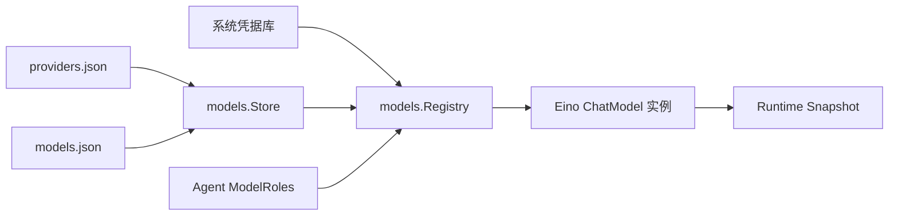

# Models：Provider、模型能力与实例解析

[总目录](../../docs/项目源码详解.md) · [Agent](../agents/README.md) · [Runtime](../runtime/README.md)

`Store` 在 `config/providers.json`、`config/models.json` 保存非密钥 Provider/Model 配置；系统凭据由 `credential.Store` 管理。模型记录包含上下文窗口、输出上限和工具/视觉等能力配置。`Registry.Resolve` 根据模型 ID、Provider 配置与凭据构造本轮可用实例；`TestModel` 是显式连接测试。模型角色由 Agent 指定，图片辅助模型由全局 MultimediaConfig 指定。

Registry 在创建/更新/删除时校验引用和能力，避免删掉仍被 Agent 使用的模型；凭据写入失败会回滚相关配置操作。配置变化增加 revision，Resolver 下一个 Turn 才解析新实例。`MultimediaConfig.ImageModelID` 只允许引用具备视觉能力的有效模型；主聊天模型已有视觉能力时不需辅助路由。

模型创建与更新采用相同输入字段，`UpdateModelInput` 是 `CreateModelInput` 的别名，校验复用 `normalizeCreateModelInput`。两条操作仍保留各自的存在性检查和写入行为，不改变配置字段或凭据处理。

| 文件 | 阅读重点 |
| --- | --- |
| `types.go` | Provider、Model、Capabilities、角色/配置的字段与校验。 |
| `store.go` | JSON 控制面、默认值与读写。 |
| `registry.go` | `Resolve`、`TestModel`、引用校验、凭据生命周期。 |
| `factory.go`、`runtime.go` | OpenAI、兼容接口、Ollama 的实际实例构造。 |

排查“模型能连接但不能调用工具”：先核对 Model Capability 与 Agent 角色，再看 Resolver 的 `validateToolCapability`，最后查供应商响应。连接测试只验证对应测试路径，不等于所有能力都可用。

`reasoning_replay.go` 按已知模型协议控制回放。OpenAI 与未知兼容模型仍省略原生推理输入；OpenAI-compatible 下的已文档化 MiMo 模型（v2.6-pro／flash／pro-ultraspeed、v2.5-pro／v2.5）保留当前窗口的完整 `reasoning_content`，包括已完成轮次和同轮工具调用。`RuntimeSnapshot.SupportsReasoningReplay` 与 Factory 使用同一判断，避免 Context 预算和真实出站策略分离。该策略不同于 UI 的 Reasoning 能力开关，不会强制开启 thinking 或发起探测请求。

`reasoningModel` 在 Generate／Stream／WithTools 后保持策略。MiMo 出站消息在副本上将文本与 thinking 统一成原生 Content／ReasoningContent，并去除仅用于 SSE 拼接的 ToolCall.Index；合法工具参数使用与 JSONL RawMessage 一致的 JSON 编码。调用 ID、参数含义和原始消息不变，非法参数不会被修正成合法请求。这样执行中的消息与持久化后重放的消息具有稳定表示。协议依据：[MiMo OpenAI API](https://mimo.mi.com/docs/en-US/api/chat/openai-api)。
