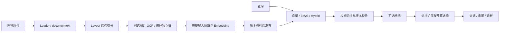

# RAG 模块

`rag.Service` 提供导入、检索、原件与文档状态管理。桌面功能由 [internal/knowledge](../knowledge/README.md) 接入；独立实验使用 [上传/查询示例](../../examples/5-rag/README.md)。完整实现说明见 [RAG 源码详解](../../docs/RAG源码详解.md)。

## 职责与调用方向

| 位置 | 职责 |
| --- | --- |
| `rag.go`、`service.go` | 依赖校验、资源生命周期、请求/批次类型及 Search |
| `ingestion.go` | 导入占用、版本预留、阶段推进、取消与失败回写 |
| `ingestion_document.go`、`ingestion_batch.go` | 托管原件/重试、单文档处理、普通/父子批次 |
| `ingest.go`、`indexing.go` | 并发与完整输入预算、版本 ID、Eino Store、发布与补偿 |
| `source.go`、`persistence.go`、`published.go` | 原件、文档状态、权威分块、命中版本校验 |
| `loader.go`、`loader_images.go` | 本地 Eino Loader、共享解析器、图片资产落盘 |
| `image_pipeline.go`、`image_index.go` | 按图/动作识别和缓存、独立 OCR/描述块、状态与重试 |
| `chunker/` | 共用 Markdown AST/Layout 的结构切分与 Eino Transformer |
| `config/` | 唯一参数定义、默认值、校验、YAML/环境变量与页面投影 |
| `embedding/` | OpenAI 兼容/Ollama 的 eino-ext 适配、预算、重试与模型档案 |
| `indexer/`、`retriever/` | PG 文档/索引、向量/BM25、通用 Multi/Hybrid |
| `retrieval/`、`rerank/`、`search/` | 检索文本与结果、RRF、精排、父块扩展和预算选择 |

Service 的编排通过 Eino Loader/Indexer/Retriever 和显式文档业务接口组合；PG 连接及模型选择由装配方负责。内置 Loader 位于 rag 根包，复用 `internal/documenttext`；不是一个完全不依赖具体解析器的独立 Go 包。新增后端时替换 Eino 组件和所需文档能力，见 [BACKENDS.md](BACKENDS.md)。

## 执行流程



父块只供上下文，普通块/子块以及成功的图片 OCR/描述块参与索引。普通正文在图片识别前已确定，识别文本不会覆盖原件。主表保存原件引用和管理状态，正文由分块承载；完整 Markdown 只在解析/处理期间使用，不拼接重叠块重建全文。

`Service.Search` 返回证据，不调用回答模型；桌面 Agent 通过 `knowledge_search` 读取证据后继续回答。统一 Search 不执行 Query Rewrite 或 MMR；MMR 仅在独立 `rerank.Engine.Rerank` 中使用。

## 业务 API

以下假设 `service` 已由装配方创建；单次请求不覆盖模型、数据库或任意 Eino Option：

```go
result, err := service.Ingest(ctx, rag.IngestRequest{
    CollectionID: "example",
    DocumentID: "stable-document-id",
    Source: document.Source{URI: "/path/to/document.pdf"},
    Splitter: cfg.Chunking.Splitter,
    ParentChild: cfg.Chunking.ParentChild,
    ParentChunkSize: cfg.Chunking.ParentChunkSize,
    ChildChunkSize: cfg.Chunking.ChildChunkSize,
})
response, err := service.Search(ctx, rag.SearchRequest{
    CollectionID: "example", Query: "文档中的问题", Mode: "hybrid", Limit: 5,
})
```

其它入口包括 `GetDocument`、`ListChunks`、`RetryDocument`、`RecoverDocuments`、`CancelDocument`、`DeleteDocument`、`ReadDocumentImage`。重试需要托管原件和状态存储；取消只作废未发布版本，旧发布版本仍可检索。`Shutdown(ctx)` 取消在途操作并等待失败回写/补偿，超时只结束等待；`Close()` 等待完整关闭且可重复调用。

## 配置与数据库

- `config.Default()` 是基础预设；`Load(path)` 使用默认值 < YAML < `HUMBERT_RAG_*`，`FromValues` 不读取环境变量。
- 桌面设置写入 `knowledge/state.json`，秘密交给系统凭据库，原件和图片目录由应用固定。
- 当前上传/查询示例读取 `examples/5-rag/example.go` 的固定 Config，不读取 `rag.example.yaml` 或位置参数；迁移 CLI 读取 YAML。这是不同入口。
- 内置 PG 后端检查 PostgreSQL 14+、pgvector 0.6.2+、pg_search 0.20.10+。halfvec HNSW 最多 4000 维；旧 vector HNSW 最多 2000 维。输出维度由 `embedding.dimensions` 统一提供，没有固定 1024 维。
- collection profile 固定供应商、地址、模型、版本、维度和检索文本规则；同维度也不能随意混用不同模型。

## 验证

```bash
go build ./internal/rag/... ./internal/knowledge/... ./examples/5-rag/... ./cmd/rag-migrate
go vet ./internal/rag/... ./internal/knowledge/... ./examples/5-rag/... ./cmd/rag-migrate
```

固定回归通过仓库根的 `scripts/verify.sh --checks ../humbert-agent-checks` 加载，包含导入基准、失败收尾和相关并发场景。外部用例需单独保留；真实 PG、模型和 GUI 验收按 [持续验证说明](../../docs/持续验证说明.md) 执行，不能把构建或模拟回归当作已完成真实联调。
