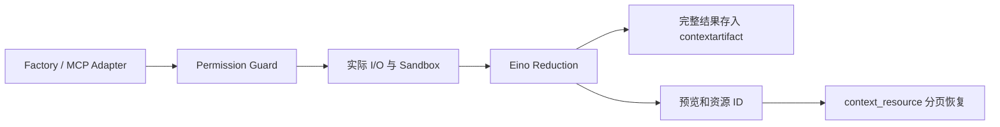

# Tools：能力注册、授权和 Eino Reduction

[总目录](../../docs/项目源码详解.md) · [内置工具](builtin/README.md) · [Permission](../permission/README.md)

`Registry.Resolve` 根据冻结的 Scope 构造工具。Scope 的 Agent、Session、工作区与安全策略来自 Runtime，模型参数不能修改这些身份。所有 Builtin 与 MCP 工具进入同一套 Permission Guard，Ask 通过 Eino interrupt/checkpoint 恢复原调用，不接受前端重新提供参数。

`guarded_tool.go` 只管理授权；`reduction.go` 负责所有工具结果的归档与清理。单个长结果先保存全文再返回预览；累计上下文到阈值后由 Eino 清理旧轮次。`ClearAtLeastTokens` 启用 Eino 的副本改写，原始消息和工具参数不被修改。`skill` 与 `context_resource` 不被递归归档。

没有独立的 ResultBudget、恢复额度池或自定义 ToolCallID context key。ToolCallID 直接使用 `compose.GetToolCallID`。未知工具配置直接报错，不保留旧 delegation 工具名称的兼容分支。

| 文件 | 职责 |
| --- | --- |
| `registry.go` | 注册、能力选择、冻结工具与关闭 |
| `types.go` | Factory、Descriptor、Scope、Authorizer 契约与哨兵错误 |
| `guarded_tool.go` | 授权与审批恢复 |
| `capability_identity.go` | 授权规则匹配所需身份 |
| `reduction.go` | Eino 与会话归档资源协议之间的适配 |

文件工具的 schema、解析和显示由 Eino filesystem 提供；`fileops.Backend` 实现受限文件访问，`builtin/filesystem.go` 只适配 Eino 工具，保留 PathGuard、os.Root、UTF-8、大小限制和原子写入。命令执行仍由受控 Runner 提供，不通过普通文件访问模拟。

`List` 与 `Resolve` 共用 `definitions`：在读锁内复制 Factory 引用与 Revision，释放锁后读取各自的 Descriptor，再按名称排序。Descriptor 与 Build 都不在 Registry 锁内执行；一次解析只读取一次描述符，选择校验与实际构造使用同一份元数据，没有新增常驻缓存。`EnabledBuiltinTools=nil` 继承全部工具，显式空集合关闭可选工具；Internal 工具仍按内部规则装配，显式禁用优先。

无调用的 `Unregister` 和只供浏览器测试使用的启动包装已移除。现有模型可见工具名称全部保留：Git 查询的固定只读边界、文档提取与资源/历史回查各有独立语义。只有 package 声明的空文件已清理。

## 工具目录与内部能力包

`Descriptor.Display` 可以声明类别、显示文案键和默认启用状态；既有工具从 `catalog.go` 的同一份目录读取。Wails 返回 `defaultEnabled`，前端不再维护第二份默认名称列表。未知工具使用通用展示，展示信息不参与权限判断。

文件 I/O 位于 `internal/fileops`；浏览器与桌面工具分别位于 `tools/browser`、`tools/desktop`。`builtin/process.go` 共用超时、受控执行与结果组装，`process_output.go` 负责限长输出；命令和 Skill 脚本各自保留参数、身份和只读策略。跨观察工具的截图写入只依赖 `ImageWriter`。
